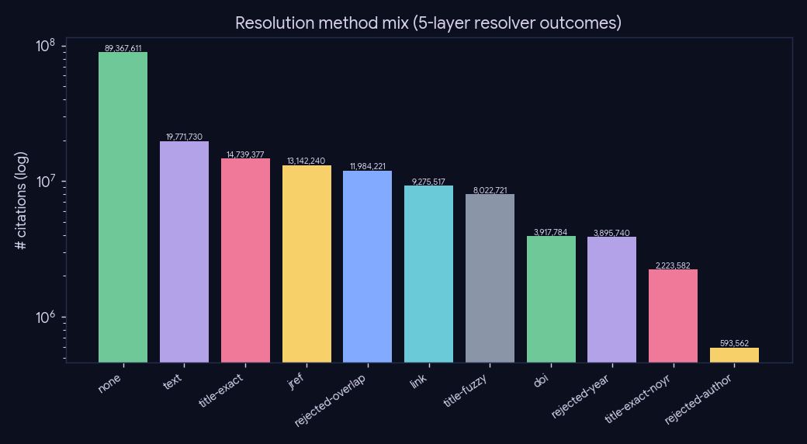
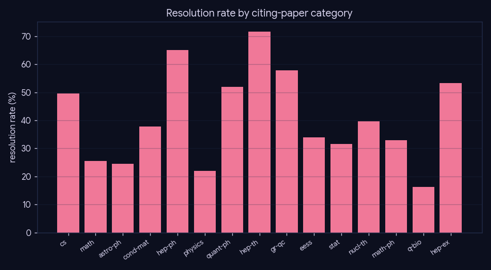
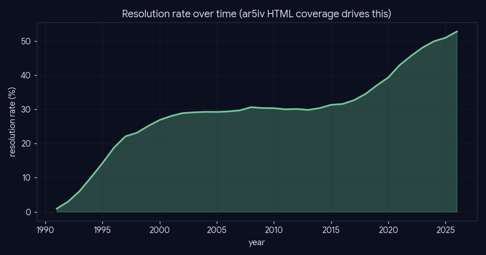

# Experiment 01 — The 5-layer citation resolver

*Preprocessing · Phase 3 (parse) · engine: SQL + figures, no LLM.*

## What we did

Phase-3 `parse` turns each in-text citation into a resolved arXiv id through a **cheapest-first,
early-terminating** cascade of six methods: `link` (an explicit ar5iv hyperlink) → `text` (a regex
arXiv-id match) → `doi` → `jref` (journal-ref) → `title-exact` → `title-fuzzy`, with
`title-exact-noyr` as a year-relaxed variant and `rejected-*`/`none` recording misses. This
experiment reads `citation.method` straight from the single Postgres store and characterizes what
each layer contributes, and how resolution varies by field and era.

## Method

Pure SQL aggregations over the 177M-row `citation` table (`method` mix; resolution rate joined to
citing-paper `primary_category` and `year`). The heavy join is cached to `cache/summary.json`
(`--use-cache`); figures + tables are written to `results/`. No model is involved — this measures the
*built artifact*, not a runtime path.

## Results

Overall resolution rate **40.18 %** (71,092,951 / 176,934,085 occurrences). The cheap exact layers
(`text`, `title-exact`, `jref`, `link`) carry ~80 % of all resolutions; the `title-fuzzy` tail is
bounded at ~11 %.

| layer (method) | resolved | share of resolved |
|---|--:|--:|
| text | 19,771,730 | 27.8% |
| title-exact | 14,739,377 | 20.7% |
| jref | 13,142,240 | 18.5% |
| link | 9,275,517 | 13.0% |
| title-fuzzy | 8,022,721 | 11.3% |
| doi | 3,917,784 | 5.5% |
| title-exact-noyr | 2,223,582 | 3.1% |

### By field and era

Resolution rate varies by field (HTML/LaTeX availability + citation style) and rises over time as
ar5iv HTML coverage improves.

## Conclusion

The layered cheapest-first resolver resolves **40 %** of all citation occurrences corpus-wide, with
the high-precision exact methods doing the bulk of the work and the fuzzy layer adding a bounded
~11 % tail — i.e. the cascade buys recall without leaning on the riskiest matcher. The remaining
~60 % `none`/`rejected-*` is dominated by citations to non-arXiv venues (books, pre-2007 papers,
non-CS journals) that have no arXiv id to resolve to.

## Caveats

`rejected-*` rows are real resolver decisions (a fuzzy candidate that failed the year/author/overlap
gate) — kept in the store precisely so this analysis can show the precision/recall trade-off of the
fuzzy layer, not silently dropped.
