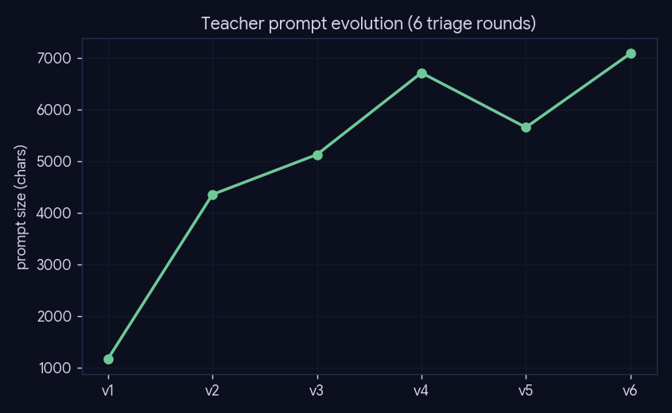
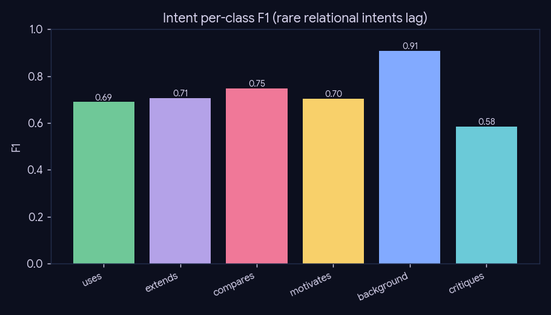
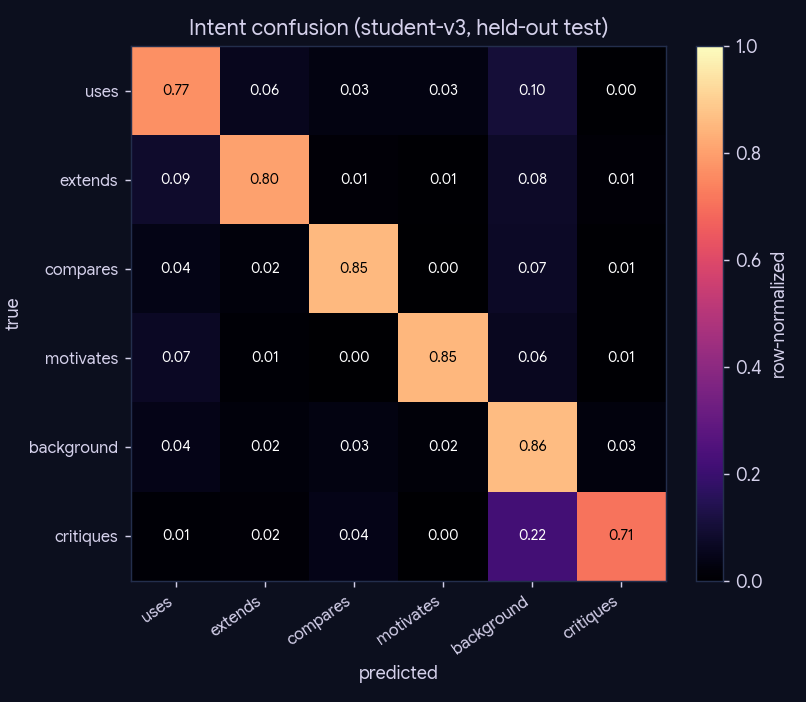
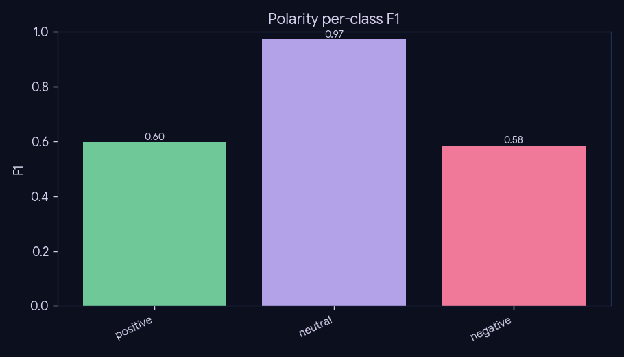
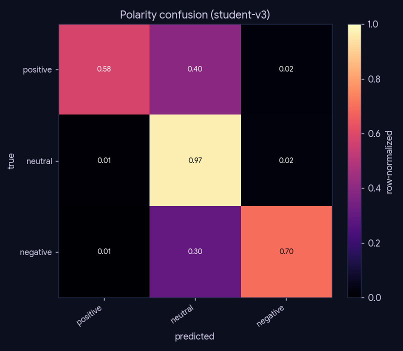

# Experiment 02 — Citation-intent labeling quality

*Preprocessing · Phase 3 (label/bert) · engine: file reads + figures, no LLM.*

## What we did

Phase-3 types every citation edge with an **intent** (6-way: uses / extends / compares / motivates /
background / critiques) and a **polarity** (3-way). Labels come from a Gemma teacher (pseudo-labels)
distilled into a DistilBERT student that runs the corpus-wide pass. This experiment measures the
*labeling quality* in two halves: (1) how the teacher prompt was tuned over six triage rounds, and
(2) the distilled student's per-class precision/recall/F1 on the held-out test split.

## Method

Pure reads of frozen training artifacts — `data/models/student-v*/test_report.json` (confusion +
per-class F1 for both heads) and the `v1..v6` teacher prompts. No model is loaded. This is the
**stage-1 (distilled-label)** benchmark; the stage-2 human-gold benchmark comes from the Phase-C
labeling tool (`code/gold_tool.py`).

## Teacher prompt evolution

Six triage rounds grew the prompt (definitions + worked examples, targeting the rare relational
intents).

## Student quality (held-out test, n = 13,521)

Shipped = **student-v3**: intent acc **0.844** / macro-F1 **0.723**, polarity acc **0.947**.

| student | intent acc | intent macro-F1 | polarity acc |
|---|--:|--:|--:|
| student-v1 | 0.894 | 0.717 | 0.962 |
| student-v2 | 0.897 | 0.713 | 0.965 |
| student-v3 | 0.844 | 0.723 | 0.947 |

### Intent per-class F1

| intent | F1 |
|---|--:|
| uses | 0.689 |
| extends | 0.706 |
| compares | 0.747 |
| motivates | 0.703 |
| background | 0.908 |
| critiques | 0.583 |

## Conclusion

Polarity is near-solved (acc 0.95). Intent is strong overall (acc 0.84, macro-F1 0.72) but the
**rare relational intents** (`critiques` 0.58, `motivates`/`extends`/`uses` ~0.70) lag the dominant
`background` (0.91) — and those are exactly the edge types phase-6's "tensions"/open-problems
surfacing leans on. macro-F1 < accuracy reflects this class imbalance.

## Caveats

This is a *distilled-label* benchmark (student vs a teacher-derived test split), **not** human
ground truth — the rare relational classes are precisely what the Phase-C human-gold set must
validate.
