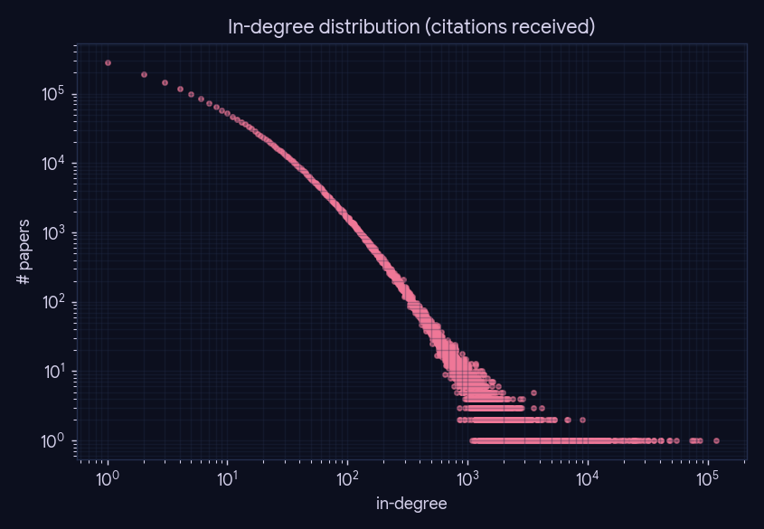
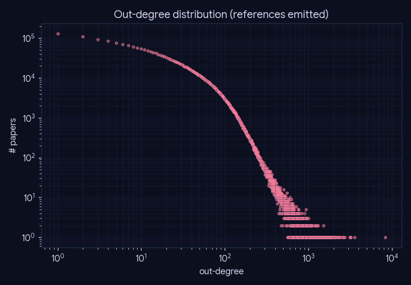
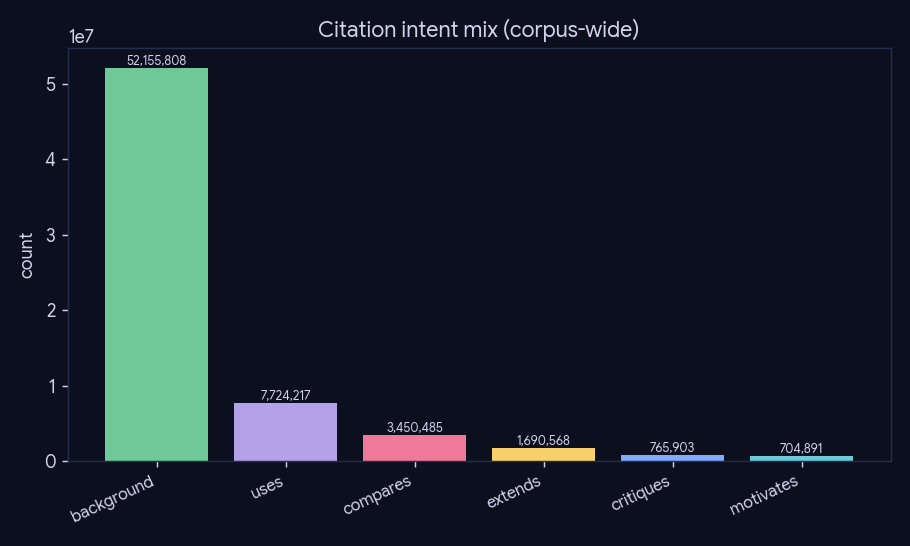
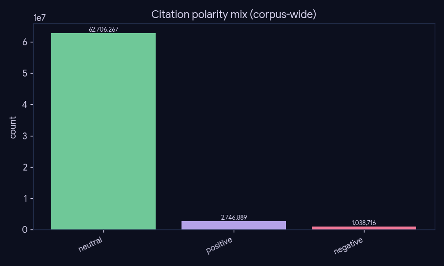
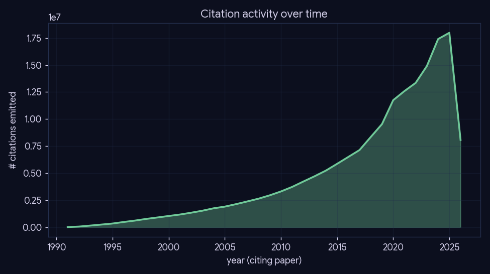

# Experiment 03 — Citation-graph structure

*Preprocessing · Phase 3/4 (graph) · engine: SQL + figures, no LLM.*

## What we did

Characterize the shape of the intent-typed citation graph — the substrate phase-6 retrieves over —
read straight from the single Postgres+pgvector store: global scale, in/out-degree distributions,
the intent/polarity typing every edge carries, citation growth over time, and the top-cited papers.

## Method

Pure SQL aggregations over the 177M-row `citation` table + `paper`/`paper_meta` joins; figures via
matplotlib. The heavy aggregations are cached to `cache/summary.json` (`--use-cache`). No model.

## Global counts

| metric | value |
|---|--:|
| papers (nodes) | 3,073,288 |
| citation occurrences | 176,934,085 |
| resolved occurrences | 70,634,716 |
| distinct edges | 36,688,723 |

*Resolution rate: 39.9%.*

## Degree distributions

Both in- and out-degree are heavy-tailed (near scale-free) — a few papers accrue enormous in-degree
while most are cited rarely. This is exactly the hub structure phase-6's pool induction avoids by
ranking *within* an on-topic pool rather than expanding from hubs.

## Edge typing (the differentiator)

Every resolved edge carries an intent + polarity (the DistilBERT student, experiment 02). The mix is
dominated by `background`/`uses`; the rare relational intents (`compares`/`critiques`/`motivates`)
feed phase-6's tensions/open-problems surfacing.

## Citation activity over time

## Top-cited papers (within-corpus in-degree)

ResNet, BERT, "Attention Is All You Need", CLIP, Adam, ViT, GPT-3, Latent Diffusion, DDPM … — the
within-corpus in-degree ranking recovers the canonical landmarks of modern ML, a sanity check that
the resolved graph is sound. (Full table in `results/metrics.md`.)

## Conclusion

A **36.7M-distinct-edge**, intent-typed, near-scale-free citation graph over **3.07M** papers, whose
in-degree ranking surfaces the field's landmark papers. The heavy-tailed hubs motivate phase-6's
"induce within a topical pool" design, and the per-edge intent/polarity typing is the feature that
distinguishes this substrate from a plain citation graph.

## Caveats

In-degree is *within-corpus* (arXiv→arXiv resolved citations only); true citation counts are higher.
Unresolved occurrences (no `cited_id`) are excluded from the graph but kept in the store for the
resolver analysis (experiment 01).
