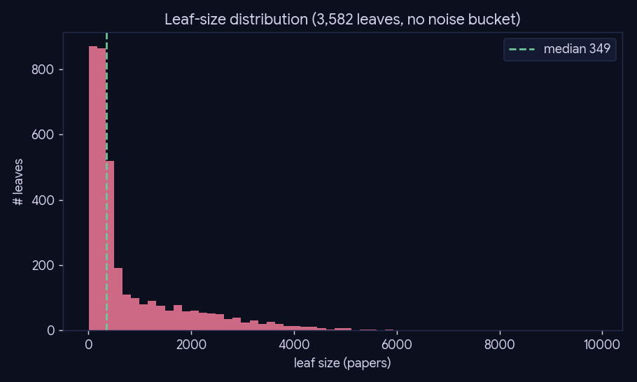
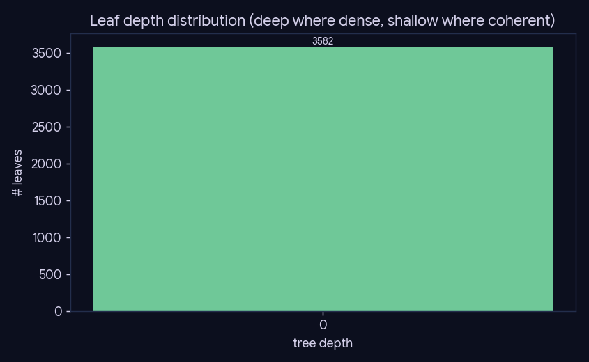
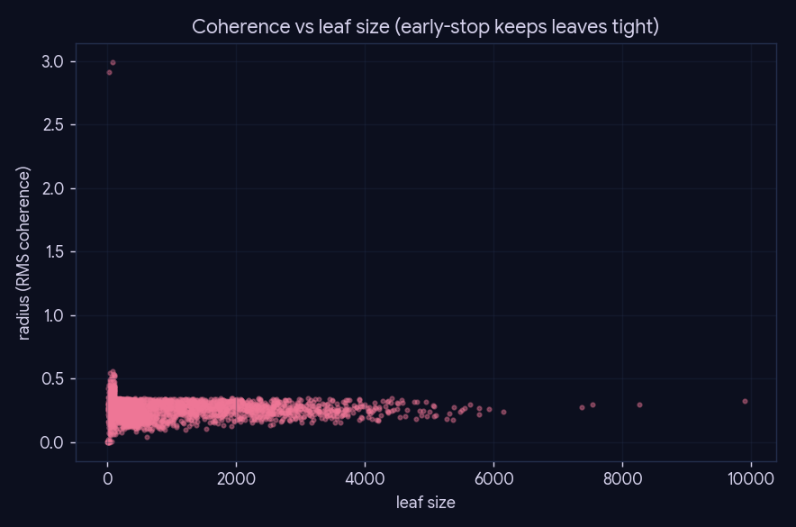

# Experiment 05 — Density-aware topic tree

*Preprocessing · Phase 5 (topic tree) · engine: SQL + figures, no LLM.*
*Note: the topic tree is an optional offline-browse artifact (off the phase-6 retrieval hot path).*

## What we did

Show the *shape* of the shipped bisecting topic tree (`leaf` + `paper_topic`): that it has **no noise
bucket** (every paper gets a leaf), its leaf-size and depth distributions, and how coherence (leaf
radius) tracks leaf size — i.e. that the coherence early-stop keeps leaves tight while adapting grain
to local density.

## Method

Pure SQL reads of the `leaf` and `paper_topic` tables (sizes, depths, radii) + matplotlib. Cached to
`cache/summary.json`. No model.

## Summary

| metric | value |
|---|--:|
| leaves | 3,582 |
| papers assigned | 2,918,448 |
| leaf size min / median / p90 / max | 6 / 349 / 2348 / 9895 |

## Conclusion

The tree places **all 2.92M** papers into **3,582** leaves (median size 349) with **no noise
bucket** — the structural win over the DBSCAN-style design that dumped ~355k niche papers into a
"Miscellaneous" sink (see experiment 04). Depth is non-uniform (deeper where dense, shallow where
already coherent), and the coherence-vs-size scatter confirms the early-stop holds leaf radius down
even as leaves grow — so a topic anchor lands a query in a tight, on-topic neighborhood.

## Caveats

Leaf membership is from the **pre-delta** tree build; 2025/2026 papers have no leaf (handled at
serve time by phase-6 `frontier_pull`). A full rebuild on the current corpus is experiment 04's
territory. Under the retrieval-only redesign the tree is retained only as an **offline-browse
artifact**, not on the phase-6 retrieval hot path.
