*deep research · 3 round(s) · 260 landmarks · frontier≥2026: 0 · 2 full-PDF critiques · grounded 83 · off-digest 0*

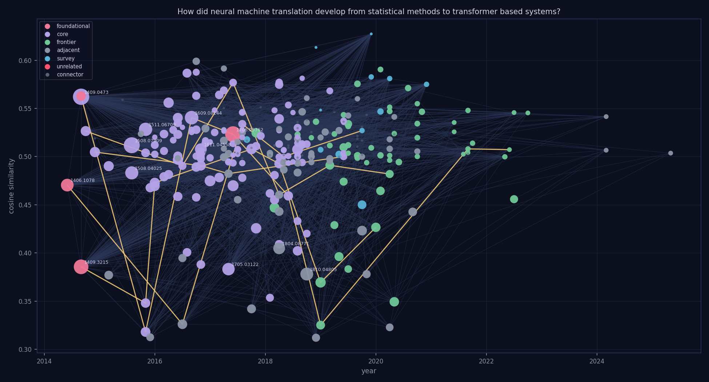

*The citation story graph behind this review — 300 papers, 2822 intent-typed edges, 5 lineage threads (gold). Node size = in-topic citations, color = role. [Interactive version](graph.html).*

---

# From Statistical Paradigms to the Transformer Revolution: A Review of Neural Machine Translation Evolution

For decades, machine translation relied on statistical frameworks that struggled to capture the nuanced, long-range dependencies of human language. The paradigm shift toward neural machine translation (NMT) fundamentally altered this landscape, beginning with the emergence of neural encoder-decoder architectures. This transition was critical because it allowed for a more holistic, continuous representation of linguistic context, moving beyond the fragmented, phrase-based approaches of previous statistical methods. As digital communication became increasingly globalized, the demand for translation systems that could provide both high fluency and semantic accuracy became a central driver of computational linguistics research.

This review traces the technological trajectory of NMT from its foundational neural structures to its modern-day dominance. We first examine the period of refining neural models through the integration of attention mechanisms, subword units, and optimized training strategies, which paved the way for scaling and systematizing NMT for large-scale deployment. The narrative then shifts to the expansion of NMT capabilities, specifically through unsupervised, multilingual, and low-resource learning techniques that addressed the scarcity of parallel corpora. Finally, we analyze the transformative impact of the Transformer era, characterized by structural advances and pre-training, before concluding with the current frontiers of large-scale multilingualism and few-shot learning.

## The Emergence of Neural Encoder-Decoder Architectures

The transition from statistical phrase-based machine translation to neural paradigms was catalyzed by the development of encoder-decoder architectures designed to map sequences into continuous vector spaces. Early foundational work established the concept of using two Recurrent Neural Networks (RNNs)—one to encode a source sequence into a fixed-length vector and another to decode that vector into a target sequence [arXiv:1406.1078](https://arxiv.org/abs/1406.1078). This approach was further generalized through the use of multilayered Long Short-Term Memory (LSTM) networks, which aimed to create sentence representations where semantic similarity was reflected by proximity in vector space [arXiv:1409.3215](https://arxiv.org/abs/1409.3215). While these models moved beyond standard feedforward networks, they were fundamentally constrained by the "fixed-length vector bottleneck," where the entire meaning of a source sentence had to be compressed into a single, finite-dimensional representation.

A critical evolution occurred with the introduction of additive attention, or "soft-alignment," which addressed this bottleneck by allowing the decoder to adaptively select relevant source annotations for each target word [arXiv:1409.0473](https://arxiv.org/abs/1409.0473). This mechanism shifted the paradigm from simple compression to a retrieval-based process, providing the conceptual foundation for later Transformer-based systems. Compared to basic RNN encoder-decoders, attention-based models demonstrated significantly higher robustness to sentence length [arXiv:1409.0473](https://arxiv.org/abs/1409.0473). However, this innovation introduced new complexities; the computational requirement of scoring every source word against every target word presented scalability challenges, and the models continued to struggle with the representation of rare or unknown words [arXiv:1409.0473](https://arxiv.org/abs/1409.0473).

To mitigate these limitations, researchers explored diverse architectural and vocabulary strategies. For instance, gated recursive convolutional neural networks (grConv) were introduced to learn syntactic structures without explicit supervision [arXiv:1409.1259](https://arxiv.org/abs/1409.1259). Addressing the "rare word problem," one approach involved training systems to track the origins of unknown words to facilitate post-processing via dictionaries [arXiv:1410.8206](https://arxiv.org/abs/1410.8206). Simultaneously, to manage the high computational complexity inherent in large vocabularies, other methods proposed using only small subsets of the target vocabulary during updates, ensuring that training complexity remained constant regardless of total vocabulary size [arXiv:1412.2007](https://arxiv.org/abs/1412.2007).

| Method | Architecture Type | Key Innovation | Primary Limitation |
| :--- | :--- | :--- | :--- |
| [arXiv:1406.1078](https://arxiv.org/abs/1406.1078) | RNN Encoder-Decoder | Continuous phrase representations [arXiv:1406.1078](https://arxiv.org/abs/1406.1078) | Fixed-length vector bottleneck [arXiv:1409.0473](https://arxiv.org/abs/1409.0473) |
| [arXiv:1409.3215](https://arxiv.org/abs/1409.3215) | Multilayered LSTM | Semantic vector space mapping [arXiv:1409.3215](https://arxiv.org/abs/1409.3215) | Fixed-length vector bottleneck [arXiv:1409.0473](https://arxiv.org/abs/1409.0473) |
| [arXiv:1409.0473](https://arxiv.org/abs/1409.0473) | Encoder-Decoder with Attention | Additive soft-alignment [arXiv:1409.0473](https://arxiv.org/abs/1409.0473) | Scalability and rare word handling [arXiv:1409.0473](https://arxiv.org/abs/1409.0473) |

The progression of these models highlights a tension between representation depth and computational efficiency. While the move from fixed-length vectors to attention mechanisms [arXiv:1409.0473](https://arxiv.org/abs/1409.0473) solved the structural bottleneck of early RNNs [arXiv:1406.1078](https://arxiv.org/abs/1406.1078), [arXiv:1409.3215](https://arxiv.org/abs/1409.3215), it necessitated new strategies to handle vocabulary scale [arXiv:1412.2007](https://arxiv.org/abs/1412.2007) and lexical sparsity [arXiv:1410.8206](https://arxiv.org/abs/1410.8206).

The transition from statistical methods to neural architectures was marked by the shift toward modeling the conditional distribution of target sentences using distributed representations [arXiv:1912.02047](https://arxiv.org/abs/1912.02047), [arXiv:2012.15515](https://arxiv.org/abs/2012.15515). Early sequence-to-sequence models integrated attention mechanisms to overcome the limitations of fixed-length vectors, establishing the foundation for modern attentional encoder-decoder frameworks [arXiv:1709.07809](https://arxiv.org/abs/1709.07809).
## Refining Neural Models: Attention, Subwords, and Training Strategies

As NMT transitioned from early sequence-to-sequence models, research pivoted toward addressing three fundamental bottlenecks: the "open-vocabulary" problem, the limitations of local context, and the misalignment between training objectives and evaluation metrics.

To resolve the inability of word-level models to handle unseen terms, researchers moved away from fixed-vocabulary paradigms and dictionary back-off methods [arXiv:1508.07909](https://arxiv.org/abs/1508.07909). While character-based models attempted to compose word representations from character sequences to handle morphology [arXiv:1511.04586](https://arxiv.org/abs/1511.04586), the introduction of subword units via Byte Pair Encoding (BPE) provided a more scalable open-vocabulary solution [arXiv:1508.07909](https://arxiv.org/abs/1508.07909). This subword approach demonstrated significant empirical gains, such as a 1.3 BLEU increase on English $\rightarrow$ Russian tasks [arXiv:1508.07909](https://arxiv.org/abs/1508.07909).

Simultaneously, the architectural focus shifted toward selective attention to improve context modeling. While early NMT lacked selective mechanisms, the introduction of global and local attention mechanisms for stacking LSTMs allowed models to focus on specific source segments [arXiv:1508.04025](https://arxiv.org/abs/1508.04025). This capability was later leveraged to scale NMT to multilingual settings; for instance, a shared attention mechanism enabled multi-way translation where parameter growth remained only linear relative to the number of languages [arXiv:1601.01073](https://arxiv.org/abs/1601.01073).

Finally, researchers sought to bridge the gap between the standard maximum likelihood estimation (MLE) training and actual translation quality. Traditional next-word prediction often fails to optimize for non-differentiable metrics like BLEU. To address this, sequence-level training algorithms, such as MIXER, were developed to optimize evaluation metrics directly [arXiv:1511.06732](https://arxiv.org/abs/1511.06732). This was further refined through Minimum Risk Training (MRT), which allows end-to-end NMT models to optimize parameters with respect to arbitrary evaluation metrics [arXiv:1512.02433](https://arxiv.org/abs/1512.02433).

The following table compares the diverse strategies employed to refine early NMT systems:

| Method | Tokenization Strategy | Primary Innovation | Training Objective |
| :--- | :--- | :--- | :--- |
| [arXiv:1508.07909](https://arxiv.org/abs/1508.07909) | Subword units (BPE) | Open-vocabulary via subwords | N/A |
| [arXiv:1511.04586](https://arxiv.org/abs/1511.04586) | Character-based | Morphological composition | N/A |
| [arXiv:1511.06114](https://arxiv.org/abs/1511.06114) | Moses (word-based) | Multi-task learning (MTL) | Supervised/Unsupervised |
| [arXiv:1511.06732](https://arxiv.org/abs/1511.06732) | Word-level | Sequence level training (MIXER) | Direct metric optimization (e.g., BLEU) |
| [arXiv:1512.02433](https://arxiv.org/abs/1512.02433) | N/A | Minimum Risk Training (MRT) | Arbitrary metric optimization |

While these refinements significantly advanced NMT, they were not without limitations. The subword-centric approach in [arXiv:1508.07909](https://arxiv.org/abs/1508.07909), despite its success in handling rare words, remained tied to RNN-based architectures and did not resolve inherent performance variability during training [arXiv:1508.07909](https://arxiv.org/abs/1508.07909). Similarly, while multi-task learning [arXiv:1511.06114](https://arxiv.org/abs/1511.06114) and back-translation using monolingual data [arXiv:1511.06709](https://arxiv.org/abs/1511.06709) expanded the utility of NMT, the field continued to grapple with the fundamental tension between efficient training and the direct optimization of translation quality.

To address data sparsity and vocabulary issues, researchers integrated subword segmentation and leveraged monolingual corpora through techniques like shallow and deep fusion [arXiv:1503.03535](https://arxiv.org/abs/1503.03535), [arXiv:1606.02891](https://arxiv.org/abs/1606.02891). These refinements, alongside advanced attention and word coverage methods, significantly improved the robustness of early neural models [arXiv:2002.07526](https://arxiv.org/abs/2002.07526).
## Scaling and Systematizing Neural Machine Translation

The transition from statistical machine translation (SMT) to neural machine translation (NMT) was characterized by a shift from phrase-based paradigms toward increasingly complex sequence-to-sequence architectures. Early NMT research focused on overcoming the limitations of shallow models and single-language pairs. For instance, while standard NMT models relied on raw parallel text, [arXiv:1606.02892](https://arxiv.org/abs/1606.02892) demonstrated that incorporating arbitrary linguistic features—such as lemmas, POS tags, and dependency labels—into the encoder embedding layer could improve translation quality. To address the depth limitations of early recurrent models, [arXiv:1606.04199](https://arxiv.org/abs/1606.04199) introduced fast-forward connections to facilitate stacking LSTM layers, moving beyond shallow NMT architectures.

As NMT matured, research pivoted toward systematizing large-scale training and expanding language coverage. Google's efforts represented a significant leap in scaling, integrating the WordPiece model, reinforcement learning (RL) refinement, and model ensembling to bridge the gap with human translation quality [arXiv:1609.08144](https://arxiv.org/abs/1609.08144). This scaling was further extended to multilingual contexts; [arXiv:1611.04558](https://arxiv.org/abs/1611.04558) introduced an artificial token at the start of input sentences to specify target languages, enabling zero-shot translation, while [arXiv:1611.04798](https://arxiv.org/abs/1611.04798) proposed a unified framework using a universal encoder and decoder for many-to-many tasks without specialized architectural treatment.

The development of NMT was not merely architectural but also infrastructural. The community saw the emergence of specialized toolkits to standardize experimentation: OpenNMT [arXiv:1701.02810](https://arxiv.org/abs/1701.02810) introduced memory-sharing systems to improve training efficiency, THUMT [arXiv:1706.06415](https://arxiv.org/abs/1706.06415) provided diverse training objectives like minimum risk training, and Sockeye [arXiv:1712.05690](https://arxiv.org/abs/1712.05690) offered a production-ready framework supporting multiple architectures including Transformers.

A fundamental shift occurred with the introduction of the Transformer architecture [arXiv:1706.03762](https://arxiv.org/abs/1706.03762), which dispensed with recurrence and convolutions entirely in favor of multi-head self-attention. This architecture provided the foundation for subsequent scaling efforts. While earlier models struggled with specific bottlenecks, [arXiv:1706.03872](https://arxiv.org/abs/1706.03872) identified six critical challenges for NMT, including domain mismatch, rare words, and long sentences. Subsequent research addressed these through scaling and optimization; for example, [arXiv:1806.00187](https://arxiv.org/abs/1806.00187) demonstrated that training speed could be significantly increased through reduced precision and large batch training.

| Method | Architecture Type | Key Innovation |
| :--- | :--- | :--- |
| [arXiv:1606.04199](https://arxiv.org/abs/1606.04199) | Deep LSTM | Fast-forward connections for stacking layers |
| [arXiv:1609.08144](https://arxiv.org/abs/1609.08144) | Seq2Seq (Encoder-Decoder) | WordPiece and RL model refinement |
| [arXiv:1706.03762](https://arxiv.org/abs/1706.03762) | Transformer (Encoder-Decoder) | Multi-head self-attention (no recurrence) |
| [arXiv:1803.07416](https://arxiv.org/abs/1803.07416) | Transformer | Tensor2Tensor reference implementations |

Despite these advancements, the transition was not without friction. Comparative studies [arXiv:1608.04631](https://arxiv.org/abs/1608.04631), [arXiv:1701.02901](https://arxiv.org/abs/1701.02901) highlighted that while NMT outperformed phrase-based translation (PBMT) in many areas, it still faced distinct errors in morphology and word order. The evolution from the recurrent-heavy models of 2016 to the attention-only Transformer models of 2017 represents the most significant structural pivot in the field, enabling the massive scaling observed in later years.

The evolution of NMT involved systematic explorations of hybrid architectures that combined elements of RNNs, CNNs, and Transformers to optimize performance [arXiv:1804.09849](https://arxiv.org/abs/1804.09849). Comprehensive surveys of these developments highlight how the field moved from mitigating SMT issues through deep learning to establishing standardized NMT frameworks [arXiv:1812.04238](https://arxiv.org/abs/1812.04238), [arXiv:2004.04902](https://arxiv.org/abs/2004.04902).
## Unsupervised, Multilingual, and Low-Resource Learning

The evolution of Neural Machine Translation (NMT) has been characterized by a shift from specialized, single-pair models toward systems capable of handling diverse linguistic landscapes through multilingualism, unsupervised learning, and transfer learning. Early efforts in multilingualism focused on architectural efficiency, such as using a single shared attention mechanism to enable multi-way translation with parameter growth that scales only linearly with the number of languages [arXiv:1601.01073](https://arxiv.org/abs/1601.01073). This was further advanced by introducing artificial tokens at the start of input sequences to specify target languages, which enabled zero-shot translation capabilities [arXiv:1611.04558](https://arxiv.org/abs/1611.04558). However, as the scale of multilingualism increased, researchers identified the need for more sophisticated parameter management. While full parameter sharing is common, partial parameter sharing has been proposed to better accommodate linguistically distant languages [arXiv:1809.00252](https://arxiv.org/abs/1809.00252). This scaling reached a milestone with massively multilingual models supporting up to 102 languages [arXiv:1903.00089](https://arxiv.org/abs/1903.00089), though these systems often struggle with off-target translation. To mitigate this, techniques like ROBt—creating artificial parallel data for zero-shot pairs—have been utilized to improve zero-shot generalization [arXiv:2004.11867](https://arxiv.org/abs/2004.11867).

Addressing the scarcity of parallel data, several paradigms emerged. Transfer learning provides a robust solution for low-resource scenarios by initializing parameters from a high-resource parent model and applying constraints like freezing or fine-tuning [arXiv:1604.02201](https://arxiv.org/abs/1604.02201). This can be extended through dynamic vocabularies that allow models to adapt to new languages by introducing new vocabulary items [arXiv:1811.01137](https://arxiv.org/abs/1811.01137), or through Universal Lexical Representations that share lexical and sentence-level representations across multiple source languages via a model of experts [arXiv:1802.05368](https://arxiv.org/abs/1802.05368). Semi-supervised approaches also contribute by concatenating labeled parallel corpora with unlabeled monolingual data from both source and target languages [arXiv:1606.04596](https://arxiv.org/abs/1606.04596). Furthermore, the effectiveness of back-translation was clarified by demonstrating that sampling or noised beam outputs provide a stronger training signal than standard beam or greedy search [arXiv:1808.09381](https://arxiv.org/abs/1808.09381).

The most radical departure from supervised paradigms is unsupervised NMT, which relies solely on monolingual corpora. Early methods focused on mapping sentences from different corpora into a shared latent space [arXiv:1711.00043](https://arxiv.org/abs/1711.00043), often utilizing dual structures [arXiv:1710.11041](https://arxiv.org/abs/1710.11041). This field progressed through the introduction of weight-sharing approaches within an Autoencoder-GAN framework using directional self-attention to model temporal order [arXiv:1804.09057](https://arxiv.org/abs/1804.09057), and the integration of phrase-based principles with neural models [arXiv:1804.07755](https://arxiv.org/abs/1804.07755). More recently, the field has moved toward large-scale pretraining. Cross-lingual language model pretraining (XLM) utilizes unsupervised and supervised objectives with a shared vocabulary [arXiv:1901.07291](https://arxiv.org/abs/1901.07291), while multilingual denoising pretraining (mBART) trains complete sequence-to-sequence models by denoising full texts across multiple languages [arXiv:2001.08210](https://arxiv.org/abs/2001.08210). Finally, architectural innovations like non-autoregressive decoding using fertility prediction modules have emerged to optimize the efficiency of these complex Transformer-based systems [arXiv:1711.02281](https://arxiv.org/abs/1711.02281), while coverage-based attention mechanisms have been introduced to prevent the common NMT issues of over-translation and under-translation [arXiv:1601.04811](https://arxiv.org/abs/1601.04811). To support these developments, toolkits like OpenNMT have provided essential infrastructure by aggressively sharing internal buffers to improve training efficiency [arXiv:1701.02810](https://arxiv.org/abs/1701.02810).

## The Transformer Era: Structural Advances and Pre-training

The transition from recurrent architectures to the Transformer paradigm was marked by a shift toward parallelizable attention mechanisms and increasingly sophisticated pre-training objectives. While early efforts sought to replace Recurrent Neural Networks (RNNs) with Convolutional Neural Networks (CNNs) using gated linear units for parallel computation [arXiv:1705.03122](https://arxiv.org/abs/1705.03122), the subsequent dominance of the Transformer architecture necessitated deeper investigations into its structural stability and representational capacity.

Structural refinements focused on addressing the limitations of absolute position representations and the challenges of scaling model depth. For instance, [arXiv:1803.02155](https://arxiv.org/abs/1803.02155) introduced relative position representations to better capture pairwise relationships between input elements. To manage the training instabilities inherent in scaling, [arXiv:1804.00247](https://arxiv.org/abs/1804.00247) provided essential empirical optimizations for hyperparameters and memory usage, while [arXiv:2008.07772](https://arxiv.org/abs/2008.07772) proposed a specific initialization technique to stabilize extremely deep models (up to 60 encoder layers) compared to standard 6-layer baselines. Furthermore, research into model topology revealed that increasing depth (e.g., 30/25-layer encoders) could improve efficiency over traditional "wide" Transformer models [arXiv:1906.01787](https://arxiv.org/abs/1906.01787).

The evolution of the Transformer also involved expanding the scope of input context and tokenization. Beyond sentence-level translation, [arXiv:1810.03581](https://arxiv.org/abs/1810.03581) introduced a context encoder to incorporate document-level information, and [arXiv:2004.14788](https://arxiv.org/abs/2004.14788) explored character-level translation by combining encoder blocks with convolutions (a "convtransformer") to capture local character dependencies.

| Method | Architecture | Key Innovation | Primary Objective |
| :--- | :--- | :--- | :--- |
| [arXiv:1901.07291](https://arxiv.org/abs/1901.07291) | Transformer | Cross-lingual pre-training (CLM/MLM/TLM) | Cross-lingual representation learning |
| [arXiv:1905.02450](https://arxiv.org/abs/1905.02450) | Transformer (Enc-Dec) | MASS (Masked Sequence to Sequence) | Reconstructing continuous masked segments |
| [arXiv:1910.10683](https://arxiv.org/abs/1910.10683) | Transformer | Unified text-to-text framework | Task-agnostic text processing |

Pre-training emerged as a critical driver for performance, moving from task-specific modeling to unified, cross-lingual frameworks. [arXiv:1901.07291](https://arxiv.org/abs/1901.07291) leveraged supervised (TLM) and unsupervised (CLM/MLM) objectives with a shared vocabulary to facilitate cross-lingual transfer. This was complemented by the MASS approach [arXiv:1905.02450](https://arxiv.org/abs/1905.02450), which specifically targeted language generation by masking continuous segments in the encoder for decoder reconstruction. While BERT was often used for fine-tuning, [arXiv:2002.06823](https://arxiv.org/abs/2002.06823) demonstrated its utility as a fixed contextual embedding for NMT modules. These advancements culminated in highly scalable systems, such as the massively multilingual model supporting 102 languages [arXiv:1903.00089](https://arxiv.org/abs/1903.00089), and unified frameworks that treat all NLP tasks as text-to-text problems [arXiv:1910.10683](https://arxiv.org/abs/1910.10683). Finally, the era saw a push toward "human parity" in specific language pairs [arXiv:1803.05567](https://arxiv.org/abs/1803.05567) and the integration of statistical alignment losses to improve the joint learning of translation and word alignment [arXiv:1909.02074](https://arxiv.org/abs/1909.02074).

The Transformer era was further enriched by the introduction of bidirectional representations, such as BERT, which utilized self-attention to condition on both left and right context [arXiv:1810.04805](https://arxiv.org/abs/1810.04805). This shift toward pre-trained transformer encoders has fundamentally changed how language understanding is integrated into translation tasks.
## Current Frontiers: Large-Scale Multilingualism and Few-Shot Learning

The evolution of neural machine translation (NMT) has shifted from optimizing individual language pairs toward massive-scale multilingualism and the exploitation of emergent properties in large-scale language models. Recent research highlights a transition from the traditional paradigm of task-specific fine-tuning on large parallel datasets toward in-context learning and zero-shot capabilities.

A significant departure from the standard encoder-decoder architecture is seen in the use of decoder-only Transformer models. [arXiv:2005.14165](https://arxiv.org/abs/2005.14165) demonstrated that large-scale language models can perform translation tasks via in-context learning (zero-, one-, and few-shot) without any task-specific fine-tuning, challenging the necessity of the supervised fine-tuning paradigm. This capability is further explored by [arXiv:2106.13627](https://arxiv.org/abs/2106.13627), which posits that a single language model (Lm4Mt) can achieve performance comparable or superior to dedicated encoder-decoder NMT models, particularly in pivot-based and zero-shot scenarios.

While large-scale models leverage general linguistic knowledge, other research focuses on scaling NMT to cover the world's diverse linguistic landscape. Traditional systems often require millions of parallel sentences, a barrier for many of the world's languages. To address this, [arXiv:2205.03983](https://arxiv.org/abs/2205.03983) proposed building systems for over 1,500 languages by utilizing semi-supervised pre-training for language identification and training on both supervised parallel and monolingual data. Similarly, [arXiv:2207.04672](https://arxiv.org/abs/2207.04672) scaled translation to over 200 languages using a Sparsely Gated Mixture of Experts (MoE) architecture and conditional compute, moving away from high-resource centric models.

Parallel to scaling language coverage, researchers have sought to improve the efficiency and robustness of Transformer-based NMT through specialized training objectives and architectural optimizations.

| Method | Architecture | Primary Innovation | Target Constraint |
| :--- | :--- | :--- | :--- |
| [arXiv:2011.02266](https://arxiv.org/abs/2011.02266) | Transformer | Hyper-parameter optimization (attention, layers, dropout) | Low-resource NMT |
| [arXiv:2010.03737](https://arxiv.org/abs/2010.03737) | Transformer (Enc-Dec) | Shallow-to-deep training (stacking shallow models) | Deep model training |
| [arXiv:2109.07780](https://arxiv.org/abs/2109.07780) | Transformer | Bidirectional Training (BiT) via 'srctgt' reconstruction | Unidirectional NMT |
| [arXiv:2206.02368](https://arxiv.org/abs/2206.02368) | Transformer | Bi-SimCut (Bidirectional pretraining + SimCut regularization) | Consistency/Distributional stability |

These specialized approaches contrast with the "brute force" scaling of large language models. For instance, while [arXiv:2005.14165](https://arxiv.org/abs/2005.14165) relies on the emergent properties of scale, [arXiv:2011.02266](https://arxiv.org/abs/2011.02266) focuses on fine-grained hyper-parameter tuning to extract maximum utility from limited data in low-resource settings. Furthermore, while standard NMT is unidirectional, [arXiv:2109.07780](https://arxiv.org/abs/2109.07780) and [arXiv:2206.02368](https://arxiv.org/abs/2206.02368) introduce bidirectional training strategies to enforce consistency and improve parameter updating. This represents a sophisticated refinement of the Transformer architecture, moving beyond simple sequence-to-sequence mapping toward more robust, structurally informed training regimes.
## Further Reading

- [arXiv:2004.05809](https://arxiv.org/abs/2004.05809) (2020) — "Neural Machine Translation: Challenges, Progress and Future" [survey, cited-by 2 in-topic]
- [arXiv:1901.01122](https://arxiv.org/abs/1901.01122) (2019) — "Machine Translation: A Literature Review" [survey, cited-by 0 in-topic]

## Tensions and Open Problems

A core tension exists regarding the management of lexical sparsity and the "rare word problem." One prominent approach suggests that expanding the target vocabulary size is the most effective way to increase coverage and reduce out-of-vocabulary issues [arXiv:1412.2007](https://arxiv.org/abs/1412.2007). Conversely, other researchers argue that simply increasing vocabulary size is insufficient and that the field must instead focus on specialized mechanisms to address the inherent difficulty of rare word prediction [arXiv:1410.8206](https://arxiv.org/abs/1410.8206). This debate has branched into two distinct architectural philosophies: one that seeks to augment neural models with external memory structures to provide lexical support [arXiv:1708.02005](https://arxiv.org/abs/1708.02005), and another that attempts to bridge the gap by incorporating discrete, explicit translation lexicons directly into the neural training process [arXiv:1606.02006](https://arxiv.org/abs/1606.02006).

A second debate concerns the trade-off between architectural expressivity and computational efficiency. Much of the progress in the field has been driven by complex, attention-based mechanisms that capture intricate dependencies [arXiv:1508.04025](https://arxiv.org/abs/1508.04025), yet these models often face scalability bottlenecks. This has prompted a push for models capable of performing neural machine translation in linear time to ensure practical deployment [arXiv:1610.10099](https://arxiv.org/abs/1610.10099). This tension between complexity and speed is further complicated by the choice of linguistic granularity; while subword models are standard, there is ongoing disagreement regarding whether character-level decoders, which bypass explicit segmentation entirely, offer superior grammatical robustness [arXiv:1603.06147](https://arxiv.org/abs/1603.06147) compared to traditional methods.

Lastly, the community remains divided on the most effective methodology for mitigating data scarcity in low-resource settings. One school of thought emphasizes the power of leveraging massive amounts of monolingual corpora to improve model fluency and robustness [arXiv:1511.06709](https://arxiv.org/abs/1511.06709); [arXiv:1503.03535](https://arxiv.org/abs/1503.03535). This is often contrasted with approaches that favor targeted data augmentation specifically tailored for low-resource pairs [arXiv:1705.00440](https://arxiv.org/abs/1705.00440), or the use of transfer learning to migrate knowledge from high-resource to low-resource languages [arXiv:1604.02201](https://arxiv.org/abs/1604.02201). As the field moves toward "the next thousand languages" [arXiv:2205.03983](https://arxiv.org/abs/2205.03983), the question of whether to prioritize massive scale or highly specialized, data-efficient adaptation remains unresolved.

**Outlook**

The frontier of machine translation is shifting from general architectural improvements toward massive-scale, human-centered multilingualism [arXiv:2207.04672](https://arxiv.org/abs/2207.04672) and highly specialized linguistic applications, such as distinguishing between spoken and written language nuances in low-resource contexts [arXiv:2505.17816](https://arxiv.org/abs/2505.17816). As we move beyond standard benchmarks, the field is heading toward "user-driven" NMT [arXiv:2106.06200](https://arxiv.org/abs/2106.06200) that prioritizes human evaluation and practical utility over mere BLEU scores. The ultimate goal is a convergence where models are not only linguistically inclusive of the world's diverse languages [arXiv:2207.04672](https://arxiv.org/abs/2207.04672) but also computationally efficient enough to be deployed in the diverse, real-world environments where they are most needed.

**Neural Machine Translation by Jointly Learning to Align and Translate** — [arXiv:1409.0473](https://arxiv.org/abs/1409.0473) p.3

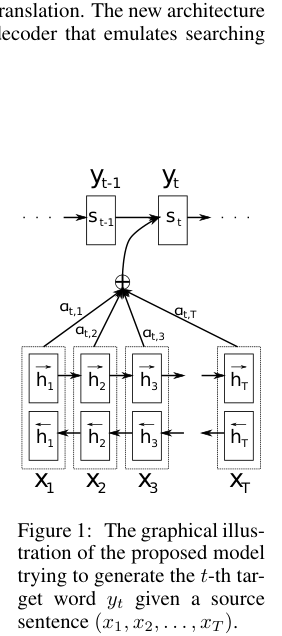

The figure is a directed graphical model diagram consisting of rectangular nodes representing source words ($x_1, \dots, x_T$), alignment weights ($\alpha_{t,1}, \dots, \alpha_{t,T}$), and target words ($y_{t-1}, y_t$), connected by arrows. The diagram shows how the current target word $y_t$ is generated by a weighted sum (indicated by a circled plus sign) of encoder hidden states ($h_1, \dots, h_T$), which are themselves derived from the source words. It conveys the mechanism of the attention model, where the decoder uses alignment weights to selectively focus on specific parts of the input sequence to predict the next word.

**Neural Machine Translation of Rare Words with Subword Units** — [arXiv:1508.07909](https://arxiv.org/abs/1508.07909) p.4

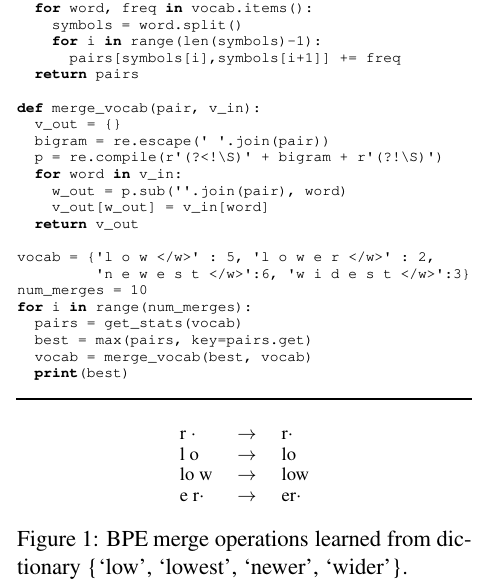

The figure displays a Python code snippet that implements the Byte Pair Encoding (BPE) algorithm, including functions for calculating pair frequencies and merging them. It demonstrates the process of iteratively identifying and merging the most frequent adjacent character pairs within a small dictionary of words to create subword units.

**Attention Is All You Need** — [arXiv:1706.03762](https://arxiv.org/abs/1706.03762) p.3

The figure illustrates the Transformer model architecture, consisting of an encoder stack on the left and a decoder stack on the right, both composed of $N$ identical layers. The encoder processes inputs through multi-head attention and feed-forward networks, while the decoder incorporates masked multi-head attention and an additional attention mechanism to attend to the encoder's output before reaching a final linear and softmax layer for output probabilities. Each sub-layer within the stacks is wrapped in a residual connection followed by layer normalization, labeled as "Add & Norm."

**Sequence to Sequence Learning with Neural Networks** — [arXiv:1409.3215](https://arxiv.org/abs/1409.3215) p.2

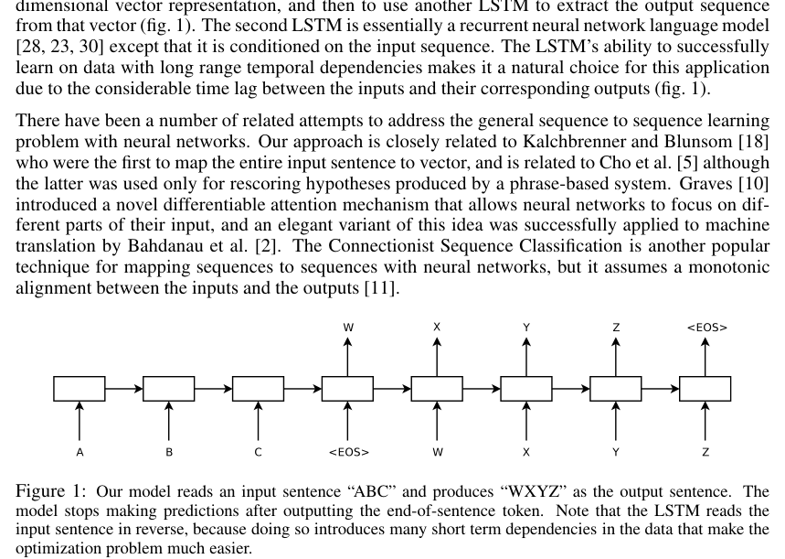

The figure depicts a sequence-to-sequence model architecture using two layers of Long Short-Term Memory (LSTM) units connected by horizontal arrows. The bottom layer processes an input sequence of boxes labeled "A", "B", "C", and "<EOS>", while the top layer generates an output sequence of boxes labeled "W", "X", "Y", "Z", and "<EOS>". The diagram conveys how the model reads an input sentence in reverse to produce a corresponding output sentence.

**Google's Neural Machine Translation System: Bridging the Gap between
  Human and Machine Translation** — [arXiv:1609.08144](https://arxiv.org/abs/1609.08144) p.4

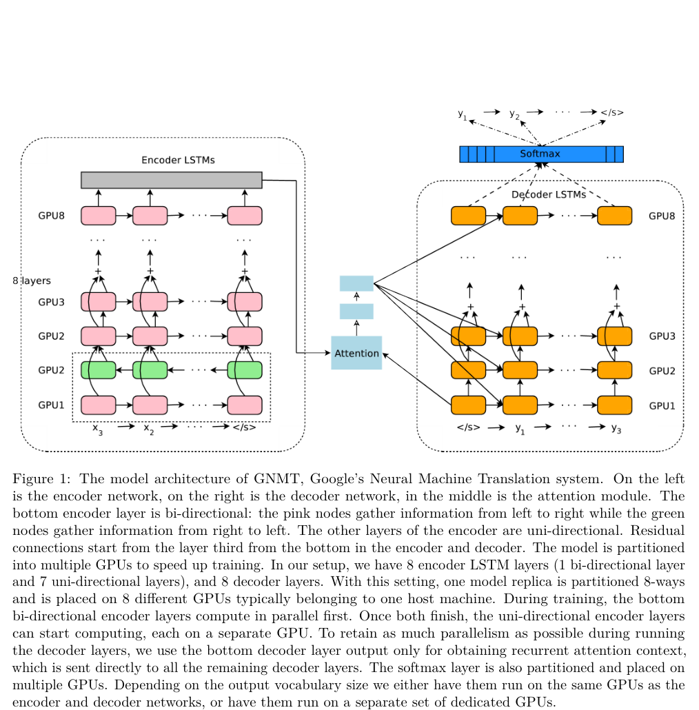

The figure illustrates the architecture of the GNMT system, featuring an encoder network on the left, a decoder network on the right, and an attention module in the center. The encoder and decoder are depicted as stacks of LSTM layers partitioned across multiple GPUs, with arrows representing data flow through bidirectional and unidirectional layers, residual connections, and the attention mechanism. The diagram conveys how the model processes input sequences through the encoder, applies attention to bridge the two networks, and generates output sequences via the decoder and a softmax layer.

**Effective Approaches to Attention-based Neural Machine Translation** — [arXiv:1508.04025](https://arxiv.org/abs/1508.04025) p.1

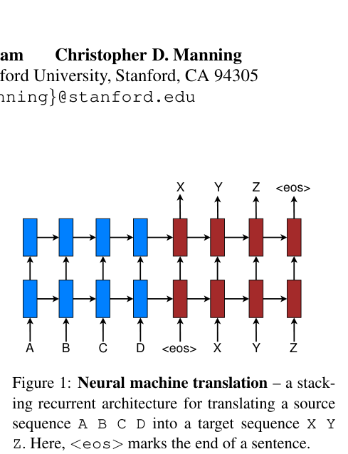

The figure depicts a stacked recurrent neural network architecture for machine translation, using colored boxes and arrows to represent hidden states and data flow. It shows a source sequence (A, B, C, D) being processed by two layers of blue recurrent units, which then feed into two layers of red recurrent units that generate a target sequence (X, Y, Z, <eos>). The arrows illustrate the temporal progression of the sequences and the vertical connections between the stacked layers.

**Learning Phrase Representations using RNN Encoder-Decoder for
  Statistical Machine Translation** — [arXiv:1406.1078](https://arxiv.org/abs/1406.1078) p.2

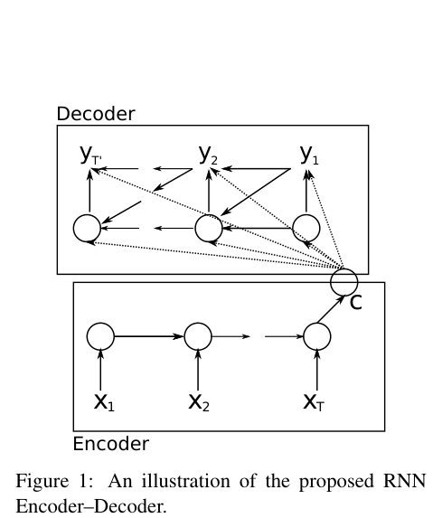

The figure illustrates an RNN encoder-decoder architecture consisting of two main boxes labeled "Encoder" and "Decoder." The Encoder processes a sequence of inputs $x_1, x_2, \dots, x_T$ through a series of connected nodes, culminating in a context vector $c$ that is passed via arrows to the Decoder. The Decoder then uses this context vector to generate a sequence of outputs $y_1, y_2, \dots, y_{T'}$, with arrows indicating the recurrent connections between decoder states and the influence of the context vector on each output.

**Convolutional Sequence to Sequence Learning** — [arXiv:1705.03122](https://arxiv.org/abs/1705.03122) p.3

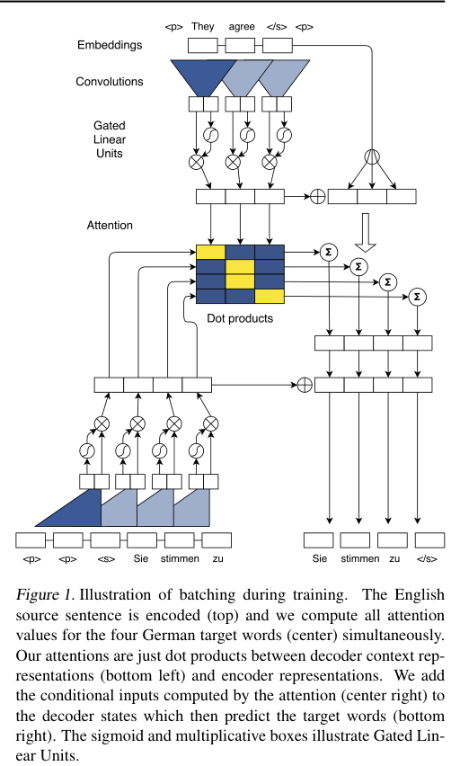

The figure uses a flowchart of boxes, arrows, and mathematical symbols to illustrate the training process of a convolutional sequence-to-sequence model. It depicts the encoding of an English source sentence through embeddings, convolutions, and gated linear units, followed by a central attention mechanism represented by a grid of dot products. The diagram shows how these attention values are combined with decoder context representations to predict German target words.

**Google's Multilingual Neural Machine Translation System: Enabling
  Zero-Shot Translation** — [arXiv:1611.04558](https://arxiv.org/abs/1611.04558) p.4

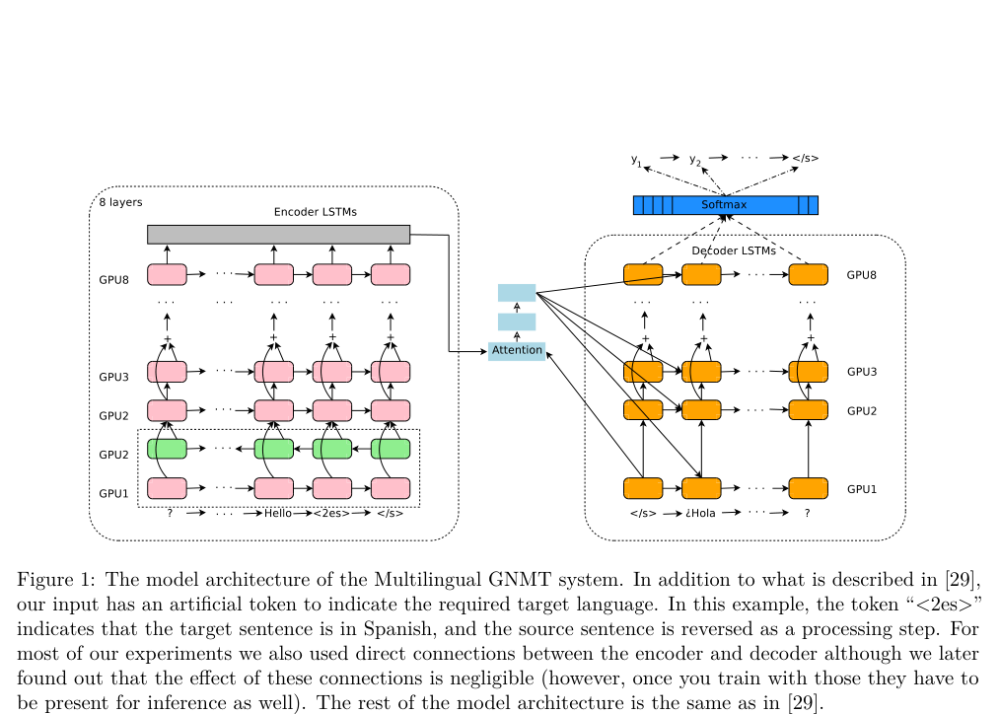

The figure illustrates the architecture of the Multilingual GNMT system, consisting of an encoder component on the left and a decoder component on the right connected by an attention mechanism. The encoder is depicted as a stack of eight layers of pink LSTM cells distributed across multiple GPUs, while the decoder is shown as a stack of orange LSTM cells across GPUs, both feeding into a softmax layer to produce output tokens. The diagram conveys how input tokens (e.g., "?", "Hello", "<2es>", "</s>") are processed through the encoder-decoder structure with attention to generate target translations.

**Six Challenges for Neural Machine Translation** — [arXiv:1706.03872](https://arxiv.org/abs/1706.03872) p.3

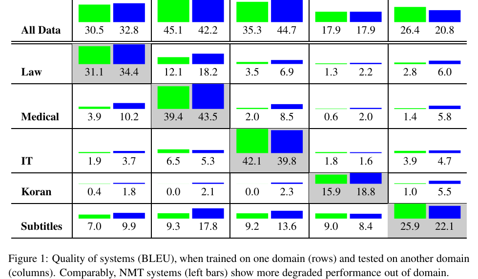

The figure consists of a grid of 30 rectangular subplots arranged in six rows (training domains) and five columns (testing domains). Each subplot contains two colored bars (green for NMT and blue for a baseline) with numerical BLEU scores labeled below them, conveying that NMT systems experience more significant performance degradation when tested on out-of-domain data compared to the baseline.

**Understanding Back-Translation at Scale** — [arXiv:1808.09381](https://arxiv.org/abs/1808.09381) p.4

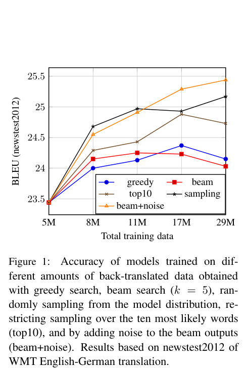

This line graph plots BLEU scores on the newstest2012 dataset against the amount of total training data (ranging from 5M to 29M). It compares five different back-translation methods—greedy, beam, top10, sampling, and beam+noise—showing that while all methods improve with more data, the "beam+noise" method consistently achieves the highest BLEU scores.

**OpenNMT: Open-Source Toolkit for Neural Machine Translation** — [arXiv:1701.02810](https://arxiv.org/abs/1701.02810) p.1

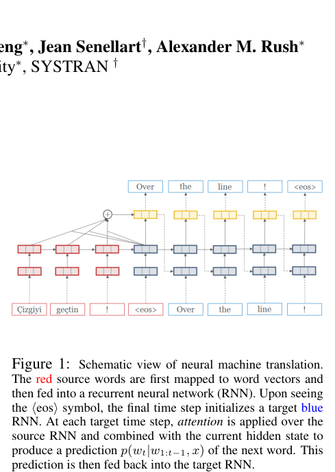

The figure depicts a schematic view of neural machine translation using a sequence of colored rectangular boxes connected by arrows to represent a recurrent neural network (RNN) architecture. The diagram shows a red input sequence being mapped through hidden layers to a blue output sequence, illustrating how attention is applied over the source words to predict each subsequent word in the target sequence.

**Unsupervised Neural Machine Translation** — [arXiv:1710.11041](https://arxiv.org/abs/1710.11041) p.2

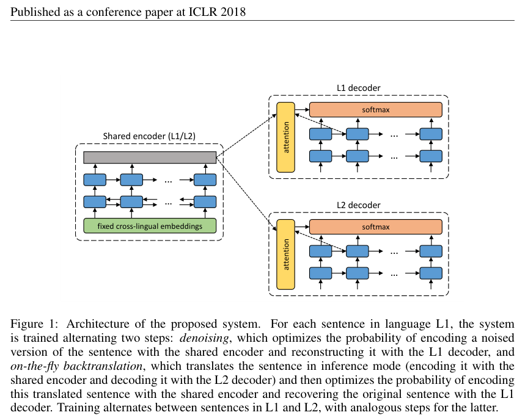

The figure illustrates a neural machine translation architecture consisting of a single shared encoder (L1/L2) connected via dashed arrows to two separate decoders, labeled L1 decoder and L2 decoder. Each decoder contains an attention mechanism and a softmax layer feeding into a sequence of recurrent blue boxes. The diagram conveys a shared representation space where both language-specific decoders operate from a common encoder.

