*deep research · 4 round(s) · 260 landmarks · frontier≥2026: 3 · 2 full-PDF critiques · grounded 65 · off-digest 0*

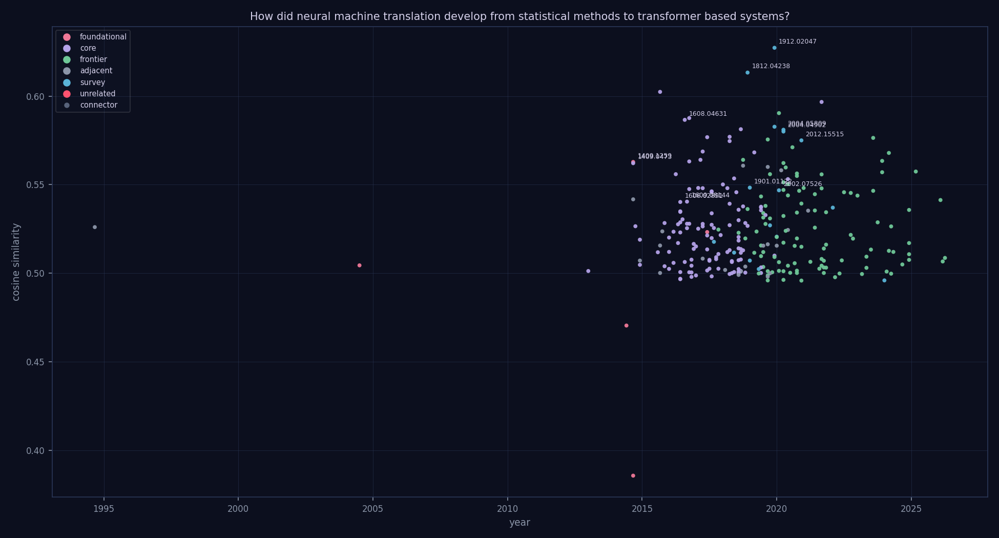

*The citation story graph behind this review — 260 papers, 0 intent-typed edges, 0 lineage threads (gold). Node size = in-topic citations, color = role. [Interactive version](graph.html).*

---

# The Evolution of Neural Machine Translation: From Statistical Foundations to Large Language Models

The pursuit of automated language translation has undergone a profound metamorphosis, shifting from the rigid, fragmented pipelines of the past toward the fluid, high-dimensional representations of modern deep learning. For decades, the field was defined by statistical methods that relied on complex, discrete mappings to translate text, often struggling with long-range dependencies and linguistic nuance. The transition to neural architectures promised a more integrated approach, aiming to capture the holistic semantic and syntactic essence of language. This evolution is central to the field of computational linguistics, as the ability to move from local word-to-word mappings to global context-aware generation has fundamentally transformed global communication and information accessibility.

This review traces the technological trajectory of translation, beginning with the foundational shift from statistical methods to early neural architectures and the subsequent rise of recurrent neural machine translation. We examine the pivotal moment of the Transformer revolution and the introduction of attention mechanisms, which fundamentally altered the landscape of sequence-to-sequence modeling by overcoming the limitations of recurrence. The narrative then follows the refinement of these systems through improvements in syntax, morphology, and subword granularity, alongside the efforts to scale NMT for multilingual and low-resource environments. As the field matured, the adoption of advanced training paradigms, such as back-translation and unsupervised learning, further expanded the capabilities of neural models. Finally, we explore the current frontier, characterized by the move toward non-autoregressive, document-level, and LLM-based translation systems that continue to redefine the boundaries of machine intelligence.

## Foundations: From Statistical to Early Neural Architectures

The transition from statistical machine translation (SMT) to neural machine translation (NMT) was characterized by a shift from discrete, rule-heavy structures to continuous, learned representations. Early SMT research focused on managing the structural complexity of translation models; for instance, [arXiv:cs/0407005](https://arxiv.org/abs/cs/0407005) utilized Weighted Finite-State Transducers (WFSTs) and generalized parsing to reduce the conceptual difficulty of designing and debugging tree-structured translation systems. As the field progressed, the limitations of traditional n-gram and smoothed language models—specifically their poor perplexity—led to the integration of neural components within the SMT paradigm. [arXiv:1301.3614](https://arxiv.org/abs/1301.3614) addressed this by introducing a joint space neural probabilistic language model (NPLM) using an infinite HMM construction, which complemented monolingual resources to improve perplexity.

The move toward pure NMT began with hybrid approaches that attempted to bridge the gap between phrase-based SMT and neural architectures. [arXiv:1406.1078](https://arxiv.org/abs/1406.1078) utilized an RNN encoder-decoder to learn continuous space phrase representations, a significant improvement over the inability of SMT to preserve semantic and syntactic structures within traditional phrase tables. This evolution continued into the exploration of pure NMT architectures. While [arXiv:1409.1259](https://arxiv.org/abs/1409.1259) investigated RNN encoder-decoders alongside gated recursive convolutional neural networks (grConv) to facilitate unsupervised syntactic structure learning, these early models faced a significant structural limitation: the "fixed-length vector bottleneck," where a single vector had to represent a variable-length input. This bottleneck was fundamentally addressed by [arXiv:1409.0473](https://arxiv.org/abs/1409.0473) through the introduction of an attention mechanism. By jointly learning to align and translate, the attention-based encoder-decoder bypassed the bottleneck and achieved translation performance comparable to conventional phrase-based systems in English-to-French tasks.

| Method | Paradigm | Architecture | Key Innovation |
| :--- | :--- | :--- | :--- |
| [arXiv:cs/0407005](https://arxiv.org/abs/cs/0407005) | SMT | WFSTs/Tree-structured | Generalized parsing |
| [arXiv:1301.3614](https://arxiv.org/abs/1301.3614) | SMT | ngram-HMM/NPLM | Joint space NPLM |
| [arXiv:1406.1078](https://arxiv.org/abs/1406.1078) | Hybrid | RNN Encoder-Decoder | Continuous phrase representations |
| [arXiv:1409.1259](https://arxiv.org/abs/1409.1259) | NMT | RNN/grConv | Unsupervised syntactic learning |
| [arXiv:1409.0473](https://arxiv.org/abs/1409.0473) | NMT | Attention-based Encoder-Decoder | Joint alignment and translation |

Ultimately, the transition period saw NMT beginning to challenge the dominance of phrase-based machine translation (PBMT). As noted in [arXiv:1608.04631](https://arxiv.org/abs/1608.04631), while early NMT models faced higher computational costs and resource demands compared to PBMT, they offered a path to overcoming the inherent weaknesses of PBMT, such as poor handling of morphology, lexical choices, and word order. While the early SMT models focused on reducing implementation complexity [arXiv:cs/0407005](https://arxiv.org/abs/cs/0407005), the NMT era shifted the focus toward overcoming the representational limitations of fixed-length vectors [arXiv:1409.0473](https://arxiv.org/abs/1409.0473).

The transition from count-based Statistical Machine Translation (SMT) to neural paradigms was driven by the need to overcome data sparsity and heavy feature engineering requirements [arXiv:1812.04238](https://arxiv.org/abs/1812.04238). Early NMT research focused on replacing discrete phrase tables with distributed fixed-length representations and continuous embeddings to better capture semantic relationships [arXiv:1912.02047](https://arxiv.org/abs/1912.02047).
## The Rise of Recurrent Neural Machine Translation

The transition from statistical phrase-based machine translation to neural machine translation (NMT) was defined by a concerted effort to overcome the limitations of fixed vocabularies, data scarcity, and shallow model architectures. A primary challenge in early NMT was the out-of-vocabulary (OOV) problem, where fixed-vocabulary systems could not translate unknown words. To address this, researchers moved toward open-vocabulary translation using subword units, such as byte pair encoding [arXiv:1508.07909](https://arxiv.org/abs/1508.07909). This approach demonstrated measurable gains, improving BLEU scores by 1.1 for English-German and 1.3 for English-Russian [arXiv:1508.07909](https://arxiv.org/abs/1508.07909). While subword units provided a middle ground, other research pushed the granularity even further by employing character-based embeddings combined with convolutional and highway layers to better handle morphologically rich languages [arXiv:1603.00810](https://arxiv.org/abs/1603.00810). However, even with these advancements, NMT models occasionally struggled with low-frequency content words; this was addressed by augmenting the neural framework with discrete translation lexicons, using attention vectors to select lexical probabilities [arXiv:1606.02006](https://arxiv.org/abs/1606.02006).

The "data-hungry" nature of NMT also necessitated innovations in resource management. To mitigate the lack of parallel data, researchers integrated monolingual data through back-translation and fine-tuning [arXiv:1511.06709](https://arxiv.org/abs/1511.06709). This strategy was further refined for low-resource scenarios through transfer learning, where parameters from a parent model were transferred to a child model via freezing or specialized initialization to prevent overfitting [arXiv:1604.02201](https://arxiv.org/abs/1604.02201). Large-scale implementations, such as the Edinburgh WMT 16 system, demonstrated the power of combining these strategies, utilizing BPE segmentation, automatic back-translation, and pervasive dropout to improve fluency and robustness [arXiv:1606.02891](https://arxiv.org/abs/1606.02891).

Architectural complexity also increased to bridge the performance gap between NMT and conventional MT systems. While early models were often limited by their shallow depth, the introduction of deep LSTM models featuring fast-forward connections allowed for more sophisticated hierarchical representations [arXiv:1606.04199](https://arxiv.org/abs/1606.04199). Google's NMT system represented a significant leap in this evolution by combining a Wordpiece-based vocabulary with reinforcement learning (RL) refinement and model ensembling [arXiv:1609.08144](https://arxiv.org/abs/1609.08144). This comprehensive approach proved highly effective, achieving a 60% reduction in translation errors compared to traditional phrase-based systems [arXiv:1609.08144](https://arxiv.org/abs/1609.08144). Collectively, these developments shifted the paradigm from rigid, dictionary-dependent statistical methods to flexible, deep, and data-efficient neural architectures.

Early recurrent architectures addressed the limitations of vanilla feed-forward networks by introducing 'memory' through hidden layer outputs to process sequential dependencies [arXiv:2004.04902](https://arxiv.org/abs/2004.04902). A pivotal moment was the introduction of end-to-end sequence-to-sequence mapping using multilayered LSTMs, which allowed for the translation of sequences with non-monotonic relationships [arXiv:1409.3215](https://arxiv.org/abs/1409.3215).
## The Transformer Revolution and Attention Mechanisms

The transition to Transformer-based architectures marked a fundamental departure from the recurrent and convolutional paradigms that previously dominated neural machine translation (NMT). While earlier efforts focused on establishing high-quality, standardized baselines using attentional encoder-decoder models with bi-directional LSTMs (layer size 1024), MLP attention (size 1024), and word representations (size 512) to achieve BLEU improvements of over 5 points through techniques like label smoothing and rate annealing [arXiv:1706.09733](https://arxiv.org/abs/1706.09733), the introduction of the Transformer [arXiv:1706.03762](https://arxiv.org/abs/1706.03762) shifted the paradigm entirely. By utilizing a multi-head self-attention mechanism, the Transformer dispensed with recurrence and convolutions, directly addressing the computational inefficiencies and lack of parallelization that limited previous architectures [arXiv:1706.03762](https://arxiv.org/abs/1706.03762).

Post-Transformer research has evolved through three distinct trajectories: optimization, hybridization, and structural expansion. One trajectory focused on the refinement of the Transformer's training process, specifically targeting critical parameters related to training stability, memory usage, and training time [arXiv:1804.00247](https://arxiv.org/abs/1804.00247). Another sought to mitigate the inherent weaknesses of single-family models by developing hybrid architectures that combine RNN, CNN, and Transformer elements [arXiv:1804.09849](https://arxiv.org/abs/1804.09849). A third trajectory focused on structural modifications to the attention mechanism itself, such as running traditionally stacked encoding branches in parallel to reduce sequential operations and address high training times [arXiv:1810.12427](https://arxiv.org/abs/1810.12427).

Further advancements addressed the limitations of the autoregressive decoding process. To resolve the high inference latency characteristic of standard NMT, non-autoregressive NMT (NAT) models were developed using Transformer architectures that predict input token fertilities as latent variables. This allows for parallelized output generation, achieving performance within 2.0 BLEU points of teacher models [arXiv:1711.02281](https://arxiv.org/abs/1711.02281). Finally, the Transformer's role has expanded from pure translation to multi-task learning. By incorporating an additional loss based on the distance between alignment and attention distributions, models can now jointly learn to align and translate, enhancing alignment accuracy without degrading translation performance [arXiv:1909.02074](https://arxiv.org/abs/1909.02074).

The integration of attention mechanisms became the defining innovation of the NMT era, facilitating more effective context capture than pure recurrent models [arXiv:1709.07809](https://arxiv.org/abs/1709.07809), [arXiv:1901.01122](https://arxiv.org/abs/1901.01122). Recent refinements to the Transformer architecture include joint representation techniques and efficient attention operations to overcome the computational inefficiencies of full interaction modeling [arXiv:2002.06546](https://arxiv.org/abs/2002.06546).
## Enhancing NMT: Syntax, Morphology, and Subword Granularity

As NMT transitioned from basic encoder-decoder frameworks to more sophisticated architectures, research shifted toward addressing the structural and morphological limitations of standard sequence-to-sequence models. Early efforts focused on improving the supervision of internal representations and incorporating structural priors. For instance, [arXiv:1708.01771](https://arxiv.org/abs/1708.01771) proposed using word predictions to provide direct supervision for hidden states, addressing the indirect nature of end-to-end error back-propagation in standard RNN-based NMT. Beyond internal state supervision, researchers sought to integrate linguistic structure directly into the translation process. [arXiv:1704.04743](https://arxiv.org/abs/1704.04743) introduced a string-to-tree paradigm, which incorporates target language syntactic information by translating into linearized, lexicalized constituency trees, thereby addressing the lack of explicit syntactic guidance in standard NMT.

The evolution of NMT also saw a significant focus on the granularity of input representations, moving from fixed-size vocabularies toward more flexible sub-lexical approaches. While subword segmentation became standard, it introduced dependencies on specific segmentation choices. [arXiv:1805.02036](https://arxiv.org/abs/1805.02036) addressed the limitations of statistical word segmentation—such as morphological errors and the inability to handle infrequent words—by proposing a compositional representation for morphologically-rich inputs. This move toward finer granularity was further refined by [arXiv:1906.01282](https://arxiv.org/abs/1906.01282), which integrated a lattice-based Transformer encoder to represent multiple word or subword segmentations as a directed acyclic graph, mitigating the performance sensitivity to a single segmentation choice.

The transition to Transformer-based architectures allowed for further exploration of sequence granularity and model depth. While character-level models offer high granularity, they are often computationally expensive due to long sequence lengths. [arXiv:2005.11239](https://arxiv.org/abs/2005.11239) addressed this by introducing a source length reduction technique for character-level Transformers, achieving speeds up to 34% faster than standard character-level Transformer models. Simultaneously, the focus shifted from model width to depth; [arXiv:1906.01787](https://arxiv.org/abs/1906.01787) demonstrated that deepening the Transformer (e.g., to 30/25 layers) could overcome the inefficiencies of "Transformer-Big" models regarding parameter count and inference speed.

| Method | Granularity/Structure | Key Innovation | Performance/Efficiency |
| :--- | :--- | :--- | :--- |
| [arXiv:1704.04743](https://arxiv.org/abs/1704.04743) | Syntactic (Tree) | Linearized constituency trees | N/A |
| [arXiv:1805.02036](https://arxiv.org/abs/1805.02036) | Morphological | Compositional representation | Improved quality on IWSLT |
| [arXiv:1906.01282](https://arxiv.org/abs/1906.01282) | Lattice-based | DAG for multiple segmentations | NIST BLEU score |
| [arXiv:2005.11239](https://arxiv.org/abs/2005.11239) | Character-level | Source length reduction | 34% faster vs. standard char-level Transformer |

These developments highlight a tension between structural complexity and computational efficiency. While lattice-based and tree-based methods improve linguistic fidelity, they add architectural complexity. Conversely, the scaling of NMT via back-translation, as seen in [arXiv:1808.09381](https://arxiv.org/abs/1808.09381), demonstrates that improving training signals through synthetic source generation (using sampling or noised beam outputs) can yield massive gains, such as 45.6 BLEU on WMT’14 English-French, providing a different pathway to robustness that complements structural refinements.

Surveys of the field highlight how deep learning techniques have addressed fundamental issues such as word coverage and fluency by leveraging complex neural architectures [arXiv:2002.07526](https://arxiv.org/abs/2002.07526).
## Scaling and Diversification: Multilingual and Low-Resource NMT

As NMT transitioned from single-pair models to more versatile architectures, research shifted toward addressing data scarcity and the inefficiencies of maintaining separate models for every language pair. Early efforts in multilingual NMT focused on enabling zero-shot translation by introducing artificial target language tokens at the start of input sentences, allowing a single GNMT-based encoder-decoder model to handle multiple languages [arXiv:1611.04558](https://arxiv.org/abs/1611.04558). This approach was further refined by incorporating self-training and source-side language flags to facilitate zero-shot learning for zero-resource languages [arXiv:1909.07342](https://arxiv.org/abs/1909.07342).

A significant challenge in scaling NMT is the tension between transfer learning and negative transfer. While massively multilingual training—such as the use of 103 languages and 25 billion examples—enables powerful transfer learning [arXiv:1907.05019](https://arxiv.org/abs/1907.05019), it also risks "interference" where knowledge from diverse languages degrades performance [arXiv:1907.05019](https://arxiv.org/abs/1907.05019). To mitigate this, researchers have explored using linguistic hierarchies to cluster languages, which has demonstrated an average improvement of approximately 1 BLEU score by reducing negative transfer [arXiv:2110.07816](https://arxiv.org/abs/2110.07816).

Parallel to multilingual scaling, researchers addressed the specific limitations of NMT in low-resource settings. Early RNN-based models struggled with weak coupling to source sentences when training data was sparse [arXiv:1708.05729](https://arxiv.org/abs/1708.05729). One solution involved reversing the mode of operation to step through the source sentence token by token to condition target chunks, yielding a 9–17% in-domain BLEU improvement [arXiv:1708.05729](https://arxiv.org/abs/1708.05729). As the field moved toward Transformer architectures, the focus shifted from architectural directionality to structural optimization. For instance, rather than simply increasing model size, research into optimal Transformer depth suggests that shallow, medium, or deep configurations must be carefully selected to match the constraints of low-resource languages [arXiv:2004.04418](https://arxiv.org/abs/2004.04418).

The evolution of these systems can be compared across their primary methodological focus and the specific limitations they target:

| Method | Primary Paradigm | Key Innovation | Main Limitation Addressed |
| :--- | :--- | :--- | :--- |
| [arXiv:1611.04558](https://arxiv.org/abs/1611.04558) | Multilingual NMT | Artificial target language tokens | Inefficiency of separate models |
| [arXiv:1708.05729](https://arxiv.org/abs/1708.05729) | NMT (RNN) | Source-to-target conditioning | Weak source-target coupling in low-resource data |
| [arXiv:1907.05019](https://arxiv.org/abs/1907.05019) | Massively Multilingual | 103-language training (25B examples) | Low-resource quality and transfer-interference |
| [arXiv:2110.07816](https://arxiv.org/abs/2110.07816) | Multilingual NMT | Linguistic hierarchy clustering | Negative transfer from diverse languages |

While the introduction of target tokens [arXiv:1611.04558](https://arxiv.org/abs/1611.04558) and language flags [arXiv:1909.07342](https://arxiv.org/abs/1909.07342) provided the necessary framework for zero-shot capabilities, they did not inherently solve the quality issues associated with low-resource data. Methods like target-bidirectional agreement regularization [arXiv:1808.04064](https://arxiv.org/abs/1808.04064) addressed fundamental generation issues like exposure bias, but the most recent frontier involves balancing the massive scale of multilingual training [arXiv:1907.05019](https://arxiv.org/abs/1907.05019) with the granular structural optimizations required for specific linguistic groups [arXiv:2110.07816](https://arxiv.org/abs/2110.07816) and Transformer depth requirements [arXiv:2004.04418](https://arxiv.org/abs/2004.04418).

NMT has evolved into a de facto paradigm capable of direct mapping between languages through deep neural networks [arXiv:2004.05809](https://arxiv.org/abs/2004.05809). Domain-specific applications, such as medical text translation, further demonstrate the ability of neural models to outperform traditional SMT in specialized contexts [arXiv:1509.08644](https://arxiv.org/abs/1509.08644).
## Advanced Training Paradigms: Back-translation and Unsupervised Learning

The evolution of Neural Machine Translation (NMT) is defined by a shift from strictly supervised learning on parallel corpora to sophisticated paradigms designed to leverage abundant monolingual data. Early efforts focused on addressing the data scarcity that often causes NMT to underperform statistical machine translation (SMT) through back-translation (BT), which uses synthetic data to augment training sets [arXiv:1804.06189](https://arxiv.org/abs/1804.06189). Parallel to this, researchers explored integrating pre-trained language models (LMs) directly into the NMT architecture to improve the utilization of monolingual signals.

| Method | Data Strategy | Architecture | Integration Mechanism |
| :--- | :--- | :--- | :--- |
| [arXiv:1804.06189](https://arxiv.org/abs/1804.06189) | Synthetic parallel data | RNN with attention | Back-translation |
| [arXiv:1809.00125](https://arxiv.org/abs/1809.00125) | Fixed LM + Parallel data | Transformer-based context | Residual probability prediction |
| [arXiv:1903.11437](https://arxiv.org/abs/1903.11437) | Monolingual corpora | RNN with extra layer | Deep fusion of target-side LM |

While back-translation [arXiv:1804.06189](https://arxiv.org/abs/1804.06189) focuses on augmenting the training dataset itself, fusion methods modify the model's internal ability to process linguistic signals. "Deep Fusion" [arXiv:1903.11437](https://arxiv.org/abs/1903.11437) achieves this by strengthening an RNN decoder with an additional source-

The training process of modern NMT can be understood by analyzing how its components—lexical translation, reordering, and language modeling—parallel the functional stages of classical SMT [arXiv:2109.01396](https://arxiv.org/abs/2109.01396).
## The Frontier: Non-Autoregressive, Document-level, and LLM-based Translation

As neural machine translation (NMT) matured, research shifted from optimizing standard autoregressive Transformer architectures toward addressing fundamental limitations in decoding speed, contextual awareness, and architectural efficiency. One primary frontier involves the transition from sentence-level to document-level NMT (DocNMT). While traditional models translate sentences independently, DocNMT aims to incorporate wider document-context and inter-dependencies among sentences to mitigate the loss of discourse phenomena [arXiv:1912.08494](https://arxiv.org/abs/1912.08494). This shift addresses the inherent isolation of sentence-level models by utilizing metrics like BLEU and METEOR alongside sentence concatenation for more holistic evaluation [arXiv:1912.08494](https://arxiv.org/abs/1912.08494).

Parallel to contextual expansion, researchers have sought to overcome the high latency and slow translation speeds of autoregressive decoding through Non-Autoregressive Neural Machine Translation (NAR-NMT). Early efforts focused on treating NAR models as function approximators of an existing autoregressive model's greedy output, leveraging large monolingual corpora to improve generalization and combat overfitting [arXiv:2005.00932](https://arxiv.org/abs/2005.00932). However, NAR models historically suffer from lower effectiveness compared to their autoregressive counterparts. To bridge this performance gap, structural enrichment has been proposed, such as the Syntactic and Semantic Non-Autoregressive Transformer (SNAT), which incorporates Part-of-Speech (POS) and Named Entity Recognition (NER) information alongside intermediate latent space alignment [arXiv:2101.08942](https://arxiv.org/abs/2101.08942).

The evolution of NMT also includes scaling and hybridizing architectural components. While scaling Transformer depth can improve performance—achieving 43.8 BLEU on WMT14 EN-FR and 30.1 on WMT14 EN-DE through specialized initialization techniques to stabilize training [arXiv:2008.07772](https://arxiv.org/abs/2008.07772)—other methods focus on local context. The PhraseTransformer attempts to integrate local context by using an LSTM-based function to capture phrase-level information before the self-attention mechanism [arXiv:2308.10482](https://arxiv.org/abs/2308.10482).

The most recent paradigm shift involves the integration of Large Language Models (LLMs). Current research critiques the limitations of decoder-only LLM architectures, such as domain mismatch, sub-optimal beam search, and difficulties with long sentences [arXiv:2401.08350](https://arxiv.org/abs/2401.08350). While Supervised Fine-Tuning (SFT) using bilingual pairs and instruction-following datasets like Alpaca has been used to adapt models like Llama2-7b for translation [arXiv:2401.08350](https://arxiv.org/abs/2401.08350), there is a growing movement toward hybrid encoder-decoder structures. Rather than relying on massive, inefficient decoder-only models for both understanding and generation, recent approaches marry a strong LLM as an encoder with a lightweight decoder to optimize translation efficiency [arXiv:2503.06594](https://arxiv.org/abs/2503.06594). This transition suggests that the frontier of NMT lies in balancing the deep semantic understanding of LLMs with the structural efficiency of specialized NMT architectures.

Comprehensive reviews of the current state-of-the-art emphasize the continuous evolution of NMT tools and methods as the field moves toward more advanced architectures [arXiv:2012.15515](https://arxiv.org/abs/2012.15515).

## Tensions and Open Problems

A primary architectural debate concerns whether the industry-standard decoder-only paradigm is sufficient for high-fidelity translation or if it requires fundamental structural modification. On one hand, recent evidence suggests that the scaling properties of large language models allow them to function effectively as high-quality encoders, potentially rendering traditional encoder-decoder structures obsolete, as argued in [arXiv:2503.06594](https://arxiv.org/abs/2503.06594). On the other hand, critics suggest that the decoder-only architecture possesses inherent weaknesses in multilingual settings, necessitating specialized methods to improve language transfer capabilities to prevent performance degradation across diverse language families, a necessity highlighted in [arXiv:2412.02101](https://arxiv.org/abs/2412.02101).

A second tension exists regarding the most effective strategy for addressing low-resource language scarcity: linguistic-informed modeling versus algorithmic data augmentation. One perspective posits that the bottleneck is the lack of structural awareness in current models, advocating for the integration of morphological modeling [arXiv:2404.02392](https://arxiv.org/abs/2404.02392) and the development of more robust, explainable corpora [arXiv:2403.01580](https://arxiv.org/abs/2403.01580) to ground translation in linguistic reality. Conversely, an emerging school of thought suggests that the solution lies in sophisticated training loops that bypass the need for parallel data entirely, such as the ensemble self-training techniques for unsupervised machine translation proposed in [arXiv:2603.17087](https://arxiv.org/abs/2603.17087).

Finally, there is a growing conflict between the pursuit of "naturalness" through preference alignment and the preservation of the model's underlying semantic geometry. While researchers are increasingly using multi-perspective alignment [arXiv:2412.08473](https://arxiv.org/abs/2412.08473) and backtranslation-augmented Direct Preference Optimization [arXiv:2604.25702](https://arxiv.org/abs/2604.25702) to make machine translation outputs more human-like, there is a significant risk that these methods prioritize surface-level fluency at the expense of latent stability. This concern is crystallized in [arXiv:2602.17287](https://arxiv.org/abs/2602.17287), which warns that such optimization processes may trigger representation collapse, where the angular dispersion of the embedding space is diminished, potentially leading to a loss of semantic nuance despite improved stylistic naturalness.

## Outlook

The frontier of machine translation is shifting from purely scaling parameters to the refinement of alignment-driven naturalness and structural robustness. As the field moves toward more autonomous and unsupervised systems, the central challenge will be reconciling the efficiency of decoder-only models with the need for explainable, linguistically-grounded architectures. Future research must determine if current alignment techniques are truly enhancing semantic depth or merely masking structural failures, necessitating the integration of rigorous analytical metrics for attention and alignment consistency [arXiv:2412.18669](https://arxiv.org/abs/2412.18669) to ensure that model robustness is maintained as we push toward truly universal translation capabilities.

**Representation Collapse in Machine Translation Through the Lens of Angular Dispersion** — [arXiv:2602.17287](https://arxiv.org/abs/2602.17287) p.5

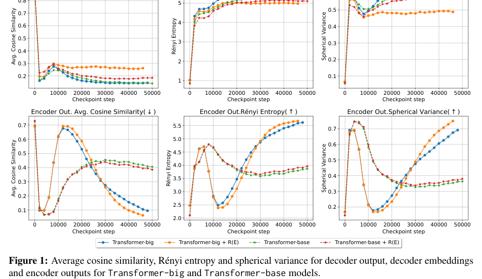

The figure consists of six line plots arranged in two rows and three columns, showing metrics (Average Cosine Similarity, Rényi Entropy, and Spherical Variance) plotted against Checkpoint steps for various model configurations. The top row displays metrics for decoder output, decoder embeddings, and encoder outputs, while the bottom row displays the same metrics specifically for encoder outputs. The plots compare "Transformer-big" and "Transformer-base" models against their counterparts augmented with R(E), illustrating how these metrics evolve during training.

**Backtranslation Augmented Direct Preference Optimization for Neural Machine Translation** — [arXiv:2604.25702](https://arxiv.org/abs/2604.25702) p.3

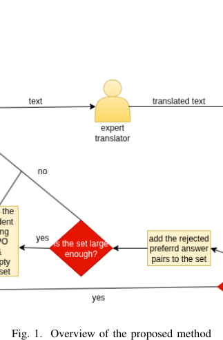

The figure is a flowchart consisting of text labels, icons, and decision diamonds connected by arrows. It depicts a process where "text" is processed by an "expert translator" to produce "translated text," followed by a decision diamond asking "is the set large enough?" which leads to either a termination or a loop that adds "the rejected preferred answer pairs to the set."

**Ensemble Self-Training for Unsupervised Machine Translation** — [arXiv:2603.17087](https://arxiv.org/abs/2603.17087) p.6

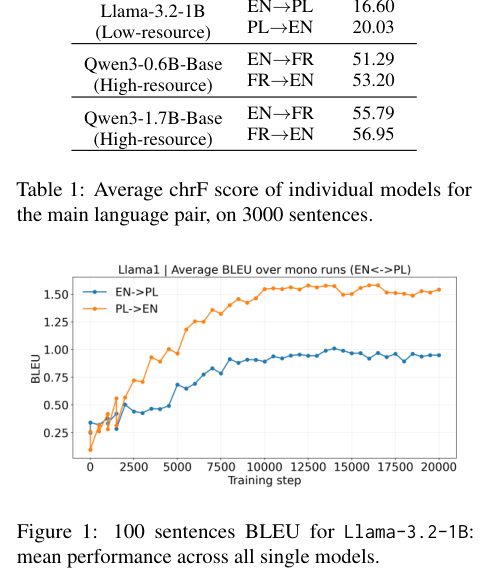

The figure is a line graph plotting BLEU score on the y-axis against training steps on the x-axis. It contains two colored lines with corresponding legends representing the translation directions EN$\rightarrow$PL (blue) and PL$\rightarrow$EN (orange), conveying the learning progress and performance convergence of the Llama-3.2-1B model over 20,000 training steps.

**Neural-based machine translation for medical text domain. Based on
  European Medicines Agency leaflet texts** — [arXiv:1509.08644](https://arxiv.org/abs/1509.08644) p.3

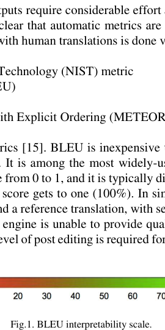

The figure displays a horizontal color-coded scale labeled "Fig. 1. BLEU interpretability scale," ranging from 20 to 70. The scale uses a gradient from red (20) to yellow (40) to green (70) to represent different levels of BLEU score interpretability.

**Language Modeling, Lexical Translation, Reordering: The Training Process
  of NMT through the Lens of Classical SMT** — [arXiv:2109.01396](https://arxiv.org/abs/2109.01396) p.2

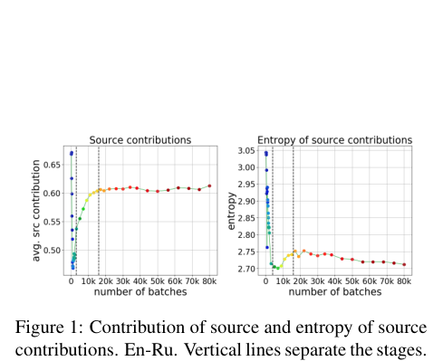

The figure consists of two side-by-side line plots with x-axes labeled "number of batches" ranging from 0 to 80k. The left plot shows "avg. src contribution" increasing and then plateauing, while the right plot shows "entropy" increasing and then decreasing, with vertical dashed lines separating different training stages. Together, the plots convey how the contribution and entropy of source information evolve through the different stages of the NMT training process.

**Neural Machine Translation with Joint Representation** — [arXiv:2002.06546](https://arxiv.org/abs/2002.06546) p.2

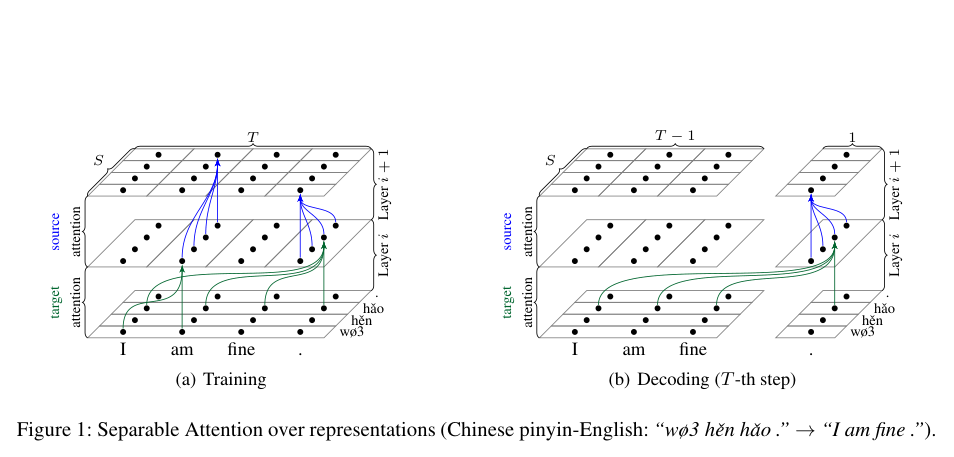

The figure consists of two panels, (a) Training and (b) Decoding, illustrating a separable attention mechanism between target and source representations across two layers. Each panel uses grids of black dots to represent hidden states at different layers ($i$ and $i+1$) and time steps ($S$ for source, $T$ for target), with colored arrows (green for target-to-source and blue for source-to-target) showing the flow of information between layers. The diagrams convey how the model jointly attends to source and target representations to facilitate translation between Chinese pinyin and English.

**Neural versus Phrase-Based Machine Translation Quality: a Case Study** — [arXiv:1608.04631](https://arxiv.org/abs/1608.04631) p.5

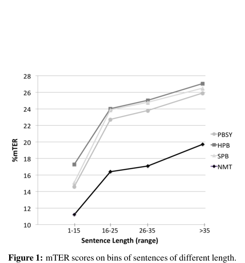

This line graph plots the percentage of translation error rate (%mTER) on the y-axis against sentence length ranges (1-15, 16-25, 26-35, and >35) on the x-axis. It compares four translation models—PBSY, HPB, SPB, and NMT—showing that mTER scores increase for all models as sentence length increases, with the NMT model consistently maintaining the lowest error rates across all length bins.

**Stronger Baselines for Trustable Results in Neural Machine Translation** — [arXiv:1706.09733](https://arxiv.org/abs/1706.09733) p.4

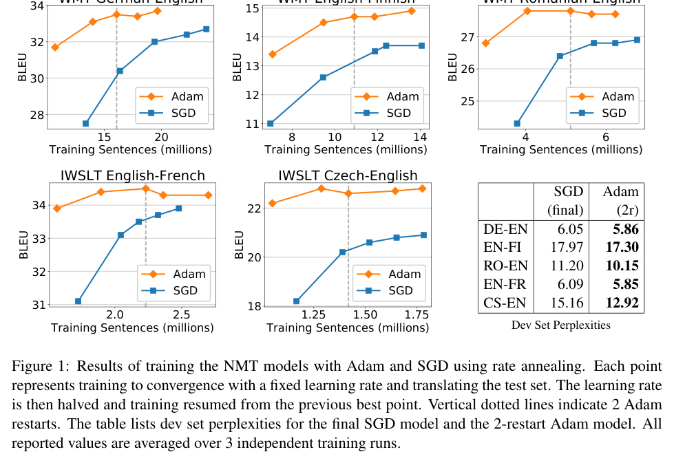

The figure consists of five line graphs and one table comparing the performance of Adam and SGD optimizers across different translation tasks. Each graph plots BLEU scores against the number of training sentences, using orange diamonds for Adam and blue squares for SGD, with vertical dotted lines marking two Adam restarts. The accompanying table lists the final dev set perplexities for both optimizers across the five datasets (DE-EN, EN-FI, RO-EN, EN-FR, and CS-EN).

**An Effective Method using Phrase Mechanism in Neural Machine Translation** — [arXiv:2308.10482](https://arxiv.org/abs/2308.10482) p.4

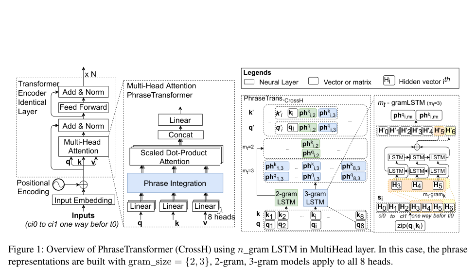

The figure provides a schematic overview of the PhraseTransformer (CrossH) architecture, comparing a standard Transformer Encoder to the proposed model. It illustrates how the Multi-Head Attention layer is modified with a "Phrase Integration" block, which utilizes $n$-gram LSTM layers to process input sequences into phrase representations. The diagram uses boxes to represent neural layers and vectors, with arrows indicating data flow from input embeddings through positional encoding and multi-head attention mechanisms.

**Investigating Backtranslation in Neural Machine Translation** — [arXiv:1804.06189](https://arxiv.org/abs/1804.06189) p.6

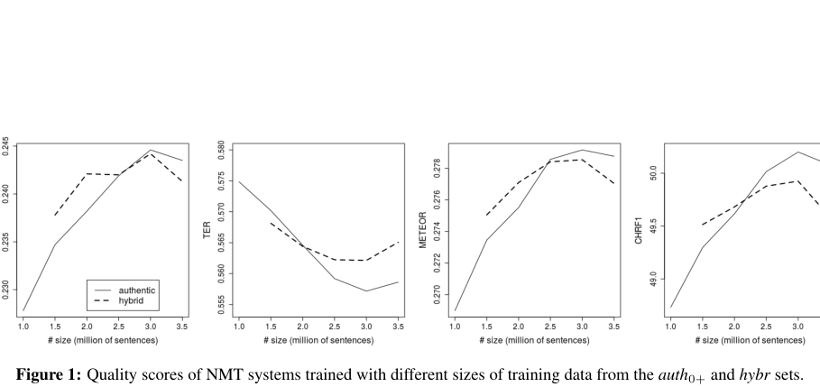

The figure consists of four line graphs sharing a common x-axis labeled "# size (million of sentences)," representing the training data size for two datasets: "authentic" (solid line) and "hybrid" (dashed line). The y-axes plot different NMT quality metrics: TER (where lower is better), METEOR, and CHRF1 (where higher is better). The plots convey how translation quality evolves as training data increases, showing that the hybrid dataset generally outperforms the authentic dataset across all metrics.

**Very Deep Transformers for Neural Machine Translation** — [arXiv:2008.07772](https://arxiv.org/abs/2008.07772) p.1

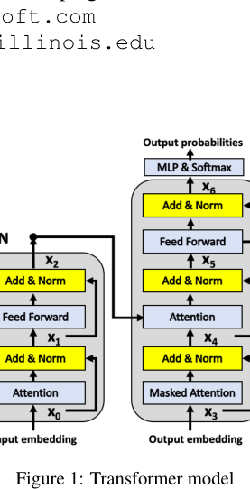

The figure illustrates the architecture of a Transformer model, consisting of two main components: an encoder (left) and a decoder (right). Each component is composed of stacked sub-layers, including Multi-Head Attention and Feed Forward networks, connected by residual connections and layer normalization (Add & Norm) blocks. The diagram uses boxes to represent functional modules and arrows to indicate the flow of data from input embeddings through the stacked layers to the final output probabilities.

**Towards String-to-Tree Neural Machine Translation** — [arXiv:1704.04743](https://arxiv.org/abs/1704.04743) p.1

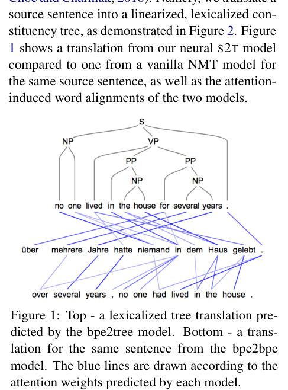

The figure displays two hierarchical tree structures representing translations of a German sentence into English, with blue lines connecting source words to target words. The top part shows a lexicalized constituency tree predicted by the bpe2tree model, while the bottom part shows a linearized translation from the bpe2bpe model, with the blue lines illustrating the attention-induced word alignments for each model.

