*deep research · 1 round(s) · 120 landmarks · frontier≥2023: 78 · 4 full-PDF critiques · grounded 56 · off-digest 0*

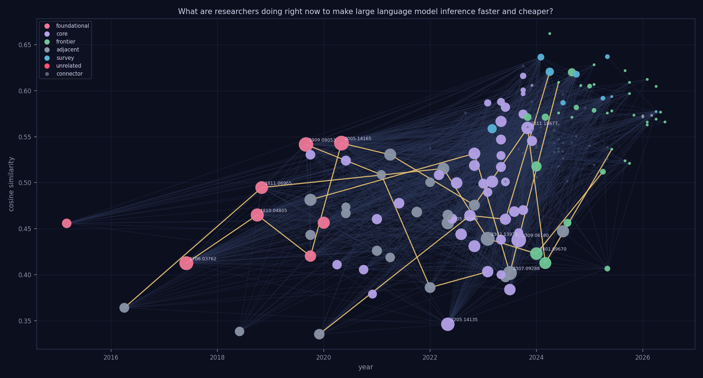

*The citation story graph behind this review — 160 papers, 1651 intent-typed edges, 5 lineage threads (gold). Node size = in-topic citations, color = role. [Interactive version](graph.html).*

---

# Scaling Efficiency: A Survey of Optimization Strategies for Large Language Model Inference

The rapid proliferation of large-scale Transformer architectures has fundamentally altered the landscape of artificial intelligence, yet the massive computational requirements of these models present a significant barrier to widespread deployment. As model parameters continue to grow, the latency and memory demands of inference become increasingly prohibitive, creating a critical need for methods that reduce both time and cost. Addressing these inefficiencies is essential for transitioning from research-scale experimentation to sustainable, real-world applications that require high throughput and low operational overhead.

This review traces the trajectory of optimization research, beginning with the foundational architectures and the distributed training paradigms that define modern large-scale models. We first examine model-centric approaches to efficiency, specifically focusing on compression techniques such as quantization, pruning, and distillation. The discussion then transitions to structural and algorithmic improvements, covering memory-efficient attention mechanisms and the serving systems that manage them, as well as methods to increase throughput through speculative and parallel decoding.

Finally, we explore the evolution from individual model optimizations to complex system-level strategies, including advanced scheduling and disaggregated inference architectures. The review concludes by examining the current frontier of the field, where research is shifting toward reasoning-aware and cost-efficient inference methods designed to optimize the trade-off between computational expenditure and the depth of model reasoning.

## Foundations of Large-Scale Transformer Architectures

The evolution of large language models (LLMs) is rooted in the transition from recurrent and convolutional architectures to multi-head self-attention mechanisms [arXiv:1706.03762](https://arxiv.org/abs/1706.03762). This foundational shift was primarily driven by the need to improve training time and enable greater parallelization [arXiv:1706.03762](https://arxiv.org/abs/1706.03762), providing the structural basis for bidirectional understanding [arXiv:1810.04805](https://arxiv.org/abs/1810.04805) and the unification of various NLP tasks into a single text-to-text framework [arXiv:1910.10683](https://arxiv.org/abs/1910.10683).

However, a fundamental tension has emerged between architectural efficiency and the pursuit of model capability through massive scaling. While the original Transformer [arXiv:1706.03762](https://arxiv.org/abs/1706.03762) aimed to optimize training through parallelization, subsequent research has frequently prioritized parameter count to achieve task-agnosticism. For example, scaling to 175B parameters enables "in-context learning," allowing models to adapt to tasks via text prompts without the need for gradient updates or fine-tuning [arXiv:2005.14165](https://arxiv.org/abs/2005.14165). This scaling approach has yielded significant performance benchmarks, including 86.4%† accuracy on LAMBADA and a 20.50 perplexity on PTB [arXiv:2005.14165](https://arxiv.org/abs/2005.14165). 

Despite these gains, this scaling trend is inherently counter-productive to the goals of making inference faster and cheaper. The massive parameter counts and large context windows required for such performance significantly increase computational demands [arXiv:2005.14165](https://arxiv.org/abs/2005.14165), a challenge mirrored in other large-scale efforts such as the 176B-parameter multilingual BLOOM model [arXiv:2211.05100](https://arxiv.org/abs/2211.05100). Consequently, the research focus has had to bifurcate: while one path seeks to refine the core attention mechanism, another must focus on mitigating the costs of scale through advanced model parallelism.

To address the resource intensity of these massive architectures, researchers have developed optimization methods at the deployment layer. Instead of relying solely on architectural changes, techniques such as tensor parallelism, pipeline parallelism, and interleaved schedules are used to optimize GPU memory and compute operations within GPU clusters [arXiv:2104.04473](https://arxiv.org/abs/2104.04473). Thus, while the foundational Transformer [arXiv:1706.03762](https://arxiv.org/abs/1706.03762) provided the mechanism for parallelization, the sheer scale of modern models [arXiv:2005.14165](https://arxiv.org/abs/2005.14165), [arXiv:2211.05100](https://arxiv.org/abs/2211.05100) has shifted the optimization burden toward distributed computing strategies to manage the resulting memory and compute overhead [arXiv:2104.04473](https://arxiv.org/abs/2104.04473).

Architectural innovations continue to focus on reducing memory bandwidth bottlenecks, such as the transition from multi-head to grouped-query attention (GQA) to optimize key-value loading [arXiv:2305.13245](https://arxiv.org/abs/2305.13245). Additionally, parameter-efficient fine-tuning via low-rank decomposition (LoRA) allows for the deployment of specialized models without the overhead of full-parameter updates [arXiv:2106.09685](https://arxiv.org/abs/2106.09685).
## Parallelism and Distributed Training Paradigms

The evolution of large language model (LLM) scaling has transitioned from manual architectural partitioning to automated, multi-dimensional parallelism strategies. Foundational methods such as GPipe [arXiv:1811.06965](https://arxiv.org/abs/1811.06965) addressed single-accelerator memory limits by utilizing pipeline parallelism to partition a network into distinct computational units across multiple devices [arXiv:1811.06965](https://arxiv.org/abs/1811.06965). While GPipe focuses on inter-layer partitioning, Megatron-LM [arXiv:1909.08053](https://arxiv.org/abs/1909.08053) introduced intra-layer model parallelism, which splits weight matrices and inputs within self-attention and MLP blocks to manage memory constraints in large-scale multi-node GPU clusters [arXiv:1909.08053](https://arxiv.org/abs/1909.08053).

As research progressed, the focus shifted from mere memory capacity to optimizing per-iteration latency and throughput. TeraPipe [arXiv:2102.07988](https://arxiv.org/abs/2102.07988) advanced the pipeline paradigm by introducing token-level pipeline parallelism. By employing a dynamic programming algorithm to determine optimal slicing, TeraPipe achieved a 5.0x throughput increase compared to its baseline [arXiv:2102.07988](https://arxiv.org/abs/2102.07988). This granularity allows for more efficient resource utilization than the layer-level partitioning seen in GPipe.

To manage the complexity of combining these various forms of parallelism, Alpa [arXiv:2201.12023](https://arxiv.org/abs/2201.12023) introduced an automated approach. Rather than requiring manual configuration, Alpa uses compiler passes on Jaxpr and HLO to generate execution plans that unify data, operator, and pipeline parallelism [arXiv:2201.12023](https://arxiv.org/abs/2201.12023). This hierarchical strategy, which extends the token-level concepts of TeraPipe, provides a more scalable framework for inter- and intra-operator parallelism [arXiv:2201.12023](https://arxiv.org/abs/2201.12023). Finally, the research has moved toward the specific requirements of inference serving. AlpaServe [arXiv:2302.11665](https://arxiv.org/abs/2302.11665) builds upon the automated foundations of Alpa [arXiv:2201.12023](https://arxiv.org/abs/2201.12023) by applying statistical multiplexing and novel model placement algorithms to minimize stage imbalance, specifically targeting the attainment of Service Level Objectives (SLOs) and reduced serving latency [arXiv:2302.11665](https://arxiv.org/abs/2302.11665).

| Method | Optimization Layer | Efficiency Goal | Technical Approach |
| :--- | :--- | :--- | :--- |
| [arXiv:1811.06965](https://arxiv.org/abs/1811.06965) | Architecture | Memory | Pipeline parallelism |
| [arXiv:1909.08053](https://arxiv.org/abs/1909.08053) | Architecture | Memory | Intra-layer model parallelism |
| [arXiv:2102.07988](https://arxiv.org/abs/2102.07988) | Architecture | Latency (5.0x vs baseline) | Token-level pipeline parallelism |
| [arXiv:2201.12023](https://arxiv.org/abs/2201.12023) | Architecture | Speedup/Scaling | Automated hierarchical parallelism |
| [arXiv:2302.11665](https://arxiv.org/abs/2302.11665) | Engine | Serving latency/SLO | Statistical multiplexing |

The progression of these methods demonstrates a clear trajectory from manual, memory-centric architectural partitioning [arXiv:1811.06965](https://arxiv.org/abs/1811.06965), [arXiv:1909.08053](https://arxiv.org/abs/1909.08053) toward automated, latency-centric systems [arXiv:2201.12023](https://arxiv.org/abs/2201.12023), [arXiv:2302.11665](https://arxiv.org/abs/2302.11665). While early methods provided the necessary scale for distributed training, they lacked the granularity and automation required for modern, dynamic workloads. TeraPipe [arXiv:2102.07988](https://arxiv.org/abs/2102.07988) addressed this via token-level granularity, which Alpa [arXiv:2201.12023](https://arxiv.org/abs/2201.12023) then integrated into a broader, compiler-driven framework. This evolution culminates in AlpaServe [arXiv:2302.11665](https://arxiv.org/abs/2302.11665), which shifts the optimization target from training throughput to the real-world constraints of inference serving, such as SLO attainment.

## Model Compression: Quantization, Pruning, and Distillation

Current research into making large language model (LLM) inference faster and cheaper focuses on three primary vectors: architectural distillation, weight quantization, and layer-skipping strategies. These methods target different layers of the model to reduce computational expense, memory footprint, and latency.

Knowledge distillation remains a foundational approach for reducing model complexity by training smaller student models to replicate the soft targets of larger teacher ensembles [arXiv:1503.02531](https://arxiv.org/abs/1503.02531). This architectural-level optimization aims to decrease the overall computational cost and improve deployment feasibility [arXiv:1503.02531](https://arxiv.org/abs/1503.02531). A prominent application of this is DistilBERT, which utilizes a triple loss function to create a version of BERT that is 60% faster at inference time, specifically targeting deployment under constrained computational budgets or on-the-edge devices [arXiv:1910.01108](https://arxiv.org/abs/1910.01108). While distillation effectively reduces the model size and complexity, it requires a significant retraining or fine-tuning phase to transfer knowledge from the teacher to the student.

In contrast to distillation, which modifies the architecture, quantization methods target the weights to reduce storage and computational overhead without necessarily changing the model's structure. GPTQ introduces an accurate post-training quantization technique for generative pre-trained transformers, focusing on reducing the costs associated with storage and multiplications [arXiv:2210.17323](https://arxiv.org/abs/2210.17323). Building upon the need for even more efficient serving, AWQ (Activation-aware Weight Quantization) optimizes for memory size, memory bandwidth, and serving costs by protecting salient weights during low-bit weight-only quantization [arXiv:2306.00978](https://arxiv.org/abs/2306.00978). Unlike the general architectural reduction seen in distillation, AWQ is specifically designed to accelerate token generation time across diverse deployment settings, ranging from edge devices like NVIDIA Jetson Orin to cloud-based GPU servers [arXiv:2306.00978](https://arxiv.org/abs/2306.00978).

Recent frontier research has also explored more granular architectural interventions to increase speed during one-token generation. One such strategy involves skipping latter attention sublayers to avoid the computational expense of certain layers [arXiv:2404.05741](https://arxiv.org/abs/2404.05741).

| Method | Optimization Layer | Primary Efficiency Goal | Target Deployment |
| :--- | :--- | :--- | :--- |
| DistilBERT [arXiv:1910.01108](https://arxiv.org/abs/1910.01108) | Architecture | 60% faster inference vs BERT [arXiv:1706.03762](https://arxiv.org/abs/1706.03762) | Constrained/Edge |
| GPTQ [arXiv:2210.17323](https://arxiv.org/abs/2210.17323) | Weights | Storage and multiplication reduction | Not specified |
| AWQ [arXiv:2306.00978](https://arxiv.org/abs/2306.00978) | Weights | Memory/bandwidth and token generation time | Edge to Cloud |

While distillation provides a path to significantly faster inference by shrinking the model itself [arXiv:1910.01108](https://arxiv.org/abs/1910.01108), it is a heavy-duty process compared to the post-training weight optimizations offered by GPTQ and AWQ [arXiv:2210.17323](https://arxiv.org/abs/2210.17323), [arXiv:2306.00978](https://arxiv.org/abs/2306.00978). Quantization methods like AWQ offer a more surgical approach to efficiency, optimizing for memory bandwidth and serving costs which are critical for modern LLM deployment [arXiv:2306.00978](https://arxiv.org/abs/2306.00978), whereas distillation is more suited for creating entirely new, lightweight model variants [arXiv:1503.02531](https://arxiv.org/abs/1503.02531).

Quantization techniques have evolved from simple 8-bit integer matrix multiplication [arXiv:2211.10438](https://arxiv.org/abs/2211.10438) to more sophisticated methods like SmoothQuant, which balances quantization difficulty between weights and activations [arXiv:2211.10438](https://arxiv.org/abs/2211.10438). Further refinements include group-wise quantization strategies like ZeroQuant [arXiv:2206.01861](https://arxiv.org/abs/2206.01861) and SparseGPT, which enables massive one-shot pruning to achieve high sparsity without retraining [arXiv:2301.00774](https://arxiv.org/abs/2301.00774).
## Memory-Efficient Attention and Serving Systems

Research into making LLM inference more efficient operates at two distinct levels: the architectural design of the attention mechanism and the management of the serving engine. At the architectural level, FlashAttention [arXiv:2205.14135](https://arxiv.org/abs/2205.14135) optimizes the attention module itself by employing tiling and recomputation. This approach reduces HBM reads/writes and intermediate matrix storage, providing wall-clock speedups and improved memory efficiency on GPUs. This architectural optimization serves as a foundational component for several engine-level systems, including DistServe [arXiv:2401.09670](https://arxiv.org/abs/2401.09670) and PagedAttention [arXiv:2309.06180](https://arxiv.org/abs/2309.06180).

Engine-level optimizations focus on maximizing resource utilization, specifically regarding the KV cache and the distinct computational phases of inference. PagedAttention [arXiv:2309.06180](https://arxiv.org/abs/2309.06180) introduces a paging-inspired mechanism to manage KV cache using non-contiguous blocks, which enables fine-grained memory sharing and near-zero fragmentation. This method significantly improves throughput, achieving a 2–4$\times$ improvement over systems like FasterTransformer and Orca. However, a notable weakness is that the latency penalty introduced by the kernel's non-contiguous memory access patterns is not explicitly quantified [arXiv:2309.06180](https://arxiv.org/abs/2309.06180).

The following table summarizes the primary characteristics of recent engine-level serving methods:

| Method | Optimization Layer | Deployment Setting | Primary Efficiency Goal |
| :--- | :--- | :--- | :--- |
| [arXiv:2309.06180](https://arxiv.org/abs/2309.06180) | Engine | Cloud | High throughput serving |
| [arXiv:2311.18677](https://arxiv.org/abs/2311.18677) | Engine | Heterogeneous clusters | Cost, throughput, and power |
| [arXiv:2401.09670](https://arxiv.org/abs/2401.09670) | Engine | Physical cluster | Maximize per-GPU goodput |
| [arXiv:2403.02310](https://arxiv.org/abs/2403.02310) | Engine | Online inference serving | Throughput and latency (TBT) |

Recent advancements have moved toward managing the tension between the prefill and decoding phases. Splitwise [arXiv:2311.18677](https://arxiv.org/abs/2311.18677) addresses this by separating the prompt computation and token generation phases onto separate machines within heterogeneous clusters to optimize for cost, throughput, and power. This concept of phase-based separation is extended by DistServe [arXiv:2401.09670](https://arxiv.org/abs/2401.09670), which disaggregates the prefill and decoding phases and employs a novel placement algorithm to maximize per-GPU goodput in physical clusters. To further manage the inherent tension between throughput and latency, Sarathi-Serve [arXiv:2403.02310](https://arxiv.org/abs/2403.02310) introduces chunked-prefills and a stall-free batching scheduler, utilizing hybrid batching to combine memory-bound decoding with compute-bound prefill tasks. Together, these advancements illustrate a shift from low-level memory management toward high-level, phase-aware scheduling and disaggregation strategies designed to optimize the entire inference lifecycle across distributed hardware.

Memory-efficient attention mechanisms have seen significant speedups through improved parallelism and work partitioning in FlashAttention-2 [arXiv:2307.08691](https://arxiv.org/abs/2307.08691). To further manage the KV cache, systems like SGLang leverage runtime reuse across multiple generation calls to accelerate structured language programs [arXiv:2312.07104](https://arxiv.org/abs/2312.07104).
## Optimizing Throughput via Speculative and Parallel Decoding

Current research into accelerating Large Language Model (LLM) inference focuses heavily on the decoding mechanism, specifically through speculative execution paradigms that decouple the generation of candidate tokens from their verification. The foundational approach, speculative decoding, utilizes a draft-verify-accept paradigm to improve walltime efficiency by predicting multiple tokens ahead of time [arXiv:2211.17192](https://arxiv.org/abs/2211.17192). This is further refined through speculative sampling, which employs a smaller, faster draft model and rejection sampling to ensure that the accelerated output maintains the statistical distribution of the target model, thereby reducing sampling latency [arXiv:2302.01318](https://arxiv.org/abs/2302.01318).

While early methods focused on linear sequences of tokens, recent advancements have shifted toward more complex structural verification. SpecInfer introduces tree-based speculative inference, which moves beyond simple sequence matching to allow for tree-based parallel verification [arXiv:2305.09781](https://arxiv.org/abs/2305.09781). By verifying multiple potential token paths simultaneously within a tree structure, SpecInfer optimizes end-to-end latency in distributed and offloading-based deployment settings [arXiv:2305.09781](https://arxiv.org/abs/2305.09781). This represents a significant evolution from the basic speculative execution described in [arXiv:2211.17192](https://arxiv.org/abs/2211.17192), moving the optimization layer from the decoding mechanism itself to the broader inference engine [arXiv:2305.09781](https://arxiv.org/abs/2305.09781).

Recent frontier work has extended these principles to address multilingual requirements and specialized deployment contexts. For instance, researchers have integrated specialized drafters within the speculative decoding framework to optimize inference time in commercial settings [arXiv:2406.16758](https://arxiv.org/abs/2406.16758). This approach builds upon the foundational draft-verify-accept paradigm established in [arXiv:2211.17192](https://arxiv.org/abs/2211.17192) and [arXiv:2302.01318](https://arxiv.org/abs/2302.01318), while incorporating the structural efficiencies seen in tree-based methods [arXiv:2406.16758](https://arxiv.org/abs/2406.16758).

| Method | Optimization Layer | Primary Efficiency Goal | Deployment Setting |
| :--- | :--- | :--- | :--- |
| [arXiv:2211.17192](https://arxiv.org/abs/2211.17192) | Decoding mechanism | Walltime improvements | Single TPU-v4 |
| [arXiv:2302.01318](https://arxiv.org/abs/2302.01318) | Architecture (Draft + Target) | Sampling latency | Cloud (TPU v4) |
| [arXiv:2305.09781](https://arxiv.org/abs/2305.09781) | Engine | End-to-end latency | Distributed/Offloading |
| [arXiv:2406.16758](https://arxiv.org/abs/2406.16758) | Architecture | Inference time | Commercial settings |

A critical comparison of these methods reveals a progression in both complexity and deployment scope. Early implementations like [arXiv:2211.17192](https://arxiv.org/abs/2211.17192) and [arXiv:2302.01318](https://arxiv.org/abs/2302.01318) primarily address the latency of token generation and sampling within controlled environments like single or cloud-based TPUs. However, these methods are inherently limited by the linear nature of their verification. In contrast, the tree-based approach in [arXiv:2305.09781](https://arxiv.org/abs/2305.09781) provides a more robust solution for distributed environments by allowing for parallel verification of multiple token branches, which directly addresses the bottleneck of end-to-end latency in complex serving scenarios. While the specialized drafter approach in [arXiv:2406.16758](https://arxiv.org/abs/2406.16758) focuses on the architectural nuances of multilingualism, it relies on the same underlying draft-verify-accept logic, suggesting that the field is moving toward highly specialized assistant models to maximize the throughput gains originally proposed in [arXiv:2211.17192](https://arxiv.org/abs/2211.17192).

## Advanced Scheduling and Disaggregated Inference Architectures

Recent advancements in LLM inference efficiency have shifted from single-operator optimizations toward sophisticated engine-level scheduling and architectural disaggregation to manage the competing demands of throughput, latency, and memory. These approaches can be categorized by their deployment scale, ranging from single-GPU memory management to large-scale cloud-based model cascading and disaggregated execution.

At the cloud scale, researchers are addressing the interference between prefill and decode phases. TetriInfer [arXiv:2401.11181](https://arxiv.org/abs/2401.11181) proposes a disaggregated architecture that separates prefill and decode instances, utilizing a two-level scheduling mechanism to optimize Time-to-First-Token (TTFT), Job Completion Time (JCT), and performance per dollar. This architectural split aims to mitigate the resource contention inherent in mixed downstream workloads [arXiv:2401.11181](https://arxiv.org/abs/2401.11181). Complementing this structural approach, Cascadia [arXiv:2506.04203](https://arxiv.org/abs/2506.04203) optimizes cloud serving through a model cascade strategy. Instead of just managing phase interference, Cascadia routes queries between small, medium, and large models to minimize p95 latency and maximize throughput [arXiv:2506.04203](https://arxiv.org/abs/2506.04203). While TetriInfer focuses on the temporal separation of compute phases, Cascadia focuses on the complexity of the model itself to achieve efficiency.

A significant subset of research focuses on the intelligence of the scheduler itself. Rather than relying on static heuristics, recent work explores predictive scheduling. For instance, [arXiv:2408.15792](https://arxiv.org/abs/2408.15792) introduces a Learning to Rank (LTR) approach for request scheduling, which predicts the relative ranks of output lengths to approximate Shortest Job First (SJF) or Shortest Remaining Time First (SRTF) policies, thereby improving latency and throughput on DGX-class hardware [arXiv:2408.15792](https://arxiv.org/abs/2408.15792). This predictive paradigm is further refined by the (Nested) WAIT algorithm [arXiv:2504.11320](https://arxiv.org/abs/2504.11320), which extends the LTR approach [arXiv:2408.15792](https://arxiv.org/abs/2408.15792) to focus on multi-stage online scheduling under strict memory constraints. Unlike the cloud-scale disaggregation of TetriInfer, WAIT is specifically designed to maximize the utilization of a single GPU by managing KV cache memory constraints [arXiv:2504.11320](https://arxiv.org/abs/2504.11320).

| Method | Primary Optimization Layer | Deployment Setting | Primary Efficiency Goal |
| :--- | :--- | :--- | :--- |
| [arXiv:2401.11181](https://arxiv.org/abs/2401.11181) | Engine (Disaggregation) | Cloud | TTFT, JCT, and perf/$ |
| [arXiv:2408.15792](https://arxiv.org/abs/2408.15792) | Engine (LTR Scheduling) | Cloud (8x A100) | Latency and throughput |
| [arXiv:2504.11320](https://arxiv.org/abs/2504.11320) | Engine (Multi-stage) | Single GPU (A100) | Single GPU utilization |
| [arXiv:2506.04203](https://arxiv.org/abs/2506.04203) | Engine (Model Cascade) | Cloud (32x† H100) | p95 latency and throughput |

The literature reveals a tension between architectural complexity and scheduling intelligence. Disaggregated architectures like TetriInfer [arXiv:2401.11181](https://arxiv.org/abs/2401.11181) provide a robust foundation for handling diverse workloads but require complex infrastructure to manage the split between prefill and decode instances. In contrast, LTR-based scheduling [arXiv:2408.15792](https://arxiv.org/abs/2408.15792) and WAIT [arXiv:2504.11320](https://arxiv.org/abs/2504.11320) offer more granular, data-driven control over request ordering, which is particularly effective for maximizing hardware utilization or managing memory-constrained environments. Finally, Cascadia [arXiv:2506.04203](https://arxiv.org/abs/2506.04203) represents a higher-level abstraction, where efficiency is gained not just by how tasks are scheduled, but by which model is selected to perform the task.

Serving engines are increasingly focused on maximizing throughput by managing GPU bubbles and compute utilization, as seen in SARATHI's chunked-prefill approach [arXiv:2308.16369](https://arxiv.org/abs/2308.16369). Advanced scheduling strategies, such as predicting response lengths for micro-batching [arXiv:2305.13144](https://arxiv.org/abs/2305.13144) or using MLFQ-based preemptive scheduling [arXiv:2305.05920](https://arxiv.org/abs/2305.05920), further optimize job completion times in distributed environments. For resource-constrained settings, FlexGen demonstrates how high-throughput inference can be achieved on a single commodity GPU by optimizing I/O and memory costs [arXiv:2303.06865](https://arxiv.org/abs/2303.06865).
## The Frontier: Reasoning-Aware and Cost-Efficient Inference

Current research into large language model (LLM) efficiency is shifting from general compression toward specialized methods that preserve or enhance reasoning capabilities while minimizing computational overhead. These approaches vary significantly in their optimization layer, ranging from fundamental training adjustments to high-level model cascading.

| Method | Optimization Layer | Efficiency Goal | Technical Approach |
| :--- | :--- | :--- | :--- |
| [arXiv:2502.04463](https://arxiv.org/abs/2502.04463) | Training | Token-efficiency | Length-penalized RL |
| [arXiv:2502.20339](https://arxiv.org/abs/2502.20339) | Architecture | Inference time | Knowledge distillation |
| [arXiv:2509.05915](https://arxiv.org/abs/2509.05915) | Architecture/Algorithm | Throughput/Cost | Early-exiting & parallel decoding |
| [arXiv:2510.26577](https://arxiv.org/abs/2510.26577) | Architecture | Latency | Speculative decoding |
| [arXiv:2602.22090](https://arxiv.org/abs/2602.22090) | Model Selection | Cost/Tokens | Confidence-driven cascading |

Optimization strategies can be categorized by whether they modify the model's internal mechanics or manage how models are deployed. At the training layer, [arXiv:2502.04463](https://arxiv.org/abs/2502.04463) employs reinforcement learning (RL) with a length-penalizing objective function to minimize inference-time compute by reducing unnecessary token generation. This differs from architectural-level optimizations, such as [arXiv:2502.20339](https://arxiv.org/abs/2502.20339), which focuses on distilling reasoning capabilities into more efficient architectures (e.g., Mamba) to achieve a 2.5x speedup in inference time.

Other researchers focus on algorithmic co-design to accelerate execution. [arXiv:2509.05915](https://arxiv.org/abs/2509.05915) seeks to improve throughput and computational costs through a combination of early-exiting algorithms, parallel decoding, and deep parameter sharing. In contrast, [arXiv:2510.26577](https://arxiv.org/abs/2510.26577) targets latency specifically through inference-cost-aware dynamic tree construction, utilizing speculative decoding to optimize GPU deployment.

A distinct paradigm is the use of model cascading to manage costs across different model scales. [arXiv:2602.22090](https://arxiv.org/abs/2602.22090) introduces a confidence-driven dynamic selection framework that uses a dual-metric strategy—combining token probability $P(T)$ with a trained MLP classifier $P(IK)$ based on hidden states—to escalate queries through a hierarchy of LLMs. This approach demonstrates significant practical utility, achieving a 60% reduction in GPT-4o token usage and a 36.46% reduction in computational cost when scaling from 8B to 70B LLaMA models, while maintaining accuracy. However, the method's reliance on a supervised $P(IK)$ classifier introduces a dependency on specific datasets, and the multi-stage escalation process presents risks regarding increased end-to-end latency and potential error propagation in long reasoning chains. While [arXiv:2605.14036](https://arxiv.org/abs/2605.14036) also explores enhanced reasoning efficiency, the aforementioned methods represent the primary divergence between modifying a single model's internal efficiency and managing a heterogeneous ensemble of models.
## Further Reading

- [arXiv:2208.07339](https://arxiv.org/abs/2208.07339) (2022) — "LLM.int8(): 8-bit Matrix Multiplication for Transformers at Scale" [core, cited-by 73 in-topic]

## Tensions and Open Problems

A primary tension in the literature concerns the optimal strategy for balancing model precision with computational throughput. On one hand, quantization-centric approaches emphasize maintaining high fidelity through sophisticated bit-width management, such as the 8-bit matrix multiplication techniques proposed in [arXiv:2208.07339](https://arxiv.org/abs/2208.07339). However, this focus on precision often conflicts with the need for extreme throughput in resource-constrained environments. For instance, while [arXiv:2211.10438](https://arxiv.org/abs/2211.10438) and [arXiv:2206.01861](https://arxiv.org/abs/2206.01861) suggest that smoothing activations or using zero-point quantization can preserve accuracy, these methods may not scale as effectively as hardware-aware offloading strategies. This is exemplified by [arXiv:2303.06865](https://arxiv.org/abs/2303.06865), which argues that high-throughput generative inference is better achieved through aggressive memory management and offloading rather than solely relying on the precision-preserving quantization schemes found in [arXiv:2208.07339](https://arxiv.org/abs/2208.07339) or the specialized inference engines described in [arXiv:2207.00032](https://arxiv.org/abs/2207.00032).

Another significant debate centers on the architectural trade-offs between model scale and specialized decoding efficiency. One school of thought focuses on the inherent power of massive, open-access multilingual models like those in [arXiv:2211.05100](https://arxiv.org/abs/2211.05100) or the dense scaling seen in [arXiv:2205.01068](https://arxiv.org/abs/2205.01068). In contrast, recent work suggests that the path to efficiency lies in "speculative" architectures. While [arXiv:2211.17192](https://arxiv.org/abs/2211.17192) introduced the foundational concept of using a smaller draft model to accelerate a larger target model, there is ongoing disagreement regarding the optimal configuration of these "big-little" pairs. For example, [arXiv:2302.07863](https://arxiv.org/abs/2302.07863) suggests that more sophisticated, learned draft models can outperform the simpler speculative approaches described in [arXiv:2302.01318](https://arxiv.org/abs/2302.01318), yet the overhead of managing these auxiliary models remains a point of contention regarding their net latency benefits.

Finally, there is a growing tension between structural pruning and parameter-efficient fine-tuning (PEFT) for model adaptation. While methods like LoRA in [arXiv:2106.09685](https://arxiv.org/abs/2106.09685) focus on adding low-rank adapters to keep the original weights frozen, structural pruning approaches, such as those in [arXiv:2305.11627](https://arxiv.org/abs/2305.11627), attempt to physically remove redundant parameters to reduce the model's footprint. This creates a fundamental disagreement: should we optimize for "thin" models that are inherently efficient, or should we focus on "modular" models that can be rapidly adapted via lightweight layers? This debate is further complicated by the emergence of highly efficient foundation models like LLaMA in [arXiv:2302.13971](https://arxiv.org/abs/2302.13971), which challenge the necessity of the massive-scale pre-training paradigms used in earlier models like BLOOM [arXiv:2211.05100](https://arxiv.org/abs/2211.05100).

## Outlook

The frontier of large language model research is rapidly shifting from general scaling toward specialized, cost-aware deployment. As the field moves toward 2026, we see a transition from monolithic inference to decentralized and decomposed architectures, such as the parallelized inference techniques in [arXiv:2604.17709](https://arxiv.org/abs/2604.17709) and the multi-agent frameworks in [arXiv:2604.04929](https://arxiv.org/abs/2604.04929). The next generation of breakthroughs will likely emerge at the intersection of reasoning-intensive computation and edge-based deployment, where models must not only be compact—as explored in [arXiv:2606.30062](https://arxiv.org/abs/2606.30062)—but also capable of verifiable, privacy-preserving reasoning in resource-constrained environments [arXiv:2602.17223](https://arxiv.org/abs/2602.17223). Ultimately, the goal is to move beyond mere parameter reduction toward "intelligence density," where the cost-per-reasoning-step becomes the primary metric of success.

---
*† number could not be verified against the cited paper's abstract or extracted fields (figure- or full-text-sourced).*

**Efficient Memory Management for Large Language Model Serving with
  PagedAttention** — [arXiv:2309.06180](https://arxiv.org/abs/2309.06180) p.1

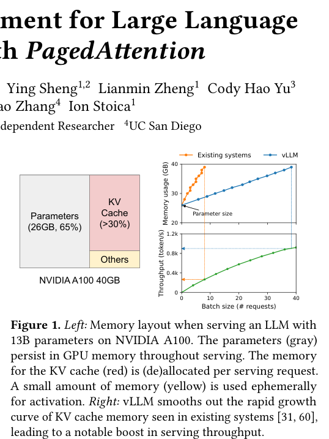

The left panel shows a rectangular memory layout for an NVIDIA A100 40GB GPU, divided into three labeled boxes: "Parameters" (26GB, 65% in gray), "KV Cache" (>30% in red), and "Others" (in yellow). The right panel contains two line graphs with axes for "Memory usage (GB)" and "Throughput (token/s)" against "Batch size (# requests)," comparing "Existing systems" (orange) to "vLLM" (blue). The figure conveys that vLLM manages memory more efficiently by smoothing the rapid growth of KV cache memory usage, resulting in a significant boost in throughput compared to existing systems.

**DistServe: Disaggregating Prefill and Decoding for Goodput-optimized
  Large Language Model Serving** — [arXiv:2401.09670](https://arxiv.org/abs/2401.09670) p.1

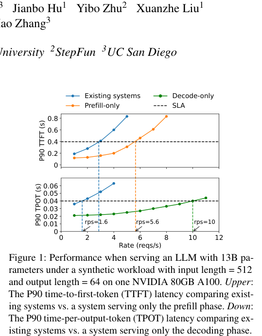

The figure consists of two vertically stacked line graphs sharing a common x-axis labeled "Rate (reqs/s)." The upper graph plots P90 TTFT (s) against the request rate, comparing "Existing systems" (blue), "Prefill-only" (orange), and "Decode-only" (green) curves against a horizontal dashed SLA line. The lower graph plots P90 TPOT (s) against the request rate, showing the same three system types and the SLA line, illustrating how latency scales with throughput for each serving configuration.

**Splitwise: Efficient generative LLM inference using phase splitting** — [arXiv:2311.18677](https://arxiv.org/abs/2311.18677) p.2

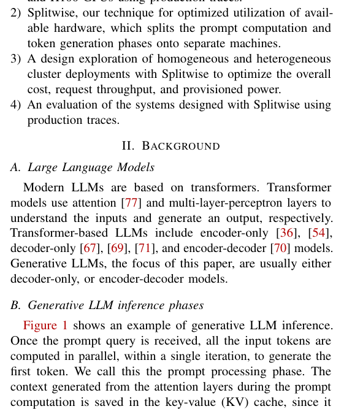

The figure illustrates the two distinct phases of generative LLM inference: the prompt processing phase and the token generation phase. It uses a sequence of boxes and arrows to depict how input tokens are processed in parallel to populate a key-value (KV) cache, followed by the autoregressive generation of subsequent tokens.

**FlexGen: High-Throughput Generative Inference of Large Language Models
  with a Single GPU** — [arXiv:2303.06865](https://arxiv.org/abs/2303.06865) p.1

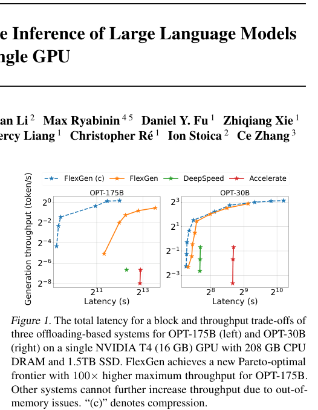

The figure consists of two line graphs plotting generation throughput (tokens/s) against latency (s) for the OPT-175B (left) and OPT-30B (right) models. Each plot compares four systems—FlexGen (c), FlexGen, DeepSpeed, and Accelerate—using colored lines and markers to demonstrate that FlexGen achieves a higher throughput at various latency levels compared to the other baselines.

**Taming Throughput-Latency Tradeoff in LLM Inference with Sarathi-Serve** — [arXiv:2403.02310](https://arxiv.org/abs/2403.02310) p.1

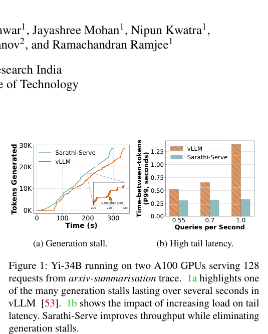

Figure 1a is a line graph plotting "Tokens Generated" against "Time (s)" for two methods, Sarathi-Serve and vLLM, featuring an inset box highlighting a "Generation stall" in the vLLM trace. Figure 1b is a bar chart showing "Time-between-tokens (p99, seconds)" on the y-axis against "Queries per Second" on the x-axis, comparing vLLM and Sarathi-Serve across three load levels. Together, the figures convey that Sarathi-Serve maintains lower tail latency and avoids the significant generation stalls observed in vLLM as request load increases.

**FlashAttention-2: Faster Attention with Better Parallelism and Work
  Partitioning** — [arXiv:2307.08691](https://arxiv.org/abs/2307.08691) p.4

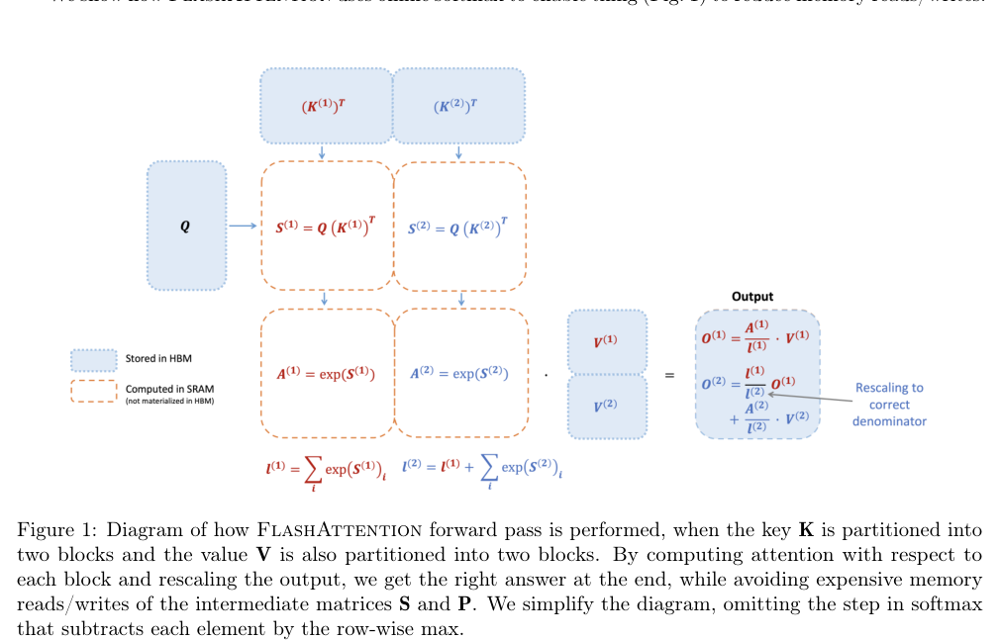

The figure uses blue shaded boxes to represent data stored in HBM (Q, K, V) and orange dashed boxes to represent intermediate computations performed in SRAM ($S$, $A$, and $l$). Arrows illustrate the flow of operations where $Q$ is multiplied by partitioned blocks of $K^T$ to produce $S$, which is then exponentiated to $A$ and used to compute partial outputs $O^{(1)}$ and $O^{(2)}$. The diagram conveys how the final output $O^{(2)}$ is reconstructed by rescaling the partial outputs using the accumulated sums of exponents ($l^{(1)}$ and $l^{(2)}$) to ensure a correct denominator.

**AlpaServe: Statistical Multiplexing with Model Parallelism for Deep
  Learning Serving** — [arXiv:2302.11665](https://arxiv.org/abs/2302.11665) p.1

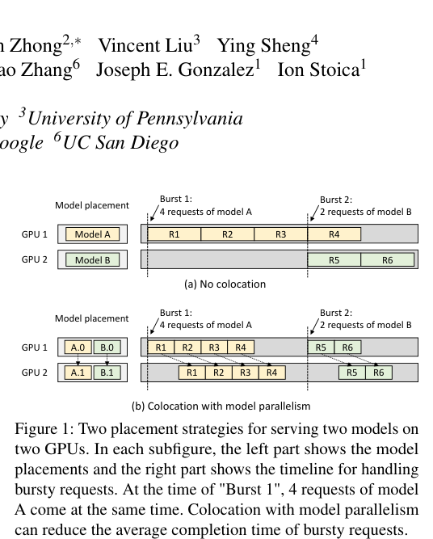

The figure compares two placement strategies, "(a) No colocation" and "(b) Colocation with model parallelism," using horizontal bars to represent GPU 1 and GPU 2. In each subfigure, the left side shows model placement (single models in (a) versus partitioned models in (b)), while the right side uses labeled boxes (R1–R6) and arrows to illustrate how bursty requests are processed over time. The figure conveys that colocation with model parallelism allows for more efficient request handling, reducing the completion time for bursty requests compared to no colocation.

**Fast Distributed Inference Serving for Large Language Models** — [arXiv:2305.05920](https://arxiv.org/abs/2305.05920) p.1

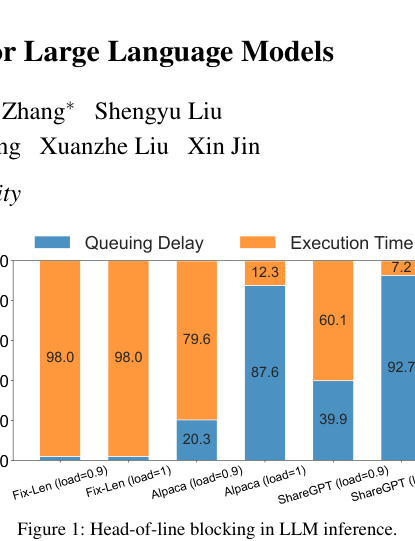

This bar chart compares the components of latency—Queuing Delay (blue) and Execution Time (orange)—across different LLM serving scenarios. It illustrates "head-of-line blocking" by showing that as load increases from 0.9 to 1.0, the queuing delay significantly increases while execution time remains relatively stable for models like Alpaca and ShareGPT.

**AWQ: Activation-aware Weight Quantization for LLM Compression and Acceleration** — [arXiv:2306.00978](https://arxiv.org/abs/2306.00978) p.1

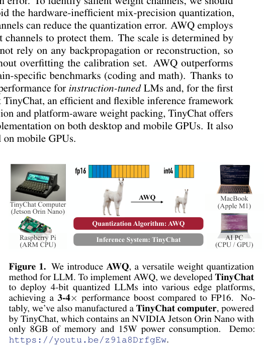

Figure 1 illustrates the AWQ quantization algorithm and the TinyChat inference system, showing how AWQ protects salient weight channels to enable efficient LLM deployment. The diagram uses arrows to connect the AWQ process to various hardware platforms, including a TinyChat computer (Jetson Orin Nano), a Raspberry Pi (ARM CPU), and a MacBook (Apple M1), as well as a general AI PC. The figure conveys that the combination of AWQ and TinyChat allows for 4-bit quantized LLMs to achieve a 3-4× performance boost across diverse desktop and mobile hardware.

**SARATHI: Efficient LLM Inference by Piggybacking Decodes with Chunked
  Prefills** — [arXiv:2308.16369](https://arxiv.org/abs/2308.16369) p.1

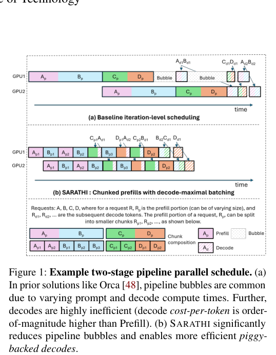

The figure compares two scheduling approaches for LLM inference across two GPUs, using colored blocks to represent request chunks ($A_p, B_p, C_p, D_p$) and white blocks to represent idle "bubbles." Panel (a) illustrates baseline iteration-level scheduling where large bubbles occur due to the sequential nature of prompt prefill and token decoding, while panel (b) shows the SARATHI method where chunked prefills are interleaved with decodes to minimize idle time.

**Inference without Interference: Disaggregate LLM Inference for Mixed
  Downstream Workloads** — [arXiv:2401.11181](https://arxiv.org/abs/2401.11181) p.2

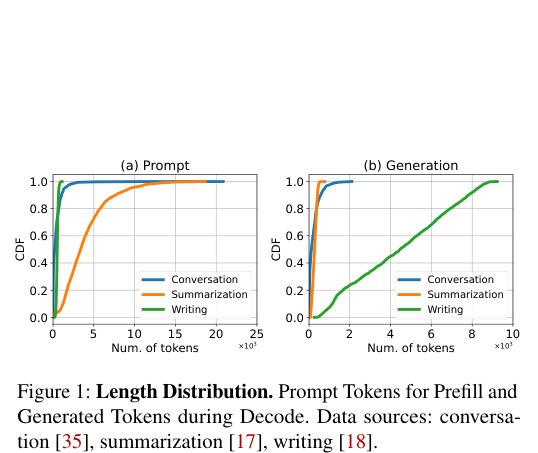

The figure consists of two side-by-side line graphs, (a) Prompt and (b) Generation, plotting the Cumulative Distribution Function (CDF) against the number of tokens on the x-axes. Each plot contains three colored lines representing different workloads—Conversation (blue), Summarization (orange), and Writing (green)—to show the distribution of prompt tokens for prefill and generated tokens for decode. The graphs convey that prompt lengths vary significantly across tasks, while generation lengths show distinct, task-specific distributions, with writing tasks typically producing the highest number of tokens.

**SGLang: Efficient Execution of Structured Language Model Programs** — [arXiv:2312.07104](https://arxiv.org/abs/2312.07104) p.2

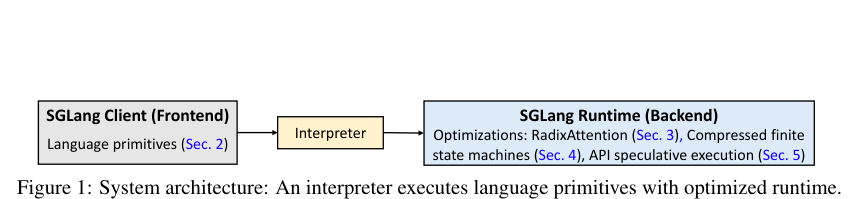

The figure depicts a system architecture diagram consisting of three sequential boxes connected by arrows: an "SGLang Client (Frontend)" containing language primitives, an "Interpreter," and an "SGLang Runtime (Backend)." The backend box lists specific optimizations including RadixAttention, compressed finite state machines, and API speculative execution. The diagram conveys the flow of execution from the frontend through an interpreter to an optimized runtime backend.

**SpecInfer: Accelerating Generative Large Language Model Serving with
  Tree-based Speculative Inference and Verification** — [arXiv:2305.09781](https://arxiv.org/abs/2305.09781) p.3

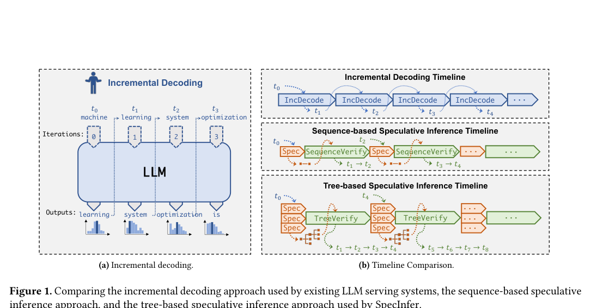

Figure 1 compares three LLM serving methods through timelines and process diagrams. Panel (a) illustrates incremental decoding as a sequential process where an LLM generates one token at a time (e.g., "learning," "system," "optimization") across discrete iterations. Panel (b) uses colored boxes and arrows to contrast the timelines of incremental decoding (one token per step), sequence-based speculative inference (a block of speculative tokens followed by verification), and the proposed tree-based speculative inference (multiple speculative paths verified in a single step).

**Response Length Perception and Sequence Scheduling: An LLM-Empowered LLM
  Inference Pipeline** — [arXiv:2305.13144](https://arxiv.org/abs/2305.13144) p.2

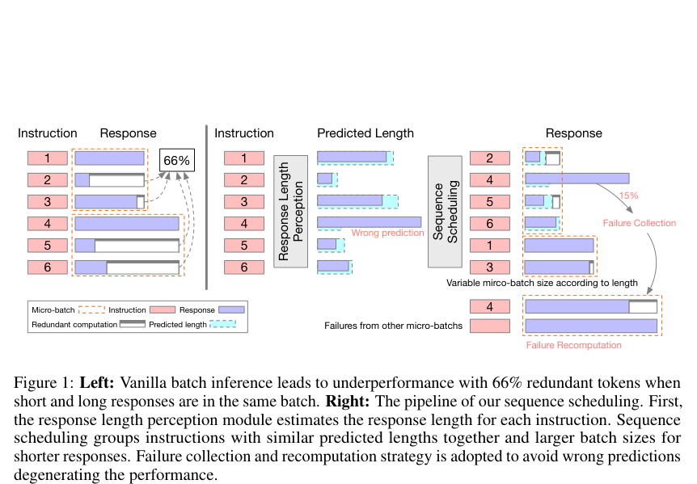

The figure consists of two panels comparing vanilla batch inference with the proposed pipeline. The left panel shows a micro-batch of six instructions with varying response lengths, highlighting that 66% of tokens are redundant due to the mismatch between short and long responses. The right panel illustrates the proposed pipeline, where a "Response Length Perception" module estimates lengths, a "Sequence Scheduling" module groups instructions into variable micro-batches based on those lengths, and a "Failure Collection" and "Failure Recomputation" mechanism handles errors from wrong predictions.

