*deep research · 1 round(s) · 120 landmarks · frontier≥2023: 118 · 4 full-PDF critiques · grounded 53 · off-digest 0*

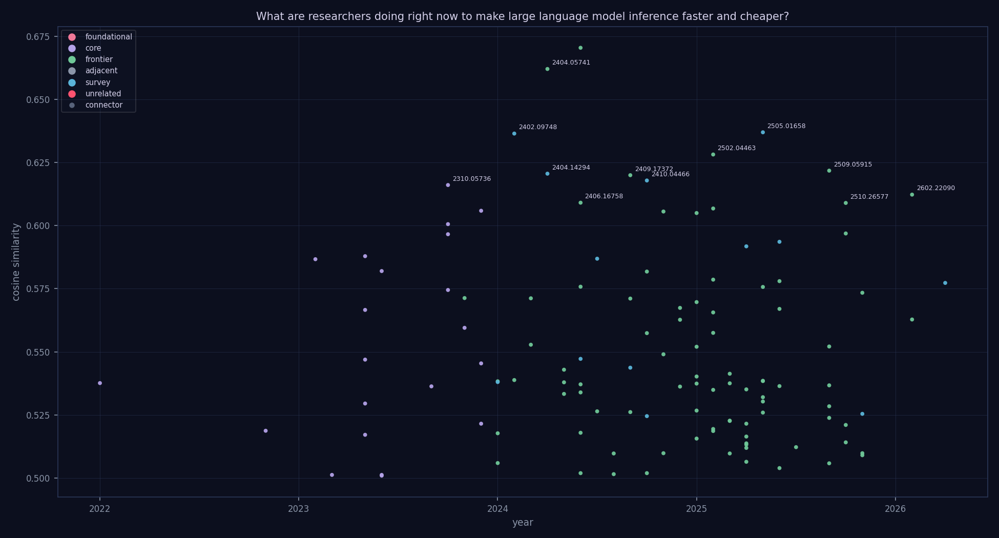

*The citation story graph behind this review — 120 papers, 0 intent-typed edges, 0 lineage threads (gold). Node size = in-topic citations, color = role. [Interactive version](graph.html).*

---

# Scaling Efficiency: A Survey of Modern Large Language Model Inference Optimization

The unprecedented growth in the parameter counts of large language models (LLMs) has introduced a critical bottleneck in the deployment of artificial intelligence: the prohibitive cost and latency of inference. As these models become central to global digital infrastructure, the demand for high-throughput, low-latency responses clashes with the massive memory and computational requirements of transformer architectures. Solving the efficiency problem is essential not only for reducing the environmental and economic footprint of AI but also for enabling real-time interaction and democratizing access to advanced reasoning capabilities across diverse hardware environments.

This review traces the evolution of inference optimization from fundamental model-level reductions to sophisticated, system-wide architectures. We begin by examining foundational techniques in model compression and sparsity, which aim to reduce the inherent size and density of neural networks. We then explore algorithmic acceleration through methods like speculative decoding and early-exiting, followed by systemic strategies for optimizing throughput via advanced batching, scheduling, and memory management. The scope expands to include the structural shifts enabled by distributed and disaggregated inference architectures and the critical role of hardware-software co-design and specialized accelerators. We further address the constraints of edge and mobile deployment, before finally looking toward the frontier of the field: the development of reasoning-aware and adaptive scaling laws that allow models to dynamically allocate compute based on task complexity.

## Foundational Techniques: Model Compression and Sparsity

Current research into accelerating large language model (LLM) inference focuses on two primary axes: reducing the computational footprint of the model architecture itself and minimizing the volume of input data processed during the prefill and decoding phases. As summarized in [arXiv:2402.09748](https://arxiv.org/abs/2402.09748), these efforts encompass a broad spectrum of techniques including pruning, quantization, knowledge distillation, and compact architecture design to optimize network structure and attention computation.

A significant portion of recent work targets the model's internal parameters through pruning. Structural pruning approaches, such as LLM-Pruner, utilize a three-stage process (Discovery, Estimation, and Recovery) to remove interdependent structures, achieving a 20% reduction in parameters [arXiv:2305.11627](https://arxiv.org/abs/2305.11627). This contrasts with weight-centric methods like Wanda, which focuses on pruning network weights by considering both weights and activations [arXiv:2306.11695](https://arxiv.org/abs/2306.11695). While structural pruning aims for architectural efficiency, sparsity-based methods like Deja Vu introduce contextual sparsity by targeting the MLP and Attention blocks to reduce token generation latency [arXiv:2310.17157](https://arxiv.org/abs/2310.17157).

Another distinct research direction addresses the inefficiency of long input contexts. Rather than modifying the model weights, these algorithmic techniques compress the prompt to save tokens and context window usage. Selective Context optimizes context efficiency by filtering redundant content using self-information [arXiv:2310.06201](https://arxiv.org/abs/2310.06201), whereas LLMLingua focuses on compressing the instruction, demonstrations, and questions to reduce inference costs via higher compression ratios [arXiv:2310.05736](https://arxiv.org/abs/2310.05736).

| Method | Target Component | Optimization Category | Primary Resource Saved |
| :--- | :--- | :--- | :--- |
| [arXiv:2310.05736](https://arxiv.org/abs/2310.05736) | Input prompts | Compression | Tokens (sequence length) |
| [arXiv:2310.06201](https://arxiv.org/abs/2310.06201) | Input context | Compression | Context window usage |
| [arXiv:2310.17157](https://arxiv.org/abs/2310.17157) | MLP/Attention blocks | Sparsity | Latency |
| [arXiv:2305.11627](https://arxiv.org/abs/2305.11627) | Interdependent structures | Compression | Parameters (20% removal) |
| [arXiv:2311.18677](https://arxiv.org/abs/2311.18677) | KV-cache/Phase execution | System | Throughput, cost, and power |

While compression and sparsity techniques primarily operate at the algorithmic level to reduce the mathematical complexity of the model, system-level innovations like Splitwise shift the focus toward execution efficiency. Splitwise employs phase splitting—separating prompt computation from token generation onto distinct machines—to optimize throughput, cost, and power [arXiv:2311.18677](https://arxiv.org/abs/2311.18677). 

The literature reveals a tension between these approaches: prompt compression [arXiv:2310.05736](https://arxiv.org/abs/2310.05736), [arXiv:2310.06201](https://arxiv.org/abs/2310.06201) provides a "shallow" efficiency gain by reducing input volume without altering the model, whereas structural pruning [arXiv:2305.11627](https://arxiv.org/abs/2305.11627) and sparsity [arXiv:2310.17157](https://arxiv.org/abs/2310.17157) offer "deep" efficiency by fundamentally altering how the model processes information. However, while prompt compression is highly effective for long-context scenarios, it does not reduce the inherent computational cost of the model's weights, a gap that system-level architectural changes [arXiv:2311.18677](https://arxiv.org/abs/2311.18677) and weight-based pruning aim to bridge.

Beyond standard pruning, architectural innovations such as skipping specific attention sublayers can yield significant speedups in single-token generation [arXiv:2404.05741](https://arxiv.org/abs/2404.05741). Furthermore, algorithmic approaches like the Heavy-Hitter Oracle (H2O) optimize the KV cache to reduce the memory footprint [arXiv:2306.14048](https://arxiv.org/abs/2306.14048), while evolution-based search methods can be used to discover more efficient model architectures [arXiv:2409.17372](https://arxiv.org/abs/2409.17372).
## Algorithmic Acceleration: Speculative Decoding and Early-Exiting

Current research into accelerating large language model (LLM) inference focuses heavily on reducing the overhead of the autoregressive decoding process through two primary paradigms: speculative decoding and early-exiting mechanisms. Speculative decoding seeks to improve throughput by using a smaller, faster "drafter" model to predict multiple tokens, which are then verified in parallel by the target LLM [arXiv:2211.17192](https://arxiv.org/abs/2211.17192).

The evolution of speculative decoding shows a shift from basic draft-verify paradigms toward more complex architectural integrations. While the foundational approach focuses on the autoregressive decoding process to reduce walltime [arXiv:2211.17192](https://arxiv.org/abs/2211.17192), subsequent works have refined the drafter's role. For instance, the "Big Little Decoder" approach achieves speedups ranging from 1.85x to 2.12x by optimizing the generation process [arXiv:2302.07863](https://arxiv.org/abs/2302.07863). More recent frontier research extends this to multilingual contexts, utilizing specialized drafters to save memory bandwidth during the draft-verify-accept cycle [arXiv:2406.16758](https://arxiv.org/abs/2406.16758).

A significant trend in the literature is the transition from simple linear token prediction to structural optimizations. SpecInfer moves beyond single-sequence drafting by implementing tree-based speculative inference and verification, which targets end-to-end latency and reduces overall computational requirements at a system level [arXiv:2305.09781](https://arxiv.org/abs/2305.09781). Similarly, the Lookahead framework introduces a multi-branch strategy paired with a Verification and Accept (VA) process to accelerate decoding while maintaining lossless generation accuracy [arXiv:2312.12728](https://arxiv.org/abs/2312.12728). This highlights a critical tension in the field: the need to increase speed without sacrificing the mathematical integrity of the model's output.

While speculative decoding optimizes the *sequence* of generation, early-exiting algorithms attempt to optimize the *depth* of computation. Unlike the draft-verify paradigm, which adds a secondary model, early-exiting employs architectural and algorithmic co-design to reduce the computational cost per token [arXiv:2509.05915](https://arxiv.org/abs/2509.05915). This is achieved through lightweight routers, deep parameter sharing, and parallel decoding mechanisms that allow the model to exit the computation early if a certain confidence threshold is met [arXiv:2509.05915](https://arxiv.org/abs/2509.05915).

| Method | Optimization Category | Implementation Level | Primary Target |
| :--- | :--- | :--- | :--- |
| [arXiv:2211.17192](https://arxiv.org/abs/2211.17192) | Algorithmic | Algorithmic | Autoregressive decoding |
| [arXiv:2302.07863](https://arxiv.org/abs/2302.07863) | Arch./Algorithmic | Algorithmic | Autoregressive generation |
| [arXiv:2305.09781](https://arxiv.org/abs/2305.09781) | Architectural | System | Token decoding/generation |
| [arXiv:2312.12728](https://arxiv.org/abs/2312.12728) | Architectural | Algorithmic | LLM inference decoding |
| [arXiv:2406.16758](https://arxiv.org/abs/2406.16758) | Algorithmic | Algorithmic | Token generation |
| [arXiv:2509.05915](https://arxiv.org/abs/2509.05915) | Arch./Algorithmic | Alg./Arch. | Model architecture/decoding |

The literature reveals a clear divergence in implementation strategy. Speculative decoding methods, such as those in [arXiv:2211.17192](https://arxiv.org/abs/2211.17192), [arXiv:2302.07863](https://arxiv.org/abs/2302.07863), [arXiv:2305.09781](https://arxiv.org/abs/2305.09781), [arXiv:2312.12728](https://arxiv.org/abs/2312.12728), and [arXiv:2406.16758](https://arxiv.org/abs/2406.16758), primarily focus on the interaction between a drafter and a verifier to bypass the sequential nature of autoregression. In contrast, early-exiting [arXiv:2509.05915](https://arxiv.org/abs/2509.05915) fundamentally alters the model's internal execution path, trading off model depth for throughput. While speculative decoding is highly effective for reducing latency through parallel verification, it requires the management of additional model parameters (the drafter), whereas early-exiting aims to reduce the total parameters and computation required per inference step.

Speculative decoding is being refined through dynamic tree construction techniques that can achieve up to 5.2x speedups over vanilla autoregressive methods [arXiv:2510.26577](https://arxiv.org/abs/2510.26577). Additionally, early-exiting strategies, such as LITE, leverage instruction tuning to enable decoding from intermediate layers [arXiv:2310.18581](https://arxiv.org/abs/2310.18581).
## Optimizing Throughput: Batching, Scheduling, and Memory Management

Current research into maximizing LLM throughput focuses on three interconnected pillars: optimizing batching strategies, refining request scheduling, and managing the memory overhead of the KV cache. While early approaches prioritized compression to fit models into limited hardware, recent frontier work shifts toward dynamic, runtime-aware orchestration of computational resources.

A primary bottleneck in inference is the inefficient utilization of GPU resources due to "computational bubbles" and rigid batching. BATON addresses this by implementing dynamic re-batching through vector shaping and P&D decoupling, which improves query processing throughput by 1.29–1.75x [arXiv:2410.18701](https://arxiv.org/abs/2410.18701). This contrasts with more traditional scheduling methods, such as the multi-bin batching algorithm [arXiv:2412.04504](https://arxiv.org/abs/2412.04504) or the simulated annealing-based SLO-aware scheduler, which prioritizes Service Level Objective (SLO) attainment and latency reduction [arXiv:2504.14966](https://arxiv.org/abs/2504.14966). While BATON targets the structural efficiency of the batching process itself, SLO-aware scheduling focuses on the dispatching logic to reduce average latency by up to 31.6% and improve SLO attainment by up to 5% [arXiv:2504.14966](https://arxiv.org/abs/2504.14966).

Memory management, specifically the KV cache, serves as a critical dimension for both throughput and latency. Researchers have moved from static allocation to highly dynamic, predictive, or reuse-oriented strategies. $S^3$ utilizes a fine-tuned DistalBERT model to predict sequence lengths, allowing for more efficient KV cache memory allocation [arXiv:2306.06000](https://arxiv.org/abs/2306.06000). In contrast, SGLang optimizes throughput by enabling KV cache reuse across multiple generation calls at runtime, which can accelerate common LLM tasks by up to 5x [arXiv:2312.07104](https://arxiv.org/abs/2312.07104). More recent algorithmic approaches, such as the memory-aware and SLA-constrained dynamic batching proposed in [arXiv:2503.05248](https://arxiv.org/abs/2503.05248), attempt to unify these concerns by simultaneously optimizing batch size configuration and KV cache capacity to maximize tokens processed per second [arXiv:2503.05248](https://arxiv.org/abs/2503.05248).

| Method | Primary Optimization Target | Efficiency Metric |
| :--- | :--- | :--- |
| [arXiv:2312.07104](https://arxiv.org/abs/2312.07104) | KV cache reuse | Up to 5x vs. common LLM tasks |
| [arXiv:2410.18701](https://arxiv.org/abs/2410.18701) | Batch-wise process | 1.29–1.75x vs. baseline throughput |
| [arXiv:2504.14966](https://arxiv.org/abs/2504.14966) | Request scheduling | Up to 31.6% vs. baseline latency |

The literature reveals a transition from coarse-grained optimizations to fine-grained, system-algorithm co-designs. Early work like FlexGen focused on compression via group-wise quantization and sparse attention to reduce I/O costs [arXiv:2303.06865](https://arxiv.org/abs/2303.06865), whereas contemporary methods like BATON and the memory-aware batching in [arXiv:2503.05248](https://arxiv.org/abs/2503.05248) treat batching and memory as a joint optimization problem [arXiv:2410.18701](https://arxiv.org/abs/2410.18701), [arXiv:2503.05248](https://arxiv.org/abs/2503.05248). However, a tension remains between maximizing raw throughput and maintaining strict latency guarantees; while BATON and $S^3$ prioritize the former [arXiv:2410.18701](https://arxiv.org/abs/2410.18701), [arXiv:2306.06000](https://arxiv.org/abs/2306.06000), SLO-aware schedulers suggest that throughput gains are secondary to meeting user-defined service constraints [arXiv:2504.14966](https://arxiv.org/abs/2504.14966).

System-level optimizations are increasingly focusing on task scheduling, such as the ScheInfer strategy which utilizes weight tensor slicing to improve latency on single GPU systems [arXiv:2411.15715](https://arxiv.org/abs/2411.15715). Comprehensive surveys highlight that modern inference engines must balance parallelism, compression, and caching to maximize throughput [arXiv:2505.01658](https://arxiv.org/abs/2505.01658), [arXiv:2506.21901](https://arxiv.org/abs/2506.21901).
## Distributed and Disaggregated Inference Architectures

Recent research has shifted from monolithic inference toward distributed and disaggregated architectures to mitigate resource contention between different inference phases. A primary focus is the separation of the prefill and decode phases, a strategy designed to optimize Time to First Token (TTFT), Job Completion Time (JCT), and performance-per-dollar [arXiv:2401.11181](https://arxiv.org/abs/2401.11181). This disaggregation has evolved from simple phase separation to more complex, multi-stage pipelines. For instance, HydraInfer extends this to a three-stage Encode-Prefill-Decode (EPD) disaggregation specifically to support multimodal LLM serving [arXiv:2505.12658](https://arxiv.org/abs/2505.12658).

While disaggregation improves phase-specific efficiency, it introduces significant inter-node communication overhead. KVDirect addresses this bottleneck by optimizing the KV cache transfer process through a "Connect, Transfer, Complete" mechanism to reduce round-trip communication and synchronization [arXiv:2501.14743](https://arxiv.org/abs/2501.14743). Similarly, in multi-vendor GPU environments, researchers have moved toward joint optimization of parallel strategies and instance ratio allocation to maximize resource utilization and inference speed [arXiv:2509.17542](https://arxiv.org/abs/2509.17542).

| Method | Target Component | Optimization Category | Primary Metric |
| :--- | :--- | :--- | :--- |
| [arXiv:2401.11181](https://arxiv.org/abs/2401.11181) | Prefill and decode phases | Architectural/System-level scheduling | TTFT, JCT, and perf/$ |
| [arXiv:2501.14743](https://arxiv.org/abs/2501.14743) | KV cache transfer | Architectural (disaggregated inference) | Communication overhead |
| [arXiv:2505.12658](https://arxiv.org/abs/2505.12658) | Encode, Prefill, and Decode stages | Architectural (Disaggregated scheduling) | System throughput and service capacity |
| [arXiv:2509.17542](https://arxiv.org/abs/2509.17542) | Prefill and Decoding stages | Architectural (disaggregated inference) | Resource utilization and speed |

While the aforementioned methods optimize the internal inference pipeline, other distributed approaches focus on model placement and workload distribution. SplitLLM utilizes collaborative execution between servers and clients to optimize throughput and reduce server-side workload, specifically targeting FLOP or GPU memory savings [arXiv:2410.10759](https://arxiv.org/abs/2410.10759). This contrasts with purely distributed serving systems that utilize skip-join MLFQ schedulers and proactive KV cache management to optimize JCT and GPU memory capacity [arXiv:2305.05920](https://arxiv.org/abs/2305.05920). 

The complexity of managing these distributed components across heterogeneous environments is addressed by GUIDE, which employs simulation-based optimization to navigate the multi-dimensional parameter space of hardware platforms, frameworks, and parallel strategies [arXiv:2412.04788](https://arxiv.org/abs/2412.04788). At the micro-architectural level, optimizations like FlashDecoding++ complement these high-level architectural shifts by targeting the attention computation itself, using asynchronized softmax with a unified max value and flat GEMM optimization to improve raw inference speed [arXiv:2311.01282](https://arxiv.org/abs/2311.01282).

Recent literature provides a holistic view of the evolving landscape of LLM inference serving, emphasizing the need to manage the massive memory overhead inherent in generative models [arXiv:2504.19720](https://arxiv.org/abs/2504.19720).
## Hardware-Software Co-Design and Specialized Accelerators

Current research into accelerating Large Language Model (LLM) inference is shifting from purely algorithmic optimizations toward deep hardware-software co-design to overcome the "memory wall" and data movement bottlenecks. While algorithmic approaches like Multi-query attention (MQA), Grouped-query attention (GQA), and Mixture of Experts (MoE) focus on reducing the computational and memory footprint of attention mechanisms and network execution [arXiv:2407.09111](https://arxiv.org/abs/2407.09111), recent frontier work suggests that hardware-level interventions are necessary to realize these theoretical gains.

A significant trend involves integrating computation closer to memory to mitigate data movement energy. HALO utilizes 2.5D heterogeneous integration, combining HBM-based Compute-in-DRAM (CiD) with on-chip analog Compute-in-Memory (CiM) to target low-batch inference [arXiv:2510.02675](https://arxiv.org/abs/2510.02675). This memory-centric approach achieves substantial performance leaps, demonstrating up to a 2.5x speedup over CENT and 18x over AttAcc [arXiv:2510.02675](https://arxiv.org/abs/2510.02675). Similarly, SAIL addresses memory bandwidth constraints by employing near-memory computing using SRAM as a ping-pong buffer and utilizing lookup-table-based GEMV [arXiv:2509.25853](https://arxiv.org/abs/2509.25853). SAIL's system-level approach results in a 10.7x speedup and 19.9x improvement in cost efficiency compared to its baseline [arXiv:2509.25853](https://arxiv.org/abs/2509.25853).

Other researchers focus on the synergy between compression and architectural efficiency. AccLLM employs an algorithm-hardware co-design strategy that combines semi-structured pruning, k-shaped attention, and W2A8KV4 quantization to reduce computational complexity and memory access overheads [arXiv:2505.03745](https://arxiv.org/abs/2505.03745). This contrasts with purely architectural efforts like Inferflow, which focuses on a modular, highly configurable inference engine framework to optimize latency through atomic build-blocks [arXiv:2401.08294](https://arxiv.org/abs/2401.08294), or studies focusing on scaling strategies through expert and tensor parallelism [arXiv:2506.00008](https://arxiv.org/abs/2506.00008).

| Method | Primary Optimization Target | Implementation Level | Key Efficiency Metric |
| :--- | :--- | :--- | :--- |
| [arXiv:2510.02675](https://arxiv.org/abs/2510.02675) | HBM-based CiD and analog CiM | Hardware | 2.5x speedup vs CENT; 18x vs AttAcc |
| [arXiv:2509.25853](https://arxiv.org/abs/2509.25853) | SRAM near-memory computing | System/Hardware | 10.7x speedup; 19.9x cost efficiency vs baseline |
| [arXiv:2505.03745](https://arxiv.org/abs/2505.03745) | Pruning and W2A8KV4 quantization | Algorithm-Hardware | Throughput (via reduced complexity) |

The literature reveals a tension between general-purpose architectural modularity and highly specialized, domain-specific hardware. While modular engines like Inferflow [arXiv:2401.08294](https://arxiv.org/abs/2401.08294) offer flexibility, they may lack the extreme efficiency gains seen in specialized accelerators like HALO [arXiv:2510.02675](https://arxiv.org/abs/2510.02675) or SAIL [arXiv:2509.25853](https://arxiv.org/abs/2509.25853), which achieve orders-of-magnitude improvements by fundamentally altering how data moves between memory and compute units. However, the extreme specialization of near-memory or CiM-based approaches may introduce complexity in deployment compared to the algorithmic-heavy optimizations (e.g., GQA/MoE) that can be implemented on existing AI accelerators [arXiv:2407.09111](https://arxiv.org/abs/2407.09111).

Hardware-centric perspectives are becoming essential, particularly in understanding the unique acceleration requirements of generative LLMs compared to traditional encoder models [arXiv:2410.04466](https://arxiv.org/abs/2410.04466).
## Edge and Mobile Deployment: Resource-Constrained Inference

Current research into edge and mobile LLM deployment focuses on three primary axes: algorithmic acceleration via speculative execution, neuron-level activation management, and system-level hardware/memory optimizations.

Algorithmic speedups are frequently pursued through speculative decoding to mitigate the memory wall. LLMCad [2309.04255] utilizes a speculative generation pipeline, employing a memory-resident model as a generator and a target model as a verifier to improve latency. Similarly, research into specialized drafters [2406.16758] refines this draft-verify-accept paradigm to optimize inference time and memory bandwidth, particularly for multilingual tasks. While both approaches target the generation process at an algorithmic level, they represent a shared shift toward decoupling the drafting and verification stages to bypass bandwidth bottlenecks.

A second approach targets the inherent sparsity of model activations. PowerInfer [2312.12456] exploits the locality of "hot" versus "cold" neurons to optimize GPU memory usage on consumer-grade hardware. This concept is significantly advanced in PowerInfer-2 [2406.06282], which transitions from GPU-centric to smartphone-centric deployment. By implementing a polymorphic neuron engine that decomposes matrix computations into fine-grained neuron clusters, PowerInfer-2 achieves 68 tokens/s on a smartphone and reduces memory requirements by nearly 40% for 7B models. This represents a shift from purely algorithmic neuron management to a system-level implementation capable of handling the extreme constraints of mobile hardware.

System-level optimizations focus on the specific hardware-software interface of mobile devices. Transformer-Lite [2403.20041] optimizes mobile GPU performance through a multi-faceted approach, including FP4 quantization (M0E4), sub-tensor-based KV cache management, and symbolic expression-based dynamic shape support. In contrast, MNN-LLM [2506.10443] addresses the memory bottleneck by combining quantization with a DRAM-Flash hybrid storage strategy, specifically targeting high-computation operators and data layout to improve both speed and memory efficiency. While Transformer-Lite focuses on the efficiency of the GPU execution and cache management, MNN-LLM prioritizes the management of the memory hierarchy itself.

Finally, researchers are exploring collaborative paradigms that move beyond single-device constraints. PICE [2501.09367] introduces a progressive inference paradigm for cloud-edge networks. Unlike the previous methods that optimize a single device's resources, PICE utilizes a two-stage modeling approach—cloud-based sketch generation followed by edge-based parallel extension—to achieve a 1.5x to 2x enhancement in throughput and up to a 43% reduction in latency. This collaborative approach suggests that the future of edge deployment may rely as much on network orchestration as on local device optimization.

None
## The Frontier: Reasoning-Aware and Adaptive Scaling Laws

Recent research has shifted from general scaling towards optimizing the specific relationship between model architecture, reasoning depth, and inference efficiency. This frontier can be categorized into three distinct approaches: architectural co-optimization, reasoning-aware training, and dynamic model selection.

One prominent direction involves refining scaling laws to prioritize inference efficiency. While traditional scaling focuses on parameter count and token volume, [arXiv:2501.18107](https://arxiv.org/abs/2501.18107) proposes modified Chinchilla scaling laws that co-optimize these parameters alongside model architecture to minimize inference latency. Similarly, [arXiv:2510.18245](https://arxiv.org/abs/2510.18245) moves beyond parameter scaling to perform architecture searches, specifically varying hidden sizes and the ratio of MLP-to-attention layers to maximize inference throughput in decoder-only transformers. These methods suggest that the "optimal" model is no longer just a function of data and parameters, but is deeply tied to the structural efficiency of the architecture itself.

A second approach focuses on the computational cost of reasoning, particularly the length of Chain-of-Thought (CoT) sequences. Rather than altering the architecture, [arXiv:2502.04463](https://arxiv.org/abs/2502.04463) optimizes the training objective by using a monotonic function to penalize response length, thereby improving token-efficiency during inference. This contrasts with distillation-based methods like [arXiv:2502.20339](https://arxiv.org/abs/2502.20339), which seeks to compress reasoning capabilities by distilling knowledge from Transformers into more efficient architectures, such as Mamba, achieving a 2.5x speedup in inference time. Furthermore, [arXiv:2602.04919](https://arxiv.org/abs/2602.04919) introduces "Gradual Compaction" (PTL) to reduce FLOPs by progressively compacting parameters, offering a different path to efficiency through structural reduction rather than objective-based length control.

Finally, researchers are exploring adaptive inference through model cascading and selection.

| Method | Optimization Category | Primary Efficiency Metric | Key Result/Mechanism |
| :--- | :--- | :--- | :--- |
| [arXiv:2602.22090](https://arxiv.org/abs/2602.22090) | Architectural (Cascading) | Token costs | 60% reduction in GPT-4o usage vs. baseline; 36.46% cost reduction for 8B $\to$ 70B LLaMA |
| [arXiv:2502.04463](https://arxiv.org/abs/2502.04463) | Algorithmic (Training) | Token-efficiency | Length-penalized objective function |
| [arXiv:2502.20339](https://arxiv.org/abs/2502.20339) | Compression/Distillation | Inference time | 2.5x speedup via Transformer-to-Mamba distillation |[arXiv:2602.22090](https://arxiv.org/abs/2602.22090) introduces a sophisticated confidence-driven selection mechanism that uses both token probability $P(T)$ and a trained MLP classifier $P(IK)$ to route queries through a hierarchy of LLMs. While this achieves significant reductions in both token usage and computational cost, it introduces new complexities. The reliance of the $P(IK)$ classifier on supervised training for specific datasets limits its generalizability, and the multi-stage escalation process risks increasing end-to-end latency and causing error propagation across the model cascade. This highlights a fundamental tension in the field: while architectural and training-based optimizations [arXiv:2501.18107](https://arxiv.org/abs/2501.18107), [arXiv:2502.04463](https://arxiv.org/abs/2502.04463) aim to make individual models leaner, adaptive routing [arXiv:2602.22090](https://arxiv.org/abs/2602.22090) attempts to manage the cost of intelligence by intelligently selecting the scale of the model required for a given task.

None

## Further Reading

- [arXiv:2404.14294](https://arxiv.org/abs/2404.14294) (2024) — "A Survey on Efficient Inference for Large Language Models" [survey, cited-by 0 in-topic]
- [arXiv:2305.05176](https://arxiv.org/abs/2305.05176) (2023) — "FrugalGPT: How to Use Large Language Models While Reducing Cost and
  Improving Performance" [core, cited-by 0 in-topic]

## Tensions and Open Problems

A primary tension in the current literature concerns the optimal allocation of computational budget: whether intelligence should be scaled through increased inference-time computation or through more efficient model architectures. On one side, researchers argue that intelligence can be augmented by scaling the "thinking" process, using distilled reasoners to expand inference compute for complex tasks [arXiv:2502.20339](https://arxiv.org/abs/2502.20339). This view suggests that reasoning is a temporal process that can be stretched to improve accuracy. Conversely, a growing body of work suggests that the focus should remain on the structural efficiency of the model itself, arguing that scaling laws must be reconciled with model architecture to create inherently inference-efficient LLMs [arXiv:2510.18245](https://arxiv.org/abs/2510.18245). This debate poses a fundamental question: is reasoning an emergent property of extended compute cycles, or is it a structural property that must be baked into the model's design to remain cost-effective?

A second debate centers on the trade-off between dynamic inference efficiency and the preservation of high-level reasoning capabilities. Proponents of dynamic execution suggest that we can significantly reduce costs by employing early-exiting algorithms [arXiv:2509.05915](https://arxiv.org/abs/2509.05915) or by utilizing inference-cost-aware dynamic tree construction [arXiv:2510.26577](https://arxiv.org/abs/2510.26577) to bypass unnecessary computations. However, there is growing concern regarding the "reasoning debt" incurred by such methods. While some approaches attempt to mitigate this through gradual compaction strategies to prevent the loss of cognitive depth—a concept described as avoiding the "boiling frog" effect [arXiv:2602.04919](https://arxiv.org/abs/2602.04919)—it remains unclear if aggressive pruning or early exiting fundamentally compromises the model's ability to handle multi-step logical deductions compared to full-width inference.

Finally, there is a structural tension between centralized serving optimization and the decentralization of intelligence. Much of the recent survey literature focuses on optimizing large-scale inference engines and serving systems to maximize throughput and minimize latency in cloud environments [arXiv:2504.19720](https://arxiv.org/abs/2504.19720); [arXiv:2506.21901](https://arxiv.org/abs/2506.21901). In contrast, a burgeoning subfield argues that the future of LLM deployment lies at the network edge, necessitating entirely different principles for distributed inference that prioritize local resource constraints over global throughput [arXiv:2604.22906](https://arxiv.org/abs/2604.22906). This creates a divide between researchers optimizing for "massive-scale efficiency" in the data center and those optimizing for "ubiquitous efficiency" on edge devices.

## Outlook

The frontier of LLM inference is shifting from simple parameter reduction toward "intelligence-aware" efficiency. We are moving away from static model deployment and toward highly adaptive systems that can dynamically modulate their computational depth based on task complexity and available hardware. The next generation of research will likely converge on the intersection of reasoning-centric compression and hardware-aware edge orchestration, seeking to create models that do not just "run faster," but "think smarter" with a strictly bounded energy and latency budget.

**Training Language Models to Reason Efficiently** — [arXiv:2502.04463](https://arxiv.org/abs/2502.04463) p.2

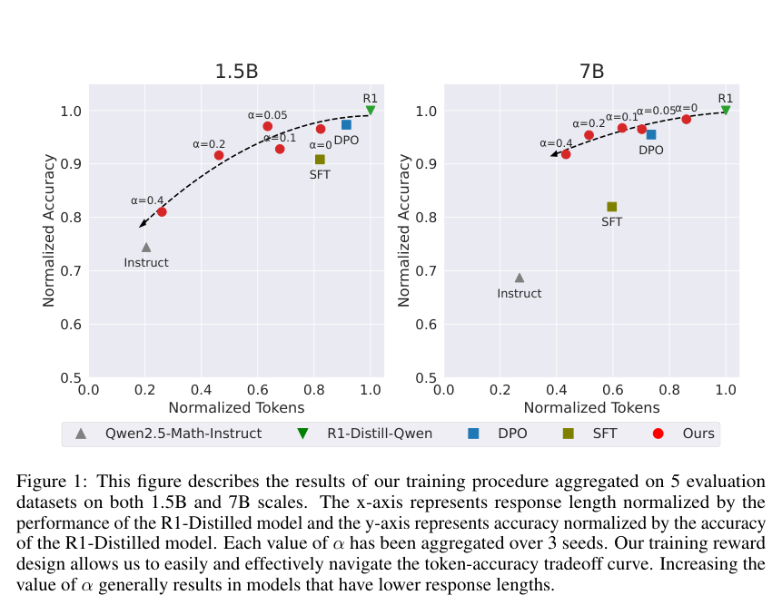

The figure consists of two scatter plots (labeled 1.5B and 7B) showing the relationship between Normalized Tokens on the x-axis and Normalized Accuracy on the y-axis. Data points represent different training methods—including Instruct, SFT, DPO, R1-Distill-Qwen, and various $\alpha$ values for the authors' method (red dots)—connected by a dashed black line. The plots convey a token-accuracy tradeoff curve, demonstrating how adjusting the $\alpha$ parameter allows for navigating between response length and accuracy.

**Search for Efficient Large Language Models** — [arXiv:2409.17372](https://arxiv.org/abs/2409.17372) p.2

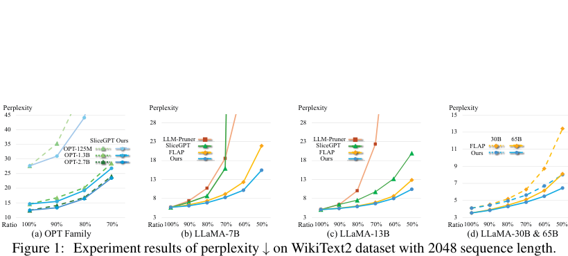

The figure consists of four line graphs labeled (a) OPT Family, (b) LLaMA-7B, (c) LLaMA-13B, and (d) LLaMA-30B & 65B, which plot Perplexity on the y-axis against Ratio on the x-axis. Each plot uses colored lines and markers to compare the perplexity performance of different pruning methods (such as SliceGPT, FLAP, and "Ours") across various model scales. The graphs convey that the "Ours" method generally maintains lower perplexity at higher compression ratios compared to the other baseline methods.

**LLMLingua: Compressing Prompts for Accelerated Inference of Large
  Language Models** — [arXiv:2310.05736](https://arxiv.org/abs/2310.05736) p.3

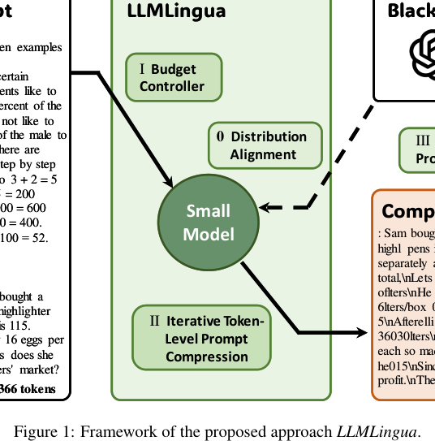

The figure presents a flowchart of the LLMLingua framework, illustrating the process of compressing a large prompt into a smaller one for efficient LLM inference. It depicts a workflow where an input prompt passes through a "Budget Controller" and "Distribution Alignment" module to interact with a "Small Model," which then performs "Iterative Token-Level Prompt Compression" to produce a compressed output for a "Black-box LLM."

**Confidence-Driven Multi-Scale Model Selection for Cost-Efficient Inference** — [arXiv:2602.22090](https://arxiv.org/abs/2602.22090) p.2

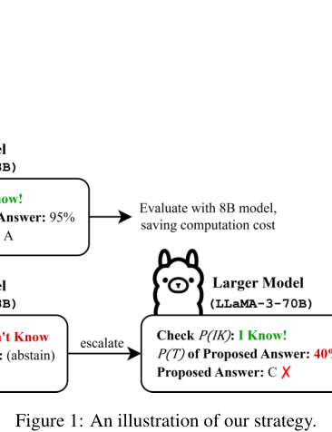

The figure uses boxes, arrows, and text labels to illustrate a decision-making strategy for model selection. It depicts a workflow where a model's confidence is checked: if the model is confident ("I Know!"), it evaluates with an 8B model to save computation cost; if it is not confident ("I Don't Know"), it escalates the task to a larger model (LLaMA-3-70B).

**Towards Fast Multilingual LLM Inference: Speculative Decoding and
  Specialized Drafters** — [arXiv:2406.16758](https://arxiv.org/abs/2406.16758) p.1

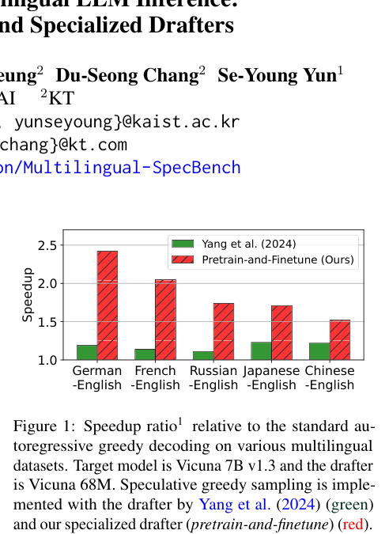

This bar chart compares the speedup ratio of two speculative decoding methods across five multilingual datasets: German-English, French-English, Russian-English, Japanese-English, and Chinese-English. The x-axis lists the language pairs, the y-axis represents the speedup ratio, and the bars use green to denote the method by Yang et al. (2024) and red to denote the authors' "Pretrain-and-Finetune" method. The figure conveys that the authors' specialized drafter consistently achieves a higher speedup ratio than the baseline across all tested language pairs.

**Inference-Cost-Aware Dynamic Tree Construction for Efficient Inference in Large Language Models** — [arXiv:2510.26577](https://arxiv.org/abs/2510.26577) p.5

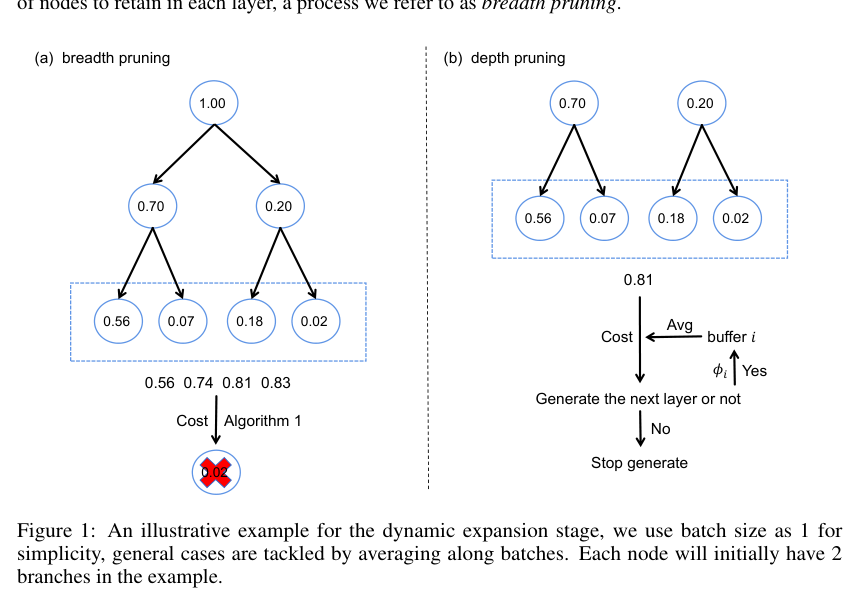

The figure consists of two tree diagrams, labeled (a) breadth pruning and (b) depth pruning, illustrating different strategies for tree construction. Diagram (a) shows a hierarchical structure of nodes with numerical values connected by arrows, followed by a calculation of average values per layer and a decision process involving "Cost" and "Algorithm 1" that results in a red "X" icon. Diagram (b) shows a similar tree structure that leads to a decision flow where an average value of 0.81 is compared against a threshold $\phi_i$ to determine whether to generate the next layer or stop.

**Thinking Slow, Fast: Scaling Inference Compute with Distilled Reasoners** — [arXiv:2502.20339](https://arxiv.org/abs/2502.20339) p.2

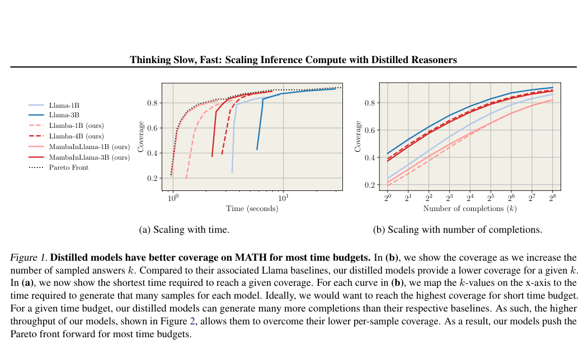

Figure 1 contains two line graphs, (a) "Scaling with time" and (b) "Scaling with number of completions," comparing the coverage of Llama baseline models against various distilled "ours" models. Graph (a) plots coverage against time in seconds on a logarithmic x-axis, showing that distilled models reach higher coverage faster and push the Pareto front forward. Graph (b) plots coverage against the number of completions ($k$) on a logarithmic x-axis, illustrating that while distilled models have lower coverage per individual sample, their higher throughput allows them to achieve better overall coverage as $k$ increases.

**Lookahead: An Inference Acceleration Framework for Large Language Model
  with Lossless Generation Accuracy** — [arXiv:2312.12728](https://arxiv.org/abs/2312.12728) p.3

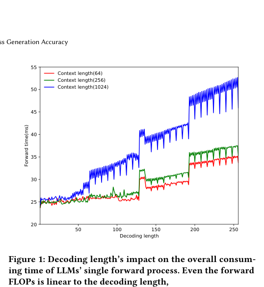

This line graph plots forward time in milliseconds (y-axis) against decoding length (x-axis) for three different context lengths: 64 (red), 256 (green), and 1024 (blue). The figure conveys that as decoding length increases, the forward time grows linearly for each context length, with larger context lengths resulting in higher overall latency.

**Task Scheduling for Efficient Inference of Large Language Models on
  Single Moderate GPU Systems** — [arXiv:2411.15715](https://arxiv.org/abs/2411.15715) p.2

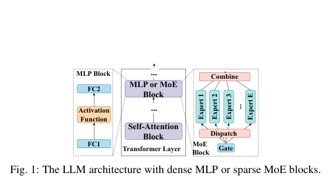

The figure depicts a hierarchical LLM architecture diagram consisting of a central "MLP or MoE Block" positioned above a "Self-Attention Block" and a "Transformer Layer." The MoE (Mixture-of-Experts) component is detailed via a sub-diagram showing a "Dispatch" mechanism that routes inputs to multiple "Expert" boxes, which are then processed by a "Combine" block.

**Scaling Inference-Efficient Language Models** — [arXiv:2501.18107](https://arxiv.org/abs/2501.18107) p.1

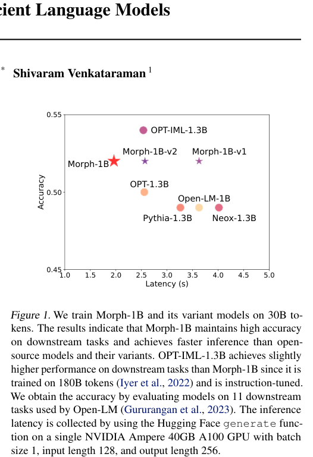

This scatter plot displays the relationship between model accuracy (y-axis) and inference latency in seconds (x-axis) for several 1.3B parameter language models. Data points representing Morph-1B, Morph-1B-v1, Morph-1B-v2, OPT-IML-1.3B, OPT-1.3B, Open-LM-1B, Pythia-1.3B, and Neox-1.3B are plotted to show that Morph-1B maintains high accuracy while achieving lower latency than most open-source counterparts.

**Compressing Context to Enhance Inference Efficiency of Large Language
  Models** — [arXiv:2310.06201](https://arxiv.org/abs/2310.06201) p.1

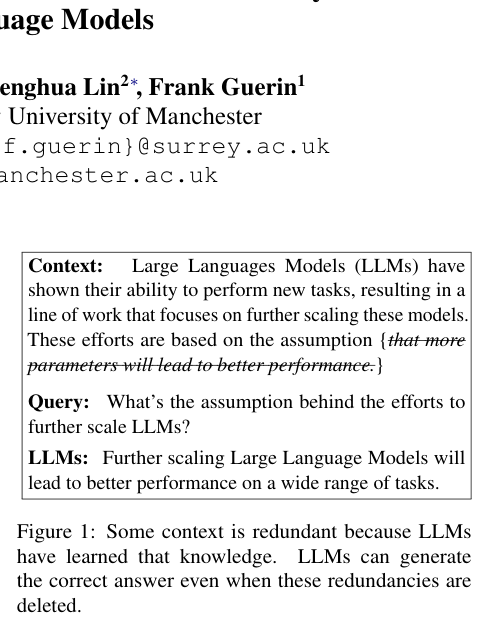

The figure displays a text-based example consisting of three labeled sections: "Context," "Query," and "LLMs." The "Context" box contains a paragraph about scaling Large Language Models, the "Query" asks for the assumption behind scaling, and the "LLMs" section provides the corresponding answer. The figure illustrates that some context is redundant because the model can generate the correct answer even when specific information is removed.

**Scaling Laws Meet Model Architecture: Toward Inference-Efficient LLMs** — [arXiv:2510.18245](https://arxiv.org/abs/2510.18245) p.1

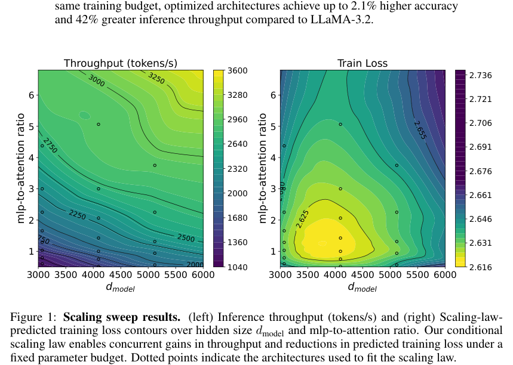

The figure consists of two side-by-side contour plots with axes representing model size ($d_{\text{model}}$) and the mlp-to-attention ratio. The left plot shows inference throughput in tokens per second, illustrating how throughput increases with larger model sizes and lower mlp-to-attention ratios, while the right plot shows scaling-law-predicted training loss, illustrating how loss decreases with larger model sizes and higher mlp-to-attention ratios. Dotted points on both plots indicate the specific architectures used to fit the scaling laws.

