*deep research · 3 round(s) · 260 landmarks · frontier≥2023: 196 · 4 full-PDF critiques · grounded 60 · off-digest 0*

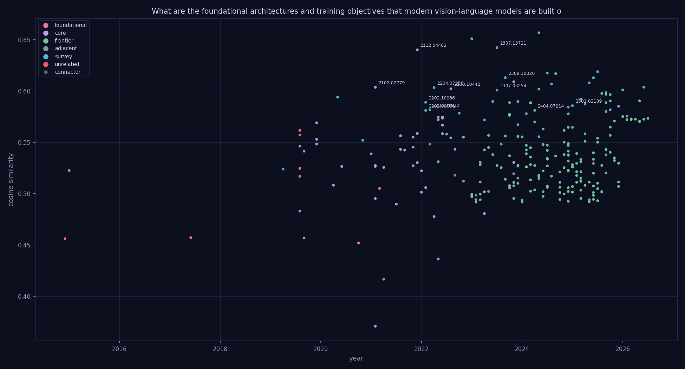

*The citation story graph behind this review — 260 papers, 0 intent-typed edges, 0 lineage threads (gold). Node size = in-topic citations, color = role. [Interactive version](graph.html).*

---

# From Alignment to Action: A Review of Vision-Language Model Architectures and Objectives

The ability to bridge the gap between visual perception and linguistic reasoning is a cornerstone of general artificial intelligence, necessitating the translation of continuous sensory input into structured semantic concepts. This challenge is central to creating machines that can not only observe their surroundings but also reason about and communicate their experiences. The evolution of this field began with the establishment of early foundations, where research focused heavily on cross-modal alignment and the development of specialized encoder architectures designed to map disparate data types into a common representational space.

The trajectory of the field has since moved through several transformative stages, beginning with the rise of pre-trained vision-language transformers that provided a more robust framework for large-scale representation learning. This was followed by a period of intense focus on scaling and modularity, where the community navigated the trade-offs between monolithic unified encoders and the more flexible integration of adapters. These advancements paved the way for the current era of Large Vision-Language Models (LVLMs), where instruction tuning has become the standard for aligning massive multimodal capabilities with nuanced human commands.

This review traces this historical and technical arc from its origins in basic alignment to the current state-of-the-art. Finally, it examines the emerging frontier of the field, where the focus is shifting toward embodied intelligence. This includes the development of Vision-Language-Action (VLA) models and the pursuit of world models, representing a move from models that merely describe the world to agents that can act within and predict its underlying dynamics.

## Early Foundations: Cross-Modal Alignment and Encoder Architectures

Early efforts in vision-language modeling focused on learning inter-modal correspondences through hybrid architectures. One approach utilized CNNs for image regions combined with bidirectional RNNs for language to generate natural language descriptions [arXiv:1412.2306](https://arxiv.org/abs/1412.2306). Other methods sought to extend linguistic models, such as the MMSkip-gram, which jointly predicts linguistic contexts and visual features to learn shared representations [arXiv:1501.02598](https://arxiv.org/abs/1501.02598). These early models were eventually superseded by the Transformer architecture [arXiv:1706.03762](https://arxiv.org/abs/1706.03762), which replaced recurrence and convolutions with multi-head self-attention. This paradigm shift extended to vision via the Vision Transformer (ViT), which processes image patches directly, demonstrating that pure Transformer architectures can outperform CNN-based models on large-scale image recognition tasks [arXiv:2010.11929](https://arxiv.org/abs/2010.11929).

As research transitioned into vision-language pre-training (VLP), architectures diverged into two-stream and single-stream configurations.

| Method | Architecture Type | Interaction Mechanism |
| :--- | :--- | :--- |
| [arXiv:1908.02265](https://arxiv.org/abs/1908.02265) | Two-stream | Co-attentional layers |
| [arXiv:1908.07490](https://arxiv.org/abs/1908.07490) | Three-stream | Cross-attention |
| [arXiv:1908.03557](https://arxiv.org/abs/1908.03557) | Single-stream | Self-attention |
| [arXiv:1908.08530](https://arxiv.org/abs/1908.08530) | Single-stream | Self-attention |
| [arXiv:1908.06066](https://arxiv.org/abs/1908.06066) | Single-stream | Self-attention |

The two-stream models, such as ViLBERT [arXiv:1908.02265](https://arxiv.org/abs/1908.02265) and LXMERT [arXiv:1908.07490](https://arxiv.org/abs/1908.07490), utilize dedicated encoders for visual and textual inputs that interact through co-attentional or cross-modality layers. While these allow for specialized modality processing, single-stream models offer a more streamlined alternative. VisualBERT [arXiv:1908.03557](https://arxiv.org/abs/1908.03557) and VL-BERT [arXiv:1908.08530](https://arxiv.org/abs/1908.08530) both utilize Transformer-based structures to implicitly align text and image regions through self-attention. VisualBERT is notably simpler and more performant as a baseline [arXiv:1908.03557](https://arxiv.org/abs/1908.03557), whereas VL-BERT achieves high performance in visual commonsense reasoning by taking both linguistic and visual region-of-interest (RoI) features as input [arXiv:1908.08530](https://arxiv.org/abs/1908.08530). 

The complexity of training objectives also evolved alongside these architectures. While VL-BERT relies on generic visual-linguistic representations, Unicoder-VL [arXiv:1908.06066](https://arxiv.org/abs/1908.06066) introduces a more diverse set of pre-training tasks, including Masked Object Classification (MOC) and Visual-linguistic Matching (VLM), to improve image-text retrieval. Finally, the Unified VLP approach [arXiv:1909.11059](https://arxiv.org/abs/1909.11059) moves beyond pure understanding by using a shared multi-layer Transformer for both encoding and decoding, enabling a single model to perform both vision-language generation (captioning) and understanding (VQA).

Early efforts focused on unifying diverse vision-and-language tasks into single multimodal conditional text generation frameworks, such as using VL-T5 and VL-BART architectures with region embeddings [arXiv:2102.02779](https://arxiv.org/abs/2102.02779). This period established the foundational distinction between single-stream and dual-stream architectures, as well as the various ways to model cross-modal interactions through self-attention or co-attention [arXiv:2204.07356](https://arxiv.org/abs/2204.07356), [arXiv:2202.10936](https://arxiv.org/abs/2202.10936).
## The Rise of Pre-trained Vision-Language Transformers

The evolution of vision-language pre-training (VLP) has transitioned from task-specific architectures to unified foundation models that bridge unimodal and multimodal reasoning. Early approaches focused on multi-task regimes using parallel BERT-style models for image regions and text, such as ViLBERT, which improved VQA performance (71.82 vs. 70.55) through multi-task pretraining [arXiv:1912.02315](https://arxiv.org/abs/1912.02315). To address the difficulty of fine-grained inter-modality relationships, researchers introduced weak supervision to encourage word-object alignment [arXiv:1912.03063](https://arxiv.org/abs/1912.03063), while Oscar utilized object tags as anchor points to facilitate cross-modal alignment [arXiv:2004.06165](https://arxiv.org/abs/2004.06165).

A significant architectural divide exists between dual-stream and single-stream models. Dual-stream models, such as ALIGN [arXiv:2102.05918](https://arxiv.org/abs/2102.05918) and CLIP [arXiv:2103.00020](https://arxiv.org/abs/2103.00020), leverage contrastive learning on large-scale noisy web data to achieve robust zero-shot transfer [arXiv:2103.00020](https://arxiv.org/abs/2103.00020). While CLIP demonstrates superior robustness compared to supervised ImageNet models [arXiv:2103.00020](https://arxiv.org/abs/2103.00020), it lacks the deep fusion capabilities of single-stream models. Single-stream models, like ViLT, achieve competent performance by removing heavy convolutional or region supervision in favor of image-text matching and masked language modeling [arXiv:2102.03334](https://arxiv.org/abs/2102.03334).

Recent trends emphasize unification through shared architectures and diverse objectives.

| Method | Architecture Type | Primary Objectives | Key Contribution |
| :--- | :--- | :--- | :--- |
| FLAVA [arXiv:2112.04482](https://arxiv.org/abs/2112.04482) | Transformer-based | Unimodal (MIM/MLM) + Multimodal (MMM/ITM/GC) | Achieves 75.85 macro-average across 35 tasks using a small 70M-pair dataset [arXiv:2112.04482](https://arxiv.org/abs/2112.04482). |
| VLMo [arXiv:2111.02358](https://arxiv.org/abs/2111.02358) | MoME Transformer | Contrastive (ITC) + Matching (ITM) + Masking (MLM) | Uses Mixture-of-Modality-Experts to function as both dual and fusion encoders [arXiv:2111.02358](https://arxiv.org/abs/2111.02358). |
| CoCa [arXiv:2205.01917](https://arxiv.org/abs/2205.01917) | Encoder-Decoder | Contrastive + Captioning | Combines CLIP-style contrastive learning with generative captioning [arXiv:2205.01917](https://arxiv.org/abs/2205.01917). |
| BEiT-3 [arXiv:2208.10442](https://arxiv.org/abs/2208.10442) | Multiway Transformer | Masked Data Modeling | Uses modality-specific experts to achieve SOTA across vision and V+L tasks [arXiv:2208.10442](https://arxiv.org/abs/2208.10442). |

While FLAVA provides a holistic approach to unimodal and multimodal tasks, it faces optimization complexity, as adding unimodal data can sometimes decrease macro-average performance [arXiv:2112.04482](https://arxiv.org/abs/2112.04482). In contrast, VLMo addresses architectural flexibility through its Mixture-of-Modality-Experts, allowing it to switch between dual-encoder and fusion-encoder roles [arXiv:2111.02358](https://arxiv.org/abs/2111.02358). The field has further moved toward generative unification; for instance, CoCa integrates contrastive learning with image-to-caption generation to bridge the gap between discriminative and generative capabilities [arXiv:2205.01917](https://arxiv.org/abs/2205.01917). Similarly, BEiT-3 utilizes a multiway Transformer with modality experts to achieve state-of-the-art transfer performance across both vision and vision-language domains [arXiv:2208.10442](https://arxiv.org/abs/2208.10442). This progression highlights a shift from specialized encoders toward generalist models capable of handling diverse tasks through unified, multi-objective training [arXiv:2211.09808](https://arxiv.org/abs/2211.09808).

The transition to transformer-based pre-training was characterized by a move toward minimalist generative frameworks like SimVLM, which utilized weak supervision to achieve zero-shot transfer [arXiv:2108.10904](https://arxiv.org/abs/2108.10904). Subsequent surveys have categorized these pre-trained models based on their interaction depth and whether they utilize encoder-only or encoder-decoder designs [arXiv:2307.03254](https://arxiv.org/abs/2307.03254), [arXiv:2202.09061](https://arxiv.org/abs/2202.09061). These models expanded the scope of pre-training from simple image-text pairs to include video-text tasks and more complex vision-centric objectives [arXiv:2210.09263](https://arxiv.org/abs/2210.09263).
## Scaling and Modularity: From Unified Encoders to Adapters

Modern vision-language models (VLMs) have transitioned from architectures that integrate multimodal fusion directly into the backbones toward modular designs that leverage frozen, large-scale components. Early foundational approaches focused on deep integration to mitigate information asymmetry. For instance, mPLUG utilizes cross-modal skip-connections between a 6-layer text encoder and a 12-layer decoder to improve efficiency [arXiv:2205.12005](https://arxiv.org/abs/2205.12005). Similarly, Fiber employs a "fusion-in-the-backbone" strategy, inserting cross-attention layers and gating mechanisms within Swin-Base and RoBERTa-Base to handle both high-level understanding and region-level tasks [arXiv:2206.07643](https://arxiv.org/abs/2206.07643). These models often rely on training objectives categorized as contrastive, generative, or hybrid [arXiv:2307.13721](https://arxiv.org/abs/2307.13721).

A significant architectural shift has occurred toward "Adapted LLM" designs, which use lightweight modules to bridge frozen vision encoders and frozen large language models (LLMs). This modularity offers substantial efficiency; BLIP-2, for example, outperforms Flamingo by 8.7% on zero-shot VQAv2 while utilizing 54% fewer trainable parameters [arXiv:2301.12597](https://arxiv.org/abs/2301.12597). The complexity of these bridging mechanisms varies significantly across the literature:

| Method | Connection Mechanism | Primary Function |
| :--- | :--- | :--- |
| [arXiv:2301.12597](https://arxiv.org/abs/2301.12597) | Q-Former | Bootstrapping frozen components |
| [arXiv:2304.08485](https://arxiv.org/abs/2304.08485) | MLP projection | Visual instruction tuning |
| [arXiv:2311.03079](https://arxiv.org/abs/2311.03079) | Visual expert module | Deep fusion in attention/FFN layers |
| [arXiv:2308.12966](https://arxiv.org/abs/2308.12966) | Position-aware adapter | Feature compression and localization |

While lightweight adapters like the MLP projection used in LLaVA provide a simple connection for instruction tuning [arXiv:2304.08485](https://arxiv.org/abs/2304.08485), they may lack the depth required for complex reasoning. CogVLM addresses this by integrating a trainable visual expert module directly into the attention and FFN layers of a GPT-style LLM, enabling deep feature fusion without sacrificing NLP performance [arXiv:2311.03079](https://arxiv.org/abs/2311.03079). Similarly, Qwen-VL utilizes a specialized position-aware adapter to support fine-grained tasks like text reading and localization [arXiv:2308.12966](https://arxiv.org/abs/2308.12966).

The effectiveness of these architectures is heavily dependent on the training protocol. VILA demonstrates that simply training a projector is insufficient for advanced capabilities; updating the base LLM is essential to inherit properties such as multi-image reasoning and enhanced world knowledge [arXiv:2312.07533](https://arxiv.org/abs/2312.07533). Beyond structural design, specialized objectives further refine model performance. EqSim introduces an equivariant similarity objective to ensure representations vary faithfully with semantic changes [arXiv:2303.14465](https://arxiv.org/abs/2303.14465), while retrieval-based schemes can achieve state-of-the-art knowledge-based understanding using only 0.2% of the pre-training data required by larger models [arXiv:2304.13923](https://arxiv.org/abs/2304.13923). Finally, Free Language Modeling (FLM) offers a way to accelerate pre-training by decoupling the prediction rate from the corruption rate [arXiv:2303.14038](https://arxiv.org/abs/2303.14038).

As models evolved, research shifted toward understanding how vision-language models can be specialized for specific visual recognition tasks through transfer learning and distillation [arXiv:2304.00685](https://arxiv.org/abs/2304.00685). This era also saw a systematic categorization of how different fusion encoders and dual-encoder combinations manage modality interaction [arXiv:2202.10936](https://arxiv.org/abs/2202.10936).
## Frontier: Embodied Intelligence, VLA Models, and World Models

The evolution of vision-language models (VLMs) is increasingly defined by their transition from passive observers to active agents capable of embodied reasoning and world modeling. This shift is characterized by the emergence of Vision-Language-Action (VLA) models, which integrate visual perception and linguistic understanding with policy modules or planners to facilitate decision-making [arXiv:2505.04769](https://arxiv.org/abs/2505.04769). Recent research has categorized VLA architectures into several generations, ranging from CNN-based end-to-end models to transformer-based and diffusion-based policies [arXiv:2510.07077](https://arxiv.org/abs/2510.07077).

A critical component of this transition is the development of "world models" that enable high-level reasoning and planning. The Vision Language World Model (VLWM) represents a significant advancement in this area, utilizing a reward-agnostic framework to predict trajectories of interleaved actions and state changes [arXiv:2509.02722](https://arxiv.org/abs/2509.02722). By evaluating candidate action plans through a trained critic model, VLWMs can select trajectories that minimize the distance between predicted states and desired goals, achieving state-of-the-art performance on procedural planning tasks [arXiv:2509.02722](https://arxiv.org/abs/2509.02722).

In the domain of robotic manipulation and autonomous driving, VLA models are being refined to address the "semantic-sensorimotor divide" [arXiv:2509.11766](https://arxiv.org/abs/2509.11766). For instance, the DriveTeach-VLA framework enhances spatial awareness by teaching models "what to see" through self-distillation and "where to look" by projecting expert trajectories onto the 2D image plane [arXiv:2607.01658](https://arxiv.org/abs/2607.01658). Similarly, the DeepVision-VLA framework improves performance in both simulation and real-world settings by injecting multi-level "Vision Expert" knowledge and employing Action-Guided Vision Pruning (AGVP) to focus on task-relevant visual signals [arXiv:2603.15618](https://arxiv.org/abs/2603.15618).

Despite these advancements, several foundational challenges persist:
* **Data and Scaling:** While scaling vision and language is essential, research indicates a "scaling asymmetry" where vision is significantly more data-hungry than language [arXiv:2603.03276](https://arxiv.org/abs/2603.03276). Furthermore, the efficiency of data iteration decreases sharply when scaling beyond 10M samples [arXiv:2501.14818](https://arxiv.org/abs/2501.14818).
* **Architectural Constraints:** Traditional modular pipelines in autonomous driving often suffer from error propagation [arXiv:2512.16760](https://arxiv.org/abs/2512.16760). Additionally, current foundation models exhibit persistent limitations in explicit reasoning over entities, roles, and spatio-temporal relations [arXiv:2508.18421](https://arxiv.org/abs/2508.18421).
* **The LLM-Centric Bias:** Many current VLMs suffer from a text-dominant optimization bias [arXiv:2601.19798](https://arxiv.org/abs/2601.19798). While models like LIVE attempt to shift control back to the vision encoder by using language to guide embeddings, they remain heavily dependent on high-quality synthetic data and still lag behind LLM "oracles" [arXiv:2606.19584](https://arxiv.org/abs/2606.19584).

To bridge these gaps, researchers are exploring unified architectures. The Transfusion framework, for example, combines next-token prediction for language with diffusion (flow matching) for vision to create a more native multimodal pretraining environment [arXiv:2603.03276](https://arxiv.org/abs/2603.03276).

The field has progressed from task-specific specialists to general-purpose assistants capable of complex reasoning [arXiv:2309.10020](https://arxiv.org/abs/2309.10020). Modern large vision-language models (LVLMs) are increasingly defined by their architectural shift toward using pre-trained LLMs as backbones and employing sophisticated alignment and visual-to-textual token fusion methods [arXiv:2501.02189](https://arxiv.org/abs/2501.02189). This evolution is marked by a transition from joint representation learning to large-scale models empowered by massive, weakly-labeled datasets [arXiv:2203.01922](https://arxiv.org/abs/2203.01922).

## Further Reading

- [arXiv:2404.07214](https://arxiv.org/abs/2404.07214) (2024) — "Exploring the Frontier of Vision-Language Models: A Survey of Current Methodologies and Future Directions" [survey, cited-by 0 in-topic]

## Tensions and Open Problems

A primary debate in the field concerns whether the lack of spatial reasoning in vision-language models (VLMs) is a fundamental architectural deficiency or a deficiency in training supervision. One perspective highlights a critical "spatial blindspot," noting that current models struggle to grasp the geometric and relational nuances of the physical world (`[arXiv:2601.09954](https://arxiv.org/abs/2601.09954)`). To resolve this, some researchers propose that the solution lies in more granular, language-instructed vision embeddings that provide controllable and generalizable perception (`[arXiv:2606.19584](https://arxiv.org/abs/2606.19584)`). Others argue that the gap is not merely about embedding quality but about the mechanism of attention, suggesting that models must be explicitly taught "what to see and where to look" to bridge the gap between visual perception and embodied action (`[arXiv:2607.01658](https://arxiv.org/abs/2607.01658)`).

A second tension exists between the push for massive, unified multimodal scaling and the move toward data-efficient, selective training. One school of thought suggests that the path to maximizing visual potential requires unleashing the power of unified vision-language supervision (`[arXiv:2601.19798](https://arxiv.org/abs/2601.19798)`) and exploring pretraining objectives that move significantly beyond standard language modeling (`[arXiv:2603.03276](https://arxiv.org/abs/2603.03276)`). In contrast, a growing body of work advocates for a more surgical approach to training. This includes utilizing visual information gain to perform selective training for large models (`[arXiv:2602.17186](https://arxiv.org/abs/2602.17186)`) or developing compact, discriminative transformers that can maintain high performance even in low-resource settings (`[arXiv:2604.18452](https://arxiv.org/abs/2604.18452)`).

Finally, there is an emerging disagreement regarding the stability of visual representations during complex inference tasks. While many focus on enhancing foundation representations to ensure models "look before they act" in robotic contexts (`[arXiv:2603.15618](https://arxiv.org/abs/2603.15618)`), others emphasize the need for sustaining visual consistency throughout the inference process to prevent the semantic drift that often plagues multimodal large language models (`[arXiv:2605.18160](https://arxiv.org/abs/2605.18160)`).

## Outlook

The field is rapidly transitioning from passive multimodal understanding toward active, embodied intelligence. The current frontier lies in the convergence of high-fidelity geometric alignment and efficient, selective supervision. As the focus shifts from simple semantic recognition to Vision-Language-Action (VLA) integration, the next generation of models will likely move beyond mere description, aiming for a seamless synthesis of spatial awareness, temporal consistency, and real-time decision-making in complex physical environments.

**Language-Instructed Vision Embeddings for Controllable and Generalizable Perception** — [arXiv:2606.19584](https://arxiv.org/abs/2606.19584) p.2

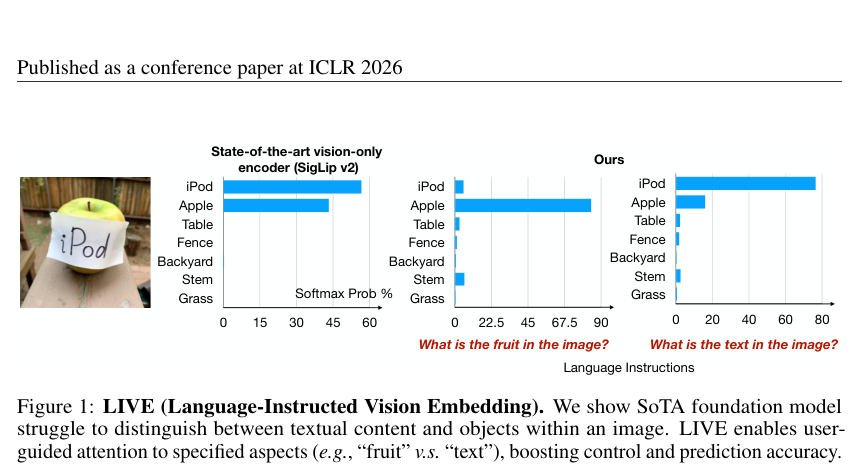

The figure displays an image of an apple with "iPod" written on it, alongside three bar charts comparing a state-of-the-art vision-only encoder to the proposed "Ours" method. The charts plot "Softmax Prob %" on the x-axis against various labels (e.g., iPod, Apple, Table) on the y-axis, illustrating how the baseline model fails to distinguish between text and objects, whereas the proposed model correctly shifts its prediction based on red-labeled language instructions ("What is the fruit in the image?" versus "What is the text in the image?").

**The Spatial Blindspot of Vision-Language Models** — [arXiv:2601.09954](https://arxiv.org/abs/2601.09954) p.3

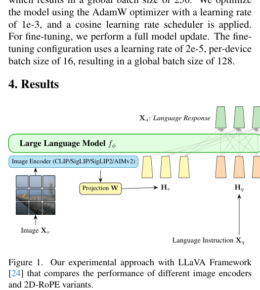

The figure is a schematic diagram of a vision-language model architecture consisting of an image encoder, a projection layer $W$, and a large language model $f_\phi$. Arrows illustrate the data flow from an input image $X_v$ through the encoder and projection to the language model, which then generates a language response $X_a$ based on a language instruction $X_q$.

**Igniting VLMs toward the Embodied Space** — [arXiv:2509.11766](https://arxiv.org/abs/2509.11766) p.2

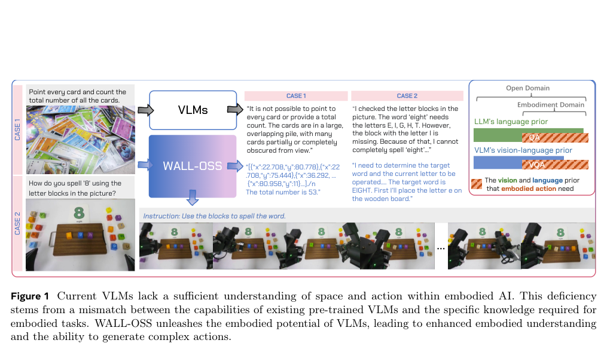

The figure uses a flowchart to compare the performance of standard Vision-Language Models (VLMs) against the proposed WALL-OSS framework across two cases. In Case 1 (counting cards) and Case 2 (spelling a word with blocks), the diagram uses arrows to show how standard VLMs fail to provide accurate spatial or actionable responses, whereas WALL-OSS provides precise coordinates and actionable instructions. The right side of the figure uses a Venn diagram to illustrate that WALL-OSS integrates LLM language priors and VLM vision-language priors to satisfy the requirements for embodied action.

**Vision Inference Former: Sustaining Visual Consistency in Multimodal Large Language Models** — [arXiv:2605.18160](https://arxiv.org/abs/2605.18160) p.1

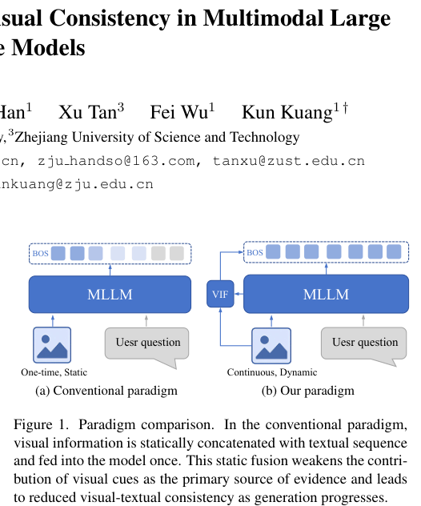

The figure presents a side-by-side comparison of two paradigms: "(a) Conventional paradigm" and "(b) Our paradigm." In the conventional paradigm, a single static block of concatenated visual and textual tokens is fed into an MLLM box, whereas in the proposed paradigm, a "VIF" block provides a continuous, dynamic stream of visual information to the MLLM box alongside the user question.

**Planning with Reasoning using Vision Language World Model** — [arXiv:2509.02722](https://arxiv.org/abs/2509.02722) p.2

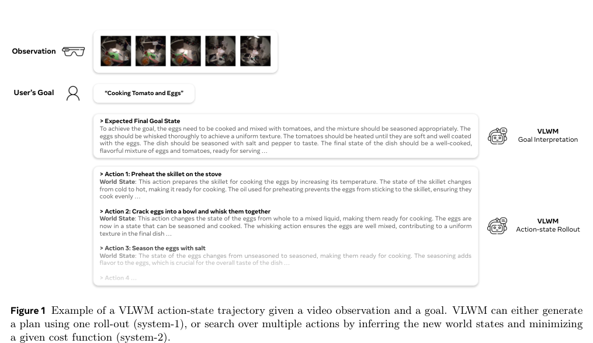

The figure illustrates a Vision Language World Model (VLWM) processing an input observation (a sequence of five video frames) and a user's goal ("Cooking Tomato and Eggs"). It depicts a hierarchical workflow where the goal is first processed through "Goal Interpretation" to determine an expected final state, followed by a "VLWM Action-state Rollout" that lists a sequence of specific actions (e.g., preheating a skillet, cracking eggs) alongside their corresponding predicted world states.

**Youtu-VL: Unleashing Visual Potential via Unified Vision-Language Supervision** — [arXiv:2601.19798](https://arxiv.org/abs/2601.19798) p.1

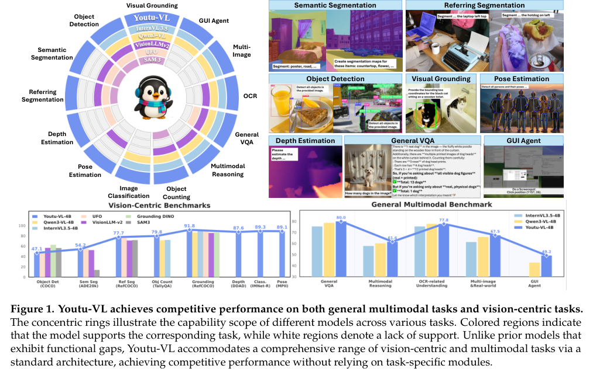

The figure consists of three main parts: a central radar chart, a grid of task examples, and two bar charts. The radar chart uses concentric rings and colored segments to illustrate the task coverage of various models, highlighting that Youtu-VL supports a wide range of vision-language tasks compared to other models. The task grid provides visual examples of different capabilities (e.g., Semantic Segmentation, Object Detection), while the bar charts compare the performance of Youtu-VL against other models across vision-centric and general multimodal benchmarks.

**Teaching Vision-Language-Action Models What to See and Where to Look** — [arXiv:2607.01658](https://arxiv.org/abs/2607.01658) p.2

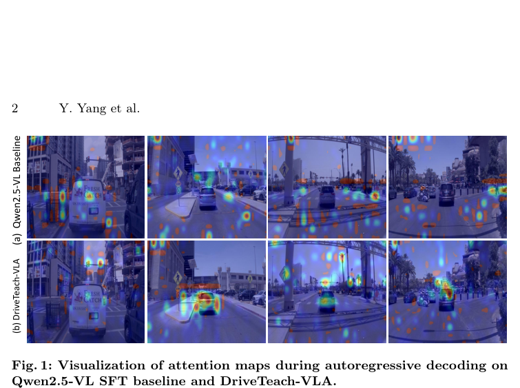

The figure displays a grid of eight driving scene images organized into two rows, labeled "(a) Qwen2.5-VL Baseline" and "(b) DriveTeach-VLA." Overlaid on these images are colorful attention heatmaps that visualize where the models are focusing during autoregressive decoding, conveying that DriveTeach-VLA produces more concentrated and relevant attention on key road objects compared to the baseline.

**Look Before Acting: Enhancing Vision Foundation Representations for Vision-Language-Action Models** — [arXiv:2603.15618](https://arxiv.org/abs/2603.15618) p.2

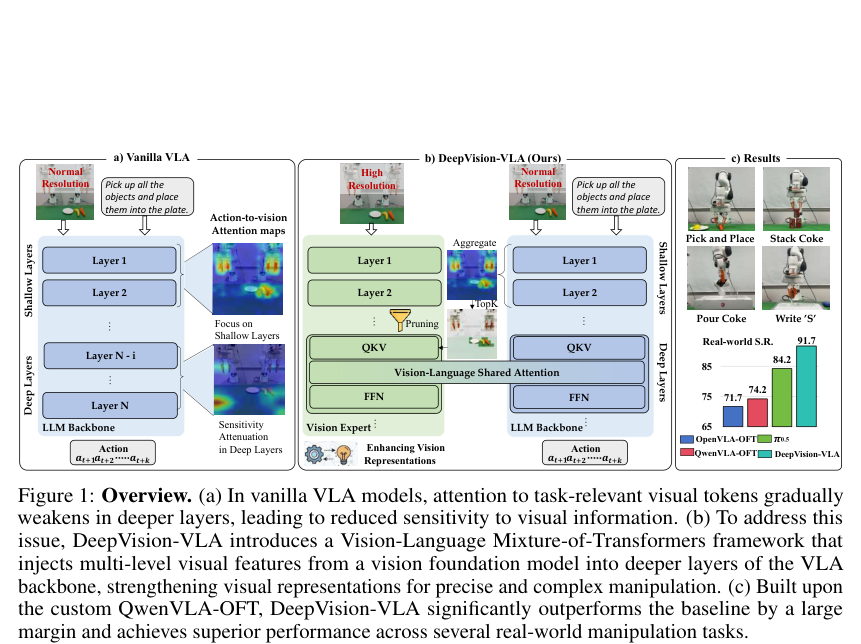

The figure presents a comparative overview of "Vanilla VLA" (a) and the proposed "DeepVision-VLA" (b), alongside qualitative and quantitative results (c). Panel (a) uses boxes and attention maps to show how task-relevant visual information attenuates in deeper layers of a standard LLM backbone, while panel (b) illustrates a vision expert module that injects high-resolution features into shallow and deep layers via pruning and aggregation. Panel (c) displays successful real-world manipulation task images and a bar chart comparing the success rates of OpenVLA-OFT, QwenVLA-OFT, and DeepVision-VLA.

**ESsEN: Training Compact Discriminative Vision-Language Transformers in a Low-Resource Setting** — [arXiv:2604.18452](https://arxiv.org/abs/2604.18452) p.3

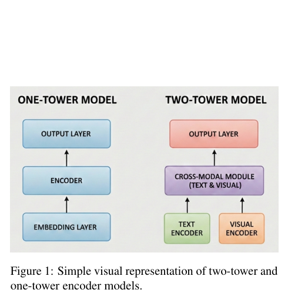

The figure presents two flowcharts comparing architectural structures: a "ONE-TOWER MODEL" and a "TWO-TOWER MODEL." The one-tower model is depicted as a single vertical stack of three boxes (Embedding Layer, Encoder, and Output Layer) connected by upward arrows, while the two-tower model consists of two parallel bottom boxes (Text Encoder and Visual Encoder) feeding into a Cross-Modal Module, which then connects to an Output Layer.

**Beyond Language Modeling: An Exploration of Multimodal Pretraining** — [arXiv:2603.03276](https://arxiv.org/abs/2603.03276) p.4

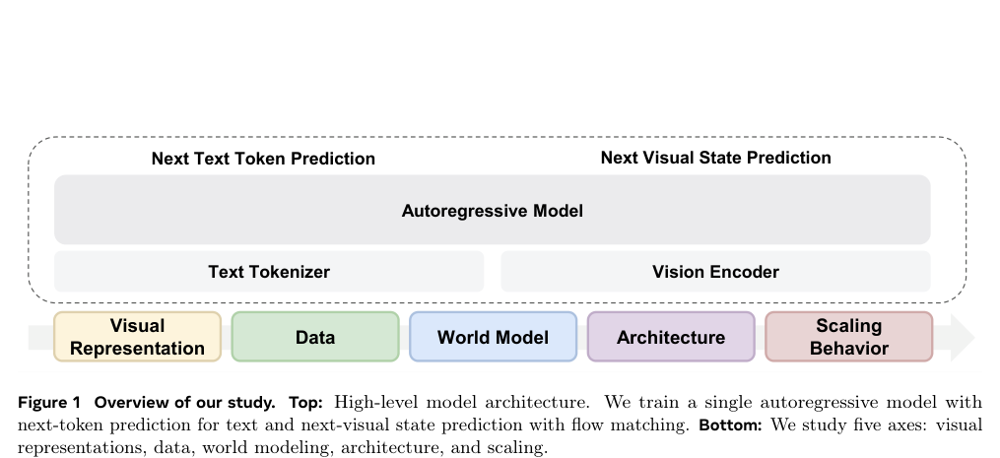

The figure consists of two main parts: a top diagram enclosed in a dashed box and a bottom horizontal arrow containing five colored boxes. The top diagram illustrates a high-level architecture where an "Autoregressive Model" processes inputs from a "Text Tokenizer" and a "Vision Encoder" to perform "Next Text Token Prediction" and "Next Visual State Prediction." The bottom arrow represents five axes of study: "Visual Representation," "Data," "World Model," "Architecture," and "Scaling Behavior."

**Focusing Where Vision Matters: Selective Training for Large Vision Language Models via Visual Information Gain** — [arXiv:2602.17186](https://arxiv.org/abs/2602.17186) p.1

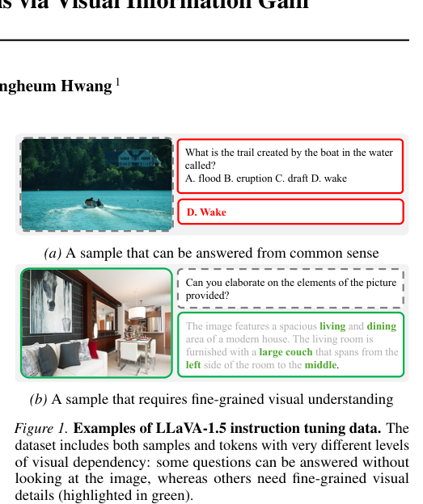

Figure 1 presents two examples of LLaVA-1.5 instruction tuning data, labeled (a) and (b). Subfigure (a) shows an image of a boat on water next to a multiple-choice question and its correct answer, illustrating a task solvable via common sense, while subfigure (b) shows an image of a living room next to a question asking for elaboration on specific elements highlighted in green, illustrating a task requiring fine-grained visual understanding.

**Qwen-VL: A Versatile Vision-Language Model for Understanding,
  Localization, Text Reading, and Beyond** — [arXiv:2308.12966](https://arxiv.org/abs/2308.12966) p.1

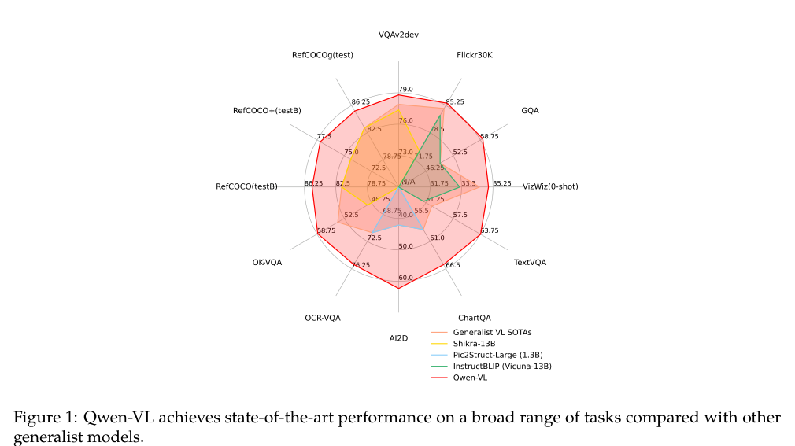

This radar chart compares the performance of Qwen-VL against several generalist vision-language models across various benchmarks, including VQAv2dev, Flickr30K, GQA, and TextVQA. The figure uses colored shaded areas and radial axes to represent scores, showing that the red area (Qwen-VL) encompasses a larger area than the other models, indicating superior performance across the evaluated tasks.

**Retrieval-based Knowledge Augmented Vision Language Pre-training** — [arXiv:2304.13923](https://arxiv.org/abs/2304.13923) p.4

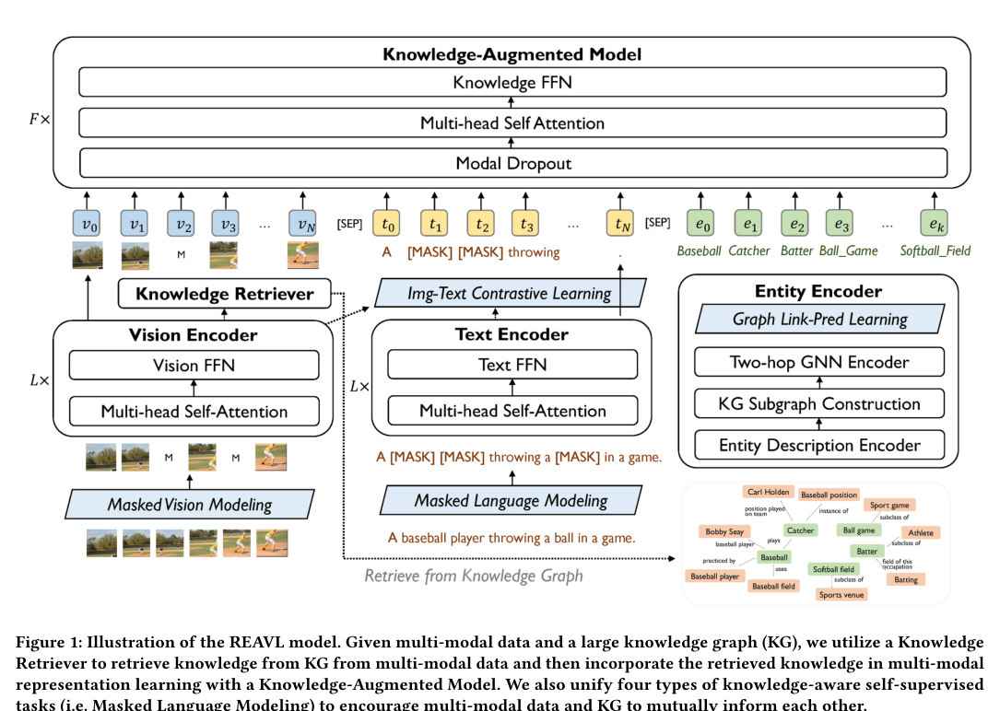

The figure illustrates the REAVL model architecture, showing the interaction between a Vision Encoder, a Text Encoder, and a Knowledge-Augmented Model. It depicts a workflow where a Knowledge Retriever extracts information from a Knowledge Graph (represented by nodes and edges) to feed into the Knowledge-Augmented Model, which processes vision tokens ($v_n$), text tokens ($t_n$), and entity tokens ($e_k$). The diagram also highlights four self-supervised tasks, including Masked Vision Modeling, Masked Language Modeling, Img-Text Contrastive Learning, and Graph Link-Pred Learning.

**Equivariant Similarity for Vision-Language Foundation Models** — [arXiv:2303.14465](https://arxiv.org/abs/2303.14465) p.1

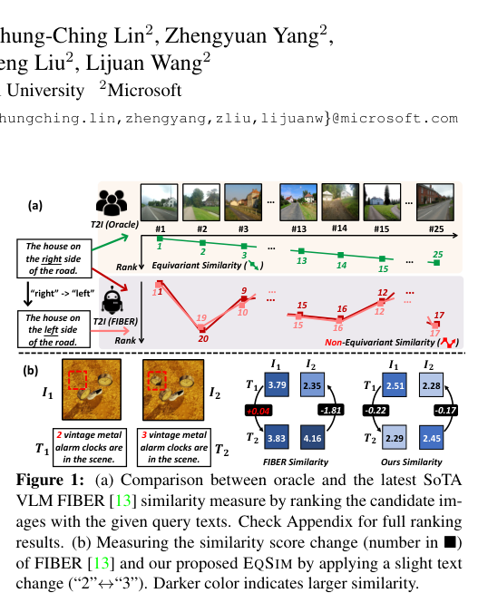

Figure (a) compares the similarity scores of candidate images against two query texts ("the house on the right side of the road" and its left-side counterpart) using an Oracle and the FIBER model, represented by ranked lists and colored lines. The figure conveys that while the Oracle maintains consistent similarity rankings for flipped queries, the FIBER model exhibits non-equivariant similarity, where the ranking order changes inconsistently. Figure (b) shows the similarity score improvement (indicated by black boxes) achieved by the proposed EqSIM method compared to FIBER when applying a slight text change.

