*deep research · 1 round(s) · 120 landmarks · frontier≥2020: 62 · 3 full-PDF critiques · grounded 67 · off-digest 0*

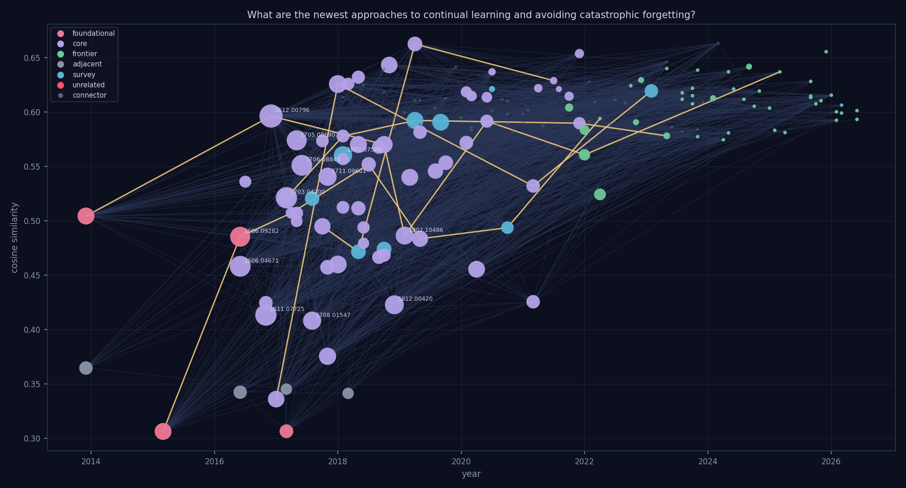

*The citation story graph behind this review — 160 papers, 1989 intent-typed edges, 5 lineage threads (gold). Node size = in-topic citations, color = role. [Interactive version](graph.html).*

---

# From Stability to Plasticity: A Survey of Continual Learning Paradigms and the Mitigation of Catastrophic Forgetting

The pursuit of artificial intelligence capable of lifelong learning is fundamentally hindered by the phenomenon of catastrophic forgetting, wherein the acquisition of new information leads to the abrupt erasure of previously learned knowledge. This instability creates a critical tension between plasticity, the ability to integrate new tasks, and stability, the preservation of existing expertise. Understanding the foundations of catastrophic forgetting and the role of knowledge distillation is essential to addressing this challenge, as it underpins the necessity for models that can navigate sequential task distributions without degrading performance on historical data.

The methodological evolution of the field has progressed through several distinct stages of complexity. Initial efforts focused on early strategies such as regularization, parameter isolation, and architecture expansion to protect specific weights or create dedicated sub-networks for new tasks. These approaches eventually transitioned into more dynamic replay-based methods and generative memory, which attempt to simulate past experiences to maintain knowledge. More recently, the focus has shifted toward meta-learning and adaptive optimization for continual learning, aiming to develop learners that can proactively prepare for future task shifts through optimized learning trajectories.

As the field moves toward more sophisticated and efficient architectures, contemporary research has begun to leverage structural and prompt-based continual learning to facilitate seamless task transitions through modularity and input manipulation. These methods represent a departure from traditional weight-tuning, focusing instead on how model structure and representation can be adapted with minimal interference. Finally, this review examines the modern frontiers of the discipline, where the emphasis has moved toward ensuring stability, safety, and the implementation of advanced replay mechanisms designed for complex, real-world deployment.

## Foundations of Catastrophic Forgetting and Knowledge Distillation

The study of catastrophic forgetting begins with an empirical understanding of how gradient-based neural networks lose previously acquired information during sequential training. [arXiv:1312.6211](https://arxiv.org/abs/1312.6211) provides a foundational investigation into this phenomenon, demonstrating that the choice of activation functions—including logistic sigmoid, rectifier, hard LWTA, and maxout—as well as the use of dropout regularization, significantly influences how much knowledge is lost in task-incremental learning paradigms [arXiv:1312.6211](https://arxiv.org/abs/1312.6211).

To address these losses, researchers have leveraged knowledge distillation, a technique originally designed to transfer knowledge from a large, complex teacher model to a smaller student model [arXiv:1503.02531](https://arxiv.org/abs/1503.02531). By training the student to mimic the soft targets (the probability distributions) of the teacher, the student can achieve lower test errors than if trained on hard labels alone [arXiv:1503.02531](https://arxiv.org/abs/1503.02531). This concept was pivotally adapted for continual learning in the "Learning without Forgetting" (LwF) method [arXiv:1606.09282](https://arxiv.org/abs/1606.09282). Unlike standard distillation, LwF uses the existing network to generate soft labels for new task data, allowing the model to acquire new capabilities without requiring access to the original training datasets [arXiv:1606.09282](https://arxiv.org/abs/1606.09282).

A different structural approach to preservation is found in encoder-based lifelong learning, which shifts the focus from output distributions to feature preservation. While LwF relies on a fixed architecture to match outputs [arXiv:1606.09282](https://arxiv.org/abs/1606.09282), [arXiv:1704.01920](https://arxiv.org/abs/1704.01920) utilizes task-specific under-complete autoencoders to capture and preserve the crucial features of each task [arXiv:1704.01920](https://arxiv.org/abs/1704.01920). This method employs a shared convolutional backbone, such as AlexNet, paired with task-specific classification layers and these auxiliary autoencoders [arXiv:1704.01920](https://arxiv.org/abs/1704.01920).

| Method | Mitigation Mechanism | Architecture Strategy | Learning Paradigm |
| :--- | :--- | :--- | :--- |
| [arXiv:1312.6211](https://arxiv.org/abs/1312.6211) | Dropout regularization | Fixed | Task-incremental |
| [arXiv:1503.02531](https://arxiv.org/abs/1503.02531) | Matching soft targets | Fixed (Teacher-Student) | General Distillation |
| [arXiv:1606.09282](https://arxiv.org/abs/1606.09282) | Soft label distillation | Fixed | Task-incremental |
| [arXiv:1704.01920](https://arxiv.org/abs/1704.01920) | Under-complete autoencoders | Shared backbone + Task-specific layers | Task-incremental |

The transition from the empirical observations of [arXiv:1312.6211](https://arxiv.org/abs/1312.6211) to the distillation-based strategies of [arXiv:1606.09282](https://arxiv.org/abs/1606.09282) represents a move from managing training dynamics to actively preserving knowledge through output mimicry. However, LwF's reliance on the current model's soft labels may limit its effectiveness if the model's representations drift significantly. In contrast, the autoencoder-based approach in [arXiv:1704.01920](https://arxiv.org/abs/1704.01920) offers a more robust mechanism for feature retention by explicitly modeling the underlying data distribution, though it introduces higher architectural complexity by requiring task-specific components [arXiv:1704.01920](https://arxiv.org/abs/1704.01920).

A comprehensive taxonomy of methods, including regularization and distillation, provides a foundational framework for understanding how parameter variation is penalized [arXiv:2302.00487](https://arxiv.org/abs/2302.00487). Building on these foundations, Bayesian principles offer a rigorous approach by using sequential updates to mimic batch training, theoretically ensuring immunity to forgetting [arXiv:2405.18758](https://arxiv.org/abs/2405.18758).
## Early Strategies: Regularization, Parameter Isolation, and Architecture Expansion

Early approaches to mitigating catastrophic forgetting can be categorized by their fundamental mechanism: regularizing parameter updates, isolating task-specific parameters, or expanding the model architecture to accommodate new knowledge.

Regularization-based methods focus on protecting critical weights within a fixed architecture. Synaptic Intelligence (SI) introduces "intelligent synapses" that utilize an online, path-integral-based importance measure ($\omega_k^\mu$) to track the contribution of each synapse to loss reduction, thereby penalizing changes to important weights [arXiv:1703.04200](https://arxiv.org/abs/1703.04200). This approach is notable for moving beyond post-hoc Fisher information estimates [arXiv:1703.04200](https://arxiv.org/abs/1703.04200). Similarly, Memory Aware Synapses (MAS) estimates importance weights by approximating the sensitivity of the learned function to parameter changes [arXiv:1711.09601](https://arxiv.org/abs/1711.09601). While SI demonstrates significant resistance to forgetting on Permuted MNIST and CIFAR-10/100 [arXiv:1703.04200](https://arxiv.org/abs/1703.04200), it requires empirical tuning of a consolidation strength hyperparameter $c$ and a damping parameter $\xi$ [arXiv:1703.04200](https://arxiv.org/abs/1703.04200).

Parameter isolation and gating strategies attempt to decouple task-specific information. PathNet employs an evolutionary algorithm to discover task-specific pathways through a shared pool of modular parameters, enabling parameter reuse and transfer learning [arXiv:1701.08734](https://arxiv.org/abs/1701.08734). In contrast, HAT uses a hard attention mechanism to learn task-based masks via stochastic gradient descent, preserving previous task information by conditioning new learning on existing masks [arXiv:1801.01423](https://arxiv.org/abs/1801.01423). XdG further refines this by combining context-dependent gating with synaptic stabilization to enable the learning of large sequences of tasks [arXiv:1802.01569](https://arxiv.org/abs/1802.01569).

Finally, architecture expansion methods address the capacity limits of fixed models. DEN dynamically decides network capacity by splitting or duplicating units and using timestamping to prevent semantic drift [arXiv:1708.01547](https://arxiv.org/abs/1708.01547). This is complemented by the "Learn to Grow" framework, which explicitly separates structure learning from parameter learning to optimize architecture across tasks [arXiv:1904.00310](https://arxiv.org/abs/1904.00310). A distinct approach to consolidation is found in Progress & Compress, which utilizes a two-column architecture—a fixed knowledge base and an active column—to mimic sleep-based memory consolidation [arXiv:1805.06370](https://arxiv.org/abs/1805.06370).

| Method | Architecture Strategy | Primary Mitigation Mechanism |
| :--- | :--- | :--- |
| [arXiv:1703.04200](https://arxiv.org/abs/1703.04200) | Fixed | Path-integral based regularization [arXiv:1703.04200](https://arxiv.org/abs/1703.04200) |
| [arXiv:1711.09601](https://arxiv.org/abs/1711.09601) | Fixed (with task heads) | Function sensitivity importance weighting [arXiv:1711.09601](https://arxiv.org/abs/1711.09601) |
| [arXiv:1701.08734](https://arxiv.org/abs/1701.08734) | Fixed (modular) | Evolutionary pathway discovery [arXiv:1701.08734](https://arxiv.org/abs/1701.08734) |
| [arXiv:1708.01547](https://arxiv.org/abs/1708.01547) | Growing | Dynamic unit expansion/splitting [arXiv:1708.01547](https://arxiv.org/abs/1708.01547) |
| [arXiv:1801.01423](https://arxiv.org/abs/1801.01423) | Fixed | Stochastic hard attention masks [arXiv:1801.01423](https://arxiv.org/abs/1801.01423) |
| [arXiv:1805.06370](https://arxiv.org/abs/1805.06370) | Fixed (two-column) | Knowledge base/active column consolidation [arXiv:1805.06370](https://arxiv.org/abs/1805.06370) |

While regularization methods like SI and MAS provide efficient solutions for fixed architectures, they often struggle with the inherent capacity constraints that expansion-based methods like DEN and "Learn to Grow" are designed to overcome [arXiv:1708.01547](https://arxiv.org/abs/1708.01547), [arXiv:1904.00310](https://arxiv.org/abs/1904.00310). Meanwhile, isolation techniques like PathNet and HAT offer a middle ground by utilizing modularity or masking to protect learned features without necessarily increasing the total parameter count indefinitely [arXiv:1701.08734](https://arxiv.org/abs/1701.08734), [arXiv:1801.01423](https://arxiv.org/abs/1801.01423).

Beyond simple regularization, recursive gradient optimization (RGO) modifies gradients to minimize the loss increment of previous tasks [arXiv:2201.12522](https://arxiv.org/abs/2201.12522). Furthermore, progressive learning strategies can manage stability-plasticity dynamics by utilizing previous functions to increase the trustworthiness of current parameters [arXiv:2211.15215](https://arxiv.org/abs/2211.15215).
## Replay-Based Methods and Generative Memory

Replay-based strategies mitigate catastrophic forgetting by reintroducing past information during the training of new tasks. These approaches can be broadly categorized into experience replay, which utilizes a buffer of stored samples, and generative replay, which reconstructs past data distributions using learned models.

Early advancements in generative replay focused on reconstructing the input space using generative adversarial networks, such as WGAN-GP, to make performance dependent on the quality of the generator [arXiv:1705.08690](https://arxiv.org/abs/1705.08690). This was further refined by dual memory architectures that incorporate a Deep Generative Memory (DGM) sub-model consisting of a generator, a learner, and task descriptors to facilitate learning from sequential samples [arXiv:1710.10368](https://arxiv.org/abs/1710.10368). While these methods avoid storing raw data, they rely heavily on the generative model's ability to accurately represent the input space. More recent work in domain-incremental learning extends this by using generative models to provide "negative replay" patterns, interleaving negative examples to enable contrastive learning in high-dimensional, non-i.i.d. scenarios [arXiv:2204.05842](https://arxiv.org/abs/2204.05842).

Experience replay methods have evolved from simple buffer management to sophisticated selection and optimization strategies. While standard FIFO buffers are common, selective experience replay improves upon this by using long-term memory to store samples based on criteria such as surprise or state space coverage, thereby reducing training bias [arXiv:1802.10269](https://arxiv.org/abs/1802.10269). To move beyond task-incremental constraints, CLEAR introduced a task-agnostic approach using actor-critic training and V-Trace off-policy learning to correct for distribution shifts without requiring task boundaries [arXiv:1811.11682](https://arxiv.org/abs/1811.11682).

A significant trend in recent literature is the shift from random sampling to intelligent retrieval. Instead of uniform sampling, gradient-based selection chooses subsets that best represent previous history [arXiv:1903.08671](https://arxiv.org/abs/1903.08671). Similarly, Maximally Interfered Retrieval (MIR) specifically selects samples from history or generative models that would experience the highest interference from new data [arXiv:1908.04742](https://arxiv.org/abs/1908.04742). Beyond sample selection, Dark Experience Replay (DER/DER++) optimizes the *content* of the replay by storing and replaying logits sampled throughout the optimization trajectory, rather than just ground-truth labels, to encourage convergence to flatter minima [arXiv:2004.07211](https://arxiv.org/abs/2004.07211).

| Method | Paradigm | Core Mechanism | Key Innovation |
| :--- | :--- | :--- | :--- |
| [arXiv:1705.08690](https://arxiv.org/abs/1705.08690) | Sequential/Task-incremental | Generative Replay | WGAN-GP reconstruction of input space |
| [arXiv:1811.11682](https://arxiv.org/abs/1811.11682) | Task-agnostic | Experience Replay | V-Trace off-policy learning for distribution shifts |
| [arXiv:1812.00420](https://arxiv.org/abs/1812.00420) | Task-incremental | Gradient Constraints | A-GEM using compositional task descriptors |
| [arXiv:1908.04742](https://arxiv.org/abs/1908.04742) | Online | Hybrid Replay | Maximally Interfered Retrieval (MIR) |
| [arXiv:2004.07211](https://arxiv.org/abs/2004.07211) | GCL/Task/Class-IL | Logit Replay | DER/DER++ using optimization trajectory logits |

The transition from basic data reconstruction [arXiv:1705.08690](https://arxiv.org/abs/1705.08690) to gradient-based and interference-aware selection [arXiv:1903.08671](https://arxiv.org/abs/1903.08671), [arXiv:1908.04742](https://arxiv.org/abs/1908.04742) demonstrates a move toward maximizing the utility of limited memory. While A-GEM improves forward transfer via attribute matrices [arXiv:1812.00420](https://arxiv.org/abs/1812.00420), methods like DER++ [arXiv:2004.07211](https://arxiv.org/abs/2004.07211) offer a more robust baseline by focusing on the stability of the loss landscape through logit replay.

Replay mechanisms have evolved from simple rehearsal to sophisticated strategies like 'Goldilocks' sampling, which selectively rehearses examples susceptible to forgetting [arXiv:2406.09935](https://arxiv.org/abs/2406.09935). Advanced methods such as Manifold Expansion Replay (MaER) use Wasserstein distance to expand the knowledge manifold, while saliency-augmented memory completion uses image inpainting for more efficient storage [arXiv:2310.08038](https://arxiv.org/abs/2310.08038), [arXiv:2212.13242](https://arxiv.org/abs/2212.13242). Additionally, X-DER improves rehearsal by implanting updated logits into the memory buffer to preserve secondary information [arXiv:2201.00766](https://arxiv.org/abs/2201.00766).
## Meta-Learning and Adaptive Optimization for Continual Learning

Recent advancements in continual learning have shifted from static regularization toward meta-learning frameworks and adaptive optimization strategies that actively manage the trade-off between plasticity and stability. Early structural regularization approaches, such as Synaptic Intelligence (SI), treat synapses as dynamic entities by tracking their contribution to loss reduction via an online, path-integral-based importance measure ($\omega_k^\mu$) [arXiv:1703.04200](https://arxiv.org/abs/1703.04200). While SI demonstrates significant resistance to forgetting on datasets like CIFAR-10/100 by penalizing changes to critical parameters [arXiv:1703.04200](https://arxiv.org/abs/1703.04200), it necessitates empirical tuning of the consolidation strength hyperparameter $c$ and requires a damping parameter $\xi$ to maintain numerical stability [arXiv:1703.04200](https://arxiv.org/abs/1703.04200).

To move beyond parameter-specific penalties, meta-learning approaches attempt to optimize the learning process itself. Meta-Experience Replay (MER) [arXiv:1810.11910](https://arxiv.org/abs/1810.11910) optimizes the balance between transfer and interference by enforcing gradient alignment across examples, effectively learning how to learn without forgetting. This contrasts with representation-focused meta-learning, where the goal is to learn sparse representations offline that are optimized for future online updates [arXiv:1905.12588](https://arxiv.org/abs/1905.12588). While MER focuses on gradient dynamics [arXiv:1810.11910](https://arxiv.org/abs/1810.11910), representation-based methods aim to minimize interference by ensuring the learned features are conducive to future task acquisition [arXiv:1905.12588](https://arxiv.org/abs/1905.12588).

A significant evolution in this domain is the move toward biologically inspired and modular architectures. The Neuromodulated Meta-Learning Algorithm (ANML) [arXiv:2002.09571](https://arxiv.org/abs/2002.09571) employs direct modulation of activations to reduce interference in both forward and backward passes, a technique inspired by neuromodulatory processes in the brain [arXiv:2002.09571](https://arxiv.org/abs/2002.09571). Similarly, prompting techniques [arXiv:2112.08654](https://arxiv.org/abs/2112.08654) introduce a succinct memory system of prompts, allowing for task-agnostic continual learning where the model avoids the need for task identity at test time [arXiv:2112.08654](https://arxiv.org/abs/2112.08654).

More recent frontier research focuses on computational efficiency and robust rehearsal. Efficient Meta-Learning for Continual Learning (EMCL) [arXiv:2210.00713](https://arxiv.org/abs/2210.00713) improves upon traditional meta-learning by using a Taylor expansion approximation; it avoids the heavy computational cost of Hessian matrices or additional learnable parameters by employing a diagonal matrix based on the moving average of parameter importance in the inner loss [arXiv:2210.00713](https://arxiv.org/abs/2210.00713). Finally, Strong Experience Replay (SER) [arXiv:2305.13622](https://arxiv.org/abs/2305.13622) enhances standard experience replay by simulating future data distributions during the rehearsal of old samples, thereby preventing the model from overfitting to the limited memory buffer [arXiv:2305.13622](https://arxiv.org/abs/2305.13622). These methods collectively represent a transition from protecting individual weights [arXiv:1703.04200](https://arxiv.org/abs/1703.04200) to optimizing the entire learning trajectory through meta-knowledge and simulated future distributions [arXiv:1810.11910](https://arxiv.org/abs/1810.11910), [arXiv:2305.13622](https://arxiv.org/abs/2305.13622).

Adaptive optimization is furthered by using adaptive classification criteria and supervised contrastive learning to preserve representations [arXiv:2305.12270](https://arxiv.org/abs/2305.12270). In distributed settings, optimal sequencing of tasks across knowledge-sharing networks can also mitigate forgetting [arXiv:2512.16871](https://arxiv.org/abs/2512.16871).
## Structural and Prompt-Based Continual Learning

Recent advancements in continual learning have diverged into two primary architectural philosophies: expanding the model capacity to accommodate new knowledge and maintaining a fixed architecture through parameter-efficient modulation. 

Architectural growth strategies focus on dynamic capacity adjustment. The GROWN framework [arXiv:2110.00908](https://arxiv.org/abs/2110.00908) addresses the efficiency-performance trade-off in task-incremental learning by growing the network only when necessary, starting from a small seed network to prevent unnecessary parameter expansion. A more recent evolution of this paradigm is COLA [arXiv:2510.21836](https://arxiv.org/abs/2510.21836), which utilizes an autoencoder-based retrieval mechanism for task-incremental learning. Unlike the direct growth in GROWN, COLA employs an autoencoder to reconstruct and retrieve task-specific adapters, providing a structured way to manage task-aware knowledge within large language models. While both methods avoid catastrophic forgetting by preventing the overwriting of existing weights, GROWN focuses on the structural expansion of the network itself, whereas COLA leverages the modularity of adapters to manage task-specific knowledge.

In contrast, several methods prioritize fixed architectures, seeking to mitigate interference through sophisticated parameter modulation or prompting. DualPrompt [arXiv:2204.04799](https://arxiv.org/abs/2204.04799) operates in the class-incremental setting by using complementary prompting to separate task-specific and shared knowledge within a pre-trained backbone. This rehearsal-free approach allows for the instruction of a pre-trained model without the need for a memory buffer. Similar rehearsal-free objectives are pursued through weight modulation and meta-learning. Adaptive Weight Modulation [arXiv:2311.15276](https://arxiv.org/abs/2311.15276) provides a task-incremental solution that modulates weights for each task to prevent inner-task interference, theoretically allowing for an unlimited number of tasks without parameter storage. Moving beyond simple modulation, the approach in [arXiv:2408.03219](https://arxiv.org/abs/2408.03219) utilizes meta-learning to optimize an attention-based optimizer. This method dynamically updates classifier weights to minimize interference and promote knowledge transfer, uniquely enabling adaptation without requiring task identifiers.

| Method | Learning Paradigm | Architecture Strategy | Mitigation Mechanism |
| :--- | :--- | :--- | :--- |
| [arXiv:2110.00908](https://arxiv.org/abs/2110.00908) | Task-incremental | Growing | Capacity expansion only when necessary |
| [arXiv:2204.04799](https://arxiv.org/abs/2204.04799) | Class-incremental | Fixed (Pre-trained) | Complementary prompting |
| [arXiv:2311.15276](https://arxiv.org/abs/2311.15276) | Task-incremental | Fixed | Adaptive weight modulation |
| [arXiv:2408.03219](https://arxiv.org/abs/2408.03219) | Task-incremental | Fixed | Meta-learned optimizer |
| [arXiv:2510.21836](https://arxiv.org/abs/2510.21836) | Task-incremental | Growing (Adapters) | Autoencoder adapter retrieval |

The tension between these approaches lies in the trade-off between parameter efficiency and the flexibility of the model. Growing architectures like GROWN [arXiv:2110.00908](https://arxiv.org/abs/2110.00908) and COLA [arXiv:2510.21836](https://arxiv.org/abs/2510.21836) offer high capacity for new knowledge but face challenges regarding the long-term management of expanding structures. Conversely, fixed-architecture methods like DualPrompt [arXiv:2204.04799](https://arxiv.org/abs/2204.04799) and the meta-learning approach [arXiv:2408.03219](https://arxiv.org/abs/2408.03219) offer superior parameter efficiency and rehearsal-free operation, yet they must navigate the inherent constraints of a static backbone, often relying on complex modulation or specialized optimizers to prevent the overwriting of established patterns.

Architectural expansion remains a key frontier, with methods utilizing model growth through stacking LLMs to structure training [arXiv:2509.01213](https://arxiv.org/abs/2509.01213). Recent work also explores growing architectures to achieve both forgetting-free learning and positive knowledge transfer [arXiv:2601.05623](https://arxiv.org/abs/2601.05623).
## Modern Frontiers: Stability, Safety, and Advanced Replay Mechanisms

Recent research has shifted from simple buffer management toward sophisticated mechanisms that mimic biological processes or leverage deep architectural properties to ensure stability. A primary tension exists between replay-based methods, which rely on data or reconstructions, and optimization-based methods that seek to stabilize weights or gradients directly.

Replay mechanisms have evolved from basic sample storage to more nuanced cognitive and structural strategies. CORE introduces "cognitive replay," which avoids uniform sample treatment by dynamically selecting high-quality samples to mimic human cognitive review [arXiv:2402.01348](https://arxiv.org/abs/2402.01348). Moving beyond physical buffers, [arXiv:2411.06916](https://arxiv.org/abs/2411.06916) proposes reconstructing old training data by exploiting the implicit bias of margin maximization points within previous models, effectively using the models themselves as memory buffers. This concept of "restoration" is further extended by the sleep-inspired replay (SRC) approach [arXiv:2606.08447](https://arxiv.org/abs/2606.08447), which demonstrates that a single unsupervised "sleep episode" applied after a full sequence of tasks can restore performance on previously forgotten memories. To ensure the reliability of such replayed data, IDER introduces an idempotence distillation loss [arXiv:2603.00624](https://arxiv.org/abs/2603.00624), minimizing the distance between reprocessed and original outputs to maintain prediction stability.

Parallel to replay, researchers are targeting the optimization process itself to prevent weight drift. STAR provides a plug-and-play stability-inducing weight perturbation to improve existing frameworks [arXiv:2503.01595](https://arxiv.org/abs/2503.01595), while [arXiv:2409.11329](https://arxiv.org/abs/2409.11329) utilizes self-distillation of highly generalized features from shallow layers to prevent overfitting to limited buffers. For Vision Transformers (ViTs), [arXiv:2602.05454](https://arxiv.org/abs/2602.05454) identifies "attention drift" as a core driver of forgetting and proposes a data-free gradient masking technique to retain attention. While highly effective—outperforming VPT-CPG by 3.3%† accuracy on 50-split ImageNet-R [arXiv:2602.05454](https://arxiv.org/abs/2602.05454)—this method's reliance on instance-adaptive thresholding requiring second-order derivatives presents an implementation challenge, and its theoretical link between gradient masking and attention retention remains largely relegated to appendices [arXiv:2602.05454](https://arxiv.org/abs/2602.05454).

A significant emerging frontier is the move toward gradient-free optimization. ZeroFlow [arXiv:2501.01045](https://arxiv.org/abs/2501.01045) and FoRo [arXiv:2509.01533](https://arxiv.org/abs/2509.01533) demonstrate that catastrophic forgetting can be overcome using zero-order optimization or evolutionary optimization, respectively, bypassing iterative error backpropagation entirely. This represents a radical departure from traditional gradient-based paradigms.

Finally, theoretical frameworks are beginning to provide more rigorous bounds for these empirical successes. [arXiv:2511.02025](https://arxiv.org/abs/2511.02025) utilizes Neural Tangent Kernel (NTK) theory to establish principled plasticity bounds, achieving a reduction in forgetting from 27% to 18% [arXiv:2511.02025](https://arxiv.org/abs/2511.02025). This theoretical grounding offers a more robust alternative to purely heuristic methods, though it often requires complex task-specific architectures like specialized BatchNorm layers [arXiv:2511.02025](https://arxiv.org/abs/2511.02025).

## Tensions and Open Problems

A primary tension in the literature concerns the optimal mechanism for preserving stability versus plasticity, specifically regarding the use of memory buffers. One school of thought emphasizes the necessity of robust experience replay to anchor previous knowledge, with [arXiv:2305.13622](https://arxiv.org/abs/2305.13622) arguing that strong experience replay is essential to overcome the limitations of earlier regularization-based methods like "Learning without Forgetting" [arXiv:1606.09282](https://arxiv.org/abs/1606.09282) or the architectural constraints of iCaRL [arXiv:1611.07725](https://arxiv.org/abs/1611.07725). This perspective suggests that without explicit replay, models struggle to maintain the representation integrity seen in gradient-based memory methods like GEM [arXiv:1706.08840](https://arxiv.org/abs/1706.08840) or A-GEM [arXiv:1812.00420](https://arxiv.org/abs/1812.00420). Conversely, a competing direction seeks to minimize the reliance on large buffers to improve efficiency and reduce data overhead. For instance, [arXiv:2308.03810](https://arxiv.org/abs/2308.03810) explores how adaptive, more efficient replay strategies can outperform traditional fixed-size episodic memories [arXiv:1902.10486](https://arxiv.org/abs/1902.10486), while other approaches attempt to bypass the need for replay entirely through architectural growth or synaptic modulation, such as the synaptic intelligence framework [arXiv:1703.04200](https://arxiv.org/abs/1703.04200).

Another significant debate revolves around the structural approach to model capacity: whether to expand the existing architecture or optimize the current parameter space. Proponents of architectural expansion argue that preventing catastrophic forgetting requires increasing the model's capacity to accommodate new information, as seen in the progressive neural networks approach [arXiv:1606.04671](https://arxiv.org/abs/1606.04671) or more recent model growth strategies [arXiv:2509.01213](https://arxiv.org/abs/2509.01213). This view posits that fixed-capacity models are inherently prone to interference. On the other hand, researchers focusing on parameter efficiency argue that catastrophic forgetting can be mitigated within a fixed parameter space by better managing how weights are updated or by leveraging the inherent width of networks, as suggested by the observation that wider neural networks tend to forget less catastrophically [arXiv:2110.11526](https://arxiv.org/abs/2110.11526). This tension is further complicated by the emergence of specialized architectures, such as "Elephant Neural Networks" [arXiv:2310.01365](https://arxiv.org/abs/2310.01365), which attempt to bridge the gap between structural growth and efficient parameter utilization.

Finally, there is a growing disagreement regarding the definition and evaluation of "success" in continual learning, particularly concerning task granularity and transfer. While much of the foundational work focuses on distinct, sequential task scenarios [arXiv:1904.07734](https://arxiv.org/abs/1904.07734), recent critiques suggest that the categorization of these scenarios [arXiv:1810.12488](https://arxiv.org/abs/1810.12488) and the specific granularity of tasks [arXiv:2606.08013](https://arxiv.org/abs/2606.08013) significantly alter the perceived severity of forgetting. This leads to a tension between models designed for "forgetting-free" knowledge transfer [arXiv:2601.05623](https://arxiv.org/abs/2601.05623) and those that accept a degree of forgetting as a trade-off for rapid adaptation. This debate is increasingly relevant as the field moves toward natural language processing and vision transformer architectures, where the nuances of attention retention [arXiv:2602.05454](https://arxiv.org/abs/2602.05454) and sequential task adaptation [arXiv:2603.18641](https://arxiv.org/abs/2603.18641) redefine the benchmarks for what constitutes a truly "lifelong" learner.

## Outlook

The frontier of continual learning is shifting from mere mitigation of forgetting toward the active pursuit of positive knowledge transfer and "sleep-inspired" consolidation [arXiv:2606.08447](https://arxiv.org/abs/2606.08447). As we move beyond simple replay, the field is heading toward more sophisticated, idempotent replay mechanisms [arXiv:2603.00624](https://arxiv.org/abs/2603.00624) and provable feature-learning frameworks [arXiv:2602.02767](https://arxiv.org/abs/2602.02767) that can handle complex modalities like text-to-image diffusion via latent replay [arXiv:2509.10529](https://arxiv.org/abs/2509.10529). The ultimate goal is to transition from reactive stability-inducing techniques [arXiv:2503.01595](https://arxiv.org/abs/2503.01595) to proactive, forward-only learning systems [arXiv:2509.01533](https://arxiv.org/abs/2509.01533) that can autonomously navigate expanding task manifolds without the need for retrospective correction.

---
*† number could not be verified against the cited paper's abstract or extracted fields (figure- or full-text-sourced).*

**Learning to Prompt for Continual Learning** — [arXiv:2112.08654](https://arxiv.org/abs/2112.08654) p.1

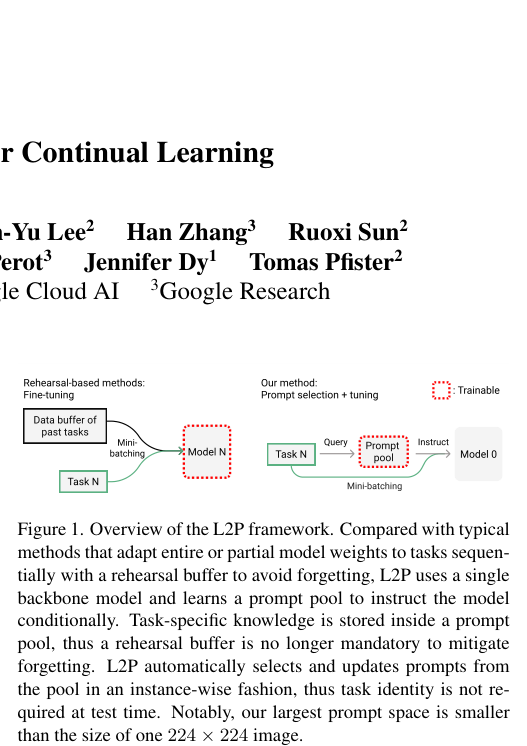

The figure compares rehearsal-based methods with the proposed L2P framework using flow diagrams. In the rehearsal-based method, a data buffer of past tasks is mini-batched with Task $N$ to train Model $N$, whereas the L2P method uses Task $N$ to query a prompt pool, which then provides an instruction to Model 0.

**DualPrompt: Complementary Prompting for Rehearsal-free Continual
  Learning** — [arXiv:2204.04799](https://arxiv.org/abs/2204.04799) p.2

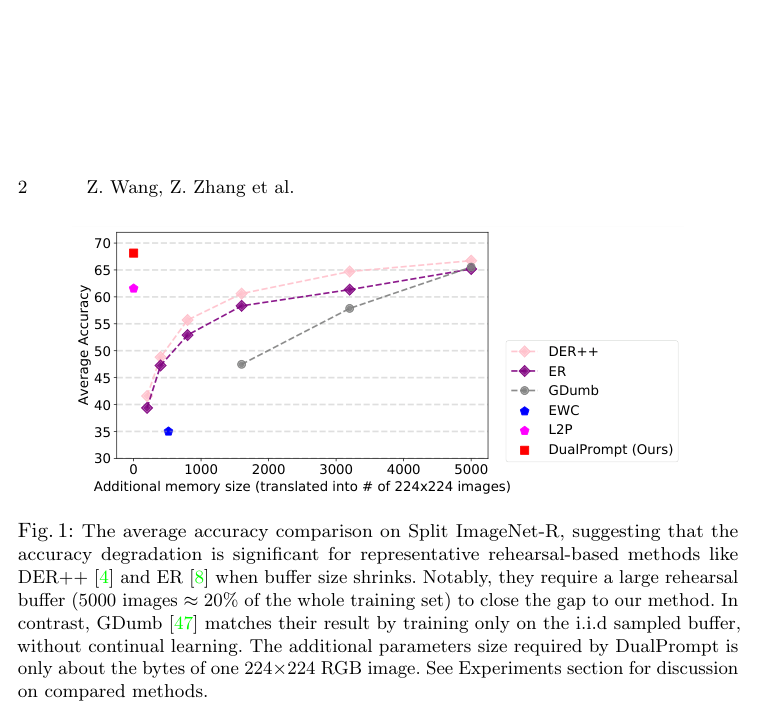

This line graph plots Average Accuracy on the y-axis against Additional memory size (translated into the number of 224x224 images) on the x-axis. It compares several methods, including DER++, ER, GDumb, EWC, and L2P, showing their accuracy trends as memory size increases, while highlighting the DualPrompt method as a single red square with high accuracy at near-zero additional memory.

**Class-Incremental Continual Learning into the eXtended DER-verse** — [arXiv:2201.00766](https://arxiv.org/abs/2201.00766) p.3

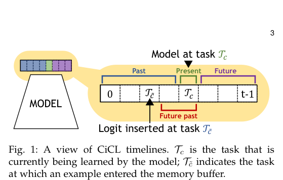

The figure depicts a timeline of tasks represented by a horizontal box divided into "Past" ($\mathcal{T}_{\bar{c}}$), "Present" ($\mathcal{T}_c$), and "Future" (t-1) segments. An arrow labeled "Logit inserted at task $\mathcal{T}_c$" points from a memory buffer (represented by a colored strip above a "MODEL" trapezoid) to the "Present" task segment, conveying how past information is integrated into the current learning stage.

**Learning to Continually Learn** — [arXiv:2002.09571](https://arxiv.org/abs/2002.09571) p.3

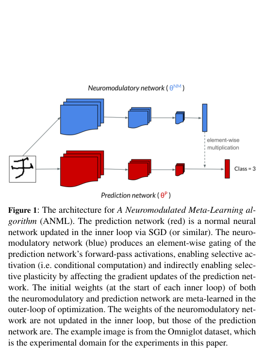

The figure illustrates the architecture of the A Neuromodulated Meta-Learning (ANML) algorithm, showing a sample image from the Omniglot dataset being processed through two parallel paths. A blue neuromodulatory network ($\theta^{NM}$) produces activations that undergo element-wise multiplication with the activations of a red prediction network ($\theta^{P}$), which then leads to a final classification output.

**Wide Neural Networks Forget Less Catastrophically** — [arXiv:2110.11526](https://arxiv.org/abs/2110.11526) p.2

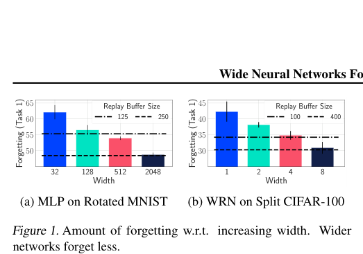

Figure 1 consists of two bar charts, (a) and (b), plotting "Forgetting (Task 1)" on the y-axis against "Width" on the x-axis for different model architectures. The charts use colored bars to represent different widths and include horizontal dashed lines to indicate different "Replay Buffer Sizes" (125 and 250 for chart a; 100 and 400 for chart b). The figure conveys that as the width of the neural network increases, the amount of forgetting decreases.

**GROWN: GRow Only When Necessary for Continual Learning** — [arXiv:2110.00908](https://arxiv.org/abs/2110.00908) p.2

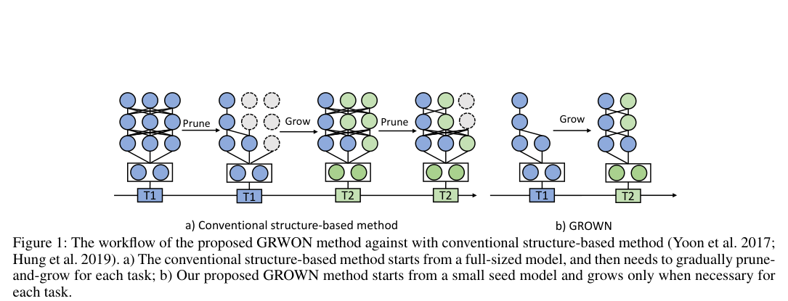

The figure compares two workflows for continual learning: (a) a conventional structure-based method and (b) the proposed GROWN method. In part (a), a full-sized model undergoes a repetitive cycle of "Prune" and "Grow" operations between tasks T1 and T2, represented by blue and green circles and dashed outlines. In part (b), the GROWN method starts with a small seed model for T1 and only performs a "Grow" operation to expand the architecture for T2.

**Continual Learning with Strong Experience Replay** — [arXiv:2305.13622](https://arxiv.org/abs/2305.13622) p.2

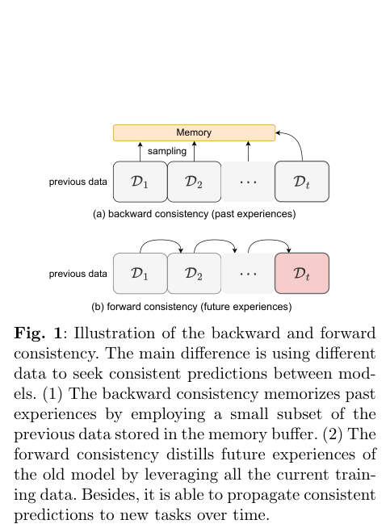

The figure consists of two diagrams, (a) and (b), illustrating backward and forward consistency through sets of data boxes labeled $\mathcal{D}_1, \mathcal{D}_2, \dots, \mathcal{D}_t$. Diagram (a) shows arrows pointing from previous data boxes to a "Memory" box via a "sampling" process to represent past experience replay, while diagram (b) shows arrows pointing from previous data boxes toward the current data $\mathcal{D}_t$ to represent the distillation of future experiences. Together, the figure conveys how backward consistency uses a memory buffer of past data, whereas forward consistency leverages current training data to propagate consistent predictions to future tasks.

**Reducing Catastrophic Forgetting in Online Class Incremental Learning
  Using Self-Distillation** — [arXiv:2409.11329](https://arxiv.org/abs/2409.11329) p.4

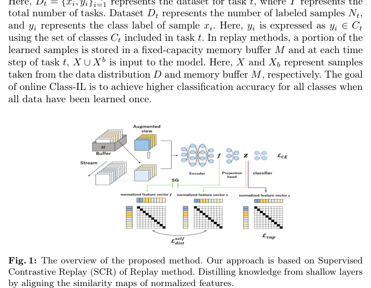

The figure illustrates a machine learning pipeline consisting of a data stream and a memory buffer that feeds into an encoder, projection head, and classifier. Below the main architecture, three similarity matrices compare normalized feature vectors ($f$, $x$, and $z$) to demonstrate the alignment of similarity maps through self-distillation ($L_{self\_dist}$) and supervised loss ($L_{sup}$). The diagram conveys how the proposed method uses augmented views and feature distillation to mitigate catastrophic forgetting in incremental learning.

**Saliency-Augmented Memory Completion for Continual Learning** — [arXiv:2212.13242](https://arxiv.org/abs/2212.13242) p.3

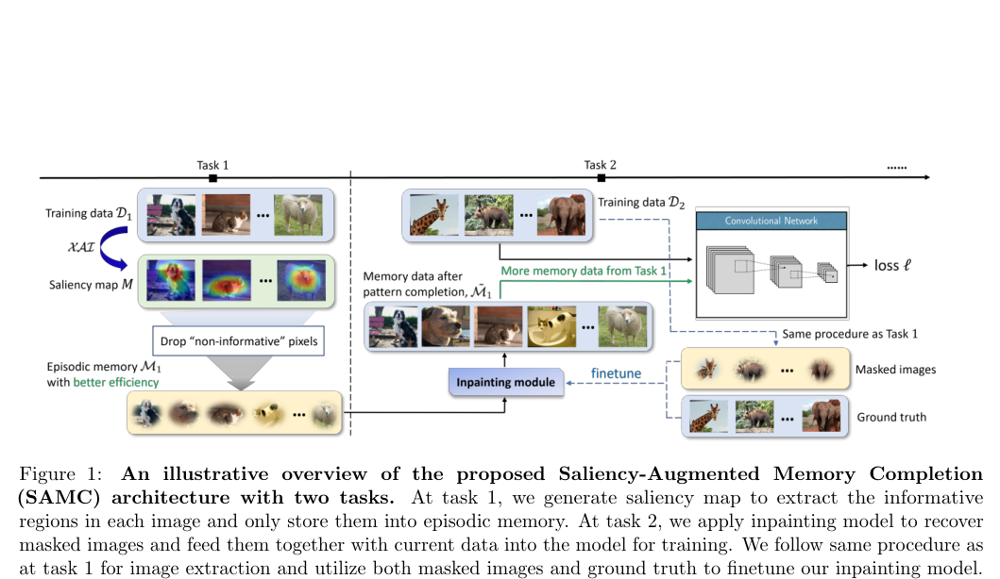

The figure illustrates the Saliency-Augmented Memory Completion (SAMC) architecture across two tasks, using arrows to show the flow of data from training sets to episodic memory and back into a convolutional network. In Task 1, training data $\mathcal{D}_1$ is processed via XAI to create saliency maps $\mathcal{M}$, which are used to drop "non-informative" pixels and store only informative regions in episodic memory $\mathcal{M}_1$. In Task 2, an inpainting module recovers these masked images to be used alongside new training data $\mathcal{D}_2$ for model training, while the module itself is finetuned using masked images and their corresponding ground truth.

**CORE: Mitigating Catastrophic Forgetting in Continual Learning through
  Cognitive Replay** — [arXiv:2402.01348](https://arxiv.org/abs/2402.01348) p.1

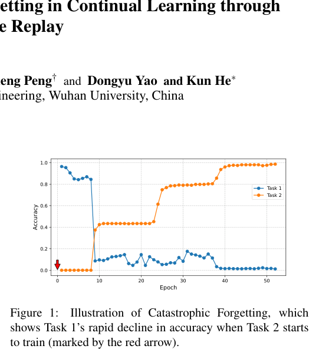

The figure is a line graph plotting Accuracy against Epoch for two tasks, Task 1 (blue line) and Task 2 (orange line). It illustrates catastrophic forgetting by showing that Task 1's accuracy drops sharply toward zero once Task 2 begins training, which is indicated by a red arrow at the start of Task 2.

**Progressive Learning without Forgetting** — [arXiv:2211.15215](https://arxiv.org/abs/2211.15215) p.1

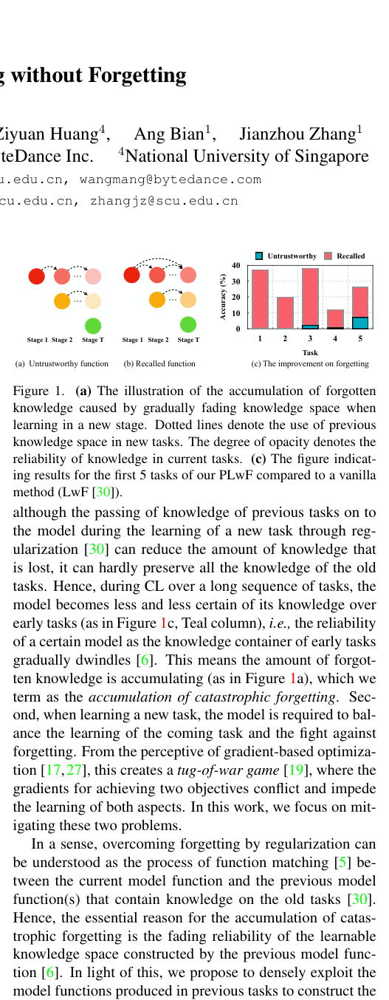

Figure 1 consists of three panels: (a) shows three stages of colored circles connected by dotted arrows to illustrate fading knowledge reliability, (b) shows similar circles with arrows to represent recalled knowledge, and (c) is a bar chart comparing "Untrustworthy" and "Recalled" accuracy percentages across five tasks. The figure conveys the concept of accumulating forgotten knowledge through fading reliability and demonstrates the improvement in forgetting using the proposed method compared to a vanilla baseline.

**Sequencing to Mitigate Catastrophic Forgetting in Continual Learning** — [arXiv:2512.16871](https://arxiv.org/abs/2512.16871) p.2

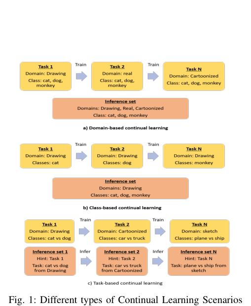

The figure presents three diagrams (a, b, and c) illustrating different continual learning scenarios using colored boxes, arrows, and labels. Each diagram depicts a sequence of tasks (Task 1 to Task N) defined by specific domains and classes, followed by a larger "Inference set" box that shows the cumulative scope of the learned domains and classes. The scenarios categorized are domain-based continual learning (changing domains, same classes), class-based continual learning (same domain, changing classes), and task-based continual learning (changing both domains and classes).

