*deep research · 1 round(s) · 120 landmarks · frontier≥2022: 72 · 2 full-PDF critiques · grounded 54 · off-digest 0*

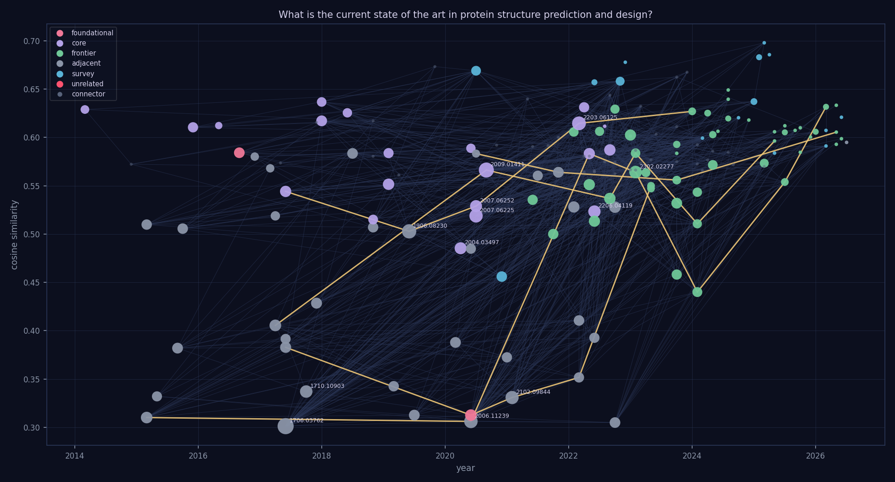

*The citation story graph behind this review — 160 papers, 891 intent-typed edges, 5 lineage threads (gold). Node size = in-topic citations, color = role. [Interactive version](graph.html).*

---

# From Sequence to Synthesis: A Review of Advances in Protein Structure Prediction and Design

The ability to accurately predict the three-dimensional architecture of a protein from its primary amino acid sequence remains one of the most profound challenges in computational biology. Solving this problem is not merely a theoretical exercise; it is the cornerstone of modern drug discovery, synthetic biology, and the engineering of novel biocatalysts. Early efforts in the field were rooted in the foundations of protein structure and sequence modeling, establishing the fundamental relationship between amino acid patterns and folded states. However, as the complexity of biological systems became apparent, the field required more sophisticated mathematical frameworks to capture the nuances of molecular geometry and the physical constraints of folding.

The transition from traditional modeling to modern deep learning was catalyzed by the emergence of geometric deep learning and equivariant representations, which allowed models to respect the physical symmetries inherent in 3D space. This evolution was further accelerated by the rise of protein language models and their structural integration, where large-scale pre-training on evolutionary data provided a deep, latent understanding of protein "grammar." These advancements shifted the focus from merely describing known structures to predicting them with unprecedented accuracy, setting the stage for a new era of generative capabilities.

Currently, the field is undergoing a paradigm shift from structure prediction to de novo protein design. This transition is driven by generative diffusion and flow models, which enable the creation of entirely new protein scaffolds with bespoke functions. As the scope of research expands, the focus is increasingly directed toward advanced protein complex prediction and interaction modeling to understand how proteins function within larger, multi-component biological machines. This review traces this trajectory, moving from the historical foundations of sequence modeling toward the current frontier of atomistic design and dynamic protein engineering, where the goal is to move beyond static snapshots toward the precise control of molecular motion and function.

## Foundations of Protein Structure and Sequence Modeling

Early deep learning approaches to protein modeling focused on decomposing the problem into hierarchical tasks, ranging from local secondary structure prediction to global fold recognition and contact map estimation. A foundational advancement in secondary structure prediction was the development of Deep Convolutional Neural Fields (DeepCNF), which integrated deep hierarchical architectures with Conditional Random Fields (CRF) to model interdependencies between adjacent labels [arXiv:1512.00843](https://arxiv.org/abs/1512.00843). This method achieved ~84% Q3 accuracy and ~85% SOV score by leveraging sequence profile information [arXiv:1512.00843](https://arxiv.org/abs/1512.00843). While DeepCNF focused on local sequence-structure relationships, other models sought to capture more global topological constraints. For instance, DeepSF utilized a 1D-convolutional neural network to map protein sequences directly to fold space, bypassing traditional homology-based alignment to achieve 80.4% accuracy on SCOP1.75 [arXiv:1706.01010](https://arxiv.org/abs/1706.01010).

The transition from local sequence features to global spatial arrangements is exemplified by the shift toward contact map prediction and 3D density analysis. To address de novo structure prediction, ultra-deep dual residual networks were developed to integrate evolutionary coupling (EC) and sequence conservation, modeling complex long-range inter-contact correlations [arXiv:1609.00680](https://arxiv.org/abs/1609.00680). Complementing these sequence-to-contact mappings, quality assessment models began utilizing raw three-dimensional atomic densities rather than manual feature engineering, allowing for more direct learning of structural features for decoy ranking [arXiv:1801.06252](https://arxiv.org/abs/1801.06252). This evolution toward higher-dimensional representations culminated in graph-based approaches, such as Intrinsic-Extrinsic Convolution and Pooling (IEConv), which operates on atom-level protein graphs with 6D input feature vectors to capture multiple structural levels for fold and enzyme classification [arXiv:2007.06252](https://arxiv.org/abs/2007.06252).

These methodological advancements necessitated standardized evaluation frameworks. The introduction of ProteinNet addressed the challenge of weak homology in training sets by using sensitive evolution-based distance metrics to create standardized data splits, effectively emulating CASP difficulty levels for structure prediction and design [arXiv:1902.00249](https://arxiv.org/abs/1902.00249).

The progression of these methods shows a clear trajectory from 1D sequence-based descriptors to complex 3D graph and density representations:

| Method | Primary Representation | Key Innovation | Target Task |
| :--- | :--- | :--- | :--- |
| [arXiv:1512.00843](https://arxiv.org/abs/1512.00843) | Sequence (profile) | Deep hierarchical CRF integration | Secondary structure prediction |
| [arXiv:1706.01010](https://arxiv.org/abs/1706.01010) | Protein sequence | Direct sequence-to-fold mapping | Fold recognition |
| [arXiv:1609.00680](https://arxiv.org/abs/1609.00680) | Protein contact map | Dual residual networks (EC + conservation) | De novo structure prediction |
| [arXiv:1801.06252](https://arxiv.org/abs/1801.06252) | 3D atomic densities | Learning directly from raw 3D densities | Quality assessment |
| [arXiv:2007.06252](https://arxiv.org/abs/2007.06252) | Atom-level protein graph | Intrinsic-extrinsic convolution/pooling | Fold/enzyme classification |

While 1D models like DeepSF [arXiv:1706.01010](https://arxiv.org/abs/1706.01010) and DeepCNF [arXiv:1512.00843](https://arxiv.org/abs/1512.00843) provided efficient sequence-based classification, they lacked the spatial awareness inherent in the ultra-deep residual networks [arXiv:1609.00680](https://arxiv.org/abs/1609.00680) or the graph-based IEConv [arXiv:2007.06252](https://arxiv.org/abs/2007.06252). Furthermore, the integration of neural network outputs as residue type restraints in design tasks [arXiv:1801.07130](https://arxiv.org/abs/1801.07130) demonstrates how these predictive foundations are leveraged to improve sequence identity in Rosetta-based design, achieving ~3% higher identity than previous methods [arXiv:1801.07130](https://arxiv.org/abs/1801.07130).

Early graph-based approaches like AlphaDesign [arXiv:2202.01079](https://arxiv.org/abs/2202.01079) introduced simplified graph transformers and constraint-aware decoders to improve design efficiency and accuracy. Further advancements in this area focused on capturing high-order dependencies through global contextual awareness [arXiv:2204.10673](https://arxiv.org/abs/2204.10673), moving beyond local neighbor-level interactions.
## Geometric Deep Learning and Equivariant Representations

The evolution of protein modeling has transitioned from treating structures as scalar-based graphs to leveraging sophisticated equivariant architectures that preserve geometric relationships under rotation and translation. Early foundational work established the necessity of SE(3)-equivariance through self-attention mechanisms using spherical harmonics to model 3D point clouds [arXiv:2006.10503](https://arxiv.org/abs/2006.10503). This was further generalized by E(n) Equivariant Graph Neural Networks (EGNNs), which achieved equivariance to rotations, translations, reflections, and permutations without the computational overhead of higher-order representations [arXiv:2102.09844](https://arxiv.org/abs/2102.09844).

A significant shift occurred with the introduction of Geometric Vector Perceptrons (GVP), which bridged relational and geometric reasoning by enabling Graph Neural Networks to simultaneously process scalar features and Euclidean vectors [arXiv:2009.01411](https://arxiv.org/abs/2009.01411). Unlike models that reduce geometry to scalars, GVP integrates node orientations and edge directions directly into graph propagation. This architecture demonstrated high utility in both computational protein design (achieving 5.29 perplexity and 40.2%† recovery on CATH 4.2) and model quality assessment (0.888 global correlation on CASP 13) [arXiv:2009.01411](https://arxiv.org/abs/2009.01411). However, the GVP framework is limited to the protein backbone, omitting sidechain atoms, which may constrain its utility in complex design tasks [arXiv:2009.01411](https://arxiv.org/abs/2009.01411).

Recent frontiers in protein design have moved toward generative diffusion models. While some approaches utilize E(3) equivariant diffusion to jointly denoise continuous coordinates and categorical atom features [arXiv:2203.17003](https://arxiv.org/abs/2203.17003), others focus on the more principled Riemannian diffusion on the SE(3) Lie group to generate protein backbones via orientation-preserving rigid motions [arXiv:2302.02277](https://arxiv.org/abs/2302.02277). To address the bottlenecks inherent in frame modeling, Vector Field Networks (VFN) have emerged, utilizing a vector field operator and virtual atoms to extract geometric features between amino acids [arXiv:2310.11802](https://arxiv.org/abs/2310.11802).

The following table compares the performance of recent design-oriented methodologies on sequence recovery rates:

| Method | Sequence Recovery (vs. PiFold) | Sequence Recovery (vs. LM-Design) |
| :--- | :--- | :--- |
| [arXiv:2310.11802](https://arxiv.org/abs/2310.11802) | 54.74% vs. 51.66% | 62.64% vs. 55.65% |

While VFN [arXiv:2310.11802](https://arxiv.org/abs/2310.11802) shows superior recovery rates compared to existing models, the field continues to balance the trade-off between geometric expressivity and computational scalability. For instance, while SE(3)-Transformers [arXiv:2006.10503](https://arxiv.org/abs/2006.10503) provide continuous 3D equivariance, the scalability of EGNNs [arXiv:2102.09844](https://arxiv.org/abs/2102.09844) offers an alternative for high-dimensional molecular property prediction. Furthermore, the integration of geometric structure pretraining via multiview contrastive learning [arXiv:2203.06125](https://arxiv.org/abs/2203.06125) suggests that aligning protein substructures in latent space is a critical precursor to successful downstream prediction and classification tasks.

The field has transitioned from simple geometric constraints to sophisticated SE(3)-equivariant frameworks. Methods such as [arXiv:2301.12485](https://arxiv.org/abs/2301.12485) utilize oriented residue clouds to perform diffusion directly in Cartesian space, while [arXiv:2210.08761](https://arxiv.org/abs/2210.08761) demonstrates how equivariant translation can enable rapid sequence and structure co-design.
## Protein Language Models and Structural Integration

The evolution of protein modeling has transitioned from purely sequence-based representations to sophisticated frameworks that integrate structural geometry to bridge the sequence-structure-function gap [arXiv:2211.16742](https://arxiv.org/abs/2211.16742). Early efforts focused on learning sequence embeddings that incorporate structural information through complex modeling techniques. For instance, [arXiv:1902.08661](https://arxiv.org/abs/1902.08661) utilized a multi-layer bidirectional LSTM with soft symmetric alignment and ordinal regression to learn embeddings from structural data, specifically targeting structural similarity detection and residue-residue contact prediction. While this approach successfully bridged the sequence-structure divide, subsequent research shifted toward large-scale self-supervised learning on massive datasets.

A significant milestone in this progression is ProtTrans [arXiv:2007.06225](https://arxiv.org/abs/2007.06225), which leverages various Transformer-based architectures (including BERT, XLNet, and T5) trained on up to 393 billion amino acids. By capturing biophysical features without relying on evolutionary information, ProtTrans achieves high performance in secondary structure prediction (Q3=81%-87%), sub-cellular localization (Q10=81%), and membrane/water-solubility prediction (Q91%). This represents a shift toward using protein language models (pLMs) as foundational representations for diverse downstream tasks.

The integration of structural knowledge has branched into two primary directions: generative design and predictive representation learning. In the domain of protein design, ProGen [arXiv:2004.03497](https://arxiv.org/abs/2004.03497) utilizes a 1.2B-parameter conditional language model for unsupervised sequence generation. By conditioning on taxonomic and keyword tags (e.g., molecular function), ProGen enables the engineering of specific proteins, such as enzyme development and antibody-binding GB1 proteins, measured by perplexity. Building upon the concept of pLMs, LM-Design [arXiv:2302.01649](https://arxiv.org/abs/2302.01649) introduces a "structural surgery" approach. Rather than training a model from scratch, it reprograms existing sequence-based pLMs using a lightweight structural adapter and iterative refinement, allowing for fixed backbone protein sequence design of both single-chain and multi-chain complexes.

Conversely, predictive models have focused on aligning latent spaces through geometric information. [arXiv:2203.06125](https://arxiv.org/abs/2203.06125) employs multiview contrastive learning with novel augmentation functions to discover correlated co-occurrences of protein substructures, facilitating tasks like Enzyme Commission number and Gene Ontology term prediction. This geometric focus is further refined in [arXiv:2401.14819](https://arxiv.org/abs/2401.14819), which endows ESM-2 transformer models with structural knowledge by representing proteins as graphs integrated via a perceptron. This graph-based integration aims to more effectively bridge the sequence-structure-function gap compared to purely sequence-centric models.

While ProGen [arXiv:2004.03497](https://arxiv.org/abs/2004.03497) excels at conditional generation, it lacks the explicit structural constraints found in LM-Design [arXiv:2302.01649](https://arxiv.org/abs/2302.01649), which uses structural adapters to implant awareness into sequence models. Similarly, while ProtTrans [arXiv:2007.06225](https://arxiv.org/abs/2007.06225) provides powerful biophysical embeddings, models like [arXiv:2203.06125](https://arxiv.org/abs/2203.06125) and [arXiv:2401.14819](https://arxiv.org/abs/2401.14819) offer more direct structural alignment by utilizing contrastive learning or graph representations, respectively, to enhance functional prediction accuracy.

The integration of language modeling with generative frameworks has expanded significantly. While traditional PLMs focus on prediction, discrete diffusion protein language models [arXiv:2402.18567](https://arxiv.org/abs/2402.18567) allow for versatile applications including unconditional generation and predictive tasks. Additionally, flow matching can repurpose single-state predictors like AlphaFold into sequence-conditioned generative models for ensemble sampling [arXiv:2402.04845](https://arxiv.org/abs/2402.04845).
## Generative Diffusion and Flow Models for Protein Design

The evolution of generative modeling in protein design has transitioned from general-purpose denoising frameworks to highly specialized geometric and algebraic architectures. The foundational principle of Denoising Diffusion Probabilistic Models (DDPM), which establishes a connection between diffusion and denoising score matching using a weighted variational bound [arXiv:2006.11239](https://arxiv.org/abs/2006.11239), has been adapted to the complex, non-Euclidean constraints of molecular biology.

Early adaptations focused on equivariant representations to handle 3D spatial symmetries. For instance, [arXiv:2205.15019](https://arxiv.org/abs/2205.15019) introduced equivariant DDPMs to synthesize both residue-level structures (backbone and side-chains) and sequences using a 1D GPT-like architecture. This was complemented by [arXiv:2206.04119](https://arxiv.org/abs/2206.04119), which utilized E(3)-equivariant graph neural networks specifically for the motif-scaffolding problem, focusing on 3D protein backbones. While these models improved physical plausibility, subsequent research sought more rigorous mathematical frameworks for handling rotational and translational symmetries. [arXiv:2302.02277](https://arxiv.org/abs/2302.02277) advanced this by implementing Riemannian diffusion on the SE(3) Lie group, treating protein backbones as 3D rigid body frames to ensure group invariance through SE(3)-equivariant networks.

Recent advancements have focused on reducing computational complexity and expanding the scope of generation:

| Method | Representation | Primary Task | Key Innovation |
| :--- | :--- | :--- | :--- |
| [arXiv:2205.15019](https://arxiv.org/abs/2205.15019) | Residue-level (backbone + side-chains) | Structure & Sequence Design | Equivariant DDPM with 1D GPT-like architecture |
| [arXiv:2206.04119](https://arxiv.org/abs/2206.04119) | 3D Backbone | Motif-scaffolding | E(3)-equivariant graph neural networks |
| [arXiv:2302.02277](https://arxiv.org/abs/2302.02277) | 3D Rigid body frames | Backbone Generation | Riemannian diffusion on the SE(3) Lie group |
| [arXiv:2304.02198](https://arxiv.org/abs/2304.02198) | 3D Coordinates (structure graph) | Structure Prediction | Non-isotropic diffusion via harmonic oscillators |
| [arXiv:2305.04120](https://arxiv.org/abs/2305.04120) | Backbone (atomistic chain) | Backbone Generation | Latent diffusion via equivariant autoencoder |
| [arXiv:2402.04997](https://arxiv.org/abs/2402.04997) | Multimodal (discrete & continuous) | Protein Co-design | Discrete Flow Models (DFMs) via CTMC |
| [arXiv:2507.09466](https://arxiv.org/abs/2507.09466) | Atomistic | De novo Design | Partially latent flow matching for variable side-chains |

To manage the high dimensionality of protein space, [arXiv:2305.04120](https://arxiv.org/abs/2305.04120) proposed a latent diffusion model that utilizes an equivariant protein autoencoder to capture natural distributions in a condensed latent space, thereby improving sampling efficiency and structural distribution. This shift toward latent and flow-based modeling is further exemplified by [arXiv:2402.04997](https://arxiv.org/abs/2402.04997), which introduces Discrete Flow Models (DFMs) using Continuous Time Markov Chains (CTMC) to enable multimodal co-design across both discrete and continuous state-spaces. Most recently, [arXiv:2507.09466](https://arxiv.org/abs/2507.09466) has pushed the frontier toward full atomistic resolution, using a partially latent flow matching framework to jointly generate amino acid sequences and atomistic structures while accounting for variable side-chain lengths.

While these models offer significant leaps in designability and diversity, a critical distinction exists between design and prediction. While most discussed methods focus on generative design, [arXiv:2304.02198](https://arxiv.org/abs/2304.02198) (EigenFold) pivots toward structure prediction by modeling structures as systems of harmonic oscillators, using a cascading-resolution process to sample conformational ensembles and structural flexibility. This highlights a growing divergence in the field: one path optimizes the generative flow for de novo creation, while the other refines the sampling of physical energy landscapes.

Generative diffusion has evolved from biologically-inspired folding diffusion [arXiv:2209.15611](https://arxiv.org/abs/2209.15611) to advanced flow-matching paradigms on Riemannian manifolds [arXiv:2310.02391](https://arxiv.org/abs/2310.02391), [arXiv:2310.05297](https://arxiv.org/abs/2310.05297). Recent scaling efforts include Proteina [arXiv:2503.00710](https://arxiv.org/abs/2503.00710), which utilizes hierarchical fold conditioning, and Genie 2 [arXiv:2405.15489](https://arxiv.org/abs/2405.15489), which employs asymmetric SE(3)-equivariant diffusion for large-scale motif scaffolding. Other innovations include guided discrete diffusion for conditional sampling [arXiv:2305.20009](https://arxiv.org/abs/2305.20009).
## Advanced Protein Complex Prediction and Interaction Modeling

The modeling of protein complexes has evolved from predicting simple interfaces to the de novo generation of multi-component biomolecular assemblies. Early advancements focused on capturing high-order interactions; [arXiv:2007.09334](https://arxiv.org/abs/2007.09334) utilized sequential modeling alongside high-order pairwise interaction information between amino acid pairs to improve protein interface prediction and binding affinity estimation. This emphasis on geometric and sequential context laid the groundwork for more specialized structural modeling.

A significant shift occurred with the move toward SE(3)-equivariant architectures, which ensure physical consistency in 3D space. [arXiv:2111.07786](https://arxiv.org/abs/2111.07786) introduced an end-to-end rigid docking method using SE(3)-equivariant graph neural networks on residue-level k-NN graphs. By eliminating the need for heavy candidate sampling or hand-crafted geometric features, this approach achieved an 80-500x speed-up compared to traditional methods. Building on this equivariant paradigm, [arXiv:2310.18515](https://arxiv.org/abs/2310.18515) introduced PPIformer, which utilizes masking pre-training on the large-scale PPIRef dataset to enhance generalization in protein-protein interaction (PPI) design and binding affinity prediction.

Current frontier methods have transitioned from rigid docking to flexible, all-atom, and multi-component modeling. While HelixFold-Multimer [arXiv:2404.10260](https://arxiv.org/abs/2404.10260) specializes in heteromeric complexes and antigen-antibody interactions—achieving a median DockQ score of 0.304 and ensuring 57.8% of samples exceed a DockQ of 0.23—other models aim for broader chemical complexity. NeuralPLexer3 [arXiv:2412.10743](https://arxiv.org/abs/2412.10743) employs a conditional flow-based generative model to predict and sample generalized biomolecular complexes, including proteins, nucleic acids, ligands, and ions, using all-atom 3D coordinates.

The most recent research integrates structural proteomics and diffusion-based generative modeling to capture conformational dynamics. [arXiv:2605.26192](https://arxiv.org/abs/2605.26192) presents AIMS-Fold, a diffusion model that utilizes "Boltz Steering" to inject physics-informed energy potentials, such as XL-MS distance constraints and HDX-MS solvent accessibility, into the sampling trajectory. This allows for the prediction of conformational states and the design of proximity-inducing drugs like PROTACs. Concurrently, [arXiv:2605.11189](https://arxiv.org/abs/2605.11189) synthesizes these advancements, noting that the field now relies on domain-specific architectures that capture hierarchical structures alongside search algorithms to navigate complex sequence spaces for protein design.

| Method | Task Focus | Representation | Key Innovation |
| :--- | :--- | :--- | :--- |
| [arXiv:2111.07786](https://arxiv.org/abs/2111.07786) | Rigid docking | Residue-level graph | 80-500x speed-up vs traditional sampling |
| [arXiv:2310.18515](https://arxiv.org/abs/2310.18515) | PPI design/affinity | Coarse-grain | SE(3)-equivariant PPIformer with PPIRef |
| [arXiv:2404.10260](https://arxiv.org/abs/2404.10260) | Complex structure | Heteromeric/Antigen-antibody | Median DockQ of 0.304 |
| [arXiv:2412.10743](https://arxiv.org/abs/2412.10743) | Generalized complexes | All-atom 3D | Conditional flow-based sampling |

While these models represent a massive leap in accuracy and speed, a critical tension remains between specialized performance and generalizability. For instance, while HelixFold-Multimer [arXiv:2404.10260](https://arxiv.org/abs/2404.10260) provides high-fidelity results for specific biological contexts like antigen-antibody interactions, NeuralPLexer3 [arXiv:2412.10743](https://arxiv.org/abs/2412.10743) offers superior breadth by incorporating non-protein components like ligands and ions. Furthermore, the integration of experimental constraints in AIMS-Fold [arXiv:2605.26192](https://arxiv.org/abs/2605.26192) addresses the limitation of purely data-driven models by grounding diffusion trajectories in physical proteomics data.

## The Frontier: Atomistic Design and Dynamic Protein Engineering

The current frontier of protein engineering is characterized by a transition from coarse-grained residue-level modeling toward fully atomistic generation and the integration of multi-modal inputs. Recent advancements focus on bridging the gap between computational design and experimental realization by refining the relationship between sequence and structure [arXiv:2408.17241](https://arxiv.org/abs/2408.17241). A significant shift is observed in the representation of protein components: while traditional methods rely on discrete amino acid tokens, newer frameworks like ProDVa utilize a "Dynamic Protein Vocabulary" [arXiv:2505.18966](https://arxiv.org/abs/2505.18966). This approach combines a Text Language Model, a Protein Language Model, and a Fragment Encoder to allow for function-based *de novo* design driven by natural language descriptions, achieving structural plausibility with metrics such as pLDDT > 70 and PAE < 10 [arXiv:2505.18966](https://arxiv.org/abs/2505.18966).

Parallel to these multi-modal developments is the rise of atomistic-level generation, which seeks to place every atom with high precision. La-Proteina employs partially latent flow matching to jointly generate atomistic structures and sequences, specifically addressing the challenge of variable side-chain lengths [arXiv:2507.09466](https://arxiv.org/abs/2507.09466). To ensure the physical viability of these generated structures, researchers have begun focusing on sequence-structure consistency; for instance, one approach utilizes aligned synthetic datasets—where ProteinMPNN-generated sequences are validated against structure prediction models—to unlock greater structural diversity in *de novo* design [arXiv:2512.01976](https://arxiv.org/abs/2512.01976). This focus on precision extends to drug discovery, where foundation models like Pearl utilize SE(3)-equivariant diffusion and a lightweight triangle multiplication (trimul) module to facilitate protein-ligand cofolding [arXiv:2510.24670](https://arxiv.org/abs/2510.24670).

A critical evolution in the field is the unification of generative modeling and sequence optimization (hallucination) into single, scalable frameworks. Rather than treating generation and optimization as distinct paradigms, recent work applies test-time compute scaling—such as Beam Search or Monte Carlo Tree Search (MCTS)—to flow-based atomistic generative priors [arXiv:2603.27950](https://arxiv.org/abs/2603.27950).

| Method | Representation | Primary Task | Key Innovation |
| :--- | :--- | :--- | :--- |
| [arXiv:2505.18966](https://arxiv.org/abs/2505.18966) | Discrete tokens & fragments | Function-based design | Dynamic Protein Vocabulary |
| [arXiv:2507.09466](https://arxiv.org/abs/2507.09466) | Atomistic | *De novo* structure design | Partially latent flow matching |
| [arXiv:2512.01976](https://arxiv.org/abs/2512.01976) | Fully atomistic | *De novo* design | Aligned synthetic datasets |
| [arXiv:2603.27950](https://arxiv.org/abs/2603.27950) | Atomistic | Binder design | Generative pretraining + test-time compute |

While these atomistic frameworks demonstrate significant promise, they face critical challenges regarding validation and bias. For example, the scaling of atomistic binder design via test-time compute has shown state-of-the-art *in-silico* success, outperforming hallucination-based methods like BindCraft under normalized compute budgets [arXiv:2603.27950](https://arxiv.org/abs/2603.27950). However, this success is currently limited by a reliance on *in-silico* proxies (e.g., fpLDDT, fipAE) rather than experimental verification [arXiv:2603.27950](https://arxiv.org/abs/2603.27950). Furthermore, the use of purely synthetic datasets, such as those derived from predicted AFDB structures, risks propagating the inherent biases of existing structure prediction models into the next generation of design tools [arXiv:2603.27950](https://arxiv.org/abs/2603.27950).

## Tensions and Open Problems

A primary tension in the field concerns the optimal representation for generative modeling: whether to operate in the high-dimensional, continuous space of 3D coordinates or within a compressed, latent manifold. Proponents of direct geometric modeling, such as the SE(3)-equivariant diffusion approach in [arXiv:2302.02277](https://arxiv.org/abs/2302.02277), argue that modeling the backbone directly preserves essential spatial symmetries and physical constraints. However, this approach faces significant computational hurdles when scaling to large proteins. In contrast, researchers advocating for latent diffusion models, as seen in [arXiv:2305.04120](https://arxiv.org/abs/2305.04120), suggest that by first compressing structural information into a lower-dimensional latent space, models can more efficiently capture global topologies and overcome the noise-to-signal challenges inherent in raw coordinate diffusion, such as those found in earlier folding-based diffusion methods like [arXiv:2209.15611](https://arxiv.org/abs/2209.15611).

Another fundamental debate centers on the integration of structural knowledge within Protein Language Models (PLMs). One school of thought emphasizes the power of purely sequence-based pretraining, where models like ProtTrans [arXiv:2007.06225](https://arxiv.org/abs/2007.06225) demonstrate that massive scale and evolutionary information can implicitly capture biological nuances. Conversely, recent work argues that sequence-only models are fundamentally limited in their ability to reason about physical reality. This is exemplified by the critique in [arXiv:2401.14819](https://arxiv.org/abs/2401.14819), which suggests that endowing PLMs with explicit structural knowledge is necessary to bridge the gap between linguistic patterns and the geometric constraints required for functional design, moving beyond the baseline evaluation metrics established by models like TAPE [arXiv:1906.08230](https://arxiv.org/abs/1906.08230).

Finally, there is a growing disagreement regarding the methodology of protein design: whether to prioritize global context or local geometric precision. Early generative approaches often relied on global context to ensure foldability [arXiv:2204.10673](https://arxiv.org/abs/2204.10673), but these can struggle with the fine-grained atomic accuracy required for functional sites. This has led to a push toward more specialized geometric vector field networks [arXiv:2310.11802](https://arxiv.org/abs/2310.11802) that prioritize local structural integrity. This tension is further complicated by the transition from simple graph-based representations [arXiv:2202.01079](https://arxiv.org/abs/2202.01079) toward more complex, structure-informed language models [arXiv:2302.01649](https://arxiv.org/abs/2302.01649) that attempt to unify these two paradigms by treating structure as a primary conditioning signal rather than a secondary constraint.

## Outlook

The frontier of protein engineering is rapidly shifting from the prediction of static, single-chain structures toward the generative modeling of complex, dynamic ensembles. As the field moves beyond the "static snapshot" era, the next generation of models will likely integrate atomistic-level representations [arXiv:2605.22133](https://arxiv.org/abs/2605.22133) with physics-guided constraints to capture protein flexibility and conformational landscapes [arXiv:2606.08647](https://arxiv.org/abs/2606.08647). We expect to see a convergence of multimodal architectures that can simultaneously reason about sequence, structure, and function, ultimately enabling the de novo design of large-scale biomolecular complexes and transient protein-protein interactions through enhanced test-time compute and structural proteomics-guided co-folding [arXiv:2603.27950](https://arxiv.org/abs/2603.27950), [arXiv:2605.26192](https://arxiv.org/abs/2605.26192).

---
*† number could not be verified against the cited paper's abstract or extracted fields (figure- or full-text-sourced).*

**Protein Representation Learning by Geometric Structure Pretraining** — [arXiv:2203.06125](https://arxiv.org/abs/2203.06125) p.5

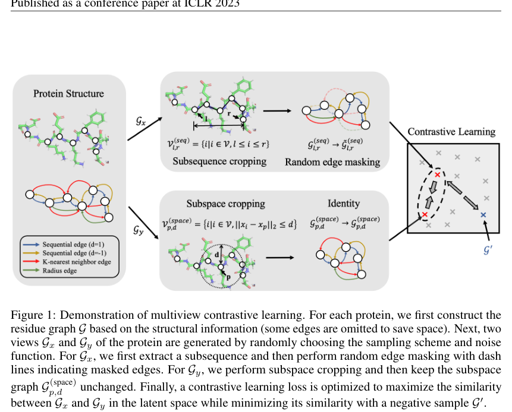

The figure illustrates a multiview contrastive learning framework for protein structures, starting from an initial residue graph $\mathcal{G}$ that branches into two views, $\mathcal{G}_x$ and $\mathcal{G}_y$. The $\mathcal{G}_x$ pathway depicts a process of subsequence cropping followed by random edge masking (indicated by dashed lines), while the $\mathcal{G}_y$ pathway shows subspace cropping followed by an identity transformation. The final stage shows a contrastive learning objective where the two processed views are pulled together in a latent space while being pushed away from a negative sample $\mathcal{G}'$.

**SE(3) diffusion model with application to protein backbone generation** — [arXiv:2302.02277](https://arxiv.org/abs/2302.02277) p.2

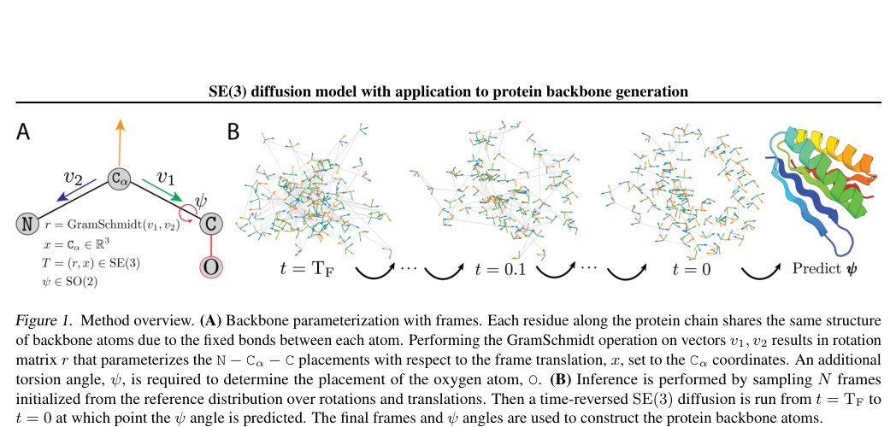

Figure 1 presents a method overview for protein backbone generation. Panel (A) uses a diagram of atoms (N, $C_\alpha$, C, O) and vectors ($v_1, v_2$) to illustrate how the backbone is parameterized using a frame $x$, a rotation matrix $r$ derived via Gram-Schmidt, and a torsion angle $\psi$. Panel (B) depicts the inference process through a sequence of increasingly sparse point clouds representing the diffusion process from time $t = T_F$ to $t = 0$, concluding with a predicted $\psi$ and a generated protein backbone structure.

**Diffusion probabilistic modeling of protein backbones in 3D for the
  motif-scaffolding problem** — [arXiv:2206.04119](https://arxiv.org/abs/2206.04119) p.2

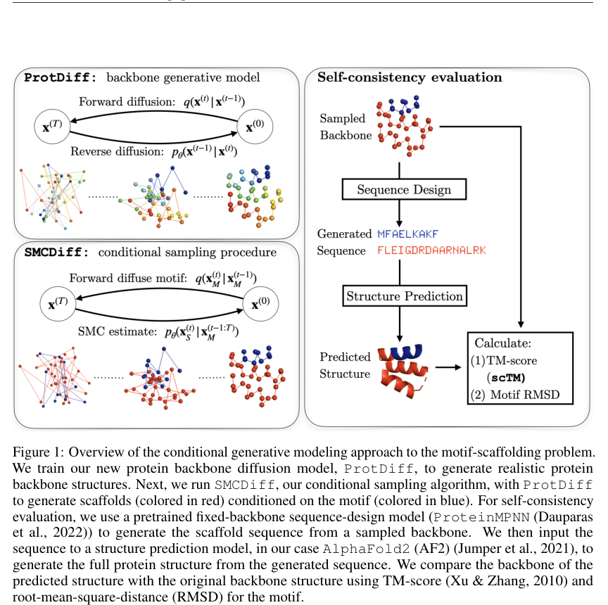

The figure consists of two main panels: a left panel illustrating the "ProtDiff" backbone generative model and the "SMCDiff" conditional sampling procedure using directed arrows between diffusion states $\mathbf{x}^{(T)}$ and $\mathbf{x}^{(0)}$, while the right panel depicts a "Self-consistency evaluation" workflow. The right panel uses a flowchart of boxes and arrows to show how a sampled backbone undergoes sequence design and structure prediction to calculate TM-score (scTM) and motif RMSD. Together, the figure conveys the relationship between the diffusion models and the evaluation pipeline used to assess the quality of generated protein scaffolds.

**Protein structure generation via folding diffusion** — [arXiv:2209.15611](https://arxiv.org/abs/2209.15611) p.4

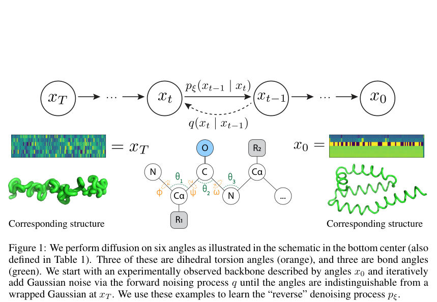

The figure depicts a diffusion process represented by a sequence of circles labeled $x_T$ through $x_0$, connected by arrows showing a forward noising process $q(x_t | x_{t-1})$ and a reverse denoising process $p_\xi(x_{t-1} | x_t)$. Below this, a schematic of a protein backbone shows six specific angles (three orange dihedral torsion angles and three green bond angles) that serve as the diffusion variables. The diagram illustrates how a structured protein backbone $x_0$ is transformed into a noisy distribution $x_T$, which is visually represented by color-coded strips and corresponding 3D protein structures.

**Generating Novel, Designable, and Diverse Protein Structures by
  Equivariantly Diffusing Oriented Residue Clouds** — [arXiv:2301.12485](https://arxiv.org/abs/2301.12485) p.4

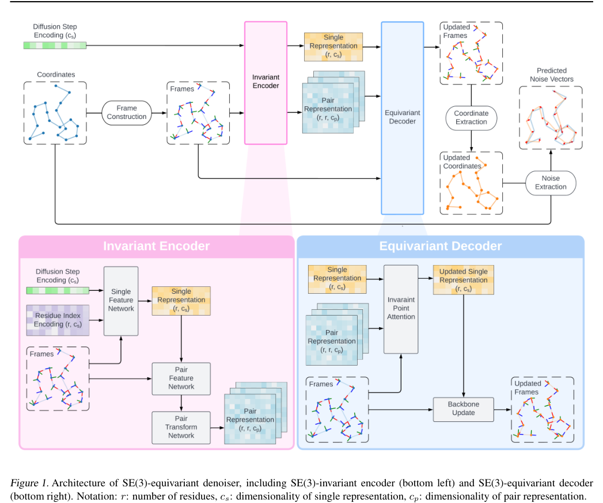

The figure illustrates the architecture of an SE(3)-equivariant denoiser, consisting of a frame construction step followed by an invariant encoder and an equivariant decoder. The invariant encoder (pink box) processes frames and diffusion step encodings through single and pair feature networks to produce single and pair representations, while the equivariant decoder (blue box) uses invariant point attention to update these representations and the backbone frames to predict noise vectors.

**SE(3)-Stochastic Flow Matching for Protein Backbone Generation** — [arXiv:2310.02391](https://arxiv.org/abs/2310.02391) p.1

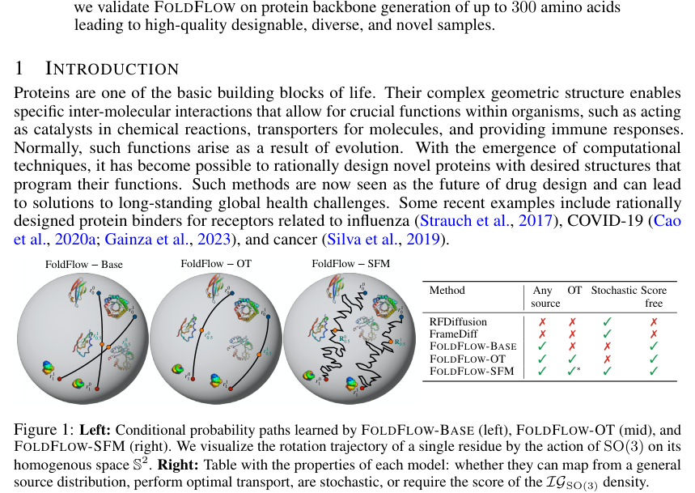

The figure displays three spheres representing the homogeneous space $\mathbb{S}^2$, each containing a different colored trajectory of a single residue's rotation. These trajectories illustrate the conditional probability paths learned by three models: FoldFlow-BASE (left), FoldFlow-OT (middle), and FoldFlow-SFM (right). To the right, a table compares these methods against RFDiffusion and FrameDiff across three criteria: ability to map from any source, performance of optimal transport (OT), and being stochastic score-free.

**Generative De Novo Protein Design with Global Context** — [arXiv:2204.10673](https://arxiv.org/abs/2204.10673) p.1

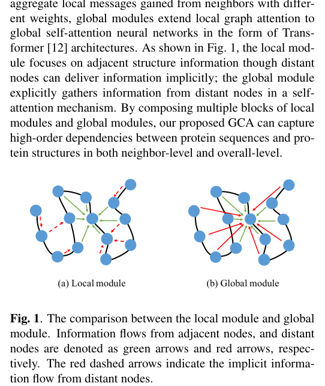

The figure displays two diagrams, labeled (a) Local module and (b) Global module, consisting of blue nodes connected by various colored arrows. In the local module, solid green arrows connect adjacent nodes while red dashed arrows represent implicit information flow from distant nodes; in the global module, solid red arrows explicitly connect distant nodes to a central node. The figure conveys the difference between implicit information transfer from distant nodes in local modules versus the explicit gathering of information from distant nodes in global modules.

**Fast protein backbone generation with SE(3) flow matching** — [arXiv:2310.05297](https://arxiv.org/abs/2310.05297) p.5

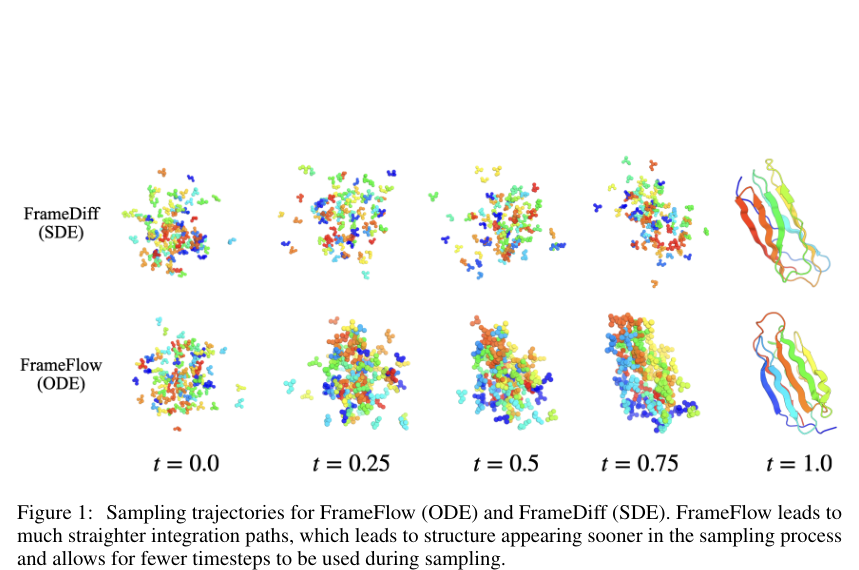

The figure displays two rows of protein backbone structures representing sampling trajectories for FrameDiff (SDE) and FrameFlow (ODE) at five discrete timesteps ($t = 0.0, 0.25, 0.5, 0.75, 1.0$). It conveys that FrameFlow (ODE) produces more coherent protein structures earlier in the sampling process compared to the more disorganized structures in the FrameDiff (SDE) row.

**Generative Flows on Discrete State-Spaces: Enabling Multimodal Flows
  with Applications to Protein Co-Design** — [arXiv:2402.04997](https://arxiv.org/abs/2402.04997) p.2

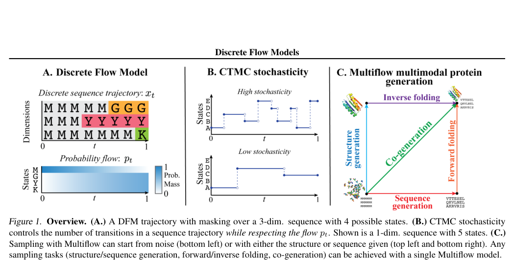

Figure 1 provides an overview of Discrete Flow Models, divided into three panels. Panel A illustrates a discrete sequence trajectory $x_t$ undergoing masking over time alongside its corresponding probability flow $p_t$. Panel B compares high and low CTMC stochasticity through line plots of state transitions over time $t$, and Panel C depicts a square diagram of protein generation tasks, showing how structure and sequence generation can be linked via forward folding, inverse folding, and co-generation.

**Out of Many, One: Designing and Scaffolding Proteins at the Scale of the
  Structural Universe with Genie 2** — [arXiv:2405.15489](https://arxiv.org/abs/2405.15489) p.3

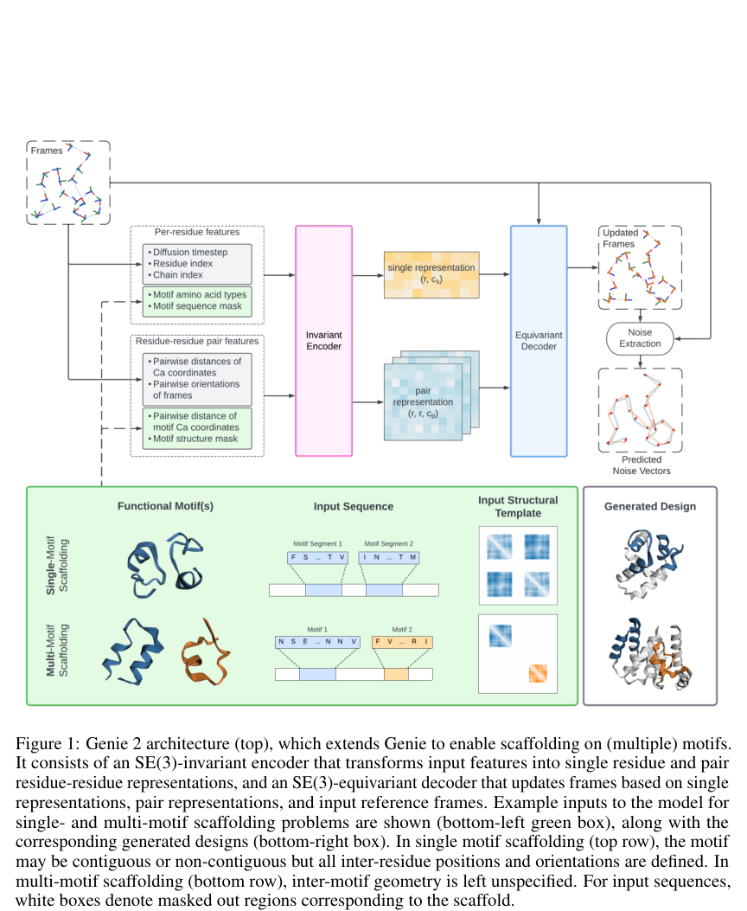

The top panel illustrates the Genie 2 architecture, showing a flow from input "Frames" through an "Invariant Encoder" (processing per-residue and residue-residue pair features) to an "Equivariant Decoder" that outputs "Updated Frames" and "Predicted Noise Vectors." The bottom panel displays examples of single-motif and multi-motif scaffolding tasks, mapping functional motifs and input sequences/templates to their resulting generated protein designs.

**AlphaDesign: A graph protein design method and benchmark on AlphaFoldDB** — [arXiv:2202.01079](https://arxiv.org/abs/2202.01079) p.3

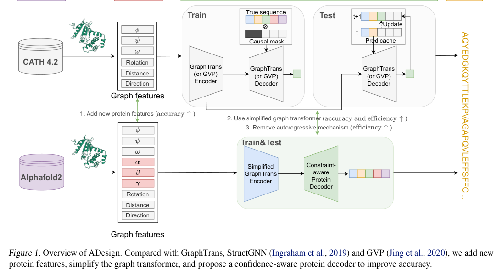

The figure illustrates the architectural differences between existing methods (GraphTrans/GVP) and the proposed AlphaDesign (ADesign) framework. It uses flowcharts with boxes and arrows to show how ADesign incorporates additional protein features ($\alpha, \beta, \gamma$) and utilizes a simplified GraphTrans encoder paired with a constraint-aware protein decoder to improve accuracy and efficiency.

**Structure-informed Language Models Are Protein Designers** — [arXiv:2302.01649](https://arxiv.org/abs/2302.01649) p.2

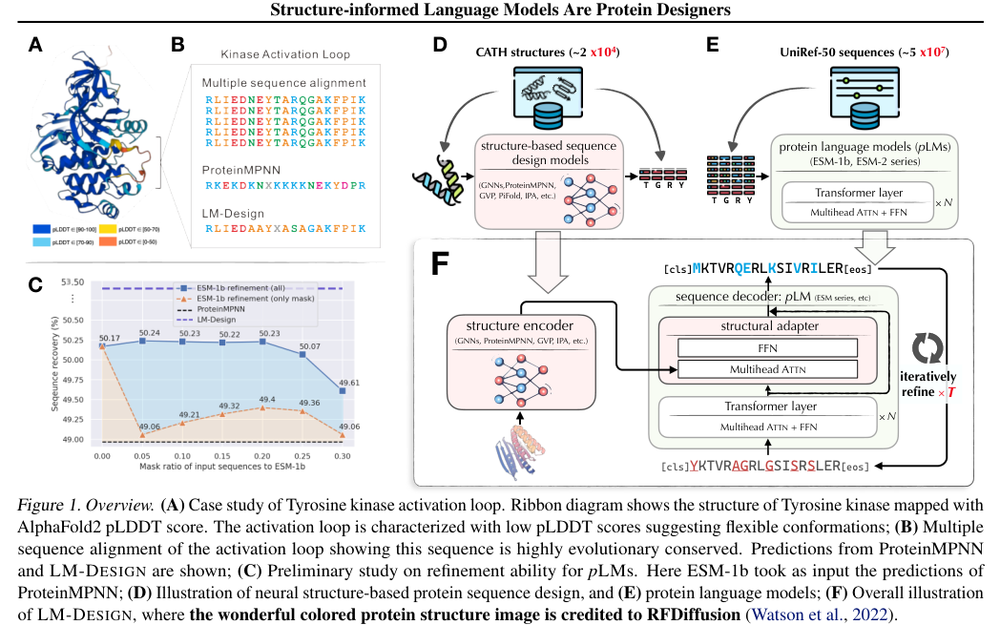

Figure 1 provides an overview of structure-informed protein design, illustrating a case study of a Tyrosine kinase activation loop (A) and its multiple sequence alignment (B). Panel (C) presents a line graph comparing sequence recovery for LM-Design and ProteinMPNN against ESM-1b refinement. Panels (D), (E), and (F) use flowcharts and architectural diagrams to contrast structure-based sequence design models (D) and protein language models (E) with the proposed LM-Design framework (F), which integrates a structure encoder and a structural adapter into a sequence decoder.

**AlphaFold Meets Flow Matching for Generating Protein Ensembles** — [arXiv:2402.04845](https://arxiv.org/abs/2402.04845) p.2

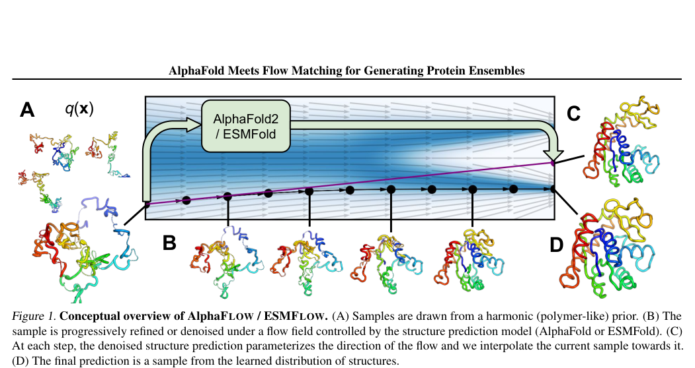

The figure illustrates a conceptual overview of AlphaFLOW / ESMFLOW, showing a progression from a disordered protein prior (A) to a structured protein ensemble (D). A central blue rectangular panel depicts a flow field with streamlines and a directed path of black dots, where an AlphaFold2 / ESMFold box provides guidance to the flow. The sequence of protein structures (B and C) shows the progressive refinement and denoising of a sample along this flow path toward the final predicted structure (D).

