*deep research · 1 round(s) · 120 landmarks · frontier≥2022: 97 · 3 full-PDF critiques · grounded 75 · off-digest 0*

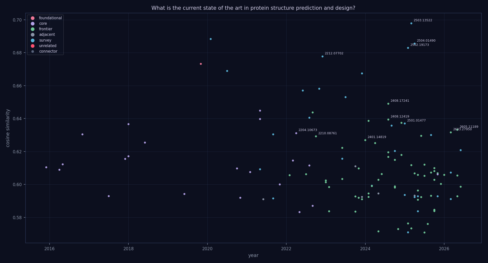

*The citation story graph behind this review — 120 papers, 0 intent-typed edges, 0 lineage threads (gold). Node size = in-topic citations, color = role. [Interactive version](graph.html).*

---

# From Sequence to Function: A Review of Advances in Protein Structure Prediction and De Novo Design

The relationship between a protein's primary amino acid sequence and its functional three-dimensional fold remains one of the most profound challenges in computational biology. Deciphering how a linear chain of residues collapses into a precise architecture is essential for understanding biological mechanisms, characterizing disease pathways, and accelerating therapeutic discovery. For decades, the field has been anchored in the fundamental principles of protein structure and sequence modeling, seeking to decode the physical and chemical constraints that govern the folding landscape.

The methodology of the field has undergone a dramatic evolution, transitioning from early heuristic approaches centered on contact maps to the transformative era of deep learning exemplified by AlphaFold. This shift has moved the discipline beyond mere observation toward a paradigm of creation. Modern advancements now leverage generative modeling and de novo protein design to engineer novel folds that do not exist in nature, a process increasingly enhanced by the integration of protein language models that capture deep evolutionary patterns.

As the field matures, the focus is expanding from static, single-chain models toward the complex realities of cellular environments. Current research is increasingly directed at predicting multi-protein complex structures and intricate protein-ligand interactions, which are critical for modern drug design. Ultimately, the frontier of the discipline lies in moving beyond fixed snapshots to capture the temporal and spatial nuances of molecular biology, specifically through the study of protein dynamics, conformational ensembles, and high-fidelity atomistic design.

## Foundations of Protein Structure and Sequence Modeling

Early advancements in protein modeling focused heavily on secondary structure prediction (SSP) through increasingly complex deep learning architectures. Initial efforts utilized deep hierarchical architectures to integrate Conditional Random Fields (CRF) with convolutional neural fields, modeling interdependencies between adjacent secondary structure labels to achieve ~84% Q3 accuracy [arXiv:1512.00843](https://arxiv.org/abs/1512.00843). Subsequent research sought to capture broader contextual dependencies; for instance, DCRNN combined multiscale CNNs with stacked bidirectional GRUs to integrate local and global contextual features [arXiv:1604.07176](https://arxiv.org/abs/1604.07176). Other approaches optimized computational efficiency and density, such as MUST-CNN, which employed a "shift-and-stitch" technique to generate fully dense per-position predictions [arXiv:1605.03004](https://arxiv.org/abs/1605.03004), or multi-scale CNNs utilizing next-step conditioning [arXiv:1611.01503](https://arxiv.org/abs/1611.01503).

As the field matured, the focus shifted from local secondary structure to more complex geometric and topological representations. Researchers moved beyond simple sequence-to-label mappings to predict continuous geometric properties, such as backbone dihedral angles, by converting real-valued angles into vector representations and applying k-means clustering for label normalization [arXiv:1712.07244](https://arxiv.org/abs/1712.07244). Similarly, deep neural networks were deployed to predict side-chain conformations without physics-based assumptions, achieving a >25% accuracy improvement over standard methods [arXiv:1707.08381](https://arxiv.org/abs/1707.08381). This progression toward higher-order structural information is further evidenced by the use of bi-directional RNNs and ANNs for 2D contact map prediction [arXiv:1906.04527](https://arxiv.org/abs/1906.04527) and the development of encoder-decoder architectures that leverage MSA covariance matrices and embeddings to reconstruct all-atom coordinates via distance matrices and torsion angles [arXiv:1911.05531](https://arxiv.org/abs/1911.05531).

The integration of deep learning into protein design and quality assessment represents a significant shift from purely predictive tasks to generative and evaluative ones.

| Method | Primary Task | Key Innovation | Performance Metric |
| :--- | :--- | :--- | :--- |
| [arXiv:1801.07130](https://arxiv.org/abs/1801.07130) | Design & Prediction | NN outputs as residue restraints | 38.3% accuracy; ~3% higher sequence identity vs. previous methods |
| [arXiv:1806.09900](https://arxiv.org/abs/1806.09900) | Design | Latent space exploration via CVAE | 49.5% mean sequence identity for metal binding site conditioning |
| [arXiv:1801.06252](https://arxiv.org/abs/1801.06252) | Quality Assessment | Learning from raw 3D atomic densities | N/A (ranking of model structures) |

While the multi-layer neural network approach in [arXiv:1801.07130](https://arxiv.org/abs/1801.07130) improved sequence identity in Rosetta-based design by using neural outputs as restraints, the CVAE approach in [arXiv:1806.09900](https://arxiv.org/abs/1806.09900) offers a more generative framework, allowing for the iterative sampling of sequences with specific attributes, such as metal-binding sites. In contrast to these sequence-centric design methods, [arXiv:1801.06252](https://arxiv.org/abs/1801.06252) addresses the structural integrity of models by learning features directly from raw 3D atomic densities, bypassing the need for manual feature engineering in decoy ranking. Together, these methodologies demonstrate a transition from predicting local sequence patterns to designing and validating complex, functional protein architectures.

['Recent surveys emphasize that protein design is increasingly treated as the inverse problem of structural and functional prediction, utilizing sequence, structure, and functional data as primary inputs [arXiv:2501.01477](https://arxiv.org/abs/2501.01477), [arXiv:2502.19173](https://arxiv.org/abs/2502.19173).']
## Evolution of Structure Prediction: From Contact Maps to AlphaFold

The evolution of protein structure prediction has transitioned from modeling coarse-grained contact maps toward high-fidelity, all-atom representations and unified generative frameworks. Early advancements in data granularity, such as SidechainNet, expanded the field's scope by providing all-atom information, including both backbone and sidechain coordinates and angles, moving beyond simple residue-level approximations [arXiv:2010.08162](https://arxiv.org/abs/2010.08162). This shift toward atomic detail is mirrored in the development of specialized architectures like rotation-equivariant, hierarchical neural networks, which utilize point-based representations to perform model quality assessment (MQA) across multiple structural resolutions without requiring multiple sequence alignments (MSAs) [arXiv:2011.13557](https://arxiv.org/abs/2011.13557).

Recent methodologies have increasingly sought to bridge the gap between folding (prediction) and design. MimNet introduces a reversible graph mimetic neural network that treats these tasks as a unified problem [arXiv:2102.03881](https://arxiv.org/abs/2102.03881), while EBM-Fold utilizes fully-differentiable energy-based models to replace traditional, non-differentiable optimization tools in the folding process [arXiv:2105.04771](https://arxiv.org/abs/2105.04771). This trend toward optimization-based refinement is also seen in tFold-TR, which integrates predicted distances of missing regions and residue-specific deviations into a hybrid potential energy function for template-based modeling [arXiv:2105.04350](https://arxiv.org/abs/2105.04350).

The field has further diverged into specialized generative and co-design paradigms. For instance, NeuralPLexer employs a multi-scale Molecular Heat Transformer to predict protein-ligand complex structures, specifically utilizing discretized heat-kernel transformations to encode chirality and long-range dependencies [arXiv:2209.15171](https://arxiv.org/abs/2209.15171). In contrast, diffusion-based models have emerged to design novel protein backbones by mirroring the native folding process [arXiv:2209.15611](https://arxiv.org/abs/2209.15611). While these generative models focus on backbone creation, ProtSeed utilizes equivariant translation to enable rapid protein sequence and structure co-design, achieving speeds orders of magnitude faster than traditional sampling-based methods [arXiv:2210.08761](https://arxiv.org/abs/2210.08761).

Despite the dominance of AlphaFold2, current research focuses on maximizing its utility through ensemble techniques or improving its predictive accuracy. ARStack demonstrates that stacking AlphaFold2 and RoseTTAFold via a meta-model can outperform the individual baseline models [arXiv:2301.07568](https://arxiv.org/abs/2301.07568). However, a critical tension remains between specialized predictive models and general representation learners. While geometric structure pretraining via multiview contrastive learning offers broad utility for tasks like fold classification and enzyme prediction [arXiv:2203.06125](https://arxiv.org/abs/2203.06125), it lacks the task-specific optimization seen in dedicated design frameworks like ProtSeed [arXiv:2210.08761](https://arxiv.org/abs/2210.08761) or the complex-specific focus of NeuralPLexer [arXiv:2209.15171](https://arxiv.org/abs/2209.15171).

['The field has transitioned from the landmark computational accuracy of AlphaFold2 [arXiv:2212.07702](https://arxiv.org/abs/2212.07702) to unified biomolecular prediction frameworks like AlphaFold3 and RoseTTAFold, which utilize three-track architectures and diffusion to model complex interactions [arXiv:2504.01490](https://arxiv.org/abs/2504.01490). Efficiency has also become a focus, with models like Protenix-Mini utilizing compact architectures and few-step ODE samplers to accelerate prediction [arXiv:2507.11839](https://arxiv.org/abs/2507.11839).']
## Generative Modeling and De Novo Protein Design

Recent advancements in protein design have transitioned from simple sequence generation to sophisticated generative frameworks capable of co-designing backbone structures and sequences. A primary tension in the field exists between specialized sequence design (inverse folding) and holistic de novo structure generation.

For fixed-backbone design, several methods focus on mapping 3D structures to optimal sequences. AlphaDesign (ADesign) utilizes a graph transformer encoder (SGT) and a non-autoregressive constraint-aware protein decoder (CPD) to achieve parallel residue prediction, reporting a 40x speedup in efficiency and an 8% increase in accuracy over previous benchmarks [arXiv:2202.01079](https://arxiv.org/abs/2202.01079). Similarly, LM-Design repurposes pretrained protein language models (pLMs) by implanting a lightweight structural adapter, a technique described as "structural surgery" to endow sequence-based models with structural awareness [arXiv:2302.01649](https://arxiv.org/abs/2302.01649). In contrast to these adapter-based approaches, GCA emphasizes capturing high-order dependencies by representing proteins as graphs with rotation- and translation-invariant edge features, focusing on global context for therapeutic applications [arXiv:2204.10673](https://arxiv.org/abs/2204.10673).

The frontier of the field has shifted toward diffusion-based models that generate novel backbones. Genie introduces a Denoising Diffusion Probabilistic Model (DDPM) that operates directly in Cartesian space using an SE(3)-equivariant denoiser acting on oriented residue clouds [arXiv:2301.12485](https://arxiv.org/abs/2301.12485). This concept is evolved in Genie 2, which employs an asymmetric representation: using atom point clouds for the forward process and clouds of reference frames for the reverse process to facilitate multi-motif scaffolding [arXiv:2405.15489](https://arxiv.org/abs/2405.15489). Other geometric approaches include the Vector Field Network (VFN), which utilizes vector field operators and virtual atoms to extract geometric features [arXiv:2310.11802](https://arxiv.org/abs/2310.11802). VFN demonstrates superior sequence recovery compared to specialized models, achieving 54.74% vs. 51.66% for PiFold and 62.64% vs. 55.65% for LM-Design when augmented with external knowledge [arXiv:2310.11802](https://arxiv.org/abs/2310.11802).

| Method | Primary Task | Key Innovation | Performance Metric |
| :--- | :--- | :--- | :--- |
| [arXiv:2202.01079](https://arxiv.org/abs/2202.01079) | Design | SGT encoder & CPD decoder | +8% accuracy vs. baseline |
| [arXiv:2310.11802](https://arxiv.org/abs/2310.11802) | Both | Vector field operators & virtual atoms | 54.74% recovery vs. 51.66% (PiFold) |
| [arXiv:2310.11802](https://arxiv.org/abs/2310.11802) | Both | Vector field operators & virtual atoms | 62.64% recovery vs. 55.65% (LM-Design) |

Current research is increasingly addressing functional constraints and low-resource scenarios. NAEPro moves beyond generic backbone generation by jointly designing sequence and structure based on automatically detected functional and conserved sites, specifically targeting metalloproteins [arXiv:2310.04343](https://arxiv.org/abs/2310.04343). For specialized tasks like enzyme design where data is scarce, CrossDesign introduces a domain-adaptive framework. It utilizes a Structure-to-Sequence (Str2Seq) stream and an auxiliary PPLM stream bridged by a linear alignment unit (LAU) to enable task-adaptive generalization [arXiv:2411.17795](https://arxiv.org/abs/2411.17795). While earlier pipelines like ProteinSolver combined sequence generation with AlphaFold2 for binding site design [arXiv:2208.14526](https://arxiv.org/abs/2208.14526), modern generative models aim to bridge the gap between computational design and experimental realization by refining the entire structure-sequence relationship [arXiv:2408.17241](https://arxiv.org/abs/2408.17241).

['Generative modeling has shifted toward sequence-structure co-generation, employing denoising diffusion probabilistic models (DDPMs) and flow matching to model both modalities simultaneously [arXiv:2410.01773](https://arxiv.org/abs/2410.01773). Advanced frameworks now leverage diffusion-based methods and pairwise attention modules to achieve near-experimental accuracy in de novo design [arXiv:2503.13522](https://arxiv.org/abs/2503.13522), [arXiv:2502.19173](https://arxiv.org/abs/2502.19173). Furthermore, the use of consistent synthetic sequences and tools like ProteinMPNN has enabled the creation of high-quality training datasets for fully atomistic protein generation [arXiv:2512.01976](https://arxiv.org/abs/2512.01976).']
## Protein Language Models and Structural Integration

The evolution of Protein Language Models (PLMs) has transitioned from purely sequence-based representations toward architectures that explicitly or implicitly integrate structural information to enhance functional understanding and design capabilities [arXiv:2502.17504](https://arxiv.org/abs/2502.17504), [arXiv:2505.20098](https://arxiv.org/abs/2505.20098). While early transformer-based models focused on capturing long-range dependencies through self-attention [arXiv:2505.20098](https://arxiv.org/abs/2505.20098), recent advancements demonstrate a divergence in how structural knowledge is ingested.

One primary approach involves explicit structural integration. The PST model enhances ESM-2 by representing proteins as graphs, thereby endowing the language model with direct structural knowledge for improved Enzyme and Gene Ontology prediction [arXiv:2401.14819](https://arxiv.org/abs/2401.14819). Similarly, DS-ProGen utilizes a dual-structure fusion design decoder that integrates backbone geometric features (N, C, Cα) with molecular surface biochemical information to facilitate functional protein design and inverse protein folding [arXiv:2505.12511](https://arxiv.org/abs/2505.12511). In contrast, the Structure-Informed Protein Language Model adopts a distillation strategy; it integrates remote homology detection to infuse structural information into ESM-2 models without requiring explicit structural inputs during inference [arXiv:2402.05856](https://arxiv.org/abs/2402.05856). This distinction highlights a trade-off between the high-fidelity geometric modeling seen in DS-ProGen and the computational efficiency of distillation-based methods.

For computational protein design (CPD), models are increasingly focusing on local environments. EMOCPD utilizes a multi-head attention mechanism and an inverse residual structure to analyze the three-dimensional amino acid microenvironment, achieving test accuracies of 68.33% and 62.32% for optimizing thermal stability and expression [arXiv:2410.21069](https://arxiv.org/abs/2410.21069). While these models focus on specific biochemical attributes, Prot2Token proposes a more generalized paradigm by converting diverse tasks—including residue-specific attributes and inter-protein interactions—into a unified next-token prediction format using an encoder-decoder transformer [arXiv:2505.20589](https://arxiv.org/abs/2505.20589).

The integration of these models into practical workflows is further addressed by middleware solutions. The IMPRESS framework (including IM-RP) bridges the gap between generative AI and High-Performance Computing (HPC), using real-time feedback and dynamic resource allocation to optimize the design of target-binding proteins [arXiv:2510.06396](https://arxiv.org/abs/2510.06396).

| Method | Primary Input Features | Key Structural Integration Strategy | Primary Task Focus |
| :--- | :--- | :--- | :--- |
| [arXiv:2401.14819](https://arxiv.org/abs/2401.14819) | Sequences and structural graphs | Graph-based integration into ESM-2 | Function prediction |
| [arXiv:2402.05856](https://arxiv.org/abs/2402.05856) | Protein sequences | Remote homology distillation | Function prediction |
| [arXiv:2410.21069](https://arxiv.org/abs/2410.21069) | 3D atomic microenvironments | Multi-head attention on local environments | Protein design (CPD) |
| [arXiv:2505.12511](https://arxiv.org/abs/2505.12511) | Backbone coordinates and molecular surfaces | Dual-structure fusion decoder | Inverse protein folding/Design |
| [arXiv:2505.20589](https://arxiv.org/abs/2505.20589) | Sequences and SMILES | Unified next-token prediction framework | Multi-task modeling |

While explicit graph or surface-based models like PST [arXiv:2401.14819](https://arxiv.org/abs/2401.14819) and DS-ProGen [arXiv:2505.12511](https://arxiv.org/abs/2505.12511) offer high structural granularity, they may require more complex input pipelines compared to the distillation-based approach of [arXiv:2402.05856](https://arxiv.org/abs/2402.05856). Furthermore, while EMOCPD [arXiv:2410.21069](https://arxiv.org/abs/2410.21069) excels at optimizing local microenvironments for stability, the unified framework of Prot2Token [arXiv:2505.20589](https://arxiv.org/abs/2505.20589) offers superior versatility across disparate protein-related prediction tasks.

['Structural information is increasingly being tokenized through vector-quantized autoencoders to allow transformer-based models to learn the language of 3D backbone coordinates [arXiv:2405.15840](https://arxiv.org/abs/2405.15840).']
## Predicting Complex Structures and Protein-Ligand Interactions

The transition from single-chain modeling to the prediction of multi-component biomolecular assemblies is characterized by a shift toward generative architectures and specialized structural constraints. For protein multimer structure prediction (MSP), approaches vary from prompt-based Graph Neural Networks (GNNs) that reformulate link prediction into graph-level regression [arXiv:2402.18813](https://arxiv.org/abs/2402.18813) to symmetry-aware models like SGNet, which utilizes structural topology to predict symmetrical complexes via the asymmetric unit [arXiv:2403.04395](https://arxiv.org/abs/2403.04395). HelixFold-Multimer [arXiv:2404.10260](https://arxiv.org/abs/2404.10260) further refines this by offering specialized versions for antigen-antibody interactions, achieving a median DockQ score of 0.304 and a 57.8% success rate for samples with DockQ > 0.23 [arXiv:2404.10260](https://arxiv.org/abs/2404.10260).

In the realm of ligand and nucleic acid interactions, generative models have become dominant. HelixFold3 [arXiv:2408.16975](https://arxiv.org/abs/2408.16975) employs diffusion to handle diverse biomolecules, while NeuralPLexer3 [arXiv:2412.10743](https://arxiv.org/abs/2412.10743) utilizes conditional flow models to enable de novo sampling of generalized complexes, including ions and post-translational modifications (PTMs). While both offer broad applicability, NeuralPLexer3 distinguishes itself through all-atom and pairwise confidence estimation [arXiv:2412.10743](https://arxiv.org/abs/2412.10743). A significant refinement in ligand placement accuracy is seen in the use of AF-ClaSeq [arXiv:2506.00147](https://arxiv.org/abs/2506.00147), which uses purified sequence subsets to isolate coevolutionary signals, thereby correcting protein conformations and ligand placement in AlphaFold3-based workflows.

| Method | Primary Task | Methodology | Scope |
| :--- | :--- | :--- | :--- |
| [arXiv:2404.10260](https://arxiv.org/abs/2404.10260) | Prediction | Specialized versions (general/antigen-antibody) | Heteromeric, peptide-protein, antigen-antibody |
| [arXiv:2408.16975](https://arxiv.org/abs/2408.16975) | Prediction | Diffusion | Single chains, complexes, ligands, nucleic acids |
| [arXiv:2412.10743](https://arxiv.org/abs/2412.10743) | Both | Conditional flow-based generative | Proteins, nucleic acids, ligands, ions, PTMs |

The temporal and functional dimensions of these complexes are also being addressed. AlphaFolding [arXiv:2408.12419](https://arxiv.org/abs/2408.12419) introduces 4D diffusion to predict protein trajectories by incorporating molecular dynamics data and motion guidance. This contrasts with multi-scale representation learning [arXiv:2412.01108](https://arxiv.org/abs/2412.01108), which merges sequence and structural modalities to predict protein fitness, such as thermostability and drug resistance. While these deep learning frameworks [arXiv:2605.11189](https://arxiv.org/abs/2605.11189) focus on hierarchical architectures and sequence space search, emerging quantum frameworks [arXiv:2506.22677](https://arxiv.org/abs/2506.22677) attempt to solve binding-site structure prediction via ground-state energy minimization on utility-level quantum processors. This suggests a bifurcated future for the field: highly specialized deep learning models for specific biological interfaces [arXiv:2404.10260](https://arxiv.org/abs/2404.10260) and generalized generative models capable of handling the full spectrum of biomolecular complexity [arXiv:2412.10743](https://arxiv.org/abs/2412.10743).

["The scope of prediction has expanded to include protein-protein complexes and binding free energy changes [arXiv:2406.03979](https://arxiv.org/abs/2406.03979), as well as all-atom ligand placement. Models like Pearl utilize SE(3)-equivariant diffusion and specialized 'trimul' modules to achieve precise atomistic placement for drug discovery [arXiv:2510.24670](https://arxiv.org/abs/2510.24670)."]
## Frontiers in Protein Dynamics, Ensembles, and Atomistic Design

The field is transitioning from predicting static, single-state structures toward modeling the high-dimensional, multimodal distributions characteristic of protein ensembles [arXiv:2509.17224](https://arxiv.org/abs/2509.17224). Recent methodologies aim to bypass the computational cost of physical simulations by using generative models to sample statistically independent conformational states [arXiv:2509.17224](https://arxiv.org/abs/2509.17224). Within this paradigm, Ibex introduces conformation tokens (apo or holo) and residual connections to enable state-specific prediction for immune proteins [arXiv:2507.09054](https://arxiv.org/abs/2507.09054), while other approaches condition design on flexibility using protein language model embeddings [arXiv:2508.18211](https://arxiv.org/abs/2508.18211). To address structural changes induced by mutations, DeltaDiff offers a training-free, physics-guided diffusion approach [arXiv:2606.04452](https://arxiv.org/abs/2606.04452), whereas Refine-PPI integrates molecular dynamics-inspired hallucination to predict the consequences of mutations in protein-protein interactions [arXiv:2601.06214](https://arxiv.org/abs/2601.06214).

| Method | Atomistic/All-atom Capability | Conformation/Mutation Awareness |
| :--- | :--- | :--- |
| [arXiv:2507.09054](https://arxiv.org/abs/2507.09054) | Not specified | Conformation tokens (apo/holo) [arXiv:2507.09054](https://arxiv.org/abs/2507.09054) |
| [arXiv:2507.14156](https://arxiv.org/abs/2507.14156) | All-atom (inc. ligands/ions) [arXiv:2507.14156](https://arxiv.org/abs/2507.14156) | Dynamic complexes [arXiv:2507.14156](https://arxiv.org/abs/2507.14156) |
| [arXiv:2603.27950](https://arxiv.org/abs/2603.27950) | Fully atomistic [arXiv:2603.27950](https://arxiv.org/abs/2603.27950) | Not specified |
| [arXiv:2606.04452](https://arxiv.org/abs/2606.04452) | Not specified | Training-free mutation adaptation [arXiv:2606.04452](https://arxiv.org/abs/2606.04452) |

Current state-of-the-art design is increasingly focused on all-atom precision and the integration of non-protein components. ADFLIP utilizes discrete flow matching to perform all-atom inverse folding for complex systems involving ligands, nucleotides, and metal ions [arXiv:2507.14156](https://arxiv.org/abs/2507.14156). Similarly, TriProRep enhances representation learning by using VQ-VAE tokenization to jointly model amino-acid, backbone, and full-atom geometries, which improves homodimer co-folding and interface modeling [arXiv:2605.22133](https://arxiv.org/abs/2605.22133). 

In the domain of binder design, Proteína-Complexa unifies conditional generative modeling with test-time compute scaling (e.g., Beam Search or MCTS) to treat design as a scalable inference problem [arXiv:2603.27950](https://arxiv.org/abs/2603.27950). This approach achieves significant in-silico success, outperforming hallucination-based methods like BindCraft under normalized compute budgets [arXiv:2603.27950](https://arxiv.org/abs/2603.27950). However, a critical weakness is its reliance on synthetic proxies (fpLDDT, fipAE) and the Teddymer dataset, which is derived from predicted AFDB structures and may propagate existing model biases [arXiv:2603.27950](https://arxiv.org/abs/2603.27950).

Efficiency and physical realism are also being addressed through architectural innovations. Pairmixer replaces computationally expensive triangle attention with triangle multiplication to facilitate faster reasoning over residue triplets [arXiv:2510.18870](https://arxiv.org/abs/2510.18870). For backbone generation, PhysFlow integrates topology-aware unfolding and collision avoidance into the flow-matching paradigm to ensure physical realism [arXiv:2509.25379](https://arxiv.org/abs/2509.25379), while Proteina utilizes hierarchical fold class labels to improve the distributional similarity of generated proteins [arXiv:2503.00710](https://arxiv.org/abs/2503.00710).

['The paradigm is evolving from predicting static snapshots to modeling generative dynamics and multimodal interactions, incorporating textual knowledge and conformational ensembles [arXiv:2603.18505](https://arxiv.org/abs/2603.18505).']

## Tensions and Open Problems

A primary tension in the field concerns the transition from static structural modeling to the representation of conformational ensembles. One school of thought emphasizes that the path to biological accuracy lies in increasing the granularity of spatial representations, arguing that atom-level protein representation learning is essential for the precision required in structure prediction [arXiv:2605.22133](https://arxiv.org/abs/2605.22133). However, a growing body of work suggests that high-fidelity static snapshots are insufficient for capturing biological reality. This perspective argues that we must move from "snapshots to symphonies," shifting the focus toward generative dynamics and multimodal interactions that reflect the temporal nature of proteins [arXiv:2603.18505](https://arxiv.org/abs/2603.18505). Proponents of this view suggest that true functional modeling requires capturing the protein's movement and flexibility rather than just its equilibrium state [arXiv:2606.08647](https://arxiv.org/abs/2606.08647), or even using dynamics-inspired hallucination to better model protein-protein interactions [arXiv:2601.06214](https://arxiv.org/abs/2601.06214).

A second debate centers on the methodology of protein design: whether the field should prioritize massive scaling of generative models or the integration of explicit physical inductive biases. Recent advancements suggest that scaling atomistic binder design through generative pretraining and increased test-time compute can overcome complex design challenges [arXiv:2603.27950](https://arxiv.org/abs/2603.27950), supported by the broader development of sophisticated neural representations and conditional generation standards [arXiv:2603.26378](https://arxiv.org/abs/2603.26378). Conversely, there is an emerging critique that pure scaling may lack the robustness required for specific biological perturbations. This has motivated the development of physics-guided, training-free methods, such as DeltaDiff, which argue that incorporating explicit physical constraints is a more reliable way to predict the structural consequences of mutations than relying solely on data-driven scaling [arXiv:2606.04452](https://arxiv.org/abs/2606.04452).

Finally, there remains a disagreement regarding the optimal level of abstraction for co-folding and complex prediction. While some frameworks focus on the deep learning of complex architectures through specialized design tools [arXiv:2605.11189](https://arxiv.org/abs/2605.11189), others argue that models must be more closely guided by structural proteomics to ensure that predicted co-folding behaviors align with observed biological assemblies [arXiv:2605.26192](https://arxiv.org/abs/2605.26192). This tension highlights the difficulty in balancing the high-dimensional flexibility of deep generative models with the rigid constraints imposed by experimental proteomics.

## Outlook

The frontier of protein science is rapidly moving away from the mere prediction of coordinates toward the "design of function." As the field matures, the next generation of models will likely converge these competing tensions by integrating atomistic precision with generative temporal dynamics. We anticipate a shift toward unified frameworks that combine the scaling laws of large-scale generative pretraining with the reliability of physics-guided constraints, ultimately enabling the de novo design of proteins that are not only structurally stable but also kinetically tuned for specific biological roles.

**AlphaFolding: 4D Diffusion for Dynamic Protein Structure Prediction with
  Reference and Motion Guidance** — [arXiv:2408.12419](https://arxiv.org/abs/2408.12419) p.2

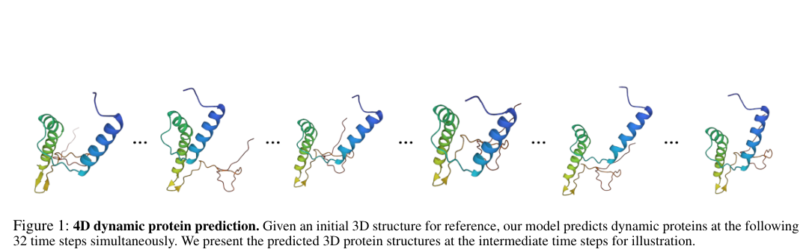

The figure displays a sequence of five 3D protein ribbon structures separated by ellipses, representing a temporal progression of protein conformations. It conveys the model's ability to simultaneously predict dynamic protein structures across multiple time steps, starting from an initial reference structure.

**Multi-Scale Representation Learning for Protein Fitness Prediction** — [arXiv:2412.01108](https://arxiv.org/abs/2412.01108) p.4

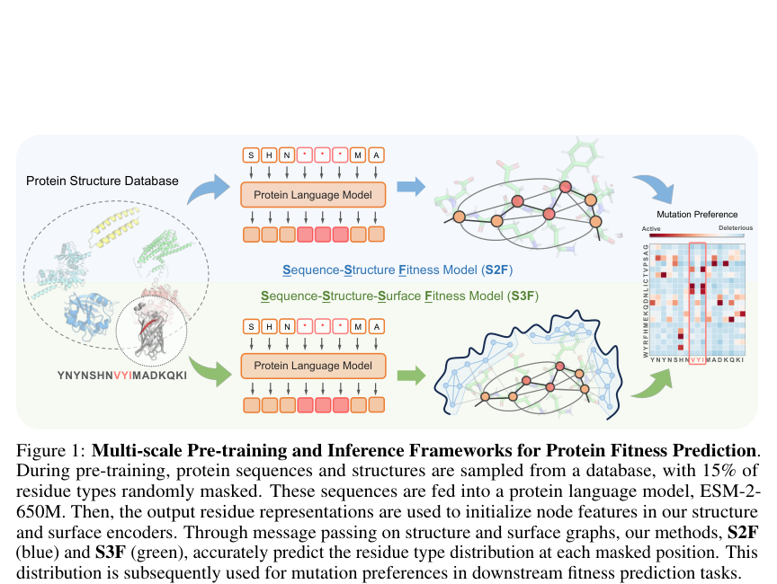

The figure illustrates two multi-scale frameworks, S2F (blue) and S3F (green), which process protein sequences through a protein language model to initialize features for structure and surface encoders. The diagrams use arrows to show the flow from a protein structure database through masked sequences and language models into message-passing graphs representing protein structures and surfaces. The final output is a heatmap representing predicted residue type distributions, which is used to determine mutation preferences ranging from active to deleterious.

**Scaling Atomistic Protein Binder Design with Generative Pretraining and Test-Time Compute** — [arXiv:2603.27950](https://arxiv.org/abs/2603.27950) p.2

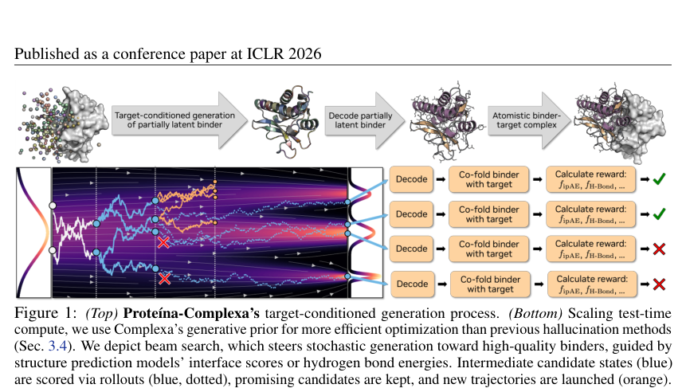

The figure consists of two panels: the top panel uses arrows to illustrate a pipeline from a target protein to a partially latent binder, then to a decoded partially latent binder, and finally to an atomistic binder-target complex. The bottom panel depicts a beam search process where trajectories are represented by colored lines (blue for intermediate candidates and orange for promising ones) that navigate through a landscape of potential states, with nodes marked by green checkmarks or red crosses to indicate successful or failed reward calculations.

**Generative De Novo Protein Design with Global Context** — [arXiv:2204.10673](https://arxiv.org/abs/2204.10673) p.1

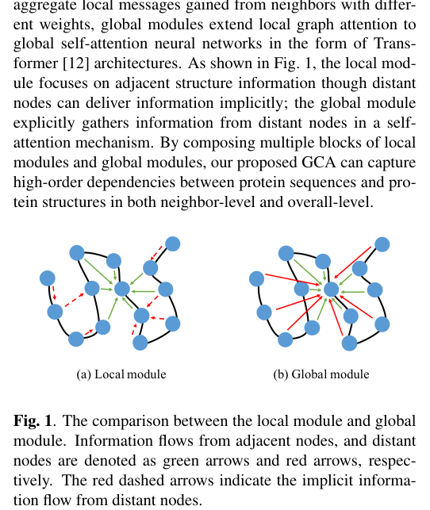

The figure displays two diagrams, labeled "(a) Local module" and "(b) Global module," consisting of blue circular nodes connected by various colored arrows. In the local module, solid green arrows connect adjacent nodes while red dashed arrows represent implicit information flow from distant nodes; in the global module, solid red arrows represent the explicit gathering of information from distant nodes.

**A Quantum Framework for Protein Binding-Site Structure Prediction on Utility-Level Quantum Processors** — [arXiv:2506.22677](https://arxiv.org/abs/2506.22677) p.5

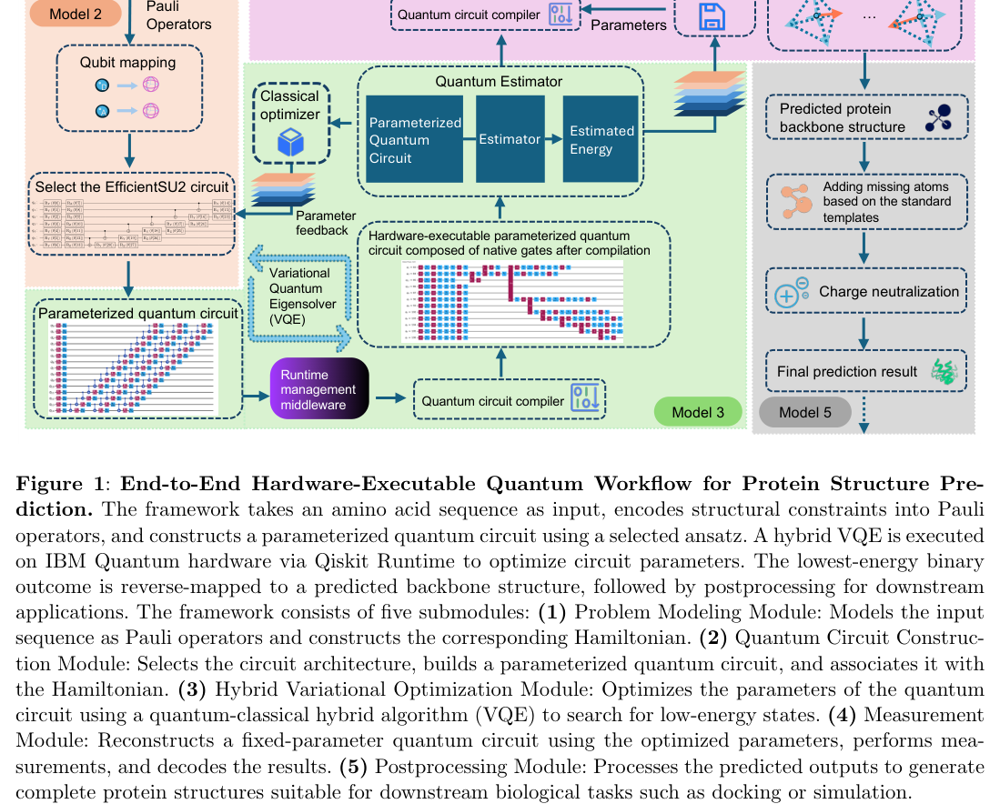

The figure presents a flowchart of an end-to-end quantum workflow for protein structure prediction, organized into five interconnected submodules represented by colored boxes and directional arrows. It illustrates the process starting from "Model 2" (Pauli Operators and Qubit mapping), moving through a "Quantum Estimator" containing a "Parameterized Quantum Circuit" and "Classical optimizer" within a VQE loop, and concluding with "Model 5" (Postprocessing) to produce a "Final prediction result." The diagram uses arrows to show the flow of parameters, quantum circuits, and feedback between classical and quantum components, including the role of the "Quantum circuit compiler" and "Runtime management middleware."

**Protein Sequence and Structure Co-Design with Equivariant Translation** — [arXiv:2210.08761](https://arxiv.org/abs/2210.08761) p.2

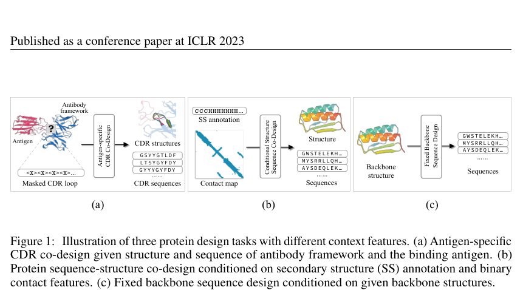

The figure presents three distinct protein design tasks labeled (a), (b), and (c) using diagrams of molecules, text boxes, and flow arrows. Task (a) illustrates antigen-specific CDR co-design by showing a masked CDR loop being designed based on an antigen and antibody framework; task (b) depicts conditional structure-sequence co-design using secondary structure (SS) annotations and contact maps to generate structures and sequences; and task (c) shows fixed backbone sequence design where sequences are generated from a given backbone structure.

**Endowing Protein Language Models with Structural Knowledge** — [arXiv:2401.14819](https://arxiv.org/abs/2401.14819) p.4

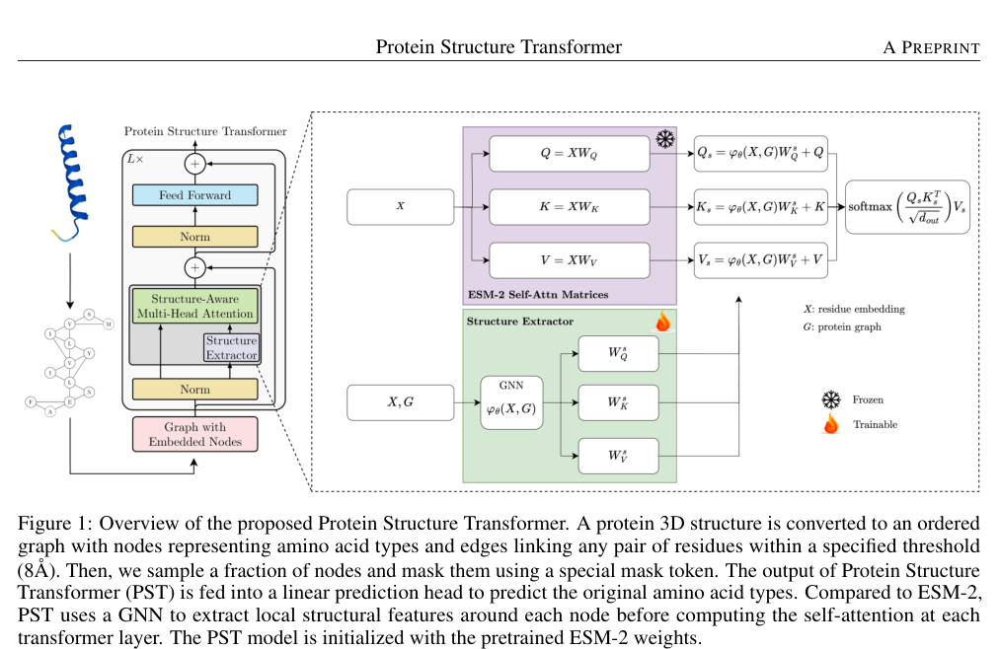

The figure illustrates the architecture of the Protein Structure Transformer, comparing its mechanism to the ESM-2 self-attention process. It depicts a sequence of operations where a protein graph $G$ and residue embeddings $X$ are processed by a trainable GNN-based Structure Extractor to produce structural adjustments ($Q_*, K_*, V_*$) that are added to the standard ESM-2 attention matrices ($Q, K, V$). The diagram uses color-coded boxes and symbols to distinguish between frozen ESM-2 components and trainable structural extraction components.

**HelixFold-Multimer: Elevating Protein Complex Structure Prediction to
  New Heights** — [arXiv:2404.10260](https://arxiv.org/abs/2404.10260) p.2

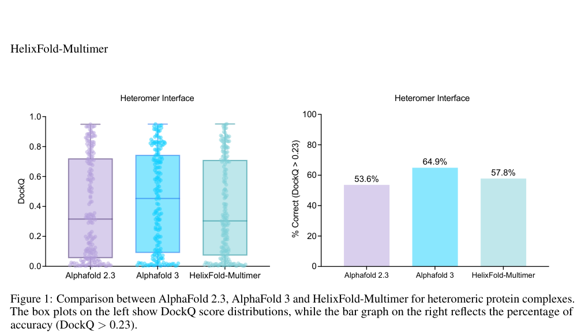

The figure consists of two side-by-side plots comparing AlphaFold 2.3, AlphaFold 3, and HelixFold-Multimer on heteromer interfaces. The left box plot displays DockQ score distributions using shaded boxes and overlaid data points, while the right bar graph shows the percentage of correct predictions (DockQ > 0.23) for each model.

**Technical Report of HelixFold3 for Biomolecular Structure Prediction** — [arXiv:2408.16975](https://arxiv.org/abs/2408.16975) p.5

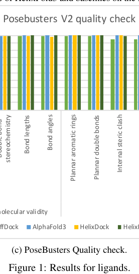

This bar chart compares the performance of different models (ffDock, AlphaFold3, HelixDock, and HelixFold3) across several quality metrics for ligands, including stereochemistry, bond lengths, bond angles, planar aromatic rings, planar double bonds, and internal steric clash. Each metric is represented by a group of colored bars, where the height of each bar indicates the specific model's score for that category.

**NeuralPLexer3: Accurate Biomolecular Complex Structure Prediction with
  Flow Models** — [arXiv:2412.10743](https://arxiv.org/abs/2412.10743) p.3

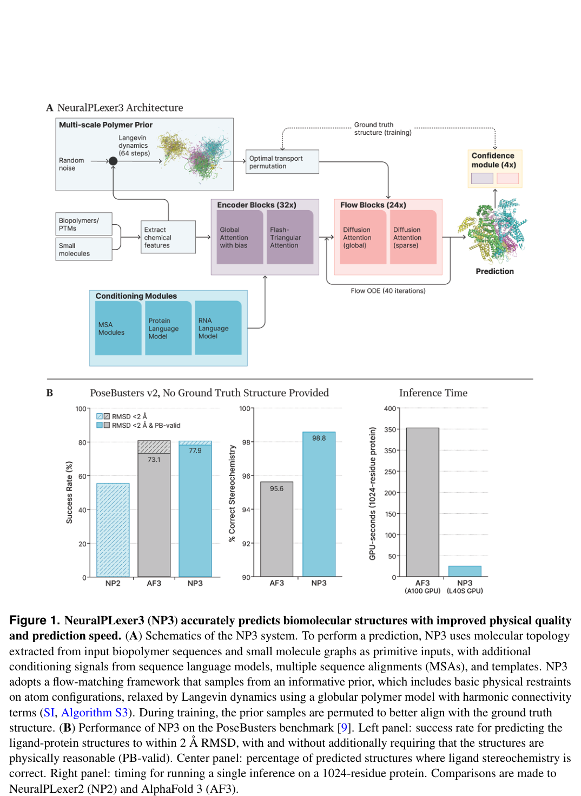

Figure A presents a schematic of the NeuralPLexer3 architecture, illustrating a flow-based model that transforms random noise into a biomolecular prediction through a multi-scale polymer prior, encoder blocks, and flow blocks. The diagram uses boxes and arrows to show the integration of conditioning modules (MSA, protein, and RNA language models) and the iterative refinement process via Langevin dynamics and flow ODEs. Figure B contains three bar charts comparing NeuralPLexer3 (NP3) to NP2 and AF3 across success rate (RMSD and PB-validity), percentage stereochemistry, and inference time on a GPU.

**Protein Representation Learning by Geometric Structure Pretraining** — [arXiv:2203.06125](https://arxiv.org/abs/2203.06125) p.5

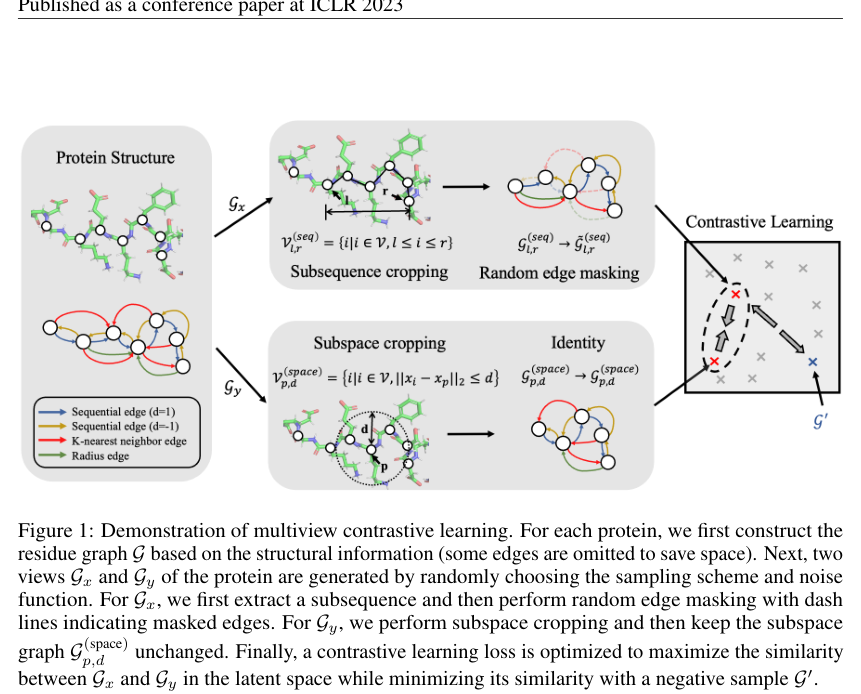

The figure illustrates a multiview contrastive learning framework where a protein structure is transformed into two distinct views, $\mathcal{G}_x$ and $\mathcal{G}_y$. The top path ($\mathcal{G}_x$) shows subsequence cropping followed by random edge masking (indicated by dashed lines), while the bottom path ($\mathcal{G}_y$) shows subspace cropping where the subgraph remains unchanged. These two views are then mapped into a latent space for contrastive learning, where the similarity between the views is maximized while minimizing similarity with a negative sample $\mathcal{G}'$.

