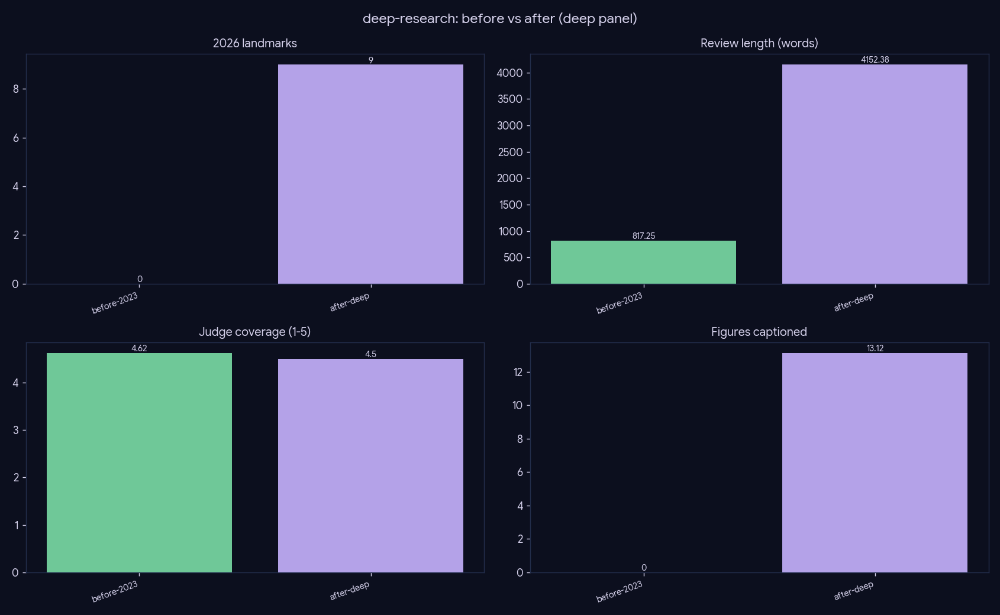

# Deep-research — the flagship, before vs after

*The deployed pipeline, dogfooded end-to-end. Not a single-lever ablation — the holistic jump from the old default to the full deep system.*

## What this is

**`before-2023`** mimics the old default (single-pass, raw in-degree, recency=0, frontier-pull off); **`after-deep`** is the full deployed pipeline with every shipped lever on (deep judge-loop, PPR, recency=0.5, frontier-pull, critique, vision figures). The long md/tex reviews + figure galleries under `results/runs/` (and a tracked sample in `results/showcase/`) are the primary artifact; the table quantifies the jump.

## Results (deep panel, 27 topics)

| pipeline | #2026 | frontier | words | grounded | figures | cap.faith | j_overall |
|---|--:|--:|--:|--:|--:|--:|--:|
| before-2023 | 0.0 | 16.1 | 797 | 29.4 | 0.0 | — | 4.91 |
| **after-deep** | **3.3** | **51.2** | **3921** | **50.7** | **12.0** | **0.93** | 4.92 |

**Pairwise (after-deep vs before-2023):** overall **23W / 4T / 0L (0.85)**, grounding **27/0/0 (1.0)**, lineage 0.85, coverage 0.78.

## The jump

**The deployed pipeline is preferred over the old default 23/4/0 on overall — and a clean sweep (27/0/0, win-rate 1.0) on grounding.** Concretely it:
- surfaces **3.3 2026 papers/topic** where the old default surfaced **zero**,
- triples frontier coverage (16 → 51),
- writes a **full review** (797 → 3921 words vs an abstract-length blurb),
- nearly doubles grounded citations (29 → 51),
- ships **12 verified figures** (caption-faithfulness 0.93) where the old default had none.

**Honest nuance:** gold landmark recall dips slightly (0.96 → 0.85) — the old lineage-only pipeline over-indexes on pre-2026 canonical papers, while the deep pipeline reallocates attention toward the frontier. The pairwise judge nonetheless prefers the deep review almost unanimously, so the trade is clearly worth it.

**This is the artifact that gets deployed.**

## Caveats

The absolute judge axes are compressed and near-ceiling for both; the discriminating signal is the pairwise (1.0 grounding, 0.85 overall) plus the objective coverage/length/figure deltas.
