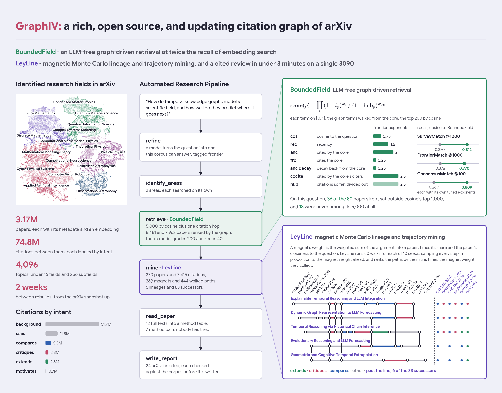
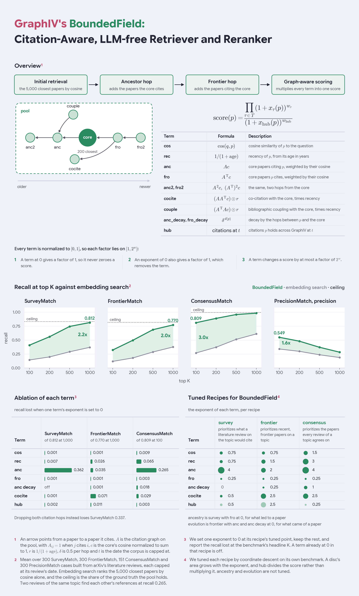
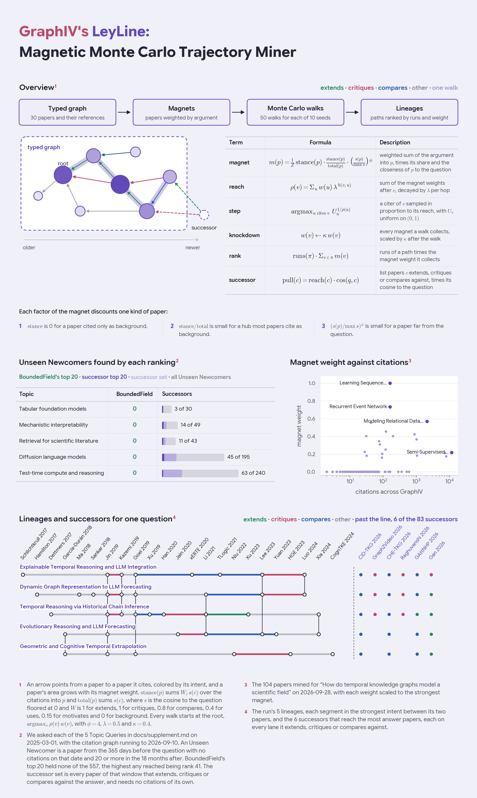
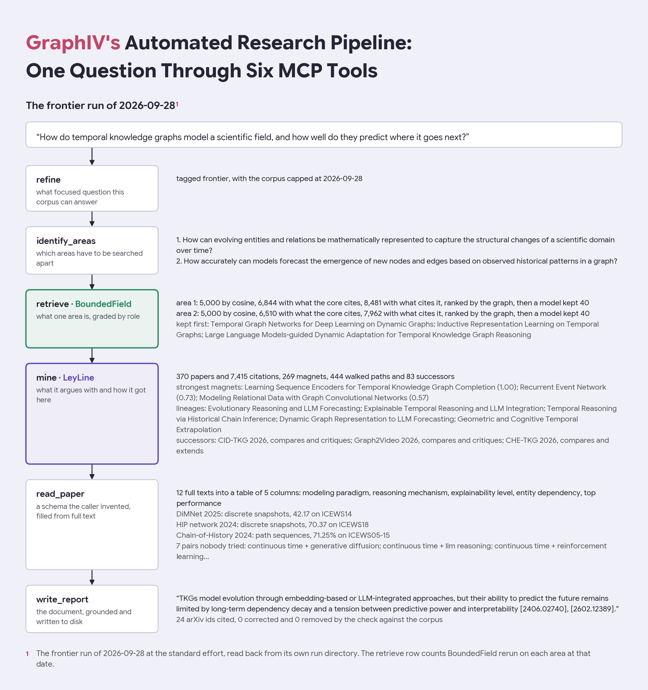

# GraphIV: a rich, open source, and updating citation graph of arXiv

[](https://graphiv.kuroma.dev)
[](https://huggingface.co/datasets/kkuroma/GraphIV)
[](https://huggingface.co/kkuroma/GraphIV-citation-intent)
[](https://huggingface.co/kkuroma/GraphIV-survey)
[](LICENSE)

GraphIV ("graph" + arXiv) is an open source, reproducible citation graph of all of arXiv, rebuilt every two weeks on a single PC. Each resolved citation between two arXiv papers is labeled with its intent, each paper carries an embedding and a place in a topic tree of 4,096 topics, and the whole graph is served as an MCP server that turns a question into a grounded literature review.

There are tens of thousands of papers released to arXiv each month, and even a single topic easily exceeds several hundred. LLM deep research tools take upwards of 30 minutes per question and often miss niche and recent publications, while the closest tool, [consensus](https://consensus.app), still misses the newest papers and runs on proprietary algorithms. I built GraphIV to catch up with modern AI research using infrastructure anyone can host.

On top of the graph sit two algorithms of my own. BoundedField retrieves and ranks papers by where they sit in the citation graph, with no language model in the ranking, and LeyLine mines the lineages that led a field to where it is and the new papers that have already answered them.



## Table of contents
- [Using GraphIV](#using-graphiv)
  - [Live Demo](#live-demo)
  - [Reproduction](#reproduction)
  - [Self-hosting](#self-hosting)
- [Components](#components)
  - [Data](#graphivs-data)
  - [BoundedField](#boundedfield---citation-aware-llm-free-retriever--reranker)
  - [LeyLine](#leyline---magnetic-monte-carlo-trajectory-miner)
  - [Pipeline](#automated-research-pipeline)
- [Repository layout](#repository-layout)
- [Future directions](#future-directions)
- [License](#license) and [citation](#citation)

## Using GraphIV

### Live Demo

[graphiv.kuroma.dev](https://graphiv.kuroma.dev) serves the dashboard over the reports my own server has written. Each report opens on six tabs: the report itself, its method table, its papers, the lineages as a citation graph, where its papers sit in the topic tree, and the run's details. The demo serves the dashboard alone, so asking a new question needs a server of your own, below.

### Reproduction

Everything in GraphIV is rebuilt from public sources: [arXiv's metadata snapshot on Kaggle](https://www.kaggle.com/datasets/Cornell-University/arxiv), arXiv's own HTML and PDF files, and open weight models. The build is ten stages filling four tables, run in this order, and [`docs/preprocess.md`](docs/preprocess.md) is the runbook with what each stage reads and writes. To skip the build, [`docs/restore.md`](docs/restore.md) restores the published dump and serves from it.

```sh
uv run python offline/papers_preprocess/stage0_fetch_source_json.py --dry-run   # what a new snapshot adds
uv run python offline/papers_preprocess/stage0_fetch_source_json.py --no-fetch
uv run python offline/papers_preprocess/stage1_download_pdf.py
uv run python offline/papers_preprocess/stage2_download_html.py
uv run python offline/papers_preprocess/stage3_embed_papers.py
uv run python offline/papers_preprocess/stage4_label_survey.py
uv run python offline/topic_tree_creation/stage0_umap.py
uv run python offline/topic_tree_creation/stage1_create_topic_tree.py
uv run python offline/topic_tree_creation/stage2_topic_labeling.py
uv run python offline/citation_preprocess/stage0_create_citation.py --workers 16
uv run python offline/citation_preprocess/stage1_label_citation.py
```

The two labelers the build loads are trained by [`offline/citation_labeler/`](offline/citation_labeler/README.md) and described on their cards, [GraphIV-citation-intent](https://huggingface.co/kkuroma/GraphIV-citation-intent) and [GraphIV-survey](https://huggingface.co/kkuroma/GraphIV-survey). The four retrieval benchmarks, defined in [`docs/benchmarks.md`](docs/benchmarks.md) and published at [GraphIV_benchmarks](https://huggingface.co/datasets/kkuroma/GraphIV_benchmarks), are fit and rerun by [`research/recipe_tuning/`](research/recipe_tuning/README.md), which writes every case and every ranking under [`research/experiments/retrieve/`](research/experiments/retrieve), and every figure on this page and on the cards is redrawn from those files by `direnv exec . uv run python research/assets/run.py`.

### Self-hosting

GraphIV ships as an MCP server, which any agent that speaks MCP can drive, plus a dashboard over what it wrote. Everything below was measured on the one PC GraphIV runs on: a Ryzen 7 7700X, 64 GB of RAM and an RTX 3090 with 24 GB.

| Tier | What you get | What it needs |
|---|---|---|
| data | the three tables | a Hugging Face login and 6.1 GB of download, see [the dataset card](https://huggingface.co/datasets/kkuroma/GraphIV) |
| server | the ten MCP tools and the dashboard | Postgres 17 with pgvector holding the 90 GB store, about 1 GB of RAM for the citation graph and a ranking, an embedding endpoint serving nomic-embed-text-v2-moe through llama-server (0.9 GB of VRAM), and any OpenAI-compatible chat endpoint, here Gemma 4 26B A4B in MXFP4 with a 131k context (18.8 GB of VRAM) |
| updates | the rebuild every two weeks | the server tier, plus the manager, the GPU for both labelers (2,012 citations and 214 papers a second) and the embeddings, and the chat endpoint for naming 4,368 topics |
| build | everything from scratch | the update tier, plus 496 GB of HTML and 5.6 TB of PDF for the full text |

The store holds the citation sentences, which are each paper's own text, so it is not published as a dump, and the server tier needs a build of its own for now.

```sh
nix develop                                   # Python 3.13, uv, postgres17 with pgvector
uv sync
uv run graphiv-serve --http --role api         # the tools, at http://127.0.0.1:6767/mcp
uv run graphiv-serve --http --role frontend    # the dashboard, at http://127.0.0.1:6969
claude mcp add --transport http graphiv http://127.0.0.1:6767/mcp
```

The retained NixOS deployment lives in [`legacy/nix/`](legacy/nix/README.md). Runtime paths, ports, and endpoints live in [`configs/runtime.toml`](configs/runtime.toml); preprocessing, training, and evaluation settings live in [`configs/offline.toml`](configs/offline.toml).

The Next.js interface in [`apps/web`](apps/web/README.md) provides library search, report reading, paper inspection, and citation graphs. With Node.js 22.6 or newer, start `uv run graphiv-serve --http --role frontend` from the repository root, then in another terminal:

```sh
cd apps/web
npm install
npm run dev
```

Open `http://127.0.0.1:3000`. The web server uses `GRAPHIV_API_URL` to read the Python service, defaulting to `http://127.0.0.1:6969`. An unavailable implicit default shows clearly labelled examples; an explicitly configured backend shows connection errors. The web app reads saved research; it does not submit new research jobs.

## Components

### GraphIV's data

| Table | Rows | One row is |
|---|---|---|
| `papers` | 3,165,827 | an arXiv paper with its metadata, its embedding and how likely it is a literature review |
| `citations` | 74,764,672 | a citation between two of those papers, and its intent |
| `topics` | 3,165,827 | a paper's field, subfield and topic, in a tree of 16, 256 and 4,096 |

The release is gated on [kkuroma/GraphIV](https://huggingface.co/datasets/kkuroma/GraphIV), with one tag per rebuild, the present one being `GraphIV-2026-10-01`. Its card covers the columns, how citations are resolved and how the topic tree is built and named.

### BoundedField - Citation Aware LLM-free Retriever & Reranker

BoundedField takes the 5,000 papers closest to a question, adds what the top 200 cite and what cites them, and ranks the pool by a product of cosine, recency and citation-graph terms whose exponents are tuned per mode, because embedding search finds the papers that sound like a question rather than the ones its field cites. Read more at [`docs/retrieval.md`](docs/retrieval.md).



### LeyLine - Magnetic Monte Carlo Trajectory Miner

LeyLine walks the papers a field takes positions on, drawing every step by how much the field argues with the next paper, keeps the paths that recur as lineages, and collects the newest papers extending, critiquing or comparing against the answer, because a ranking built on citations cannot see a paper too new to be cited. Read more at [`docs/leyline.md`](docs/leyline.md), and the Topic Queries behind its evaluation are in [`docs/supplement.md`](docs/supplement.md).



### Automated research pipeline



The agent owns the loop, and the server answers one call at a time while holding the corpus, the tuned constants and the rankings. A two-area standard run measured 139 seconds end to end over MCP, where 59 went to the two `retrieve` calls and 71 to `write_report`.

| Tool | What it answers |
|---|---|
| `refine` | what focused question this corpus can answer, tagged survey or frontier |
| `identify_areas` | which areas a question has to be searched as separately |
| `retrieve` | what one area or one paper's neighborhood is, graded by role, plus an id for the ranking |
| `mine` | what it argues with, how it got here, what bridges it, and what has appeared since |
| `read_paper` | a paper's sections, or a schema the caller invented, filled from its full text |
| `write_report` | the document, grounded and written to disk |
| `what_cites` | who took a position on one paper, and the sentence they used |
| `search_papers` | plain cosine, to turn a title into an id |
| `find_runs` | which report this server already wrote for a question, and the document itself |

Five modes pick the recipe: `survey`, `frontier` and `consensus` are each tuned on their own benchmark, and `ancestry` and `evolution` start from one paper, with the score's forward or backward terms set to zero. [`src/mcp/README.md`](src/mcp/README.md) covers the tools and the three efforts.

## Repository Layout

| Path | What it holds |
|---|---|
| [`apps/`](apps/README.md) | the [API application](apps/api/README.md) and the [Next.js reading workspace](apps/web/README.md) |
| [`src/`](src/README.md) | reusable Python components: shared [`core`](src/core/README.md), [`retrieve`](src/retrieve/README.md) (BoundedField), [`miner`](src/miner/README.md) (LeyLine), [`report`](src/report/README.md), and [`mcp`](src/mcp/README.md) tool implementations; storage and evidence interfaces have their own packages |
| [`offline/`](offline/README.md) | preprocessing, model training, index building, exports, and the [administration manager](offline/manager/README.md) |
| [`research/recipe_tuning/`](research/recipe_tuning/README.md) | benchmark evaluation and recipe fitting |
| [`retrieval_recipes/`](retrieval_recipes) | one toml per mode, the only place an exponent or a miner constant lives |
| [`research/experiments/`](research/experiments/findings/README.md) | what the benchmarks last wrote, and the findings of every experiment since deleted |
| [`research/assets/`](research/assets/README.md) | every figure here and on the cards, and the code that draws them |
| [`docs/`](docs/README.md) | the methods, the benchmarks and the runbooks |
| [`infra/azure/`](infra/azure/README.md) | the reserved location for Azure infrastructure definitions |
| [`legacy/`](legacy/README.md) | the existing [research dashboard](legacy/research-webui/README.md), [Nix deployment](legacy/nix/README.md), and compatibility launcher |
| [`tests/`](tests/README.md) | tests for reusable components, application routes, and offline jobs |
| [`research/themes/`](research/themes/README.md) | the palette and the typeface every figure uses |
| [`configs/`](configs/README.md) | separate runtime and offline settings, with paths relative to each configuration file |

`apps/api` owns transport and the future orchestration entrypoint, and imports the algorithms and MCP tools from `src`. The separate Next.js app in `apps/web` reads saved runs through the API's read-only endpoints. Offline jobs and research utilities use the same reusable components. The runtime wheel includes the API, reusable source, recipes, runtime configuration, and existing dashboard assets. Offline and research code stays in the checkout, with training and evaluation dependencies in separate dependency groups. The Azure Terraform directory remains reserved for future infrastructure definitions.

## Future Directions

- My vision is to eventually unify the web of science into a singular graph database, where querying becomes a simple graph operation, and arXiv is the first part.
- Anyone should be able to host the server, which needs a loader from the Hugging Face release into Postgres that fetches the citation sentences from arXiv's HTML.
- A paper too new to be cited is still the open problem: the successors reached 136 of 557 such papers that later took off, and BoundedField's top 20 none.
- The reports have no end-to-end evaluation yet, and the `ancestry` and `evolution` modes are untuned.

### Acknowledgments

Thank you to arXiv for use of its open access interoperability. GraphIV is built on [arXiv's metadata snapshot on Kaggle](https://www.kaggle.com/datasets/Cornell-University/arxiv), on [arXiv](https://arxiv.org)'s own HTML renders and [its PDF bucket](https://www.kaggle.com/datasets/Cornell-University/arxiv) on Google Cloud, and on [ar5iv](https://ar5iv.labs.arxiv.org) for the papers from before arXiv rendered HTML itself.

| Model | Used for |
|---|---|
| [nomic-ai/nomic-embed-text-v2-moe](https://huggingface.co/nomic-ai/nomic-embed-text-v2-moe), served from [its GGUF](https://huggingface.co/nomic-ai/nomic-embed-text-v2-moe-GGUF) | every embedding |
| [google/gemma-4-26B-A4B-it](https://huggingface.co/google/gemma-4-26B-A4B-it) | the topic names, both labelers' training labels, and every model call of the pipeline |
| [Qwen/Qwen3.6-35B-A3B](https://huggingface.co/Qwen/Qwen3.6-35B-A3B) and [zai-org/GLM-4.7-Flash](https://huggingface.co/zai-org/GLM-4.7-Flash) | checking the survey labels against two other model families |
| [distilbert/distilbert-base-uncased](https://huggingface.co/distilbert/distilbert-base-uncased) | both labelers |

## License

| Part | License |
|---|---|
| the code in this repository | [AGPLv3](LICENSE) |
| the dataset, [kkuroma/GraphIV](https://huggingface.co/datasets/kkuroma/GraphIV) | CC BY-NC 4.0, with the arXiv metadata columns CC0 as arXiv releases them |
| the two labelers | Apache 2.0 |

The code is AGPLv3 from the commit after `c484e9a`, and every commit up to and including `c484e9a` was released under GPLv3.

## Citation

```bibtex
@misc{graphiv2026,
  title={GraphIV: An Open, Reproducible Citation Knowledge Graph of arXiv},
  author={kkuroma},
  year={2026},
  howpublished={\url{https://huggingface.co/datasets/kkuroma/GraphIV}}
}
```
