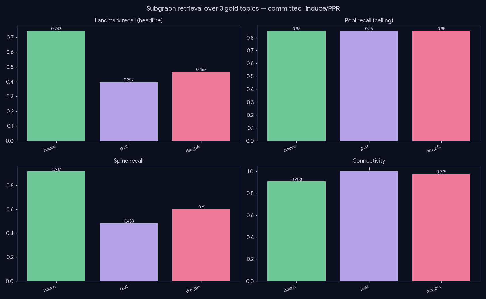

# Experiment — Subgraph retrieval quality

*Retrieval · the committed recipe in isolation: did the right papers come back as a bounded, connected, on-topic citation subgraph?*

## What we did

The committed recipe — hybrid pool (asym cosine ∪ title-BM25) → backward-ancestor augmentation → induce citation subgraph → Personalized-PageRank landmark ranking — is locked; this measures the one thing it does: recovering a field's **canonical landmark papers**. **Retrieval level only — no LLM, no compose, no judge.** Over each gold topic we build one shared candidate pool and run three Stage-4 selectors:

- `induce` — the committed method: PPR over the induced citation edges, teleporting to query-similarity, top-`m`.
- `pcst` — Prize-Collecting Steiner Tree, prize on the top-`m` relevant nodes (G-Retriever, [2402.07630](https://arxiv.org/abs/2402.07630)).
- `dsa_bfs` — similarity-aware BFS from the top-cosine seeds (DynaGRAG, [2412.18644](https://arxiv.org/abs/2412.18644)).

Splitting `pool_recall` (reachability ceiling) from `landmark_recall` (after ranking) localizes any loss: a gap is a *ranking* problem, a low ceiling a *reach* problem.

## Results (3 gold topics: diffusion, transformer, testtime)

| method | pool_recall | landmark_recall | spine_recall | connectivity | mean_cosine |
|---|--:|--:|--:|--:|--:|
| **induce (committed)** | 0.85 | **0.742** | **0.917** | 0.908 | 0.497 |
| pcst | 0.85 | 0.397 | 0.483 | 1.000 | 0.602 |
| dsa_bfs | 0.85 | 0.467 | 0.600 | 0.975 | 0.577 |

## Conclusion

- **The committed `induce`/PPR recovers 0.74 of canonical landmarks and 0.92 of the foundational spine**, against a shared pool ceiling of 0.85 — so PPR retains 0.742/0.85 ≈ **87%** of everything reachable, and almost the whole origin story.
- The 0.85 ceiling (not 1.0) is a pool-**reach** limit, not a ranking flaw: missing canonical papers fall outside the topical cosine cloud or are uncited within it — a candidate-pool question (wider `n_pool` / more ancestor hops), not a selector one.
- **`induce` dominates every recall axis.** `pcst` wins *only* connectivity (1.0) and mean-cosine while **halving** landmark recall (0.40) — its cosine prize ≠ citation centrality, so it keeps tight high-cosine clusters and drops central-but-not-top-cosine canonical papers. Membership must be decided by PPR; connectivity is handled downstream (the lineage tree adds Steiner bridges *over* the PPR landmarks).

## Caveats

n=3 (the only topics with curated gold). Per-topic numbers are stable (`induce` landmark_recall = 0.625 / 0.60 / 1.0; see `results/metrics_raw.json`), but a wider gold battery is the cheapest way to harden the claim.
