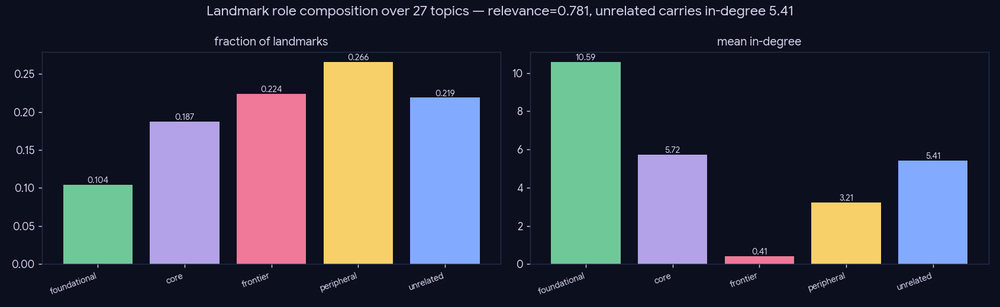

# Experiment — Subgraph relevance / role judge

*Retrieval · the precision and composition that recall cannot measure — gold-free, all 27 topics.*

## What we did

Where `02-01` measures **recall** against curated gold (only 3 topics), this measures the two things recall cannot: **precision** (how much of the retrieved subgraph is off-topic noise) and **composition** (does it span a field's lineage). It needs no gold, so it runs the whole 27-topic battery.

For every committed landmark (induce/PPR), a self-hosted Gemma-4-26B judge (@T=0) sees **only** the topic + the paper's title/year/abstract — not our PPR/in-degree scores, so its label is an independent check, not a rubber stamp — and assigns one role: `foundational`, `core`, `frontier`, `peripheral`, `unrelated`. Derived: `relevance_rate` = 1 − unrelated-frac; `lineage_span` (has ≥1 foundational AND ≥1 frontier); and mean in-degree per role (a structure-agreement check vs PPR). Labels cached by `(topic, arxiv_id)` — retrieval-independent, so `02-03` reuses them.

## Results (27 topics, 1080 landmarks)

| metric | value |
|---|--:|
| relevance_rate (precision) | **0.781** |
| unrelated fraction | 0.219 |
| lineage_span (has roots→frontier) | 0.889 |
| composition (found / core / frontier / periph / unrel) | 0.10 / 0.19 / 0.22 / 0.27 / 0.22 |
| in-degree by role (found / core / frontier / unrel) | 10.6 / 5.7 / 0.4 / **5.4** |

## Conclusion

- **~78% of retrieved landmarks are on-topic, and 89% of topics span their full lineage** (a foundational root AND a frontier paper present) — the subgraph is compositionally complete enough to ground a review.
- **But ~22% is off-topic noise, and it is structurally invisible to PPR**: unrelated papers carry mean in-degree **5.4** — as high as `core` — because they are famous cross-field hubs (GPT-3 / StyleGAN under "diffusion") that ride in on citation fame, not relevance. PPR cannot tell them from genuine core work; only the content judge can.
- This is the precise failure `02-03` targets: the noise enters through the most-cited-ancestor injection, and a cosine floor removes it.

## Caveats

The role judge is the measurement instrument; its fairness is validated separately (the judge-validity experiment in `03-generation`). `relevance_rate` is an LLM estimate, not gold — but it is corpus-stable and cross-checks against in-degree structure here.
