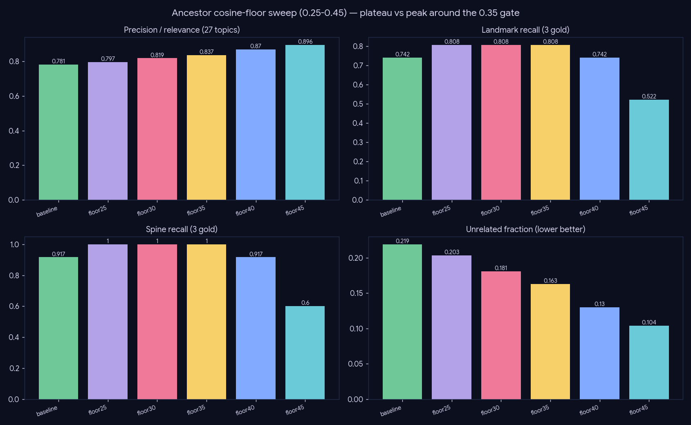

# Experiment — Ancestor relevance gate

*Retrieval · plugging the one mechanism through which off-topic noise enters the subgraph.*

## What we did

`02-02` found ~22% of landmarks off-topic AND carrying high in-degree (5.4) — famous cross-field hubs (GPT-3 / StyleGAN under "diffusion"). They enter through one mechanism: `augment_with_ancestors` → `store.ancestors` pulls the top-120 **most-cited** one-hop-back papers (ranked by citer count *before* cosine), so fame beats relevance. We gate that injection by a cosine floor and measure **both** sides of the tradeoff:

- **precision** = LLM `relevance_rate` (1 − unrelated) over all **27** topics (reuses the `02-02` role-judge cache — labels are retrieval-independent, so only newly-introduced landmarks cost a call).
- **recall** = `landmark_recall` + `spine_recall` over the **3 gold** topics (set membership, no LLM).

Swept a **0.25–0.45 sensitivity grid** in 0.05 steps (the original 0.35 came from a coarse search, so the ship decision needed to know whether it sits on a plateau or a knife-edge peak). Only the **injected ancestors** are gated; the core hybrid pool and cosine-gated `frontier_pull` are untouched.

## Results

| variant | precision (27) | unrelated | landmark_recall (gold-3) | spine_recall (gold-3) |
|---|--:|--:|--:|--:|
| baseline | 0.781 | 0.219 | 0.742 | 0.917 |
| floor25 | 0.797 | 0.203 | 0.808 | 1.000 |
| floor30 | 0.819 | 0.181 | 0.808 | 1.000 |
| **floor35** | **0.837** | 0.163 | **0.808** | **1.000** |
| floor40 | 0.870 | 0.130 | 0.742 | 0.917 |
| floor45 | 0.896 | 0.104 | 0.522 | 0.600 |

## Conclusion

The sweep resolves the plateau-vs-peak question decisively:

- **Recall sits on a flat plateau across 0.25–0.35** — landmark recall 0.808 and spine 1.0 are *identical* at all three floors, while precision rises monotonically (0.797 → 0.819 → 0.837). The gains are not tuned to a magic number; any gentle floor beats no floor on both metrics.
- **0.35 is the max-precision edge of the plateau** — the principled ship point: the highest precision available at zero recall cost.
- **The cliff starts at 0.40** (recall falls back to baseline 0.742) and **0.45 collapses it** (0.522, spine 0.6): those floors cut genuine low-cosine foundational papers (VAE / Sohl-Dickstein sit ~0.4–0.5).
- An earlier pass also tested a modal-category gate at 0.45; it added ~nothing (0.896 → 0.902) and is dropped.

**Verdict: shipped.** `augment_with_ancestors(min_cosine=0.35)` is the production default (`pipeline.py` + the harness's committed recipe); `0.0` remains available as the ablation arm.

## Caveats

Recall is n=3 gold; precision is n=27. The plateau (three consecutive floors with identical recall) plus the mechanism (0.35 ≪ foundational cosine ~0.4–0.5) make the no-recall-loss claim robust, but a wider gold set would harden it further.
