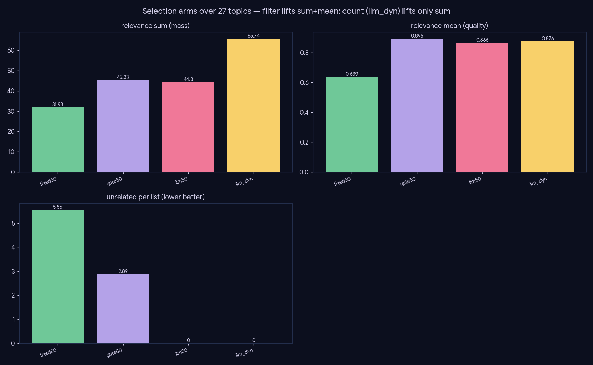

# Experiment — Selection flags (the count doesn't matter)

*Retrieval · an ablation: how to pick the landmark set, scored at the per-paper level so the count tension is visible.*

## What we did

`02-03` cleaned the pool with a cosine gate; this asks how to pick the final landmark set from it, and **whether the cap needs to grow**. Four arms at cap 50, over all 27 topics, scoring **every selected paper** −2..+2 on its **salient full text** (a self-hosted Gemma-4-26B judge @T=0): `sum` penalizes drift/noise (count-confounded), `mean` = per-paper quality (count-independent), `neg2_per_list` = outright-unrelated papers kept.

- `fixed50` — PPR top-50 (baseline).
- `gate50` — 0.35 cosine ancestor gate (the `02-03` win), top-50.
- `llm50` — drop role=unrelated over PPR-80, capped 50 (LLM filter, **same count**).
- `llm_dyn` — same filter, soft cap 75 (LLM filter, **more count**).

Scores cached per `(topic, arxiv_id)` — config-independent, so arms share the cache.

## Results (27 topics)

| arm | count | sum | mean | −2/list |
|---|--:|--:|--:|--:|
| fixed50 | 50.0 | 31.93 | 0.639 | 5.56 |
| gate50 | 49.7 | **45.33** | **0.896** | 2.89 |
| llm50 | 48.3 | 44.30 | 0.866 | **0.0** |
| llm_dyn | 70.5 | **65.74** | 0.876 | **0.0** |

## Conclusion — the count doesn't matter; the filters are independent flags

- **Filtering raises both sum and mean.** fixed50 → gate50: sum +42% (31.9→45.3), mean +40% (0.639→0.896). The unfiltered top-50 carries **5.6 outright-unrelated papers per list**; the cosine gate halves that, the LLM filter zeroes it.
- **Going bigger raises sum via clean relevant mass while mean holds.** llm50 → llm_dyn adds ~22 papers and sum jumps +48% (44.3→65.7) while mean is flat (0.866→0.876). The extra papers are genuine on-topic mass, not dilution — but they don't make any *paper* better.
- **So the count is not a lever to tune.** `sum` rises with clean count (a recall-flavored quantity); `mean` — the count-independent quality signal — **saturates at ~0.88 once you filter**, exactly where the compose-judge (landmark-selection, `03-generation`) said the *review* saturates. The cap is free to sit small.

**This makes cosine-gate and LLM-filter two independent on/off flags, not a tuned size:**
- the **0.35 cosine gate** alone gets ~95% of the mean win for free (no LLM);
- the **LLM filter** drives the residual −2 papers from ~3 to 0 (precision-max);
- either can be enabled without touching the cap.

## Caveats

`sum` is count-confounded by construction (more clean papers → more mass); `mean` is the fair cross-arm comparison. The score is an LLM estimate on salient text (abstract fallback where ar5iv HTML is missing). The downstream review quality is judged separately (`03-generation`).
