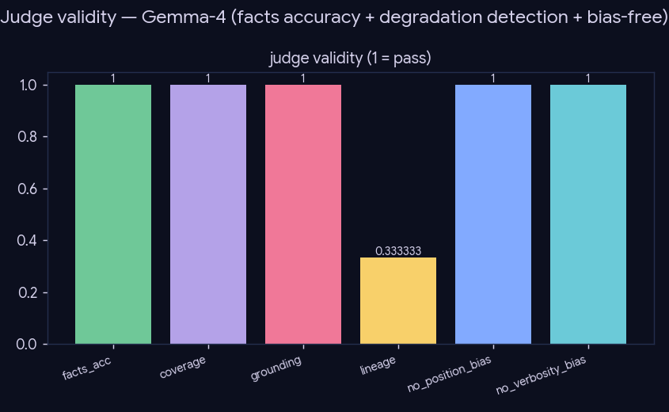

# Experiment — Is the LLM judge fair?

*Evaluation · validates the measurement instrument (Gemma-4-26B judge) that every other experiment's quality verdict relies on.*

## What we did

Our quality verdicts rest on an LLM judge (Gemma-4-26B): 4 axes (grounding / coverage / lineage / coherence) + an order-debiased pairwise. Before trusting it on small effects, we test it against **ground truth**, three ways:
1. **Known facts** — 24 claims about famous papers (DDPM, VAE, Transformer, BERT, ResNet, …): true claims, false-topic (a *different* paper's contribution), and false-subtle (a plausible-but-wrong method detail). The judge sees only title+abstract and must accept the true, reject the false.
2. **Degradations** — take a good review, build variants with a known-worse direction (truncated → coverage; citations-stripped → grounding; chronology-corrupted → lineage), and confirm the judge prefers the full one.
3. **Bias** — identical inputs must tie (position bias); a content-free padded variant must not win (verbosity bias).

The chronology corruption reverse-maps the years so the prose's temporal claims contradict the dates — an *internal* inconsistency the judge catches by arithmetic, independent of its (stale) sense of "now"; today's date is also injected into the judge prompt.

## Results

**Known-fact accuracy: 1.0** (true 1.0, false-topic 1.0, false-subtle 1.0; n=24) — it even rejects every subtle method-confusion ("DDPM uses a GAN objective" → no; "Transformer relies on RNNs" → no).

| degradation | full wins | axis |
|---|--:|---|
| identical | 0/3 (tie) | sanity / position |
| truncated 75/50/25 | 3/3 each | coverage |
| citations stripped | 3/3 | grounding |
| chronology corrupted | ~1–2/3 | lineage |
| verbose padded | 0/3 (tie) | verbosity |

Position bias **0/6 (clean)**; verbosity bias **none** (padded never won).

## Conclusion

The judge is **valid and unbiased on the objective dimensions** — perfect on factual ground truth, catches coverage and grounding degradations at every level, no position or verbosity bias. **Lineage is its weak axis** (catches genuine chronology corruption only sometimes; ignores cosmetic reordering, correctly). So the rule for every downstream experiment: **trust grounding/coverage verdicts and large effects; asterisk lineage verdicts and sub-noise-floor margins.** This licenses the judge's use with a documented profile, rather than assuming fairness.

## Caveats

Small ground-truth set (24 facts, 3 base reviews); same-family (Gemma judges Gemma-Code) — a separate cross-family *agreement* check found no systematic self-preference (the other families never reversed Gemma's clear verdicts), so the bias is not material, but it remains undisproven in principle.
