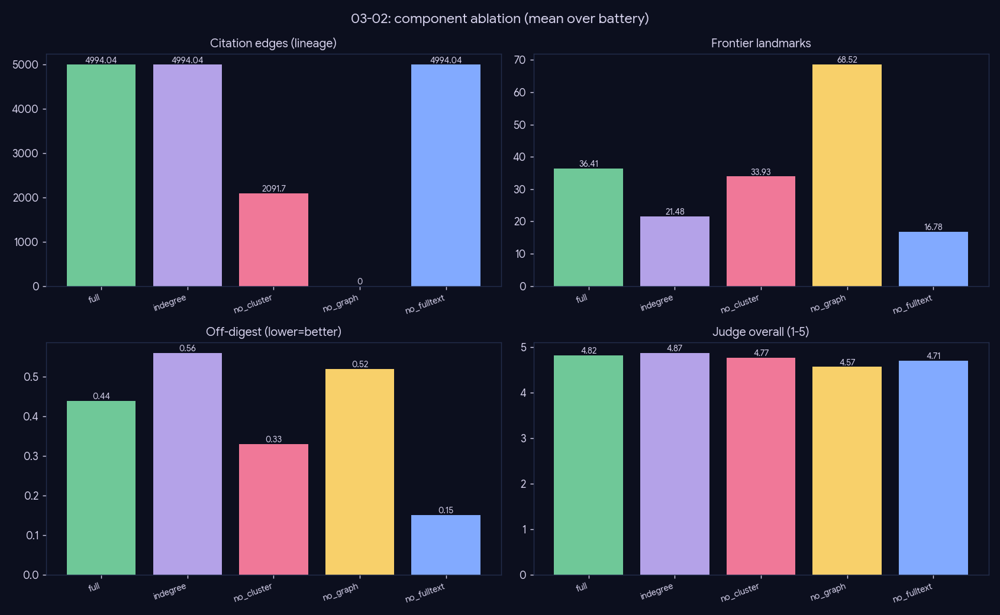

# Experiment — Component ablation (read the vector, never one number)

*Generation · the classic ablation: knock out one pipeline component at a time over the full review pipeline.*

## What we did

Knock out one component at a time (control = `full`), holding topic + question fixed, over the 27-topic battery, reading the **full metric vector** + an independent **4-axis LLM judge** (Gemma-4-26B: grounding/coverage/lineage/coherence) + a **faithfulness** tripwire:

- `indegree` — raw in-degree ranking (no PPR, no frontier reservation).
- `no_cluster` — drop the topic-tree leaf anchor.
- `no_graph` — drop the induced citation subgraph (vector-only).
- `no_fulltext` — abstracts only (`effort=fast`).

## Results (mean over 27 topics)

| config | n_edges | frontier_count | off_digest | landmark_recall | j_overall | faithfulness |
|---|--:|--:|--:|--:|--:|--:|
| **full** | 5589 | 35.8 | 0.48 | 0.09 | 4.84 | 0.96 |
| indegree | 5531 | 16.6 | 0.44 | 0.11 | 4.88 | 0.95 |
| no_cluster | 2329 | 33.6 | 0.44 | 0.09 | 4.90 | 0.96 |
| no_graph | **0** | **65.2** | 0.52 | **0.01** | **4.64** | 0.96 |
| no_fulltext | 5659 | 15.9 | 0.0 | 0.09 | 4.74 | 0.95 |

## Conclusion

- **`no_graph` is the gameable-single-metric artifact:** highest frontier_count (65.2 — pure similarity floods recent papers) yet **0 edges**, near-zero recall, and the **worst judge (4.64)** — chronology and canonical coverage destroyed while a surface metric "improves."
- **`indegree` starves the frontier** (16.6 vs full's healthy 35.8): raw in-degree favors old hubs — the age-vs-citation bias PPR+frontier reservation fixes.
- **`no_cluster` cuts citation density 58%** (5589→2329): the topic-tree leaf anchor keeps the pool connected and on-topic.
- **`no_fulltext` keeps structure but halves landmarks** and lowers the judge — abstracts carry less to synthesize.
- **Faithfulness ≈ 0.95 everywhere** — a correctness tripwire, not a lever-ranking score.

**Thesis: the full system is the only configuration that keeps *all* axes healthy at once.** A knockout that wins one metric loses others catastrophically.

## Caveats

Judge-overall is compressed (~4.6–4.9, the known distribution collapse — see `03-01-judge-validity`); landmark_recall is diluted by the 24 non-gold topics (only 3 carry curated gold). The robust signals are edges, frontier balance, and the cross-axis pattern — not any single number.
