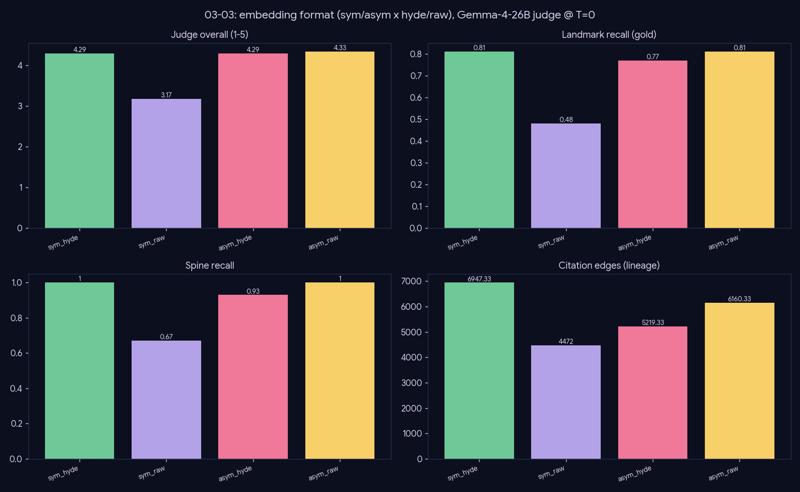

# Experiment — Embedding format (asymmetric + raw query)

*Generation · which query-embedding shape retrieves best, judged end-to-end.*

## What we did

Four query-embedding conditions, full pipeline each (graph drill + PPR + compose), judged over 3 gold topics: `sym`/`asym` (symmetric vs nomic asymmetric `search_query`/`search_document`) × `hyde`/`raw` (HyDE hypothetical-document expansion vs the raw question). Committed = `asym_raw`.

## Results (3 gold topics)

| format | n_edges | landmark_recall | spine_recall | j_overall |
|---|--:|--:|--:|--:|
| sym_hyde | 7050 | 0.81 | 1.0 | 4.25 |
| sym_raw | 4472 | 0.48 | 0.67 | 3.38 |
| asym_hyde | 5779 | 0.77 | 0.93 | 4.04 |
| **asym_raw** | 6160 | **0.81** | **1.0** | **4.25** |

## Conclusion

- **Committed `asym_raw` ties for best** (recall 0.81, spine 1.0, top judge) at **no extra generation**.
- **`sym_raw` is worst** (0.48): a symmetric embedding on a bare question under-retrieves the document space.
- **HyDE rescues the symmetric space** (`sym_hyde` → 0.81) but **adds nothing to the asymmetric space** (`asym_hyde` ≤ `asym_raw`) while costing a hypothetical-document generation per query.
- The asymmetric query/document encoding already does HyDE's job — aligning the query into document space — making HyDE redundant.

**Ship `asym_raw`:** best recall, no HyDE latency.

## Caveats

n=3 gold; judge axes are compressed, but the objective recall/spine agree with the judge here.
