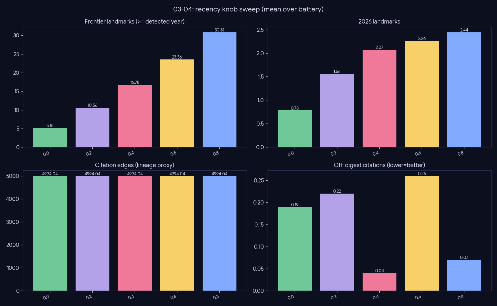

# Experiment — Recency knob (a control surface, not a winner)

*Generation · how the topic-adaptive recency dial trades lineage depth for frontier coverage.*

## What we did

Sweep `recency ∈ {0.0, 0.2, 0.4, 0.6, 0.8}` over the 27-topic battery. The knob dials how many landmark slots are reserved newest-cohort-first (frontier) vs left to PPR lineage ranking; the frontier *year* is auto-detected per topic, so the knob is a relative dial, not an absolute year.

## Results (mean over 27 topics)

| recency | frontier_count | #≥2025 | #2026 | grounded | off_digest |
|---|--:|--:|--:|--:|--:|
| 0.0 | 3.67 | 1.04 | 0.74 | 22.11 | 0.26 |
| 0.2 | 8.85 | 3.74 | 1.30 | 23.93 | 0.15 |
| 0.4 | 14.96 | 6.41 | 1.70 | 24.30 | 0.26 |
| 0.6 | 23.22 | 8.67 | 1.96 | 24.89 | 0.30 |
| 0.8 | 30.81 | 11.15 | 1.93 | 24.22 | 0.26 |

## Conclusion

**Recency is a control surface, not a lever with a single optimum.** Frontier landmarks climb monotonically with the knob (3.67 → 30.81) while `grounded` stays roughly flat (~22–25) and `off_digest` stays low — the knob trades **lineage depth for frontier coverage at constant grounding**, exactly as designed.

There is no universal best value: a "foundations of X" question wants low recency (lineage), a "latest in X" question wants high. So it is correctly **exposed as a per-query knob** with a sensible mid default, not tuned to a constant.

## Caveats

`landmark_recall` is diluted by the non-gold topics and is flat here; the meaningful signal is the clean monotonic frontier/lineage trade.
