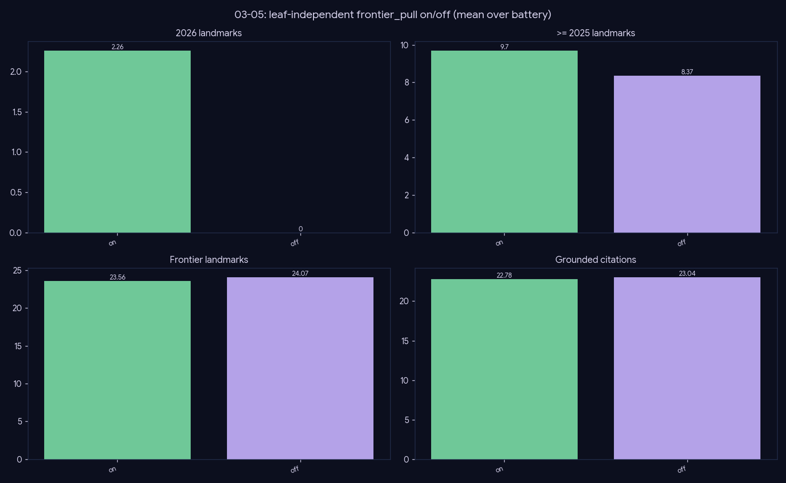

# Experiment — Frontier-pull (the only path to the corpus delta)

*Generation · does the leaf-independent year-filtered pull matter, and at what cost?*

## What we did

Toggle `frontier_pull` on/off over the 27-topic battery. The topic tree was built before the 2026 corpus delta and has no 2026 leaves, so leaf-anchored retrieval structurally cannot reach recent papers. `frontier_pull` injects the newest cohort directly via a leaf-independent, year-filtered vector pull.

## Results (mean over 27 topics)

| frontier_pull | #2026 | #≥2025 | frontier_count | grounded |
|---|--:|--:|--:|--:|
| **on** | **1.89** | 9.19 | 22.52 | 24.19 |
| off | **0.0** | 7.59 | 23.81 | 24.89 |

## Conclusion

**Frontier-pull is the *only* path to the corpus delta, at no cost.** With it on, the review surfaces ~1.9 2026 papers per topic; with it off, **zero** — the leaf tree literally cannot reach them. Frontier count and grounding are essentially unchanged (22.5 vs 23.8; 24.2 vs 24.9), so the pull fills a structural blind spot rather than flooding noise.

**Ship it on.** It's a correctness fix — without it, every "latest work on X" answer silently omits the most recent year — not a quality/cost tradeoff.

## Caveats

The win is concentrated in the recent-cohort counts; `landmark_recall` (gold, mostly pre-2026) is unaffected, as expected.
