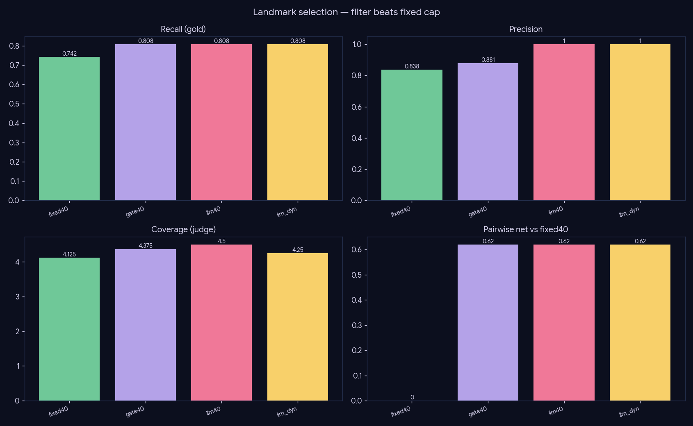

# Experiment — Paper-list quality under a low cap

*Postprocessing · the landmark-selection lever: how to pick the ~40-paper subgraph the review is built from.*

## What we did

The committed retrieval takes a hard PPR top-40. Does relevance-filtering that list beat it, and does the cap need to grow? Four arms over one shared pool (same adjacency-list + extracted-fields digest; only the landmark **set** differs), disentangling **filter-type** from **count**:

- `fixed40` — PPR top-40 (baseline).
- `gate40` — 0.35 cosine ancestor gate, PPR top-40 (cheap structural filter).
- `llm40` — LLM-relevance filter (drop role = unrelated) over PPR-100, capped 40 (semantic, **same count**).
- `llm_dyn` — same filter, soft dynamic cap 60 (semantic, **more count**).

Scored on the Exp-1-validated metric: direct list metrics primary (count, recall [gold], precision [role judge], lineage-span) + the compose-judge on its trusted axes (grounding, coverage) + pairwise vs `fixed40`; lineage asterisked. Judges get today's date injected.

## Results (8 topics, gold-3 for recall)

| arm | count | recall | precision | coverage | pairwise vs fixed40 |
|---|--:|--:|--:|--:|--:|
| fixed40 | 40 | 0.742 | 0.838 | 4.125 | — |
| gate40 | 40 | 0.808 | 0.881 | 4.375 | +0.62 |
| **llm40** | **40** | **0.808** | **1.0** | **4.5** | **+0.62** |
| llm_dyn | 60 | 0.808 | 1.0 | 4.25 | +0.62 |

## Conclusion

**The win is the FILTER, not the count — keep the list at 40 and filter for relevance; do not expand it.**

- All three alternatives beat `fixed40` (recall 0.742→0.808, pairwise +0.62 = 5 wins / 3 ties / 0 losses).
- **`llm40` (filter at the same 40 papers) captures the full win** — perfect precision (1.0), full recall (0.808), best coverage (4.5) — at **zero size increase**.
- **`llm_dyn` (60) does not beat `llm40` (40)** — identical recall/precision/pairwise, slightly *lower* coverage. The extra papers add nothing and mildly dilute: cleaner beats bigger.
- **`gate40` (cheap 0.35 cosine, no LLM) gets ~80% of the win**; the LLM filter adds the precision polish (0.881 → 1.0) by removing the semantically-unrelated papers cosine keeps.

So: replace the hard PPR-top-40 with a relevance-filtered top-40 — ship the cheap gate at minimum, the LLM filter for precision-max. Removing/raising the cap is the wrong move.

## Caveats

n=8 (gold-3 for recall); the robust signal is the direct metrics (recall/precision) — pairwise margins are modest and on the validated axes only (lineage asterisked per the judge-validity experiment). `llm_dyn` pinned at 60 on all 8 topics, so the dynamic float never exercised (moot, since 40-filtered already wins).
