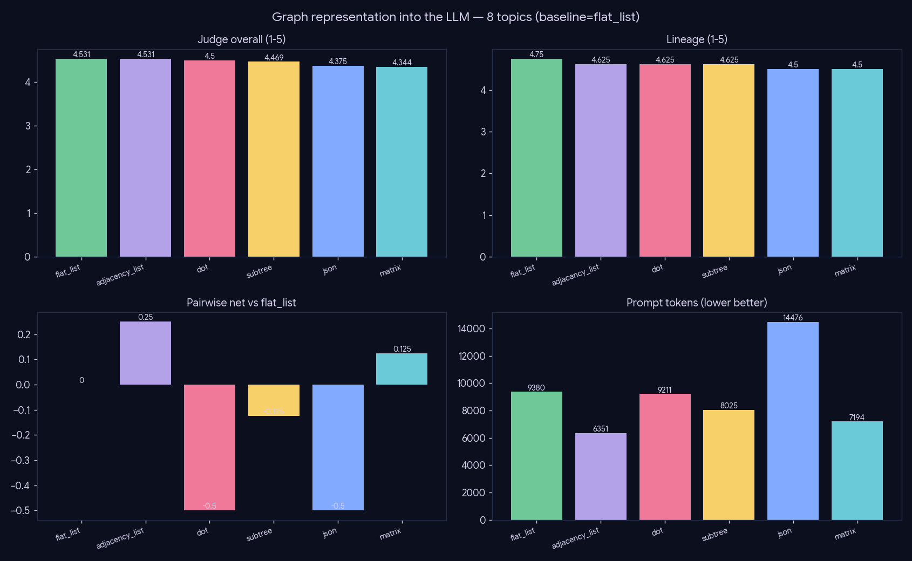
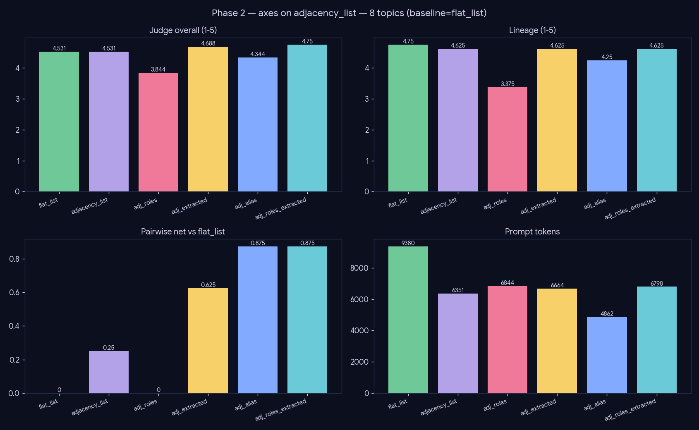

# Experiment — Graph representation (how the subgraph reaches the writer)

*Generation · serializing a non-linear citation subgraph into a linear LLM prompt — not a solved problem.*

## What we did

A retrieved citation subgraph (nodes, typed edges, non-linear) must be linearized into the prompt. **Phase 1** compares the *structure* axis — `flat_list`, `adjacency_list`, `dot` (Graphviz), `subtree`, `json`, `matrix` — judged absolute (4-axis) + order-debiased pairwise vs `flat_list`, 8 deep-panel topics @T=0. **Phase 2** fixes the adjacency winner and layers the *orthogonal* axes: per-node `roles`, per-node `extracted` content (full-text fields vs abstract), and `alias` (`[D1]..` labels + id table).

## Phase 1 — structure

| representation | overall | pair_net | tokens |
|---|--:|--:|--:|
| flat_list | 4.312 | 0.0 | 9380 |
| **adjacency_list** | 4.531 | **0.5** | **6351** |
| dot | 4.344 | 0.25 | 9211 |
| subtree | 4.344 | 0.375 | 8025 |
| json | 4.469 | 0.375 | 14476 |
| matrix | 4.438 | −0.125 | 7194 |

## Phase 2 — orthogonal axes on the adjacency winner

| config | coverage | lineage | overall | pair_net | tokens |
|---|--:|--:|--:|--:|--:|
| flat_list | 3.5 | 4.5 | 4.312 | 0.0 | 9380 |
| adjacency_list | 3.75 | 4.625 | 4.531 | 0.5 | 6351 |
| adj_roles | 4.125 | 3.875 | 4.438 | 0.25 | 6844 |
| adj_extracted | 4.375 | 4.875 | 4.719 | 0.75 | 6690 |
| adj_alias | 4.0 | 4.75 | 4.656 | 0.875 | 4862 |
| **adj_roles_extracted** | **4.625** | **5.0** | **4.906** | **0.875** | 6824 |

## Conclusion

- **Structure: `adjacency_list` wins** (pair_net 0.5) — at the **fewest** tokens (6351 vs 9380 flat, 2.3× for json). A node table + intent-grouped adjacency reads cleanly and compresses. `matrix` loses (−0.125); `dot`/`json` are middling and dearer.
- **Content is the biggest lever:** `adj_extracted` (full-text fields instead of abstracts) jumps to pair_net 0.75 — the specifics the abstract omits are what the composer needs.
- **Roles help only *with* content:** `adj_roles` alone is a weak 0.25, but combined the winner `adj_roles_extracted` tops every axis (overall 4.906, pairwise 7/1/0).
- **Aliasing is a free token win:** `adj_alias` matches the top pairwise at the fewest tokens (4862).

**Production digest: adjacency-list + extracted content + role tags + aliasing.**

## Caveats

n=8, absolute axes compressed; the pairwise nets are the discriminator and they agree across both phases.
