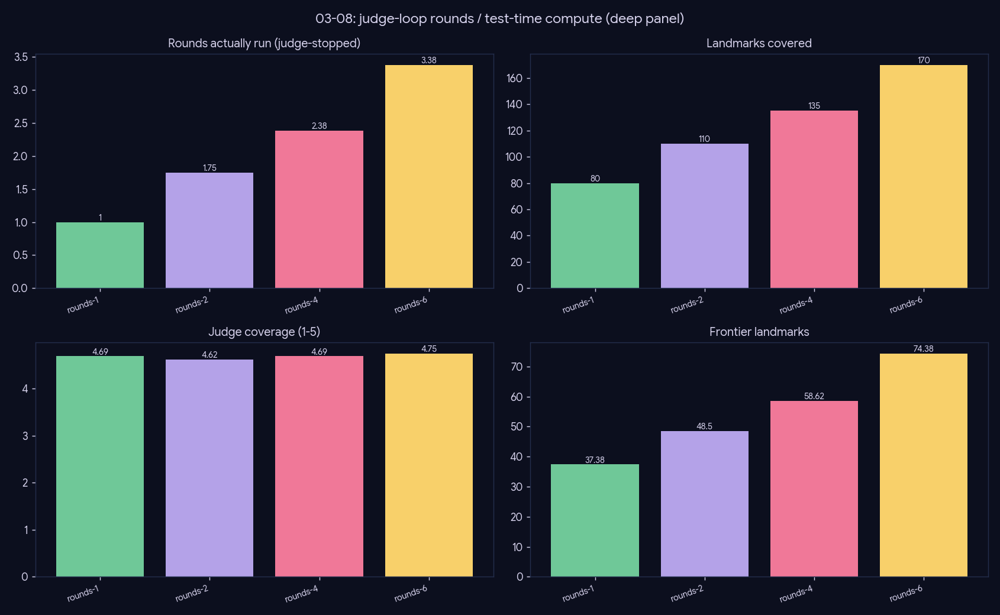

# Experiment — Judge-driven deep loop (test-time compute that works)

*Generation · does spending more inference-time compute on iterative critique-and-retrieve yield a better review?*

## What we did

Vary only the round cap `max_rounds ∈ {1,2,4,6}`, all on the deep path (long-compose + critique constant, figures off to isolate the loop), over 27 topics. A thinking judge owns termination, so the cap is only a ceiling. Scored on the metric vector + 4-axis judge + an order-debiased **pairwise** of `rounds-6` vs `rounds-1`.

## Results (mean over 27 topics)

| rounds | rounds_run | n_landmarks | frontier_count | gold_recall | j_coverage | j_overall |
|---|--:|--:|--:|--:|--:|--:|
| rounds-1 | 1.00 | 77.3 | 33.0 | 0.85 | 4.57 | 4.85 |
| rounds-2 | 1.85 | 114.1 | 46.0 | 0.92 | 4.72 | 4.87 |
| **rounds-4** | 2.78 | 151.1 | 64.0 | **0.96** | 4.69 | 4.89 |
| rounds-6 | 2.81 | 149.6 | 65.7 | 0.88 | 4.78 | 4.94 |

**Pairwise (rounds-6 vs rounds-1):** overall **21W / 2L / 4T (0.78)**, lineage 0.78, coverage 0.67, grounding 0.63.

## Conclusion

- **The deep loop is a real quality lever.** Landmarks nearly double (77 → 151), frontier coverage doubles, gold recall climbs to 0.96 (rounds-4).
- The absolute judge axes are compressed (~4.6–4.9, the known collapse), but the **pairwise discriminates sharply: rounds-6 beats rounds-1 0.78 on overall** — more compute genuinely wins.
- **The judge self-regulates:** even at cap 6, mean rounds actually run is ~2.8 — it stops when a topic saturates.
- **Diminishing returns after ~3 rounds** (gold recall dips at rounds-6, within variance).

**Ship deep with cap ≈ 4;** the judge handles early termination.

## Caveats

More rounds = more landmarks but **not** more words (length is set by long-compose, not the loop) — the loop adds breadth, not padding.
