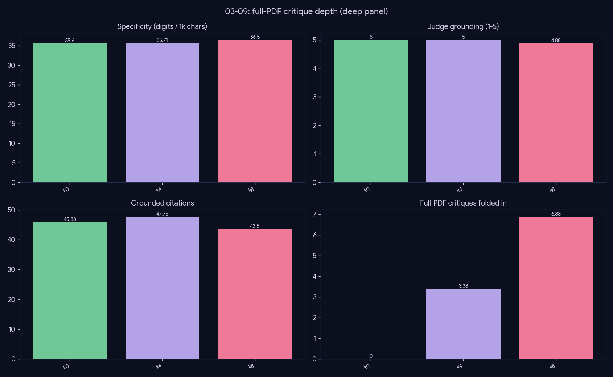

# Experiment — Critique depth (a documented near-null)

*Generation · does reading more full PDFs per round measurably improve the review?*

## What we did

Vary only `critique_k ∈ {0, 4, 8}` — the number of per-paper full-PDF critiques the deep loop runs — holding everything else constant, over 27 topics. Scored on the metric vector + 4-axis judge + faithfulness + an order-debiased **pairwise** of `k8` vs `k0`.

## Results (mean over 27 topics)

| critique_k | n_critiques | gold_recall | j_grounding | j_coverage | faithfulness |
|---|--:|--:|--:|--:|--:|
| k0 | 0.0 | 0.85 | 4.93 | 4.52 | 0.95 |
| k4 | 3.3 | 0.92 | 4.96 | 4.67 | 0.94 |
| k8 | 6.7 | 0.92 | 4.89 | 4.70 | 0.90 |

**Pairwise (k8 vs k0):** overall 17W / 5L / 5T (**0.63**).

## Conclusion

**A documented near-null.** The first few critiques help a little (gold recall 0.85 → 0.92 from k0 to k4), but **k8 adds nothing over k4** on recall or the judge, and faithfulness *drops* (0.95 → 0.90): more critiqued passages give the composer more chances to mis-attribute.

The pairwise k8-vs-k0 is a modest 0.63 — below the deep loop's 0.78 (`03-08`) — and isn't backed by any objective-metric gain.

**Critique depth is not a quality lever beyond a handful:** keep `critique_k` small (≈ 4); paying for k=8 buys cost (full-PDF reads) and a faithfulness risk, not quality.

## Caveats

An honest null worth recording — the deep loop's win comes from the *retrieve-and-expand* rounds (`03-08`), not from critiquing more PDFs per round.
