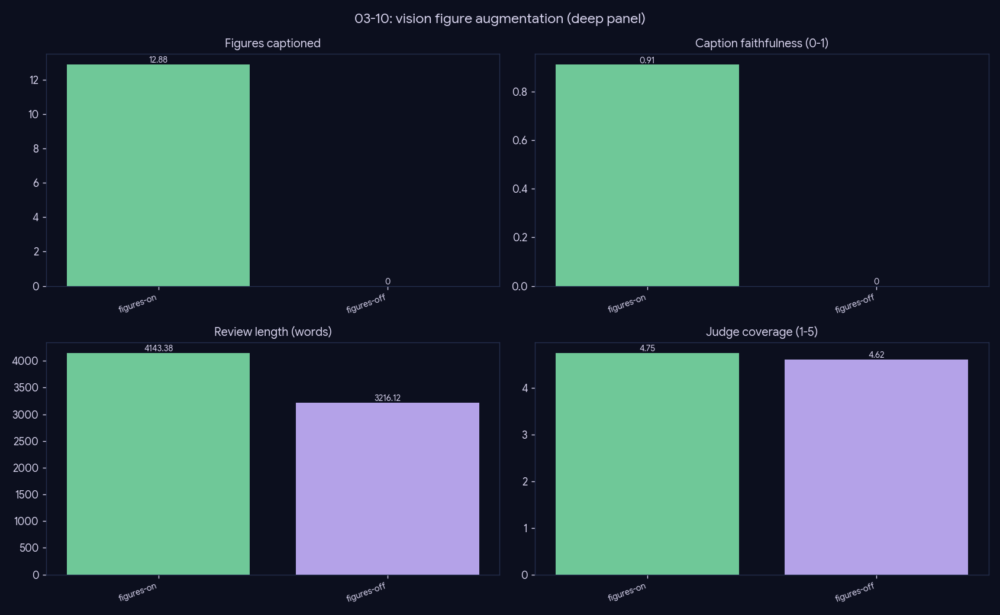

# Experiment — Vision figures (enrichment, not a text lever)

*Generation · does the figure gallery improve the review, and how is "improve" even measured here?*

## What we did

Toggle the figure gallery on/off over 27 topics. With it on, a Gemma-4-26B-Vision pass selects architecture diagrams / result plots from the landmark papers and writes captions; each figure is checked by a caption-faithfulness tripwire. Scored on the text metric vector + 4-axis judge, plus the gallery's own caption-faithfulness.

## Results (mean over 27 topics)

| figures | n_figures | caption_faithfulness | words | grounded | j_coverage |
|---|--:|--:|--:|--:|--:|
| **figures-on** | 12.41 | 0.93 | 3909 | 48.15 | 4.67 |
| figures-off | 0.0 | — | 2877 | 47.70 | 4.65 |

## Conclusion

**The figure gallery is an enrichment feature, not a lever on the text.** With it on, each review carries ~12 figures at **0.93 caption-faithfulness** and grows ~1000 words, but the 4-axis *textual* judge is unchanged (coverage 4.67 vs 4.65, grounding flat) — as expected, since the judge reads text, not images.

The figures' value lives in their **own** metric (caption-faithfulness 0.93) — verified visual grounding the text judge structurally cannot see.

**Ship it as an option:** it makes the review materially richer (diagrams + plots a reader wants) at the cost of ~1000 words and a vision pass, without touching textual quality — a clean additive feature.

## Caveats

The only quality guarantee here is caption-faithfulness; an unfaithful caption is the failure mode the tripwire exists to catch (0.93 pass rate).
