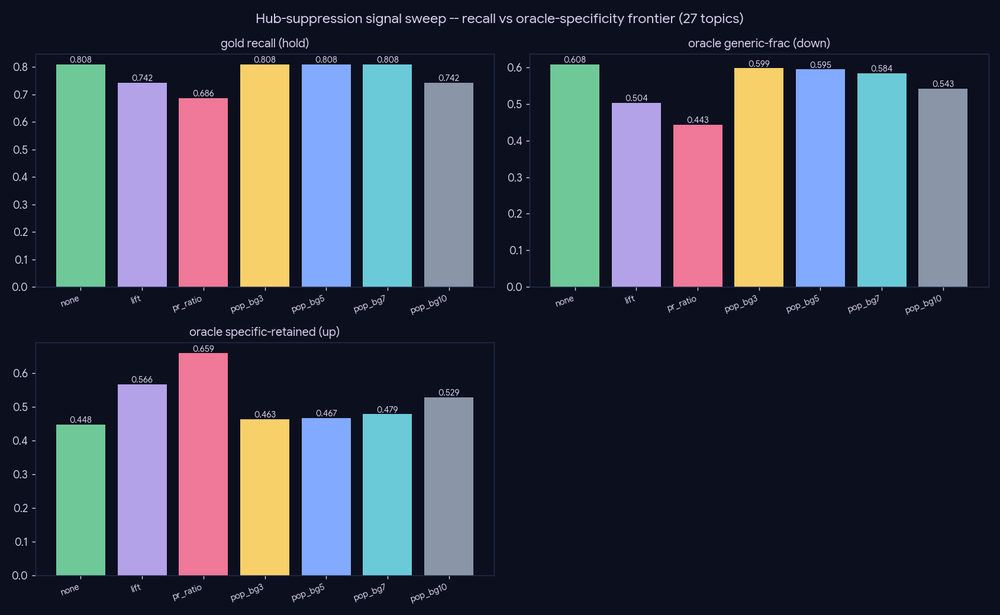

# Experiment — Hub suppression (stopping generic papers from hijacking niche reviews)

*Generation · the flagship's main rough edge: generic globally-cited hubs (Attention/BERT/Adam) dominating niche reviews.*

## The problem

Reading the real deep-research outputs, the flagship's dominant rough edge is **generic-hub dominance**: "Attention Is All You Need" is cited in **27 of 27** deep reports, BERT 17, GPT-3 16, Adam 11 — regardless of topic. A theorem-proving review devotes a whole "Rise of LLMs and Transformers" section to Attention→BERT→GPT-3 and cites **Adam as foundational to theorem proving**. Root cause: hubs accrue high *in-topic* in-degree (nearly everything cites them), so PPR floats them to top landmarks. A **specificity** problem, fixed **without a blocklist**.

## Data-derived signal sweep (no blocklist)

Every plausible data-derived demotion signal, two metrics over 27 topics: **gold_recall** (canonical retention — the tripwire) and an **independent LLM oracle** that labels each paper specific/generic *for that topic* (never sees our signals).

| arm | gold_recall | oracle generic_frac ↓ | oracle specific_retained ↑ | bg_mean |
|---|--:|--:|--:|--:|
| none | 0.808 | 0.608 | 0.448 | 0.574 |
| lift | 0.742 | 0.504 | 0.566 | 0.598 |
| pr_ratio | 0.686 | **0.443** | **0.659** | 0.579 |
| pop_bg (s=0.7) | **0.808** | 0.584 | 0.479 | 0.545 |
| pop_bg (s=1.0) | 0.742 | 0.543 | 0.529 | 0.521 |

## Finding: a real frontier, no structural silver bullet

- A genuine recall↔specificity **frontier**. Topic-conditioned **`pop_bg` holds gold recall perfectly** (0.808 at s≤0.7) — it never penalizes a load-bearing paper by fame alone — but is **gentle** (oracle 0.608→0.584).
- Topic-blind penalties (`pr_ratio`) move the oracle most (0.608→0.443) but cost recall (0.808→0.686, concentrated on `transformer`, where the hubs genuinely *are* canonical).
- **Crucially, no purely-structural signal removes a hub that is genuinely *used* in the niche** — Attention stays a landmark in theorem-proving at every strength, because ATP papers really do use transformers (low background-ratio there). So "generic for this topic" is partly a **narrative** judgment.

## The fix: a compose-side guard (shipped, A/B-validated)

A one-line compose guard (`compose_report._SYS` + `long_compose._OUTLINE_SYS`) forbidding a generic-foundations section unless directly load-bearing. **Deep A/B on "RL for automated theorem proving":**

| | OLD (pre-guard) | NEW (guard) |
|---|---|---|
| "Rise of Transformers" section | present | **gone** |
| Attention / BERT / GPT-3 / Adam mentions | 3 / 1 / 3 / 1 | **0 / 0 / 0 / 0** |
| ATP-specific coverage (HTPS, DSP, Lean-STaR…) | present | **preserved** |

Re-validated on three further niche topics (firm-network causal propagation; two document-layout-parsing variants): **zero** generic-hub mentions, all sections topic-specific, coverage intact — not over-corrected.

## Conclusion

**The shipped fix is the compose guard** (it solves the named complaint decisively and at zero recall cost). The recall-safe **`pop_bg` retrieval lever remains available** behind a `hub_penalty` knob for the milder generic-*method* residue in ultra-niche topics.

## Caveats

The oracle is an LLM instrument (validated in the style of `03-01-judge-validity`); gold recall is n=3. `pop_bg`'s structural metrics move modestly because it is deliberately gentle — its value is zero-recall-cost cleanup of truly-background hubs, complementary to the guard. The heavy sweep/oracle scripts (`scratchpad/hub_sweep.py`, `hub_oracle.py`) produced the committed `results/{structural,oracle}.json`.
