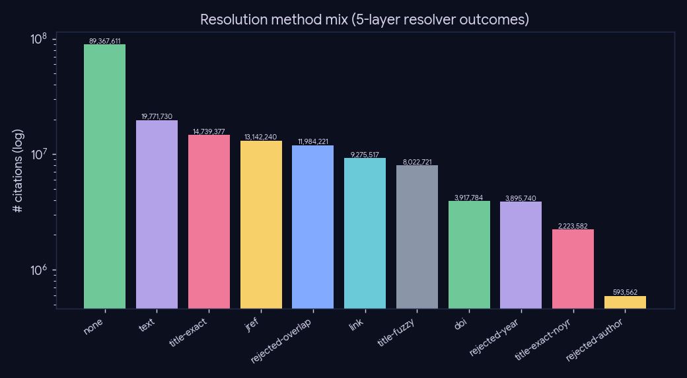
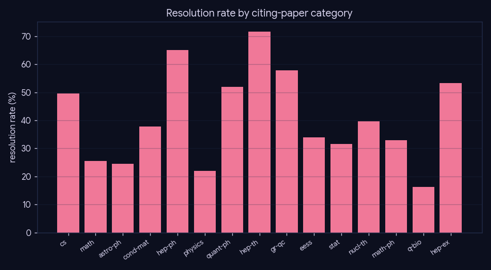
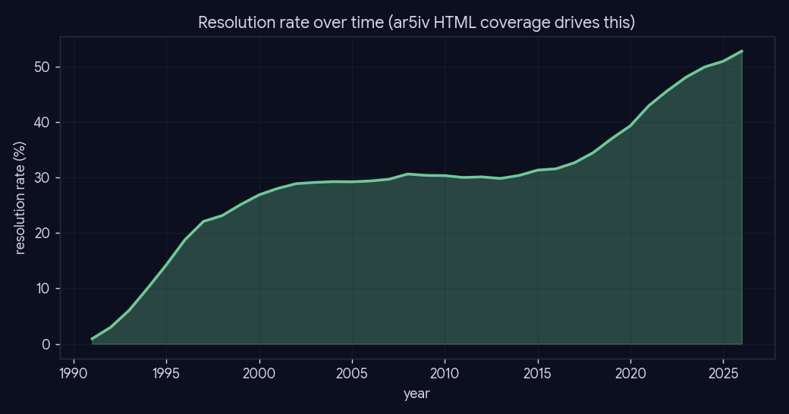

# Experiment 1 — The 5-layer citation resolver

**What:** which of the layered resolver's stages (L0 link → L1 text → L2 doi → L3 jref → L4
title-exact → L5 title-fuzzy; `rejected-*`/`none` for misses) actually resolve citations, and how
resolution varies by field and era. Read straight from `citation.method` in the single store.
**Why:** the resolver is cheapest-first with early termination — high-confidence exact methods
short-circuit before fuzzy is ever tried; this quantifies each layer's contribution and the tail.

**Reproduce:** `uv run python experiments/experiment-1-resolver-quality/run.py` (idempotent;
`--force`). Heavy joins cached to `results/summary.json`.

## Headline

Overall resolution rate: **40.18%** (71,092,951 / 176,934,085).

| layer (method) | resolved | share of resolved |
|---|--:|--:|
| text | 19,771,730 | 27.8% |
| title-exact | 14,739,377 | 20.7% |
| jref | 13,142,240 | 18.5% |
| link | 9,275,517 | 13.0% |
| title-fuzzy | 8,022,721 | 11.3% |
| doi | 3,917,784 | 5.5% |
| title-exact-noyr | 2,223,582 | 3.1% |

## By field and era

Resolution rate varies by field (HTML/LaTeX availability + citation style) and rises over time as
ar5iv HTML coverage improves.

## Caveats

`rejected-*` rows are real resolver decisions (a fuzzy candidate that failed the year/author/overlap
gate) — kept in the store precisely so this analysis can show the precision/recall trade-off of the
fuzzy layer, not silently dropped.
