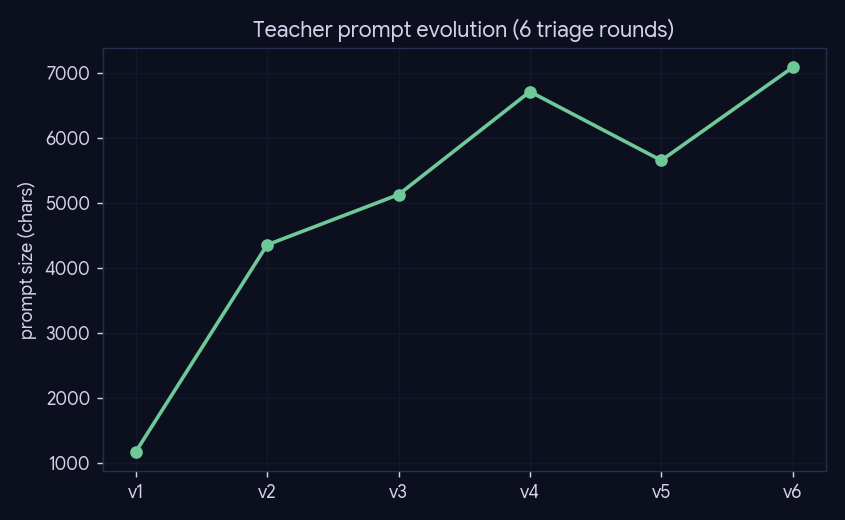
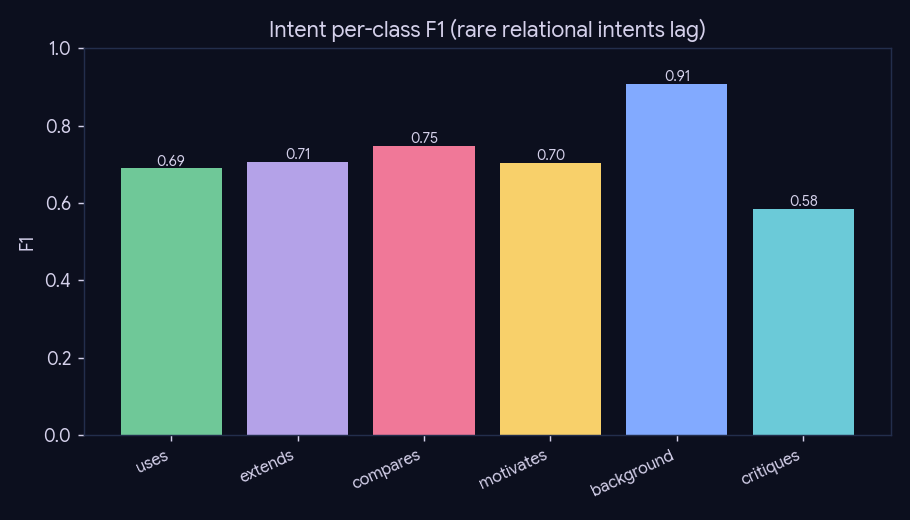
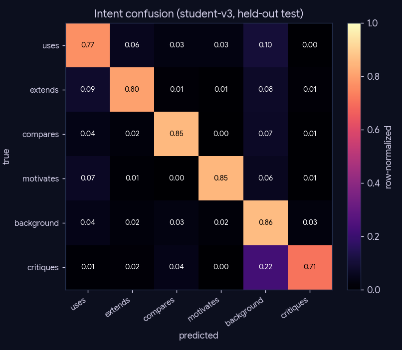
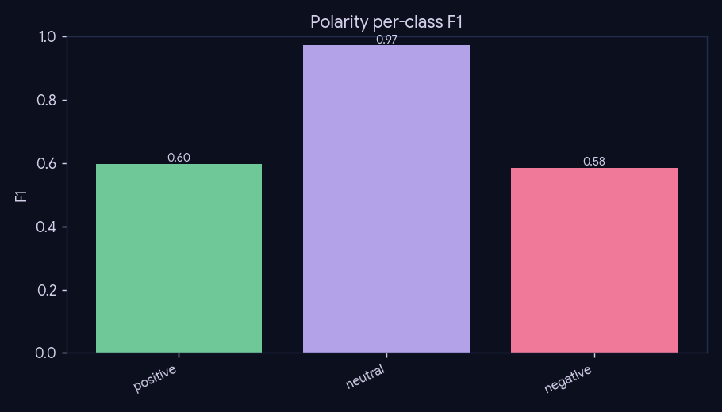
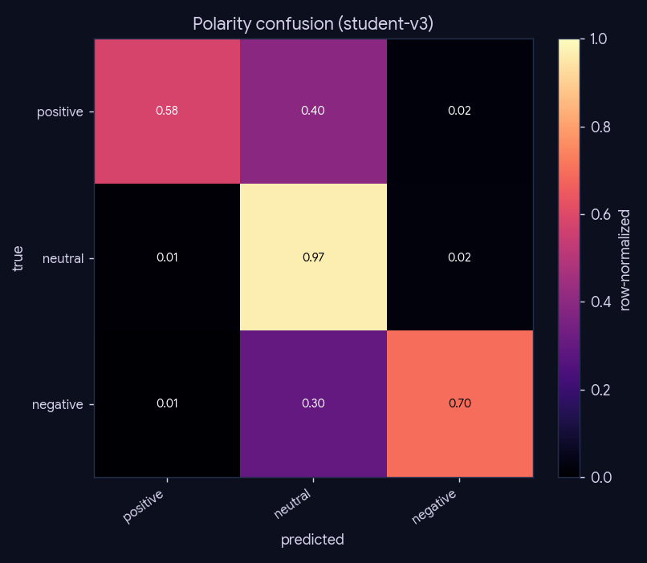

# Experiment 2 — Citation-intent labeling quality

**What:** how the Gemma teacher prompt was tuned (v1→v6) and how well the distilled DistilBERT
student labels both heads (intent 6-way, polarity 3-way). **Why:** edge typing is the graph's
differentiator (experiment-3) and the resource's citable-quality claim; this is the stage-1
(distilled-label) benchmark, measured on the held-out test split. *Stage-2 human-gold PRF comes
from the Phase-C labeling tool.*

**Reproduce:** `uv run python experiments/experiment-2-labeling-quality/run.py` (reads frozen
training artifacts; no LLM/inference).

## Teacher prompt evolution

Six triage rounds grew the prompt 1,176 → 7,089 chars (definitions + worked
examples for the rare relational intents). History: `.legacy/report/graph_label/AUTOLABELING.md`.

## Student quality (held-out test, n=13,521)

| student | intent acc | intent macro-F1 | polarity acc |
|---|--:|--:|--:|
| student-v1 | 0.894 | 0.717 | 0.962 |
| student-v2 | 0.897 | 0.713 | 0.965 |
| student-v3 | 0.844 | 0.723 | 0.947 |

Shipped = **student-v3**: intent acc **0.844** / macro-F1
**0.723**, polarity acc **0.947**.

### Intent per-class F1

| intent | F1 |
|---|--:|
| uses | 0.689 |
| extends | 0.706 |
| compares | 0.747 |
| motivates | 0.703 |
| background | 0.908 |
| critiques | 0.583 |

## Caveats (the honest read)

The rare relational intents (`critiques`/`compares`/`motivates`) have the lowest F1 — exactly the
classes phase-6's "tensions"/open-problems surfacing depends on, and exactly what the Phase-C
human-gold set must validate. macro-F1 < accuracy reflects this class imbalance. This is a
*distilled-label* benchmark (student vs teacher-derived test split), **not** human ground truth.
