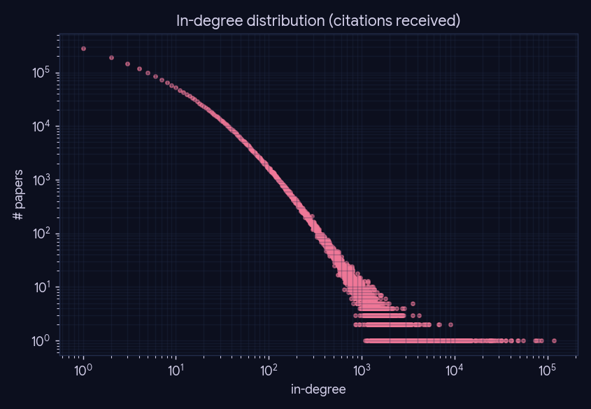
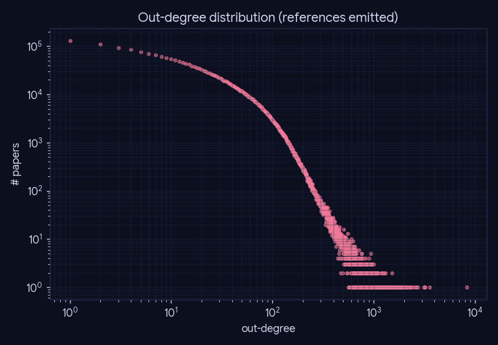
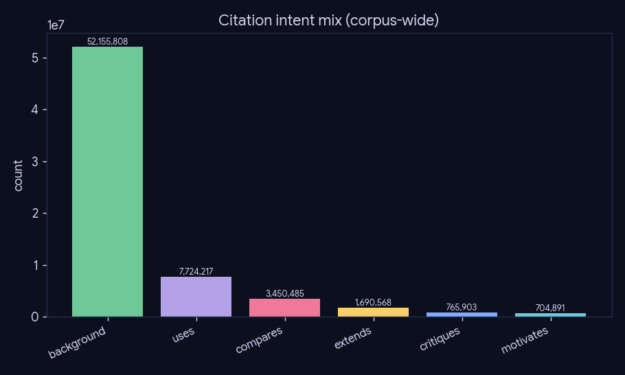
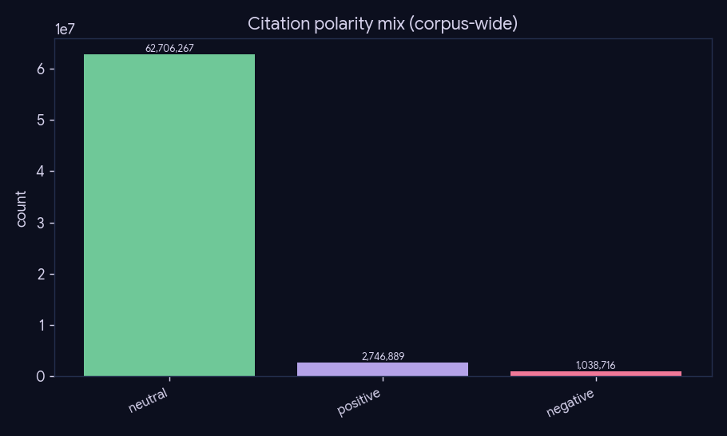
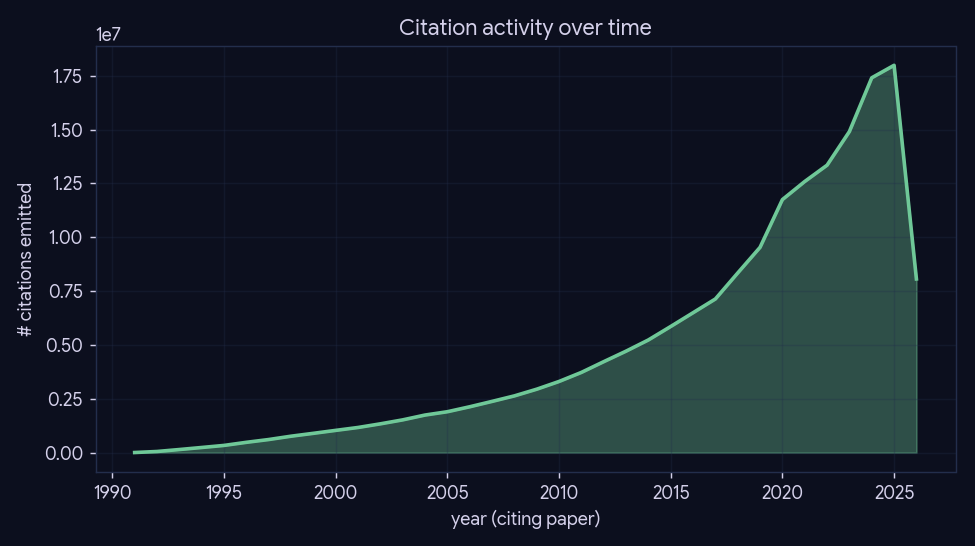

# Experiment 3 — Citation-graph structure

**What:** the shape of the 68.9M-edge intent-typed citation graph, read straight from the single
Postgres+pgvector store (`./data/pg`). Pure SQL + matplotlib, no LLM. **Why:** characterizes the
substrate phase-6 retrieves over — scale-free degree structure, the intent/polarity typing that
edges carry, and how citation activity grows over time.

**Reproduce:** `uv run python experiments/experiment-3-graph-structure/run.py` (idempotent; caches
`results/summary.json`, `--force` to recompute).

## Global counts

| metric | value |
|---|--:|
| papers (nodes) | 3,073,288 |
| citation occurrences | 176,934,085 |
| resolved occurrences | 70,634,716 |
| distinct edges | 36,688,723 |

*Resolution rate: 39.9%.*

## Degree distributions

Both in- and out-degree are heavy-tailed (near scale-free) — a few papers accrue enormous
in-degree while most are cited rarely; this is exactly the hub structure phase-6's pool induction
avoids by ranking *within* an on-topic pool rather than expanding from hubs.

## Edge typing (the differentiator)

Every resolved edge carries an intent + polarity (DistilBERT student over the corpus). The mix is
dominated by `background`/`uses`; the rare relational intents (`compares`/`critiques`/`motivates`)
are what feed phase-6's "tensions"/open-problems surfacing.

## Citation activity over time

## Top-cited papers (within-corpus in-degree)

| rank | in-deg | year | arXiv | title |
|--:|--:|--:|---|---|
| 1 | 117,137 | 2015 | 1512.03385 | Deep Residual Learning for Image Recognition |
| 2 | 85,284 | 2018 | 1810.04805 | BERT: Pre-training of Deep Bidirectional Transformers for La |
| 3 | 80,414 | 2017 | 1706.03762 | Attention Is All You Need |
| 4 | 76,307 | 2021 | 2103.00020 | Learning Transferable Visual Models From Natural Language Su |
| 5 | 73,764 | 2014 | 1412.6980 | Adam: A Method for Stochastic Optimization |
| 6 | 54,796 | 2020 | 2010.11929 | An Image is Worth 16x16 Words: Transformers for Image Recogn |
| 7 | 48,138 | 2020 | 2005.14165 | Language Models are Few-Shot Learners |
| 8 | 48,032 | 2021 | 2112.10752 | High-Resolution Image Synthesis with Latent Diffusion Models |
| 9 | 41,122 | 2020 | 2006.11239 | Denoising Diffusion Probabilistic Models |
| 10 | 40,778 | 2014 | 1409.1556 | Very Deep Convolutional Networks for Large-Scale Image Recog |
| 11 | 39,984 | 2023 | 2303.08774 | GPT-4 Technical Report |
| 12 | 35,705 | 2015 | 1505.04597 | U-Net: Convolutional Networks for Biomedical Image Segmentat |
| 13 | 35,698 | 2014 | 1405.0312 | Microsoft COCO: Common Objects in Context |
| 14 | 32,194 | 2021 | 2106.09685 | LoRA: Low-Rank Adaptation of Large Language Models |
| 15 | 32,186 | 2016 | 1609.02907 | Semi-Supervised Classification with Graph Convolutional Netw |
| 16 | 31,356 | 2013 | 1312.6114 | Auto-Encoding Variational Bayes |
| 17 | 29,694 | 2018 | 1807.06209 | Planck 2018 results. VI. Cosmological parameters |
| 18 | 29,405 | 2020 | 2002.05709 | A Simple Framework for Contrastive Learning of Visual Repres |
| 19 | 27,768 | 2015 | 1506.01497 | Faster R-CNN: Towards Real-Time Object Detection with Region |
| 20 | 27,124 | 2023 | 2307.09288 | Llama 2: Open Foundation and Fine-Tuned Chat Models |

## Caveats

In-degree here is *within-corpus* (arXiv→arXiv resolved citations only); true citation counts are
higher. Unresolved occurrences (no `cited_id`) are excluded from the graph but retained in the
store for the resolver analysis (experiment-1).
