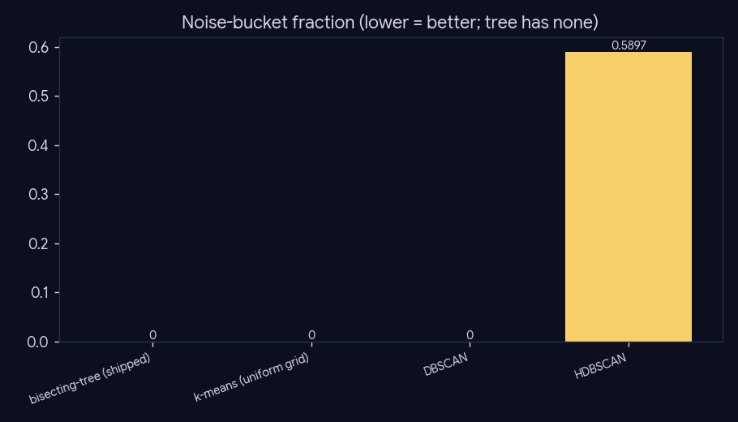
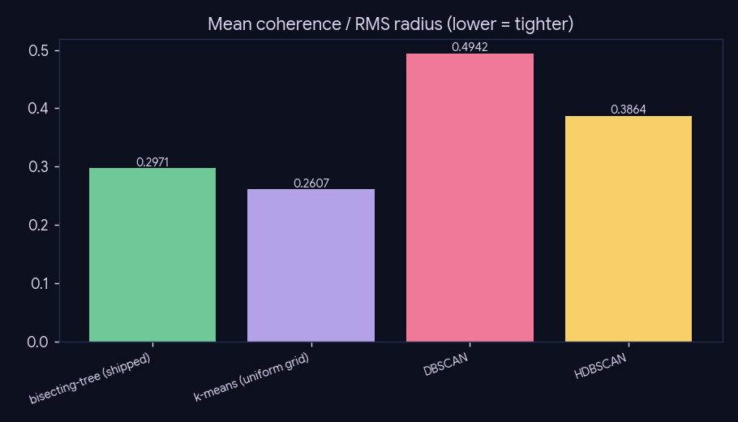
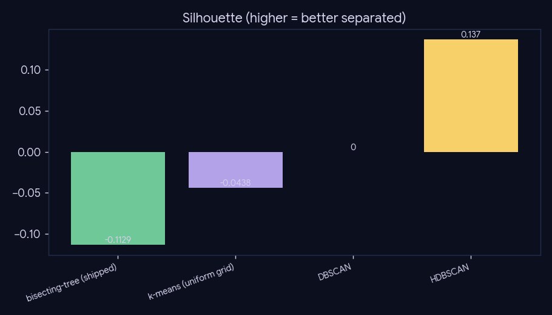

# Experiment 4 — Clustering comparison

**What:** the shipped density-aware **bisecting tree** (read from `paper_topic`) vs a uniform
k-means grid and DBSCAN/HDBSCAN, on a common sample of 30,000 embedded papers (768-d nomic
→ PCA-50). **Why:** the tree was built to avoid the old design's DBSCAN "noise bucket" that swallowed
355k niche papers into "Miscellaneous"; this quantifies the noise/coherence/separation trade-off.

**Reproduce:** `uv run python experiments/experiment-4-clustering-comparison/run.py` (sampled;
`--force`, `--n N`).

## Results (sample n=30,000, tree leaves in sample = 3,139)

| method | noise bucket | clusters | coherence ↓ | silhouette ↑ |
|---|--:|--:|--:|--:|
| bisecting-tree (shipped) | 0.0% | 3,139 | 0.2971 | -0.1129 |
| k-means (uniform grid) | 0.0% | 3,132 | 0.2607 | -0.0438 |
| DBSCAN | 0.0% | 1 | 0.4942 | 0.0 |
| HDBSCAN | 59.0% | 2 | 0.3864 | 0.137 |

## Read

The **bisecting tree assigns every paper a leaf (0% noise)** — the niche papers DBSCAN/HDBSCAN drop
into the noise bucket are exactly the ones phase-6 needs to retrieve. k-means also has no noise but
imposes a uniform grain; the tree's coherence early-stop adapts grain to density. Caveat: sampled +
PCA-50 (not the full UMAP-50 build); a fair *full* rebuild is heavier, but the noise-bucket contrast
is the structural point and is grain-robust.
