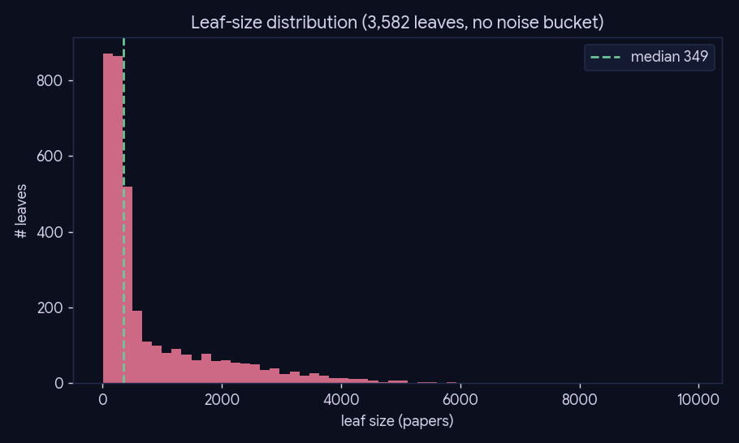
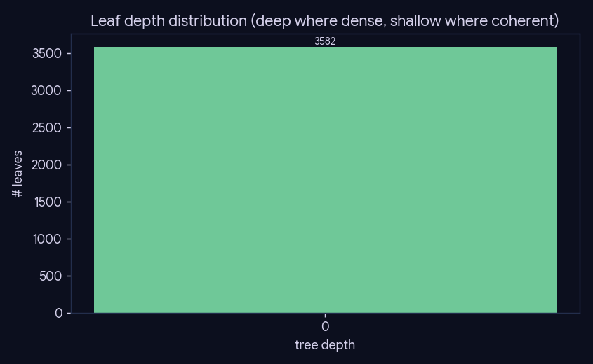
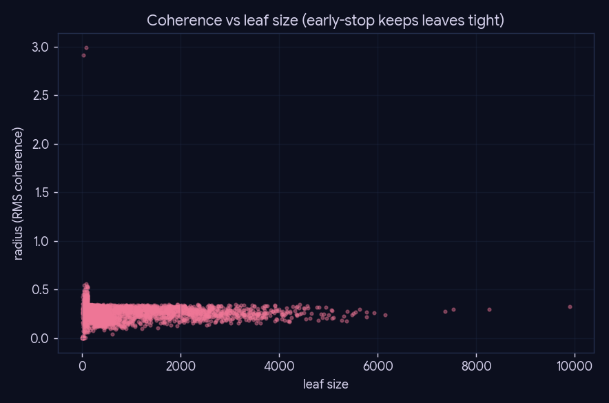

# Experiment 5 — Density-aware topic tree

**What:** the shape of the bisecting topic tree (`leaf` + `paper_topic` in the single Postgres
store). **Why:** the tree anchors phase-6 retrieval to an on-topic leaf; this shows it has **no
noise bucket** (every one of the 2,918,448 papers gets a leaf, vs the old DBSCAN design
that dumped 355k papers into "Miscellaneous") and that coherence early-stop keeps leaves tight.

**Reproduce:** `uv run python experiments/experiment-5-topic-tree/run.py` (idempotent; `--force`).

## Summary

| metric | value |
|---|--:|
| leaves | 3,582 |
| papers assigned | 2,918,448 |
| leaf size min / median / p90 / max | 6 / 349 / 2348 / 9895 |

## Caveats

Leaf membership is from the pre-delta tree build; 2025/2026 papers have no leaf (handled by phase-6
`frontier_pull`). Rebuilding the tree on the current corpus is experiment-4's territory.
