*deep research · 2 round(s) · 120 landmarks · frontier≥2023: 39 · 3 full-PDF critiques · grounded 49 · off-digest 1*

# The Evolution of Generative Synthesis: A Survey of Diffusion Models for Image Generation

The field of generative modeling has undergone a profound transformation, moving from traditional probabilistic approaches to the highly sophisticated architectures capable of synthesizing hyper-realistic imagery. For much of the last decade, Generative Adversarial Networks (GANs) dominated the landscape, yet they were frequently plagued by fundamental challenges such as training instability and mode collapse. The emergence of diffusion-based frameworks has addressed these limitations by reframing image generation as a process of iterative denoising, offering a more stable and mathematically grounded approach to density estimation. This shift is critical because the ability to generate high-fidelity, diverse, and controllable visual content serves as a cornerstone for advancements in digital media, synthetic data augmentation, and the broader landscape of human-computer interaction.

This review provides a comprehensive survey of the trajectory of diffusion models, tracing their development from foundational principles to the state-of-the-art. We begin by exploring the Origins of these models, examining the mathematical frameworks of non-equilibrium thermodynamics and score-based modeling that provided the initial theoretical groundwork. The discussion then transitions to Key Advances, where we analyze the architectural innovations and sampling efficiency improvements that enabled these models to scale and surpass previous generative paradigms. Finally, we examine the Current Frontier, investigating the latest developments in large-scale latent diffusion, complex text-to-image conditioning, and the pursuit of fine-grained semantic control that defines the present landscape of generative artificial intelligence.

## Origins

The foundations of generative modeling and image synthesis are rooted in a convergence of probabilistic inference, optimization theory, and large-scale dataset construction. Early advancements in efficient inference were driven by the need to manage continuous latent variables in directed probabilistic models. Specifically, the introduction of stochastic variational inference and the reparameterization trick allowed for the optimization of the variational lower bound using standard stochastic gradient methods, providing a scalable mechanism for learning from large, i.i.d. datasets [arXiv:1312.6114]. This mathematical framework for posterior inference laid essential groundwork for subsequent generative approaches.

Parallel to these probabilistic developments, the field of generative modeling was significantly shaped by the emergence of Generative Adversarial Networks (GANs). Unlike methods requiring Markov chains or unrolled approximate inference, GANs utilize a minimax two-player game where a generator and discriminator are trained simultaneously via backpropagation [arXiv:1406.2661]. The stability and quality of these models were later refined through various architectural and procedural improvements. For instance, researchers introduced new architectural features to enhance semi-supervised learning and visual realism [arXiv:1606.03498], while others proposed a two time-scale update rule (TTUR) to ensure convergence to a local Nash equilibrium by employing individual learning rates for the generator and discriminator [arXiv:1706.08500]. Furthermore, the stability of high-resolution generation was addressed through progressive growing, where layers are added incrementally to model finer details [arXiv:1710.10196].

A distinct and fundamental departure from the adversarial paradigm is found in the application of non-equilibrium statistical physics to generative modeling. Rather than relying on a minimax game, this approach utilizes an iterative forward diffusion process to destroy data structure, followed by a learned reverse diffusion process to restore it [arXiv:1503.03585]. This methodology enables the modeling of complex datasets using highly flexible, analytically tractable probability distributions, representing a significant shift in how generative processes are conceptualized [arXiv:1503.03585].

The efficacy of these generative models is inextricably linked to the availability of high-quality benchmarks and optimization techniques. The development of large-scale datasets such as ImageNet [arXiv:1409.0575], Microsoft COCO [arXiv:1405.0312], and LSUN [arXiv:1506.03365] provided the necessary scale for training and evaluating complex visual recognition and generation tasks. These datasets were often constructed using novel methodologies, such as human-in-the-loop iterative sampling [arXiv:1506.03365] or crowd-worker involvement for instance segmentation [arXiv:1405.0312]. Supporting these large-scale training regimes are robust optimization frameworks, most notably the Adam optimizer, which utilizes adaptive estimates of lower-order moments to handle noisy or sparse gradients in large-scale parameter spaces [arXiv:1412.6980].

## Key Advances

The evolution of diffusion models is marked by a transition from foundational probabilistic frameworks to unified continuous-time theories and high-efficiency sampling techniques. Early work established the viability of diffusion models for high-quality image synthesis by training on a weighted variational bound connected to denoising score matching and Langevin dynamics (arXiv:2006.11239). While this established a state-of-the-art FID of 3.17 on CIFAR-10 using a simplified $\epsilon$-prediction objective, it struggled with competitive log-likelihoods compared to other likelihood-based models (arXiv:2006.11239). This gap was addressed by score-based modeling, which initially utilized annealed Langevin dynamics to estimate gradients of perturbed data distributions (arXiv:1907.05600).

A significant theoretical leap occurred with the unification of score-based modeling and diffusion probabilistic models into a continuous-time framework using Stochastic Differential Equations (SDEs) (arXiv:2011.13456). This framework introduced the probability flow ODE, enabling both deterministic sampling and exact likelihood computation, achieving a record likelihood of 2.99 bits/dim on CIFAR-10 (arXiv:2011.13456). However, despite these mathematical advancements, sampling speed remained a critical bottleneck compared to GANs (arXiv:2011.13456).

To mitigate this, research diverged into several efficiency-focused trajectories. One approach involved non-Markovian diffusion processes, such as Denoising Diffusion Implicit Models (DDIMs), which allow for faster sampling without altering the training objective (arXiv:2010.02502), providing a 10x to 50x speedup. Another trajectory focused on mathematical solvers; DPM-Solver (arXiv:2206.00964) and DPM-Solver++ (arXiv:2211.01095) utilized high-order ODE solving to achieve high-fidelity results in significantly fewer steps. Furthermore, progressive distillation (arXiv:2202.00512) and knowledge distillation (arXiv:2101.02388) were employed to compress multi-step denoising processes into fewer iterations, with the former achieving an FID of 3.0 on CIFAR-10 in just 4 steps (arXiv:2202.00512).

Recent advances have also focused on scaling and conditioning. Latent Diffusion Models (LDMs) shifted the computational burden from pixel space to the latent space of pretrained autoencoders, enabling high-resolution synthesis with reduced complexity (arXiv:2112.10752). This was further extended by Diffusion Transformers (DiTs), which replaced the standard U-Net backbone with a scalable transformer architecture (arXiv:2212.09748). For text-to-image tasks, advancements moved from classifier guidance (arXiv:2105.05233) to classifier-free guidance (arXiv:2207.12598), which trades off mode coverage and fidelity without requiring a separate pre-trained classifier. Finally, the field has expanded into complex domains, including text-to-3D synthesis (arXiv:2209.14988) and high-definition video generation (arXiv:2204.03458).

## Current Frontier

The current frontier of diffusion models is characterized by a shift from standard denoising paradigms toward methods that optimize for inference speed, high-resolution scalability, and structural control. A primary tension exists between traditional training-intensive models and emerging training-free or accelerated frameworks. For instance, while standard latent diffusion models (LDMs) like SDXL improve high-resolution synthesis through larger UNet backbones and dual text encoders (arXiv:2307.01952), they remain computationally heavy. In contrast, arXiv:2606.04299 introduces a training-free paradigm that replaces learned score functions with an analytical, closed-form denoiser derived from an image's internal patch distribution. This approach achieves extreme scalability, enabling gigapixel generation in 13.9 minutes, and demonstrates superior diversity (LPIPS Div. 0.50) compared to SinDiffusion (0.41) (arXiv:2606.04299). However, this training-free method relies on coarse-to-fine blending heuristics to compensate for a lack of inherent global semantic modeling, a weakness not shared by models that explicitly model data manifold geometry (arXiv:2606.00094).

Efficiency is also being pursued through mathematical re-engineering of the diffusion process itself. Rather than relying on iterative MCMC-based sub-sampling, arXiv:2408.08306 utilizes an exponentially time-decaying Signal to Noise Ratio (SNR) and a parallel data-driven model to generate trajectories in a single run. Similarly, arXiv:2502.02483 accelerates inference by replacing standard regression loss with a scoring rule, allowing sampling from probability transitions on a coarse time scale. This focus on sampling efficiency is furthered by Denoising Score Distillation (DSD), which distills pretrained models into one-step generators (arXiv:2503.07578), and Hierarchical Koopman Diffusion, which uses Koopman operator theory to lift nonlinear dynamics into a linear latent space, enabling one-step sampling and interpretable trajectories (arXiv:2510.12220).

The frontier also extends into specialized domains such as high-resolution synthesis and video generation. To manage the complexity of high-resolution pixel space, MSF employs multi-scale latent factorization to separate low-frequency base signals from high-frequency residuals, achieving a 4x speed-up (arXiv:2501.13349). In the temporal domain, the field is moving from 2D image models to video-centric architectures. Stable Video Diffusion scales LDMs to video via a three-stage training process involving temporal layer insertion (arXiv:2311.15127), while ModelScope incorporates spatio-temporal blocks into a VQGAN-based architecture (arXiv:2308.06571). Recent advancements even allow for explicit temporal control, such as making time editable in Video Diffusion Transformers through lightweight temporal modules (arXiv:2606.10183). Finally, emerging research addresses the limitations of Gaussian noise; for example, using blue noise to improve gradient flow (arXiv:2402.04930) or employing noise-level guidance to reduce variations in prompt adherence without additional training (arXiv:2509.13936).

## Tensions and Open Problems

A primary tension in the field concerns the fundamental trade-off between sample quality, sampling speed, and distributional coverage—often described as the "generative learning trilemma." While early frameworks such as the maximum likelihood approach in arXiv:2101.09258 and the variational formulations presented in arXiv:2107.00630 and arXiv:2107.03006 attempt to optimize for density estimation, they often struggle to match the perceptual fidelity of adversarial models. This is further complicated by the historical dominance of GANs, which, despite their stability improvements in arXiv:1710.10196 and arXiv:1606.03498, often suffer from mode collapse. In contrast, arXiv:2112.07804 argues that denoising diffusion models provide a superior path toward resolving this trilemma, offering a more robust way to capture the full data distribution than the invertible flows of arXiv:1807.03039 or the cascaded architectures of arXiv:2106.15282.

Another significant debate revolves around the mathematical formulation of the generative process: specifically, whether the transition between noise and data is best modeled as a stochastic diffusion process or a deterministic flow. The traditional view, rooted in the non-equilibrium thermodynamics of arXiv:1503.03585, emphasizes stochasticity for robustness. However, recent developments in flow matching, such as those in arXiv:2210.02747, suggest that learning straight paths can significantly improve efficiency. This tension is highlighted by the critique in arXiv:2309.16948, which argues that while diffusion Schrödinger bridges in arXiv:2106.01357 attempt to unify these views, they may lack the directness and simplicity offered by newer bridge models and flow-based frameworks. Furthermore, the efficiency of these paths remains contested; while arXiv:2202.00512 seeks speed through progressive distillation, newer solvers like the DPM-Solver in arXiv:2206.00927 argue that high-order ODE solvers can achieve rapid sampling without the need for heavy distillation.

Finally, there is an emerging conflict regarding the reliance on massive, high-resolution datasets versus the need for more efficient, structured training. As models like SDXL in arXiv:2307.01952 push the boundaries of latent diffusion for high-resolution synthesis, they face criticism regarding the computational cost and the potential for overfitting to finite, noisy datasets. This has motivated a shift toward more mathematically rigorous training objectives, such as the stochastic forward-backward deconvolution proposed in arXiv:2502.05446, which seeks to address the limitations of training on finite data. Simultaneously, researchers are questioning whether high-quality generation necessitates the memorization of training samples, with arXiv:2502.21278 suggesting that "ambient diffusion" can foster creativity by avoiding direct memorization.

## Outlook

The frontier of generative modeling is rapidly shifting from static image synthesis toward dynamic, temporally coherent video generation and the explicit modeling of complex data geometries. As evidenced by recent work in video diffusion transformers (arXiv:2606.10183) and manifold-aware generation (arXiv:2606.00094), the next generation of models will likely move beyond simple pixel-level denoising. We expect to see a convergence of efficient, one-step generation techniques (arXiv:2503.07578) with highly compressed latent representations (arXiv:2502.01189), ultimately aiming for models that are not only photorealistic and temporally stable but also computationally sustainable for real-time, interactive applications.

---

## Key Figures

**Denoising Diffusion Probabilistic Models** — arXiv:2006.11239 p.1

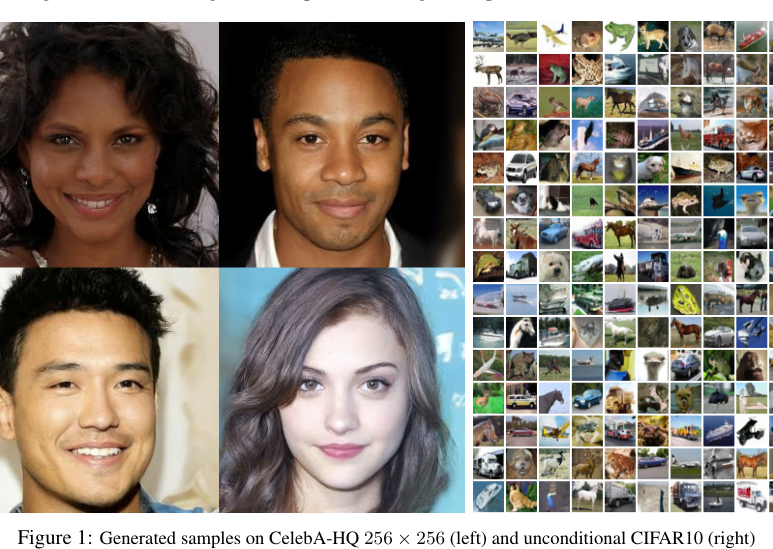

The figure displays two sets of image grids: a 2x2 grid of high-resolution human faces on the left and a large 10x10 grid of diverse, low-resolution objects (such as animals, vehicles, and landscapes) on the right. It conveys the quality and variety of images generated by the model on the CelebA-HQ and CIFAR-10 datasets.

**Score-Based Generative Modeling through Stochastic Differential
  Equations** — arXiv:2011.13456 p.2

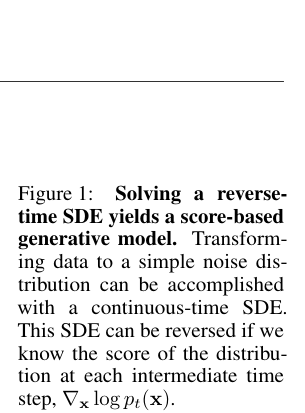

The figure consists of a flow diagram with two main stages connected by arrows. The first stage shows a data distribution $p_{data}(\mathbf{x})$ being transformed into a simple noise distribution $p_T(\mathbf{x})$ via a forward SDE, while the second stage shows the reverse process where the noise distribution is transformed back into the data distribution using the score $\nabla_{\mathbf{x}} \log p_t(\mathbf{x})$.

**Denoising Diffusion Implicit Models** — arXiv:2010.02502 p.2

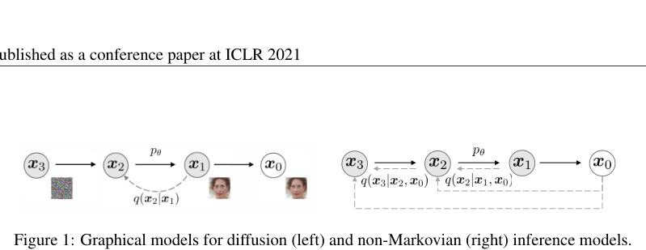

The figure displays two sequences of directed nodes labeled $x_3, x_2, x_1,$ and $x_0$ connected by arrows to represent probabilistic graphical models. The left model shows a Markovian chain where arrows only connect adjacent nodes ($x_i \to x_{i-1}$), while the right model shows a non-Markovian process where nodes $x_1$ and $x_0$ have dashed arrows connecting back to $x_2$, representing conditional dependencies. The figure conveys the structural difference between standard diffusion inference models and the proposed non-Markovian inference models.

**High-Resolution Image Synthesis with Latent Diffusion Models** — arXiv:2112.10752 p.1

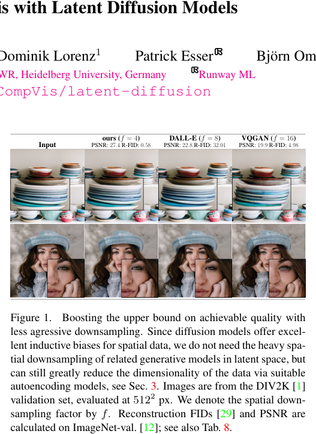

The figure presents a comparison of image synthesis quality across three models (ours with $f=4$, DALL-E with $f=8$, and VQGAN with $f=16$) alongside an input image. Each model's output is accompanied by its corresponding PSNR and R-FID metrics, demonstrating that a lower spatial downsampling factor ($f$) results in higher PSNR and lower FID values.

**Deep Unsupervised Learning using Nonequilibrium Thermodynamics** — arXiv:1503.03585 p.3

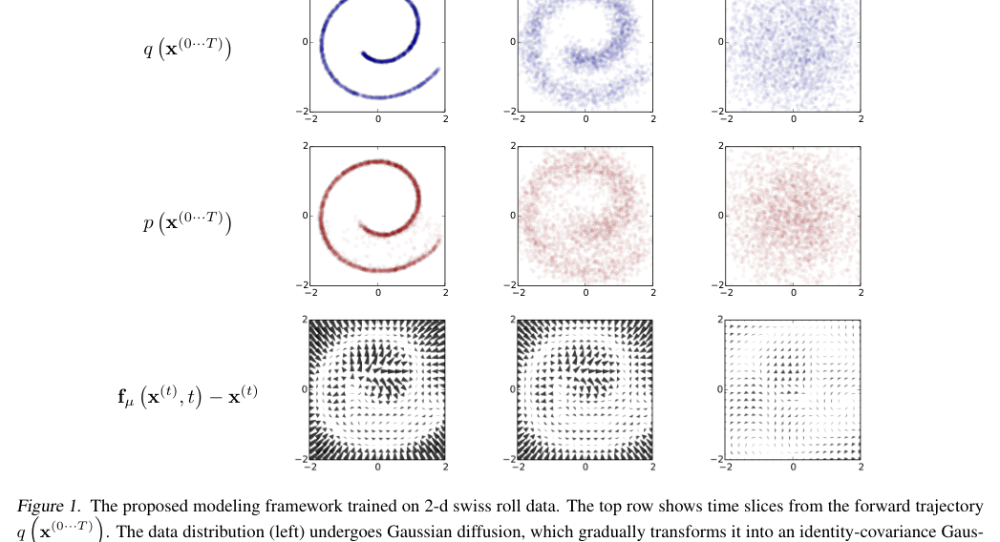

The figure consists of a 3x3 grid of plots organized by row and column. The top row shows blue time slices of a 2D Swiss roll undergoing Gaussian diffusion, the middle row shows red snapshots of the data distribution $p(\mathbf{x}^{(0 \dots T)})$, and the bottom row displays black vector fields representing the score function $\mathbf{f}_\mu(\mathbf{x}^{(t)}, t) - \mathbf{x}^{(t)}$. The columns represent progressive stages of the diffusion process, conveying how the structured data gradually transforms into an identity-covariance Gaussian distribution while the learned vector fields guide the reverse process.

**Diffusion Models Beat GANs on Image Synthesis** — arXiv:2105.05233 p.1

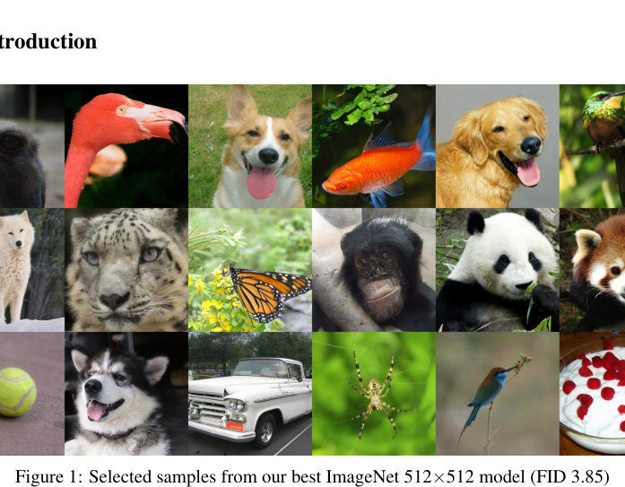

This figure consists of a 3x7 grid of diverse, high-resolution images including animals, insects, vehicles, and objects. It conveys the visual quality and variety of samples generated by the authors' best ImageNet 512×512 diffusion model.

**GANs Trained by a Two Time-Scale Update Rule Converge to a Local Nash
  Equilibrium** — arXiv:1706.08500 p.2

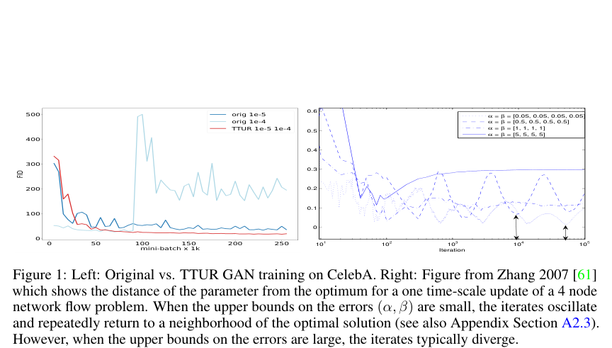

The left panel is a line graph plotting FID against mini-batch index (multiplied by 1k) for three training methods: "orig 1e-5" (blue), "orig 1e-4" (light blue), and "TTUR 1e-5 1e-4" (red). The right panel is a semi-log plot showing the distance of a parameter from an optimum over iterations for different values of $\alpha$ and $\beta$, where smaller values result in oscillations around the optimum while larger values cause divergence.

**Generative Modeling by Estimating Gradients of the Data Distribution** — arXiv:1907.05600 p.3

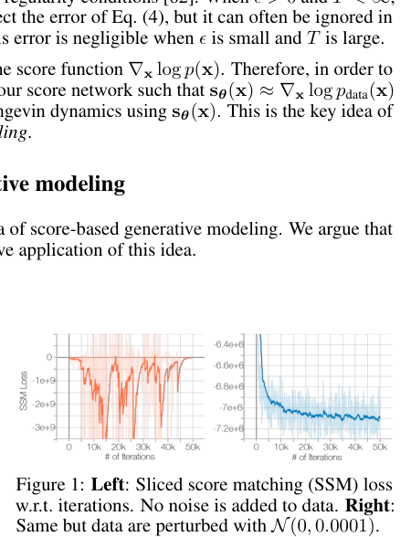

The figure consists of two side-by-side line plots showing Sliced Score Matching (SSM) loss over iterations. The left panel displays the SSM loss for data without added noise, showing high-frequency oscillations, while the right panel shows the loss for data perturbed with $\mathcal{N}(0, 0.0001)$, displaying a smooth decay toward a lower value.

**Image-to-Video Diffusion: From Foundations to Open Frontiers** — arXiv:2605.17248 p.1

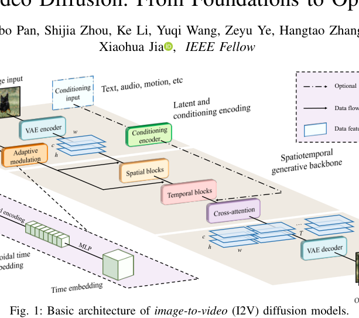

The figure illustrates the basic architecture of image-to-video (I2V) diffusion models using a series of labeled boxes and connecting arrows. It depicts a workflow where video input, conditioning input (text, audio, motion), and time embeddings are processed through VAE encoders, conditioning encoders, and spatiotemporal generative backbones containing spatial blocks, temporal blocks, and cross-attention mechanisms. The diagram conveys how various data streams are encoded and integrated through a backbone to ultimately produce video output via a VAE decoder.

**Distributional Diffusion Models with Scoring Rules** — arXiv:2502.02483 p.4

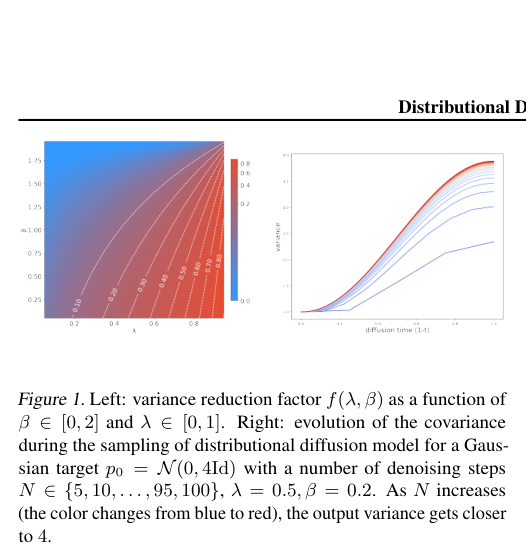

The figure consists of two panels: a heatmap on the left and a line plot on the right. The left panel displays a color-coded heatmap of the variance reduction factor $f(\lambda, \beta)$ across a grid of $\beta \in [0, 2]$ and $\lambda \in [0, 1]$, with white contour lines indicating specific values. The right panel shows multiple curves plotting variance against diffusion time ($1-t$), where increasing numbers of denoising steps $N$ are represented by a color gradient from blue to red, conveying that higher $N$ results in output variance approaching 4.

**Compressed Image Generation with Denoising Diffusion Codebook Models** — arXiv:2502.01189 p.2

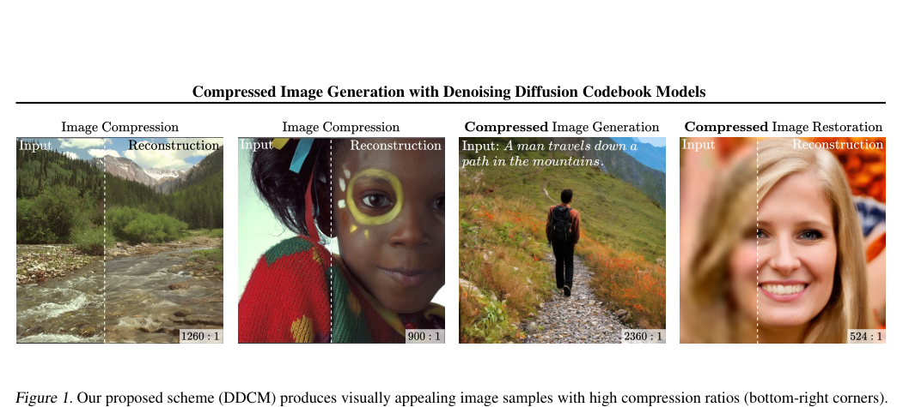

The figure displays four side-by-side image panels categorized into "Image Compression," "Compressed Image Generation," and "Compressed Image Restoration." Each panel contains a split-view image comparing an "Input" to a "Reconstruction," with a numerical compression ratio (e.g., 1260:1, 2360:1) labeled in the bottom-right corner. The figure conveys that the proposed DDCM scheme can achieve high-quality image reconstruction and generation at very high compression ratios.
