*deep research · 2 round(s) · 120 landmarks · frontier≥2023: 50 · 4 full-PDF critiques · grounded 64 · off-digest 0*

# From Pixels to Temporal Dynamics: A Review of Diffusion Models for Video Generation

The ability to synthesize realistic, temporally coherent video represents one of the most significant challenges in generative modeling. While static image synthesis has achieved remarkable fidelity, video generation introduces the complex requirement of modeling intricate temporal dependencies alongside spatial structures. This capability is critical for a wide array of applications, ranging from automated cinematic content creation to the development of high-fidelity simulators for robotics and autonomous systems. Solving the problem of video synthesis requires not only capturing the distribution of individual frames but also mastering the underlying laws of motion and physical consistency over time.

This review traces the technological evolution of the field, beginning with the foundational principles of generative modeling and the emergence of diffusion processes. We first examine the early landscape of video generation, which was primarily dominated by Generative Adversarial Networks (GANs) and autoregressive models, noting their inherent limitations in training stability and long-term temporal consistency. We then explore the pivotal transition to video diffusion and the adoption of latent models, which allowed for more efficient modeling by operating in compressed representation spaces rather than high-dimensional pixel space.

As the field has matured, research has shifted toward enhancing the controllability, motion, and compositional synthesis of generated sequences to allow for more precise user guidance. We analyze the recent efforts to scale these models and improve computational efficiency to meet the massive resource requirements of high-resolution video production. Finally, we look toward the frontier of the discipline, investigating the move toward long-horizon generation, autoregressive video extensions, and the development of world models that aim to simulate the physical dynamics of reality.

## Foundations of Generative Modeling and Diffusion

The evolution of generative modeling has transitioned from adversarial frameworks to the current dominance of diffusion-based methods. Early advancements focused on variational inference and adversarial training. For instance, arXiv:1312.6114 introduced the reparameterization of the variational lower bound and a recognition model to enable efficient posterior inference in directed probabilistic models. This was followed by the introduction of Generative Adversarial Networks (GANs) in arXiv:1406.2661, which established a minimax two-player game between a generator and a discriminator to capture data distributions. Subsequent refinements to GANs sought to improve stability and quality, such as the Two Time-Scale Update Rule (TTUR) and the Fréchet Inception Distance (FID) metric in arXiv:1706.08500, and the style-based generator architecture in arXiv:1812.04948, which achieved unsupervised separation of high-level attributes and stochastic variation.

A significant shift occurred with the emergence of score-based modeling. arXiv:1907.05600 proposed estimating the gradients of data distributions via score matching and annealed Langevin dynamics, aiming to produce samples comparable to GANs. This line of inquiry was unified by arXiv:2011.13456, which provided a framework using Stochastic Differential Equations (SDEs) and Neural ODEs to enable exact likelihood computation and high-fidelity generation.

The current state-of-the-art is largely defined by Denoising Diffusion Probabilistic Models (DDPMs). As detailed in arXiv:2006.11239, DDPMs established a mathematical equivalence between diffusion models, denoising score matching, and Langevin dynamics through a simplified $\epsilon$-prediction parameterization. While DDPMs achieved state-of-the-art image synthesis (e.g., an FID of 3.17 on CIFAR10), they suffered from a failure to produce competitive log-likelihoods compared to other likelihood-based models and were initially limited to static image synthesis. To address the computational bottleneck of the Markovian process, arXiv:2010.02502 introduced Denoising Diffusion Implicit Models (DDIMs), which utilize non-Markovian processes to achieve 10x to 50x faster sampling speeds without altering the training objective.

Further advancements improved both conditional control and computational efficiency. arXiv:2105.05233 introduced classifier guidance, allowing for a trade-off between diversity and fidelity in conditional synthesis, eventually demonstrating that diffusion models could outperform GANs in image synthesis. Finally, arXiv:2112.10752 addressed the high computational cost of pixel-space diffusion by introducing Latent Diffusion Models (LDMs). By decoupling perceptual compression via pretrained autoencoders from semantic generation in the latent space and incorporating cross-attention layers for conditioning, LDMs significantly reduced computational requirements while preserving detail. This progression from pixel-level score matching to latent-space diffusion provides the essential mathematical and architectural foundation for modern video generation tasks.

## Early Video Generation: GANs and Autoregressive Models

Early video generation research was primarily dominated by Generative Adversarial Networks (GANs) that sought to disentangle temporal dynamics from spatial content. Initial efforts utilized spatio-temporal convolutional GANs to untangle foreground from background to learn scene dynamics (arXiv:1609.02612). This was extended by Temporal Generative Adversarial Nets (TGAN), which introduced a dual-generator structure—comprising a temporal generator and an image generator—and utilized singular value clipping to achieve stable end-to-end training (arXiv:1611.06624).

A significant methodological trend in GAN development involved the decomposition of video components into distinct latent representations. MoCoGAN (arXiv:1707.04993) advanced this by using an unsupervised adversarial scheme to separate fixed content from stochastic motion. This concept of decomposition was further refined in a two-stage GAN approach (arXiv:1709.07592), which first generates realistic content and then refines motion dynamics using a Gram matrix. While these models focused on structural decomposition, other researchers addressed the computational bottlenecks of high-resolution synthesis. For instance, arXiv:1811.09245 proposed a memory-efficient stack of small sub-generators to scale computational costs linearly with resolution, whereas DVD-GAN (arXiv:1907.06571) achieved scalability by decomposing its discriminator to handle longer and more complex videos. StyleGAN-V (arXiv:2112.14683) represents a more recent evolution, moving toward continuous-time video generation via positional embeddings and a holistic discriminator, which also enables efficient training on sparse video clips.

Parallel to the GAN-based evolution, autoregressive models emerged as a powerful alternative for high-fidelity synthesis. While earlier spatio-temporal CNN-based models were critiqued (arXiv:1906.02634), research demonstrated that conceptually simple autoregressive models using 3D self-attention could achieve highly realistic results (arXiv:1906.02634). This paradigm was significantly scaled by VideoGPT (arXiv:2104.10157), which combines a VQ-VAE for discrete latent representations with a GPT-like architecture employing axial self-attention. Moving beyond pure video generation, NÜWA (arXiv:2111.12417) introduced a 3D transformer encoder-decoder framework utilizing a 3D Nearby Attention (3DNA) mechanism, enabling a unified multimodal pre-trained model for visual synthesis across text, image, and video tasks.

## Transition to Video Diffusion and Latent Models

The evolution from text-to-image synthesis to video generation has been driven by two primary trajectories: the expansion of spatial diffusion models into the temporal dimension and the shift from pixel-space to efficient latent-space modeling. Early advancements in text-to-image fidelity, such as GLIDE's comparison of CLIP guidance versus classifier-free guidance [arXiv:2112.10741] and the use of large pretrained language models like T5 to improve image-text alignment [arXiv:2205.11487], provided the foundational text-conditioning capabilities necessary for subsequent video tasks.

Initial attempts to extend these capabilities to video focused on augmenting standard image diffusion architectures. Video Diffusion Models (VDM) [arXiv:2204.03458] introduced joint training on image and video data alongside a conditional sampling technique for spatial and temporal extension. This approach was further scaled by Imagen Video [arXiv:2210.02303], which utilized a cascade of fully-convolutional spatial and temporal super-resolution models to achieve high-definition generation. While these pixel-space methods achieve high fidelity, they are computationally intensive. In contrast, MagicVideo [arXiv:2211.11018] and other latent-based approaches prioritize efficiency by modeling video distributions in a low-dimensional latent space using a novel VideoVAE and a 3D U-Net with directed temporal attention, achieving 64x fewer computations in FLOPs than VDM [arXiv:2211.11018].

A critical challenge in this transition is maintaining temporal coherence and managing long-form content. To address the limitations of short-clip training, some architectures have moved toward hybrid structures. For instance, the combination of a time-agnostic VQGAN and a time-sensitive Transformer enables the generation of videos spanning thousands of frames [arXiv:2204.03638]. Similarly, latent video diffusion models [arXiv:2211.13221] utilize a 3D latent space and hierarchical diffusion to generate long videos, employing conditional latent perturbation to mitigate error accumulation.

Methodological variations also exist in how temporal dynamics are learned. While some models require extensive training, such as ModelScope [arXiv:2308.06571], which incorporates spatio-temporal blocks for smooth movement, others seek to leverage existing image models. Tune-A-Video [arXiv:2212.11565] employs one-shot tuning via a tailored spatio-temporal attention mechanism, whereas Text2Video-Zero [arXiv:2303.13439] offers a training-free alternative by reprogramming frame-level self-attention through cross-frame attention on the first frame. Finally, to further disentangle motion from appearance, VideoFusion [arXiv:2303.08320] proposes a decomposed diffusion process that resolves per-frame noise into shared base noise and time-varying residual noise, providing a more granular control over temporal correlation than standard joint training methods.

## Controllability, Motion, and Compositional Synthesis

The evolution of diffusion models for video generation has transitioned from simple text-to-video synthesis toward highly controllable, compositional frameworks that manage complex spatial and temporal dynamics. Early efforts in controllability focused on image-level manipulation, such as using cross-attention control to manage the relationship between spatial layouts and prompt words without additional training [arXiv:2208.01626]. This concept of spatial conditioning was significantly advanced by ControlNet, which introduces "zero convolutions" to integrate external signals like depth or pose into pretrained backbones without damaging original weights [arXiv:2302.05543]. While ControlNet provides robust spatial conditioning, T2I-Adapter offers a more lightweight alternative by learning simple adapters to align frozen models with external signals like color and structure [arXiv:2302.08453].

Moving from static images to temporal sequences, several methodologies address the challenge of motion. Tune-A-Video achieves one-shot video tuning by employing a tailored spatio-temporal attention mechanism and DDIM inversion to maintain content consistency [arXiv:2212.11565]. In contrast, AnimateDiff adopts a "plug-and-play" approach, integrating a motion module into personalized text-to-image models to learn transferable motion priors, which can be further refined via MotionLoRA [arXiv:2307.04725]. While Tune-A-Video requires specific tuning for a single video, AnimateDiff focuses on generating smooth animations from existing text-to-image models. Further refining temporal quality, VideoFusion decomposes the diffusion process into shared base noise and time-varying residual noise to better leverage temporal correlations [arXiv:2303.08320]. Efficiency is also a key driver of architectural innovation; Grid Diffusion Models represent video as a grid image to eliminate the temporal dimension in the architecture, thereby reducing computational costs [arXiv:2404.00234].

Compositional synthesis and fine-grained motion control represent the current frontier. VideoComposer introduces the Spatio-Temporal Condition (STC) encoder, allowing for unified incorporation of spatial and temporal relations using explicit signals like motion vectors or sketch sequences [arXiv:2306.02018]. Similarly, VideoTetris utilizes spatio-temporal compositional diffusion and attention map manipulation to enhance prompt understanding and motion dynamics [arXiv:2406.04277]. For even more granular control, MotionFlow provides a training-free, attention-driven framework that manipulates cross-attention maps to facilitate seamless motion transfer during scene changes [arXiv:2412.05275]. Collectively, these advancements demonstrate a shift from merely generating motion to precisely directing it through structured attention and compositional architectures.

## Scaling and Efficiency in Video Diffusion

Recent advancements in video diffusion models have transitioned from basic spatio-temporal architectures toward complex systems designed to mitigate the massive computational costs associated with high-resolution, long-duration video synthesis. A primary strategy for achieving efficiency involves the decomposition of spatial and temporal components. For instance, HiGen employs Hierarchical Spatio-temporal Decoupling to separate spatial reasoning from temporal reasoning at the structural level, as well as motion and appearance cues at the content level (arXiv:2312.04483). Similarly, Open-Sora utilizes a Spatial-Temporal Diffusion Transformer (STDiT) that decouples spatial and temporal attention, paired with a highly compressive 3D autoencoder to facilitate compact representations (arXiv:2412.20404). This theme of decomposition is further refined in the Content-motion latent diffusion model (CMD), which achieves efficiency by combining a content frame with a low-dimensional motion latent representation within a compact latent space (arXiv:2403.14148).

Scaling these models to massive parameter counts requires sophisticated training and architectural engineering. HunyuanVideo represents a significant leap in scale, utilizing a 13-billion-parameter framework that integrates progressive scaling and efficient infrastructure to optimize motion dynamics and text-video alignment (arXiv:2412.03603). CogVideoX approaches scaling through an "Expert Transformer" featuring Expert Adaptive LayerNorm and a 3D VAE for spatio-temporal compression, utilizing a multi-resolution frame pack technique to ensure long-duration coherent motion (arXiv:2408.06072). While these large-scale models focus on fidelity and alignment, VideoCrafter2 optimizes the training process by finetuning spatial modules with high-quality images, effectively shifting the distribution toward higher quality without inducing motion degradation (arXiv:2401.09047).

Efficiency is also pursued through novel attention mechanisms and sampling strategies. VGDFR introduces a training-free approach that utilizes a dynamic frame rate scheduler and latent-space frame merging to achieve up to a 3x speedup with minimal quality loss (arXiv:2504.12259). FrameDiT proposes "Matrix Attention," a frame-level temporal mechanism that processes entire frames as matrices to preserve global spatio-temporal structure (arXiv:2603.09721). While FrameDiT-H achieves significant performance gains—notably a 39% FVD improvement over Latte on FaceForensics—its Global-only variant (FrameDiT-G) struggles with temporal coherence, producing frames that resemble independent images; this suggests that matrix-native operations cannot yet fully replace local motion priors (arXiv:2603.09721).

The landscape of these advancements can be categorized into four distinct paradigms: step distillation, efficient attention, model compression, and cache/trajectory optimization (arXiv:2604.15911). Despite these technical strides, a critical challenge remains: current progress relies heavily on "stability engineering" and "staged training" rather than unified algorithmic solutions, as there is still a lack of inherently stable objectives for long-horizon generation (arXiv:2604.15911).

## The Frontier: Long-Horizon, Autoregressive, and World Modeling

Recent advancements in video diffusion models have shifted focus toward overcoming the limitations of short-duration generation by integrating autoregressive (AR) frameworks and world modeling capabilities. A primary challenge in long-horizon generation is error accumulation and identity drift, which several researchers address through novel architectural unifications. For instance, the Generative Pre-trained Autoregressive Diffusion Transformer unifies diffusion and AR modeling within a continuous latent space, utilizing a diffusion loss for future latent frame prediction and a parameter-free rotation-based time-conditioning mechanism [arXiv:2505.07344]. Similarly, AR-Diffusion introduces an asynchronous approach using temporal causal attention and specialized timestep schedulers (FoPP and AD) to reduce the discrepancy between training and inference [arXiv:2503.07418].

The integration of multi-scale modeling further enhances scalability and temporal consistency. VideoAR employs a Visual Autoregressive (VAR) framework with a 3D multi-scale tokenizer, combining intra-frame VAR modeling with causal next-frame prediction via Multi-scale Temporal RoPE and Cross-Frame Error Correction [arXiv:2601.05966]. While these methods focus on architectural unification, other approaches target the stability of long-duration sequences through specialized loss functions or retrieval mechanisms. LongLive-RAG treats long video generation as a retrieval-augmented generation (RAG) problem, using previously generated latents as searchable history and introducing a Window Temporal Delta Loss to mitigate identity drift [arXiv:2606.02553]. In a different approach to long-horizon stability, the LIVE framework introduces a cycle-consistency objective for video world modeling, which enforces bounded error accumulation by using a reverse generation process to reconstruct initial states, thereby bypassing the need for teacher-based distillation [arXiv:2602.03747].

Efficiency and control also emerge as critical themes in this frontier. To manage computational costs, Motion-Adaptive Temporal Attention utilizes UNet transformer blocks to adjust receptive fields—using local attention for high-motion and global for low-motion—to preserve detail with only 25.8M trainable parameters [arXiv:2603.17398]. Other methodologies prioritize resource efficiency through guidance or training-free strategies: Dynamic Mask Guidance enables motion trajectory control via mask motion sequences [arXiv:2503.18386], while DiffuseSlide achieves high frame rate generation without additional training by employing noise re-injection and sliding window latent denoising [arXiv:2506.01454]. Furthermore, the DVG framework optimizes efficiency by jointly allocating spatio-temporal computation and implementing content-aware acceleration [arXiv:2605.21042]. Finally, as these models grow in complexity, the need for rigorous assessment is addressed by the DVAR framework, which introduces a three-axis evaluation protocol (Appearance, Motion, Camera) and a taxonomy of 10 artifact categories to identify generative failures [arXiv:2601.20297].

## Tensions and Open Problems

A primary tension in the field concerns the architectural trade-off between spatial fidelity and temporal coherence. Early approaches to high-resolution synthesis often relied on scaling existing image-based architectures, such as the high-resolution latent diffusion techniques described in arXiv:2307.01952, to accommodate video data. However, this often leads to a decoupling of spatial and temporal features that can degrade motion smoothness. In contrast, more recent architectures, such as the hierarchical spatio-temporal decoupling method proposed in arXiv:2312.04483, argue that explicit structural separation is necessary to maintain high-resolution detail without sacrificing the fluidity of movement. This debate extends to the very nature of the generative backbone; while some researchers advocate for the stability of diffusion-based modeling as seen in arXiv:2011.13456, others point to the historical efficiency and perceptual sharpness of style-based GAN architectures, such as arXiv:1812.04948, as a benchmark for visual quality that diffusion models still struggle to consistently match in certain domains.

Another significant disagreement centers on the optimal method for generating long-duration content and managing temporal dependencies. Some frameworks attempt to extend video length through time-agnostic or time-sensitive VQGAN structures, as explored in arXiv:2204.03638, or by leveraging large-scale datasets without explicit text-video alignment, as seen in arXiv:2209.14792. Yet, these methods are frequently critiqued for their inability to maintain global semantic consistency over long horizons. For instance, arXiv:2302.07685 argues that models like Make-A-Video (arXiv:2209.14792) and MagicVideo (arXiv:2211.11018) fail to adequately capture the probabilistic complexities of latent spaces, leading to drift. This has spurred a shift toward more complex temporal modeling, ranging from the masked conditional diffusion approach in arXiv:2205.09853 to the emerging use of retrieval-augmented frameworks like LongLive-RAG (arXiv:2606.025RL) to provide the necessary long-term memory for consistent video world modeling.

Finally, the community is deeply divided over the metrics used to evaluate "quality" and "realism." Traditional metrics, such as those proposed in arXiv:1812.01717, have been criticized for failing to capture the nuanced dynamics of moving scenes. This critique is echoed by the development of more comprehensive suites like VBench (arXiv:2311.17982), which argues that standard GAN-based convergence metrics or simple perceptual losses are insufficient for the multi-dimensional requirements of video. As models move toward higher complexity, the tension between computational efficiency and artifact-free generation becomes acute; while high-definition models like Imagen Video (arXiv:2210.02303) provide impressive results, they are often critiqued for their prohibitive resource requirements, motivating a new wave of research into resource-efficient motion control and lightweight temporal attention mechanisms (arXiv:2503.18386).

## Outlook

The frontier of video generation is rapidly shifting from simple frame synthesis toward the creation of interactive, long-horizon "video worlds." We are moving away from purely stochastic diffusion toward hybrid architectures that combine the temporal precision of autoregressive modeling (arXiv:2601.05966) with the structural stability of diffusion transformers (arXiv:2603.09721). The next generation of models will likely prioritize "world modeling" capabilities—where temporal consistency is not just a visual byproduct but a result of underlying physical and causal reasoning—facilitated by asynchronous generation (arXiv:2503.07418) and advanced retrieval-augmented memory (arXiv:2606.025RL). As evaluation moves toward artifact-aware and motion-centric benchmarks (arXiv:2601.20297), the field is poised to transition from generating clips to simulating coherent, interactive environments.

---

## Key Figures

**Denoising Diffusion Probabilistic Models** — arXiv:2006.11239 p.1

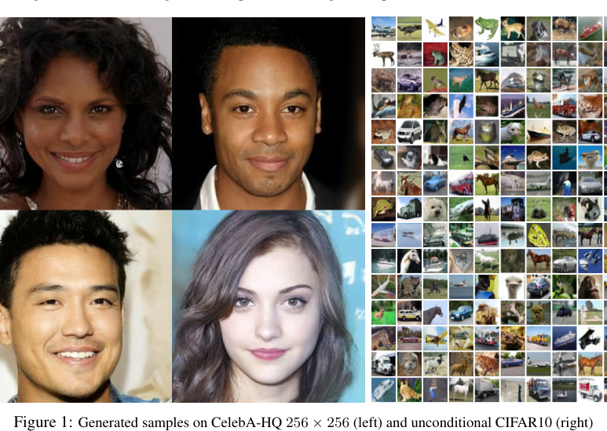

The figure displays two sets of image grids: a 2x2 grid of high-resolution human faces on the left and a large 10x10 grid of diverse, low-resolution objects (such as animals, vehicles, and landscapes) on the right. It conveys the quality and variety of images generated by the model on the CelebA-HQ and CIFAR-10 datasets.

**High-Resolution Image Synthesis with Latent Diffusion Models** — arXiv:2112.10752 p.1

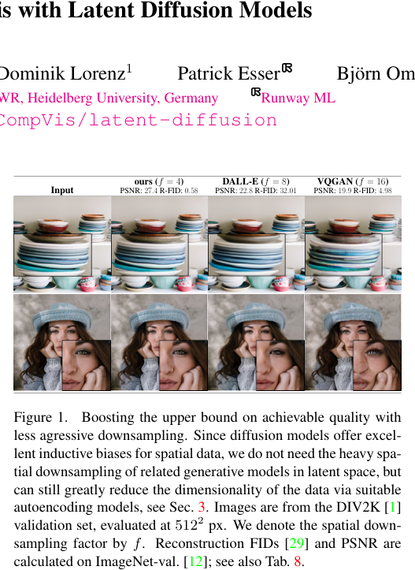

The figure presents a comparison of image synthesis quality across three models (ours with $f=4$, DALL-E with $f=8$, and VQGAN with $f=16$) alongside an input image. Each model's output is displayed in a grid with corresponding performance metrics (PSNR and R-FID) labeled above each column. The figure conveys that lower spatial downsampling factors ($f$) lead to higher PSNR and lower R-FID, indicating superior image reconstruction and synthesis quality.

**Make-A-Video: Text-to-Video Generation without Text-Video Data** — arXiv:2209.14792 p.2

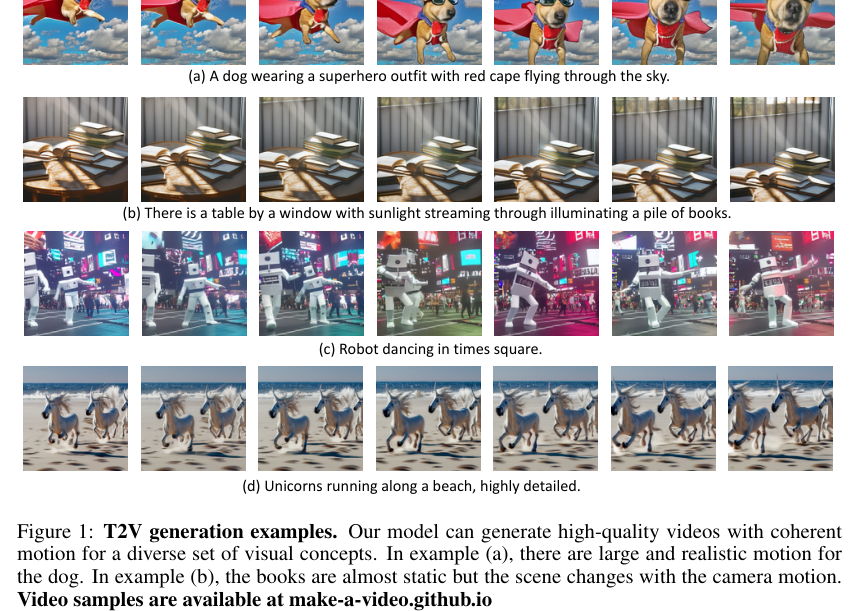

This figure displays four rows of image sequences, labeled (a) through (d), representing video frames generated from text prompts. Each row illustrates a different visual concept—a flying superhero dog, a pile of books in sunlight, a dancing robot, and running unicorns—to demonstrate the model's ability to produce coherent motion and high-quality video generation.

**Learning Transferable Visual Models From Natural Language Supervision** — arXiv:2103.00020 p.2

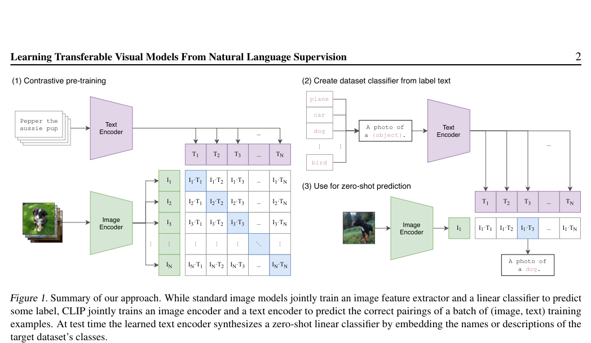

The figure illustrates the CLIP framework through three panels: (1) a contrastive pre-training process showing an image and text being passed through respective encoders to produce a matrix of similarity scores between $N$ image and text embeddings; (2) the creation of a dataset classifier by passing label text through a text encoder to generate class embeddings; and (3) zero-shot prediction where an image is encoded and compared against the previously generated class embeddings. The diagram uses boxes to represent data (images, text, and matrices) and encoders, with arrows indicating the flow of information through the model components.

**Imagen Video: High Definition Video Generation with Diffusion Models** — arXiv:2210.02303 p.1

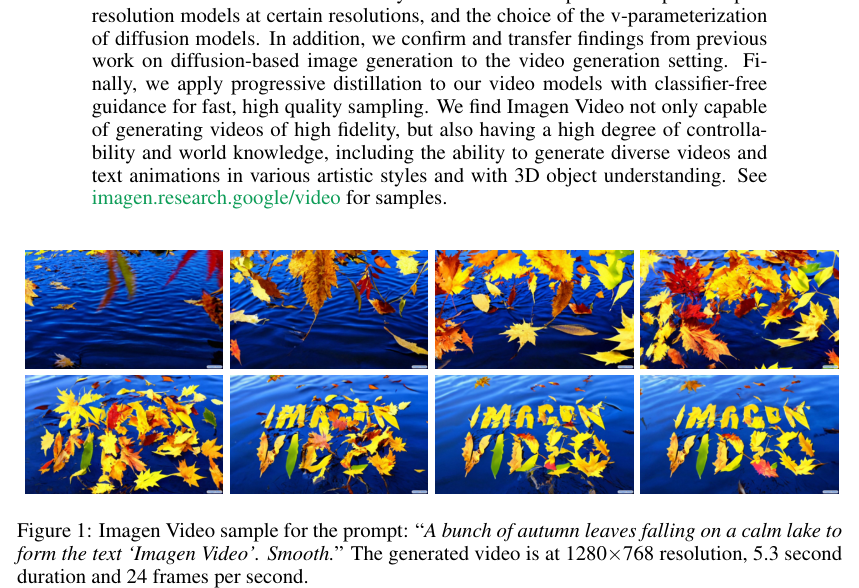

The figure displays a grid of eight video frames showing autumn leaves falling onto a blue lake. The frames progress from a scene of scattered leaves to a sequence where the leaves coalesce to form the text "IMAGEN VIDEO."

**Align your Latents: High-Resolution Video Synthesis with Latent
  Diffusion Models** — arXiv:2304.08818 p.1

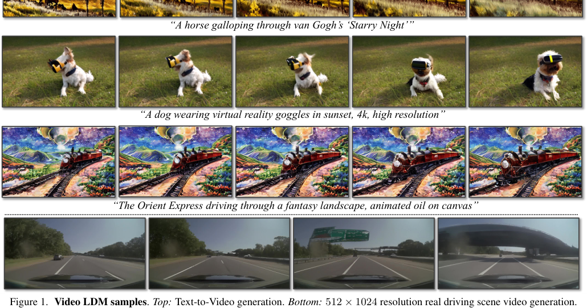

The figure displays two rows of video frame sequences generated from text prompts. The top row shows three sequences of a horse in a Van Gogh style and a dog wearing VR goggles, while the bottom row shows a sequence of an animated oil painting of a train and a real-world driving scene.

**Video Diffusion Models** — arXiv:2204.03458 p.3

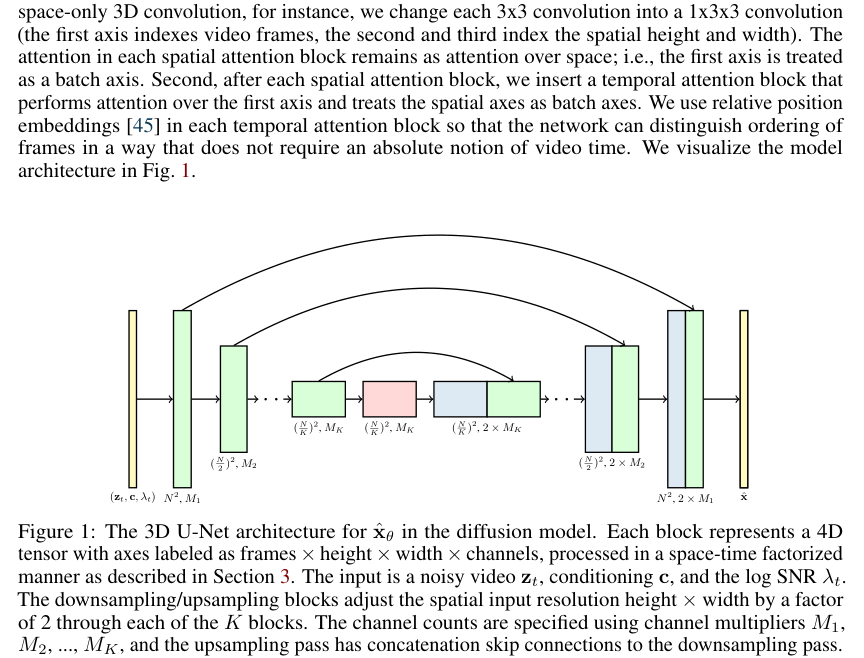

The figure depicts a 3D U-Net architecture consisting of a sequence of colored rectangular blocks connected by arrows, representing a downsampling encoder path followed by an upsampling decoder path. The blocks are labeled with dimensions in the format of frames $\times$ height $\times$ width $\times$ channels, and curved arrows indicate concatenation skip connections from the encoder blocks to the corresponding decoder blocks. The diagram conveys the flow of a noisy video $\mathbf{z}_t$, conditioning $\mathbf{c}$, and log SNR $\lambda_t$ through a space-time factorized processing pipeline to produce an output $\hat{\mathbf{x}}_\theta$.

**Denoising Diffusion Implicit Models** — arXiv:2010.02502 p.2

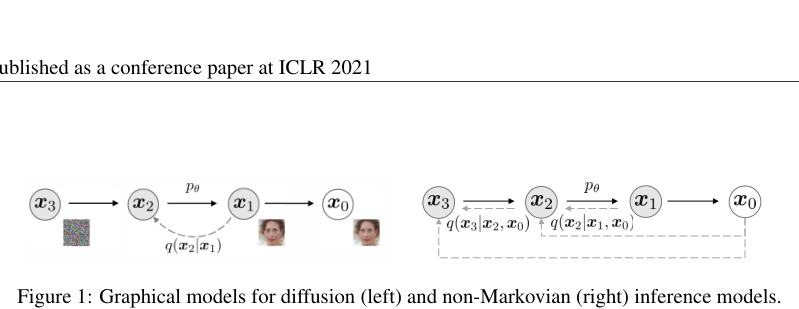

The figure displays two sequences of directed nodes, $x_3$ through $x_0$, connected by arrows to represent probabilistic graphical models. The left model shows a Markovian diffusion process with sequential arrows between adjacent nodes, while the right model shows a non-Markovian inference process where nodes are connected by both sequential arrows and dashed arrows representing conditional distributions $q(x_3|x_2, x_0)$ and $q(x_2|x_1, x_0)$.

**Efficient Video Diffusion Models: Advancements and Challenges** — arXiv:2604.15911 p.2

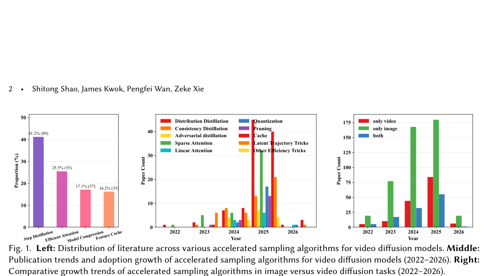

The figure consists of three bar charts showing trends in accelerated sampling algorithms. The left chart shows the proportion of literature across different methods, with "Step Distillation" being the most prevalent at 41.2%; the middle chart displays the annual publication count for various specific algorithms from 2022 to 2026, showing a significant peak in 2025; and the right chart compares the growth of paper counts for "only video," "only image," and "both" tasks over the same period.

**FrameDiT: Diffusion Transformer with Matrix Attention for Efficient Video Generation** — arXiv:2603.09721 p.2

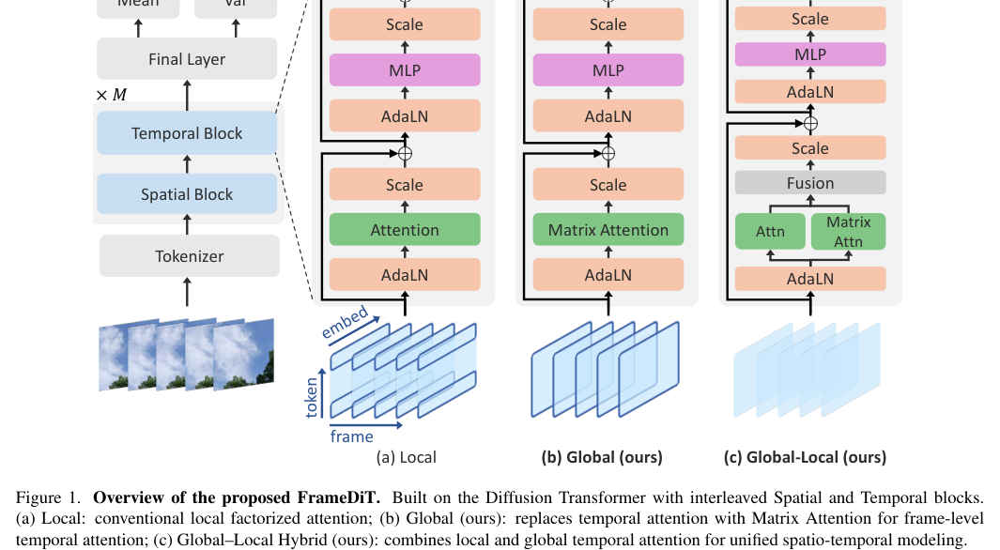

The figure illustrates the architecture of FrameDiT, transitioning from a high-level block diagram of a Diffusion Transformer to three detailed block configurations: (a) Local, (b) Global, and (c) Global-Local Hybrid. The diagrams use colored boxes to represent functional components like AdaLN, Attention/Matrix Attention, MLP, and Scale, connected by arrows to show data flow. The figure conveys how the proposed "Global" method replaces standard attention with Matrix Attention for frame-level modeling and how the "Global-Local Hybrid" combines both attention types for unified spatio-temporal modeling.

**VideoAR: Autoregressive Video Generation via Next-Frame & Scale Prediction** — arXiv:2601.05966 p.1

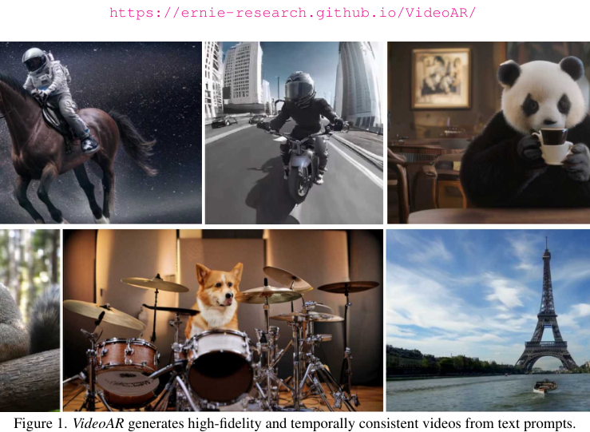

The figure consists of a grid of six sample video frames generated from text prompts. These images depict various scenes, including an astronaut riding a horse, a person on a motorcycle, a panda drinking coffee, a dog behind a drum kit, and the Eiffel Tower. The figure conveys the model's ability to generate high-fidelity and visually diverse video content.

**Motion-Adaptive Temporal Attention for Lightweight Video Generation with Stable Diffusion** — arXiv:2603.17398 p.3

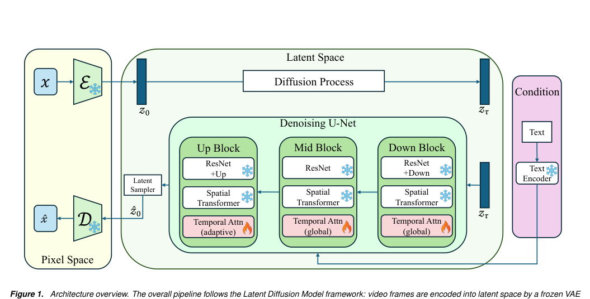

This diagram illustrates a Latent Diffusion Model architecture consisting of a Pixel Space, a Latent Space, and a Condition module. The pipeline shows video frames ($x$) being encoded into latent space ($z_0$) via an encoder ($\mathcal{E}$), undergoing a diffusion process to reach $z_\tau$, and being decoded back to $\hat{x}$ via a decoder ($\mathcal{D}$). The Denoising U-Net within the latent space is composed of Down, Mid, and Up blocks, each containing ResNet, Spatial Transformer, and Temporal Attention layers, with the latter being "adaptive" in the Up Block and "global" in the others.

**Dynamic Video Generation: Shaping Video Generation Across Time and Space** — arXiv:2605.21042 p.1

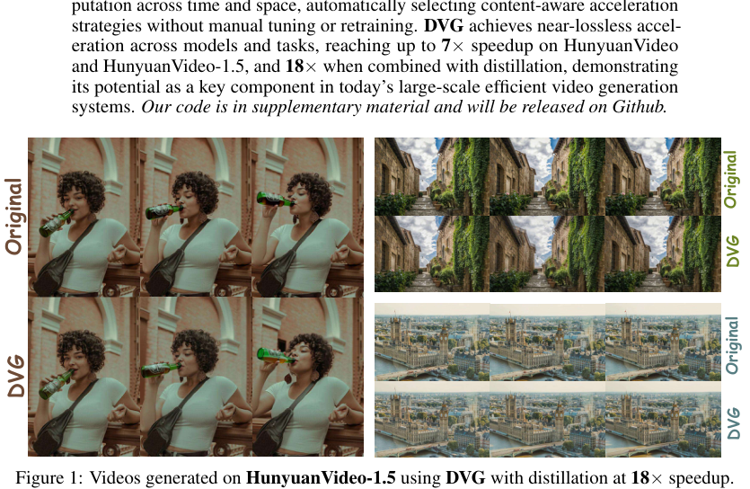

The figure presents a comparison of video sequences generated by the "Original" model and the "DVG" model, organized into two main panels. The left panel shows a sequence of frames of a woman drinking from a bottle, while the right panel shows two sets of sequences depicting a garden path and a cityscape. The figure conveys that the DVG method, when used with distillation at 18× speedup, produces video results visually consistent with the original model.

**LIVE: Long-horizon Interactive Video World Modeling** — arXiv:2602.03747 p.1

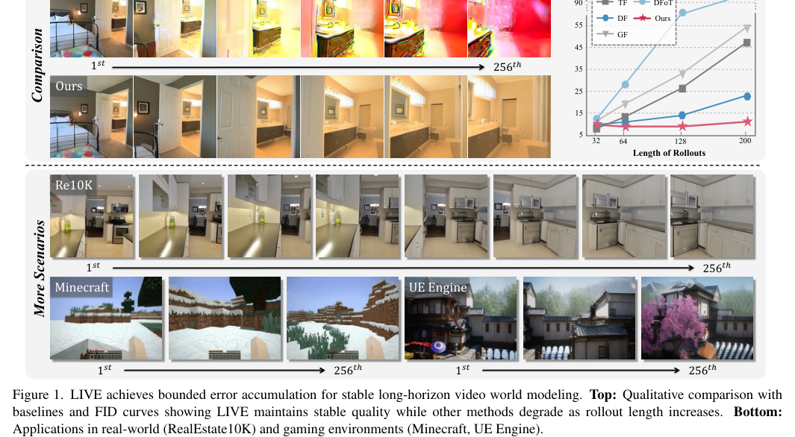

The figure consists of several panels comparing video generation quality across different rollout lengths. The top panel shows qualitative sequences of frames from baseline models that rapidly degrade into color distortions, contrasted with the "Ours" sequence which maintains visual stability, alongside a line graph plotting FID scores against rollout length to quantitatively demonstrate lower error accumulation. The bottom panel displays qualitative results of the proposed model applied to diverse scenarios, including RealEstate10K, Minecraft, and UE Engine, showing stable video generation up to the 256th frame.
