*deep research · 3 round(s) · 160 landmarks · frontier≥2023: 81 · 4 full-PDF critiques · grounded 67 · off-digest 0*

# The Evolution of Video Synthesis: From Generative Foundations to Large-Scale Diffusion Transformers

The pursuit of high-fidelity video synthesis represents one of the most significant challenges in modern artificial intelligence, requiring models to master not only spatial composition but also the intricate complexities of temporal coherence. While image generation has reached remarkable levels of realism, video generation demands the simultaneous management of motion dynamics, object persistence, and long-range dependencies across the time dimension. As the demand for automated content creation grows across industries such as film, gaming, and digital media, the ability to generate controllable, high-resolution, and temporally consistent video sequences has become a central objective of generative research.

This review traces the technological trajectory that has led to the current state of the art, beginning with the fundamental principles established in the foundations of generative modeling and diffusion. We first examine the landscape prior to the diffusion revolution, characterized by early video generation and GAN-based approaches that often struggled with training stability and sample diversity. The narrative then follows the pivotal transition to latent video diffusion and text-to-video frameworks, which fundamentally altered the capacity for high-resolution synthesis by operating in compressed latent spaces. We further explore the technical nuances of temporal modeling, control, and video editing, addressing how researchers have moved beyond simple motion to achieve precise manipulation of cinematic elements. Finally, the review concludes by examining the current frontier: the rapid scaling to transformers and large-scale models that are redefining the boundaries of what is possible in video synthesis.

## Foundations of Generative Modeling and Diffusion

The evolution of generative modeling has progressed from early variational frameworks and adversarial games to the current dominance of diffusion-based architectures. Early foundational work established the principles of approximate inference through the reparameterization of the variational lower bound in Variational Autoencoders (VAEs), which enabled optimization via stochastic gradient methods [arXiv:1312.6114]. While VAEs provided a structured approach to latent variables, they faced challenges regarding intractable posterior distributions and scaling to large datasets [arXiv:1312.6114]. To address the limitations of continuous latent spaces, VQ-VAE introduced discrete codes and an autoregressive prior to circumvent posterior collapse [arXiv:1711.00937].

Parallel to the variational approach, Generative Adversarial Networks (GANs) introduced a minimax two-player game between a generator and a discriminator [arXiv:1406.2661]. Unlike VAEs, GANs capture data distributions without relying on Markov chains or unrolled approximate inference [arXiv:1406.2661]. This framework was further refined by style-based architectures that enabled the unsupervised separation of high-level attributes and stochastic variation [arXiv:1812.04948]. However, the field eventually shifted toward diffusion processes, which draw inspiration from non-equilibrium statistical physics [arXiv:1503.03585].

Diffusion models operate by learning a reverse process to restore structure destroyed during a forward diffusion process [arXiv:1503.03585]. This line of research was significantly advanced by Denoising Diffusion Probabilistic Models (DDPMs), which established a connection between diffusion and denoising score matching using a weighted variational bound [arXiv:2006.11239]. While DDPMs provided high-quality synthesis, they were computationally expensive due to their iterative nature. This was addressed by Denoising Diffusion Implicit Models (DDIMs), which introduced non-Markovian processes to allow for faster sampling and latent space interpolation [arXiv:2010.02502]. Furthermore, the field was unified through the use of Stochastic Differential Equations (SDEs), providing a framework that encompasses both score-based modeling and neural ODEs [arXiv:2011.13456].

The superiority of diffusion models over GANs was empirically demonstrated through the introduction of classifier guidance, which allows for a controlled trade-off between diversity and fidelity [arXiv:2105.05233]. Despite these gains, pixel-based diffusion models remain computationally intensive [arXiv:2112.10752]. A significant breakthrough in addressing this cost was the development of Latent Diffusion Models (LDMs). By decoupling perceptual compression—handled by a pretrained autoencoder—from semantic generation, LDMs perform diffusion within a latent space [arXiv:2112.10752]. This architectural shift significantly reduces computational complexity while maintaining high-resolution detail and enabling flexible conditioning through cross-attention layers [arXiv:2112.10752].

## Early Video Generation and GAN-based Approaches

Early video generation research was heavily shaped by the evolution of datasets and the development of Generative Adversarial Networks (GANs). Initial efforts were often constrained by the paucity of video data in existing datasets like UCF101 (arXiv:1212.0402), which suffered from cluttered backgrounds and unconstrained camera motion, making it difficult to identify superior architectures. This limitation prompted the introduction of larger, more diverse datasets such as Kinetics (arXiv:1705.07750) to facilitate more robust model training.

The GAN-based era saw significant architectural progression aimed at managing temporal dynamics. Early models focused on learning scene dynamics by untangling foreground from background (arXiv:1609.02612) or utilizing recurrent frameworks for time-lapse prediction (arXiv:1608.07724). To address the inherent instability of training advanced GANs, TGAN (arXiv:1611.06624) introduced a dual-generator structure—comprising a temporal and an image generator—alongside a novel singular value clipping method. This conceptual focus on decomposition was further refined by MoCoGAN (arXiv:1707.04993), which explicitly separated video into fixed content and stochastic motion components using both image and video discriminators, offering a more structured approach than the purely spatio-temporal convolutional architectures of earlier models (arXiv:1609.02612). 

Despite these advancements, GANs faced persistent challenges regarding temporal coherence and scaling. Models often struggled with temporal artifacts, such as "freezing" or "looping," which were addressed by reformulating generation as a Markov Decision Process to represent motion as a stochastic process (arXiv:1909.12400). Scaling to higher resolutions also presented computational hurdles; while some researchers utilized a stack of small sub-generators to achieve memory-efficient training (arXiv:1811.09245), others, such as DVD-GAN (arXiv:1907.06571), focused on using decomposed discriminator architectures to scale to longer and higher-resolution videos.

The field eventually transitioned toward transformer-based and diffusion-based paradigms. Transformer models like VideoGPT (arXiv:2104.10157) leveraged VQ-VAE and axial self-attention to model discrete latent representations, while MAGVIT (arXiv:2212.05199) introduced 3D tokenization for multi-task synthesis. Parallel to this, the success of text-conditional diffusion models in image synthesis, such as GLIDE (arXiv:2112.10741) which demonstrated the superiority of classifier-free guidance, paved the way for direct video applications. MCVD (arXiv:2205.09853) demonstrated the versatility of diffusion by using random masking to enable a single model to perform prediction, generation, and interpolation. Finally, MagicVideo (arXiv:2211.11018) optimized this by employing a 3D U-Net in a low-dimensional latent space, achieving a 64x reduction in FLOPs compared to previous video diffusion models while maintaining high resolution.

## Transition to Latent Video Diffusion and Text-to-Video

The evolution of video generation has shifted from direct pixel-space modeling toward latent-space frameworks to mitigate the high computational demands of high-dimensional video data [arXiv:2211.13221]. Early methodologies, such as those extending standard image diffusion architectures through joint training on image and video data [arXiv:2204.03458], laid the groundwork for temporal extension. However, the field has increasingly moved toward leveraging pre-trained Text-to-Image (T2I) models to bypass the scarcity of paired text-video datasets. For instance, Make-A-Video [arXiv:2209.14792] translates T2I progress to text-to-video (T2V) by learning motion from unsupervised footage, while Tune-A-Video [arXiv:2212.11565] employs a one-shot tuning strategy using spatio-temporal attention and DDIM inversion for structural guidance.

A significant breakthrough in efficiency and fidelity is the adoption of Latent Diffusion Models (LDMs). Align Your Latents [arXiv:2304.08818] extends pre-trained image LDMs by introducing temporal dimensions to the latent space, a strategy further refined by Stable Video Diffusion [arXiv:2311.15127], which utilizes a three-stage training process (T2I pretraining, video pretraining, and high-quality finetuning) and systematic data curation. While these models excel at high-fidelity generation, long-form video remains a challenge. Latent Video Diffusion Models [arXiv:2211.13221] address this via hierarchical diffusion in a 3D latent space to generate videos exceeding 1,000 frames, though they face error accumulation during long sequences. To combat this, NUWA-XL [arXiv:2303.12346] proposes a "diffusion over diffusion" coarse-to-fine strategy, using global diffusion for keyframes and local diffusion for interpolation.

The architectural backbone is also undergoing a transition from U-Nets to Transformers. While traditional models rely on spatial-temporal U-Nets [arXiv:2209.14792], Scalable Diffusion Models with Transformers (DiT) [arXiv:2212.09748] demonstrate that replacing the U-Net with a transformer operating on latent patches allows for significant scalability in depth and width. This transformer-based approach is further advanced by W.A.L.T [arXiv:2312.06662], which utilizes a causal encoder and window attention for efficient spatio-temporal modeling.

Finally, the field has branched into specialized tasks such as video editing and control. Methods like FateZero [arXiv:2303.09535] and Pix2Video [arXiv:2303.12688] enable zero-shot editing by manipulating attention maps or injecting features from anchor frames. However, achieving fine-grained control remains difficult; DragNUWA [arXiv:2308.08089] attempts to integrate trajectories for better precision, noting that existing works often lack sufficient control granularity. To evaluate these diverse advancements, VBench [arXiv:2311.17982] provides a hierarchical benchmark across 16 dimensions, addressing the limitation that standard metrics often fail to align with human perception of motion smoothness and temporal consistency.

## Temporal Modeling, Control, and Video Editing

The evolution of video diffusion models is characterized by a shift from adapting image-based architectures to developing specialized spatiotemporal frameworks. Early zero-shot approaches, such as Text2Video-Zero, sought to bypass training by enriching latent codes with motion dynamics and reprogramming frame-level self-attention into cross-frame attention on the first frame [arXiv:2303.13439]. Similarly, Rerender A Video achieves zero-shot video-to-video translation by adapting image models through key frame translation and temporal-aware propagation [arXiv:2306.07954]. While these methods avoid the high computational expense and scarcity of billion-scale video datasets [arXiv:2305.10474], they often struggle with temporal consistency regarding shapes, textures, and colors [arXiv:2306.07954].

To address these consistency issues, several methodologies propose structural changes to the diffusion process. TokenFlow enforces consistency in the diffusion feature space by propagating features based on inter-frame correspondences [arXiv:2307.10373], while Lumiere utilizes a Space-Time U-Net to generate the entire temporal duration in a single pass, aiming for global temporal consistency [arXiv:2412.04929]. In contrast to single-pass generation, the Vectorized Timestep Approach introduces a vectorized timestep variable (VTV), allowing each frame to follow an independent noise schedule to capture fine-grained dependencies [arXiv:2410.03160]. Efficiency remains a significant bottleneck due to the quadratic complexity of attention layers [arXiv:2403.07711]. This has led to the adoption of Latent Diffusion Transformers (Latte) [arXiv:2401.03048] and the use of bidirectional State-Space Models (SSMs) to replace attention with linear-time temporal feature extractors [arXiv:2403.07711].

Control and compositionality represent another critical frontier. VideoTetris introduces spatio-temporal compositional diffusion to manipulate attention maps, addressing the difficulty of generating videos with multiple dynamic objects [arXiv:2406.04277]. For more efficient synthesis, Content-Motion Latent Diffusion Models (CMD) decompose video into a content frame and a low-dimensional motion latent [arXiv:2403.14148], while Grid Diffusion Models represent video as a grid image to enable the application of image-based methods with fixed GPU memory [arXiv:2404.00234].

Finally, the field is moving toward large-scale foundation models. HunyuanVideo represents a systematic scaling effort, utilizing over 13 billion parameters and integrated data curation [arXiv:2412.03603]. This contrasts with earlier efforts like VideoCrafter2, which focused on overcoming data limitations by leveraging low-quality videos and synthesized high-quality images to shift distributions without losing motion [arXiv:2401.09047]. Together, these advancements demonstrate a transition from simple temporal extensions of image models toward complex, high-parameter architectures capable of unified spatiotemporal modeling.

## Scaling to Transformers and Large-Scale Models

The transition toward the Diffusion Transformer (DiT) paradigm has enabled a significant scaling of video generation capabilities, moving from localized attention mechanisms to massive, high-capacity foundation models. At the forefront of this scaling, Movie Gen utilizes a 30B parameter transformer with a massive 73K video token context length to achieve high-quality 1080p HD video generation [arXiv:2410.13720]. This extreme scale contrasts with the Wan suite, which provides scalable pre-training through 1.3B and 14B parameter models [arXiv:2503.20314], and CogVideoX, which introduces an "expert transformer" utilizing expert adaptive LayerNorm and a 3D VAE for spatial-temporal compression [arXiv:2408.06072]. While these models push the boundaries of generative capacity, Open-Sora focuses on architectural efficiency through a Spatial-Temporal Diffusion Transformer (STDiT) that decouples spatial and temporal attention, enabling 720p synthesis for durations up to 15s [arXiv:2412.20404].

However, scaling introduces severe computational bottlenecks, specifically the quadratic complexity of 3D Full Attention in DiTs [arXiv:2502.01776]. To mitigate these costs, several architectural and sampling-based strategies have emerged. Sparse VideoGen (SVG) addresses this by classifying attention heads into spatial and temporal groups via an online profiling strategy to leverage spatial-temporal sparsity [arXiv:2502.01776]. In contrast, the Pyramid Attention Broadcast (PAB) approach reduces redundancy by broadcasting attention outputs to subsequent steps in a pyramid style based on variance [arXiv:2408.12588]. For mobile-specific constraints, S2DiT introduces a "sandwich" design optimized via budget-aware dynamic programming to facilitate streaming video generation [arXiv:2601.12719]. Furthermore, FrameDiT attempts to resolve the trade-off between expensive Full 3D Attention and temporally limited Local Factorized Attention by utilizing Matrix Attention to process entire frames as matrices [arXiv:2603.09721].

Beyond computational efficiency, scaling requires addressing semantic and temporal stability. RepVideo identifies that unstable semantic representations and cumulative feature differences across layers can reduce temporal coherence, proposing a feature accumulation mechanism to enrich representations for the attention mechanism [arXiv:2501.08994]. This need for stability is echoed in recent surveys, which observe that current progress in long-horizon generation often relies heavily on "stability engineering" and "staged training" rather than unified algorithmic solutions [arXiv:2604.15911]. This suggests that while parameter scaling and attention optimization have advanced the field, a fundamental algorithmic solution for long-term consistency remains a critical open challenge [arXiv:2604.15911].

## Tensions and Open Problems

A primary tension in the literature concerns the architectural strategy for maintaining temporal coherence versus achieving high-resolution visual fidelity. Early approaches to long-form video generation often relied on time-agnostic VQGANs and time-sensitive architectures to bridge temporal gaps, as seen in arXiv:2204.03638; however, these methods have faced significant criticism regarding their ability to maintain structural consistency over extended durations. This critique is echoed by arXiv:2303.12346, which argues that such architectures struggle with the complexities of extremely long video generation, and by arXiv:2312.06662, which suggests that these older frameworks fail to meet the photorealistic standards achievable by modern diffusion-based models. Furthermore, while some researchers have attempted to resolve this by decoupling spatio-temporal components to leverage high-resolution image priors like SDXL (arXiv:2307.01952), as proposed in arXiv:2312.04483, the field remains divided on whether decoupling or integrated joint modeling provides the most robust path toward cinematic stability.

Another significant debate centers on the methodology for zero-shot video editing and translation. One school of thought emphasizes the fusion of cross-attention maps to preserve semantic content during text-guided transformations, a technique exemplified by the attention-fusing approach in arXiv:2303.09535. In contrast, more recent work such as arXiv:2306.07954 argues for a "rerendering" paradigm that offers superior zero-shot video-to-video translation by moving beyond simple attention manipulation. This tension is further complicated by the transition from image-centric editing to video-centric editing; for instance, while arXiv:2303.04761 seeks to extend the cross-attention control mechanisms originally developed for static image editing in arXiv:2208.01626 into the temporal domain, the inherent complexity of maintaining consistency across frames remains a persistent hurdle that simple attention-based steering has yet to fully resolve.

Finally, there is a growing disagreement regarding the efficiency and scalability of generative frameworks. Traditional diffusion models, such as the large-scale text-to-video generation approach in arXiv:2209.14792, have been critiqued for their heavy computational requirements and lack of probabilistic rigor, with arXiv:2302.07685 arguing for the necessity of projected latent spaces to better model video distributions. This push for efficiency is met with a variety of competing solutions: some researchers advocate for latent consistency models to accelerate sampling, as seen in arXiv:2312.09109, while others focus on optimizing the underlying transformer architectures. This conflict highlights a fundamental trade-off between the expressive power of massive, data-hungry models and the need for lightweight, real-time deployment in resource-constrained environments.

## Outlook

The frontier of video generation is rapidly shifting from heavy, offline synthesis toward real-time, interactive, and highly controllable streaming architectures. As the field moves beyond foundational diffusion models, the current trajectory suggests a convergence of Diffusion Transformers (DiTs) with autoregressive and motion-adaptive mechanisms to enable efficient, long-form content creation. Future research is expected to prioritize "editability" within the latent space—moving from simple prompting to precise temporal steering—and the development of highly compressed, mobile-ready generative models that do not sacrifice the photorealism required for professional-grade video production.

---

## Key Figures

**High-Resolution Image Synthesis with Latent Diffusion Models** — arXiv:2112.10752 p.1

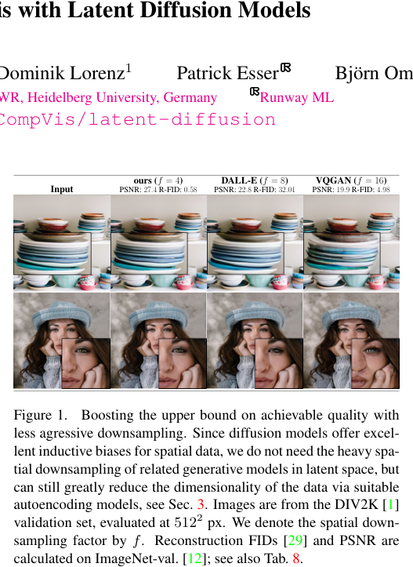

The figure presents a comparison of image synthesis quality across three models (ours, DALL-E, and VQGAN) using different spatial downsampling factors ($f$). It displays a grid of input images alongside reconstructed/generated outputs, accompanied by text labels indicating the downsampling factor, PSNR, and R-FID for each method. The figure conveys that the proposed model achieves higher image quality (higher PSNR and lower R-FID) by using a less aggressive downsampling factor.

**Denoising Diffusion Probabilistic Models** — arXiv:2006.11239 p.1

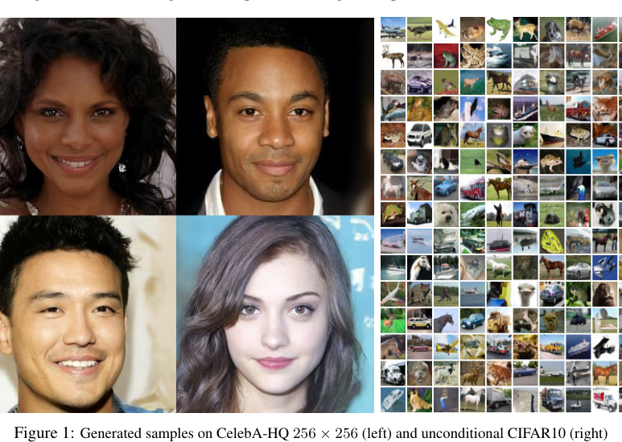

The figure displays two sets of image grids: a 2x2 grid of high-resolution human faces on the left and a large 10x10 grid of diverse, low-resolution objects (such as animals, vehicles, and landscapes) on the right. It conveys the quality and variety of images generated by the model on the CelebA-HQ and CIFAR-10 datasets.

**Learning Transferable Visual Models From Natural Language Supervision** — arXiv:2103.00020 p.2

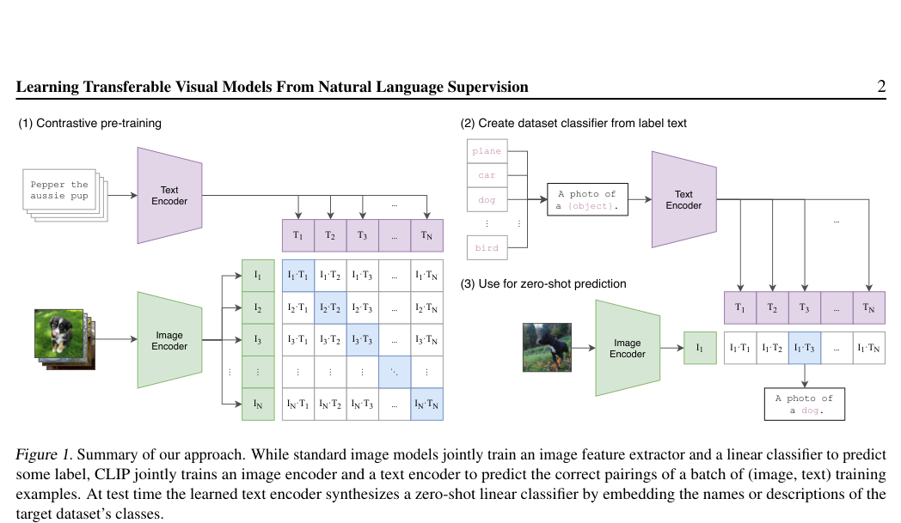

The figure illustrates the CLIP framework through three panels: (1) a contrastive pre-training stage showing an image and text being processed by respective encoders to produce a matrix of similarity scores between $N$ image and $N$ text embeddings; (2) the creation of a dataset classifier by passing label texts through a text encoder; and (3) zero-shot prediction where an image embedding is compared against the text embeddings of potential labels. The diagram uses boxes for data inputs and encoders, and arrows to represent the flow of information toward a similarity matrix.

**Denoising Diffusion Implicit Models** — arXiv:2010.02502 p.2

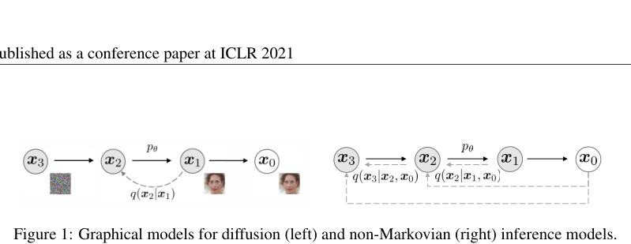

The figure displays two sequences of directed nodes, $x_3$ through $x_0$, connected by arrows to represent probabilistic dependencies. The left model shows a Markovian chain where each node $x_t$ depends only on $x_{t+1}$ (labeled $p_\theta$) or $x_{t-1}$ (labeled $q(x_t|x_{t+1})$), while the right model shows a non-Markovian process where $x_t$ depends on all subsequent states $x_{t+1}, \dots, x_0$ via dashed arrows. The figure conveys the structural difference between standard diffusion inference models and the proposed non-Markovian DDIM inference models.

**Make-A-Video: Text-to-Video Generation without Text-Video Data** — arXiv:2209.14792 p.2

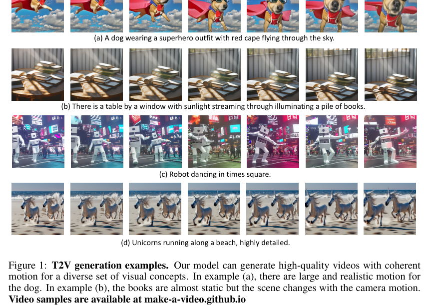

Figure 1 displays four rows of image sequences, labeled (a) through (d), representing video frames generated from text prompts. Each row illustrates a different visual concept—a flying superhero dog, a pile of books by a window, a dancing robot, and running unicorns—to demonstrate the model's ability to produce coherent motion and high-quality video generation.

**Imagen Video: High Definition Video Generation with Diffusion Models** — arXiv:2210.02303 p.1

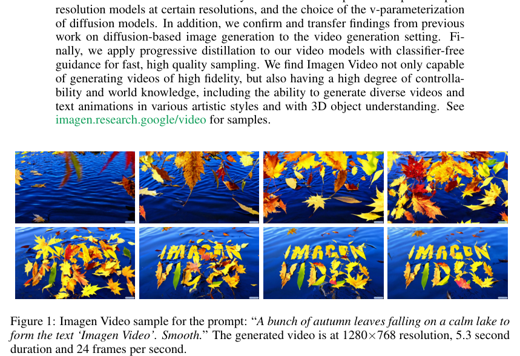

The figure displays a grid of eight video frames showing autumn leaves falling onto a blue lake. The sequence progresses from leaves scattered randomly on the water to leaves settling into a pattern that spells out the text "IMAGEN VIDEO."

**Video Diffusion Models** — arXiv:2204.03458 p.3

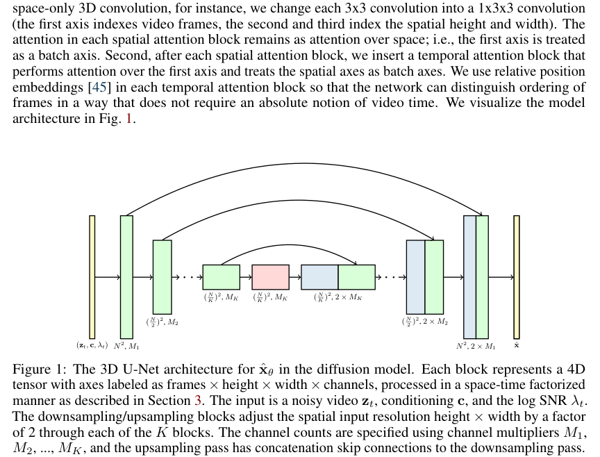

The figure depicts a 3D U-Net architecture consisting of a sequence of colored rectangular blocks connected by arrows, representing a downsampling path followed by an upsampling path. The blocks are labeled with dimensions in the format of frames $\times$ height $\times$ width $\times$ channels, and curved arrows indicate concatenation skip connections from the downsampling blocks to the corresponding upsampling blocks. The diagram conveys the hierarchical structure of the model, showing how spatial resolution is reduced through $K$ blocks and subsequently restored.

**Align your Latents: High-Resolution Video Synthesis with Latent
  Diffusion Models** — arXiv:2304.08818 p.1

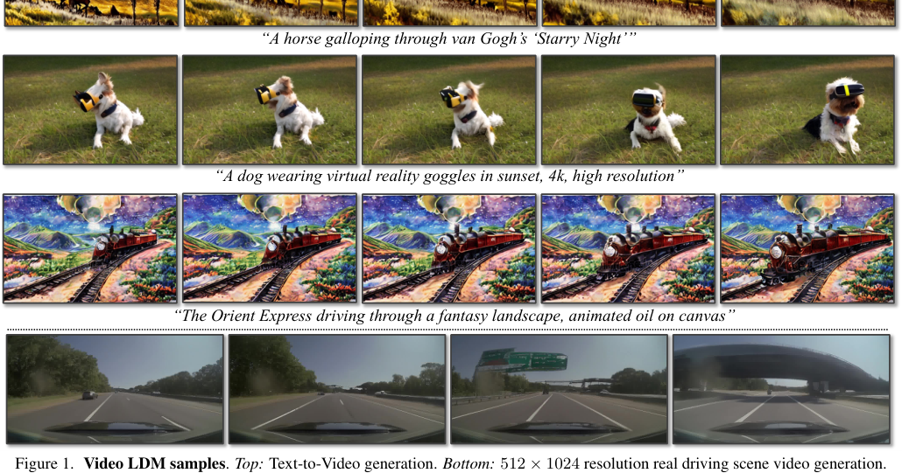

The figure displays two rows of video frame sequences generated from text prompts. The top row shows three examples of text-to-video generation—a horse in a Van Gogh style, a dog in VR goggles, and a train in a fantasy landscape—while the bottom row shows a sequence of high-resolution real driving scenes.

**Efficient Video Diffusion Models: Advancements and Challenges** — arXiv:2604.15911 p.2

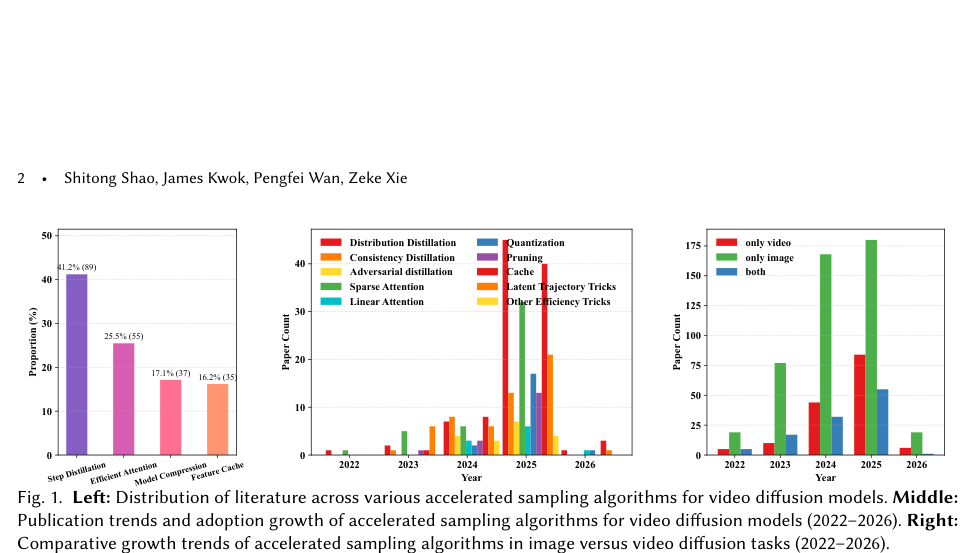

The figure consists of three bar charts showing the distribution and trends of accelerated sampling algorithms. The left chart shows the proportion of literature across different categories, with "Step Distillation" being the largest at 41.2%; the middle chart displays the annual publication count for various specific algorithms from 2022 to 2026; and the right chart compares the growth in paper counts for "only video," "only image," and "both" tasks over the same period.

**Image-to-Video Diffusion: From Foundations to Open Frontiers** — arXiv:2605.17248 p.1

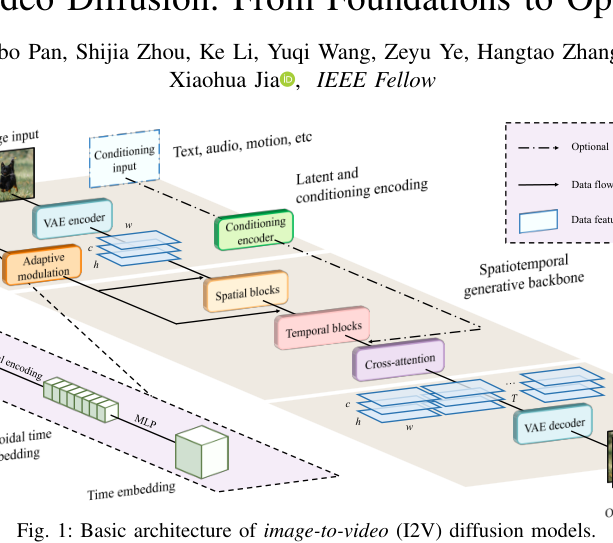

The figure illustrates the basic architecture of image-to-video (I2V) diffusion models through a series of interconnected blocks and data flow arrows. It depicts a spatiotemporal generative backbone composed of spatial blocks, temporal blocks, and cross-attention mechanisms that process latent and conditioning encodings (from text, audio, or motion inputs) alongside VAE-encoded image inputs. The diagram conveys how various conditioning signals and time embeddings are integrated into the generative process to produce video sequences.

**Motion-Adaptive Temporal Attention for Lightweight Video Generation with Stable Diffusion** — arXiv:2603.17398 p.3

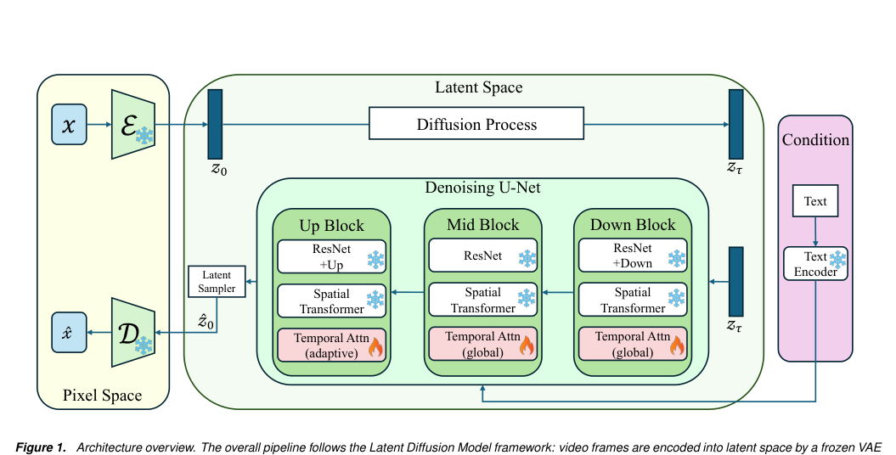

The figure illustrates a pipeline for video generation, showing the flow from Pixel Space (containing $x$ and $\hat{x}$) through an encoder $\mathcal{E}$ into a Latent Space. Within the Latent Space, a Diffusion Process operates on latents $z_0$ and $z_\tau$, while a Denoising U-Net—composed of Up, Mid, and Down Blocks—processes these latents using spatial transformers and temporal attention layers (adaptive or global) conditioned by a Text Encoder.

**FSVideo: Fast Speed Video Diffusion Model in a Highly-Compressed Latent Space** — arXiv:2602.02092 p.1

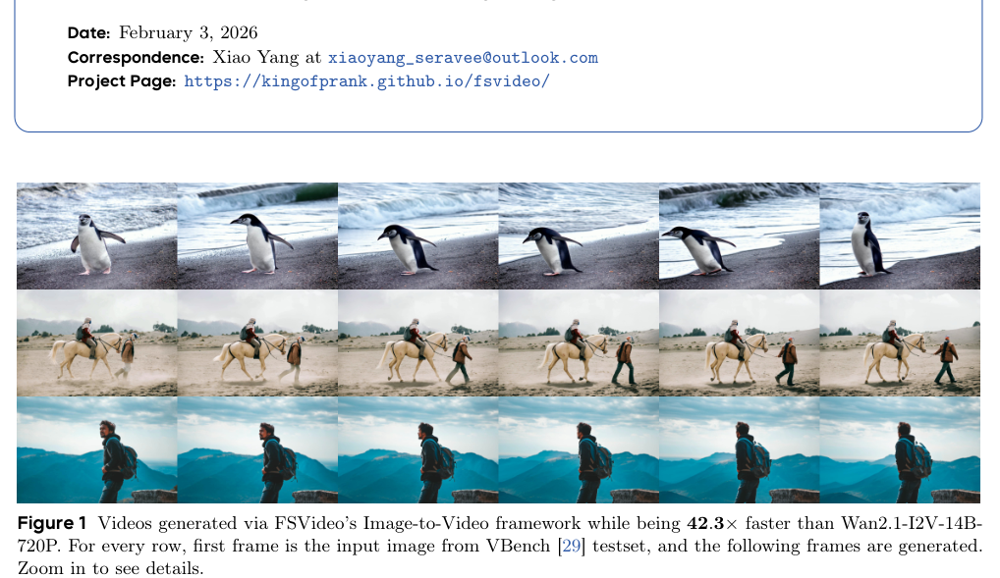

Figure 1 displays a grid of three rows, each containing a sequence of six images showing the temporal progression of a video. The rows depict a penguin walking on a beach, a person riding a horse, and a person walking in a landscape, illustrating the model's ability to generate subsequent video frames from an initial input image.

**FrameDiT: Diffusion Transformer with Matrix Attention for Efficient Video Generation** — arXiv:2603.09721 p.2

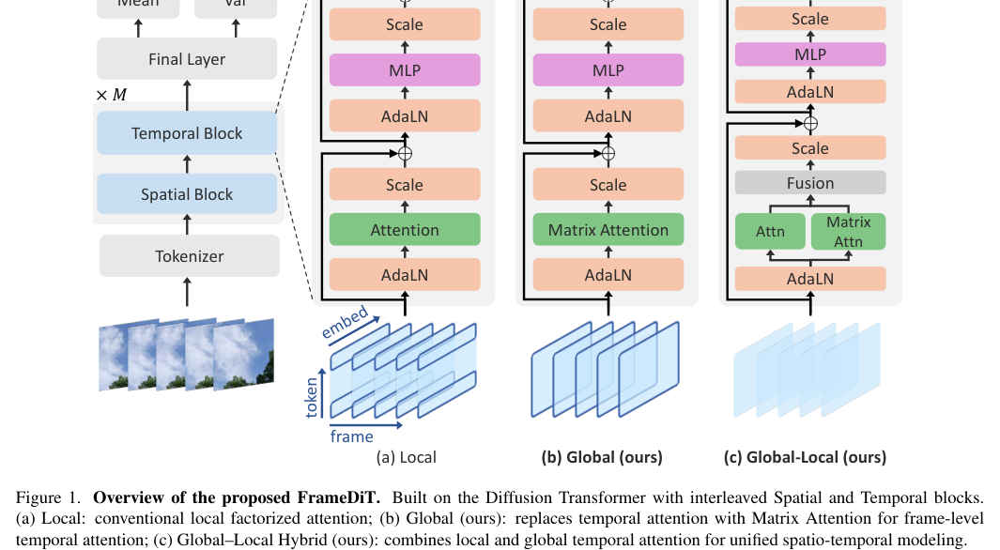

The figure presents a block diagram of the FrameDiT architecture, illustrating three different attention mechanisms: (a) a local factorized approach with standard attention, (b) a global approach using Matrix Attention, and (c) a hybrid approach combining both. Each sub-figure uses colored boxes to represent architectural components like AdaLN, MLP, and Scale layers, connected by arrows to show the data flow from input video frames through the transformer blocks.
