*deep research · 2 round(s) · 120 landmarks · frontier≥2020: 50 · 4 full-PDF critiques · grounded 50 · off-digest 1*

# The Evolution of Graph Neural Networks in Drug Discovery: From Topological Representations to Geometric Deep Learning

The discovery of novel therapeutic agents is a high-stakes, resource-intensive endeavor characterized by vast chemical search spaces and complex biological interactions. Traditional computational approaches often struggle to capture the non-Euclidean nature of molecular structures, which are defined by intricate connectivity and spatial arrangements rather than fixed grids. Graph Neural Networks (GNNs) have revolutionized this domain by providing a mathematical framework that treats molecules as graphs, where atoms and bonds are represented as nodes and edges. By building upon the foundations of graph and 3D deep learning, these models allow for the encoding of complex chemical information, transforming how researchers approach the fundamental challenges of molecular modeling and biological activity prediction.

This review traces the technological progression of GNNs in the pharmaceutical sciences, beginning with the transition from early molecular representation and property prediction to the more complex task of generative models for molecular graph design. We examine how the field has moved beyond simple connectivity to incorporate spatial awareness through geometric deep learning and equivariant architectures, which respect the physical symmetries of 3D molecular structures. The narrative then explores the application of these sophisticated models in advanced structure-based drug design and affinity prediction, focusing on the critical interaction between ligands and protein targets. Finally, we survey the current landscape, highlighting the shift toward large-scale pre-training and the emerging frontiers that are currently redefining the boundaries of AI-driven drug discovery.

## Foundations of Graph and 3D Deep Learning

The evolution of deep learning for non-Euclidean data relies on a convergence of architectural innovations ranging from generative modeling and residual learning to specialized graph-based operators. A foundational component in the generative landscape is the Auto-Encoding Variational Bayes framework (arXiv:1312.6114), which provides the probabilistic basis for latent variable modeling. While not a graph-specific architecture, its influence is pervasive, serving as a prerequisite for various subsequent generative models used in molecular and structural modeling (arXiv:1611.07308; arXiv:1801.07829).

The transition from grid-like Euclidean data to irregular structures necessitated the adaptation of deep learning principles. The concept of deep residual learning (arXiv:1512.03385), originally designed to mitigate degradation in image recognition tasks like ImageNet classification, provided the structural depth necessary for complex feature extraction. This principle of residual connections is frequently leveraged in more complex architectures to ensure stable gradient flow. Building upon these foundations, the field shifted toward geometric deep learning (arXiv:1611.08097), which formalizes the extension of neural networks to graphs and manifolds, moving beyond the constraints of traditional Euclidean domains.

The development of Graph Neural Networks (GNNs) can be viewed as a progression of increasing expressive power and flexibility. Early work established Graph Convolutional Networks (GCNs) (arXiv:1609.02907), which utilize a localized first-order approximation of spectral graph convolutions for semi-supervised classification. While effective on citation and knowledge graphs, GCNs are often limited by their fixed aggregation mechanism. This limitation is addressed by Graph Attention Networks (GAT) (arXiv:1710.10903), which extend the GCN framework by incorporating masked self-attentional layers. By allowing nodes to assign different weights to different neighbors, GAT provides a more nuanced mechanism for node classification, as demonstrated on protein-protein interaction datasets.

Further advancements addressed the scalability and inductive capabilities of these models. GraphSAGE (arXiv:1706.02216) moved away from transductive settings by introducing a sampling and aggregation approach, enabling inductive node classification on large-scale graphs such as Reddit and protein-protein multi-graphs. While GCN and GAT focus on the mechanism of neighborhood interaction, the Graph Isomorphism Network (GIN) (arXiv:1810.00826) focuses on the theoretical limits of these architectures. By analyzing graph structure discrimination, GIN demonstrates that the expressive power of GNNs is tied to their ability to distinguish non-isomorphic graph structures, providing a benchmark for how "powerful" a GNN can truly be in graph classification tasks. Together, these developments form a hierarchy of complexity, from basic spectral approximations to sophisticated, attention-driven, and theoretically optimized structural learners.

## Early Molecular Representation and Property Prediction

The evolution of molecular representation in drug discovery has transitioned from large-scale multitask learning to specialized geometric and graph-based architectures. Early efforts focused on scaling predictive power through massive datasets. For instance, arXiv:1502.02072 demonstrated the utility of multitask networks by predicting measurements across more than 200 biological targets using a dataset of nearly 40 million measurements. While effective for broad property prediction, this approach differs from structure-based methods like AtomNet (arXiv:1510.02855), which utilizes 3D structural target information to predict the bioactivity of small molecules, evaluated via AUC on the DUDE benchmark.

A significant shift occurred with the move toward explicit molecular topology. arXiv:1603.00856 introduced molecular graph convolutions, moving beyond traditional fingerprints by representing molecules as undirected graphs containing atoms, bonds, and distances. This graph-centric approach provided a more nuanced representation than previous multitask or 3D-convolutional methods. The necessity for standardized evaluation of these diverse representations led to the development of MoleculeNet (arXiv:1703.00564), a curated benchmark of multiple public datasets designed to evaluate learnable representations and physics-aware featurizations across quantum mechanical and biophysical properties.

The literature further diverges based on whether the representation prioritizes topological connectivity or continuous 3D geometry. While graph convolutions (arXiv:1603.00856) focus on the discrete graph structure, SchNet (arXiv:1706.08566, arXiv:1712.06113) introduced continuous-filter convolutional neural networks to model atomistic systems. Unlike purely topological models, SchNet utilizes 3D atomic positions and continuous coordinates to predict quantum-mechanical properties, such as total energy, interatomic forces, and potential-energy surfaces. This distinction is critical: where graph-based models excel at ligand-based virtual screening, SchNet-style architectures are specialized for modeling the underlying physics of molecular interactions.

Recent analytical work has sought to bridge these methodologies by evaluating the efficacy of learned representations across diverse chemical endpoints. arXiv:1904.01561 conducted a rigorous analysis using a graph convolutional model across 19 public and 16 proprietary industrial datasets. By comparing these learned representations against established benchmarks like MoleculeNet (arXiv:1703.00564), this work provides a critical assessment of how well graph-based architectures generalize across the wide variety of chemical properties required for modern drug discovery. This progression highlights a trajectory from massive-scale multitask prediction toward highly specialized, physics-aware graph and geometric models.

## Generative Models for Molecular Graph Design

The evolution of generative modeling for drug discovery has transitioned from continuous latent space representations to sophisticated graph-structured architectures. Early approaches focused on mapping discrete molecular structures into a multidimensional continuous latent space to facilitate molecule generation and optimization of chemical properties [arXiv:1610.02415]. While effective for navigating chemical space, these methods often struggle with the discrete nature of chemical syntax. To address this, the Grammar Variational Autoencoder (GVAE) introduced a representation based on parse trees derived from context-free grammars [arXiv:1703.01925], shifting the focus toward ensuring molecular synthesis through more structured linguistic rules.

A significant advancement in maintaining structural integrity is the Junction Tree Variational Autoencoder (JT-VAE) [arXiv:1802.04364]. Unlike previous methods that might struggle with long-range dependencies or invalid valency, JT-VAE utilizes a graph message passing network to generate tree-structured scaffolds over chemical substructures. This hierarchical approach to molecular graphs allows for more robust generation compared to the purely string-based or latent-space methods seen in [arXiv:1610.02415] and [arXiv:1703.01925].

Parallel to the VAE-based lineage, Generative Adversarial Networks (GANs) and Reinforcement Learning (RL) have been adapted for graph-structured data. MolGAN [arXiv:1805.11973] employs an implicit generative model to produce 2D molecular graphs, utilizing RL to target specific desired chemical properties. While MolGAN achieves high validity—approaching 100% on the QM9 dataset—it represents a different paradigm of implicit generation compared to the explicit structural scaffolding of JT-VAE [arXiv:1802.04364].

The field has also seen the rise of goal-directed generation through policy networks. The Graph Convolutional Policy Network (GCPN) [arXiv:1806.02473] treats molecule generation as a reinforcement learning task, optimizing for drug-likeness, synthetic accessibility, and chemical valency. GCPN demonstrates significant utility in property optimization, showing improvements of 61% and 184% in specific metrics, and serves as a benchmark against earlier VAE models [arXiv:1610.02415; arXiv:1703.01925; arXiv:1802.04364].

More recently, flow-based autoregressive models like GraphAF [arXiv:2001.09382] have emerged to refine the efficiency and validity of graph generation. GraphAF offers a notable advantage in training speed, performing 2x faster than GCPN [arXiv:1806.02473]. Furthermore, while unconstrained generation in GraphAF yields a chemical validity of 68%, the integration of rules allows it to reach 100% validity, effectively bridging the gap between the high-speed autoregressive approach and the strict structural constraints required for practical chemical property optimization [arXiv:2001.09382].

## Geometric Deep Learning and Equivariant Architectures

The evolution of graph neural networks (GNNs) for drug discovery has increasingly shifted toward geometric deep learning, prioritizing architectures that respect the fundamental symmetries of 3D molecular structures. Central to this progression is the requirement for equivariance to rotations, translations, and permutations, ensuring that model predictions remain consistent regardless of a molecule's orientation in space.

Early foundational work in this domain, such as Tensor Field Networks (TFNs), introduced architectures locally equivariant to 3D rotations, translations, and permutations using 3D point clouds [arXiv:1802.08219]. While TFNs established a framework for geometry, physics, and chemistry tasks, subsequent research has sought to refine how these symmetries are implemented to balance computational efficiency with expressive power. For instance, E(n)-Equivariant Graph Neural Networks (EGNNs) extend these principles to include reflections, facilitating tasks ranging from dynamical systems modelling to molecular property prediction [arXiv:2102.09844].

A significant divergence in the literature exists regarding the specific mathematical representations used to achieve equivariance. Some approaches focus on geometric tensors to learn interatomic potentials, as seen in the E(3)-equivariant NequIP architecture [arXiv:2101.03164]. This specialized focus on interatomic potentials demonstrates the utility of high-order geometric representations for physical accuracy. In contrast, Geometric Vector Perceptrons (GVP) utilize Euclidean vectors to represent the 3D structures of large biomolecules [arXiv:2009.01411]. While NequIP targets the precision of atomic interactions, GVP is optimized for broader biological applications, such as model quality assessment and computational protein design [arXiv:2009.01411].

The application of these equivariant principles has moved beyond mere property prediction into the realm of generative modeling and structure-based design. Equivariant Diffusion Models (EDM) utilize E(3) equivariance to generate molecules in 3D by operating on continuous atom coordinates and categorical atom types [arXiv:2203.17003]. This represents a sophisticated leap from static representation learning to active molecular generation. Furthermore, the broader field of structure-based drug design leverages these geometric deep learning techniques to address complex challenges, including ligand binding site prediction, pose prediction, and de novo molecular design using the 3D geometric information of macromolecules like proteins and nucleic acids [arXiv:2210.11250].

In summary, while early architectures like TFNs [arXiv:1802.08219] provided the theoretical groundwork for equivariant point cloud processing, the field has branched into specialized implementations. These range from the tensor-heavy approaches used for interatomic potentials [arXiv:2101.03164] to the vector-based representations used for large-scale protein design [arXiv:2009.01411], ultimately enabling advanced generative workflows for 3D molecule construction [arXiv:2203.17003].

## Advanced Structure-Based Drug Design and Affinity Prediction

Recent advancements in graph neural networks (GNNs) for drug discovery have shifted from simple topological representations toward sophisticated models that integrate 3D geometric and structural information to predict binding affinities and generate novel ligands. A primary focus in the literature is the accurate prediction of protein-ligand binding affinity by capturing the complex spatial relationships within biomolecular complexes. For instance, the Structure-aware Interactive Graph Neural Network (SIGN) utilizes polar-inspired graph attention layers (PGAL) and pairwise interactive pooling (PiPool) to leverage 3D structural data, specifically atom-level distance and angle information, to enhance affinity prediction accuracy (arXiv:2107.10670). This emphasis on structural awareness is furthered by DeepGGL, which employs a geometric graph-based approach using deep convolutional neural networks with residual connections and multiscale weighted colored bipartite subgraphs to model protein-ligand complexes (arXiv:2509.13476). While SIGN focuses on interactive pooling mechanisms, DeepGGL utilizes multiscale bipartite subgraphs to achieve its predictions across diverse benchmark datasets such as PDBbind v2019 and CASF-2016 (arXiv:2509.13476).

The field has also transitioned from affinity prediction to generative tasks, where the goal is to design molecules that fit specific protein pockets. Pocket2Mol represents a significant step in this direction by employing an E(3)-equivariant generative network that captures both spatial and chemical bonding relationships to sample molecules directly within 3D protein pockets (arXiv:2205.07249). This generative capability is extended by the use of SE(3)-equivariant diffusion models, which facilitate 3D-conditional molecule generation by modeling the structural data of both ligand atoms and protein pockets (arXiv:2210.13695). Both approaches prioritize equivariance to ensure that the generated molecular structures remain physically consistent under spatial transformations, a critical requirement for structure-based drug design.

However, a tension exists between the complexity of geometric modeling and the need for interpretability and scalability. While geometric GNNs provide high-fidelity representations of all-atom information (arXiv:2410.21683), they can be computationally intensive. In contrast, the Sparse Learning to Graph Neural Network (SLGNN) addresses the need for explainability in drug-protein binding prediction by using a generalized fused lasso with message-passing algorithms on chemical-substructure-based graphs (arXiv:2309.12906). Unlike the all-atom geometric models that prioritize spatial precision, SLGNN optimizes for sparsity to provide more interpretable insights into binding interactions. Furthermore, the push toward scaling these models is evidenced by research into all-atom Geometric GNNs (Geom-GNNs) that explore self-supervised pre-training and zero-shot transfer for predicting interatomic potentials and molecular properties (arXiv:2410.21683), suggesting a trajectory toward more generalized and robust geometric deep learning frameworks.

## Current Frontiers: Large-Scale Pre-training and Surveying the Landscape

The current landscape of Graph Neural Networks (GNNs) in drug discovery is characterized by a transition from narrow property prediction toward multifaceted generative frameworks and systemic biological modeling. Recent surveys illustrate this expanding breadth: arXiv:2506.01302 focuses on the intersection of molecule generation, property prediction, and drug-drug interaction (DDI) [arXiv:2506.01302]. This is further expanded by arXiv:2506.06915, which incorporates virtual screening, synthesis planning, and the construction of biomedical knowledge graphs, while emphasizing the utility of geometric GNNs and interpretable models [arXiv:2506.06915]. Providing the most comprehensive task coverage, arXiv:2509.07887 extends the scope to include microbiome interaction prediction, drug repositioning, and retrosynthesis [arXiv:2509.07887].

Technological advancements in GNN architectures are simultaneously addressing the limitations of molecular representation. While some approaches focus on topological connectivity, arXiv:2411.07269 advances the field by utilizing molecular graphs that incorporate both atom-bond structures and precise atom positions [arXiv:2411.07269]. This approach leverages advanced high-order pooling functions and backbones capable of learning invariant and equivariant characteristics to improve graph representation learning [arXiv:2411.07269]. This emphasis on geometric precision and equivariance contrasts with the generative strategy proposed in arXiv:2406.03278, which utilizes invertible GNN property predictors to facilitate molecule generation [arXiv:2406.03278]. Rather than focusing on equivariant backbones, arXiv:2406.03278 optimizes for specific target properties, such as energy gaps (verified via DFT) and octanol-water partition coefficients (logP) [arXiv:2406.03278].

A critical tension exists between general representation learning and task-specific optimization. As the field moves toward more complex tasks—ranging from the synthesis planning noted in arXiv:2506.06915 to the drug-target binding affinity predictions discussed in arXiv:2509.07887—the architectural requirements are shifting toward more sophisticated frameworks [arXiv:2506.06915, arXiv:2509.07887]. Within this evolution, arXiv:2411.07269 provides a necessary critical intervention by addressing design issues and specifically critiquing the methodology of arXiv:2203.02923 [arXiv:2411.07269]. This highlights a growing movement to refine GNN design to better handle the geometric and structural complexities inherent in drug discovery [arXiv:2411.07269].

## Tensions and Open Problems

A primary tension in geometric deep learning concerns the optimal method for capturing local structure within unstructured point sets. Early approaches focused on global feature aggregation, as seen in the permutation-invariant architecture of PointNet (arXiv:1612.00593), which treats points as independent entities to achieve set-based classification. However, this global perspective often fails to capture fine-grained local geometry. While Kd-Networks (arXiv:1704.01222) attempt to bridge this gap by utilizing hierarchical spatial partitioning to better recognize complex shapes, they have been critiqued for lacking the sophisticated local feature refinement found in more advanced hierarchical models. Specifically, SpiderCNN (arXiv:1803.11527) argues that both Kd-Networks (arXiv:1704.01222) and PointNet++ (arXiv:1706.02413) struggle to maintain consistent local geometric information; SpiderCNN proposes parameterized convolutional kernels to provide a more robust alternative to the rigid hierarchical grouping used in PointNet++.

In the domain of molecular modeling, a significant debate persists regarding the most effective way to represent and generate graph-structured data. One school of thought emphasizes generative frameworks that optimize for specific chemical objectives, such as the Objective-Reinforced Generative Adversarial Networks (ORGAN) (arXiv:1705.10843). This approach is contested by proponents of more structured latent spaces, such as the Junction Tree Variational Autoencoder (JT-VAE) (arXiv:1802.04364), which argues that generating molecules atom-by-atom is inherently flawed and that representing molecules through chemically valid sub-structures is necessary for meaningful generation. This tension extends to the very design of the models: recent critiques suggest that even sophisticated geometric diffusion models, such as GeoDiff (arXiv:2203.02923), may suffer from fundamental design issues in how they interpret graph-structured data, necessitating a move toward more rigorous structural learning (arXiv:2411.07269).

Finally, there is a growing disagreement regarding the efficacy of standard message-passing architectures versus specialized structural descriptors for molecular property prediction. Traditional graph convolutional networks (arXiv:1509.09290) and early message-passing neural networks (arXiv:1704.01212) rely on local neighborhood aggregation to learn representations. However, recent comparative studies suggest these methods may be outperformed by models that explicitly incorporate continuous-filter convolutions (arXiv:1706.08566) or multilevel quantum interaction data (arXiv:1906.11081). The debate centers on whether the "intelligence" of a model should reside in the graph architecture itself or in the sophisticated integration of physical and structural similarity information (arXiv:2409.08580) to supplement the sparse connectivity of molecular graphs.

### Outlook

The frontier of the field is rapidly shifting from simple representation learning toward the integration of high-fidelity geometric constraints with generative intelligence. As we move toward 2026, the focus is crystallizing around the intersection of equivariant geometry and biological processes (arXiv:2602.20274), where models must not only predict properties but also respect the fundamental symmetries of physical space. The next generation of research will likely move beyond standard GNN architectures to embrace parameter-centric regression views (arXiv:2604.17762) and advanced geometric graph-based models (arXiv:2509.13476) that can bridge the gap between abstract graph topology and the complex, continuous reality of drug-target interactions.

---

## Key Figures

**Neural Message Passing for Quantum Chemistry** — arXiv:1704.01212 p.1

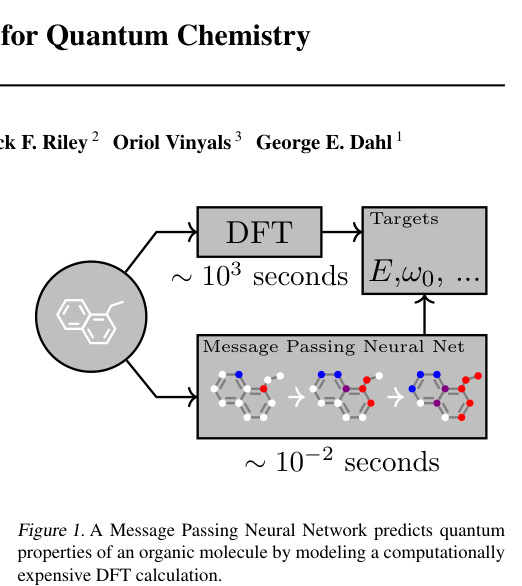

The figure contains a diagram with a grey circle representing an organic molecule, which points via arrows to two separate processing boxes: "DFT" and "Message Passing Neural Net." The DFT box leads to a "Targets" box containing variables like $E$ and $\omega_0$, while the neural network box displays a sequence of molecular structures, conveying that the neural network predicts quantum properties in $\sim 10^{-2}$ seconds compared to the $\sim 10^3$ seconds required for DFT calculations.

**Adam: A Method for Stochastic Optimization** — arXiv:1412.6980 p.6

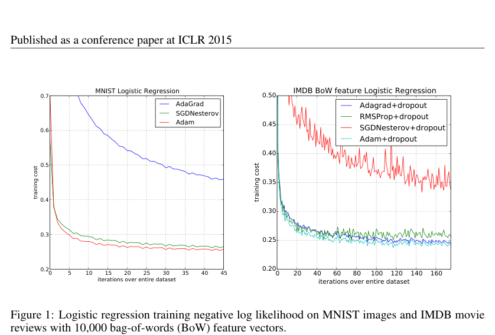

The figure consists of two line graphs comparing the training cost of different optimization algorithms on MNIST and IMDB datasets. The x-axes represent iterations over the entire dataset, the y-axes represent training cost, and the colored lines track the performance of Adam, AdaGrad, SGDNesterov, and RMSProp (with dropout for the IMDB plot). The graphs convey that Adam achieves a lower training cost more rapidly than the other optimizers in both tasks.

**Semi-Supervised Classification with Graph Convolutional Networks** — arXiv:1609.02907 p.4

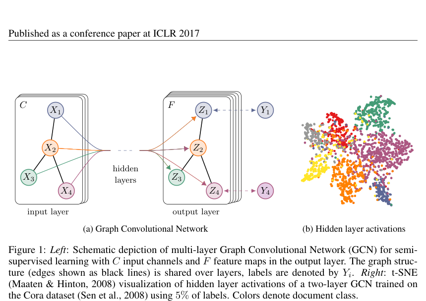

Figure 1a is a schematic diagram showing an input layer with $C$ channels ($X_1$ through $X_4$) and an output layer with $F$ feature maps ($Z_1$ through $Z_4$), connected via hidden layers. The diagram uses nodes, edges, and dashed arrows to convey how graph structures are shared across layers and how output features are mapped to labels $Y_i$. Figure 1b is a t-SNE visualization of hidden layer activations, displaying clusters of colored points representing different document classes from the Cora dataset.

**MoleculeNet: A Benchmark for Molecular Machine Learning** — arXiv:1703.00564 p.6

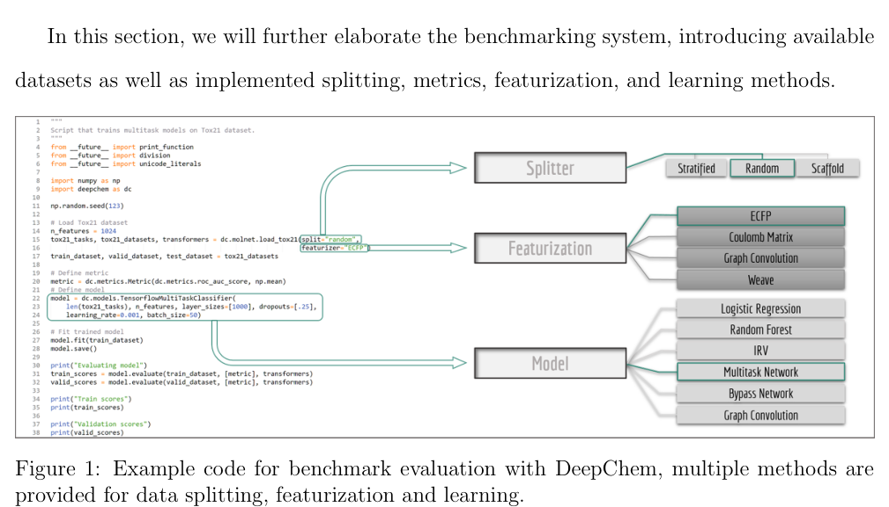

The figure displays a block diagram where a code snippet on the left is connected via arrows to four central boxes labeled "Splitter," "Featurization," "Model," and an unlabeled box. These central boxes branch out into lists of specific methods, such as "Stratified" and "Random" for the Splitter, and "Logistic Regression" and "Graph Convolution" for the Model. The diagram conveys how the provided code integrates various modular components for data splitting, molecular featurization, and machine learning models.

**ShapeNet: An Information-Rich 3D Model Repository** — arXiv:1512.03012 p.3

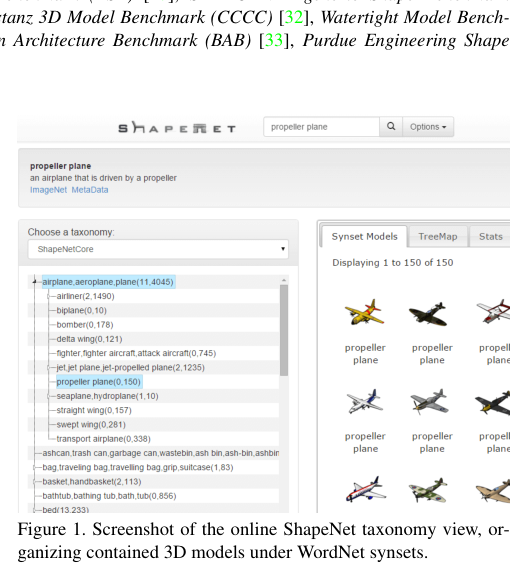

The figure is a screenshot of the ShapeNet online interface, featuring a search bar, a "Choose a taxonomy" dropdown menu, and a hierarchical tree view of categories. The tree view displays a nested list of 3D model categories (e.g., "airplane," "propeller plane") with associated counts, while a "Synset Models" panel to the right displays a grid of thumbnail images for the selected category. The figure conveys the organizational structure of the ShapeNet repository, showing how models are categorized via WordNet synsets.

**Attention Is All You Need** — arXiv:1706.03762 p.3

The figure illustrates the Transformer model architecture, consisting of an encoder stack on the left and a decoder stack on the right, both composed of $N$ identical layers. The diagram uses colored boxes to represent functional components—such as Multi-Head Attention, Feed Forward, and Add & Norm—connected by arrows that show the data flow from input embeddings and positional encodings through to the final softmax output probabilities.

**PointNet: Deep Learning on Point Sets for 3D Classification and
  Segmentation** — arXiv:1612.00593 p.1

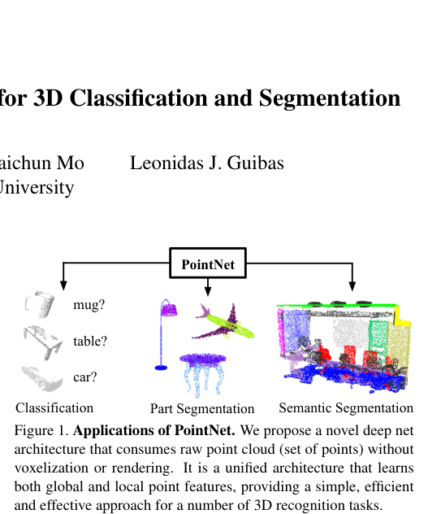

The figure consists of a central "PointNet" box with arrows pointing downward to three distinct categories of 3D tasks. It illustrates the model's applications by showing examples of 3D classification (mug, table, and car), part segmentation (a lamp and a plane), and semantic segmentation (a segmented scene of a room).

**Junction Tree Variational Autoencoder for Molecular Graph Generation** — arXiv:1802.04364 p.1

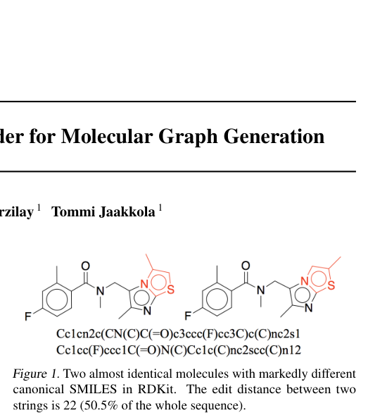

The figure displays two chemical structures that are visually almost identical, positioned above two corresponding SMILES strings. It conveys that the same molecule can be represented by markedly different canonical SMILES sequences, noting an edit distance of 22 (50.5% of the sequence) between them.

**Geometry and biological processes** — arXiv:2602.20274 p.2

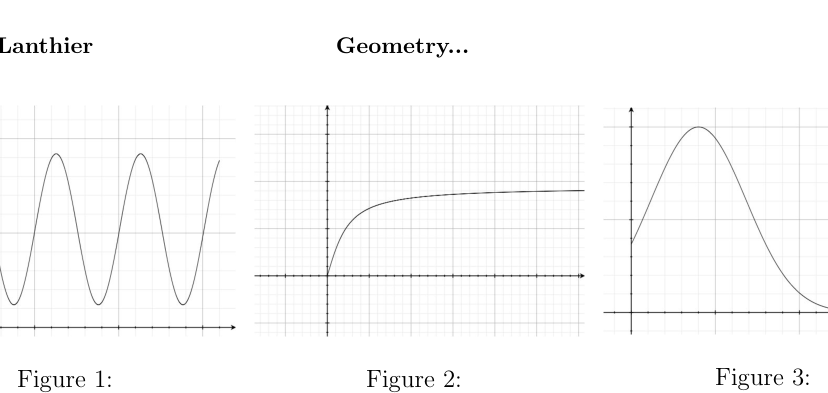

Figure 1 shows a line graph on a Cartesian coordinate system depicting a continuous periodic wave. Figure 2 displays a line graph on a Cartesian coordinate system showing a curve that rises from the origin and asymptotically approaches a horizontal limit. Figure 3 presents a line graph on a Cartesian coordinate system depicting a single bell-shaped curve that rises to a peak and then descends toward the x-axis.

**Graph Neural Networks in Modern AI-aided Drug Discovery** — arXiv:2506.06915 p.6

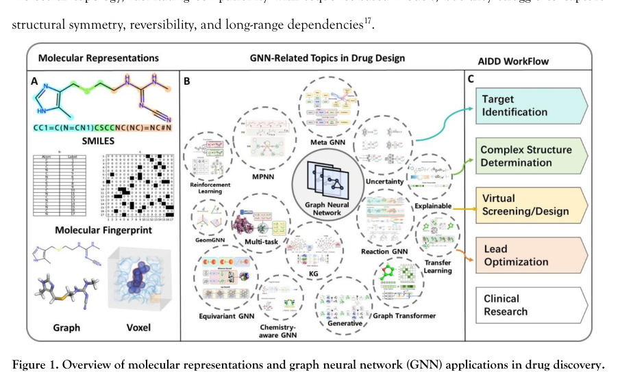

The figure is divided into three panels: Panel A displays various molecular representations including SMILES strings, molecular fingerprints, graphs, and voxels; Panel B shows a central "Graph Neural Network" node connected via dashed arrows to various GNN-related topics such as Meta GNN, MPNN, and Reinforcement Learning; Panel C outlines an "AIDD Workflow" consisting of a vertical sequence of boxes labeled Target Identification, Complex Structure Determination, Virtual Screening/Design, Lead Optimization, and Clinical Research. Overall, the figure illustrates the relationship between molecular data formats, specific GNN methodologies, and their application throughout the drug discovery pipeline.

**A Survey of Graph Neural Networks for Drug Discovery: Recent Developments and Challenges** — arXiv:2509.07887 p.2

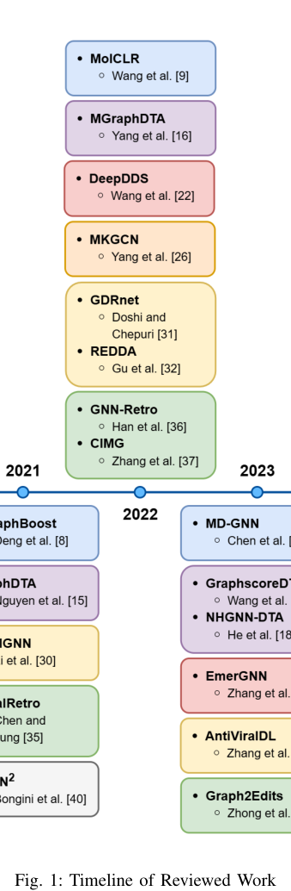

This figure is a vertical timeline spanning from 2021 to 2023, featuring a central blue horizontal axis with colored rectangular boxes containing model names and citations. The boxes are arranged chronologically above and below the axis to convey the publication years of various reviewed Graph Neural Network models.

**Recent Developments in GNNs for Drug Discovery** — arXiv:2506.01302 p.4

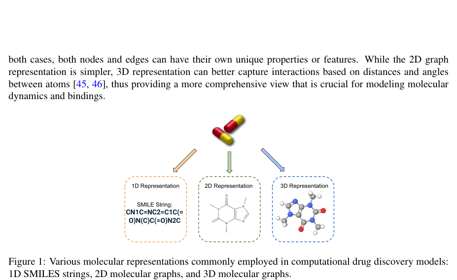

The figure displays three distinct molecular representations connected by arrows from a central capsule icon. It illustrates a 1D representation via a SMILES string, a 2D representation via a chemical structure diagram, and a 3D representation via a ball-and-stick molecular model.
