*deep research · 2 round(s) · 120 landmarks · frontier≥2020: 53 · 5 full-PDF critiques · grounded 70 · off-digest 0*

# Navigating the Chemical Space: A Review of Graph Neural Networks in Drug Discovery

The discovery of novel therapeutic agents is a high-stakes, computationally intensive process characterized by vast chemical search spaces and high attrition rates. Traditional molecular modeling often relies on simplified descriptors or fixed-length fingerprints that fail to capture the intricate, relational nature of chemical structures. Because molecules are inherently non-Euclidean, they are most naturally represented as graphs where atoms serve as nodes and bonds as edges. The emergence of graph learning has revolutionized this field, providing a mathematical framework to encode the topological nuances of molecular structures, thereby transforming how researchers navigate the complexities of chemical space to identify viable drug candidates.

This review traces the technological evolution of this field, beginning with the foundations of graph learning and early molecular modeling techniques. We examine the transition into core graph neural network architectures and the fundamental mechanisms that allow for effective message passing across molecular graphs. The narrative then progresses through the development of molecular graph generation and advanced representation learning, alongside the critical integration of geometric deep learning to incorporate essential 3D structural awareness into predictive models.

As the field has matured, the focus has shifted toward specialized applications, including advanced property prediction and the modeling of complex drug-target interactions. To address the persistent challenges of data scarcity and label noise, recent advancements have increasingly leveraged self-supervised, contrastive, and knowledge-augmented learning paradigms. Finally, we explore the current frontier of the discipline, where the convergence of multimodal data, large-scale pre-training, and generative AI is redefining the boundaries of automated and intelligent drug discovery.

## Foundations of Graph Learning and Early Molecular Modeling

The evolution of graph learning began with the challenge of generalizing convolutional neural networks to non-Euclidean domains. Early foundational work in arXiv:1312.6203 utilized spectral networks and the graph Laplacian spectrum to define signals on general graphs. While these spectral methods provided a mathematical basis for graph processing, the field transitioned toward more efficient methods for learning latent vertex representations, such as the random-walk-based approach in arXiv:1403.6652, which treats truncated walks as sentences. A major breakthrough in scalability and stability was the Graph Convolutional Network (GCN) introduced in arXiv:1609.02907. By utilizing a localized first-order approximation of spectral convolutions and a renormalization trick ($\tilde{A} = A + I_N$), this architecture addressed the propagation issues inherent in deeper layers, offering a more scalable alternative to the spectral approaches discussed in arXiv:1312.6203.

In the context of drug discovery, the application of graph learning shifted from general network analysis to the specific structural complexities of molecules. Early research emphasized the importance of scale in multitask learning; arXiv:1502.02072 demonstrated that utilizing massive datasets—comprising nearly 40 million measurements across more than 200 biological targets—is critical for improving predictive accuracy and transferability. 

As the field matured, the focus moved from fixed molecular fingerprints to data-driven, learnable representations. arXiv:1509.09292 pioneered this by using convolutional networks directly on graphs of arbitrary size and shape to learn molecular fingerprints, demonstrating improved performance and interpretability over traditional circular fingerprints. This trajectory was further refined in arXiv:1603.00856, which moved beyond fixed representations by employing molecular graph convolutions on undirected graphs that explicitly incorporate atoms, bonds, and distances for ligand-based virtual screening.

The disparate approaches to molecular graph convolutions eventually converged toward a more unified mathematical description. arXiv:1704.01212 introduced Message Passing Neural Networks (MPNNs), a framework that reformulates various existing models into a single, common architecture for molecular property prediction. This provided a significant conceptual leap over the more specialized convolutional models in arXiv:1509.09292 and arXiv:1603.00856. To facilitate the rigorous evaluation of these evolving architectures, arXiv:1703.00564 established MoleculeNet, a standardized benchmark that provides curated datasets and metrics for both fixed molecular featurizations and the increasingly prevalent learnable representations.

## Core Graph Neural Network Architectures and Mechanisms

The evolution of Graph Neural Networks (GNNs) has transitioned from foundational convolutional frameworks to highly specialized architectures designed to handle relational complexity, attention mechanisms, and hierarchical structures. Early developments focused on generalizing convolutional operations to irregular domains. One approach utilized convolutional neural networks for arbitrary graphs with discrete and continuous node/edge attributes to extract locally connected regions [arXiv:1605.05273]. This was complemented by spectral-based methods that employed fast localized spectral filtering to achieve linear computational complexity on high-dimensional irregular domains [arXiv:1606.09375]. While these methods established the groundwork for graph convolutions, subsequent research sought to address their inherent limitations.

A significant shift occurred with the introduction of Graph Attention Networks (GATs), which utilize masked self-attentional layers to allow nodes to attend to their neighbors' features [arXiv:1710.10903]. Unlike earlier spectral or purely convolutional methods, GATs provide a mechanism for both inductive and transductive learning by assigning different importance weights to neighboring nodes [arXiv:1710.10903]. This move toward more flexible neighborhood aggregation is also reflected in the development of Jumping Knowledge (JK) networks, which are compatible with various architectures like GCN and GAT to enable structure-aware representation learning through flexible neighborhood ranges [arXiv:1806.03536].

The literature also highlights the necessity of modeling complex relational data. While standard GNNs often focus on homogeneous structures, Relational Graph Convolutional Networks (R-GCNs) were specifically designed for multi-relational knowledge graphs, such as subject-predicate-object triples [arXiv:1703.06103]. R-GCNs demonstrated significant utility in knowledge base completion, achieving a 29.8% improvement over decoder-only baselines like DistMult on the FB15k-237 dataset [arXiv:1703.06103].

However, architectural complexity is not without theoretical and practical challenges. The expressive power of these models has been rigorously analyzed, with research establishing that certain architectures are equivalent to the Weisfeiler-Lehman (WL) test for graph isomorphism [arXiv:1810.00826]. Furthermore, the mechanism of Laplacian smoothing in GCNs has been identified as a potential source of over-smoothing, prompting the development of methods like Predict then Propagate (PPNP) and its approximation, APPNP, which leverage Personalized PageRank to utilize larger, adjustable neighborhoods [arXiv:1810.05997]. To manage structural complexity at different scales, DiffPool introduced a differentiable soft cluster assignment module for hierarchical graph representation learning [arXiv:1806.08804]. Collectively, these advancements represent a move from simple local aggregations toward sophisticated, multi-scale, and relation-aware reasoning frameworks [arXiv:1901.00596].

## Molecular Graph Generation and Representation Learning

The evolution of molecular design has transitioned from simple continuous latent space exploration to sophisticated graph-based generative frameworks. Early efforts focused on converting discrete molecules into real-valued continuous vectors to enable gradient-based optimization and interpolation (arXiv:1610.02415). However, these early continuous representations often faced challenges regarding the structural validity of the decoded molecules. To address this, the Grammar Variational Autoencoder (GVAE) introduced the use of parse trees from context-free grammars, ensuring that generated discrete outputs remained coherent (arXiv:1703.01925). While GVAE improves validity through symbolic constraints, it still relies on sequence-based representations. 

In contrast, more recent models have moved toward direct graph-based generation. GraphVAE (arXiv:1802.03480) utilizes a variational autoencoder to generate probabilistic fully-connected graphs, but a significant advancement in maintaining chemical validity is found in the Junction Tree VAE (JT-VAE) (arXiv:1802.04364). Unlike atom-by-atom models, JT-VAE utilizes tree-structured scaffolds over chemical substructures, allowing for the direct realization of molecular graphs that respect chemical rules. This represents a critical shift from generating raw atom sequences to assembling valid chemical building blocks.

Generative modeling has also branched into adversarial and reinforcement learning (RL) paradigms. While ORGAN (arXiv:1705.10843) utilizes RL to bias the generation of SMILES sequences toward desirable metrics, MolGAN (arXiv:1805.11973) applies a GAN framework directly to small molecular graphs for likelihood-free generation. For more complex, non-differentiable constraints such as chemical valency, the Graph Convolutional Policy Network (GCPN) (arXiv:1806.02473) employs policy gradient RL, enabling goal-directed generation that obeys strict chemical rules during the construction process. This goal-directed approach contrasts with unconditional models like $MG^2N^2$ (arXiv:2012.07397), which prioritizes interpretability through sequential GNN modules.

Furthermore, the field has explored autoregressive modeling, such as GraphRNN (arXiv:1802.08773), which decomposes graph generation into discrete node and edge formations to approximate complex distributions. Parallel to these generative tasks, the quality of learned representations remains a central concern. While Variational Graph Auto-Encoders (VGAE) utilize GCN encoders for unsupervised link prediction (arXiv:1611.07308), the practical utility of these representations must be rigorously validated. Benchmarking studies have demonstrated that learned molecular representations must be compared against fixed descriptors to ensure their efficacy in industrial property prediction settings (arXiv:1904.01561). Finally, newer approaches, such as those using geometric scattering (arXiv:2110.06241), attempt to integrate representation-first strategies with GANs to further refine goal-directed drug synthesis.

## Geometric Deep Learning and 3D Structural Awareness

The evolution of graph neural networks (GNNs) in drug discovery has transitioned from modeling simple connectivity to capturing complex 3D spatial geometries and physical symmetries. Early advancements focused on modeling quantum interactions by utilizing precise, non-grid-based atomic locations to predict total energy and interatomic forces [arXiv:1706.08566]. SchNet introduced continuous-filter convolutional architectures to capture local correlations, ensuring rotationally invariant energy predictions and differentiable potential energy surfaces [arXiv:1706.08566]. While SchNet established a foundation for modeling quantum-chemical principles, subsequent research sought to move beyond rotational invariance toward full equivariance.

To better capture the directional nature of molecular interactions, DimeNet introduced directional message passing [arXiv:2003.03123]. Unlike SchNet, which focuses on distances, DimeNet incorporates spatial directionality by utilizing spherical Bessel functions and spherical harmonics to represent atom distances and directional information in coordinate space [arXiv:2003.03123]. This approach allows for more sophisticated predictions of quantum mechanical properties, though it increases the complexity of the message-passing mechanism.

A significant shift in the literature is the pursuit of efficient equivariance. E(n)-Equivariant Graph Neural Networks (EGNNs) address the computational burden often associated with higher-order representations by providing equivariance to rotations, translations, reflections, and permutations without such overhead [arXiv:2102.09844]. This efficiency is critical for downstream applications like drug binding structure prediction. For instance, EquiBind utilizes SE(3)-equivariant geometric deep learning on atomic point clouds to predict ligand poses and orientations via blind docking [arXiv:2202.05146]. EquiBind's strength lies in its speed and accuracy, specifically through efficient fine-tuning via torsion angle adjustment [arXiv:2202.05146], a task motivated by the foundational equivariance principles established in EGNNs [arXiv:2102.09844].

The application of geometric deep learning extends from small molecules to large-scale macromolecular structures. Geometric Vector Perceptrons (GVP) unify graph-structured and geometric aspects by using collections of Euclidean vectors to represent 3D biomolecular structures [arXiv:2009.01411]. This structural awareness is vital for protein-centric tasks, such as model quality assessment and computational protein design [arXiv:2009.01411]. Building on these geometric representations, recent work has utilized 3D geometric structures modeled as protein graphs for pretraining through multiview contrastive learning [arXiv:2203.06125]. This pretraining approach enables superior performance in protein function prediction and fold classification compared to traditional sequence-based methods [arXiv:2203.06125]. Collectively, these developments demonstrate a trajectory from modeling local atomic interactions [arXiv:1706.08566] to mastering the global geometric symmetries required for complex protein-ligand docking and functional prediction [arXiv:2202.05146, arXiv:2203.06125].

## Advanced Property Prediction and Drug-Target Interaction

The evolution of graph neural networks (GNNs) in drug discovery has transitioned from sequence-based representations to highly sophisticated models that capture complex 3D spatial and structural relationships. Early approaches to drug-target binding affinity (DTA) prediction, such as WideDTA, focused on word-based sequence representations, evaluating the utility of protein domains, motifs, and maximum common substructure words against traditional character-based methods (arXiv:1902.04166). While effective for sequence modeling, these methods lack the explicit geometric context provided by more recent structural architectures.

A significant shift in the literature is the integration of spatial and topological information. The S-MAN architecture (arXiv:2012.09624) introduced a distance-aware molecule graph attention network that utilizes a pocket-ligand graph, incorporating relative spatial positions via a position encoding mechanism. This emphasis on structural awareness is further refined in the SIGN model (arXiv:2107.10670), which models protein-ligand complexes as graphs containing both distance and angle information among atoms. SIGN utilizes polar-inspired graph attention layers (PGAL) and pairwise interactive pooling (PiPool) to capture long-range interactions, representing a more granular approach than the heterogeneous graph structures used for binary drug-target interaction (DTI) prediction in GAT-based models (arXiv:2107.06099).

Recent advancements have focused on multi-scale interactions and global feature integration. For instance, the geometric graph-based model (arXiv:2509.13476) utilizes multiscale weighted colored bipartite subgraphs to capture fine-grained atom-level interactions within protein-ligand complexes. Similarly, ViDTA (arXiv:2412.19589) enhances DTA prediction by introducing virtual graph nodes to integrate global molecular information, combined with an attention-based linear feature fusion network.

Beyond affinity, the field has expanded into molecular property prediction (MPP) and explainability. While some models focus on the fundamentals of molecular graphs (arXiv:2208.04852), others, like HiGNN (arXiv:2208.13994), employ hierarchical informative GNNs that co-represent molecular graphs with chemically synthesizable BRICS fragments to improve interpretability. This drive for chemical validity is echoed in the SLGNN model (arXiv:2309.12906), which uses sparse learning to ensure that the identified key structures in drug-protein binding are chemically valid. Furthermore, graph structure learning (GSL) has emerged as a method to integrate intra-molecule topology with inter-molecule similarity graphs (arXiv:2312.16855), providing a more holistic view of molecular relationships. Collectively, these developments demonstrate a trajectory from simple sequence modeling toward complex, structure-aware, and explainable geometric frameworks.

## Self-Supervised, Contrastive, and Knowledge-Augmented Learning

The evolution of graph neural networks (GNNs) in drug discovery has transitioned from basic unsupervised node representation learning to sophisticated contrastive and knowledge-augmented frameworks designed to overcome data sparsity. Early foundational work, such as Deep Graph Infomax (DGI), focused on maximizing mutual information between local patch representations and high-level graph summaries using GCN architectures [arXiv:1809.10341]. While DGI established a baseline for unsupervised learning, subsequent research has sought to refine these strategies to improve generalization and prevent negative transfer during downstream tasks like molecular property and protein function prediction [arXiv:1905.12265].

A significant shift in the literature is the move toward contrastive learning, which utilizes multiple views of a graph to learn robust representations. For instance, one approach employs structural views, such as first-order neighbors and graph diffusion, to perform node and graph classification [arXiv:2006.05582]. This contrasts with methods that rely on graph augmentation through sequences of alteration operations to alleviate overfitting in limited-label scenarios [arXiv:2009.05923]. Further advancing this paradigm, research into graph contrastive learning (GCL) has demonstrated that employing four distinct types of graph augmentations can significantly enhance generalizability, transferability, and robustness across various unsupervised and adversarial settings [arXiv:2010.13902]. Recent developments have even extended these data-driven augmentation strategies to encompass both homogeneous and heterogeneous graphs, utilizing both topological information and node predictive features [arXiv:2412.18316].

In the specific context of molecular modeling, the literature highlights a move toward geometric awareness. While general GCL methods focus on topological changes, GeomGCL introduces a dual-view geometric message passing network (GeomMPNN) that specifically leverages both 2D and 3D molecular graphs [arXiv:2109.11730]. By utilizing geometric graph contrastive learning, this approach improves representation learning for molecular property prediction more effectively than purely topological methods [arXiv:2109.11730].

Finally, to address the inherent challenges of supervision sparsity and the need for interpretability in drug discovery, the field has moved toward Knowledge-augmented Graph Machine Learning (KaGML) [arXiv:2302.08261]. Unlike the purely data-driven self-supervised methods described above, KaGML integrates 2D or 3D protein and molecule structures with external biomedical knowledge [arXiv:2302.08261]. This integration provides a critical layer of domain-specific context that self-supervised or contrastive methods, which rely solely on the intrinsic structure of the graph, may lack. Together, these methodologies represent a progression from learning basic structural patterns to incorporating complex geometric and biological knowledge.

## The Frontier: Multimodal, Large-Scale, and Generative AI in Drug Discovery

The landscape of graph neural networks (GNNs) in drug discovery is shifting from isolated property prediction toward multimodal, large-scale, and hierarchical modeling. Recent advancements emphasize the integration of GNNs with other AI paradigms, such as Large Language Models (LLMs) and foundation models. For instance, DrugChat (arXiv:2309.03907) introduces a multi-turn interactive framework that utilizes an adaptor to bridge GNN-derived molecule representations with LLMs, enabling conversational question-answering on drug graphs. This move toward interactivity is complemented by research into the scalability of GNNs, where investigations into depth, width, and dataset diversity aim to develop robust foundation models capable of navigating vast chemical spaces across dozens of downstream tasks (arXiv:2404.11568).

A critical evolution in the field is the transition from "monolithic" graph assumptions to architectures that capture multi-level and hierarchical biological structures. While traditional models often struggle with complex dependencies, the Multi-Level Fusion GNN (MLFGNN) integrates Graph Attention Networks and Graph Transformers to capture both local and global molecular dependencies (arXiv:2507.03430). Similarly, the Graph-in-Graph (GiG) framework (arXiv:2507.11757) and Heterogeneous GNNs (HGNN-DDI) (arXiv:2508.18766) expand the scope of interaction modeling by using meta-nodes and heterogeneous biomedical networks to integrate drugs, targets, and biological entities.

This trend is most pronounced in protein-ligand affinity prediction, where modeling protein modularity has become a central challenge. One approach utilizes a domain-aware geometric encoder to address the over-smoothing limitations of monolithic graphs, achieving a 39.3% reduction in MSE and a 68.2% improvement in Spearman correlation for interface binders (arXiv:2601.17102). However, this method’s strength is offset by a weakness: the explicit exclusion of flexible linker residues to minimize geometric noise leads to degraded ranking metrics for linker binders. This limitation is directly addressed by HCLBind (arXiv:2605.19902), which employs a hierarchical contrastive pre-training strategy to decouple local physicochemical matching from global inter-domain rotation. HCLBind demonstrates significant robustness in linker-binding regions, showing a 167.5% improvement in Pearson correlation, and achieves a state-of-the-art RMSE of 1.309 on PDBBind, though it remains limited by a lack of testing on chemically novel, out-of-distribution scaffolds.

Furthermore, the field is moving toward generative design and complex structure prediction. Architectures like RedNet and GLINTER (arXiv:2605.11189) utilize multiscale graph transformers and co-evolutionary signals to improve binder specificity and thermodynamic properties. Despite these gains, a persistent gap remains between structural prediction and practical drug development, as current design workflows still require screening thousands of candidates and often fail to optimize critical therapeutic properties such as solubility and immunogenicity. Collectively, these developments signal a move toward more geometrically aware, multi-modal, and generative GNN frameworks (arXiv:2506.01302, arXiv:2506.06915, arXiv:2509.07887).

## Tensions and Open Problems

A fundamental debate persists regarding the architectural capacity and expressive power of graph representations. On one hand, early approaches focused on local neighborhood sampling and random walks to capture structural patterns, as seen in the scalable feature learning of node2vec (arXiv:1607.00653). However, this paradigm has been critiqued for its inability to capture global context, with Deep Graph Infomax (arXiv:1809.10341) arguing that local walk-based methods fail to preserve the overarching topology of the graph compared to contrastive global-local objectives. This tension extends to the theoretical limits of message passing; while the framework established in arXiv:1810.00826 defines the upper bounds of GNN expressivity via the Weisfeiler-Lehman test, subsequent surveys (arXiv:1901.00596) suggest that these theoretical guarantees often overlook the practical limitations of existing architectures, such as the inability of Variational Graph Auto-Encoders (arXiv:1611.07308) to effectively model complex, non-linear structural dependencies.

A second tension concerns the transition from transductive to inductive learning and the subsequent impact on scalability. Traditional methods like node2vec (arXiv:1607.00653) were designed for static networks where node features are not explicitly leveraged, a limitation highlighted by GraphSAGE (arXiv:1706.02216), which advocates for inductive learning to handle unseen nodes in large-scale, evolving graphs. This shift toward inductive, feature-rich learning has created a rift in how molecular and chemical graphs are processed. While early convolutional methods (arXiv:1509.09292) and specialized molecular convolutions (arXiv:1603.00856) attempted to move beyond traditional fingerprints, recent evaluations (arXiv:2312.16855) suggest that many of these specialized architectures still struggle to match the robustness of general-purpose message-passing networks (arXiv:1704.01212) when faced with the diverse chemical spaces required for modern drug discovery.

Finally, the field faces a growing crisis of evaluation and benchmarking. There is a significant disconnect between the datasets used to validate models and the real-world complexity they claim to represent. While early benchmarks provided a foundation for rapid prototyping, recent critiques of existing benchmarking protocols (arXiv:2003.00982) suggest that they often fail to account for structural nuances, such as those addressed by position-aware GNNs (arXiv:1906.04817). This has led to a fragmentation in the literature, where the adoption of the Open Graph Benchmark (arXiv:2005.00687) and TUDataset (arXiv:2007.08663) has created competing standards, making it increasingly difficult to determine whether performance gains are due to algorithmic innovation or simply the exploitation of dataset-specific biases.

## Outlook

The frontier of graph learning is rapidly shifting from static, single-modality representations toward dynamic, multi-domain geometric intelligence. As the field moves beyond simple molecular property prediction, the current trajectory points toward hierarchical, multi-level fusion models (arXiv:2507.03430) and domain-aware geometric learning (arXiv:2601.17102) that can integrate protein-ligand binding complexities. We are entering an era where the integration of hierarchical contrastive learning (arXiv:2605.19902) and advanced protein complex design (arXiv:2605.11189) will define the next generation of AI-aided drug discovery, transforming GNNs from mere structural descriptors into predictive engines capable of navigating the intricate, multi-scale landscapes of biological interactions.

---

## Key Figures

**Semi-Supervised Classification with Graph Convolutional Networks** — arXiv:1609.02907 p.4

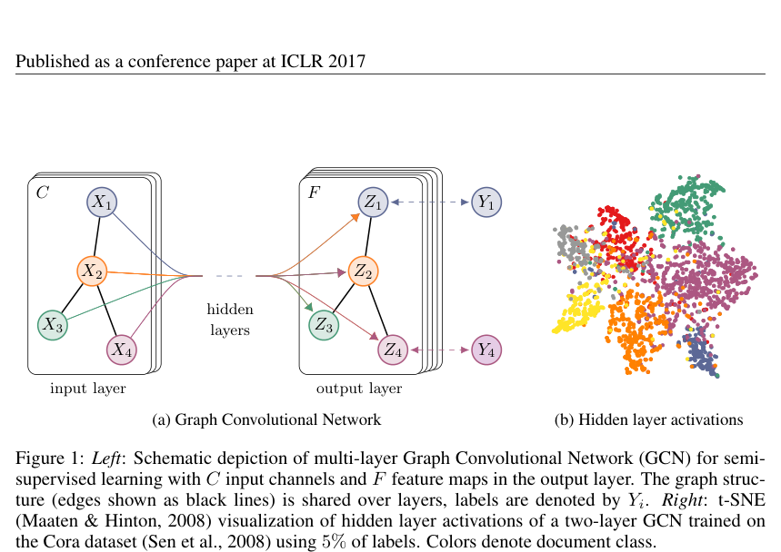

Figure 1a is a schematic diagram showing an input layer with $C$ channels (nodes $X_1$ through $X_4$) connected by edges, which passes through hidden layers to an output layer with $F$ feature maps (nodes $Z_1$ through $Z_4$) and corresponding labels $Y_1$ through $Y_4$. Figure 1b is a t-SNE visualization of hidden layer activations from a two-layer GCN trained on the Cora dataset, where colored clusters represent different document classes. Together, the figure illustrates the architecture of a Graph Convolutional Network and the resulting feature clustering in the latent space.

**Graph Attention Networks** — arXiv:1710.10903 p.4

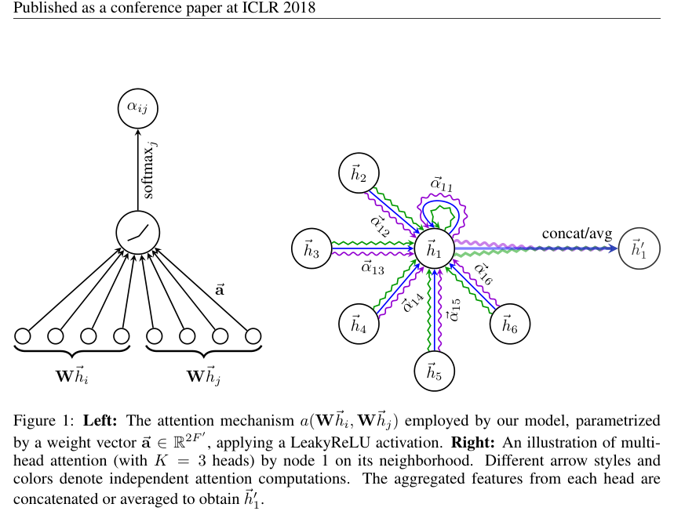

The left panel depicts the attention mechanism as a computational flow where inputs $\mathbf{W}\vec{h}_i$ and $\mathbf{W}\vec{h}_j$ are processed through a LeakyReLU activation and a softmax function to produce the attention coefficient $\alpha_{ij}$. The right panel illustrates multi-head attention, showing node $\vec{h}_1$ receiving inputs from its neighborhood ($\vec{h}_2$ through $\vec{h}_6$) via multiple colored, stylized arrows representing independent attention heads. These heads are then combined through concatenation or averaging to produce the updated node representation $\vec{h}'_1$.

**Inductive Representation Learning on Large Graphs** — arXiv:1706.02216 p.2

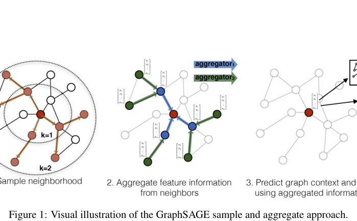

The figure consists of three sequential diagrams illustrating the GraphSAGE approach, using nodes (circles) and edges (lines) to represent a graph structure. The diagrams show a process of sampling a neighborhood (k=1 and k=2), aggregating feature information from neighbors using labeled blue and green arrows, and finally using that aggregated information to predict graph context.

**Neural Message Passing for Quantum Chemistry** — arXiv:1704.01212 p.1

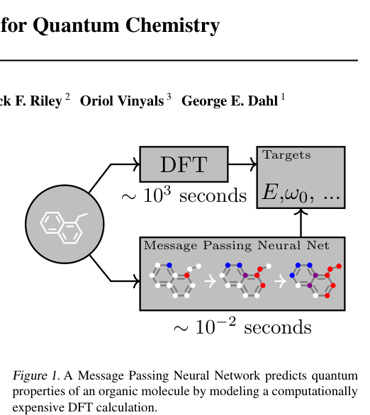

The figure consists of a grey circle containing a molecular structure with two arrows pointing to two separate rectangular boxes. The top box, labeled "DFT," indicates a process taking approximately $10^3$ seconds that leads to a "Targets" box containing variables like $E$ and $\omega_0$, while the bottom box, labeled "Message Passing Neural Net," shows a sequence of molecular transformations taking approximately $10^{-2}$ seconds. The diagram conveys that the neural network serves as a significantly faster alternative to computationally expensive DFT calculations for predicting molecular quantum properties.

**How Powerful are Graph Neural Networks?** — arXiv:1810.00826 p.3

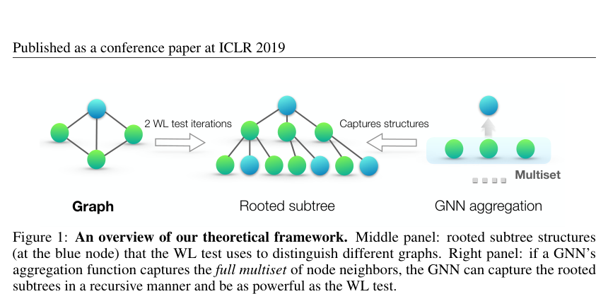

The figure illustrates a conceptual framework using three panels connected by arrows: a "Graph" on the left, a "Rooted subtree" in the center, and a "GNN aggregation" on the right. An arrow labeled "2 WL test iterations" points from the graph to the rooted subtree, while an arrow labeled "Captures structures" points from a "Multiset" of nodes toward the subtree. The diagram conveys that if a GNN's aggregation function captures the full multiset of node neighbors, it can capture rooted subtrees recursively and match the power of the Weisfeiler-Lehman (WL) test.

**Adam: A Method for Stochastic Optimization** — arXiv:1412.6980 p.6

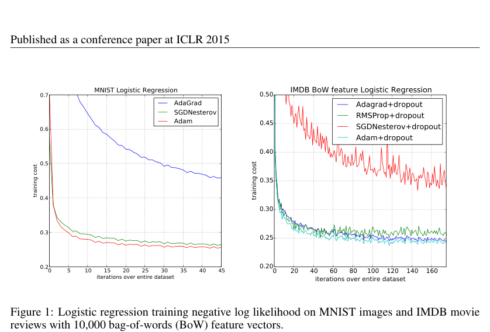

The figure consists of two line graphs comparing the training cost (negative log likelihood) of different optimization algorithms across two datasets. The left plot shows MNIST Logistic Regression performance for AdaGrad, SGDNesterov, and Adam over 45 iterations, while the right plot shows IMDB BoW feature Logistic Regression performance for Adagrad, RMSProp, SGDNesterov, and Adam (all with dropout) over 160 iterations. In both cases, the Adam optimizer achieves a lower training cost more rapidly than the other methods.

**Convolutional Neural Networks on Graphs with Fast Localized Spectral
  Filtering** — arXiv:1606.09375 p.2

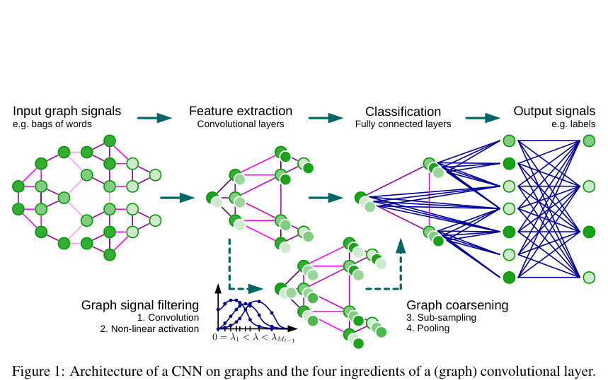

The figure illustrates a CNN architecture on graphs, showing a sequence of four stages connected by arrows: Input graph signals, Feature extraction (convolutional layers), Classification (fully connected layers), and Output signals. Below the main flow, two sub-diagrams detail the components of a convolutional layer, including a graph signal filtering process (convolution and non-linear activation) and a graph coarsening process (sub-sampling and pooling).

**Convolutional Networks on Graphs for Learning Molecular Fingerprints** — arXiv:1509.09292 p.2

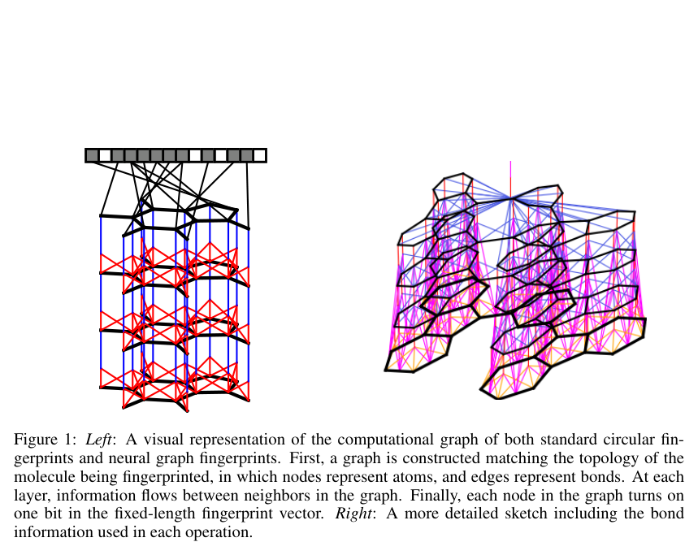

The figure consists of two panels: the left panel shows a computational graph with layers of interconnected nodes (red/blue) flowing upward into a row of grey boxes, while the right panel shows a more detailed 3D-style sketch of interconnected nodes and colored edges. The figure conveys how information flows through layers of a graph—representing atoms and bonds—to ultimately produce a fixed-length fingerprint vector.

**Domain-Aware Geometric Multimodal Learning for Multi-Domain Protein-Ligand Affinity Prediction** — arXiv:2601.17102 p.2

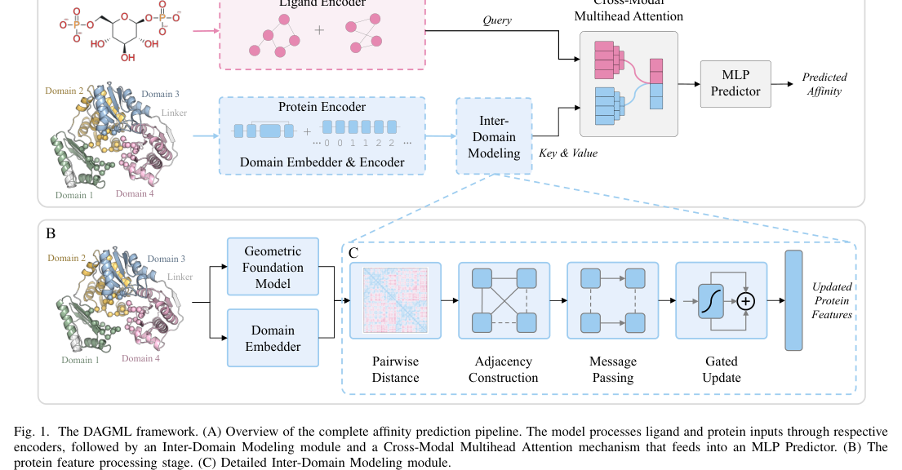

Figure 1 illustrates the DAGML framework, consisting of three panels (A, B, and C) that detail the protein-ligand affinity prediction pipeline. Panel A shows a flowchart where ligand and protein inputs are processed through respective encoders, followed by Inter-Domain Modeling and Cross-Modal Multihhead Attention, which feed into an MLP Predictor to output predicted affinity. Panels B and C provide detailed breakdowns of the protein feature processing stage and the specific steps of the Inter-Domain Modeling module, including pairwise distance calculation, adjacency construction, message passing, and gated updates.

**Hierarchical Contrastive Learning for Multi-Domain Protein-Ligand Binding** — arXiv:2605.19902 p.3

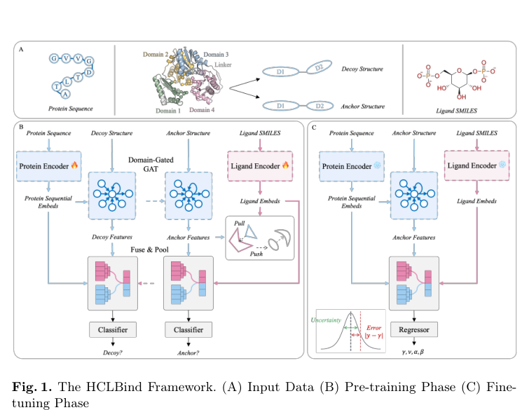

The figure illustrates the HCLBind framework through three panels: (A) shows input data including protein sequences, multi-domain structures, decoy/anchor structures, and ligand SMILES; (B) depicts the pre-training phase where protein and ligand encoders generate embeddings that are processed through Domain-Gated GATs and a "Fuse & Pool" module to feed into classifiers; and (C) shows the fine-tuning phase where the same encoders feed into a regressor to predict binding affinity ($\gamma, v, \alpha, \beta$) with an associated uncertainty error. The diagram uses boxes to represent neural network modules (Encoders, GATs, Regressors), arrows to show data flow, and a central "Pull/Push" diagram to represent the contrastive learning mechanism.

**Graph Neural Networks in Modern AI-aided Drug Discovery** — arXiv:2506.06915 p.6

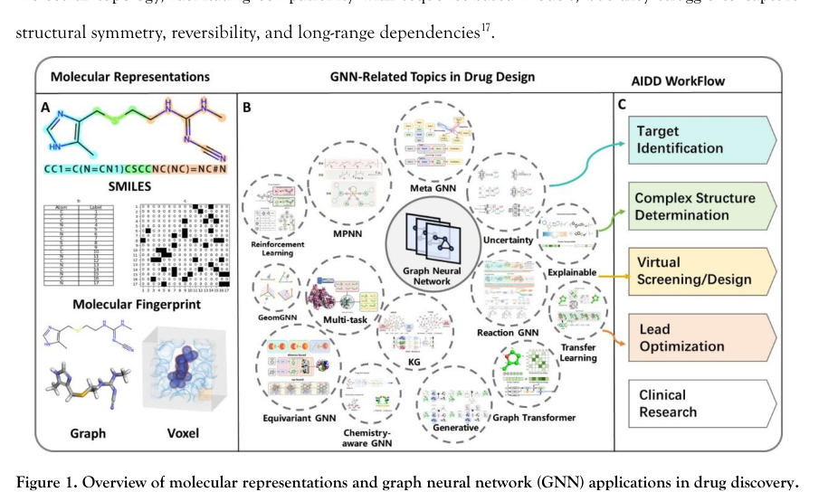

The figure is divided into three panels: Panel A displays various molecular representations including SMILES strings, molecular fingerprints, graphs, and voxels; Panel B shows a central "Graph Neural Network" node connected via dashed arrows to various GNN-related topics such as Meta GNN, MPNN, and Reinforcement Learning; Panel C outlines an "AIDD Workflow" consisting of a vertical sequence of boxes labeled Target Identification, Complex Structure Determination, Virtual Screening/Design, Lead Optimization, and Clinical Research. Overall, the figure conveys the relationship between molecular data formats, specific GNN methodologies, and their application throughout the drug discovery pipeline.

**A Survey of Graph Neural Networks for Drug Discovery: Recent Developments and Challenges** — arXiv:2509.07887 p.2

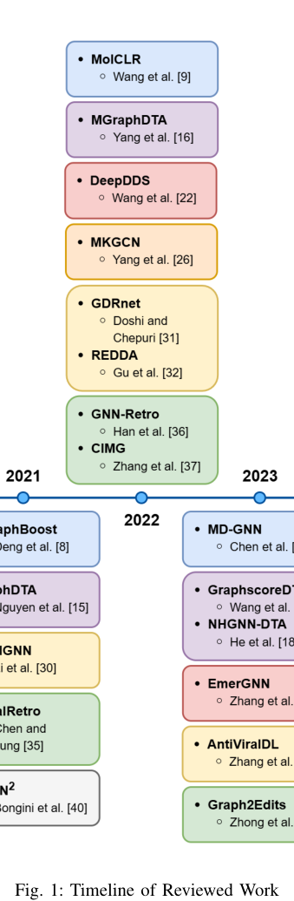

This figure is a vertical timeline spanning from 2021 to 2023, featuring a central blue axis with colored boxes containing model names and citations. The boxes are arranged chronologically along the axis to convey the publication years of various reviewed Graph Neural Network models in drug discovery.

**Recent Developments in GNNs for Drug Discovery** — arXiv:2506.01302 p.4

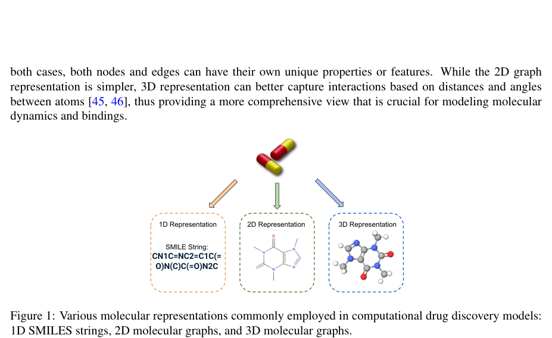

The figure displays three distinct molecular representations connected by arrows from a central capsule icon: a 1D representation showing a SMILES string, a 2D representation showing a chemical structure diagram, and a 3D representation showing a ball-and-stick molecular model. Each representation is enclosed in a dashed box with a corresponding label. The figure conveys the different ways molecules can be encoded for computational drug discovery models.
