*deep research · 1 round(s) · 80 landmarks · frontier≥2020: 34 · 4 full-PDF critiques · grounded 54 · off-digest 1*

# The Evolution of Graph Neural Networks: From Spectral Foundations to State-Space Frontiers

The ability to model complex, non-Euclidean relationships is central to modern machine learning, as much of the world's data—ranging from molecular structures to social networks—is inherently relational. Graph Neural Networks (GNNs) have emerged as the primary paradigm for extracting meaningful patterns from these irregular structures, bridging the gap between traditional deep learning and graph-theoretic principles. As the complexity and scale of relational data grow, understanding the mechanisms that allow models to capture topological dependencies becomes essential for advancing predictive accuracy, structural reasoning, and the deployment of AI in real-world networked environments.

This review traces the historical and technical trajectory of the field, beginning with the foundations of spectral theory and early graph embeddings that laid the groundwork for signal processing on graphs. We then examine the paradigm shift toward the rise of convolutional and message-passing architectures, which moved the field toward spatial local neighborhood aggregation. The discussion progresses through the critical requirements of scaling, efficiency, and the integration of structural inductive biases, alongside a rigorous theoretical analysis of expressive power and generalization capabilities. To address the inherent weaknesses of standard models, we investigate recent efforts in addressing structural limitations such as over-smoothing and heterophily.

Finally, the review explores the current frontiers of advanced representations and specialized domains, moving beyond general-purpose architectures toward more niche applications. We conclude by looking toward the 2025 frontier, analyzing the emerging integration of state-space models and the shift toward more sophisticated, contextualized learning paradigms that promise to redefine how machines interpret and interact with interconnected data.

## Foundations: Spectral Theory and Early Graph Embeddings

The evolution of graph representation learning began with a focus on extending classical signal processing and convolutional operations to non-Euclidean domains through spectral graph theory. Early work established the mathematical groundwork by defining wavelet transforms on arbitrary finite weighted graphs using the spectral decomposition of the discrete graph Laplacian [arXiv:0912.3848]. This spectral approach was further formalized into a broader framework of signal processing on graphs, which generalized fundamental operations such as filtering, translation, and dilation to irregular structures by merging algebraic concepts with computational harmonic analysis [arXiv:1211.0053].

Building upon these spectral foundations, researchers sought to adapt the success of Convolutional Neural Networks (CNNs) to graphs. One approach proposed constructing networks based on the spectrum of the graph Laplacian or hierarchical clustering, demonstrating that for low-dimensional graphs, convolutional layers could be learned with parameters independent of input size [arXiv:1312.6203]. This line of inquiry was extended by the development of convolutional neural networks that operate directly on graphs of arbitrary shape to learn molecular fingerprints, offering more interpretable and predictive data-driven features than traditional circular fingerprint methods [arXiv:1509.09297]. While these spectral methods provided a rigorous mathematical bridge, they were later critiqued in broader surveys of the field [arXiv:2407.03125]. Another significant advancement in this domain was the introduction of Diffusion-Convolutional Neural Networks (DCNNs), which utilized diffusion-convolution operations to create latent representations invariant under isomorphism, ultimately outperforming probabilistic relational models in node classification tasks [arXiv:1511.02136].

Parallel to these spectral-based convolutional methods, a different paradigm emerged focusing on latent vertex representations through random walks and structural optimization. DeepWalk introduced a method to learn social representations by treating truncated random walks as equivalent to sentences in language modeling, achieving $F_1$ scores up to 10% higher than competitors with sparse data [arXiv:1403.6652]. While DeepWalk focused on this linguistic analogy, LINE (Large-scale Information Network Embedding) optimized for both local and global structures using a novel edge-sampling algorithm, enabling the embedding of networks with millions of vertices and billions of edges within hours on a single machine [arXiv:1503.03578]. 

The training of these complex models was further stabilized by advancements in general deep learning optimization. The Adam optimizer provided adaptive estimates of lower-order moments to improve stochastic gradient-based optimization [arXiv:1412.6980], while Batch Normalization addressed internal covariate shift, allowing for higher learning rates and significantly faster training [arXiv:1502.03167]. Additionally, the residual learning framework enabled the training of substantially deeper architectures by using identity shortcut connections to ease optimization [arXiv:1512.03385], providing the structural depth necessary for modern graph-based learning tasks.

## The Rise of Convolutional and Message-Passing Architectures

The evolution of graph neural networks (GNNs) is characterized by a transition from spectral-based methods to flexible, scalable message-passing frameworks. Early advancements focused on extending spectral networks to non-Euclidean domains; for instance, arXiv:1506.05163 introduced a Graph Estimation procedure for deep architectures on unknown domains, matching or improving upon Dropout Networks while utilizing significantly fewer parameters. Similarly, arXiv:1606.09375 proposed fast localized spectral filtering to achieve linear computational complexity and constant learning complexity, demonstrating the ability to learn stationary and compositional features on graphs.

A significant shift occurred with the introduction of more efficient convolutional approximations. arXiv:1609.02907 established a foundational, scalable architecture for semi-supervised learning by utilizing a first-order approximation of spectral graph convolutions via a renormalization trick ($\tilde{D}^{-1/2} \tilde{A} \tilde{D}^{-1/2}$). While this method achieved superior accuracy and $O(|E|)$ efficiency—outperforming Planetoid* on the Cora dataset (81.5% vs 75.7%)—it remains constrained by its reliance on undirected graphs without edge features and the memory requirements of full-batch gradient descent. This architectural lineage was further extended by arXiv:1710.10903, which introduced Graph Attention Networks (GATs). By employing masked self-attentional layers, GATs allow nodes to attend to neighbors with varying weights, enabling both inductive and transductive learning without the costly matrix operations required by previous spectral methods.

Parallel to these convolutional developments, researchers sought to generalize GNNs for complex relational and sequential tasks. arXiv:1511.05493 introduced Gated Graph Sequence Neural Networks, which utilize gated recurrent units (GRUs) to extend GNNs to sequence outputs, achieving state-of-the-art performance in subgraph matching problems. This capacity for relational reasoning is echoed in arXiv:1612.00222, which developed "Interaction Networks" to simulate physical trajectories and reason about object-relation dynamics. For highly multi-relational data, arXiv:1703.06103 proposed Relational Graph Convolutional Networks (R-GCNs), which yielded a 29.8% improvement on the FB15k-237 dataset when used as an encoder.

The field eventually moved toward a unified understanding of these diverse methods. arXiv:1704.01212 reformulated various existing models into a single, cohesive framework known as Message Passing Neural Networks (MPNNs), utilizing an aggregation procedure invariant to molecular symmetries to achieve state-of-the-art results in quantum chemistry. This movement toward abstraction is complemented by the theoretical framework of geometric deep learning, which seeks to generalize structured neural models to non-Euclidean manifolds (arXiv:1611.08097, arXiv:1611.08402). While traditional tools excel on Euclidean grids, these frameworks provide the necessary mathematical foundation to handle the complex invariances inherent in graph-structured data.

## Scaling, Efficiency, and Structural Inductive Biases

The evolution of Graph Neural Networks (GNNs) has been driven by the need to transition from small-scale, transductive settings to scalable, inductive frameworks capable of handling massive or evolving datasets. A foundational shift in this direction is provided by GraphSAGE (arXiv:1706.02216), which moves away from node-specific embeddings toward an inductive framework that learns trainable aggregator functions via neighborhood sampling. This approach allows for the generation of embeddings for previously unseen nodes and is significantly more efficient than transductive baselines, offering approximately 100$\times$ faster inference and a 51% average improvement in supervised F1-scores over raw features (arXiv:1706.02216). While GraphSAGE enables generalization to new graph structures, its theoretical guarantee for learning structural information is limited by the restrictive assumption that all node features are distinct (arXiv:1706.02216).

To address the computational bottlenecks of large-scale training, FastGCN (arXiv:1801.10247) introduces a batched training scheme using importance sampling. By interpreting graph convolutions as integral transforms and employing Monte Carlo approaches, FastGCN achieves training efficiencies that are orders of magnitude greater than standard GCNs while maintaining comparable accuracy (arXiv:1801.10247). This emphasis on scalability is further exemplified by PinSage (arXiv:1806.01973), which extends the sampling principles of GraphSAGE to web-scale recommendation. By combining efficient random walks with graph convolutions, PinSage successfully deployed on a Pinterest graph containing 3 billion nodes and 18 billion edges, outperforming existing deep learning alternatives in both offline metrics and A/B tests (arXiv:1806.01973).

Beyond raw efficiency, research has focused on the structural inductive biases that define a GNN's expressive power. While popular models like GCN and GraphSAGE are widely used, they possess inherent limitations; specifically, they cannot learn to distinguish certain simple graph structures (arXiv:1810.00826). To address this, a theoretical framework was developed to match the discriminative power of the Weisfeiler-Lehman graph isomorphism test, resulting in a more powerful architecture for graph classification (arXiv:1810.00826). Other approaches seek to improve structural awareness by varying the receptive field. For instance, Jumping Knowledge (JK) networks (arXiv:1806.03536) allow nodes to flexibly leverage different neighborhood ranges, consistently improving the performance of GCN, GraphSAGE, and GAT models.

Finally, the theoretical landscape is enriched by studies on permutation invariance and equivariance. Research has characterized all permutation invariant and equivariant linear layers for (hyper-)graph data, demonstrating that these models can approximate any message-passing neural network (arXiv:1812.09902). This aligns with broader arguments that relational inductive biases and structured representations are essential for achieving combinatorial generalization in AI (arXiv:1806.01261). These theoretical advancements are supported by practical implementations such as PyTorch Geometric (arXiv:1903.02428), which utilizes sparse GPU acceleration and dedicated CUDA kernels to provide high data throughput for irregularly structured inputs.

## Theoretical Analysis: Expressive Power and Generalization

The theoretical landscape of Graph Neural Networks (GNNs) is defined by a tension between structural expressivity—the ability to distinguish non-isomorphic graphs—and the generalization capabilities of the models across different graph scales.

A foundational benchmark for expressivity is the 1-dimensional Weisfeiler-Leman (1-WL) heuristic. Research has established that standard GNNs possess the same expressive power as the 1-WL algorithm, meaning they share its inherent inability to distinguish certain non-isomorphic (sub-)graphs [arXiv:1810.02244]. To overcome this limitation, several approaches propose higher-order architectures. For instance, $k$-dimensional GNNs ($k$-GNNs) are designed to capture higher-order structures at multiple scales [arXiv:1810.02244], while $k$-order invariant/equivariant networks can theoretically match the expressiveness of the $k$-WL test [arXiv:1905.11136]. A notable advancement in this direction is a scalable 2-order network that interleaves MLPs with a single quadratic operation to achieve guaranteed 3-WL expressiveness [arXiv:1905.11136]. However, this increased expressivity introduces a significant trade-off: the computational cost of processing high-order tensors [arXiv:1905.11136].

While higher-order models focus on increasing the capacity to distinguish structures, other research highlights how depth can paradoxically diminish a model's utility. It has been demonstrated that as the number of layers in a Graph Convolutional Network (GCN) tends to infinity, the outputs exponentially approach signals containing only node degree and connected component information [arXiv:1905.10947]. This phenomenon, where GCNs suffer information loss on sufficiently large or dense Erdős–Rényi graphs, suggests that increasing depth does not monotonically improve expressive power [arXiv:1905.10947].

The distinction between expressivity and generalization is further clarified by examining the training dynamics of GNNs. Recent analysis suggests that the superiority of GNNs in node-level prediction may stem more from intrinsic generalization capabilities than from their structural expressivity [arXiv:2212.09034]. By introducing the Propagational MLP (PMLP) model class—which is trained as an MLP but tested as a GNN—researchers found that PMLPs can perform on par with or even exceed GNNs while offering significantly higher training efficiency [arXiv:2212.09034]. Despite these efficiencies, both GNNs and PMLPs face a shared limitation: they struggle to extrapolate non-linear functions when encountering extremely out-of-distribution samples [arXiv:2212.09034].

Ultimately, the design of GNN architectures involves navigating multiple perspectives of expressiveness, including universal approximation properties, the ability to compute graph moments, and the capacity to pass graph isomorphism tests [arXiv:2401.01626]. This complexity is further compounded by the need for stability to topological changes and permutation equivariance, properties that characterize the representation space of graph convolutional filters [arXiv:2003.03777].

## Addressing Structural Limitations: Over-smoothing and Heterophily

The scalability and effectiveness of Graph Neural Networks (GNNs) are fundamentally constrained by two structural phenomena: over-smoothing, where node representations become indistinguishable in deep architectures, and heterophily, where connected nodes possess differing labels.

Over-smoothing has been addressed through various architectural and optimization strategies. One stochastic approach involves DropEdge (arXiv:1907.10903), which reduces message passing and alleviates over-fitting by randomly removing edges during training, thereby slowing the convergence toward over-smoothed states. This contrasts with more structural interventions like the Deep Adaptive Graph Neural Network (DAGNN) proposed in arXiv:2007.09296. While DropEdge acts as a data augmenter, DAGNN addresses the root cause by decoupling representation transformation from propagation, allowing for adaptive information incorporation from large receptive fields.

Further refinements in addressing over-smoothing focus on the mathematical nature of the filters used during propagation. arXiv:2101.11859 establishes a unified optimization framework that treats GNNs as solutions to feature fitting functions over graph kernels. By introducing objective functions with adjustable low-pass or high-pass filtering kernels, this framework provides a more principled method for alleviating over-smoothing than purely heuristic approaches. This focus on filter dynamics is echoed in the study of deep attention mechanisms; arXiv:2306.02376 identifies that deep graph attention is vulnerable to "smooth cumulative attention," a phenomenon where attention weights become overly uniform. To remedy this, the authors propose AERO-GNN, which utilizes adaptive, less smooth attention functions to maintain performance even at depths of up to 64 layers, outperforming baselines on 9 out of 12 benchmarks.

While the aforementioned works focus on depth and smoothing, arXiv:2006.11468 shifts the focus to heterophily, noting that many popular GNNs fail to generalize when neighbors do not share labels—sometimes performing worse than simple MLPs that ignore graph structure entirely. The authors propose H2GCN, which utilizes ego- and neighbor-embedding separation and higher-order neighborhoods to bridge this gap, achieving accuracy increases of up to 40% on synthetic heterophilous networks.

The theoretical landscape of these issues is increasingly formalized. arXiv:2204.07697 and arXiv:2407.03125 provide comprehensive summaries of the approximation and learning properties of message passing and higher-order GNNs. These theoretical frameworks unify the understanding of expressiveness, generalization, and the specific mechanics of over-smoothing and over-squashing, moving the field from empirical remedies toward a rigorous understanding of graph learning behaviors.

## Frontiers: Advanced Representations and Specialized Domains

Recent research has shifted toward refining the semantic and structural foundations of Graph Neural Networks (GNNs) to move beyond standard message-passing limitations. One significant direction involves optimizing the feature space to prevent the linear correlation typically caused by repeated aggregations; arXiv:2305.06142 addresses this by proposing feature expansion through feature subspace flattening and structural principal components, achieving efficient convergence with comparable inference times to baselines. This focus on feature-space optimization contrasts with the formal semantic approach in arXiv:2305.18632, which proposes that graph rewriting subsumes GNNs. By introducing Graph Rewriting Neural Networks (GReNN) as a formal foundation, this work allows for GNNs to be represented as graph rewrite systems, enabling incremental operations for dynamic updates.

The paradigm of node interaction is also undergoing a transition from static aggregation to more complex, strategic behaviors. While traditional models rely on fixed aggregation rules, arXiv:2310.01267 introduces a cooperative framework where nodes act as players that choose between 'listen', 'broadcast', 'listen and broadcast', or 'isolate' strategies. This dynamic message-passing generalizes standard schemes by making node strategies dependent on their internal states. A similar drive toward capturing complex interactions is seen in arXiv:2411.07269, which utilizes advanced high-order pooling functions to enhance representation learning, specifically for molecular graph generative models that must learn invariant and equivariant characteristics.

As the field expands into specialized domains, the need for standardized evaluation and specialized taxonomies has become critical. The OpenGLT benchmark (arXiv:2501.00773) provides a comprehensive framework by categorizing GNNs into five distinct types: node-based, hierarchical pooling-based, subgraph-based, graph learning-based, and self-supervised learning (SSL)-based. Through an extensive empirical study of 20 models across 26 datasets, arXiv:2501.00773 demonstrates that no single architecture is universally optimal; rather, subgraph-based models excel in expressiveness, SSL-based methods in robustness, and node/pooling-based models in efficiency. It also notes that topological features like density and centrality can guide architecture selection. However, the framework reveals a significant scalability weakness, as subgraph-based and SSL-based models frequently encounter Out-of-Memory (OOM) errors on large-scale datasets such as REDDIT and COLLAB.

These specialized advancements are further reflected in domain-specific surveys. arXiv:2403.13849 provides a broad overview of GNNs and their growing role in graph generation, while arXiv:2502.12908 offers a structured taxonomy for GNNs within database systems, distinguishing between applications in Relational Databases (such as query optimization) and Graph Databases (such as similarity computation).

## The 2025 Frontier: State-Space Models and Contextualized Learning

Recent advancements in Graph Neural Networks (GNNs) have shifted focus toward mitigating the fundamental limitations of traditional message-passing, specifically the phenomenon of over-smoothing and the constraints of local topological interactions. A significant emerging trend involves integrating non-traditional architectures and advanced contextualization frameworks to enhance representation expressivity.

One prominent approach involves the integration of state-space models to address over-smoothing. MbaGCN introduces a three-component backbone—comprising a Message Aggregation Layer, a Selective State Space Transition Layer, and a Node State Prediction Layer—to leverage the Mamba paradigm within a graph convolutional framework [arXiv:2501.15461]. While this architecture aims to tackle over-smoothing through selective state-space transitions, its performance may not consistently outperform all existing methods across every dataset [arXiv:2501.15461]. This variability contrasts with the Channel-Attentive GNN (CHAT-GNN), which addresses over-smoothing through an adaptive, channel-wise message-passing mechanism [arXiv:2503.00578]. By learning attention over both neighboring nodes and specific feature channels, CHAT-GNN demonstrates higher resistance to over-smoothing and achieves state-of-the-art performance, particularly in graphs characterized by strong heterophily [arXiv:2503.00578].

While MbaGCN and CHAT-GNN focus on architectural modifications to preserve signal, other research investigates the underlying topological causes of representation failure. The study of $k$-hop similarity provides a lens to examine how local topological features interact with message-passing schemes [arXiv:2502.17739]. This research validates that the interplay between topology and message-passing can dictate whether a model achieves effective learning or falls into inevitable over-smoothing [arXiv:2502.17739].

Further expanding the scope of message-passing, the Neighborhood-Contextualized Message-Passing (NCMP) framework and the resulting SINC-GCN architecture move beyond the standard pairwise center/neighbor paradigm [arXiv:2511.11046]. By formalizing "neighborhood-contextualization" as a functional dependence on the entire set of one-hop neighbor features, SINC-GCN generalizes the multi-dimensional message $\psi$ to include broader local context [arXiv:2511.11046]. This approach demonstrates significant strengths in reasoning tasks; for instance, SINC-GCN achieved a balanced accuracy of 1.00 $\pm$ 0.00 on the UniqueSignature synthetic dataset, outperforming GCN and GIN [arXiv:2511.11046]. However, the claim of "minimal asymptotic computational overhead" in SINC-GCN warrants scrutiny, as the requirement to aggregate the entire neighborhood context $N_u$ and maintain an additional learnable weight matrix $W_N$ for every node may introduce non-trivial costs [arXiv:2511.11046]. Collectively, these works represent a transition from simple pairwise aggregation toward more complex, context-aware, and state-dependent modeling strategies.

## Tensions and Open Problems

A fundamental tension in the field concerns the trade-off between scalability and inductive flexibility. Early paradigms focused on transductive, random-walk-based methods such as DeepWalk (arXiv:1403.6652), which learn fixed embeddings for a specific graph structure. However, these approaches have been critiqued for their inability to generalize to unseen nodes or evolving networks. This limitation is highlighted by the shift toward inductive representation learning, as seen in GraphSAGE (arXiv:1706.02216), which prioritizes learning neighborhood aggregation functions that can be applied to new nodes. Similarly, while node2vec (arXiv:1607.00653) offers sophisticated flexible walks for feature learning, it has been challenged by researchers who argue that such methods lack the efficiency and structural awareness required for web-scale recommendation systems (arXiv:1806.01973).

Another critical debate centers on the architectural limits of expressivity versus the stability of deep architectures. There is a growing concern regarding the "over-smoothing" phenomenon, where repeated aggregations cause node representations to converge to indistinguishable vectors. While some researchers have attempted to mitigate this by analyzing the spectral properties of Graph Convolutional Networks (arXiv:1801.07606), others argue that the very nature of message-passing leads to an exponential loss of expressive power as depth increases (arXiv:1905.10947). This tension is further complicated by the debate over how to effectively scale depth; while some propose architectural modifications like Jumping Knowledge Networks (arXiv:1806.03536) to preserve multi-scale information, others suggest that the fundamental issue lies in how we interpret the optimization landscapes of these models (arXiv:2101.11859).

Finally, a methodological rift exists between local feature-based aggregation and global structural awareness. Traditional approaches, such as the original GCN (arXiv:1509.09292), rely heavily on localized spectral filters that may fail to capture long-range dependencies or complex global topologies. Recent work has attempted to bridge this gap by introducing feature expansion techniques (arXiv:2305.06142) and attention mechanisms (arXiv:1710.10903) to better weigh neighborhood importance. However, a persistent open problem remains: whether these local-to-global aggregations are truly sufficient to capture the underlying graph homomorphism, or if the topology of the input graph itself imposes an inescapable limit on what a neural network can learn (arXiv:2502.12908).

## Outlook

The frontier of graph learning is rapidly moving beyond simple message-passing toward hybrid architectures that integrate structural intelligence with sequence modeling. We are seeing a transition from standard GNNs to more sophisticated frameworks, such as Mamba-based state-space models (arXiv:2501.15461) designed to combat over-smoothing, and channel-attentive mechanisms (arXiv:2503.00578) that refine feature selection. As the field matures, the focus is shifting from purely predictive accuracy to the development of robust, graph-level benchmarks (arXiv:2501.00773) and the integration of GNNs into structured data systems like databases (arXiv:2502.12908), signaling a move toward more reliable and deployable graph intelligence.

---

## Key Figures

**Semi-Supervised Classification with Graph Convolutional Networks** — arXiv:1609.02907 p.4

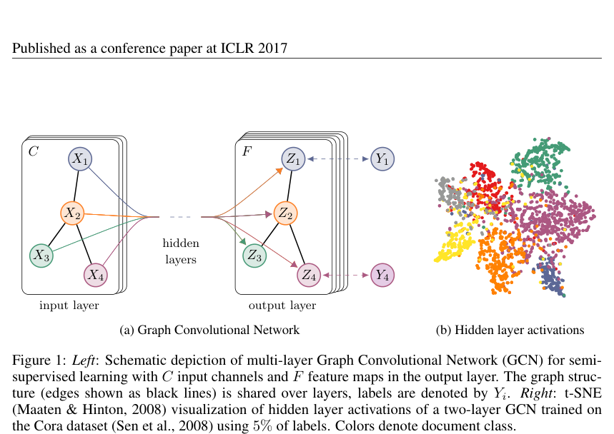

Figure 1a is a schematic diagram showing an input layer with $C$ channels ($X_1$ through $X_4$) connected via edges to hidden layers, which then map to an output layer with $F$ feature maps ($Z_1$ through $Z_4$) and corresponding labels ($Y_1$ through $Y_4$). Figure 1b is a t-SNE visualization of hidden layer activations, displaying clusters of colored points representing different document classes from the Cora dataset. Together, the figure illustrates the architecture of a multi-layer Graph Convolutional Network and the resulting feature clustering in the latent space.

**Inductive Representation Learning on Large Graphs** — arXiv:1706.02216 p.2

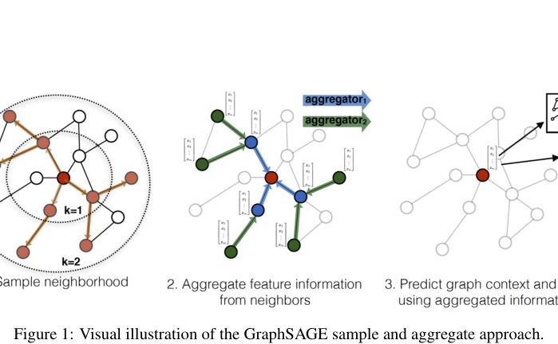

The figure consists of three sequential diagrams illustrating the GraphSAGE approach: a graph with nodes highlighted in brown to show sampled neighborhoods at distances $k=1$ and $k=2$; a central node receiving colored arrows from its neighbors labeled with feature vectors $x_i$ and processed by "aggregator" boxes; and a final graph where the central node uses aggregated information to predict its graph context. The diagrams convey the three-step process of sampling a neighborhood, aggregating feature information from neighbors, and using that information to predict graph context.

**Graph Attention Networks** — arXiv:1710.10903 p.4

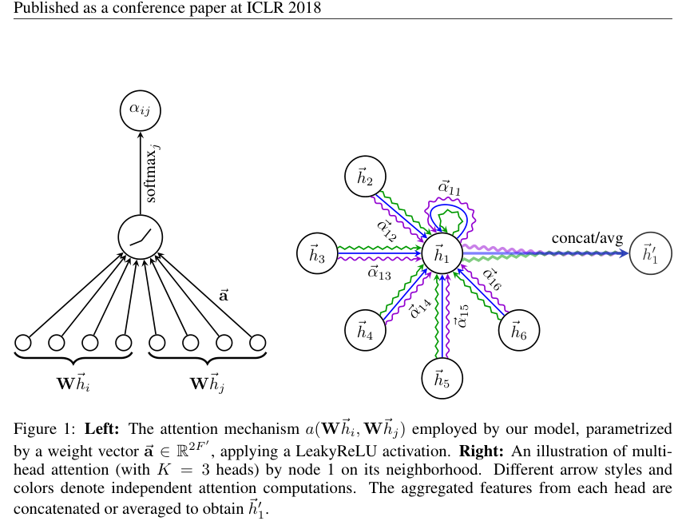

The left panel depicts the attention mechanism as a computational flow where inputs $\mathbf{W}\vec{h}_i$ and $\mathbf{W}\vec{h}_j$ are processed through a LeakyReLU activation and a softmax function to produce the attention coefficient $\alpha_{ij}$. The right panel illustrates multi-head attention for node $\vec{h}_1$ within a neighborhood of nodes $\vec{h}_2$ through $\vec{h}_6$, using different colored and styled arrows to represent independent attention computations that are ultimately concatenated or averaged to produce $\vec{h}'_1$.

**How Powerful are Graph Neural Networks?** — arXiv:1810.00826 p.3

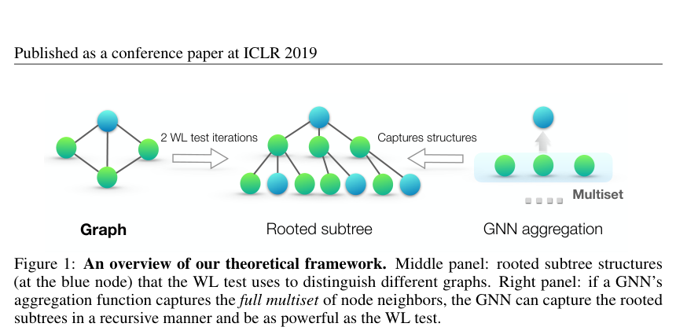

The figure illustrates a conceptual framework using three panels: a "Graph" represented by nodes and edges, a "Rooted subtree" showing a hierarchical structure, and a "GNN aggregation" panel containing a "Multiset" of nodes. An arrow indicates that two WL test iterations transform a graph into a rooted subtree, while another arrow shows that a GNN aggregation capturing a multiset of neighbors allows for the capture of these subtree structures. The diagram conveys that a GNN is as powerful as the WL test if its aggregation function can capture the full multiset of node neighbors to recursively represent rooted subtrees.

**Neural Message Passing for Quantum Chemistry** — arXiv:1704.01212 p.1

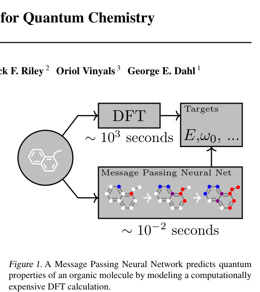

The figure consists of a grey circle containing a molecular structure with two arrows pointing to two separate rectangular boxes. The top box, labeled "DFT," indicates a process taking approximately $10^3$ seconds that leads to a "Targets" box containing variables like $E$ and $\omega_0$, while the bottom box, labeled "Message Passing Neural Net," shows a sequence of molecular transformations taking approximately $10^{-2}$ seconds. The diagram conveys that the neural network serves as a much faster alternative to computationally expensive DFT calculations for predicting molecular properties.

**Convolutional Neural Networks on Graphs with Fast Localized Spectral
  Filtering** — arXiv:1606.09375 p.2

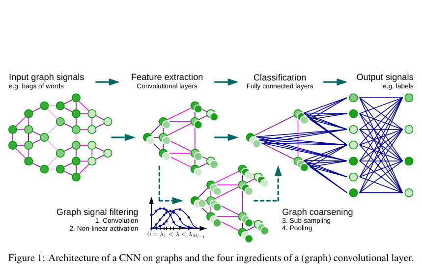

The figure illustrates a CNN architecture on graphs, showing a sequence of four stages connected by arrows: Input graph signals, Feature extraction (convolutional layers), Classification (fully connected layers), and Output signals. Below these stages, two sub-diagrams detail the components of a convolutional layer, including a graph signal filtering process (convolution and non-linear activation) and a graph coarsening process (sub-sampling and pooling).

**Spectral Networks and Locally Connected Networks on Graphs** — arXiv:1312.6203 p.3

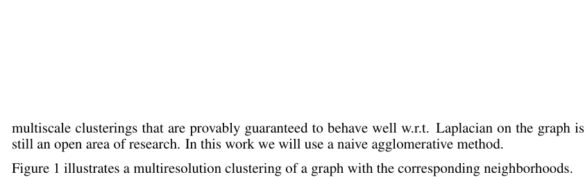

The figure illustrates a multiresolution clustering of a graph by displaying a series of nodes and edges at different scales. It conveys how the graph's structure is partitioned into increasingly larger neighborhoods or clusters as the resolution changes.

**A Comprehensive Survey on Graph Neural Networks** — arXiv:1901.00596 p.2

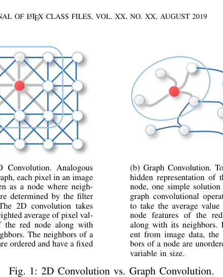

The figure consists of two side-by-side diagrams, (a) and (b), comparing 2D convolution to graph convolution. Diagram (a) shows a regular grid of blue nodes with a red central node, illustrating a fixed, ordered neighborhood structure, while diagram (b) shows an irregular arrangement of blue nodes connected to a red central node, illustrating an unordered and variable neighborhood structure.

**OpenGLT: A Comprehensive Benchmark of Graph Neural Networks for Graph-Level Tasks** — arXiv:2501.00773 p.4

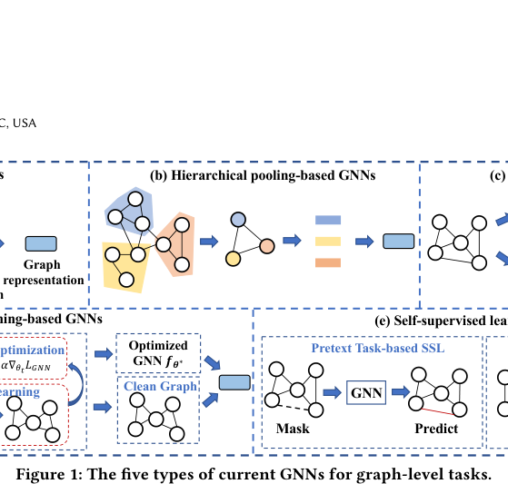

The figure consists of five dashed-line boxes, labeled (a) through (e), containing diagrams of nodes, edges, and arrows that illustrate different categories of Graph Neural Networks (GNNs). It conveys a taxonomy of five current GNN types for graph-level tasks, ranging from hierarchical pooling-based methods to self-supervised learning approaches.

**Enhancing Graph Representations with Neighborhood-Contextualized Message-Passing** — arXiv:2511.11046 p.2

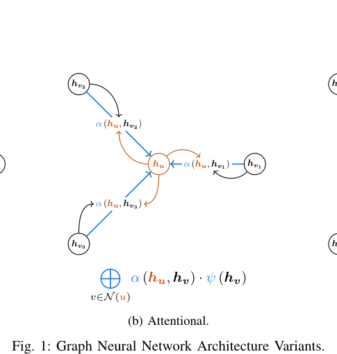

The figure depicts a central node $h_u$ connected to three neighboring nodes ($h_{v_1}, h_{v_2}, h_{v_3}$) via orange arrows pointing toward the center. Below the diagram, a mathematical formula shows that the update involves a summation ($\oplus$) of the product of an attention coefficient $\alpha(h_u, h_v)$ and a message function $\psi(h_v)$ for all neighbors $v \in \mathcal{N}(u)$. The diagram conveys the mechanism of an attentional graph neural network where neighbors contribute context-dependent messages to the central node.

**Channel-Attentive Graph Neural Networks** — arXiv:2503.00578 p.4

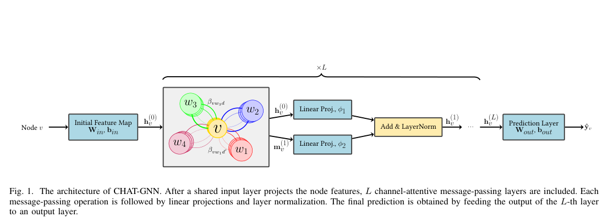

The figure illustrates the CHAT-GNN architecture, showing a sequence of operations starting from an input node $v$ passing through an initial feature map ($\mathbf{W}_{in}, \mathbf{b}_{in}$) to produce $\mathbf{h}_v^{(0)}$. This is followed by $L$ repeated layers consisting of a channel-attentive message-passing block (containing weights $\mathbf{w}_1$ through $\mathbf{w}_4$), two parallel linear projections ($\phi_1, \phi_2$), and an "Add & LayerNorm" module. The process concludes with a prediction layer ($\mathbf{W}_{out}, \mathbf{b}_{out}$) that outputs $\mathbf{\hat{y}}_v$.

**Graph Neural Networks for Databases: A Survey** — arXiv:2502.12908 p.1

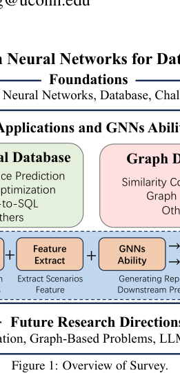

The figure consists of a hierarchical flowchart with labeled boxes connected by arrows, organized into three main sections: Foundations, Applications and GNNs Abilities, and Future Research Directions. It conveys a structured overview of the research landscape, mapping the progression from fundamental neural network concepts to specific database applications and emerging research challenges.

**Mamba-Based Graph Convolutional Networks: Tackling Over-smoothing with Selective State Space** — arXiv:2501.15461 p.1

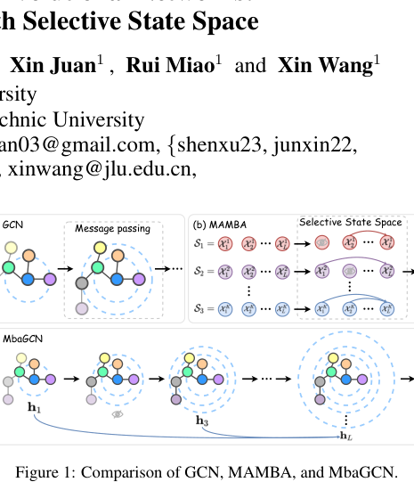

The figure presents a visual comparison of four graph neural network architectures: GCN, MAMBA, Selective State Space, and MbaGCN. It uses nodes and arrows to illustrate different information flow mechanisms, contrasting the local message passing of GCN with the sequential processing of MAMBA and the integrated, long-range dependency modeling of the proposed MbaGCN.

**Are GNNs doomed by the topology of their input graph?** — arXiv:2502.17739 p.2

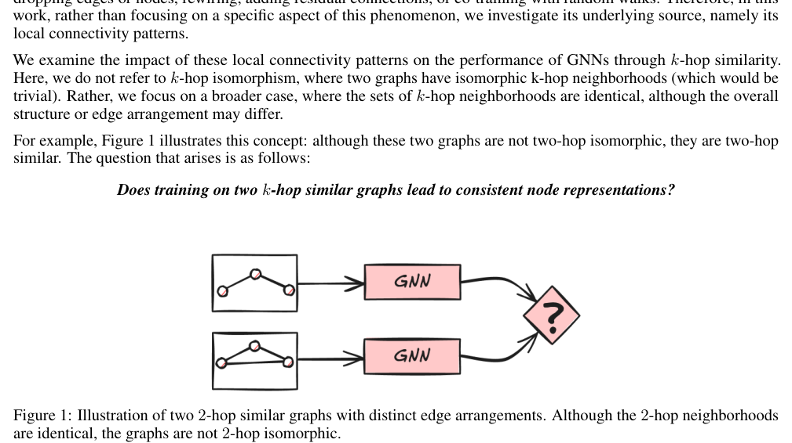

The figure displays two separate boxes containing small graph diagrams, each with an arrow pointing to a corresponding "GNN" box. These two GNN boxes then point toward a single diamond-shaped box containing a question mark. The figure illustrates whether training on two different graphs that share identical $k$-hop neighborhoods (but different edge arrangements) results in consistent node representations.
