*deep research · 1 round(s) · 80 landmarks · frontier≥2020: 42 · 5 full-PDF critiques · grounded 46 · off-digest 2*

# From Message Passing to Graph Transformers: A Survey of the Evolution and Future of Graph Neural Networks

While traditional deep learning architectures have achieved remarkable success in processing Euclidean data such as images and sequences, they often fail to capture the complex, non-Euclidean relational structures inherent in real-world datasets. From the intricate connectivity of molecular biology to the sprawling networks of social media and knowledge graphs, information is frequently organized as irregular graphs where the dependencies between entities are as vital as the entities themselves. Graph Neural Networks (GNNs) have emerged as the primary paradigm to address this challenge, providing a mathematical framework to learn meaningful representations directly from topological structures.

This review traces the historical and conceptual trajectory of the field, beginning with the Foundations and Early Embeddings that established the core principles of local neighborhood aggregation and message passing. We then examine the Architectural Evolution and Expressive Power of these models, detailing how subsequent designs sought to overcome the limitations of basic aggregation to capture higher-order structural information and improve discriminative capacity. To provide a rigorous understanding of these mechanisms, we analyze the Learning Dynamics and Representation Theory that govern how GNNs converge and the mathematical properties of the latent spaces they construct.

The scope of the field has further expanded beyond simple classification into Generative Models and Graph Transformation, where the focus shifts from analyzing existing structures to synthesizing new graphs and performing complex topological modifications. Finally, we look toward the current state of the art in The 2025 Frontier: Efficiency, Topology, and Transformers. This concluding section explores the integration of transformer architectures into graph learning, the pursuit of computational efficiency for large-scale networks, and the emerging role of topological deep learning in meeting the demands of next-generation relational reasoning.

## Foundations and Early Embeddings

The evolution of graph representation learning transitioned from signal processing frameworks to specialized embedding techniques and eventually to scalable neural architectures. Early theoretical foundations were established through signal processing on graphs (GSP), which merged algebraic and spectral graph theory with computational harmonic analysis to analyze high-dimensional data on irregular domains [arXiv:1211.0053]. This spectral perspective was further operationalized by proposing Spectral Networks and Locally Connected Networks, which utilized the graph Laplacian spectrum and hierarchical clustering to generalize Convolutional Neural Networks (CNNs) to non-Euclidean domains [arXiv:1312.6203]. Subsequent research extended these spectral methods by incorporating graph estimation to construct deep architectures for general non-Euclidean domains [arXiv:1506.05163] and utilizing fast localized spectral filtering to achieve linear computational complexity [arXiv:1606.09375].

Parallel to spectral approaches, a line of research focused on learning latent vertex representations through random walks. DeepWalk [arXiv:1403.6652] treated truncated random walks as analogous to sentences in language modeling to learn social representations. This was later refined by node2vec [arXiv:1607.00653], which introduced a biased random walk procedure to explore diverse neighborhoods, offering more flexible and task-independent representations than the rigid neighborhood notions in DeepWalk. While these methods were effective for capturing local structure, they were often transductive. In contrast, GraphSAGE [arXiv:1706.0216] shifted the paradigm toward inductive learning by training aggregator functions to sample and aggregate features from local neighborhoods. This allowed for generalization to unseen nodes and entirely new graphs, demonstrating a significant speed advantage—approximately 100× faster than transductive baselines at inference—though its theoretical proof for structural learning relies on the restrictive assumption of distinct node features [arXiv:1706.0216].

The field eventually converged on Graph Convolutional Networks (GCNs) and attention-based mechanisms. GCNs [arXiv:1609.02907] introduced a highly influential first-order approximation of spectral convolutions using a renormalization trick, achieving superior accuracy and $O(|E|)$ efficiency compared to earlier models like Planetoid*. However, GCNs are limited by their restriction to undirected graphs without edge features and their reliance on full-batch gradient descent, which poses memory challenges for large-scale graphs. To address the need for more nuanced neighborhood weighting, Graph Attention Networks (GATs) [arXiv:1710.10903] implemented masked self-attentional layers, allowing nodes to attend to neighbors with varying weights without requiring costly matrix operations. This development, alongside the unification of various models into the Message Passing Neural Network (MPNN) framework [arXiv:1704.01212], provided the necessary tools for complex tasks ranging from molecular property prediction to relational reasoning in knowledge bases [arXiv:1703.6103].

## Architectural Evolution and Expressive Power

The evolution of Graph Neural Network (GNN) architectures has transitioned from empirical design toward a rigorous theoretical understanding of discriminative limits and structural expressivity. Early research focused on the mechanisms of Graph Convolutional Networks (GCNs), identifying that their convolution operation functions as a form of Laplacian smoothing [arXiv:1801.07606]. However, this smoothing mechanism introduces topological constraints, specifically the "over-smoothing" issue when increasing layer depth [arXiv:1801.07606]. To mitigate such limitations, architectures like Jumping Knowledge (JK) networks were developed to allow nodes to flexibly leverage varying neighborhood ranges, adapting to local structural properties [arXiv:1806.03536].

A pivotal shift in the field occurred with the formalization of GNN expressive power through the lens of the Weisfeiler-Lehman (WL) graph isomorphism test. Research established that many popular variants, such as GCN and GraphSAGE, are incapable of distinguishing certain simple graph structures [arXiv:1810.00826]. This work introduced the Graph Isomorphism Network (GIN), which achieves maximum discriminative power by matching the WL test via injective multiset functions [arXiv:1810.00826]. While this provided a vital metric for moving GNN design from trial-and-error to theoretical grounding, the proof's reliance on a countable input feature space leaves the behavior of continuous or uncountable feature spaces unaddressed [arXiv:1810.00826]. Subsequent efforts expanded this hierarchy into $k$-dimensional GNNs ($k$-GNNs) to capture higher-order structures [arXiv:1810.02244], though these remain limited by the 1-WL test's inability to distinguish certain non-isomorphic subgraphs [arXiv:1810.02244, arXiv:2003.04078].

Architectural complexity has also evolved to address specific structural and scale-related challenges. For instance, to overcome the loss of structural information and long-range dependency issues, Geom-GCN introduced a geometric aggregation scheme based on the underlying continuous space of the graph [arXiv:2002.05287]. In contrast to the pursuit of higher-order expressivity, other research has sought simplification; for example, removing nonlinearities and collapsing weight matrices can transform a GCN into a linear model that acts as a fixed low-pass filter [arXiv:1902.07153]. Furthermore, the introduction of differentiable graph pooling (DiffPool) enabled hierarchical representation learning by mapping nodes to clusters, facilitating graph-level classification [arXiv:1806.08804].

Modern developments continue to refine these capabilities, such as Graph Transformer Networks (GTNs), which learn meta-paths to improve representations in heterogeneous graphs [arXiv:2106.06218], and structural message-passing frameworks that enhance representation power through the propagation of one-hot node encodings [arXiv:2006.15107]. Collectively, these advancements represent a move toward architectures that are not only more expressive but also more theoretically consistent with the topological properties they aim to model.

## Learning Dynamics and Representation Theory

Recent research has shifted from basic message-passing architectures toward a deeper understanding of how GNNs encode structural information and how their representational capacity can be expanded. A fundamental inquiry into the nature of these representations reveals that standard GNN models link node representations to walks of specific lengths and features reachable in exactly $k$ steps, a property analyzed through Lipschitz bounds regarding normalized walks arXiv:2304.10851. This structural encoding is further characterized by the lens of graph homomorphism, where information-theoretic measures like graph homomorphism entropy provide a unifying framework to characterize GNN models and derive data-dependent generalization bounds for classification tasks arXiv:2403.06079.

To overcome the inherent limitations of standard message-passing, several architectural innovations have been proposed to enhance expressive power. While standard GNNs are constrained by a tree-structured inductive bias that prevents them from recognizing closed triangles, Ego-GNNs augment message-passing with ego graph information, making them provably more powerful and capable of recognizing such structures arXiv:2107.10957. Similarly, Neural Trees utilize hierarchical message-passing on an H-tree constructed from subgraphs to approximate any continuous G-invariant/equivariant function or smooth probability distribution, though this comes at the cost of parameter complexity that scales exponentially with the input graph's treewidth arXiv:2105.07264.

The dynamics of information flow within these networks are also being refined through more flexible communication paradigms. Cooperative GNNs introduce a game-theoretic approach where nodes dynamically choose between strategies such as 'broadcast', 'listen', or 'isolate', generalizing standard message-passing arXiv:2310.01267. In contrast, Graph Feature Gating Networks (GFGN) focus on the heterogeneity of feature dimensions, using three specific graph filters to enable varying levels of contribution from different dimensions, thereby facilitating graph signal denoising arXiv:2105.04493.

Alternative paradigms have also emerged to sidestep the computational challenges of message-passing entirely. Topology Coordinate Neural Networks (TCNN) and Directional Virtual Coordinate Neural Networks (DVCNN) leverage graph coordinates for embedding, achieving higher performance with fewer trainable parameters than conventional GNNs arXiv:2312.01342. Beyond node-level learning, GNNs are being applied as meta-architectures; Graph Metanetworks (GMNs) treat neural networks themselves as input data, providing an expressive framework that is equivariant to the parameter permutation symmetries of the input models arXiv:2312.04501. Finally, the ability of GNNs to learn complex algorithmic processes is being explored through recurrent architectures that incorporate skip connections and state regularization to facilitate extrapolation from small graphs to much larger instances arXiv:2212.04934.

## Generative Models and Graph Transformation

Recent advancements in graph representation learning have shifted focus from standard message-passing paradigms toward more sophisticated methods of graph transformation and generative modeling. While traditional Graph Neural Networks (GNNs) often struggle with topological constraints such as over-smoothing, over-squashing, and limited long-range dependency modeling [arXiv:2505.16130, arXiv:2412.19419], new frameworks attempt to bypass or reformulate these limitations through structural rewriting and generative pre-training.

A significant departure from message-passing is found in the Graph Rewriting Neural Networks (GReNN) proposed by arXiv:2305.18632, which establishes a formal semantic foundation by treating GNNs as graph rewriting systems. By representing Message Passing Neural Networks (MPNN) as a Groove graph rewriting model, this approach subsumes standard GNNs and enables the modeling of complex, incremental graph transformations for dynamic updates [arXiv:2305.18632]. This provides a more rigorous engineering discipline for graph manipulation than traditional aggregation-based methods. Similarly, arXiv:2312.01342 proposes an alternative to message-passing entirely by utilizing graph coordinates for embedding. Through architectures like the Topology Coordinate Neural Network (TCNN) and Directional Virtual Coordinate Neural Network (DVCNN), this method leverages graph topology to sidestep the computational challenges inherent in message-passing, ultimately achieving higher performance with fewer trainable parameters on datasets such as OGBN-Proteins and OGBN-Products [arXiv:2312.01342].

In contrast to these structural alternatives, other research focuses on optimizing the feature space within existing architectures. arXiv:2305.06142 addresses the issue of linear correlation in feature spaces caused by repeated aggregations in spatial and spectral GNNs. By utilizing matrix space analysis and decomposing GNNs into determined feature spaces and trainable weights, this method employs feature subspace flattening and structural principal components to mitigate correlation during node classification [arXiv:2305.06142]. 

Bridging the gap between representation and generation, the Generative Graph Pattern Machine (G$^2$PM) [arXiv:2505.16130] introduces a Transformer-based pre-training framework. Unlike the coordinate-based or rewriting-based approaches, G$^2$PM represents graph instances—including nodes, edges, or entire graphs—as sequences of substructures for generative pre-training. This allows the model to specifically address the expressiveness and long-range dependency limitations that plague standard message-passing [arXiv:2505.16130]. Collectively, these works demonstrate a move toward treating graphs not merely as static inputs for aggregation, but as dynamic, rewritable, and sequenceable structures that can be modeled through coordinate geometry or generative transformers.

## The 2025 Frontier: Efficiency, Topology, and Transformers

Recent advancements in graph neural networks (GNNs) demonstrate a significant shift toward deeper topological awareness and multiscale optimization strategies. A primary frontier involves enhancing expressivity by moving beyond traditional neighborhood-based message passing. The Grothendieck Graph Neural Networks (GkGNN) framework achieves this by replacing neighborhoods with algebraic covers, utilizing Sieve Neural Networks (SNN) to overcome the expressivity limits of the Weisfeiler-Lehman test [arXiv:2412.08835]. This algebraic approach, rooted in category theory, contrasts with the parameter-free Structural-Diversity Message Passing (SGDNN) framework [arXiv:2508.19884], which captures neighborhood heterogeneity and feature semantic stability through structural diversity theory without requiring additional parameters. While GkGNN focuses on the extension of neighborhoods to covers, EdgeGFL [arXiv:2502.02302] emphasizes relational representation by employing multi-channel filters and a learned multidimensional edge feature matrix to capture fine-grained, high-order node features through edge embeddings. These topological complexities are further scrutinized in [arXiv:2502.17739], which investigates how the interaction between local topological features and message-passing schemes—specifically through k-hop similarity—impacts the consistency of node representations.

Parallel to expressivity concerns is the challenge of computational scalability. Rather than merely proposing multiscale architectures, [arXiv:2503.19666] introduces a multiscale optimization strategy involving Coarse-to-Fine, Sub-to-Full, and Multiscale Gradient Computation. This approach demonstrates substantial efficiency gains; for instance, applying random pooling to a GCN on the OGBN-Arxiv dataset at $L=4$ reduces FLOPs from $1.96 \times 10^4$ M to $2.27 \times 10^3$ M while maintaining or slightly improving accuracy from 71.76% to 72.03% [arXiv:2503.19666]. However, a notable theoretical limitation exists: the framework's guarantee (Theorem 4.1) is strictly confined to the linear case ($\sigma = \text{Id}$), meaning its efficacy for the non-linear GNNs used in practice remains an empirical observation rather than a theoretically proven certainty [arXiv:2503.19666].

Finally, the boundary between GNNs and other architectures is blurring through mathematical unification. [arXiv:2506.22084] establishes that Transformers function as GNNs operating on fully connected graphs of tokens, utilizing self-attention to capture relative token importance. This suggests that the future of graph learning may lie in the convergence of dense matrix operations and structured topological propagation [arXiv:2506.22084].

## Tensions and Open Problems

A primary tension in the literature concerns the theoretical foundations of expressive power versus the practical limitations of structural modeling. On one hand, the development of higher-order architectures, such as those proposed in arXiv:1810.02244, seeks to extend the reach of GNNs by mimicking the Weisfeiler-Lehman hierarchy to distinguish non-isomorphic graphs. However, this pursuit of theoretical expressivity is heavily contested; arXiv:2308.08235 argues that these higher-order approaches often fail to translate into meaningful representational gains for real-world topologies, while arXiv:2105.07264 and arXiv:2107.10957 suggest that focusing solely on WL-equivalence overlooks the critical importance of local ego-structures and hierarchical tree-like decompositions. This debate suggests that "expressive power" may be a misaligned metric if it does not account for the inductive biases required to capture specific local geometries.

A second fundamental disagreement exists between the paradigm of local message passing and the broader utility of global relational modeling. Traditional approaches, such as the interaction networks described in arXiv:1612.00222, emphasize learning from object-relation dynamics, yet arXiv:2308.08235 critiques these frameworks for their inability to scale or capture the complex, long-range dependencies inherent in large-scale graphs. This is further complicated by the tension between early embedding-based methods and modern deep architectures. While seminal works like arXiv:1607.00653 (node2vec) and arXiv:1403.6652 (DeepWalk) focused on scalable, shallow feature learning, they have been critiqued by arXiv:1706.02216 and arXiv:1806.01973 for their lack of inductive capabilities and their failure to leverage the rich, structural convolutional information that modern GNNs aim to exploit.

Finally, there is a growing rift regarding the adequacy of current benchmarking and generalization theory. While many researchers rely on standard datasets to validate performance, arXiv:2005.00687 and arXiv:2205.15555 argue that existing benchmarks, including the Open Graph Benchmark, may not sufficiently capture the complexities of graph-level tasks or the nuances of real-world graph distributions. This lack of robust evaluation is compounded by theoretical uncertainty; while some frameworks attempt to define the limits of GNN generalization, arXiv:2204.07697 and arXiv:2002.06157 present conflicting views on how representational limits actually constrain a model's ability to generalize to unseen graph topologies, leaving the field without a unified understanding of why certain architectures succeed where others fail.

## Outlook

The frontier of graph learning is rapidly shifting from local message-passing heuristics toward a unified view of graph processing that integrates structural diversity and global attention. Recent developments, such as the realization that Transformers can be viewed as a specialized class of GNNs (arXiv:2506.22084) and the emergence of generative pattern machines (arXiv:2505.16130), suggest that the field is moving toward a synthesis of relational inductive biases and large-scale sequence modeling. As we move forward, the central challenge will be to reconcile the efficiency of multiscale training approaches (arXiv:2503.19666) with the need for parameter-free, structurally diverse architectures (arXiv:2508.19884) that can navigate the topological constraints of increasingly complex, real-world networks.

---

## Key Figures

**Semi-Supervised Classification with Graph Convolutional Networks** — arXiv:1609.02907 p.4

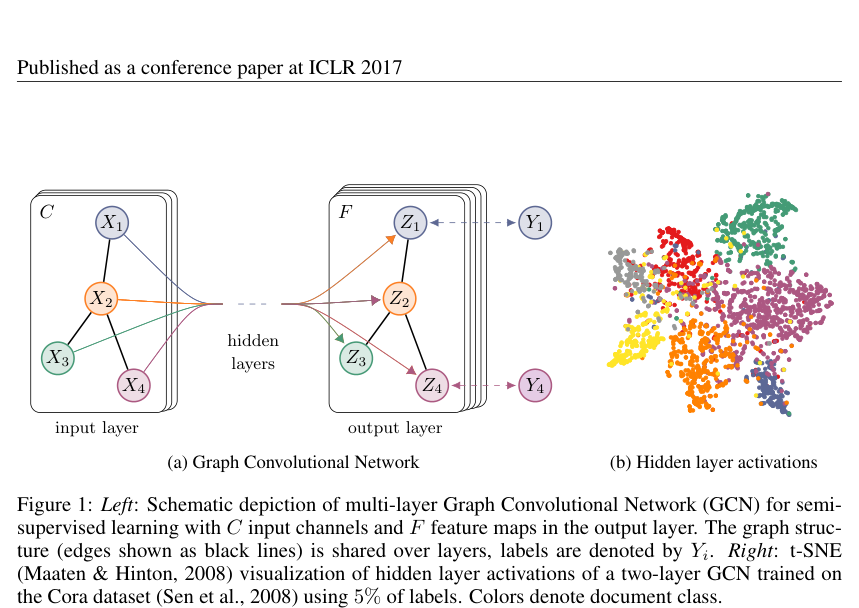

Figure 1a is a schematic diagram showing an input layer with $C$ channels ($X_1$ through $X_4$) connected via black lines to hidden layers, which then map to an output layer with $F$ feature maps ($Z_1$ through $Z_4$) and corresponding labels ($Y_1$ through $Y_4$). Figure 1b is a t-SNE visualization of hidden layer activations from a two-layer GCN trained on the Cora dataset, where colored clusters represent different document classes.

**Inductive Representation Learning on Large Graphs** — arXiv:1706.02216 p.2

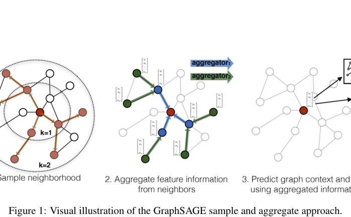

The figure consists of three sequential diagrams illustrating the GraphSAGE approach. It uses nodes (circles) and edges (lines) to show the process of sampling a neighborhood (k=1, k=2), aggregating feature information from neighbors using labeled blue arrows and "aggregator" boxes, and finally predicting graph context using the aggregated information.

**How Powerful are Graph Neural Networks?** — arXiv:1810.00826 p.3

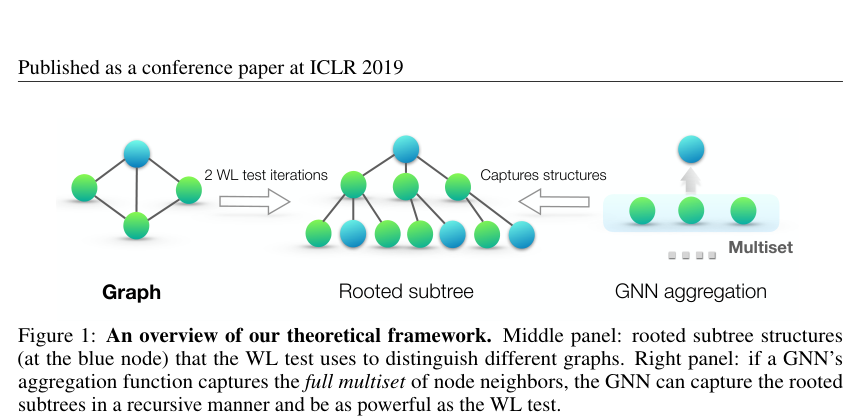

The figure illustrates a conceptual framework showing a transition from a "Graph" to a "Rooted subtree" via "2 WL test iterations," followed by a "GNN aggregation" step. An arrow labeled "Captures structures" connects a "Multiset" of green nodes to the rooted subtree, conveying that if a GNN's aggregation function captures the full multiset of node neighbors, it can capture rooted subtrees recursively and match the power of the WL test.

**Graph Attention Networks** — arXiv:1710.10903 p.4

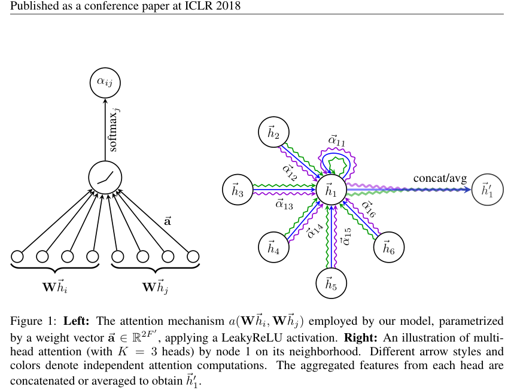

The figure consists of two diagrams: the left shows a computational flow where inputs $\mathbf{W}\vec{h}_i$ and $\mathbf{W}\vec{h}_j$ are processed through a LeakyReLU activation and a softmax function to produce the attention coefficient $\alpha_{ij}$. The right diagram illustrates multi-head attention for node $\vec{h}_1$ by showing multiple colored and styled arrows (representing different attention heads) connecting $\vec{h}_1$ to its neighbors $\vec{h}_2$ through $\vec{h}_6$, which are then concatenated or averaged to produce the output $\vec{h}'_1$.

**Neural Message Passing for Quantum Chemistry** — arXiv:1704.01212 p.1

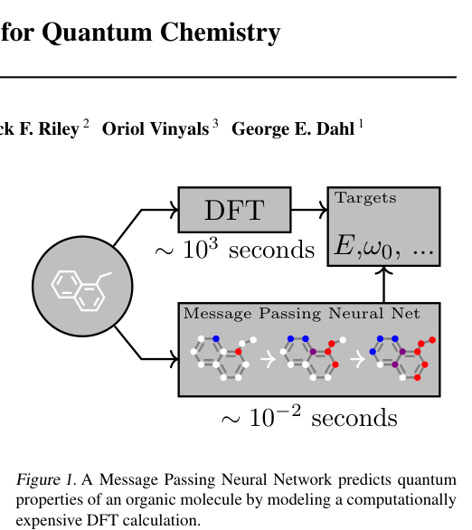

The figure consists of a central grey circle containing a molecular structure with two arrows pointing to two separate rectangular boxes. The top box represents a "DFT" calculation that takes approximately $10^3$ seconds to produce "Targets" ($E, \omega_0, \dots$), while the bottom box represents a "Message Passing Neural Net" that takes approximately $10^{-2}$ seconds to process the molecule. The diagram conveys that the neural network serves as a significantly faster alternative to computationally expensive DFT calculations for predicting quantum properties.

**Convolutional Neural Networks on Graphs with Fast Localized Spectral
  Filtering** — arXiv:1606.09375 p.2

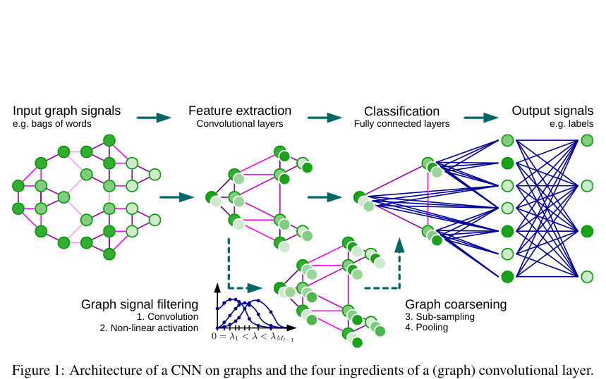

The figure depicts a flowchart of a Graph Convolutional Neural Network (GCNN) architecture, using arrows to connect four stages: Input graph signals, Feature extraction (convolutional layers), Classification (fully connected layers), and Output signals. Below the main flow, two call-out diagrams use dashed arrows to detail the components of a convolutional layer, illustrating "Graph signal filtering" via a spectral plot and "Graph coarsening" through a smaller, sub-sampled graph.

**A Comprehensive Survey on Graph Neural Networks** — arXiv:1901.00596 p.2

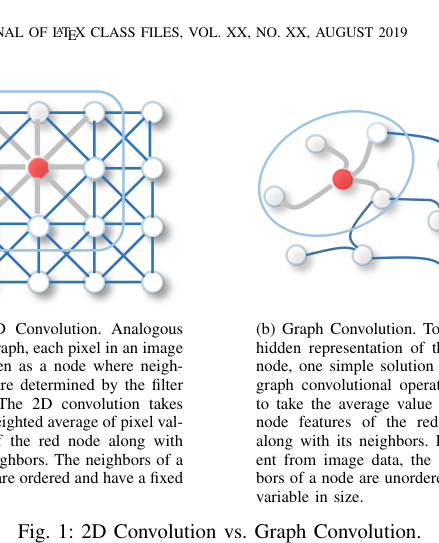

The figure consists of two side-by-side diagrams, (a) and (b), comparing 2D convolution to graph convolution. Diagram (a) shows a regular grid of blue nodes with a central red node connected to its immediate neighbors in a fixed, ordered structure, while diagram (b) shows a red node connected to an irregular, unordered set of blue nodes within a non-grid shape. The figure conveys that 2D convolution operates on fixed, ordered neighbor structures, whereas graph convolution operates on irregular, unordered neighbor sets.

**Spectral Networks and Locally Connected Networks on Graphs** — arXiv:1312.6203 p.3

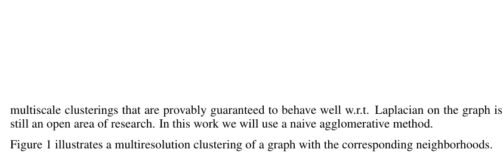

The figure illustrates a multiresolution clustering of a graph by showing a network of nodes and edges alongside their corresponding hierarchical neighborhoods. It uses a series of diagrams to convey how different levels of clustering group nodes into increasingly larger, nested sets.

**Are GNNs doomed by the topology of their input graph?** — arXiv:2502.17739 p.2

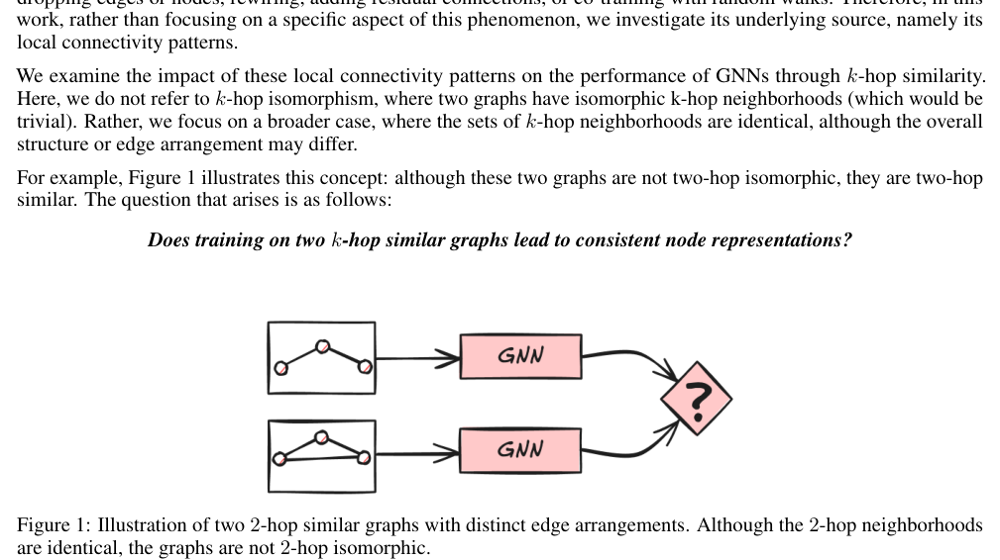

The figure displays two separate boxes containing small graph diagrams, each with an arrow pointing to a corresponding "GNN" box. These two GNN boxes then point to a single diamond-shaped box containing a question mark. The illustration conveys the research question of whether training on two different graphs that share identical $k$-hop neighborhoods (but are not isomorphic) results in consistent node representations.

**Generative Graph Pattern Machine** — arXiv:2505.16130 p.1

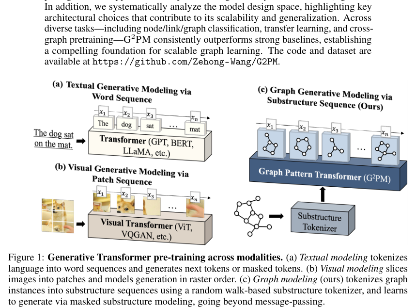

The figure presents three diagrams (a, b, and c) illustrating generative transformer pre-training across different modalities. Panels (a) and (b) show textual modeling via word sequences and visual modeling via patch sequences, respectively, using arrows to map inputs to transformer architectures. Panel (c) depicts the proposed graph modeling approach, where a graph is processed by a "Substructure Tokenizer" to create a substructure sequence ($x_1$ to $x_n$) that is then input into a "Graph Pattern Transformer ($G^2PM$)."

**Towards Efficient Training of Graph Neural Networks: A Multiscale Approach** — arXiv:2503.19666 p.2

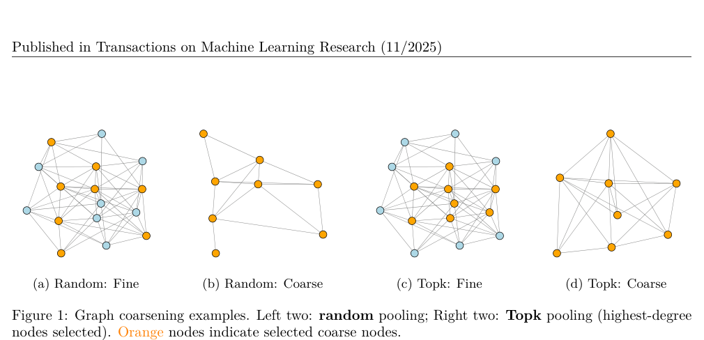

The figure displays four network diagrams consisting of nodes (circles) connected by edges (lines), labeled (a) through (d) as "Fine" or "Coarse" versions of "Random" or "Topk" pooling. The diagrams compare random pooling (left) with Topk pooling (right), where orange nodes represent selected coarse nodes and light blue nodes represent discarded nodes.

**Transformers are Graph Neural Networks** — arXiv:2506.22084 p.2

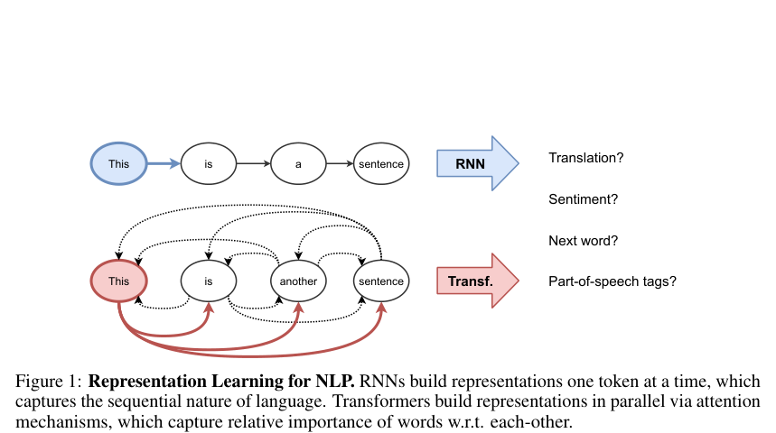

The figure compares two architectural approaches for processing language through diagrams of word sequences and arrows. The top sequence shows words connected linearly by arrows to an "RNN" block, representing sequential processing, while the bottom sequence shows words connected to each other via bidirectional, non-linear arrows to a "Transf." block, representing parallel attention mechanisms. To the right, a list of NLP tasks (Translation, Sentiment, Next word, and Part-of-speech tags) is presented as potential applications for both models.

**EdgeGFL: Rethinking Edge Information in Graph Feature Preference
  Learning** — arXiv:2502.02302 p.1

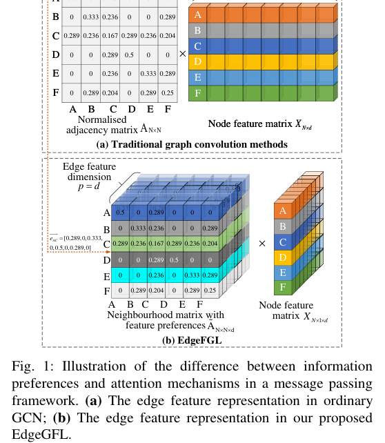

Figure 1 compares edge feature representations in traditional graph convolution methods (a) and the proposed EdgeGFL (b). Panel (a) shows a normalized adjacency matrix $A_{N \times N}$ multiplied by a node feature matrix $X_{N \times d}$, while panel (b) illustrates a neighborhood matrix $A_{N \times N \times d}$ multiplied by a node feature matrix $X_{N \times 2 \times d}$ to incorporate edge information.
