*deep research · 2 round(s) · 120 landmarks · frontier≥2023: 77 · 4 full-PDF critiques · grounded 49 · off-digest 0*

# From Textual Prediction to Autonomous Agency: A Review of LLM-Based Tool Use and Agentic Systems

The rapid evolution of large language models has shifted the focus from simple text generation to the pursuit of functional autonomy. While the *Foundations of Language Modeling and Reasoning* established the capacity for sophisticated linguistic pattern matching, these models inherently suffer from a lack of grounding in external reality and an inability to perform precise, non-linguistic tasks. To bridge this gap, the paradigm has shifted toward agentic behavior, where models are no longer mere predictors but active participants capable of interacting with external environments. This transition is critical because the utility of artificial intelligence is increasingly measured by its ability to execute complex, multi-step workflows that require more than just internal knowledge.

This review traces the trajectory of this evolution, beginning with the transition from static models to *Early Tool Integration and Augmented Language Models* that first allowed for external API and software interaction. We then examine the scaling of these capabilities, moving *From Single-Task Agents to Multi-Agent Systems* where collaborative intelligence becomes a central theme. The scope extends further into the physical realm through the study of *Embodied Agents and Real-World Interaction*, representing the move from digital interfaces to physical environments. After synthesizing current *

## Foundations of Language Modeling and Reasoning

The evolution of large language model (LLM) capabilities is rooted in the transition from specialized architectural designs to massive-scale autoregressive models capable of emergent reasoning. The foundational shift began with the introduction of the Transformer architecture (arXiv:1706.03762), which replaced recurrence and convolutions with attention mechanisms. This encoder-decoder configuration established the structural basis for subsequent advancements in machine translation, achieving BLEU scores of 28.4 on WMT 2014 English-to-German (arXiv:1706.03762). While the Transformer provided the mechanism, BERT (arXiv:1810.04805) expanded this by introducing deep bidirectional representations, conditioning on both left and right context. This bidirectional approach significantly improved performance on natural language understanding tasks, such as achieving a 93.2 F1 score on SQuAD v1.1 (arXiv:1810.04805).

A critical divergence in the literature occurs between bidirectional understanding and autoregressive generation. GPT-3 (arXiv:2005.14165) shifted the focus toward massive-scale autoregressive modeling with 175 billion parameters, demonstrating that tasks could be performed via text-based interaction and few-shot demonstrations without gradient updates. While GPT-3 proved the utility of scale across translation and arithmetic tasks (arXiv:2005.14165), later work by InstructGPT (arXiv:2203.02155) addressed the alignment of these models with user intent. By utilizing a two-stage fine-tuning process—supervised learning followed by reinforcement learning from human feedback (RLHF)—InstructGPT moved beyond mere next-token prediction to better follow specific instructions (arXiv:2203.02155).

The ability of these models to perform complex reasoning represents a more recent frontier. Chain-of-Thought (CoT) prompting (arXiv:2201.11903) introduced a novel planning strategy where models generate intermediate natural language reasoning steps. This method leverages the emergent abilities of scale, such as the 540B-parameter PaLM model, to achieve state-of-the-art accuracy on the GSM8K math benchmark (arXiv:2201.11903). However, CoT prompting possesses inherent limitations: it relies on the manual composition of exemplars and offers no formal guarantee of logical correctness in the generated paths (arXiv:2201.11903). Despite these weaknesses, CoT provides an interpretable mechanism essential for decomposing multi-step tasks. This trajectory toward multimodal and high-performance reasoning culminates in GPT-4 (arXiv:2303.08774), a Transformer-based multimodal model that integrates image and text inputs to achieve human-level performance on professional benchmarks, such as passing the simulated bar exam in the top 10% of test takers (arXiv:2303.08774).

## Early Tool Integration and Augmented Language Models

The evolution of language models from static parametric systems to interactive agents is marked by a transition from simple retrieval-augmented generation to complex, multi-step tool orchestration. Early efforts focused on augmenting the model's internal knowledge through non-parametric memory. For instance, arXiv:2005.11401 introduced a framework combining a pre-trained seq2seq model with a dense vector index of Wikipedia, allowing the model to access external information via a neural retriever to improve factuality in knowledge-intensive tasks.

As the field progressed, research shifted toward integrating reasoning with active environmental interaction. ReAct (arXiv:2210.03629) advanced this by interleaving verbal reasoning traces with task-specific actions, creating a "reason-to-act" and "act-to-reason" synergy. This closed-loop approach allows models to update plans based on external feedback, such as Wikipedia API results. While ReAct demonstrates significant few-shot advantages—outperforming baselines by 34% in ALFWorld and 10% in WebShop—it remains vulnerable to repetitive reasoning loops and is highly dependent on tool quality, with 23% of errors in HotpotQA attributed to non-informative search results (arXiv:2210.03629).

A parallel development focused on specialized symbolic reasoning through programmatic tools. PAL (arXiv:2211.10435) utilizes a hybrid architecture where the LLM decomposes natural language problems into Python code, which is then executed by a symbolic interpreter. This approach yields a 15% top-1 improvement on GSM8K compared to PaLM-540B, demonstrating the strength of offloading mathematical and algorithmic logic to deterministic executors.

Further sophistication is seen in the transition from manual prompting to self-supervised and controller-based architectures. Toolformer (arXiv:2302.04761) represents a shift toward autonomy, where models are trained via self-supervised learning to decide when and how to call APIs, passing arguments and incorporating results directly into token prediction. This contrasts with the controller-based paradigm of HuggingGPT (arXiv:2303.17580), which uses an LLM to manage a diverse ecosystem of existing AI models (vision, speech, etc.) by decomposing user requests into subtasks and selecting models based on Hugging Face function descriptions.

Finally, the scale of tool integration has expanded to encompass massive API libraries. Gorilla (arXiv:2305.15334) addresses the challenge of vast API documentation by combining a fine-tuned LLaMA-based model with a document retriever. Unlike the specialized focus of PAL on Python execution, Gorilla utilizes retrieval-augmented generation to navigate complex API ecosystems like HuggingFace and TorchHub, providing a scalable method for connecting LLMs to diverse, large-scale external software interfaces.

## From Single-Task Agents to Multi-Agent Systems

The evolution of large language model (LLM) research has shifted from isolated agent execution toward complex multi-agent systems (MAS) designed to mimic human social and professional dynamics. Early foundational work, such as CAMEL, introduced a communicative framework based on role-playing and "inception prompting" to guide agents through autonomous cooperation [arXiv:2303.17760]. By establishing a communicative interaction loop between agents, CAMEL focuses on maintaining consistency with human intentions through structured role-play [arXiv:2303.17760]. This concept of role-based interaction serves as a precursor to more specialized frameworks that move beyond general conversation toward structured task execution.

While CAMEL emphasizes communicative exploration, MetaGPT introduces a more rigid, professionalized architecture by incorporating Standardized Operating Procedures (SOPs) into prompt sequences [arXiv:2308.00352]. Unlike the open-ended role-playing in CAMEL, MetaGPT utilizes an "assembly line paradigm" where diverse agents with domain expertise work together to break down complex tasks into subtasks [arXiv:2308.00352]. This approach prioritizes the reduction of errors through human-like verification of intermediate results, making it particularly effective for collaborative software engineering [arXiv:2308.00352]. In contrast to MetaGPT's structured SOPs, AutoGen offers a more flexible alternative, enabling customizable, conversable agents that can be programmed via natural language or computer code [arXiv:2308.08155]. AutoGen expands the interaction loop by allowing agents to combine LLMs with human inputs and tools, supporting a wide array of domains including mathematics, coding, and operations research [arXiv:2308.08155].

Other research explores the emergent properties and specific cognitive strategies within these systems. AgentVerse moves away from fixed roles to focus on human-like group dynamics, allowing for a framework that can dynamically adjust its composition to achieve a "greater-than-the-sum-of-its-parts" effect [arXiv:2308.10848]. This contrasts with the more predefined structures of MetaGPT or the programmed patterns of AutoGen by emphasizing emergent social behaviors [arXiv:2308.10848]. Furthermore, specialized collaboration strategies have been developed for reasoning tasks; for instance, one approach emulates the academic peer review process, where agents independently construct solutions, assign confidence levels, and revise their work based on peer feedback [arXiv:2311.08152]. This iterative loop of construction and review provides a structured mechanism for improving accuracy in complex reasoning [arXiv:2311.08152]. Collectively, these developments represent a transition from simple instruction-following [arXiv:2303.17760] to sophisticated, multi-faceted systems capable of complex problem-solving and world simulation [arXiv:2402.01680].

## Embodied Agents and Real-World Interaction

The integration of Large Language Models (LLMs) into embodied agents has evolved from high-level semantic planning to sophisticated, closed-loop control and lifelong learning. Early approaches focused on bridging the gap between abstract language and physical feasibility. For instance, arXiv:2204.01691 proposed a hybrid architecture where an LLM provides high-level semantic knowledge to decompose complex instructions, but these proposals are constrained by pretrained low-level skills and value functions to ensure physical grounding. This contrasts with more recent multimodal approaches like PaLM-E (arXiv:2303.03378), which moves away from hybrid modularity toward a single, unified embodied multimodal model. PaLM-E interleaves visual, continuous state estimation, and textual encodings to perform sequential robotic manipulation planning, effectively integrating perception and reasoning into a single model.

A critical dimension in this evolution is the transition from open-loop prompting to closed-loop interaction. While arXiv:2204.01691 uses the robot as the "hands and eyes" for the LLM, arXiv:2207.05608 introduces the "Inner Monologue" framework, which emphasizes a continuous reasoning loop. This framework processes environmental feedback—such as scene descriptions and success detection—to adjust planning dynamically. A similar emphasis on reactive control is found in "Code as Policies" (arXiv:2209.07753), which utilizes Language Model Programs (LMPs) to synthesize Python code. Unlike purely semantic planners, this method uses code to process perception outputs (e.g., object detectors) to parameterize control APIs, achieving a 39.8% success rate on the HumanEval benchmark.

The complexity of interaction also extends to digital and open-ended environments. In the digital realm, WebArena (arXiv:2307.13854) provides a realistic environment for web-based tasks, evaluating agents on functional correctness in e-commerce and software development, noting a significant performance gap between GPT-4 (14.41%) and humans (78.24%). In contrast, for open-ended exploration in Minecraft, Voyager (arXiv:2305.16291) demonstrates a shift toward lifelong learning. Voyager utilizes an automatic curriculum and an ever-growing skill library of executable code, employing an iterative prompting mechanism to incorporate execution errors and self-verification. This allows for significant improvements in exploration efficiency, such as unlocking tech tree milestones up to 15.3x faster than baseline methods.

While these advancements show progress, the methods differ significantly in their handling of "tools." Some architectures, like arXiv:2209.07753, treat API calls as programmable components, whereas Voyager (arXiv:2305.16291) treats previously written code as a retrievable skill library. This distinction highlights a move from immediate task execution toward the accumulation of long-term, reusable embodied intelligence.

## Comprehensive Surveys and Methodological Frameworks

The literature regarding large language model (LLM) agents has evolved from establishing foundational structural definitions to developing highly specialized methodological paradigms. Early survey work established a broad tripartite architecture comprising the brain, perception, and action components [arXiv:2309.07864], covering a wide range of application domains including single-agent, multi-agent, and human-agent cooperation [arXiv:2309.07864]. This foundational framework was subsequently refined by [arXiv:2401.03428], which introduced more granular multi-agent dynamics, such as multi-role collaboration and message passing, while emphasizing an interaction loop driven by tool utilization and environmental feedback.

A significant shift in the literature is the transition from general structural components toward specific, role-based cognitive frameworks. While earlier works provided a high-level overview of agent components, [arXiv:2406.05804] offers a more specialized paradigm centered on LLM-profiled roles (LMPRs). This approach categorizes agents into distinct functional entities, such as policy models, evaluators, and dynamic models, and focuses on the integration of tool use (including RAG), planning, and feedback learning. This role-based granularity contrasts with the broader cognitive mechanism approach presented in [arXiv:2508.17281], which organizes agent capabilities around reasoning, planning, and memory to manage sequential tasks and adapt through feedback.

Methodological emphasis also varies across the surveys, particularly regarding the technical drivers of autonomy. [arXiv:2404.04442] highlights the importance of prompting, reasoning, tool utilization, and in-context learning as the core techniques enabling agentic behavior. In contrast, [arXiv:2401.03428] focuses on the breadth of application domains, ranging from coding and social interactions to economic sectors. The scope of these applications also demonstrates divergence; for instance, [arXiv:2404.04442] identifies specialized utility in healthcare and customer service, whereas [arXiv:2309.07864] maintains a more generalized focus on agent scenarios.

Finally, the literature shows a progression toward more rigorous and diverse evaluation methodologies. [arXiv:2404.04442] identifies specific, established platforms for assessment, such as AgentBench, WebArena, and ToolLLM. This is complemented by the extensive analysis in [arXiv:2508.17281], which provides a much broader empirical foundation by evaluating 68 publicly available datasets and current assessment protocols. Collectively, these works demonstrate a clear trajectory in the field: moving from defining the basic anatomy of an agent [arXiv:2309.07864] to detailing the complex, role-driven workflows [arXiv:2406.05804] and the comprehensive benchmarks required to validate them [arXiv:2508.17281].

## The Frontier: Advanced Agentic Reasoning and Orchestration

Recent advancements in large language model (LLM) agents represent a shift from simple tool invocation toward sophisticated multi-tool orchestration and complex reasoning paradigms [arXiv:2603.22862]. A foundational contribution to this evolution is the establishment of a unified "Agentic Reasoning" paradigm, which organizes agentic behavior into three hierarchical layers: foundational (single-agent planning and tool use), self-evolving (feedback and memory), and collective (multi-agent coordination) [arXiv:2601.12538]. This paradigm is strengthened by a rigorous mathematical formalization using a POMDP framework, which explicitly factorizes the agent's policy into internal reasoning ($\pi_{reason}$) and external execution ($\pi_{exec}$) [arXiv:2601.12538]. However, the framework's taxonomy is not without flaws; the distinction between "in-context" and "post-training" mechanisms is occasionally blurred, particularly where "Self-evolving" layers overlap with "Parametric Adaptation" [arXiv:2601.12538].

To manage the computational overhead of these advanced reasoning processes, research has diverged into two primary optimization strategies: structural tool selection and adaptive reasoning escalation. AutoTool optimizes efficiency by utilizing a graph-based framework that models tool usage inertia through directed graphs constructed from historical trajectories [arXiv:2511.14650]. By traversing these graphs to select tools and parameters, it bypasses repeated LLM invocations, reducing inference costs by up to 30% [arXiv:2511.14650]. Conversely, AgentCollab approaches efficiency through a difficulty-aware cumulative escalation strategy within a two-level small-large model setting [arXiv:2603.26034]. Rather than relying on historical transition probabilities, AgentCollab uses an agent's own self-reflection signals to trigger the escalation of reasoning budgets to stronger models only when failure signals are detected, aiming to optimize the accuracy-efficiency Pareto frontier [arXiv:2603.26034].

Planning methodologies are also evolving from discrete action selection toward more continuous and reward-driven trajectory modeling. One approach scales autonomous agents by employing an automatically learned reward model to evaluate action trajectories, providing heuristics for task planning in domains such as scientific reasoning, mathematics, and online shopping [arXiv:2502.12130]. This discrete, reward-scored approach contrasts sharply with FlowAgent, which reconceptualizes tool chaining as a continuous flow [arXiv:2605.07339]. Instead of selecting discrete steps, FlowAgent uses conditional flow matching to generate continuous latent trajectories within a semantic space, offering a global planning perspective for long-horizon reasoning in dynamic, real-world environments [arXiv:2605.07339]. Together, these developments illustrate a trajectory moving from reactive tool use toward proactive, mathematically formalized, and computationally efficient cognitive orchestration.

## Tensions and Open Problems

A fundamental debate persists regarding the optimal mechanism for eliciting complex reasoning within language models. One school of thought emphasizes the importance of sampling multiple reasoning paths to find a consensus, as demonstrated by the self-consistency approach in arXiv:2203.11171. However, this is challenged by the notion that reasoning can be more effectively prompted through explicit instruction, where the model is guided to "think step by step" without necessarily requiring multiple samples, a concept explored in arXiv:2205.11916. This tension extends into the domain of computational execution: while some argue for the necessity of disentangling linguistic reasoning from mathematical computation via specialized prompting strategies like Program of Thoughts (arXiv:2211.12588), others advocate for a more integrated approach where the model directly generates executable code to solve problems, as seen in the Program-aided Language Models (arXiv:2211.10435) framework.

Another significant tension lies in the architecture of agentic planning and interaction. Current research is divided between models that rely on high-level, autonomous decision-making and those that require more structured, interactive feedback loops. For instance, the "Describe, Explain, Plan and Select" framework in arXiv:2302.01560 argues that existing agents often lack the necessary interactive depth, critiquing the relatively static nature of generative agents in arXiv:2304.03442 and the verbal reinforcement loops in arXiv:2303.11366. This critique is furthered by the observation that purely linguistic planning can be insufficient for complex tasks; while some models attempt to ground language in robotic actions (arXiv:2204.01691), others suggest that true reliability requires marrying LLM reasoning with optimal, formal planning algorithms, as proposed in the LLM+P paradigm (arXiv:2304.11477).

Finally, the field faces a critical disagreement concerning the scalability and sophistication of tool use. Early approaches focused on browser-assisted question answering through human feedback (arXiv:2112.09332), but more recent work suggests that models should instead learn to teach themselves to use tools through self-supervised learning (arXiv:2302.04761). This evolution has led to a conflict between the use of specialized, narrow tool-learning benchmarks like API-Bank (arXiv:2304.08244) or ToolAlpaca (arXiv:2306.05301) and the need for massive, diverse tool ecosystems. As argued in arXiv:2307.16789, existing benchmarks often fail to capture the true breadth of tool mastery required for real-world application, necessitating a move toward more comprehensive and scalable tool-augmented architectures.

## Outlook

The frontier of the field is rapidly shifting from isolated reasoning tasks toward the development of holistic "Agentic AI" (arXiv:2601.12560). We are moving beyond simple single-tool calls toward complex multi-tool orchestration (arXiv:2603.22862) and the integration of tools as continuous flows that evolve alongside agentic reasoning (arXiv:2605.07339). As the focus transitions toward edge intelligence (arXiv:2604.09607) and personalized interoperability (arXiv:2605.18067), the next generation of research will likely prioritize self-evaluating collaborative paradigms (arXiv:2603.26034) that allow agents to operate autonomously within increasingly complex, real-world environments.

---

## Key Figures

**Chain-of-Thought Prompting Elicits Reasoning in Large Language Models** — arXiv:2201.11903 p.1

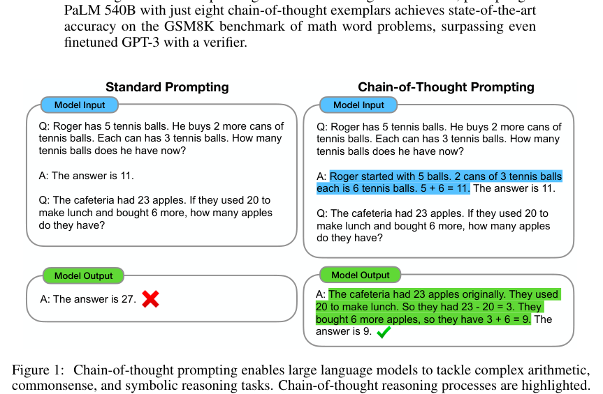

The figure compares "Standard Prompting" and "Chain-of-Thought Prompting" through two side-by-side examples of model inputs and outputs. Each example uses text boxes to display a question (Q) and an answer (A), with the Chain-of-Thought version featuring a blue highlighted reasoning process that leads to a correct answer (marked with a green check), whereas the Standard Prompting version shows an incorrect answer (marked with a red X).

**ReAct: Synergizing Reasoning and Acting in Language Models** — arXiv:2210.03629 p.2

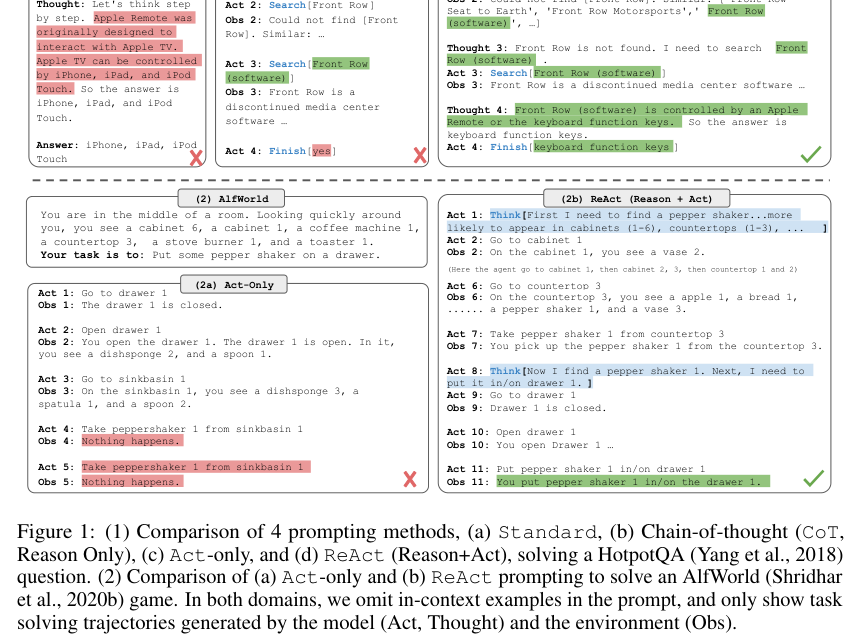

The figure presents two panels comparing different prompting methods for language models. The top panel compares "Standard" and "Chain-of-thought" approaches for a HotpotQA question, while the bottom panel compares "Act-only" and "ReAct (Reason + Act)" approaches for an AlfWorld task, using text boxes to display the model's thoughts, actions, observations, and final answers. The figure conveys that the ReAct method, which interleaves reasoning traces with task-specific actions, achieves a correct answer (indicated by a green checkmark) where the Act-only method fails (indicated by a red X).

**Language Models are Few-Shot Learners** — arXiv:2005.14165 p.3

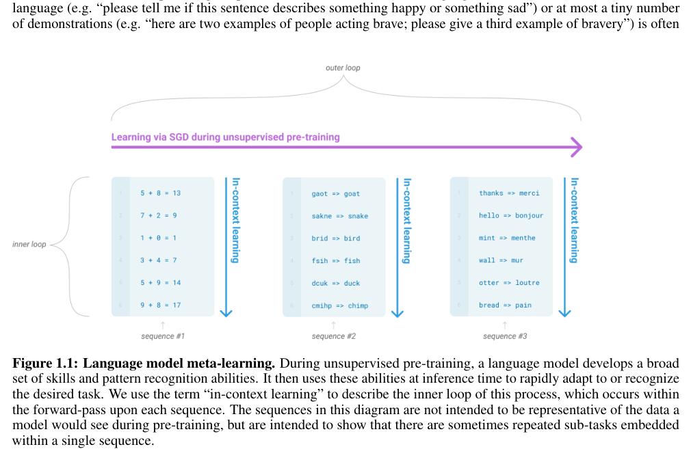

The figure uses a hierarchical diagram with brackets to illustrate the relationship between an "outer loop" of unsupervised pre-training via SGD and an "inner loop" of in-context learning. The outer loop is represented by a long purple arrow, while the inner loop consists of three separate light-blue boxes labeled "sequence #1," "#2," and "#3," each containing a series of task demonstrations (arithmetic, translation, etc.) followed by a vertical "in-context learning" label. The diagram conveys that pre-training enables the model to perform rapid adaptation to new tasks within a single sequence at inference time.

**GPT-4 Technical Report** — arXiv:2303.08774 p.3

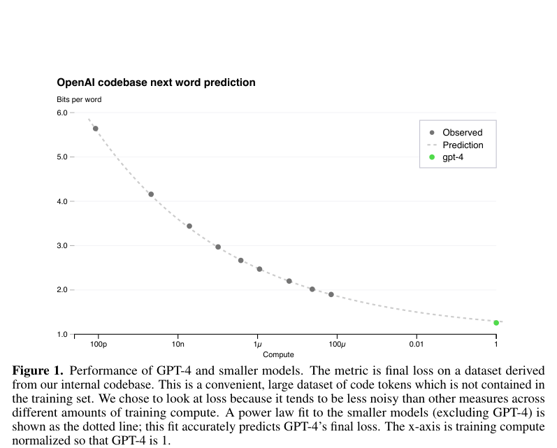

This scatter plot shows the relationship between compute (x-axis, log scale) and bits per word (y-axis) for next-word prediction on an OpenAI codebase. Gray dots represent observed performance for smaller models, a dashed line shows a power law fit to those observations, and a single green dot represents GPT-4's performance. The figure conveys that GPT-4's loss aligns with the scaling trends predicted by smaller models.

**Toolformer: Language Models Can Teach Themselves to Use Tools** — arXiv:2302.04761 p.1

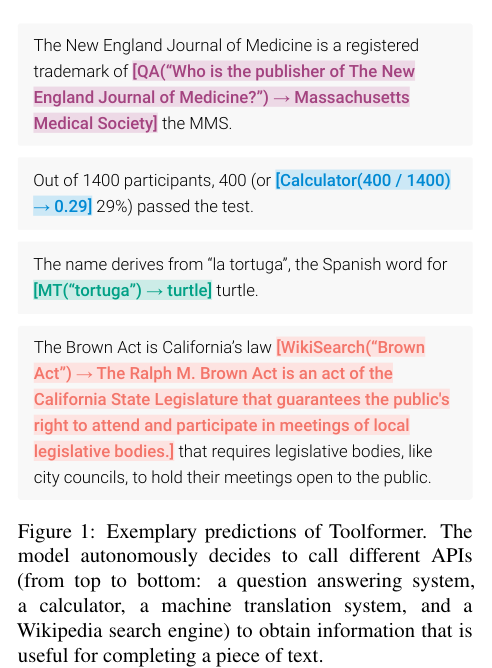

The figure displays several text blocks containing model-generated sentences interspersed with bracketed API calls and their corresponding outputs. These calls, shown in colored text, include examples of a question-answering system, a calculator, a machine translation system, and a Wikipedia search engine used to complete the surrounding text.

**Reflexion: Language Agents with Verbal Reinforcement Learning** — arXiv:2303.11366 p.3

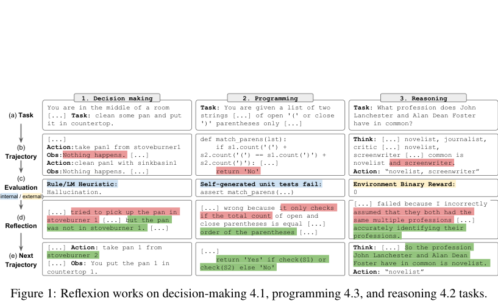

The figure is a flowchart consisting of five horizontal layers labeled (a) Task, (b) Trajectory, (c) Evaluation, (d) Reflection, and (e) Next Trajectory, organized into three vertical columns representing "1. Decision making," "2. Programming," and "3. Reasoning." It uses boxes to represent specific text inputs, actions, and reasoning steps, connected by vertical arrows to convey a cyclical process where an agent performs a task, receives feedback, reflects on its errors, and generates a new trajectory.

**A Survey on Large Language Model based Autonomous Agents** — arXiv:2308.11432 p.2

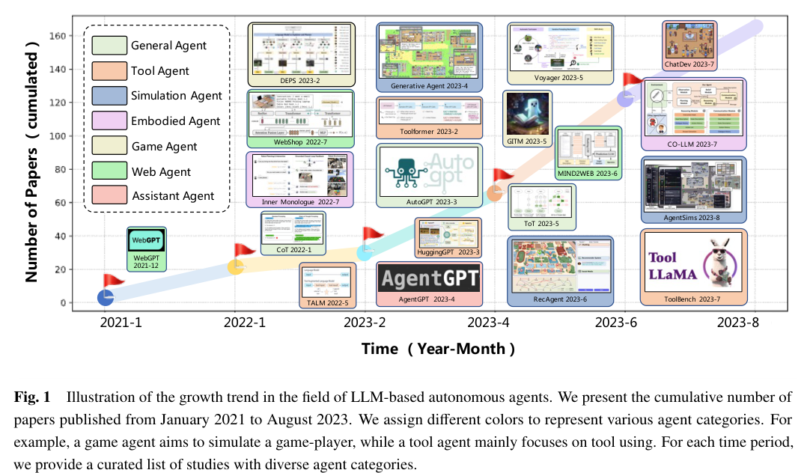

This figure is a line graph showing the cumulative number of papers published over time from January 2021 to August 2023, categorized by different agent types (General, Tool, Simulation, Embodied, Game, Web, and Assistant agents) represented by colored shaded areas. Various rectangular callout boxes containing screenshots or labels are placed along the timeline to highlight specific representative studies, such as AutoGPT, AgentGPT, and ToolLLaMA, corresponding to their respective publication periods.

**Training language models to follow instructions with human feedback** — arXiv:2203.02155 p.2

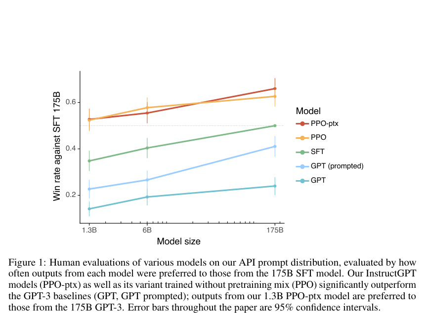

This line graph plots the "Win rate against SFT 175B" on the y-axis against "Model size" (1.3B, 6B, and 175B) on a logarithmic x-axis. It compares the performance of five models—PPO-ptx, PPO, SFT, GPT (prompted), and GPT—using colored lines with error bars representing 95% confidence intervals. The figure conveys that the InstructGPT models (PPO-ptx and PPO) achieve higher win rates across all model sizes compared to the GPT baselines.

**Agentic Reasoning for Large Language Models** — arXiv:2601.12538 p.2

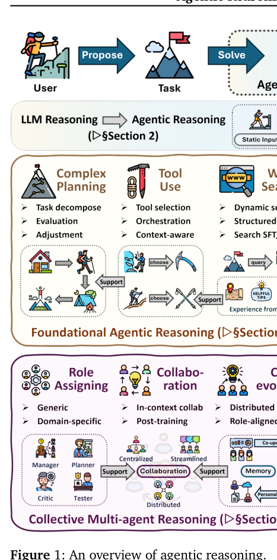

The figure uses a hierarchical flowchart with boxes, arrows, and icons to illustrate the progression from LLM reasoning to agentic reasoning. The top panel shows a user proposing a task for an agent to solve, while the middle and bottom panels detail "Foundational Agentic Reasoning" (involving complex planning and tool use) and "Collective Multi-agent Reasoning" (involving role assigning and collaboration).

**Agentic Tool Use in Large Language Models** — arXiv:2604.00835 p.2

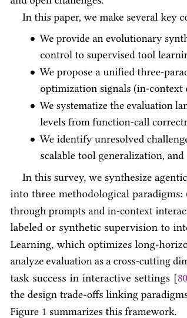

The provided text does not contain a figure, only a paragraph of text describing the paper's contributions and a summary of methodological paradigms. Therefore, there is no figure to describe.

**The Evolution of Tool Use in LLM Agents: From Single-Tool Call to Multi-Tool Orchestration** — arXiv:2603.22862 p.3

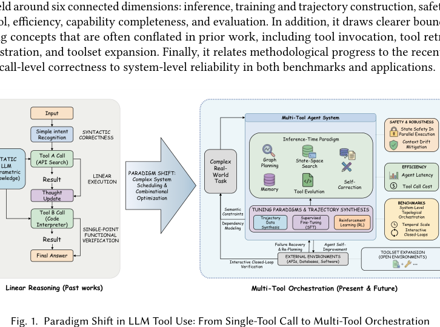

The figure depicts a paradigm shift from "Linear Reasoning" to "Multi-Tool Orchestration" via a large central arrow. The left panel shows a vertical flowchart of a single-tool call process involving input, API search, thought updates, and code interpretation to reach a final answer. The right panel illustrates a complex "Multi-Tool Agent System" containing an inference-time paradigm (graph planning, state-space search, and tool evaluation) integrated with tuning paradigms, trajectory synthesis, and toolset expansion.

**Tools as Continuous Flow for Evolving Agentic Reasoning** — arXiv:2605.07339 p.2

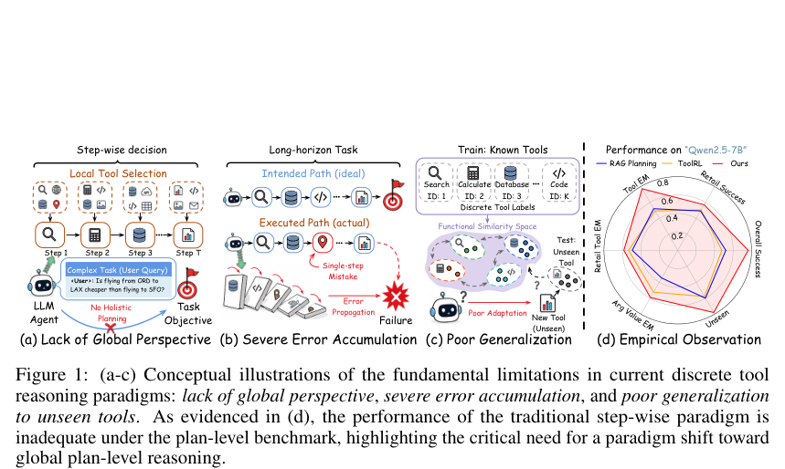

The figure consists of four panels (a-d) illustrating the limitations of step-wise tool use and comparing it to a proposed continuous flow approach. Panels (a) through (c) use diagrams of tool icons, decision paths, and similarity spaces to conceptually demonstrate how local tool selection leads to a lack of global perspective, error propagation in long-horizon tasks, and poor adaptation to unseen tools. Panel (d) presents a radar chart comparing RAG, ToolRL, and the proposed method ("Ours") across axes for Tool EM, Retail Success, Overall Success, and Unseen Tool performance on the "Qwen2.5-7B" benchmark.

**AgentCollab: A Self-Evaluation-Driven Collaboration Paradigm for Efficient LLM Agents** — arXiv:2603.26034 p.4

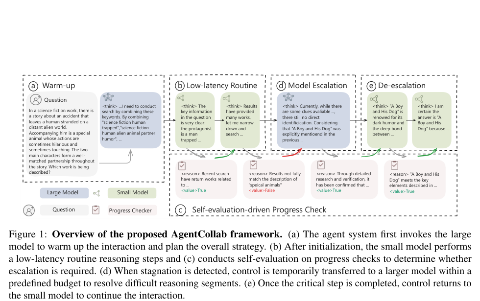

The figure presents a flowchart consisting of four sequential stages—(a) Warm-up, (b) Low-latency Routine, (d) Model Escalation, and (e) De-escalation—connected by arrows to illustrate the AgentCollab framework. Each stage contains text boxes representing "think" processes and "reason" evaluations, showing how a system transitions between a Large Model and a Small Model based on self-evaluation-driven progress checks. The diagram conveys a workflow where a small model handles routine tasks but escalates to a large model when stagnation is detected, before returning to the small model.

**Agentic Artificial Intelligence (AI): Architectures, Taxonomies, and Evaluation of Large Language Model Agents** — arXiv:2601.12560 p.5

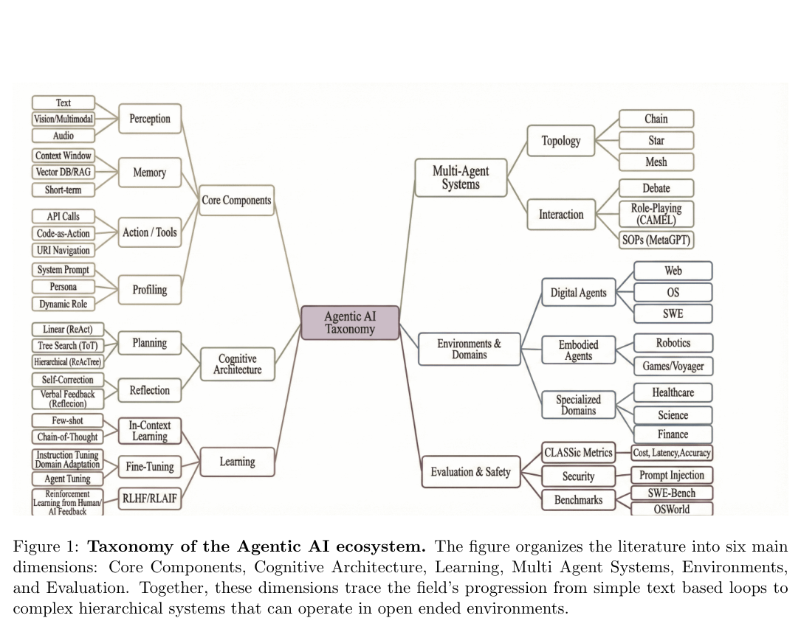

This hierarchical diagram features a central "Agentic AI Taxonomy" box that branches into six primary dimensions: Core Components, Cognitive Architecture, Learning, Multi-Agent Systems, Environments & Domains, and Evaluation & Safety. Each dimension further subdivides into specific sub-categories (e.g., Perception, Planning, Topology, or Security) which are connected via arrows to granular functional elements (e.g., Text, ReAct, Chain, or Prompt Injection). The figure conveys a structured classification of the agentic AI ecosystem, organizing various technical capabilities and research areas into a cohesive taxonomy.
