*deep research · 1 round(s) · 80 landmarks · frontier≥2023: 56 · 6 full-PDF critiques · grounded 38 · off-digest 0*

# From Language Models to Autonomous Actors: A Review of LLM-Based Agents and Tool Integration

The evolution of artificial intelligence has shifted from the pursuit of mere linguistic fluency to the development of functional agency. While the foundations of language modeling and reasoning established the necessary cognitive capacity for pattern recognition and logical inference, these models remain fundamentally constrained by their closed-world nature. To overcome the limitations of static training data and the inability to interact with the external world, the integration of external tools has become a necessity, transforming models from passive text generators into active participants capable of executing complex, multi-step tasks in digital and physical environments.

This review traces the technological arc of this transition, beginning with the early paradigms for reasoning and tool integration that first enabled models to bridge the gap between linguistic inference and external computation. We then examine the subsequent rise of autonomous agents and multi-agent systems, where individual models evolved into collaborative, goal-oriented entities. The scope of this review expands into specialized agentic applications across software, games, and robotics to illustrate the practical breadth of these capabilities. Finally, we analyze the shift toward advanced tool learning and agentic architectures, concluding at the current frontier of agentic reasoning and autonomous evolution.

## Foundations of Language Modeling and Reasoning

The architectural foundation of modern language modeling is the Transformer, which utilizes attention mechanisms to dispense with recurrence and convolution (arXiv:1706.03762). This architecture has branched into two primary methodologies: bidirectional modeling and autoregressive scaling. BERT (arXiv:1810.04805) utilizes deep bidirectional representations by conditioning on both left and right context, proving effective for natural language processing tasks such as question answering and language inference. In contrast, the autoregressive approach exemplified by GPT-3 (arXiv:2005.14165) focuses on massive scaling to enable "in-context learning."

The transition to GPT-3 marked a significant shift toward task-agnostic adaptation, where models interpret new tasks through purely linguistic instructions without requiring gradient updates (arXiv:2005.14165). This scaling provides notable strengths, such as an 86.4% accuracy on the LAMBADA dataset—an 18% improvement over previous state-of-the-art—but also introduces weaknesses, including inadequate performance on reading comprehension tasks like RACE/QuAC and potential data contamination from web-scale pre-training (arXiv:2005.14165).

While GPT-3 establishes the capacity for instruction following, Chain-of-Thought (CoT) prompting (arXiv:2201.11903) advances this by providing a framework for multi-step reasoning. By including intermediate natural language reasoning steps in the prompt, CoT elicits emergent capabilities in large models, such as PaLM 540B, which achieves state-of-the-art results on the GSM8K math benchmark (arXiv:2201.11903). However, CoT introduces a unique critical vulnerability: the reasoning is not guaranteed to be logically sound, as models often produce "fluent but illogical" chains (arXiv:2201.11903).

To address the alignment of these large-scale models with human intent, InstructGPT (arXiv:2203.02155) moves beyond pure scale by employing a two-stage fine-tuning process involving supervised learning and Reinforcement Learning from Human Feedback (RLHF). This approach aims to improve truthfulness and reduce toxicity compared to standard autoregressive models, though it is noted that these models still remain prone to simple mistakes (arXiv:2203.02155). 

The progression of these technologies suggests a movement toward general intelligence, as seen in GPT-4 (arXiv:2303.12712), which demonstrates capabilities across diverse domains including coding, law, and medicine. However, a fundamental limitation persists: the reliance on the next-word prediction paradigm may represent a ceiling for the development of true artificial general intelligence (arXiv:2303.12712).

## Early Paradigms for Reasoning and Tool Integration

Early efforts in integrating external knowledge focused on augmenting parametric models with non-parametric memory. arXiv:2005.11401 introduced Retrieval-Augmented Generation (RAG), which utilizes a differentiable access mechanism to retrieve a dense vector index of Wikipedia to address the difficulty pre-trained models face in accessing and precisely manipulating world knowledge [arXiv:2005.11401]. While RAG provides a mechanism to condition sequences on retrieved passages, it primarily functions as a retrieval-based augmentation rather than an active agent capable of environmental interaction.

Moving from static retrieval to active environmental navigation, arXiv:2112.09332 developed WebGPT, which integrates a fine-tuned GPT-3 model with a text-based web-browsing environment [arXiv:2112.09332]. Unlike the RAG framework, WebGPT employs imitation learning via behavior cloning and rejection sampling against a reward model trained on human preferences to search and navigate the web for long-form question-answering [arXiv:2112.09332].

A significant evolution occurred with the introduction of frameworks that explicitly interleave reasoning with action. arXiv:2210.03629 proposed ReAct, which creates a "reason-to-act" and "act-to-reason" synergy by interleaving verbal reasoning traces with task-specific actions, such as using the Wikipedia API [arXiv:2210.03629]. This framework addresses the hallucination and error propagation issues inherent in standalone Chain-of-Thought reasoning by grounding the model in external environments [arXiv:2210.03629]. ReAct demonstrates substantial few-shot advantages, outperforming imitation/RL methods by 34% in ALFWorld and 10% in WebShop [arXiv:2210.03629]. However, the framework remains susceptible to repetitive reasoning loops and is highly dependent on tool quality; notably, 23% of errors in HotpotQA were found to stem from non-informative search results [arXiv:2210.03629].

While ReAct focuses on general environmental interaction, arXiv:2211.10435 introduced Program-aided Language models (PAL) to address the logical and arithmetic mistakes LLMs often make during step-by-step decomposition [arXiv:2211.10435]. PAL employs a hybrid architecture where a neural LLM performs problem decomposition, but delegates the actual arithmetic and logical solution steps to a symbolic Python interpreter [arXiv:2211.10435]. This approach is specifically tailored for mathematical and algorithmic tasks, such as those in GSM8K and BIG-Bench Hard [arXiv:2211.10435].

Recent advancements have transitioned toward autonomous tool mastery and orchestration. arXiv:2302.04761 introduced Toolformer, which uses self-supervised learning to teach models to decide when and how to call APIs—such as calculators, search engines, or translation systems—integrating these calls directly into token prediction [arXiv:2302.04761]. This differs from the orchestration model of arXiv:2303.17580, where HuggingGPT uses an LLM-powered controller to manage a suite of existing AI models from communities like Hugging Face [arXiv:2303.17580]. While Toolformer focuses on the model's ability to learn tool usage natively, HuggingGPT emphasizes the LLM's capacity for high-level task planning and subtask execution across diverse modalities, including vision and speech [arXiv:2303.17580].

## The Rise of Autonomous Agents and Multi-Agent Systems

The evolution of large language model (LLM) agents has transitioned from single-agent reasoning to complex, multi-agent collaborative ecosystems. Early advancements focused on enhancing individual agent capabilities through structured reasoning and feedback loops. For instance, ART introduces a framework that utilizes frozen LLMs to automatically generate intermediate reasoning steps as a program, allowing agents to select demonstrations from a task library and pause generation to integrate external tool outputs [arXiv:2303.09014]. While ART focuses on multi-step reasoning for benchmarks like BigBench [arXiv:2303.09014], Reflexion shifts the focus toward iterative self-improvement. Reflexion employs a verbal reinforcement learning mechanism, where agents use linguistic feedback and an episodic memory buffer of reflective text—rather than weight updates—to improve decision-making in sequential tasks such as coding [arXiv:2303.11366].

As research progressed, the emphasis shifted toward social and communicative dynamics. CAMEL established a role-playing paradigm where agents engage in autonomous cooperation through communicative processes guided by "inception prompting" [arXiv:2303.17760]. However, CAMEL's framework is limited by a heavy reliance on human input to guide conversations [arXiv:2303.17760]. This concept of social simulation was significantly expanded by Generative Agents, which utilizes a tripartite architecture of observation, planning, and reflection [arXiv:2304.03442]. By extending LLMs with a natural language memory stream, these agents can exhibit emergent social behaviors, such as coordinating events or forming opinions within a simulated environment [arXiv:2304.03442].

The literature also highlights a move toward structured multi-agent collaboration to solve industrial-scale problems. MetaGPT adopts an "assembly line" paradigm, assigning diverse roles to agents to decompose complex tasks [arXiv:2308.00352]. Crucially, MetaGPT addresses the issue of cascading hallucinations—a common failure mode in naively chained LLM systems—by incorporating Standardized Operating Procedures (SOPs) into prompt sequences to allow for intermediate result verification [arXiv:2308.00352]. This contrasts with more general collaborative frameworks, such as those discussed in arXiv:2306.03314, which explore the integration of external APIs (e.g., the Gorilla model) to facilitate knowledge exchange among agents for AGI-related tasks like software development [arXiv:2306.03314]. Despite these advancements, the field faces persistent challenges; general multi-agent collaboration is still susceptible to looping issues, security risks, scalability constraints, and ethical concerns [arXiv:2306.03314]. Together, these works demonstrate a trajectory from simple tool-use and verbal reflection toward highly structured, role-based social simulations and professional workflows.

## Specialized Agentic Applications: Software, Games, and Robotics

The deployment of Large Language Model (LLM) agents has transitioned from general-purpose reasoning toward highly specialized domains, most notably in software engineering and gaming. In the realm of software engineering, agentic frameworks are increasingly designed to mirror the specific stages of the Software Development Lifecycle (SDLC). ChatDev (arXiv:2307.07924) exemplifies this through a chat-powered framework where specialized agents are organized into a "chat chain" to manage design, coding, and testing phases. This architecture utilizes multi-turn dialogues, employing natural language for design and programming languages for debugging to facilitate "communicative dehallucination" (arXiv:2307.07924). This implementation is contextualized by broader surveys which argue that the efficacy of software agents depends on their ability to perceive and utilize external tools and resources (arXiv:2409.02977) and the synergy between multiple agents and human collaborators (arXiv:2409.02977). Furthermore, the shift toward Multi-Agent Systems (MAS) in software engineering aims to leverage specialized abilities to enhance autonomous problem-solving and system robustness (arXiv:2404.04834).

In contrast to the dialogue-heavy communication protocols seen in software development, agentic applications in gaming require a distinct architectural emphasis. Game agents utilize a unified reference architecture consisting of three core components: memory, reasoning, and perception-action interfaces (arXiv:2404.02039). While software agents primarily focus on communicative coordination through chat-based interaction (arXiv:2307.07924), game agents must manage diverse requirements across six major genres, ranging from the low-latency control demands of action games to the open-ended goal formation required in sandbox environments (arXiv:2404.02039). This necessitates complex communication protocols and organizational models to support large-scale social behaviors and role differentiation (arXiv:2404.02039).

Despite these domain-specific differences, a common thread is the reliance on LLM-based reasoning for autonomous decision-making and complex problem-solving (arXiv:2402.01680). Whether through the planning and memory components of general agents (arXiv:2309.14365) or the specialized coordination mechanisms used for world simulation (arXiv:2402.01680), the core capability remains the LLM's ability to act as a reasoning engine. However, a critical distinction emerges in how these agents interact with their environments: software agents primarily interact through linguistic and programmatic interfaces (arXiv:2307.07924), whereas game agents must bridge the gap between high-level reasoning and low-level perception-action interfaces (arXiv:2404.02039).

## Advanced Tool Learning and Agentic Architectures

Recent advancements in agentic architectures focus on bridging the gap between the linguistic capabilities of Large Language Models (LLMs) and the structured requirements of external APIs. A primary challenge identified in early specialized models is the tendency of standard LLMs, such as GPT-4, to hallucinate incorrect API usage or fail to generate accurate input arguments (arXiv:2305.15334). To mitigate this, Gorilla (arXiv:2305.15334) introduces a fine-tuned LLaMA-based architecture that integrates a document retriever. This retrieval-augmented generation framework allows the model to adapt to documentation changes at test-time, specifically targeting API calls for platforms like HuggingFace and TorchHub.

Building upon the need for scale, ToolLLM (arXiv:2307.16789) expands this capability by mastering over 16,000 real-world RESTful APIs. While Gorilla focuses on retrieval-augmented accuracy, ToolLLM introduces a more complex reasoning framework using a depth-first search-based decision tree algorithm. This allows the agent to evaluate multiple reasoning traces and expand its search space across 49 API categories. ToolLLM's architecture, ToolLLaMA, utilizes a neural API retriever to recommend tools, addressing the limitation that current instruction tuning in open-source models often ignores the specific nuances of the tool-use domain (arXiv:2307.16789).

The methodology for tool integration has also shifted toward automation and programming. The AutoTools framework (arXiv:2405.16533) moves away from manual parsing—which requires domain expertise and struggles to scale—by automatically transforming tool documentation into callable functions. By integrating these functions into executable programs, AutoTools grounds tool-use actions directly into the model's reasoning process through syntax and runtime verification. In contrast, more structured methodologies like the 7-step approach in arXiv:2412.13233 focus on task decomposition and the generation of training data to ensure syntactically and semantically aligned API calls, specifically for on-device applications like piano sheet generation.

Beyond simple API calls, agentic architectures are evolving to handle symbolic and complex environmental reasoning. For instance, neurosymbolic reasoning approaches (arXiv:2401.09334) equip LLM agents with symbolic modules to tackle tasks like math, map reading, and sorting within text-based games. This represents a shift from purely linguistic tool use to a hybrid model where the agent interacts with a symbolic environment based on observations and valid action sets. While these specialized architectures show promise, broader surveys suggest that the field still faces significant practical challenges in managing multi-agent dynamics and complex environments (arXiv:2503.21460). Furthermore, a persistent limitation in many current methodologies remains the lack of deep, bidirectional interaction between LLMs and the external digital environments they aim to manipulate (arXiv:2412.13233).

## The Frontier: Agentic Reasoning and Autonomous Evolution

The frontier of agentic AI is characterized by a fundamental transition from passive statistical text generation to autonomous, action-oriented systems [2601.02749]. Recent literature suggests that building these agents requires a shift toward integrated architectures that bridge large language models (LLMs) with external environments through perception, reasoning, memory, and execution [2510.09244, 2601.02749].

Architectural taxonomies vary in their level of abstraction. Some frameworks focus on a four-component system comprising perception, reasoning, memory (both short-term and long-term), and execution [2510.09244]. Others propose a more hierarchical structure, categorizing agents into foundational (single-agent), self-evolving (feedback and memory-driven), and collective (multi-agent) layers [2601.12538]. A notable advancement in this area is the mathematical formalization provided by [2601.12538], which employs a POMDP framework to explicitly factorize agent policy into internal reasoning ($\pi_{reason}$) and external execution ($\pi_{exec}$). However, this hierarchical classification faces critique for potential taxonomic overlap, specifically where "self-evolving" layers and "parametric adaptation" mechanisms are discussed [2601.12538].

The evolution of agentic reasoning is increasingly defined by how models interact with external tools. Rather than viewing tool use as a static capability, recent research adopts a developmental view, categorizing tool interaction into three paradigms: plug-and-play prompting, supervised tool learning, and reward-driven tool policy learning [2604.00835]. This progression is exemplified by the ARTIST framework, which couples agentic reasoning with reinforcement learning (RL) to optimize multi-turn reasoning chains and tool invocation through outcome-based RL [2505.01441]. While [2604.00835] provides a valuable methodological trajectory that bridges the gap between prompting and RL, it is noted that the work lacks the empirical or quantitative data required to substantiate its qualitative claims regarding the trade-offs and failure modes of these paradigms [2604.00835].

As these systems move toward autonomous operation in complex domains—such as scientific discovery, healthcare, and software engineering [2508.17692]—they encounter significant scaling and safety challenges. While multi-agent coordination is identified as a high-priority research area for scalability [2601.02749], the field must still resolve critical limitations regarding long-horizon interaction, world modeling, and the necessity for verifiable planning [2601.12538]. Furthermore, the transition to true autonomy introduces substantial risks concerning alignment, reliability, and the potential for unintended consequences [2601.02749].

## Tensions and Open Problems

A primary debate in the literature concerns the fundamental mechanism of reasoning: whether intelligence is an emergent property of scale or a product of specific prompting and architectural interventions. While foundational work such as arXiv:2005.14165 suggests that large-scale pre-training enables powerful few-shot capabilities, subsequent critiques argue that these abilities are not merely emergent but are significantly enhanced by structured reasoning processes. For instance, arXiv:2206.07682 challenges the notion of simple emergence by highlighting how scaling laws interact with specific task complexities, while arXiv:2303.08774 demonstrates that the reasoning depth seen in frontier models like GPT-4 transcends the basic few-shot patterns identified in earlier iterations. This tension extends to the methodology of thought execution; whereas arXiv:2203.11171 posits that reasoning can be improved through self-consistency and sampling multiple paths, arXiv:2205.11916 suggests that models can achieve sophisticated reasoning through zero-shot prompting alone, potentially reducing the need for complex decoding strategies.

A second tension exists between the "internalized" reasoning approach and the "externalized" tool-use approach. One school of thought emphasizes the model's ability to solve problems through pure linguistic reasoning or program-aided logic, as seen in the program-aided frameworks of arXiv:2211.10435. Conversely, a growing body of work argues that linguistic reasoning is insufficient for real-world tasks and must be augmented by external interaction. For example, arXiv:2302.04761 critiques the limitations of purely browser-based or text-based interaction models like arXiv:2112.09332, proposing instead that models should learn to autonomously invoke APIs via self-supervised training. This conflict is further complicated by the scale of integration; while arXiv:2210.03629 advocates for a tight synergy between reasoning and acting (ReAct), more recent large-scale evaluations such as arXiv:2307.16789 suggest that current reasoning-action loops are often dwarfed by the necessity of mastering massive, diverse tool ecosystems that go far beyond simple prompt-based execution.

Finally, there is a significant disagreement regarding the generalizability and reliability of agentic frameworks. Many recent surveys, such as arXiv:2503.21460, focus on the rapid expansion of methodologies and applications, yet this optimism is met with skepticism regarding the robustness of these agents in non-static environments. Specifically, arXiv:2509.16330 critiques the perceived success of verbal reinforcement learning models like arXiv:2303.11366, arguing that current agentic architectures often fail to generalize across diverse domains and lack the stability required for true autonomy. This critique is echoed by concerns that the frameworks used to evaluate agents, such as the web-interaction benchmarks in arXiv:2207.01206, may not capture the long-term planning and adaptive capabilities necessary for agents to move beyond narrow, scripted task completion.

### Outlook

The field is currently transitioning from "reasoning-in-a-box" to "agentic autonomy," moving toward architectures that treat language models not just as predictors, but as central controllers in complex, multi-step loops. As highlighted by recent frontiers in agentic tool use (arXiv:2604.00835) and the evolving taxonomies of agentic AI (arXiv:2601.12560), the next decade will likely be defined by the integration of long-term memory, adaptive tool mastery, and the ability to perform self-directed error correction. The ultimate challenge lies in bridging the gap between high-level cognitive reasoning and low-level, reliable action in unpredictable, real-world environments.

---

## Key Figures

**Chain-of-Thought Prompting Elicits Reasoning in Large Language Models** — arXiv:2201.11903 p.1

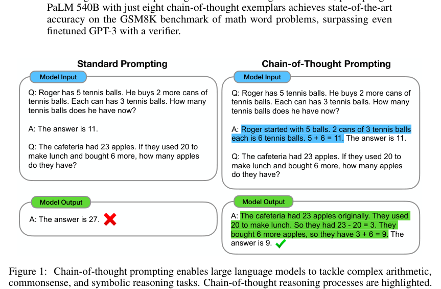

The figure compares "Standard Prompting" and "Chain-of-Thought Prompting" through two side-by-side examples of math word problems. Each example consists of a "Model Input" box containing a question and a "Model Output" box containing the answer, with the Chain-of-Thought version featuring a blue-highlighted intermediate reasoning step. The figure conveys that standard prompting leads to an incorrect answer (27), whereas chain-of-thought prompting enables the model to reach the correct answer (9) by showing its work.

**ReAct: Synergizing Reasoning and Acting in Language Models** — arXiv:2210.03629 p.2

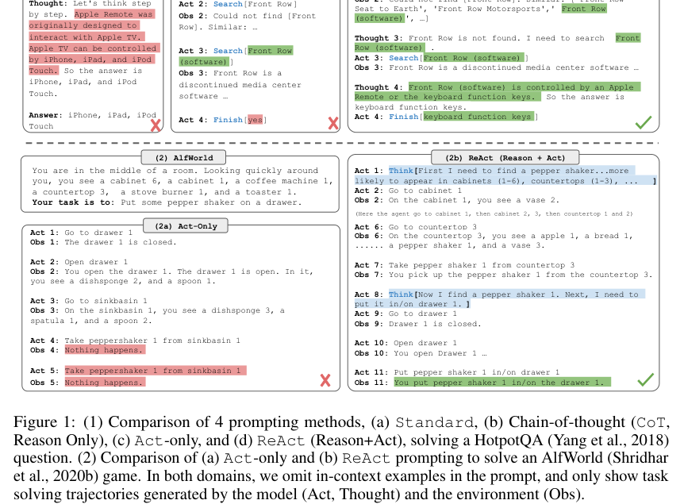

The figure presents two comparative panels, each divided into two sub-panels, illustrating different prompting strategies for language models. The top panel compares "Standard" and "Chain-of-thought" prompting for a HotpotQA task, while the bottom panel compares "Act-only" and "ReAct" prompting for an AlfWorld task, using text boxes to show the model's thoughts, actions, and observations. The figure conveys how the ReAct method, which interleaves reasoning (Thought) with acting (Act), improves task performance compared to the other three methods.

**Language Models are Few-Shot Learners** — arXiv:2005.14165 p.3

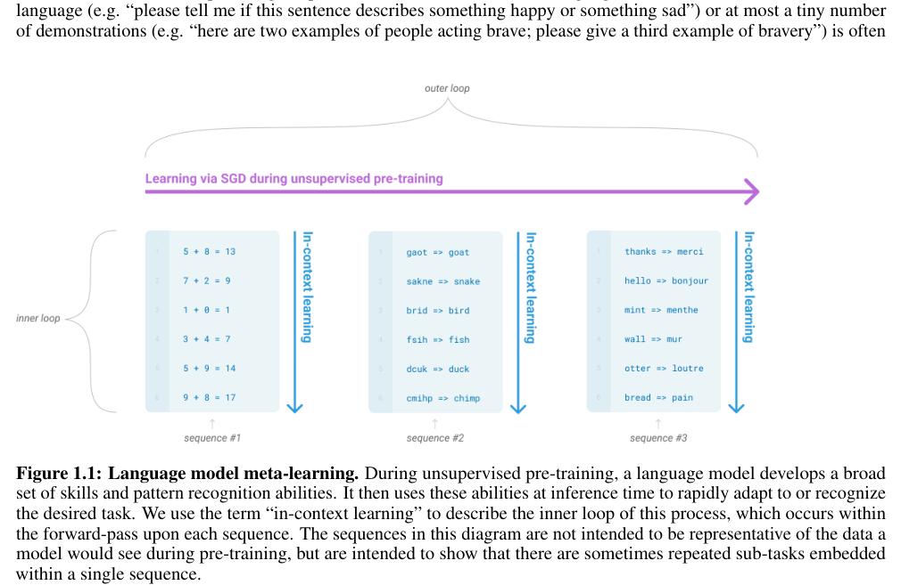

The figure uses a hierarchical diagram with brackets to illustrate the relationship between an "outer loop" of unsupervised pre-training via SGD and an "inner loop" of in-context learning. The outer loop is represented by a long purple arrow, while the inner loop consists of three distinct boxes labeled "sequence #1," "#2," and "#3," each containing a series of task demonstrations (arithmetic, translation, etc.) followed by a vertical blue label for "in-context learning." The diagram conveys that pre-training enables the model to perform rapid adaptation to new tasks within a single sequence during inference.

**Toolformer: Language Models Can Teach Themselves to Use Tools** — arXiv:2302.04761 p.1

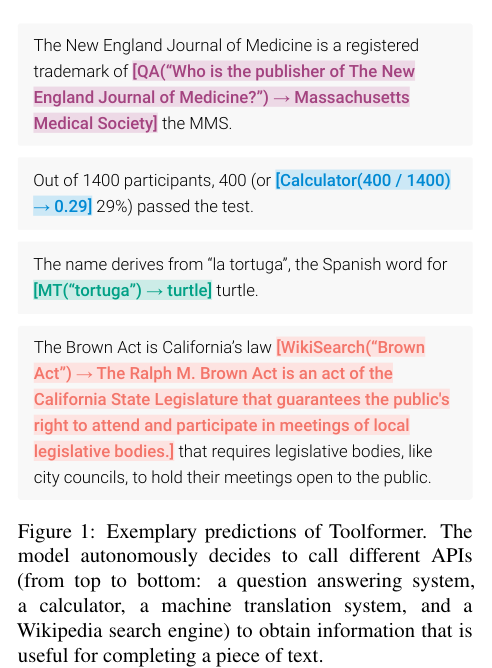

The figure displays several text blocks containing model-generated sentences interspersed with bracketed API calls and their corresponding outputs. These calls, shown in colored text, include examples of a question-answering system, a calculator, a machine translation system, and a Wikipedia search engine. The figure conveys how the Toolformer model autonomously integrates external tool outputs into its text generation to complete information gaps.

**GPT-4 Technical Report** — arXiv:2303.08774 p.3

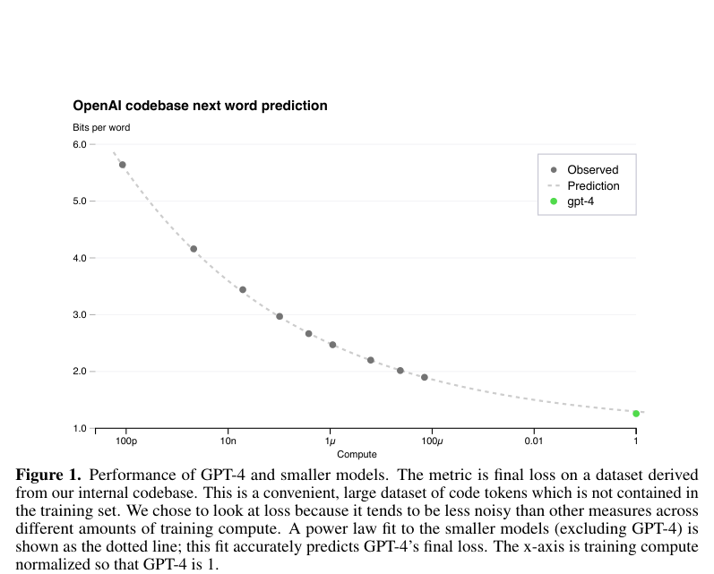

This line graph plots "Bits per word" on the y-axis against "Compute" on a logarithmic x-axis for OpenAI codebase next-word prediction. It displays gray dots representing observed data points for smaller models, a dashed gray line representing a power law fit to those observations, and a single green dot representing GPT-4. The figure conveys that GPT-4's performance aligns with the power law scaling trend established by smaller models.

**Reflexion: Language Agents with Verbal Reinforcement Learning** — arXiv:2303.11366 p.3

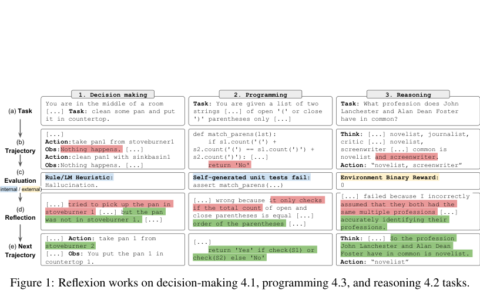

The figure is a flowchart consisting of five horizontal layers labeled (a) Task, (b) Trajectory, (c) Evaluation, (d) Reflection, and (e) Next Trajectory, organized into three vertical columns representing "1. Decision making," "2. Programming," and "3. Reasoning." Each column uses boxes to illustrate a cycle where an initial task leads to an action/observation trajectory, an evaluation of that result, a verbal reflection on the error, and a subsequent corrected trajectory. The diagram conveys how the Reflexion framework uses verbal reinforcement to iteratively improve agent performance across different task types.

**Training language models to follow instructions with human feedback** — arXiv:2203.02155 p.2

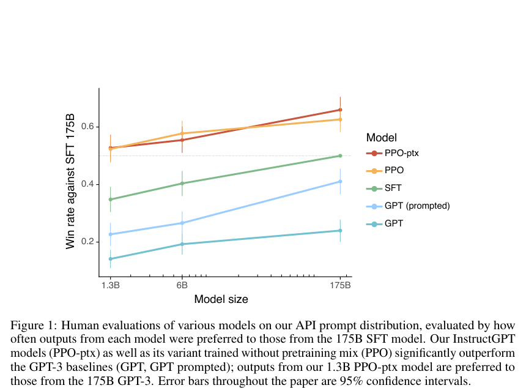

This line graph plots the "Win rate against SFT 175B" on the y-axis against "Model size" (1.3B, 6B, and 175B) on a logarithmic x-axis. It compares the performance of five models—PPO-ptx, PPO, SFT, GPT (prompted), and GPT—using colored lines with error bars representing 95% confidence intervals. The figure conveys that the InstructGPT models (PPO-ptx and PPO) achieve higher win rates across all model sizes compared to the GPT baselines.

**Generative Agents: Interactive Simulacra of Human Behavior** — arXiv:2304.03442 p.1

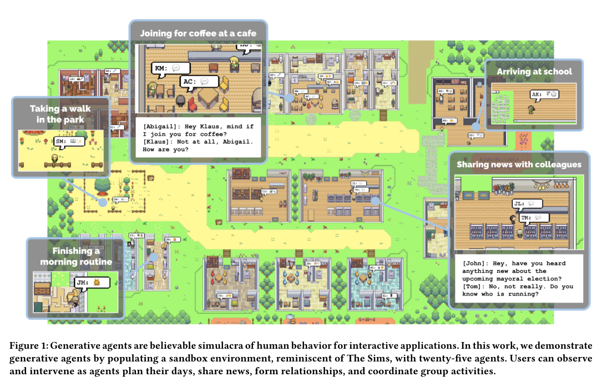

The figure displays a top-down, pixel-art map of a simulated sandbox environment populated with various buildings and green spaces. Overlaid on this map are several callout boxes containing dialogue snippets and agent identifiers that illustrate specific social behaviors, such as "Taking a walk in the park," "Joining for coffee at a cafe," and "Sharing news with colleagues." The figure conveys how generative agents interact and perform autonomous activities within a shared, simulated world.

**Agentic Reasoning for Large Language Models** — arXiv:2601.12538 p.2

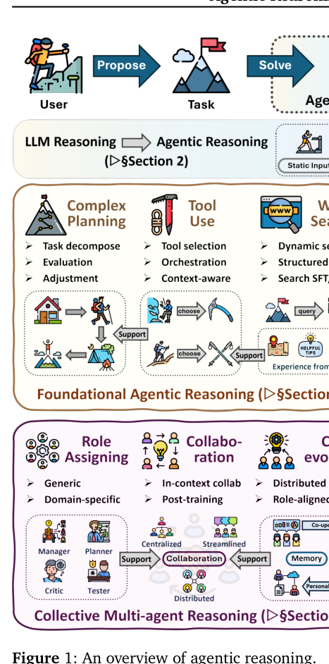

This diagram illustrates the hierarchy of agentic reasoning through three nested levels: a top-level interaction loop where a User proposes a Task for an LLM to solve, a middle layer representing Foundational Agentic Reasoning (including Complex Planning, Tool Use, and Web Search), and a bottom layer depicting Collective Multi-agent Reasoning (covering Role Assigning, Collaboration, and evolution). The figure uses icons, arrows, and labeled boxes to convey the progression from basic LLM reasoning to complex, multi-agent collaborative systems.

**Agentic Tool Use in Large Language Models** — arXiv:2604.00835 p.2

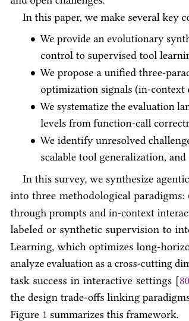

The provided text does not contain a figure, only a paragraph of text describing the paper's contributions and a summary of methodological paradigms. Therefore, there is no visual information (boxes, arrows, axes, or labels) to describe.

**Agentic Artificial Intelligence (AI): Architectures, Taxonomies, and Evaluation of Large Language Model Agents** — arXiv:2601.12560 p.5

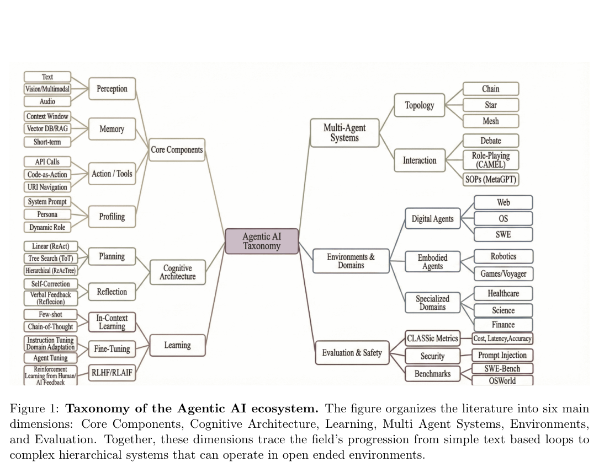

This hierarchical taxonomy diagram uses a central "Agentic AI Taxonomy" node connected via arrows to six primary dimensions: Core Components, Cognitive Architecture, Learning, Multi-Agent Systems, Environments & Domains, and Evaluation & Safety. Each dimension branches into specific sub-categories and granular technical elements, such as "Perception," "Planning," and "Topology," to categorize the architectural components and functional domains of AI agents.

**From Language to Action: A Review of Large Language Models as Autonomous Agents and Tool Users** — arXiv:2508.17281 p.2

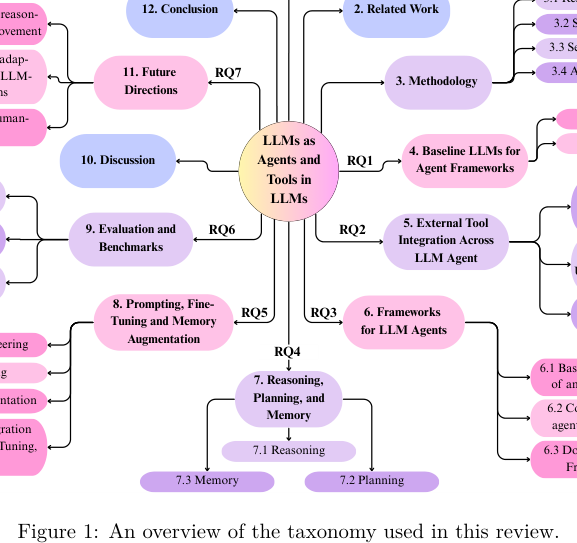

This figure is a hierarchical taxonomy diagram centered on a central circle labeled "LLMs as Agents and Tools in LLMs." From this center, arrows branch out to several numbered primary categories (e.g., "2. Related Work," "3. Methodology," "4. Baseline LLMs for Agent Frameworks"), which further subdivide into specific sub-categories represented by smaller, colored boxes. The diagram conveys the structured organizational framework used throughout the review paper to classify different aspects of LLM agents and tool usage.

**Large Language Model Agent: A Survey on Methodology, Applications and
  Challenges** — arXiv:2503.21460 p.2

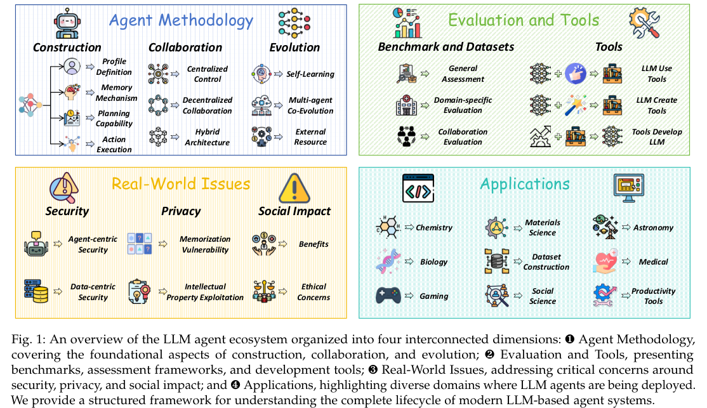

This figure presents an overview of the LLM agent ecosystem organized into four interconnected quadrants: Agent Methodology, Evaluation and Tools, Real-World Issues, and Applications. Each quadrant uses labeled boxes, icons, and arrows to categorize specific sub-components, such as the stages of agent construction (profile definition, memory mechanism, etc.) and various application domains (chemistry, biology, gaming, etc.). The diagram conveys a structured framework for understanding the lifecycle, assessment, challenges, and deployment of modern LLM-based agent systems.
