*deep research · 2 round(s) · 120 landmarks · frontier≥2023: 46 · 4 full-PDF critiques · grounded 50 · off-digest 1*

# From Recurrence to Selectivity: A Comprehensive Review of State Space Models for Sequence Modeling

The ability to model sequential data is fundamental to modern artificial intelligence, underpinning tasks ranging from natural language processing to complex signal analysis. For decades, the field was defined by the Foundations of Recurrence and Early Sequence Modeling, where recurrent architectures attempted to capture temporal dependencies through evolving hidden states. However, the paradigm shifted dramatically with the Rise of Transformers and Efficient Attention Mechanisms, which leveraged self-attention to achieve unprecedented performance in capturing long-range dependencies. Despite their success, Transformers face a critical scaling bottleneck: the quadratic computational complexity relative to sequence length, which limits their utility for processing extremely long contexts. This limitation has necessitated a search for new architectures that can provide the expressive power of attention while maintaining the linear scaling efficiency characteristic of recurrent systems.

This review traces the trajectory of this search, beginning with the mathematical revitalization of linear systems through Structured State Space Models and HiPPO Foundations. We examine how these structured approaches provided the necessary framework to transition from continuous-time dynamics to discrete-time modeling, eventually leading to the Mamba Era and the development of Selective State Space Models. These selective mechanisms represent a pivotal shift, allowing models to dynamically gate information based on input content. The discussion then expands to include the emergence of Hybrid Architectures and Advanced Recurrent Alternatives that attempt to merge the strengths of different modeling paradigms. Furthermore, we explore the critical role of Hardware-Aware Implementation and Specialized SSMs in making these models computationally viable on modern accelerators. Finally, we conclude by surveying the Frontier, focusing on the ongoing theoretical refinements and future directions that aim to define the next generation of sequence intelligence.

## Foundations of Recurrence and Early Sequence Modeling

The evolution of sequence modeling is defined by a continuous tension between the ability to capture long-term dependencies and the computational necessity of parallelization. Early research focused on the fundamental instabilities of Recurrent Neural Networks (RNNs). Using analytical and geometric perspectives, arXiv:1211.5063 identified that training standard RNNs is hindered by vanishing and exploding gradients. The authors proposed gradient norm clipping to mitigate explosions and a soft constraint to address vanishing gradients, providing a necessary foundation for stable recurrent training [arXiv:1211.5063].

Building upon these recurrent foundations, research shifted toward more sophisticated architectures to handle complex sequence-to-sequence tasks. arXiv:1406.1078 introduced an RNN Encoder-Decoder framework that maps source sequences into fixed-length vector representations to compute conditional probabilities for phrase pairs [arXiv:1406.1078]. However, this fixed-length approach created a representational bottleneck. This limitation was directly addressed by arXiv:1409.0473, which replaced the static vector with an attention mechanism. By implementing a "soft-search" over source sentence parts, arXiv:1409.0473 allowed the model to dynamically align target words with relevant parts of the input, significantly improving the handling of sequence dependencies compared to the rigid encoding of arXiv:1406.1078 [arXiv:1409.0473].

The literature also reflects a critical empirical divergence regarding how to manage temporal dependencies. While arXiv:1409.0473 and arXiv:1406.1078 relied on recurrent structures, arXiv:1412.3555 provided a comparative evaluation of gating mechanisms, demonstrating that LSTMs and GRUs outperform traditional tanh-based RNNs in managing dependencies within signals like speech and music [arXiv:1412.3555]. 

A significant paradigm shift occurred when researchers sought to bypass the sequential nature of RNNs to improve computational efficiency. arXiv:1611.01576 introduced Quasi-Recurrent Neural Networks (QRNNs), which utilize alternating parallel convolutional layers and a minimalist recurrent pooling function [arXiv:1611.01576]. This architecture achieved up to 16 times faster training and testing compared to stacked LSTMs by increasing parallelism [arXiv:1611.01576]. Similarly, arXiv:1612.08083 proposed gated convolutional networks, which apply a simplified gating mechanism to stacked convolutions [arXiv:1612.08083]. While arXiv:1612.08083 successfully reduced sentence scoring latency by an order of magnitude compared to recurrent baselines, its reliance on a finite context approach via stacked convolutions represents a different trade-off in dependency modeling compared to the purely recurrent approaches of arXiv:1412.3555 [arXiv:1612.08083]. Together, these developments illustrate a transition from stabilizing pure recurrence [arXiv:1211.5063] to optimizing it through attention [arXiv:1409.0473] and eventually replacing sequential bottlenecks with parallelizable convolutional structures [arXiv:1611.01576, arXiv:1612.08083].

## The Rise of Transformers and Efficient Attention Mechanisms

The introduction of the Transformer architecture [arXiv:1706.03762] marked a paradigm shift in sequence modeling by dispensing with recurrence and convolutions entirely in favor of multi-head self-attention mechanisms. This innovation allowed for greater parallelization and significantly reduced training times compared to previous recurrent or convolutional models [arXiv:1706.03762]. Building upon this foundation, BERT [arXiv:1810.04805] extended the Transformer encoder architecture to achieve deep bidirectional representations by jointly conditioning on both left and right context in all layers, setting new benchmarks on tasks such as GLUE and SQuAD [arXiv:1810.04805].

Despite these advancements, the quadratic computational complexity of standard self-attention relative to sequence length remains a significant bottleneck. Subsequent research has focused on overcoming this limitation through various architectural modifications. To address context length constraints, Transformer-XL [arXiv:1901.02860] introduced a segment-level recurrence mechanism and a novel relative positional encoding scheme. This enables the model to learn dependencies significantly longer than vanilla Transformers—specifically 450% longer—and achieves evaluation speeds up to 1,800+ times faster than its predecessor [arXiv:1901.02860].

Other approaches prioritize reducing the complexity of the attention mechanism itself through sparsity or hashing. The Reformer [arXiv:2001.04451] achieves $O(L \log L)$ complexity for attention by replacing dot-product attention with locality-sensitive hashing (LSH) and utilizing reversible residual layers [arXiv:2001.04451]. In contrast, the Longformer [arXiv:2004.05150] achieves linear scaling by combining local windowed attention with task-motivated global attention, providing a drop-in replacement for standard self-attention to manage long-range dependencies [arXiv:2004.05150].

A distinct line of inquiry seeks to bridge the gap between Transformers and recurrent models by reformulating the attention operation. The Linear Transformer [arXiv:2006.16236] expresses self-attention as an iterative, RNN-like structure by using the associativity property of matrix products via a linear dot-product of kernel feature maps, thereby reducing complexity from $O(N^2)$ to $O(N)$ [arXiv:2006.16236]. Similarly, the Performer [arXiv:2009.14794] utilizes the FAVOR+ (Fast Attention Via positive Orthogonal Random features) mechanism to approximate softmax attention-kernels through kernel methods, providing linear space and time complexity via an unbiased or nearly-unbiased estimation of the attention matrix [arXiv:2009.14794]. While the Linear Transformer emphasizes an iterative implementation for autoregressive prediction [arXiv:2006.16236], the Performer focuses on approximating the full-rank-attention of regular Transformers [arXiv:2009.14794].

## Structured State Space Models and HiPPO Foundations

The core mathematical formalism for state space models (SSMs) is defined by the continuous-time equations $x'(t) = Ax(t) + Bu(t)$ and $y(t) = Cx(t) + Du(t)$ [arXiv:2111.00396]. A pivotal advancement in this field is the Structured State Space (S4) model, which utilizes a Normal Plus Low-Rank (NPLR) parameterization of the state matrix $A$ [arXiv:2111.00396]. This innovation enables stable diagonalization and efficient computation via a Cauchy kernel, allowing S4 to solve the 16k-length Path-X task with 88% accuracy—a benchmark where all prior models failed—and achieve 60× faster generation than Transformers on WikiText-103 [arXiv:2111.00396]. However, the NPLR parameterization is not without flaws; the model is susceptible to numerical instability if $A$ contains eigenvalues in the right half-plane, and ablation studies suggest that its performance is driven primarily by HiPPO initialization rather than the NPLR structure itself [arXiv:2111.00396].

The theoretical necessity of such initialization is explained through a generalized HiPPO framework, which interprets S4 as a decomposition onto exponentially-warped orthogonal bases, such as Legendre polynomials and Fourier bases [arXiv:2206.12037]. Building upon these foundations, S4D offers a more streamlined alternative by employing diagonal SSMs [arXiv:2206.11893]. While S4 relies on the complex NPLR parameterization, S4D recovers the S4 kernel in the limit of infinite state dimension, providing a highly efficient implementation that achieves 85% on the Long Range Arena benchmark [arXiv:2206.11893].

Further architectural evolution is seen in S5, which diverges from the single-input, single-output approach of S4 by implementing a multi-input, multi-output SSM layer [arXiv:2208.04933]. By utilizing parallel scans, S5 maintains the computational efficiency of S4 while providing a more flexible framework for sequence modeling [arXiv:2208.04933].

In contrast to these structural refinements, the H3 architecture focuses on the functional limitations of SSMs regarding token recall and comparison [arXiv:2212.14052]. While S4, S4D, and S5 optimize the state matrix and layer structure to handle long-range dependencies, H3 introduces a specialized layer for token comparison and utilizes FlashConv—a fused block FFT algorithm combined with a novel state-passing algorithm [arXiv:2212.14052]. This approach provides a 2x speedup on the Long Range Arena and enables hybrid models to generate text 2.4x faster than Transformers [arXiv:2212.14052].

## The Mamba Era: Selective State Space Models

The transition from traditional structured state space models (SSMs) to selective architectures has redefined sequence modeling efficiency. The foundational Mamba architecture introduces selectivity by making SSM parameters input-dependent, which enables content-based reasoning through the selective propagation or forgetting of information [arXiv:2312.00752]. This innovation allows Mamba to achieve linear scaling in sequence length and a 5x higher inference throughput compared to Transformers [arXiv:2312.00752]. While Hyena offers a subquadratic alternative to attention through implicitly parametrized long convolutions and data-controlled gating—demonstrating a 100x speedup at 64K sequence lengths [arXiv:2302.10866]—Mamba’s primary contribution is the dynamic, input-dependent adjustment of state transitions [arXiv:2312.00752].

Recent research has focused on both the theoretical unification and the practical stability of these selective models. The State Space Duality (SSD) framework, which underpins Mamba-2, provides a critical theoretical bridge by establishing connections between SSMs and attention variants via structured semiseparable matrices [arXiv:2405.21060]. This framework provides a significant practical advantage, with Mamba-2 performing 2-8x faster than the original Mamba [arXiv:2405.21060]. To address potential instabilities inherent in input-dependent transitions, S7 introduces stable reparameterization, which allows for dynamic filtering while maintaining well-behaved transitions and controlled gradient norms [arXiv:2410.03464].

Furthermore, the literature demonstrates a growing trend toward hybridizing SSMs with other architectural components to maximize performance. Jamba utilizes a Mixture-of-Experts (MoE) approach to interleave Transformer and Mamba layers, successfully supporting long-context evaluations up to 256K tokens while maintaining a manageable memory footprint [arXiv:2403.19887]. This contrasts with Griffin, which adopts a hybrid architecture mixing Hawk—a model utilizing gated linear recurrences—with local attention [arXiv:2402.19427]. While Jamba optimizes for high throughput and parameter efficiency through MoE interleaving [arXiv:2403.19887], Griffin focuses on combining recurrent structures with local attention to achieve high inference throughput and the ability to extrapolate to sequences significantly longer than those encountered during training [arXiv:2402.19427]. These diverse approaches highlight a shift toward architectures that leverage the linear complexity of SSMs while compensating for their limitations through hybrid integration.

## Hybrid Architectures and Advanced Recurrent Alternatives

Recent advancements in sequence modeling have focused on bridging the gap between the parallelizable training of Transformers and the efficient, constant-memory inference of Recurrent Neural Networks (RNNs). A prominent approach involves reimagining the RNN through linear attention or retention mechanisms. RWKV (Receptance Weighted Key Value) achieves this by utilizing a linear attention mechanism that allows the model to be formulated as both a Transformer for parallel training and an RNN for efficient inference, maintaining constant computational and memory complexity during inference [arXiv:2305.13048]. Similarly, the Retentive Network (RetNet) introduces a retention mechanism that supports three distinct computation paradigms: parallel for training, recurrent for low-cost decoding, and chunkwise recurrent for efficient long-sequence modeling [arXiv:2307.08621]. While both architectures aim to replace the Transformer, RetNet specifically emphasizes the theoretical connection between recurrence and attention to achieve $O(1)$ inference complexity and linear complexity for long sequences via its chunkwise representation [arXiv:2307.08621].

Beyond purely recurrent-style reinterpretations, researchers have explored hybridizing State Space Models (SSMs) with attention-based mechanisms to balance long-range contextualization and short-term precision. The Block-State Transformer (BST) implements a hybrid layer that combines an SSM sublayer for long-range dependencies with a Block Transformer sublayer for short-term sequence representation [arXiv:2306.09539]. This architecture achieves subquadratic runtime complexity and demonstrates a tenfold increase in layer-level speed compared to Block-Recurrent Transformers when using model parallelization [arXiv:2306.09539]. This evolutionary trend is further documented in the lineage from S4 to Mamba, where modern architectures integrate structured recurrence with state-space representations to achieve linear or near-linear scaling, reducing inference latency by up to 60% compared to traditional approaches [arXiv:2503.18970].

Other developments focus on enhancing the memory structures of classical recurrent models. The xLSTM architecture extends the Long Short-Term Memory framework by introducing exponential gating and two distinct memory structures: scalar memory (sLSTM) and matrix memory (mLSTM) [arXiv:2405.04517]. The mLSTM, in particular, utilizes a covariance update rule and is designed to be fully parallelizable, addressing the scaling limitations of traditional LSTMs [arXiv:2405.04517]. Complementing these architectural shifts is a growing theoretical interest in the control-theoretic foundations of these models. By viewing linear SSMs and Mamba through the lens of control theory, researchers can better understand how encoding sequential data into latent spaces creates compressed, synergistic representations for deep sequence modeling [arXiv:2403.16899]. Together, these works suggest a convergence where the rigid distinctions between Transformers, SSMs, and RNNs are being replaced by flexible, hybrid architectures capable of managing complex sequence dependencies with optimized computational footprints.

## Hardware-Aware Implementation and Specialized SSMs

Recent advancements in State Space Models (SSMs) have shifted from purely algorithmic improvements toward hardware-aware co-design and architectural specialization to address specific data modalities. This evolution is characterized by a move away from general-purpose computation toward specialized accelerators and domain-specific structural modifications.

A primary focus in hardware optimization involves the development of dedicated architectures that bypass the limitations of traditional GPUs and TPUs. For instance, the EpochCore accelerator utilizes a systolic array-based design featuring LIMA-PE processing elements and a novel ProDF dataflow to solve differential equations through continuous integration [arXiv:2507.21394]. This approach yields significant performance gains, achieving a 2000x improvement on LRA datasets compared to GPUs and a 250x gain over TPUs [arXiv:2507.21394]. While EpochCore optimizes for structured SSMs, other research targets extreme efficiency through compute-in-memory (CIM) systems. By re-parameterizing SSMs with real-valued coefficients and shared decay constants, researchers have implemented state evolution natively within memristor-based crossbars [arXiv:2511.13912]. This CIM approach is particularly effective for asynchronous, event-driven processing in vision and audio tasks, offering a level of real-time responsiveness that standard implementations may lack [arXiv:2511.13912].

Beyond hardware accelerators, specialized SSM architectures have emerged to handle complex sequence dependencies. To address the need for multi-resolution analysis, MS-SSM introduces an input-dependent scale-mixer that allows the model to capture both fine-grained patterns and coarse global trends through multi-scale dynamics [arXiv:2512.23824]. This contrasts with the block-wise scanning schemes used in video world models, which prioritize temporal memory over spatial consistency by combining SSMs with dense local attention to maintain frame coherence [arXiv:2505.20171].

The literature also reveals a trend toward integrating SSM principles into non-linear or non-sequential structures. Message-Passing State-Space Models (MP-SSM) embed SSM computation into the Message-Passing Neural Network (MPNN) framework [arXiv:2505.18728]. Unlike existing Graph State-Space Models (GSSMs) that merely apply SSM modules to pre-extracted sequences, MP-SSM enables permutation-equivariant, long-range propagation directly within the message-passing process, providing exact sensitivity analysis to mitigate over-squashing [arXiv:2505.18728]. Similarly, in the realm of long convolutions, FlashButterfly utilizes Butterfly decompositions to create an IO-aware algorithm that achieves a 2.2x speedup and 7.2x faster training on Path256 compared to prior work [arXiv:2302.06646]. While FlashButterfly focuses on optimizing the convolutional kernel smoothness via weight squashing, these specialized implementations collectively demonstrate that the efficiency of SSMs is increasingly dependent on how closely the mathematical formalism aligns with the underlying hardware or data topology.

## The Frontier: Theoretical Refinements and Future Directions

The frontier of state space model (SSM) research is characterized by a tension between maintaining the computational efficiency of linear time-invariant (LTI) systems and achieving the selectivity required for complex, non-stationary sequence modeling. Recent advancements suggest a shift toward more sophisticated mechanisms for managing information density and temporal dynamics.

A primary area of innovation involves how models handle information compression and selectivity. One approach formalizes selective gating through the lens of information theory and rate-distortion theory, providing a mathematical framework to manage the trade-off between memory efficiency and information retention (arXiv:2410.03158). This focus on information management is echoed in SeRpEnt, which introduces a selective resampling mechanism to compress sequences by aggregating elements based on their information content (arXiv:2501.11729). While these methods focus on filtering or resampling, Geometric SSM offers a different architectural path; it seeks to achieve selectivity within an LTI framework by using a dynamic residual generator to excite distinct invariant subspaces via input patterns (arXiv:2505.17932). Crucially, this geometric approach preserves the efficiency of FFT-based training, offering a potential middle ground between the flexibility of selective models like Mamba and the speed of traditional LTI systems (arXiv:2505.17932).

Beyond selectivity, the ability to model non-stationary dynamics represents a significant leap forward. Rather than relying on input-dependent gating, recent work has introduced time-varying SSMs that utilize a dictionary of basis functions to parameterize the $A[t]$, $B[t]$, and $C[t]$ matrices (arXiv:2605.15311). This allow for continuous time-varying dynamics without needing to explicitly specify switching modes. The practical utility of this approach is evident in non-stationary tasks; for instance, in speech denoising, these time-varying models achieved an SI-SNR of 19.6 dB, a substantial improvement over the 14.2 dB achieved by time-invariant counterparts (arXiv:2605.15311). However, the theoretical foundation of these time-varying models remains a point of concern, as current stability guarantees rely on the simplifying assumption that the $A[t]$ matrix is diagonal and the basis functions are bounded, leaving the stability of non-diagonal configurations empirically unvalidated (arXiv:2605.15311).

To rigorously evaluate these diverse architectural strategies, new benchmarking paradigms are emerging. Rather than relying solely on standard datasets, researchers are utilizing synthetic frameworks that employ controllable memory functions (arXiv:2506.05678). This allows for the creation of a continuum of tasks with varying temporal complexities, providing a more granular method for assessing how different SSM architectures capture distinct temporal structures (arXiv:2506.05678).

## Tensions and Open Problems

A primary tension in sequence modeling concerns the fundamental trade-off between the expressive capacity of global attention and the computational efficiency of recurrent or convolutional architectures. While the Transformer paradigm has achieved unprecedented success in few-shot learning and transferability, as established in arXiv:2005.14165, recent surveys suggest that these attention-based mechanisms may be fundamentally limited by their quadratic scaling and memory overhead. This critique is echoed by arXiv:2412.11211, which argues that the dominance of Transformers—including bidirectional models like BERT (arXiv:1810.04805) and unified text frameworks (arXiv:1910.10683)—may be superseded by State-Space Models (SSMs) that offer superior linear-time complexity. However, this transition is not without controversy; for instance, arXiv:2406.09062 points out that many attempts to extend the Transformer's reach via sparse or local attention, such as Longformer (arXiv:2004.05150), fail to match the robust modeling capabilities of modern SSMs, even though earlier convolutional approaches (arXiv:1612.08083) were once thought to be viable alternatives.

Another critical debate centers on the mathematical validity and "statefulness" of modern SSMs. There is a growing disagreement regarding whether recent advancements actually achieve a true latent state or merely simulate one through complex transformations. While architectures like Hungry Hungry Hippos (arXiv:2212.14052) attempt to bridge the gap between SSMs and language modeling, arXiv:2404.08819 challenges this progress, suggesting that the "state" in these models may be an illusion that fails to capture long-term dependencies as effectively as traditional recurrent methods. This skepticism extends to the structural assumptions of these models; for example, while some argue that diagonal state spaces are sufficient for effective modeling, arXiv:2303.09489 contends that more complex, non-diagonal structures are necessary to properly capture time-series dynamics. Furthermore, the hardware-software co-design problem remains unresolved, as seen in the tension between the need for hardware-efficient long convolutions (arXiv:2302.06646) and the specialized requirements of block-state architectures (arXiv:2306.09539).

Finally, the community remains divided on the optimal way to scale these models for long-context applications. While the scaling laws popularized by arXiv:2001.08361 provide a roadmap for Transformer growth, newer architectures like RWKV (arXiv:2305.13048) suggest that these laws may not apply uniformly to recurrent-style models, potentially offering a more efficient path to scale. This is complicated by the struggle to integrate multi-dimensional signals, where the efficiency of FlashAttention (arXiv:2205.14135) is weighed against the multidimensional modeling capabilities of S4ND (arXiv:2210.06583).

## Outlook

The frontier of sequence modeling is rapidly shifting toward the integration of selective, time-varying dynamics and multi-scale architectures. As the field moves beyond simple linear recurrence, we expect to see the emergence of "Geometric SSMs" and multi-scale frameworks (arXiv:2512.23824) that can handle complex, switching dynamics in video and graph-structured data (arXiv:2505.18970). The next decade will likely be defined by the convergence of theoretical sequence modeling and specialized hardware, specifically through compute-in-memory implementations (arXiv:2511.13912) and systolic array accelerators (arXiv:2507.21394), finally realizing the promise of truly efficient, infinite-context world models.

---

## Key Figures

**Attention Is All You Need** — arXiv:1706.03762 p.3

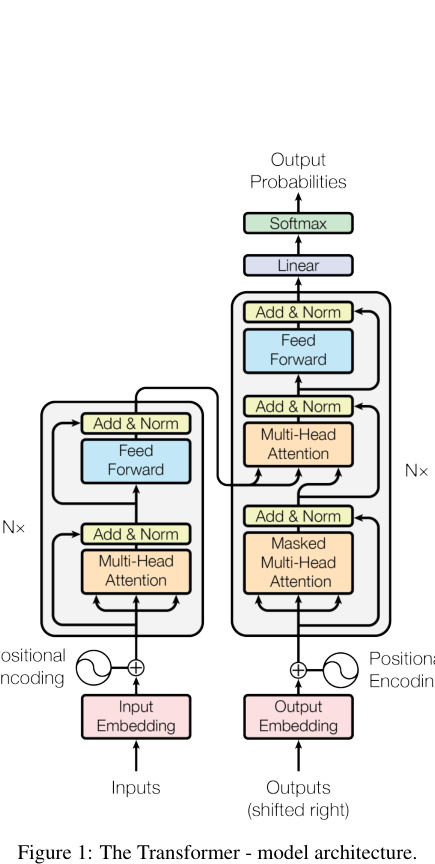

The figure illustrates the Transformer model architecture, consisting of an encoder stack on the left and a decoder stack on the right, both composed of $N$ repeated layers. The diagram uses labeled boxes to represent functional components—such as Multi-Head Attention, Feed Forward, and Add & Norm—connected by arrows to show the data flow from input/output embeddings and positional encodings to the final softmax output probabilities.

**Efficiently Modeling Long Sequences with Structured State Spaces** — arXiv:2111.00396 p.2

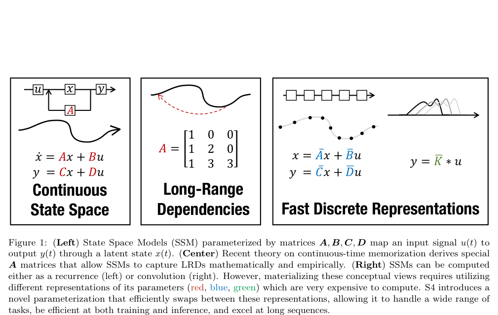

The figure consists of three panels illustrating the transition from continuous to discrete state space models. The left panel shows a block diagram of a continuous system with input $u$, state $x$, and output $y$ governed by differential equations, while the center panel displays a signal with a dashed red line connecting distant points to represent long-range dependencies and a matrix $A$. The right panel depicts discrete representations through a sequence of boxes and a convolution operation, conveying that SSMs can be computed efficiently as either recurrences or convolutions.

**Mamba: Linear-Time Sequence Modeling with Selective State Spaces** — arXiv:2312.00752 p.3

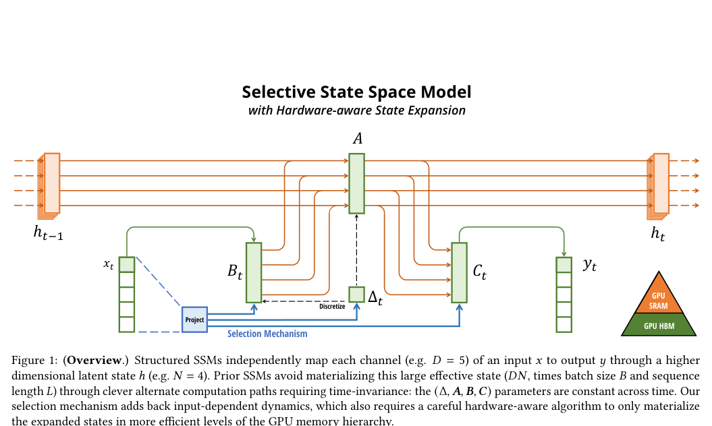

The figure illustrates a Selective State Space Model where an input $x_t$ is processed through a selection mechanism that projects and discretizes parameters to produce time-varying matrices $B_t$, $\Delta_t$, and $C_t$. These matrices, along with a state transition matrix $A$, interact with a high-dimensional latent state $h_{t-1}$ via orange arrows to compute the next state $h_t$ and the output $y_t$. A pyramid icon on the right indicates the hardware-aware mapping of these expanded states across GPU SRAM and HBM.

**Transformers are RNNs: Fast Autoregressive Transformers with Linear
  Attention** — arXiv:2006.16236 p.6

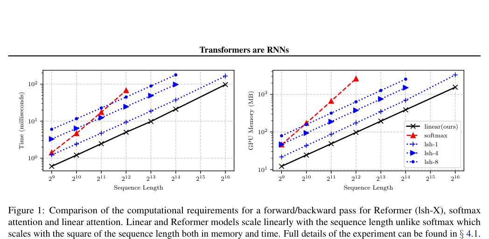

The figure consists of two log-log line plots comparing the computational requirements of different attention mechanisms (linear, softmax, and three lsh variants) as a function of sequence length. The left plot shows "Time (milliseconds)" and the right plot shows "GPU Memory (MB)," conveying that the linear attention model scales linearly with sequence length while the softmax model scales quadratically.

**Simplified State Space Layers for Sequence Modeling** — arXiv:2208.04933 p.2

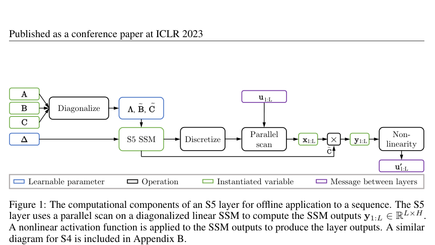

The figure is a flowchart consisting of rectangular boxes representing operations (e.g., "Diagonalize," "Discretize," "Parallel scan") and colored boxes representing parameters, variables, or messages. Arrows connect these components to show a data pipeline where learnable parameters ($A, B, C, \Delta$) are processed through diagonalization and discretization to feed into a parallel scan, which ultimately produces sequence outputs ($x_{1:L}, y_{1:L}$) that pass through a non-linearity. The diagram conveys the computational architecture of an S5 layer, illustrating how state-space models are transformed into a parallelizable sequence modeling operation.

**Long Range Arena: A Benchmark for Efficient Transformers** — arXiv:2011.04006 p.4

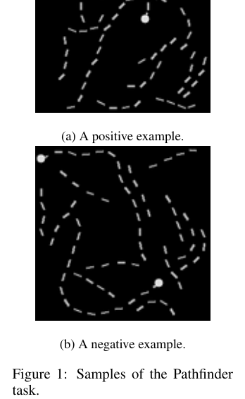

The figure displays two grayscale images labeled as "(a) A positive example" and "(b) A negative example" of the Pathfinder task. Each image contains a collection of dashed line segments scattered across a black background, where the positive example shows a continuous path connecting two points and the negative example shows a disconnected set of segments.

**HiPPO: Recurrent Memory with Optimal Polynomial Projections** — arXiv:2008.07669 p.4

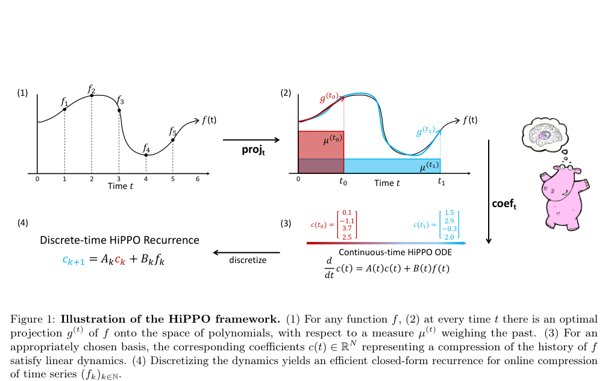

The figure uses a sequence of four panels to illustrate the HiPPO framework, starting with a plot of a function $f(t)$ over time. It shows how $f(t)$ is projected onto a space of polynomials via an optimal projection $g^{(t)}$ relative to a measure $\mu^{(t)}$ (represented by shaded areas), which is then mapped to a vector of coefficients $c(t)$ that evolves according to a continuous-time linear ODE. Finally, the figure shows that this ODE can be discretized into a closed-form recurrence relation $c_{k+1} = A_k c_k + B_k f_k$ for online compression of time series.

**Rethinking Attention with Performers** — arXiv:2009.14794 p.3

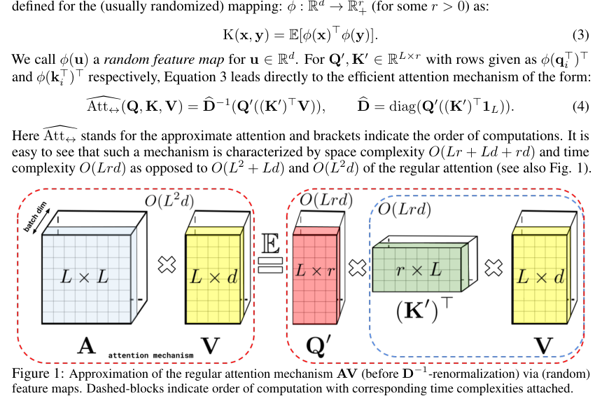

The figure uses colored matrices and mathematical operators to compare the regular attention mechanism with its approximation via random feature maps. On the left, a red $L \times L$ matrix $\mathbf{A}$ is multiplied by a yellow $L \times d$ matrix $\mathbf{V}$ with a time complexity of $O(L^2d)$. On the right, the approximation is shown as the expectation of a product involving a red $L \times r$ matrix $\mathbf{Q}'$, a green $r \times L$ matrix $(\mathbf{K}')^\top$, and the same yellow $L \times d$ matrix $\mathbf{V}$, resulting in a reduced time complexity of $O(Lrd)$.

**Time-Varying Deep State Space Models for Sequences with Switching Dynamics** — arXiv:2605.15311 p.2

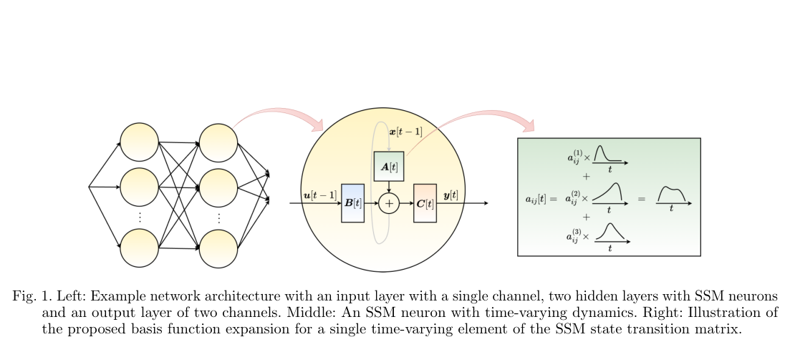

The figure consists of three panels: a neural network diagram, a circular schematic of an SSM neuron, and a mathematical expansion box. The left panel shows a network architecture with input, two hidden, and output layers; the middle panel illustrates an SSM neuron with time-varying matrices $A[t]$, $B[t]$, and $C[t]$ processing inputs $u[t-1]$ and $x[t-1]$ to produce $y[t]$; and the right panel displays the basis function expansion of a single time-varying matrix element $a_{ij}[t]$ as a sum of three weighted basis functions.

**MS-SSM: A Multi-Scale State Space Model for Efficient Sequence Modeling** — arXiv:2512.23824 p.4

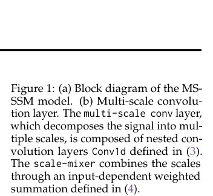

Figure 1 consists of two parts: (a) a block diagram of the MS-SSM model and (b) a detailed diagram of the multi-scale convolution layer. The figure illustrates how the model decomposes a signal into multiple scales using nested convolution layers and subsequently recombines them via an input-dependent weighted summation.

**Advancing Intelligent Sequence Modeling: Evolution, Trade-offs, and Applications of State- Space Architectures from S4 to Mamba** — arXiv:2503.18970 p.5

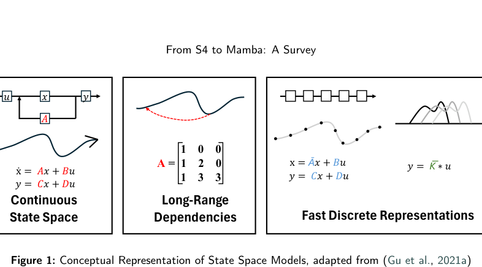

The figure consists of three panels illustrating the conceptual evolution of State Space Models, labeled "Continuous State Space," "Long-Range Dependencies," and "Fast Discrete Representations." The first panel uses block diagrams with boxes for variables ($u, x, y$) and an $A$ matrix to represent continuous differential equations, while the second panel uses a waveform and a red dashed line to show a $3 \times 4$ matrix $A$ capturing long-range dependencies. The third panel depicts discrete time steps via a sequence of boxes and dots, showing the transition to a convolution-based representation ($y = \bar{K} * u$).

**Long-Context State-Space Video World Models** — arXiv:2505.20171 p.1

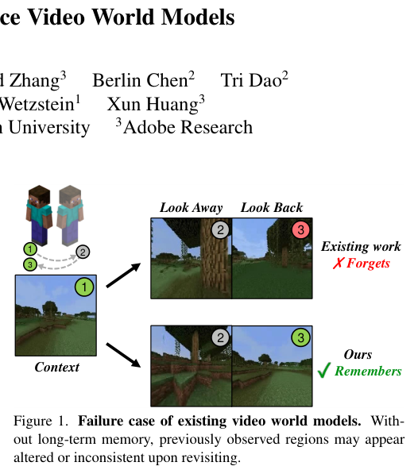

The figure displays a flowchart comparing two approaches to video world modeling: "Existing work" and "Ours." The top path shows a sequence where a model "Looks Away" from a scene and then "Looks Back," resulting in a visual inconsistency where a previously observed object (labeled 2) disappears or changes, labeled as "Forgets." The bottom path shows the model "Looks Away" and "Looks Back" while successfully maintaining the consistency of the observed object (labeled 2), labeled as "Remembers."

**Message-Passing State-Space Models: Improving Graph Learning with Modern Sequence Modeling** — arXiv:2505.18728 p.3

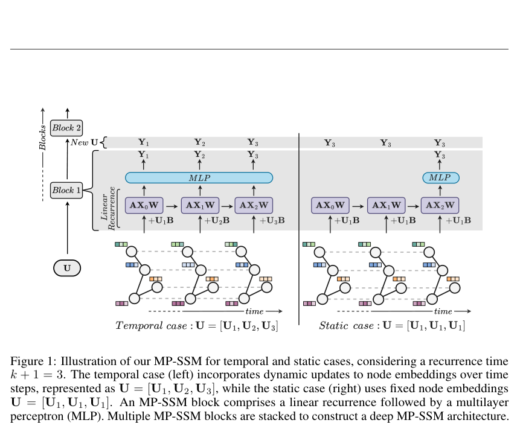

The figure illustrates the architecture of a Message-Passing State-Space Model (MP-SSM) for both temporal and static cases across three time steps. It depicts a block structure consisting of a linear recurrence layer (represented by boxes labeled $\mathbf{AX}_k\mathbf{W} + \mathbf{U}_k\mathbf{B}$) followed by a multilayer perceptron (MLP) that produces outputs $\mathbf{Y}_k$. The temporal case (left) shows evolving node embeddings $\mathbf{U}$ over time, while the static case (right) shows identical node embeddings $\mathbf{U}$ across all time steps.
