*deep research · 3 round(s) · 160 landmarks · frontier≥2023: 72 · 5 full-PDF critiques · grounded 42 · off-digest 0*

# The Evolution of State Space Models: From Structured Recurrence to Selective Dynamics

The landscape of sequence modeling has historically been defined by a fundamental trade-off between the computational efficiency of recurrent architectures and the high-capacity, long-range dependency modeling of attention mechanisms. While Transformers have set new benchmarks in language understanding, their quadratic complexity relative to sequence length presents a significant barrier to scaling context windows and real-time inference. State Space Models (SSMs) have emerged as a transformative solution to this bottleneck, offering a path toward linear-time complexity without sacrificing the ability to capture complex temporal dynamics. Addressing this challenge is critical for the development of efficient, large-scale models capable of processing vast, continuous streams of data.

This review provides a comprehensive survey of the SSM landscape, tracing its development from foundational concepts to the latest research frontiers. We first establish the foundations of recurrent and structured state space models, detailing the mathematical formalism and structural properties that underpin their stability and expressivity. The narrative then moves to the recent paradigm shift characterized by the rise of selective state space models, which has redefined the capabilities of the architecture. We further examine the integration of these models into hybrid architectures and multi-modal extensions, alongside the essential advancements in hardware acceleration and efficient implementations that make large-scale deployment feasible. The review concludes by exploring current frontiers, specifically focusing on advanced dynamics and adaptive learning strategies that aim to push the boundaries of sequence modeling.

## Foundations of Recurrent and Structured State Space Models

The evolution of sequence modeling has transitioned from managing vanishing gradients through gating to the development of structured state space models (SSMs) capable of capturing extremely long-range dependencies. Early efforts focused on refining recurrent architectures; for instance, arXiv:1412.3555 demonstrated that gated recurrent units, such as LSTMs and GRUs, significantly outperform traditional tanh-based RNNs in tasks like polyphonic music and speech modeling by utilizing gating mechanisms to regulate information flow. To address the stability issues inherent in long-term dependencies, arXiv:1511.06464 proposed Unitary Evolution Recurrent Neural Networks (U-RNN), which employ a weight matrix composed of structured matrices to ensure eigenvalues have an absolute value of exactly 1. This approach avoids the computational burden of repeated eigendecompositions, though it requires hidden states to be maintained in the complex domain.

A fundamental shift occurred with the introduction of HiPPO (Hierarchical Polynomial Projection Operators), which moved away from simple gating toward optimal polynomial projections for signal compression (arXiv:2008.07669). Unlike the empirical gating in arXiv:1412.3555, HiPPO provides a mathematical framework for incremental history representation with timescale robustness, enabling fast updates and bounded gradients across continuous and discrete time series. This work laid the groundwork for the Structured State Space (S4) model (arXiv:2111.00396), which utilizes a Normal Plus Low-Rank (NPLR) parameterization of the state matrix $A$. By enabling stable diagonalization and efficient computation via Cauchy kernels, S4 achieved 88% accuracy on the 16k-length Path-X task—a benchmark where prior models failed—and demonstrated 60x faster generation than Transformers on WikiText-103. However, S4's performance is nuanced; while it provides an $O(N+L)$ complexity framework, its success is driven heavily by HiPPO initialization, and it remains susceptible to numerical instability if $A$ has eigenvalues in the right half-plane.

Subsequent research has focused on scaling and architectural simplification. arXiv:2208.04933 introduced S5, which replaces multiple independent single-input, single-output (SISO) SSMs with a single multi-input, multi-output (MIMO) architecture. By leveraging parallel scans, S5 matches the efficiency of S4 while achieving high performance on the Long Range Arena (87.4%) and Path-X (98.5%). Parallel to these structural improvements, arXiv:2212.14052 introduced the H3 layer, specifically designed for token recall and comparison in language modeling. By combining SSMs with attention and employing the FlashConv algorithm—which uses a fused block FFT and state passing—H3 models can generate text 2.4x faster than Transformers. While S4 and S5 focus on the mathematical structure of the state matrix to handle long-range dependencies, H3 emphasizes hardware-aware efficiency and hybrid architectures to bridge the gap between SSMs and traditional attention-based language modeling.

## Mathematical Formalism and Structural Properties

The mathematical evolution of state space models (SSMs) has transitioned from complex structured matrices toward simplified diagonal forms and, more recently, toward rigorous control-theoretic and topological frameworks. A significant structural shift occurred with the introduction of Diagonal State Spaces (DSS), which replaced the diagonal-plus-low-rank structure of S4 with purely diagonal state matrices to reduce complexity while matching performance [arXiv:2203.14343]. Building upon this, S4D introduced a systematic parameterization and initialization scheme for diagonal SSMs, specifically designed to ensure these models can recover the S4 kernel in the limit of infinite state dimension [arXiv:2206.11893]. While these developments prioritize computational efficiency—notably, S4D's kernel computation requires only two lines of code [arXiv:2206.11893]—they have faced theoretical scrutiny. For instance, arXiv:2312.06211 critiques the approach in arXiv:2206.11893 by reframing SSMs as deep Wiener models, an extension of the Wiener model class used in system identification, which provides a different lens for extremely-long sequence classification [arXiv:2312.06211].

Beyond structural simplification, the expressivity of SSMs has been addressed through the integration of nonlinearity and advanced mathematical grounding. While linear SSMs provide the foundation, arXiv:2309.13414 demonstrates that incorporating layer-wise nonlinear activations enables these models to function as universal approximators for continuous sequence-to-sequence relationships [arXiv:2309.13414]. This transition from linear to nonlinear modeling is complemented by new theoretical perspectives on how selective SSMs process information. arXiv:2402.19047 provides a rigorous foundation for deep selective SSMs using Rough Path Theory, proving that the hidden state acts as a low-dimensional projection of the input's signature [arXiv:2402.19047]. This mathematical grounding offers a robust explanation for why selective models can achieve reduced training and inference costs compared to attention-based transformers.

Finally, the literature suggests a convergence between SSMs and classical control theory. arXiv:2403.16899 integrates SSMs into deep neural architectures to create synergies between control theory and sequence modeling for foundation models [arXiv:2403.16899]. This work also offers a critical perspective on earlier foundational literature, specifically critiquing arXiv:2110.13985 and arXiv:2111.00396 [arXiv:2403.16899]. Collectively, these papers illustrate a trajectory from optimizing matrix structures for efficiency [arXiv:2203.14343, arXiv:2206.11893] to establishing the deep mathematical principles of universality [arXiv:2309.13414] and signature-based projections [arXiv:2402.19047] that define modern state-space modeling.

## The Rise of Selective State Space Models (Mamba Era)

The transition from Linear Time Invariant (LTI) state space models to selective architectures marks a pivotal shift in sequence modeling. The foundational work in this era, Mamba (arXiv:2312.00752), introduces a Selective State Space Model (SSM) that replaces LTI constraints with input-dependent parameters ($\Delta, B,$ and $C$ as functions of $x$). This mechanism enables content-based reasoning through selective propagation and forgetting, allowing the model to scale linearly with sequence length and achieve up to $10^6$ token induction head extrapolation (arXiv:2312.00752). While Mamba-3B demonstrates superior language modeling performance compared to Transformers twice its size and provides 5$\times$ higher generation throughput (arXiv:2312.00752), its departure from LTI-based convolutional efficiency necessitates a complex, hardware-aware parallel scan algorithm using fused kernels and recomputation to maintain computational advantages (arXiv:2312.00752).

Recent literature explores whether the efficiency of SSMs can be reconciled with the high capacity of Transformers through hybrid architectures. Jamba (arXiv:2403.19887) implements a hybrid Transformer-Mamba Mixture-of-Experts (MoE) model, interleaving these layers to balance capacity and efficiency, achieving high throughput within a single 80GB GPU for sequences up to 256K tokens (arXiv:2403.19887). This trend is further validated by an empirical large-scale study (arXiv:2406.07887), which compares 8B-parameter Mamba, Mamba-2, and Transformer models across 3.5T tokens. Their findings suggest that a Mamba-2-Hybrid architecture (comprising 43% Mamba-2, 7% attention, and 50% MLP) may be up to 8$\times$ faster during inference than standard Transformers (arXiv:2406.07887).

However, the fundamental limitations of fixed-size latent states in Generalized State Space Models (GSSMs) remain a point of contention. Research comparing Transformers and GSSMs reveals that Transformers are significantly more effective at copying tasks, as GSSMs are theoretically constrained by their fixed-size latent states, whereas Transformers can handle strings of exponential length (arXiv:2402.01032). To address stability and learning capabilities, subsequent developments have focused on architectural refinements. S7 (arXiv:2410.03464) introduces stable reparameterization to ensure well-behaved state transitions and controlled gradient norms, making it suitable for long-sequence modeling and biological time series (arXiv:2410.03464). Furthermore, theoretical work has demonstrated that SSMs can reproduce implicit linear models via input/output gating, effectively enabling in-context learning by mimicking one step of gradient descent (arXiv:2410.11687). Together, these advancements suggest a trajectory toward SSMs that combine the linear scaling of recurrent models with the sophisticated reasoning and stability of attention-based systems.

## Hybrid Architectures and Multi-Modal Extensions

The evolution of state space models (SSMs) has moved toward hybrid and multi-modal architectures to address the limitations of 1D sequence processing in vision and the capacity constraints of pure SSMs in language modeling. In the visual domain, research has diverged between bidirectional approaches and multi-directional scanning strategies. Vision Mamba (Vim) utilizes bidirectional SSMs with position embeddings to replace self-attention, demonstrating significant efficiency gains such as being 2.8× faster than DeiT and achieving 86.8% GPU memory savings during batch inference on high-resolution (1248×1248) images (arXiv:2401.09417). Conversely, VMamba addresses the dimensionality gap between 1D selective scans and 2D vision data through a 2D Selective Scan (SS2D) module that employs four scanning routes, ensuring linear time complexity and superior input scaling (arXiv:2401.10166). Extending these concepts to video, a block-wise SSM scanning scheme combined with dense local attention is used to prioritize extended temporal memory over spatial consistency, a design trade-off that enables long-term reasoning and autoregressive frame prediction (arXiv:2505.20171).

In language modeling, hybridity is employed to balance the recurrent efficiency of SSMs with the high-capacity recall of Transformers. Jamba introduces a Mixture-of-Experts (MoE) architecture that interleaves Transformer and Mamba layers, allowing for high throughput and a small memory footprint that fits within a single 80GB GPU for sequences up to 256K tokens (arXiv:2403.19887). Samba offers a different hybrid strategy by pairing selective SSMs with Sliding Window Attention (SWA). While Jamba focuses on interleaving layers for capacity, Samba utilizes selective compression into recurrent hidden states for long-range context while specifically using SWA to ensure precise recent memory recall (arXiv:2406.07522). Samba demonstrates substantial performance improvements, achieving 3.73× higher throughput than Transformers with GQA for 128K prompts and a 3.64× speedup for 64K token generation, with the ability to extrapolate zero-shot up to 1M tokens (arXiv:2406.07522).

Beyond standard sequences and images, SSM principles are being integrated into graph learning to handle complex relational data. Message-Passing State-Space Models (MP-SSM) embed SSM computation within the Message-Passing Neural Network (MPNN) framework. This integration ensures permutation equivariance and enables exact sensitivity analysis to characterize information flow in both static and temporal graphs (arXiv:2505.18728). Collectively, these advancements show a trend of augmenting SSMs with attention mechanisms or specialized scanning patterns to handle higher-dimensional data and extended context windows.

## Hardware Acceleration and Efficient Implementations

The evolution of State Space Models (SSMs) has been driven by a dual focus on algorithmic efficiency and specialized hardware co-design to overcome the memory bottlenecks inherent in long-sequence modeling. While early attention-based mechanisms focused on IO-awareness—specifically through tiling techniques to reduce high-bandwidth memory (HBM) accesses between GPU HBM and on-chip SRAM (arXiv:2205.14135)—recent SSM research shifts toward optimizing the mathematical structure of the state transition and convolution operations to achieve superior scaling.

Algorithmic efficiency is frequently achieved through structural decoupling and decomposition. For instance, the eSSM architecture utilizes block diagonalization and fast tensor convolution via Fast Fourier Transform (FFT) to decouple the system, resulting in a model that uses only 12.89% of the parameters of an LSTM and 13.24% of Mamba, while training 1.35x faster than Mamba (arXiv:2402.15290). Similarly, research into long convolutions employs learned Butterfly decomposition coefficients to streamline computation. The FlashButterfly algorithm, an IO-aware decomposition method, accelerates convolutions by 2.2x and enables training speeds 7.2x faster than prior work on Path256 (arXiv:2302.06646). These approaches contrast with Spectral SSMs, which eschew learned filters entirely in favor of fixed convolutional filters to provide robustness across varying problem dimensionalities (arXiv:2312.06837).

Beyond algorithmic optimizations, significant strides have been made in dedicated hardware acceleration. The EpochCore accelerator represents a specialized leap for Structured SSMs, utilizing a novel "ProDF" dataflow and versatile processing elements (LIMA-PE) to achieve a 2000x performance improvement over GPUs on Long-range Arena (LRA) datasets, alongside a 250x performance gain over traditional systolic array-based accelerators like TPUs (arXiv:2507.21394). This hardware-centric approach is further extended into the domain of neuromorphic-style processing through Compute-in-Memory (CIM) implementations. By leveraging memristors with short-term memory effects, researchers have implemented re-parameterized SSMs where state evolution is driven directly by device dynamics, enabling high-energy-efficiency, fully asynchronous processing for event-based vision and audio (arXiv:2511.13912).

Collectively, these developments demonstrate a transition from general-purpose GPU optimizations (arXiv:2205.14135) toward a more integrated paradigm. While some works focus on reducing the parameter footprint and computational complexity through mathematical restructuring (arXiv:2402.15290, arXiv:2302.06646), others move toward specialized silicon architectures (arXiv:2507.21394) or analog-inspired CIM systems (arXiv:2511.13912) to meet the extreme demands of long-range sequence modeling.

## Current Frontiers: Advanced Dynamics and Adaptive Learning

Recent advancements in state space models (SSMs) have shifted from simple linear recurrence toward sophisticated mechanisms for handling non-stationarity, structural expressivity, and long-range dependencies. A primary frontier involves parameterizing time-varying dynamics to better capture switching systems. For instance, arXiv:2605.15311 introduces a method to parameterize $A[t]$, $B[t]$, and $C[t]$ matrices using a dictionary of learnable basis functions, allowing for continuous time-varying dynamics without explicit mode switching. This approach shows significant promise in non-stationary environments; specifically, it achieves up to 19.6 dB SI-SNR in speech denoising, a substantial improvement over the 14.2 dB provided by time-invariant models (arXiv:2605.15311). However, the theoretical stability of this architecture is currently limited by the simplifying assumption that $A[t]$ is diagonal and the basis functions are bounded, leaving the stability of non-diagonal configurations unexamined (arXiv:2605.15311).

In contrast to the explicit temporal parameterization seen in arXiv:2605.15311, other researchers seek to enhance expressivity through structural or input-dependent constraints. The Adaptive Unitary SSM (AUSSM) utilizes skew-symmetric, input-dependent recurrence to ensure unitary evolution, enabling the model to simulate solvable group automata for complex tasks like modular arithmetic and formal language processing (arXiv:2507.05238). While both arXiv:2605.15311 and arXiv:2507.05238 move beyond standard LTI constraints, they do so through different mathematical lenses: one through temporal basis expansion and the other through skew-symmetric algebraic structures.

A second frontier focuses on how selectivity is achieved within the sequence. SeRpEnt (arXiv:2501.11729) implements an information-aware selective resampling mechanism that aggregates elements based on their content to achieve sequence compression. This contrasts sharply with Geometric SSM (arXiv:2505.17932), which seeks to achieve selectivity while strictly maintaining a Linear Time-Invariant (LTI) framework. Rather than employing time-varying matrices, Geometric SSM uses geometric control theory to excite distinct invariant subspaces via specific input patterns, a strategy that preserves the computational advantages of FFT-based training (arXiv:2505.17932).

Finally, the challenge of extended temporal horizons is addressed through architectural trade-offs. For video world modeling, arXiv:2505.20171 proposes a block-wise SSM scanning scheme combined with dense local attention. This approach prioritizes extended temporal memory and practical inference speeds for interactive applications by trading off some spatial consistency (arXiv:2505.20171). These diverse methodological shifts—ranging from resampling and subspace excitation to block-wise scanning—are increasingly evaluated through synthetic benchmarking frameworks, such as the controllable memory functions used to characterize the temporal complexity of various SSM architectures (arXiv:2506.05678).

## Tensions and Open Problems

A fundamental tension persists regarding the architectural superiority of attention-based mechanisms versus state-space models (SSMs) for long-range dependency modeling. On one hand, the "repeat after me" paradigm suggests that Transformers maintain a qualitative edge in complex reasoning and retrieval, as argued in arXiv:2402.01032, which posits that Transformers remain superior to State Space Models in specific linguistic tasks. Conversely, the hybrid approach presented in arXiv:2402.19427 seeks to bridge this gap by mixing gated linear recurrences with local attention, suggesting that the optimal architecture is not a choice between the two, but a structural integration of both. This debate is further complicated by the question of whether the "state" in modern SSMs is even effectively utilized; while arXiv:2212.14052 demonstrates the power of structured state spaces for language modeling, arXiv:2404.08819 challenges this by suggesting that the perceived benefits of state-based modeling may be an illusion, questioning the depth of the information actually preserved within the latent state.

Another significant disagreement concerns the mathematical formulation and parameterization of these models. There is a conflict between the pursuit of structured, diagonal state spaces and the need for more flexible, time-varying dynamics. For instance, while arXiv:2206.11893 advocates for specific parameterization and initialization strategies for diagonal state spaces to ensure stability, arXiv:2402.15290 argues for the efficiency of fast tensor convolutions to optimize these same structures. This tension is deepened by theoretical critiques such as arXiv:2402.19047, which provides a foundational critique of selective SSMs—including Mamba (arXiv:2312.00752) and RWKV (arXiv:2305.13048)—by suggesting their theoretical underpinnings may not fully capture the complexities of deep selective dynamics. Furthermore, the debate extends to the hardware-software interface: while some researchers focus on the mathematical elegance of continuous kernel convolutions (arXiv:2102.02611), others prioritize hardware-efficient, simple long convolutions (arXiv:2302.06646) to ensure practical scalability.

Finally, a tension exists between the pursuit of massive scale and the necessity of structural efficiency. While the scaling laws established in arXiv:2001.08361 suggest that larger models naturally capture more complexity, the development of RWKV (arXiv:2305.13048) suggests that reinventing RNNs for the Transformer era can bypass some of the scaling inefficiencies inherent in standard attention. This is echoed in the critique of standard attention mechanisms, where the push for memory efficiency through FlashAttention (arXiv:2205.14135) is met by new proposals for linear attention models that attempt to balance the recall-precision trade-off more effectively (arXiv:2402.18668).

**Outlook**

The field is currently moving toward a synthesis of multi-scale dynamics and geometric constraints. As we move beyond simple sequence modeling, the frontier lies in integrating state-space architectures with higher-order structures, such as the multi-scale approaches seen in MS-SSM (arXiv:2512.23824) and the geometric constraints of LTI models (arXiv:2505.17932). We anticipate a shift from purely linguistic modeling toward "world models" capable of handling long-context video and multidimensional signals (arXiv:2505.20171), supported by specialized hardware like systolic array accelerators (arXiv:2507.21394) and compute-in-memory implementations (arXiv:2511.13912). The ultimate goal is a unified architecture that achieves the reasoning capabilities of Transformers with the linear-time efficiency of optimized, time-varying state-space models.

---

## Key Figures

**Attention Is All You Need** — arXiv:1706.03762 p.3

The figure illustrates the Transformer model architecture, consisting of an encoder stack (left) and a decoder stack (right) connected by residual connections and "Add & Norm" layers. The diagram uses colored boxes to represent functional components—such as Multi-Head Attention, Feed Forward networks, and Embeddings—and arrows to show the data flow from input/output embeddings through $N$ repeated layers to the final linear and softmax output.

**Efficiently Modeling Long Sequences with Structured State Spaces** — arXiv:2111.00396 p.2

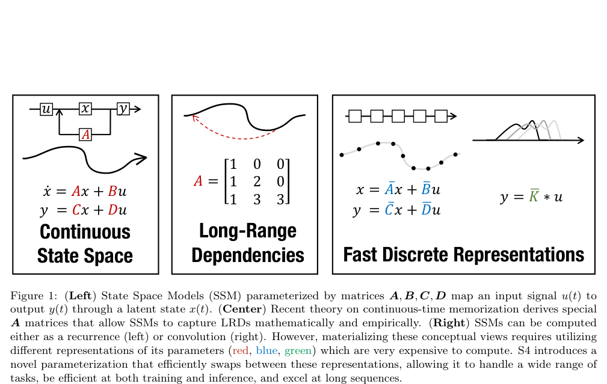

The figure consists of three panels illustrating the transition from continuous to discrete state space models. The left panel shows a block diagram of a continuous system with input $u$, state $x$, and output $y$ governed by differential equations, while the center panel displays a waveform with a dashed red line and a matrix $A$ to represent long-range dependencies. The right panel depicts discrete representations through a sequence of boxes and a convolution operation, conveying how the model can be computed efficiently as either a recurrence or a convolution.

**Mamba: Linear-Time Sequence Modeling with Selective State Spaces** — arXiv:2312.00752 p.3

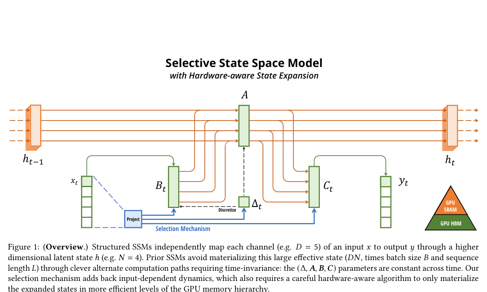

The figure illustrates a Selective State Space Model where an input $x_t$ is processed through a selection mechanism that projects and discretizes parameters to produce time-varying matrices $B_t$, $\Delta_t$, and $C_t$. These matrices, along with a state transition matrix $A$, act on a high-dimensional latent state $h_{t-1}$ via a series of arrows to compute the output $y_t$ and the updated state $h_t$. The diagram conveys how the model expands the state dimension through hardware-aware selection to achieve time-varying dynamics.

**Transformers are RNNs: Fast Autoregressive Transformers with Linear
  Attention** — arXiv:2006.16236 p.6

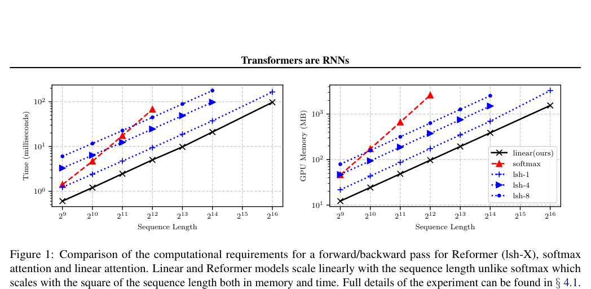

The figure consists of two log-log line plots comparing the computational requirements of different attention mechanisms (linear, softmax, and three lsh variants) against sequence length. The left plot shows "Time (milliseconds)" and the right plot shows "GPU Memory (MB)" on the y-axes, conveying that while softmax scales quadratically with sequence length, the linear and lsh models scale linearly.

**Simplified State Space Layers for Sequence Modeling** — arXiv:2208.04933 p.2

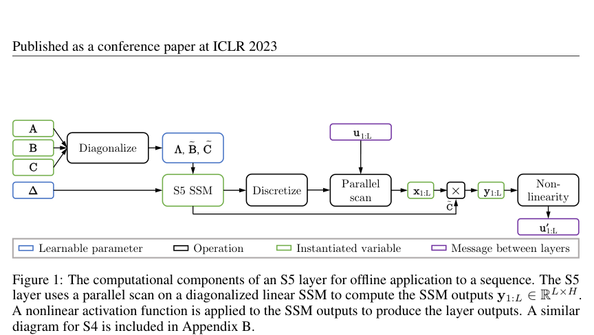

This flowchart illustrates the computational components of an S5 layer, using boxes to represent operations (e.g., "Diagonalize," "Discretize," "Parallel scan") and colored boxes to represent parameters, variables, and messages. The diagram conveys a process where learnable parameters ($A, B, C, \Delta$) are diagonalized and discretized to feed into a parallel scan operation, which processes an input sequence $u_{1:L}$ to produce an output $y_{1:L}$ through a non-linearity.

**Long Range Arena: A Benchmark for Efficient Transformers** — arXiv:2011.04006 p.4

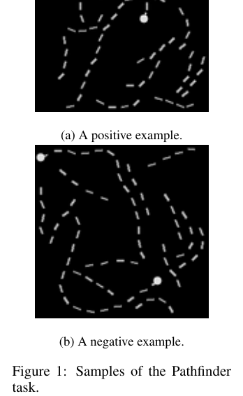

The figure displays two black-and-white images labeled as "(a) A positive example" and "(b) A negative example" for the Pathfinder task. Each image contains a series of short, dashed white line segments scattered across a black background, with the positive example containing a continuous path connecting two specific points and the negative example containing disconnected segments.

**BERT: Pre-training of Deep Bidirectional Transformers for Language
  Understanding** — arXiv:1810.04805 p.3

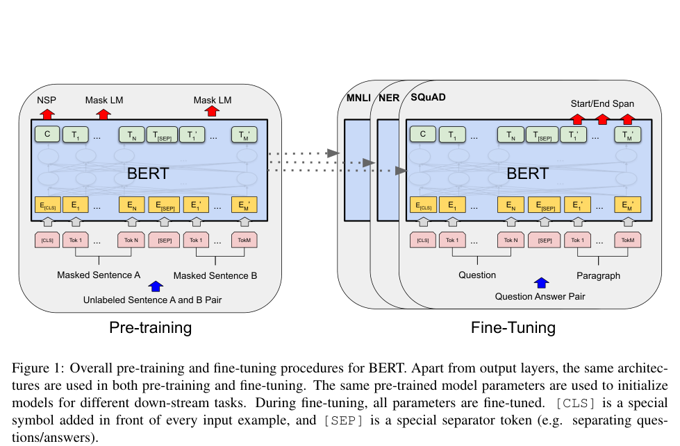

The figure illustrates the two stages of the BERT framework: pre-training and fine-tuning. The pre-training panel shows a BERT model processing an unlabeled pair of masked sentences (A and B) to perform Next Sentence Prediction (NSP) and Masked Language Modeling (MLM), while the fine-tuning panel shows the same architecture applied to specific downstream tasks like MNLI, NER, and SQuAD using task-specific output layers.

**HiPPO: Recurrent Memory with Optimal Polynomial Projections** — arXiv:2008.07669 p.4

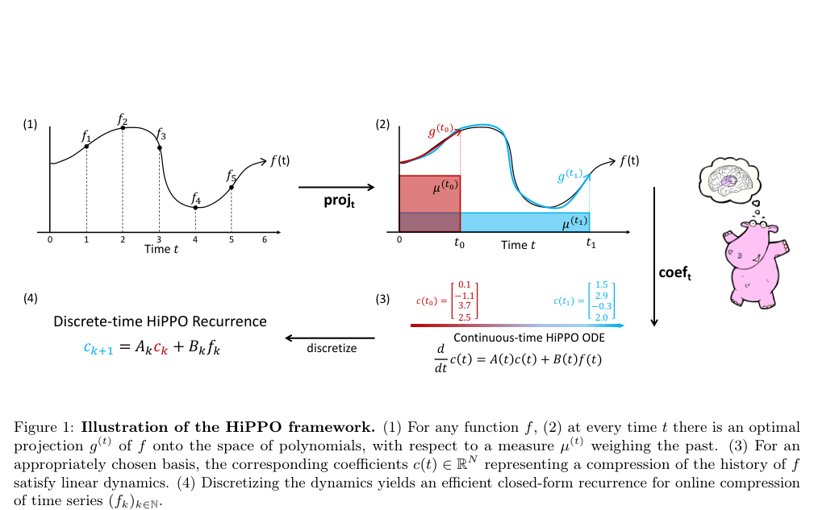

The figure illustrates the HiPPO framework through a four-part sequence: (1) a time-series function $f(t)$ is shown on an axis; (2) an optimal polynomial projection $g^{(t)}$ is drawn over $f(t)$ relative to a memory measure $\mu^{(t)}$; (3) the projection is represented by coefficient vectors $c(t)$ that evolve according to a continuous-time linear ODE; and (4) the system is discretized into a recurrence relation $c_{k+1} = A_k c_k + B_k f_k$. The diagram uses arrows to show the progression from a continuous function to a compressed coefficient representation via projection and discretization.

**Time-Varying Deep State Space Models for Sequences with Switching Dynamics** — arXiv:2605.15311 p.2

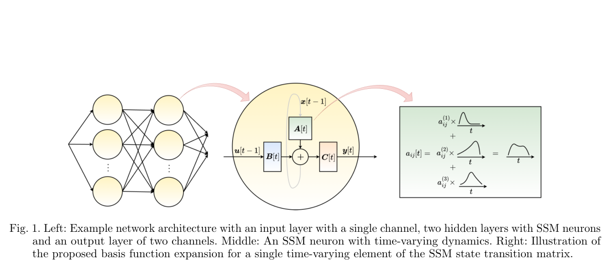

The figure consists of three panels: a neural network diagram, a circular diagram of an SSM neuron, and a mathematical expansion box. The left panel shows an architecture with an input layer, two hidden layers of SSM neurons, and a two-channel output layer; the middle panel illustrates an SSM neuron with time-varying matrices $A[t]$, $B[t]$, and $C[t]$ processing inputs $u[t-1]$ and $x[t-1]$ to produce $y[t]$; and the right panel shows a basis function expansion where a single time-varying matrix element $a_{ij}[t]$ is represented as a sum of three weighted basis functions.

**The SCAN Statistical Model Checker** — arXiv:2603.28794 p.3

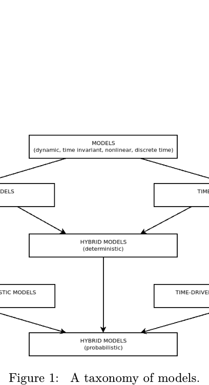

This figure is a hierarchical flowchart consisting of rectangular boxes connected by downward-pointing arrows. It presents a taxonomy of models, starting from a top-level box for "MODELS (dynamic, time invariant, nonlinear, discrete time)" and branching down through "HYBRID MODELS (deterministic)" to a final category of "HYBRID MODELS (probabilistic)."

**MS-SSM: A Multi-Scale State Space Model for Efficient Sequence Modeling** — arXiv:2512.23824 p.4

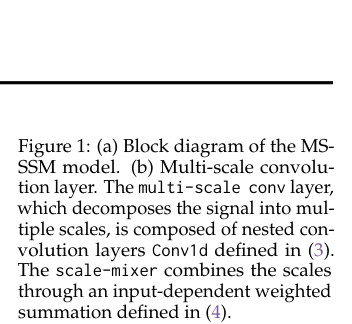

Figure 1 consists of two parts: (a) a block diagram of the MS-SSM model architecture and (b) a detailed schematic of the multi-scale convolution layer. The figure illustrates how the model decomposes signals into multiple scales using nested convolution layers and subsequently recombines them via an input-dependent weighted summation.

**Advancing Intelligent Sequence Modeling: Evolution, Trade-offs, and Applications of State- Space Architectures from S4 to Mamba** — arXiv:2503.18970 p.5

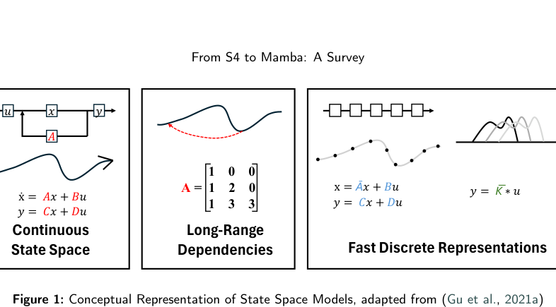

The figure consists of three panels illustrating the conceptual evolution of State Space Models, labeled "Continuous State Space," "Long-Range Dependencies," and "Fast Discrete Representations." The first panel uses block diagrams with boxes for variables ($u, x, y$) and an $A$ matrix to represent continuous differential equations, while the second panel uses a waveform and a red dashed line to show a $3 \times 4$ matrix $A$ capturing long-range dependencies. The third panel depicts discrete time steps via a sequence of boxes and a dot plot, relating discrete equations to a convolution operation ($y = \bar{K} * u$).
