*deep research · 1 round(s) · 80 landmarks · frontier≥2025: 34 · 4 full-PDF critiques · grounded 51 · off-digest 1*

# Scaling the Inference Frontier: A Review of Test-Time Compute and Reasoning in Large Language Models

The advancement of large language models (LLMs) has historically been defined by the scaling of pre-training parameters and dataset volume. However, as these models are tasked with increasingly complex logical, mathematical, and symbolic reasoning, the limitations of static, single-pass inference have become a primary bottleneck. The core problem involves the transition from mere pattern recognition to robust, multi-step cognitive processing. This has necessitated a shift in focus toward test-time compute—the strategic allocation of computational resources during the inference phase to improve accuracy and depth of thought. Understanding this mechanism is vital, as it suggests that the path to higher-order intelligence may lie not just in larger models, but in the ability to scale the computational effort applied to a single problem at the moment of execution.

This review traces the trajectory of this field, beginning with the foundations of LLM reasoning and scaling and the early reasoning paradigms that utilized prompting and verification to elicit better performance. We then examine the recent transformative shift characterized by the emergence of test-time scaling and o1-like systems, which have redefined the relationship between inference time and model capability. The review proceeds to synthesize systematic surveys and theoretical frameworks of inference compute, followed by an exploration of various optimization strategies, including search, latent reasoning, and adaptive compute. Finally, we survey the current frontiers of the discipline, focusing on the potential of multi-agent architectures, domain-specific scaling, and the emerging frontier of latent thought scaling.

## Foundations of LLM Reasoning and Scaling

The evolution of large language model (LLM) reasoning is rooted in the architectural shift toward attention mechanisms. The Transformer architecture, introduced in arXiv:1706.03762, established the fundamental mechanism for processing sequences, demonstrating significant performance gains in machine translation tasks, such as achieving 28.4 BLEU on English-to-German and 41.8 BLEU on English-to-French. This architectural foundation enabled the subsequent shift from task-specific fine-tuning to the emergent few-shot capabilities observed in much larger models. For instance, arXiv:2005.14165 demonstrated that scaling models allows them to perform diverse reasoning tasks—including 3-digit arithmetic, word unscrambling, and question-answering—with minimal instruction, reaching competitiveness with prior state-of-the-art fine-tuning methods.

However, the ability to achieve these capabilities is strictly governed by the allocation of computational resources. Early research in arXiv:2001.08361 focused on the optimal allocation of a fixed compute budget to maximize model performance. This concept of compute-optimal scaling was further refined in arXiv:2203.15556, which proposed a specific scaling strategy: increasing model size and the number of training tokens equally (doubling both for every doubling of compute). This approach yielded substantial improvements in reasoning, such as a 67.5% average accuracy on the MMLU benchmark, representing a 7% improvement over the Gopher model.

The practical application of these scaling laws is best exemplified by the Llama series of models. While arXiv:2005.14165 established the potential of few-shot learners, the Llama lineage demonstrated how efficient scaling can produce highly capable foundation models. arXiv:2302.13971 showed that a 13B parameter model could outperform the much larger GPT-3 (175B) on most benchmarks, while the 65B version remained competitive with Chinchilla-70B and PaLM-540B. This trajectory of efficiency and performance continued through the development of Llama 2, which extended the Llama architecture to outperform existing open-source chat models (arXiv:2307.09288), and eventually culminated in the Llama 3 series, which achieved quality comparable to leading models like GPT-4 (arXiv:2407.21783).

A critical tension exists between the theoretical scaling laws and the practical deployment of these models. While arXiv:2001.08361 and arXiv:2203.15556 provide mathematical frameworks for optimizing training, the subsequent Llama models (arXiv:2302.13971, arXiv:2307.09288, arXiv:2407.21783) demonstrate that the real-world utility of reasoning capabilities is increasingly driven by how these scaling strategies are implemented to balance model size against token count, ultimately aiming for the high-level performance seen in the most recent iterations.

## Early Reasoning Paradigms: Prompting and Verification

Early efforts to enhance large language model (LLM) reasoning focused on two primary axes: optimizing the prompting mechanism to elicit intermediate steps and implementing verification systems to judge the correctness of those steps. Initial breakthroughs in prompting emphasized the importance of explicit computation. The "scratchpad" mechanism (arXiv:2112.00114) demonstrated that allowing models to emit intermediate steps dramatically improved multi-step computations, such as long addition. This concept was further popularized through zero-shot Chain of Thought (CoT) prompting (arXiv:2205.11916), where the simple phrase "Let's think step by step" significantly boosted performance across arithmetic and logical tasks—for instance, increasing MultiArith accuracy from 17.7% to 78.7%.

Building on these prompting foundations, researchers developed more structured decomposition and sampling strategies. Least-to-most prompting (arXiv:2205.10625) improved compositional generalization by decomposing complex problems into simpler subproblems, notably increasing SCAN benchmark accuracy from 16% to at least 99%. To mitigate the risk of single-path errors, self-consistency (arXiv:2203.11171) introduced a sampling-based approach, selecting the most consistent answer via marginalization. This method provided substantial gains across several benchmarks, including a 17.9% improvement on GSM8K and 12.2% on AQuA. For even more complex reasoning, the Tree of Thoughts (arXiv:2305.10601) framework enabled exploration over coherent "thoughts" using lookahead and backtracking, which increased the success rate in the Game of 24 from 4% to 74%.

Parallel to prompting, the development of verifiers shifted focus toward evaluating the quality of reasoning. Early work (arXiv:2110.14168) focused on training verifiers to judge the correctness of model completions and selecting the highest-ranked candidate for math word problems. This evolved from outcome-based evaluation to more granular process-based supervision. While outcome-based feedback (arXiv:2211.14275) reduced final-answer errors from 16.8% to 12.7%, process-based supervision proved even more potent, reducing reasoning errors from 14.0% to 3.4%. This distinction is critical; process supervision (arXiv:2305.20050) provides step-level feedback that allows models to achieve high accuracy on the MATH dataset (78%). 

Recent advancements have integrated these concepts through automated reward models. Math-Shepherd (arXiv:2312.08935) utilizes a process-oriented reward model for reranking and step-by-step Proximal Policy Optimization (PPO), pushing Mistral-7B accuracy on GSM8K to 89.1% via verification. While these verification paradigms offer significant improvements over standard CoT, they represent a shift from simple prompting to complex, compute-intensive evaluation loops that require sophisticated feedback mechanisms to ensure reasoning integrity.

## The Emergence of Test-Time Scaling and o1-like Systems

Recent advancements in large language models (LLMs) have shifted focus from purely scaling model parameters to optimizing test-time compute to enhance reasoning capabilities. This paradigm shift is characterized by diverse mechanisms ranging from repeated sampling to sophisticated reinforcement learning (RL) strategies.

A foundational approach to scaling inference compute involves increasing the number of candidate solutions. arXiv:2407.21787 demonstrates that scaling the number of samples—up to four orders of magnitude—can significantly improve performance in complex tasks like coding and formal proofs; for instance, DeepSeek-Coder-V2-Instruct's SWE-bench Lite coverage rose from 15.9% with one sample to 56% with 250 samples [arXiv:2407.21787]. Similarly, arXiv:2408.00724 explores various inference strategies, including greedy search, majority voting, best-of-n, and tree search algorithms. Their findings suggest that compute-optimal inference can transcend model size limits, noting that a Llemma-7B model using a novel tree search consistently outperforms a Llemma-34B model across MATH benchmark strategies [arXiv:2408.00724].

While simple sampling and voting provide gains, more advanced methods focus on adaptive and structured search. arXiv:2408.03314 introduces a compute-optimal scaling strategy that adaptively allocates compute per prompt by searching against dense, process-based verifier reward models. This approach is notably efficient, outperforming Best-of-N with 4× less compute and even surpassing a 14× larger model in FLOPs-matched evaluations on easy and medium problems [arXiv:2408.03314]. However, it is noted that these efficiency gains may not fully account for the additional inference overhead [arXiv:2408.03314]. A different approach to budget control is seen in s1, which utilizes "budget forcing"—either through forceful termination or appending 'Wait' to lengthen generation—to scale compute [arXiv:2501.19393]. This method achieved up to a 27% improvement over o1-preview on MATH and a 50% to 57% improvement on AIME24 [arXiv:2501.19393].

The most sophisticated systems, often termed "o1-like," move beyond search heuristics toward incentivizing internal reasoning through RL. The OpenAI o1 system utilizes large-scale RL to enable reasoning via chain of thought [arXiv:2412.16720]. DeepSeek-R1 further advances this by using pure RL to trigger emergent reasoning patterns, such as self-reflection and dynamic strategy adaptation, which allows it to surpass models trained via conventional supervised learning on human demonstrations [arXiv:2501.12948]. Despite these strengths, the tendency for such models to "overthink" simple queries has led to research into self-training paradigms designed to streamline reasoning and reduce computational overhead without sacrificing performance [arXiv:2412.21187].

## Systematic Surveys and Theoretical Frameworks of Inference Compute

Recent literature has established several taxonomies to categorize the burgeoning field of test-time scaling. A foundational survey by arXiv:2503.24235 provides a broad overview of scaling across mathematics, coding, and open-ended Q&A. This generalist approach is complemented by more specialized structural frameworks; for instance, arXiv:2511.14772 proposes a taxonomy based on subproblem structure, categorizing scaling mechanisms into sequential, parallel, or tree-structured problem decomposition.

The literature further distinguishes between the specific mechanisms used to achieve scaling and the complexity of the tasks being addressed. arXiv:2504.00294 investigates scaling for complex reasoning domains, including NP-hard problems, spatial reasoning, and calendar planning. It identifies key mechanisms such as lengthening generated scratchpads and repeated model calls, which can be either independent or sequential with feedback. A critical nuance provided by arXiv:2504.00294 is the dependency on verifier quality; while significant performance gains are observed when utilizing perfect verifiers or strong feedback, the effectiveness of these scaling strategies is highly sensitive to task complexity, suggesting that the benefits of increased token usage are not universally guaranteed.

The strategies for compute allocation also present a spectrum of intensity and structure. arXiv:2512.02008 explores the dynamic allocation of compute during inference, a method that demonstrates high-scale capability but incurs massive computational overhead, such as the generation of over thirty billion tokens. This stands in contrast to more constrained scaling strategies. For example, arXiv:2502.07154 examines budget-constrained scaling via the pass@N mechanism, which involves searching for a correct answer among $N$ independent samples. While arXiv:2512.02008 focuses on the fluidity of allocation, arXiv:2502.07154 provides empirical evidence in the domain of mathematical reasoning (specifically MATH and MiniF2F benchmarks), suggesting that limiting confidence can actually improve reasoning outcomes when scaling through independent samples.

Together, these works suggest a tension between the structural decomposition of problems (arXiv:2511.14772), the intensity of compute allocation (arXiv:2512.02008), and the necessity of high-quality verifiers to realize the potential of complex task scaling (arXiv:2504.00294). While structural decomposition offers a path to manage complexity, the massive overhead of dynamic allocation and the task-dependent nature of verifier-led scaling remain significant practical considerations.

## Optimization Strategies: Search, Latent Reasoning, and Adaptive Compute

Recent advancements in test-time compute (TTC) reveal a fundamental divergence in how models can be scaled: through the expansion of explicit reasoning tokens or the intensification of latent computational depth. One prominent approach shifts away from traditional token production toward latent space iteration. arXiv:2502.05171 proposes a recurrent depth mechanism that unrolls a recurrent block to arbitrary depths, achieving a computational load equivalent to a 50 billion parameter model without increasing the token count. This contrasts with the more common "Chain of Thought" (CoT) scaling, where performance is driven by increasing the number of reasoning tokens generated.

The literature suggests that scaling via reasoning tokens is highly effective but requires careful optimization. For instance, arXiv:2502.18080 introduces "Thinking-Optimal Scaling," which optimizes mathematical reasoning by selecting the shortest correct responses under varying reasoning efforts, allowing smaller models to match the performance of much larger teachers like QwQ-32B-Preview. In specialized domains like medicine, arXiv:2504.00869 demonstrates that increasing the reasoning token budget can allow sub-10B models to establish new state-of-the-art results, though it identifies a diminishing return with an optimal budget of approximately 4K tokens. This necessity for budget management is further emphasized by arXiv:2505.16122, which utilizes an adaptive scheduling model to decompose complex queries and allocate tokens based on estimated complexity, achieving up to 70% accuracy gains while simultaneously reducing token usage by 39%.

Beyond simple token expansion, more sophisticated search-based strategies integrate structured reasoning. arXiv:2507.05557 utilizes a hierarchical retrieval-augmented Monte Carlo Tree Search (MCTS) that combines coarse-level templates with fine-level intermediate steps and Process Reward Model (PRM) scoring to improve performance on complex benchmarks like MATH500. This tree-based search is refined in arXiv:2509.25420, which introduces a dual-phase approach that separates planning from execution. By employing reward-guided pruning and dynamic budget allocation, this method allows for early stopping and reallocation of resources, optimizing mathematical and code generation tasks.

These search mechanisms extend into agentic frameworks as well. arXiv:2506.12928 explores scaling TTC for language agents, finding that parallel sampling, sequential revision, and diversifying rollouts all contribute to improved agent performance, with list-wise verification methods proving most effective. Furthermore, the utility of reasoning models can be scaled not just for generation, but for evaluation. arXiv:2503.19877 demonstrates that increasing the reasoning tokens used by an evaluator model improves performance monotonically, suggesting that reranking via reasoning-heavy evaluators is as effective as increasing the generation-time compute of the primary model. Collectively, these works suggest that the future of reasoning lies in the transition from static inference to adaptive, search-driven, and depth-optimized computation.

## Frontiers: Multi-Agent, Domain-Specific, and Latent Thought Scaling

Recent advancements in test-time compute (TTC) have shifted from simple stochastic sampling toward sophisticated, structured, and latent reasoning mechanisms. While traditional methods like self-consistency provide significant gains—demonstrating a 9% to 15% absolute accuracy improvement over greedy decoding—they often incur high computational overhead [arXiv:2603.21301]. Newer research seeks to optimize this allocation by targeting specific granularities of reasoning or by modifying the model's internal processing.

A significant frontier involves scaling through latent or recursive processes rather than just expanding the number of sampled trajectories. For instance, arXiv:2510.07358 proposes "recursive latent thoughts," which scales reasoning by iterating over a small subset of reasoning-relevant layers via an adaptive depth strategy. This approach yields substantial relative accuracy improvements, such as +28.4% on GSM8K and +36% on MATH using OLMo-2 1B. Similarly, arXiv:2603.07159 introduces a novel shift in granularity by moving uncertainty-driven selection from the token level to the "thought" level (intermediate reasoning steps). By maximizing internal predictive distribution certainty, this method matches or exceeds self-consistency under comparable token budgets. However, a notable weakness of this thought-level maximization is its reliance on predefined reasoning delimiters, which may limit its generalizability to models lacking structured Chain-of-Thought (CoT) formatting [arXiv:2603.07159].

Other researchers focus on structured search and retrieval to navigate complex problem spaces. arXiv:2507.05557 utilizes a Hierarchical retrieval-augmented Monte Carlo Tree Search (MCTS), employing dual-level in-context learning—coarse-level abstract templates and fine-level intermediate steps—alongside Process Reward Model (PRM) scoring. This hierarchical approach achieved up to a 16% relative improvement on tasks like MATH500 and OlympiadBench-TO using LLaMA-3.1-8B. In contrast, vision-language reasoning presents unique challenges; while structured reasoning and iterative self-refinement improve multi-step reasoning, these gains are notably limited on perception-focused benchmarks [arXiv:2512.11109].

Efficiency remains a critical constraint in these scaling strategies. While arXiv:2505.14733 highlights that allocating resources based on query complexity can surpass traditional model scaling in both accuracy and energy efficiency, other works emphasize the practical costs of compute. arXiv:2509.09864 advocates for dynamic allocation that incorporates both token cost and wall-clock latency, consistently outperforming static strategies in accuracy-cost trade-offs. This necessity for efficiency is further underscored by the failure of certain high-compute methods; for example, arXiv:2603.21301 found that dual-model reasoning actually decreased accuracy in their tests, suggesting that more complex multi-agent or multi-model verification strategies may not always be effective for smaller, non-reasoning models.

## Tensions and Open Problems

A primary tension in the literature concerns the optimal mechanism for enhancing model performance during inference. One school of thought focuses on increasing the breadth of sampling and logical consistency, as seen in the development of self-consistency frameworks (arXiv:2203.11171) and tree-based search structures (arXiv:2305.10601) to navigate complex decision spaces. Conversely, recent work suggests that simply increasing sample volume is insufficient or even counterproductive; for instance, arXiv:2510.02611 argues that the role of temperature sampling is more nuanced than simple repetition, while arXiv:2502.06703 challenges the assumption that scaling inference compute through repetition alone is the most efficient path, suggesting that compute-optimal test-time strategies may favor smaller, highly specialized models over massive, repetitive sampling.

Another significant debate revolves around the source of "intelligence" during the reasoning process: whether it should be baked into the model's weights via massive pre-training or emergent through iterative refinement. Early paradigms emphasized the power of few-shot learning and massive scale (arXiv:2005.14165), a view that has been critiqued by the emergence of highly capable, instruction-tuned models like GPT-4 (arXiv:2303.08774) which demonstrate that structured alignment is paramount. This has led to a divide between those advocating for "static" intelligence—where the model's reasoning capability is a fixed property of its parameters (arXiv:2402.03300)—and those advocating for "dynamic" intelligence, where performance is boosted through external loops such as verbal reinforcement (arXiv:2303.11366) or iterative self-refinement (arXiv:2303.17651).

Finally, there is an emerging conflict regarding the scalability and efficiency of test-time compute. While many researchers aim to maximize reasoning depth through increased computation (arXiv:2512.02008), new evidence suggests a "scaling plateau" where additional test-time compute yields diminishing returns (arXiv:2505.20522). This tension is further complicated by the environmental and economic costs of such scaling, prompting a shift toward "reasoning on a budget" (arXiv:2507.02076) and the need for adaptive, controllable compute allocation that can balance accuracy against the high energy demands of extended inference (arXiv:2505.14733).

## Outlook

The frontier of the field is rapidly shifting from "scaling laws for training" to "scaling laws for inference." As we move beyond simple chain-of-thought prompting, the next generation of models will likely move toward latent reasoning architectures (arXiv:2502.05172) and multi-agent synergies (arXiv:2605.10344) that treat inference as a dynamic, recurrent process rather than a single forward pass. The ultimate goal is to develop models that can autonomously manage their own computational budget, utilizing uncertainty minimization (arXiv:2603.07159) to decide exactly how much "thinking time" a specific problem requires.

---

## Key Figures

**Chain-of-Thought Prompting Elicits Reasoning in Large Language Models** — arXiv:2201.11903 p.1

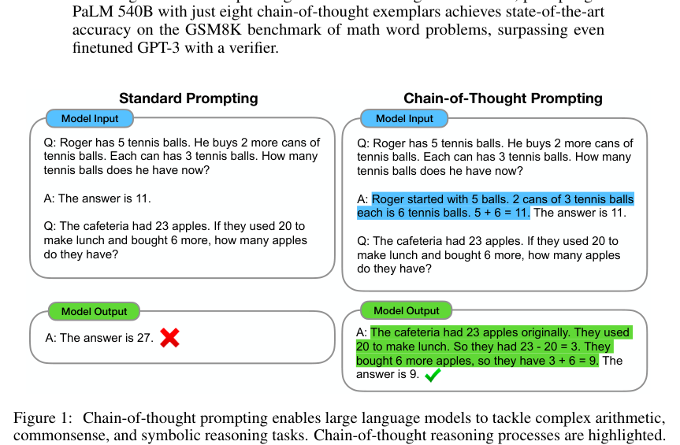

The figure compares "Standard Prompting" and "Chain-of-Thought Prompting" through two side-by-side examples of math word problems. Each example consists of a "Model Input" box containing a question and a "Model Output" box containing the answer, with the Chain-of-Thought version featuring a blue-highlighted intermediate reasoning step. The figure conveys that standard prompting leads to an incorrect answer (27), whereas chain-of-thought prompting enables the model to reach the correct answer (9) by showing its work.

**Scaling LLM Test-Time Compute Optimally can be More Effective than
  Scaling Model Parameters** — arXiv:2408.03314 p.2

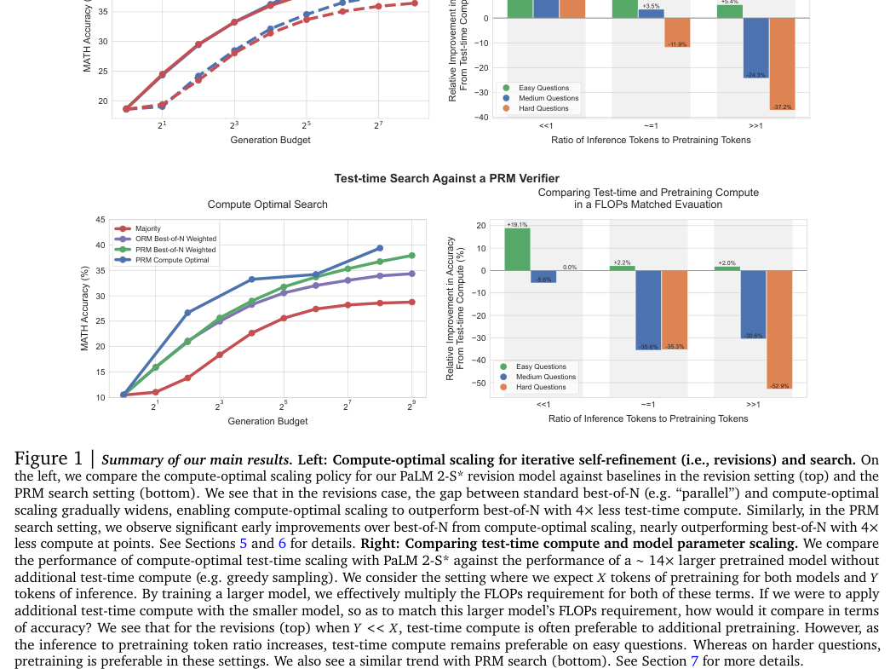

The figure consists of two side-by-side panels comparing compute-optimal scaling strategies. The left panel is a line graph plotting MATH Accuracy (%) against Generation Budget, showing that "PRM Compute Optimal" scaling eventually outperforms "Majority," "CRM Best-of-N Weighted," and "PRM Best-of-N Weighted" baselines. The right panel is a grouped bar chart showing the Relative Improvement in Test-time Compute (%) across different ratios of Inference-to-Pretraining tokens, categorized by question difficulty (Easy, Medium, and Hard).

**DeepSeek-R1: Incentivizing Reasoning Capability in LLMs via Reinforcement Learning** — arXiv:2501.12948 p.4

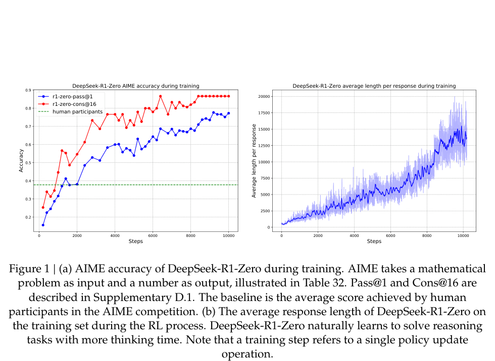

Figure 1 contains two line graphs plotted against "Steps" on the x-axis. The left graph plots "Accuracy" on the y-axis, showing the upward trends of "r1-zero-pass@1" and "r1-zero-cons@16" compared to a horizontal dashed line representing "human participants." The right graph plots "Average length per response" on the y-axis, showing a steady increase in response length as training steps progress.

**Training Verifiers to Solve Math Word Problems** — arXiv:2110.14168 p.2

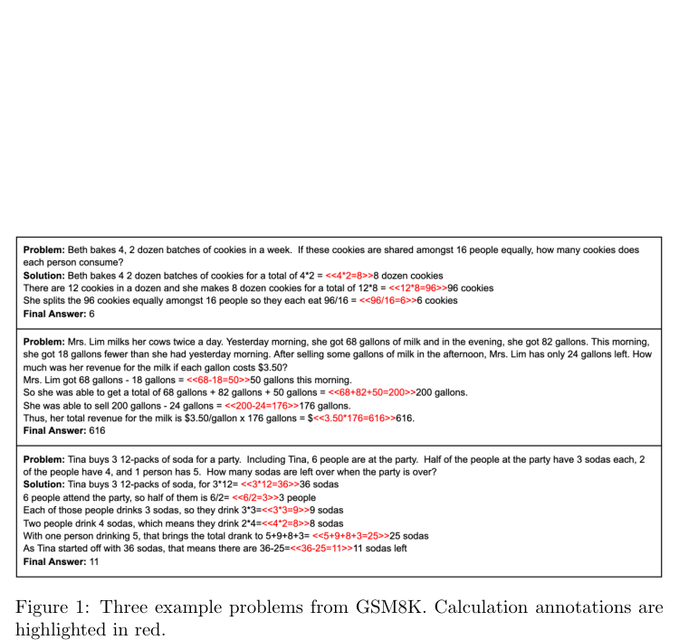

The figure displays three math word problems from the GSM8K dataset, each followed by a step-by-step solution. The solutions include calculation annotations highlighted in red text, which represent the arithmetic operations performed to reach the final answer.

**Self-Consistency Improves Chain of Thought Reasoning in Language Models** — arXiv:2203.11171 p.1

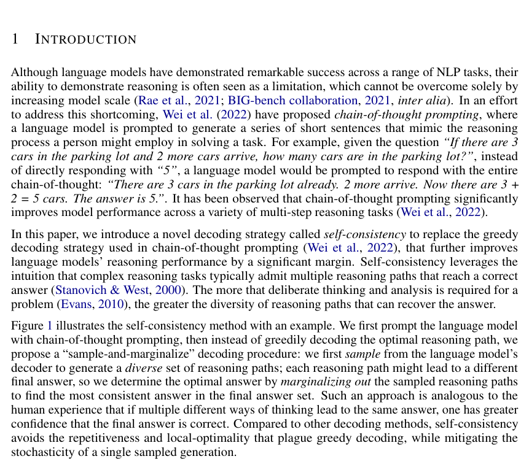

The figure illustrates the self-consistency method using a mathematical word problem as an example. It shows a prompt leading to multiple branching paths of "Chain of Thought" reasoning, each resulting in a different final answer, which are then aggregated to identify the most frequent (consistent) answer.

**Measuring Mathematical Problem Solving With the MATH Dataset** — arXiv:2103.03874 p.2

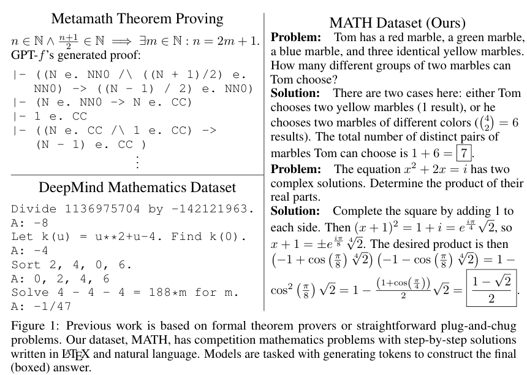

The figure is divided into two columns comparing "Metamath Theorem Proving" and the "MATH Dataset (Ours)." The left column displays formal logic proofs and simple arithmetic problems, while the right column presents competition-level mathematical problems accompanied by step-by-step natural language solutions and boxed final answers. The figure conveys that while previous datasets focus on formal proofs or plug-and-chug arithmetic, the new MATH dataset focuses on complex, multi-step problem solving.

**Tree of Thoughts: Deliberate Problem Solving with Large Language Models** — arXiv:2305.10601 p.2

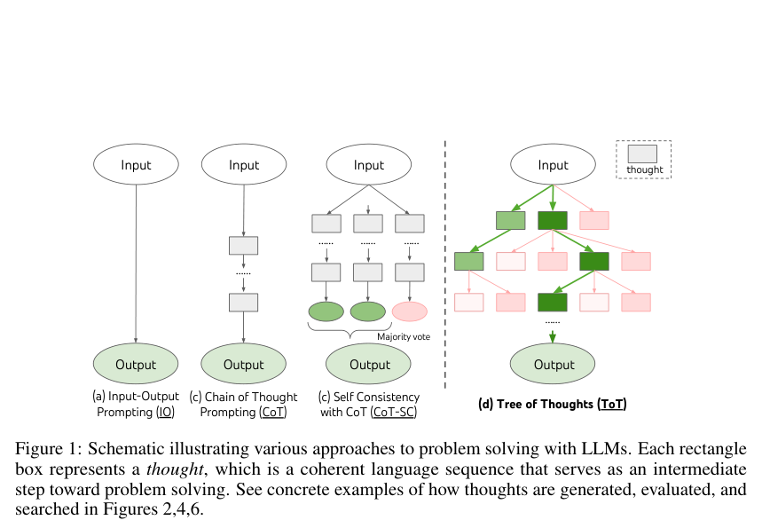

The figure uses labeled ovals for "Input" and "Output" and rectangular boxes to represent "thoughts" to compare four prompting methods. It illustrates a progression from direct Input-Output prompting (a single arrow) and Chain of Thought (a linear sequence of boxes) to Self-Consistency (multiple parallel paths with a majority vote) and Tree of Thoughts (a branching structure of green and pink boxes representing explored paths). The diagram conveys how the Tree of Thoughts approach expands the problem-solving process into a complex, searchable tree of intermediate reasoning steps.

**s1: Simple test-time scaling** — arXiv:2501.19393 p.1

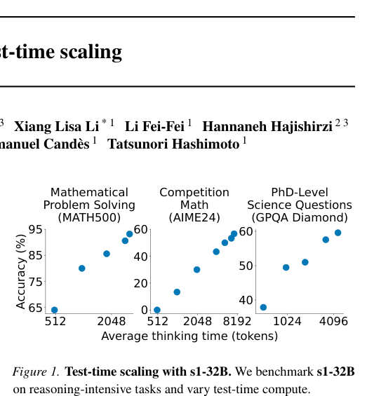

The figure consists of three scatter plots showing accuracy (%) on the y-axis against average thinking time (tokens) on the x-axis for three different benchmarks: MATH500, AIME24, and GPQA Diamond. Each plot uses blue circular markers to convey a positive correlation between increased test-time compute (thinking tokens) and improved task accuracy.

**Improving reasoning at inference time via uncertainty minimisation** — arXiv:2603.07159 p.2

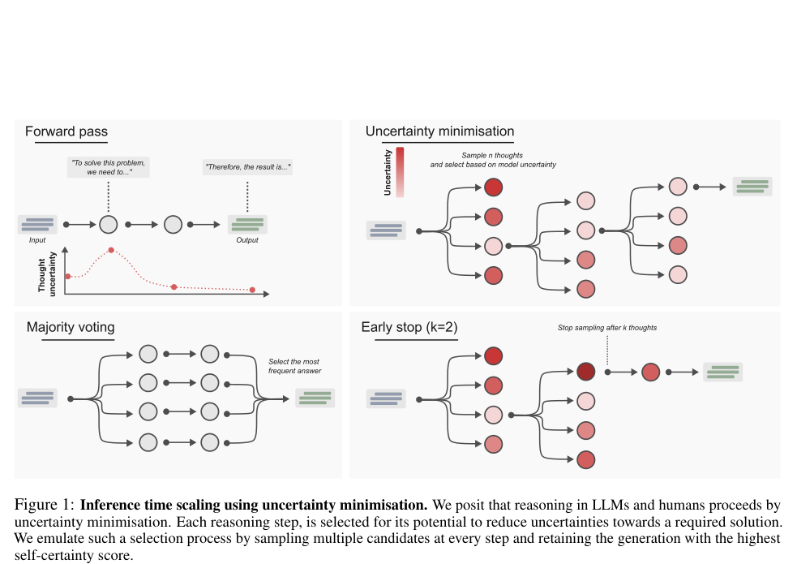

This figure consists of four panels comparing different inference methods: "Forward pass," "Uncertainty minimisation," "Majority voting," and "Early stop (k=2)." Each panel uses diagrams of input/output blocks connected by nodes and arrows to illustrate different computational paths, with the "Uncertainty minimisation" panel specifically using color-coded nodes (red for high uncertainty, pink for low) to show the selection of paths that minimize uncertainty.

**Enhancing reasoning accuracy in large language models during inference time** — arXiv:2603.21301 p.3

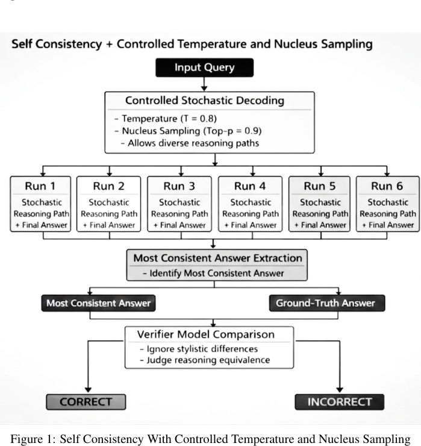

This flowchart illustrates a "Self Consistency" process starting from an "Input Query" that undergoes "Controlled Stochastic Decoding" using specific temperature and nucleus sampling parameters. The process branches into six parallel "Run" boxes, each representing a stochastic reasoning path and final answer, which are then funneled into a "Most Consistent Answer Extraction" step. Finally, a "Verifier Model Comparison" compares the extracted answer to the "Ground-Truth Answer" to output either a "CORRECT" or "INCORRECT" result.

**TMAS: Scaling Test-Time Compute via Multi-Agent Synergy** — arXiv:2605.10344 p.2

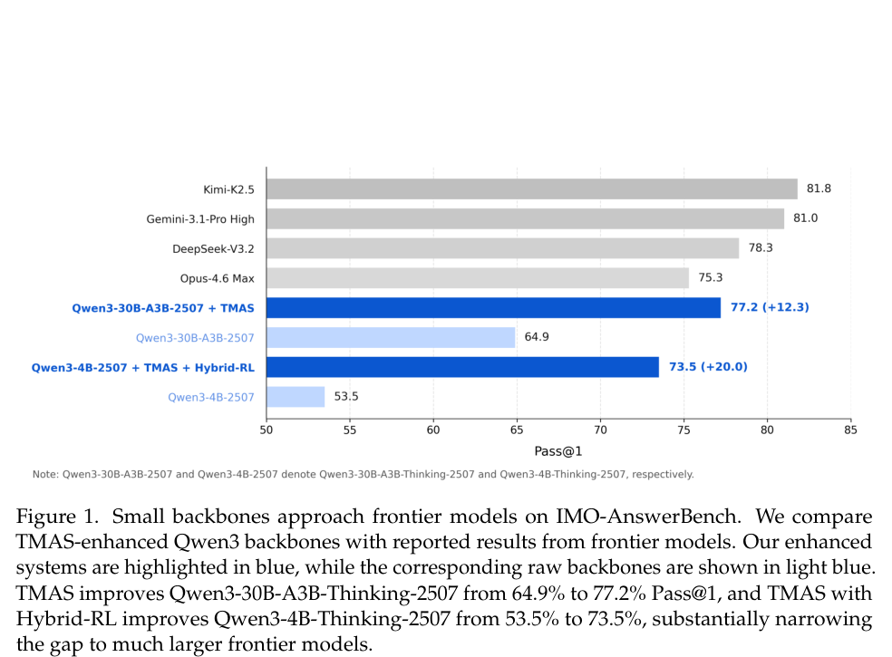

This horizontal bar chart compares the Pass@1 scores of various frontier and backbone models on the IMO-AnswerBench. The gray bars represent large frontier models like Kimi-K2.5 and Gemini-3.1-Pro High, while the blue and light blue bars represent Qwen3 backbone models, specifically highlighting the performance gains achieved by adding TMAS and Hybrid-RL.

**The Art of Scaling Test-Time Compute for Large Language Models** — arXiv:2512.02008 p.1

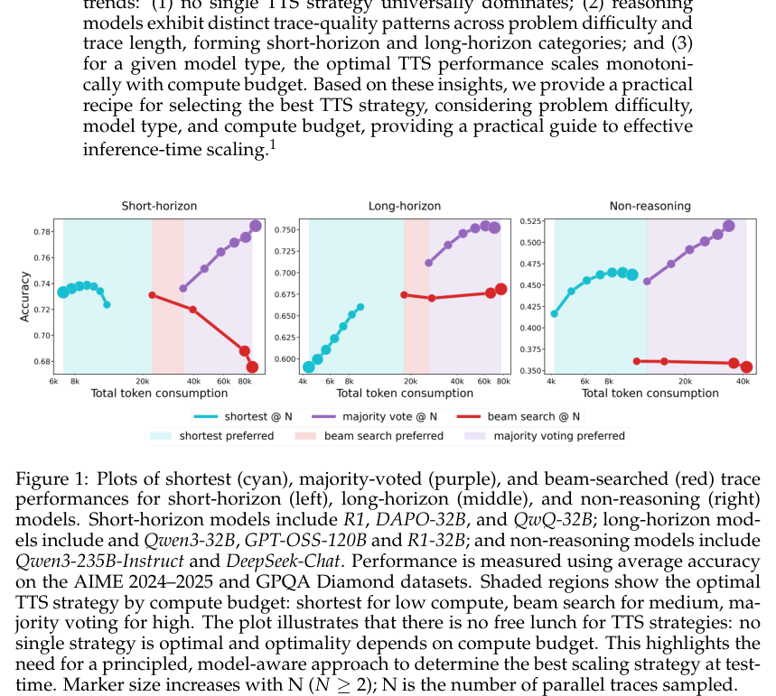

The figure consists of three side-by-side line plots showing accuracy versus total token consumption for "Short-horizon," "Long-horizon," and "Non-reasoning" model categories. Each plot contains three colored lines (cyan for shortest, purple for majority vote, and red for beam search) with marker sizes representing the number of parallel traces ($N$), and shaded background regions indicate which strategy is optimal for a given compute budget. The figure conveys that the best test-time scaling strategy depends on the specific model type and the amount of compute budget available.

**Reasoning on a Budget: A Survey of Adaptive and Controllable Test-Time Compute in LLMs** — arXiv:2507.02076 p.3

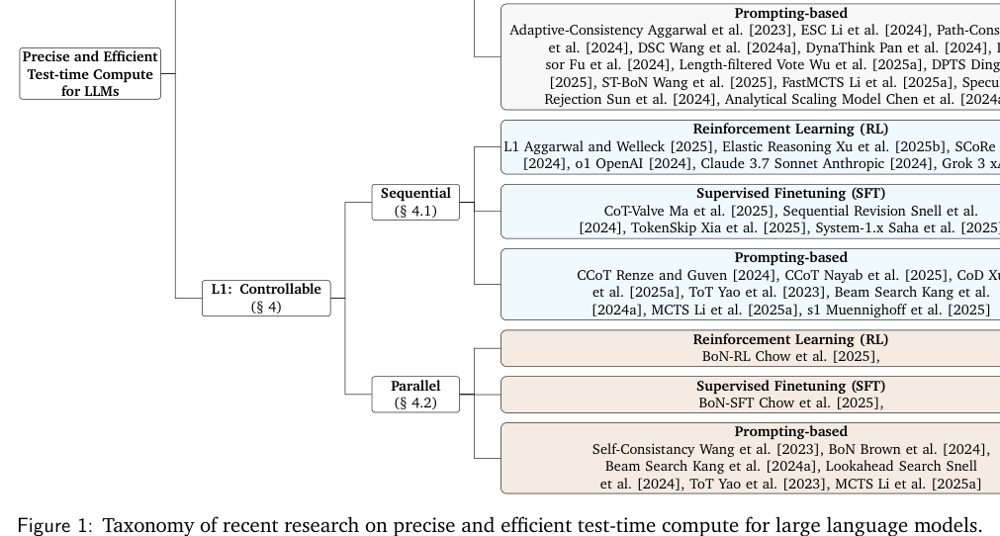

This figure is a hierarchical taxonomy diagram consisting of nested boxes connected by branching lines. It categorizes research on "Precise and Efficient Test-time Compute for LLMs" into a primary "Controllable" branch, which is further subdivided into "Sequential" and "Parallel" approaches. Each sub-category then branches into specific methodologies—Prompting-based, Reinforcement Learning (RL), and Supervised Finetuning (SFT)—listing relevant academic citations within each terminal box.

**The Energy Cost of Reasoning: Analyzing Energy Usage in LLMs with Test-time Compute** — arXiv:2505.14733 p.4

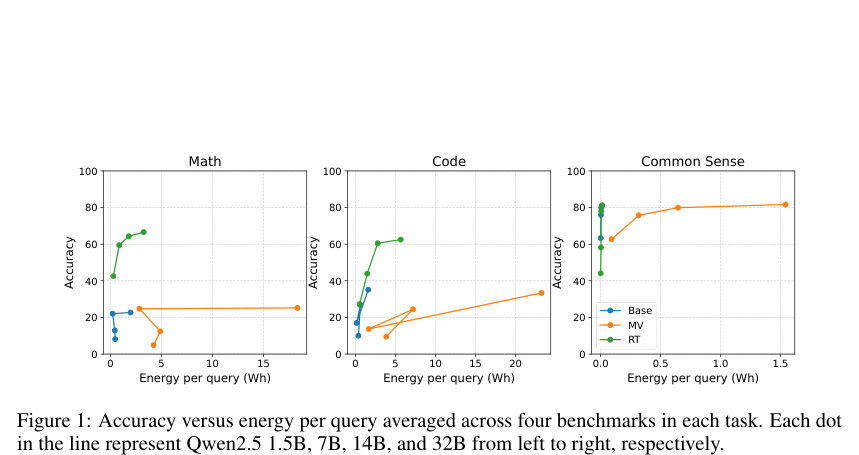

The figure consists of three line graphs titled "Math," "Code," and "Common Sense," plotting Accuracy against Energy per query (kWh). Each graph contains three colored lines—blue for "Base," orange for "MV," and green for "RT"—showing how accuracy scales with energy consumption across different reasoning methods.
