*deep research · 1 round(s) · 80 landmarks · frontier≥2025: 42 · 6 full-PDF critiques · grounded 57 · off-digest 0*

# Scaling the Inference Process: A Review of Test-Time Compute and Reasoning in Large Language Models

The advancement of large language models (LLMs) has traditionally been driven by increasing pre-training scale, yet the ability to perform complex, multi-step logical deduction remains a fundamental bottleneck for general intelligence. While early models excelled at linguistic mimicry, they often struggled with tasks requiring rigorous systematicity and deep cognitive depth. This limitation has catalyzed a paradigm shift in the field: the realization that intelligence can be augmented not just through larger parameter counts during training, but through the strategic allocation of computational resources during the inference phase. Understanding how to leverage test-time compute is essential for moving beyond probabilistic next-token prediction toward true cognitive reasoning, making it a critical area of study for high-stakes applications in mathematics, programming, and autonomous decision-making.

This review traces the developmental arc of reasoning capabilities, beginning with the foundations of LLMs and early reasoning methods. We examine the evolution of reasoning paradigms, charting the transition from basic Chain-of-Thought (CoT) prompting to more sophisticated structures like Tree-of-Thought. The narrative then shifts to the core phenomenon of test-time scaling and inference compute, synthesizing current systematic surveys and the emerging scaling laws that govern this process. To address the practical implications of these advancements, we discuss the optimization of efficiency, latency, and energy in reasoning-intensive tasks. We further explore the expansion of these techniques into domain-specific and agentic test-

## Foundations of LLMs and Early Reasoning

The evolution of large language models (LLMs) is rooted in the transition from specialized architectural components to massive, general-purpose scaling. The foundational Transformer architecture, introduced in arXiv:1706.03762, established the mechanism for tasks such as English constituency parsing and machine translation, achieving BLEU scores of 28.4 for English-to-German and 41.8 for English-to-French. This architecture provided the structural basis for subsequent scaling research, specifically the observation in arXiv:2001.08361 that cross-entropy loss follows a power-law relationship relative to model size, dataset size, and training compute.

Building upon these scaling laws, arXiv:2005.14165 demonstrated that increasing parameter counts significantly improves task-agnostic, few-shot performance across diverse domains, including 3-digit arithmetic, cloze tasks, and word unscrambling. This trend was further quantified in arXiv:2009.03300, which utilized the MMLU benchmark to show that GPT-3 improves over random chance by nearly 20 percentage points on average across multitask reasoning domains—such as law, morality, and computer science—compared to smaller models. While arXiv:2005.14165 focused on the benefits of scale, arXiv:2203.02155 shifted the focus toward alignment, using human feedback to train models to follow instructions, a development that complements the raw scaling capabilities of earlier models.

As models grew in scale, research pivoted from mere capability to the refinement of reasoning processes. A significant breakthrough occurred with the introduction of Zero-Shot Chain-of-Thought (CoT) prompting in arXiv:2205.11916, which improved accuracy in arithmetic, symbolic, and logical reasoning by simply adding the instruction "Let's think step by step." While this method improved reasoning through prompting, arXiv:2203.11171 introduced a more compute-intensive mechanism known as self-consistency. Unlike zero-shot prompting, self-consistency employs sampling and marginalization—sampling diverse reasoning paths and selecting the most consistent answer—to yield substantial accuracy gains in arithmetic and commonsense reasoning, such as a 17.9% increase on GSM8K and 12.2% on AQuA.

The lineage of these foundational models has culminated in the development of efficient, open-source alternatives. The LLaMA series (arXiv:2302.13971 and arXiv:2307.09288) extends the scaling and multitask paradigms established by GPT-3 and earlier Transformer research, providing optimized foundation and fine-tuned chat models that build upon the scaling principles of arXiv:2001.08361 and the multitask evaluation frameworks of arXiv:2009.03300. Together, these works trace a trajectory from architectural innovation to scaling-driven capability, and finally to the sophisticated manipulation of reasoning paths through prompting and sampling.

## Evolution of Reasoning Paradigms: CoT to Tree-of-Thought

The evolution of test-time reasoning in large language models (LLMs) has progressed from simple linear prompting to complex, multi-path search and iterative refinement frameworks. Early advancements focused on enhancing Chain-of-Thought (CoT) through sampling-based methods. For instance, self-consistency improves reasoning by sampling diverse paths and selecting the most consistent answer through marginalization, yielding significant accuracy gains in arithmetic and commonsense tasks, such as +17.9% on GSM8K and +12.2% on AQuA [arXiv:2203.11171]. While this approach leverages compute through sampling, it remains a passive selection mechanism compared to more active structural changes.

Subsequent research moved toward decomposing problems to manage complexity. Least-to-most prompting enables models to solve complex tasks by breaking them into simpler, sequential subproblems [arXiv:2205.10625]. This method facilitates generalization to difficulties beyond the initial prompt by using previous answers to drive subsequent steps. In contrast to this sequential progression, other methods introduced verification-based scaling. The DIVERSE framework utilizes step-wise verification and weighted voting across diverse reasoning paths to improve problem-solving rates [arXiv:2206.02336]. Similarly, Math-Shepherd and "Let's Verify Step by Step" emphasize the importance of step-by-step verification to reinforce mathematical reasoning [arXiv:2312.08935, arXiv:2305.20050], with the latter achieving 78% accuracy on a MATH dataset subset [arXiv:2305.20050]. This highlights a shift from merely generating paths to actively evaluating them.

A major paradigm shift occurred with the introduction of the Tree of Thoughts (ToT) framework, which moves beyond linear chains to explore coherent units of text through a search-based mechanism [arXiv:2305.10601]. Unlike the self-consistency method [arXiv:2203.11171], which relies on simple marginalization, ToT incorporates look-ahead, backtracking, and self-evaluation of choices. This allows for superior performance in non-trivial planning tasks; for example, ToT achieved a 74% success rate in the Game of 24, compared to only 4% for standard CoT [arXiv:2305.10601]. 

Complementing these search-based architectures are iterative refinement methods. Self-Refine utilizes a single LLM to act as generator, refiner, and feedback provider, achieving an average absolute performance improvement of ~20% across diverse tasks compared to one-step generation [arXiv:2303.17651]. While ToT scales compute through structural exploration of multiple paths, Self-Refine scales compute through temporal iterations on a single path. Together, these developments represent a transition from static prompting to dynamic, compute-intensive reasoning processes that utilize feedback and search to navigate complex problem spaces.

## The Shift to Test-Time Scaling and Inference Compute

Recent advancements in large language models (LLMs) signal a paradigm shift from scaling model parameters to scaling inference-time compute to enhance reasoning capabilities. This transition is characterized by a movement from "System-1" methods—such as output calibration or input modification—toward "System-2" mechanisms involving repeated sampling, self-correction, and tree search [arXiv:2501.02497].

Early approaches to test-time scaling focused on increasing coverage through repeated sampling of candidate solutions, particularly for coding and formal proofs [arXiv:2407.21787]. This method demonstrates a log-linear relationship between coverage and the number of samples [arXiv:2407.21787]. However, more sophisticated strategies have emerged that move beyond simple sampling. For instance, scaling via large-scale reinforcement learning (RL) to facilitate chain-of-thought (CoT) reasoning has been utilized to improve complex reasoning [arXiv:2412.16720]. DeepSeek-R1 demonstrates the power of this approach by using a pure RL framework to incentivize autonomous self-evolution, such as self-reflection and verification [arXiv:2501.12948]. This allowed for a massive performance jump in verifiable domains, increasing AIME 2024 accuracy from 15.6% to 77.9% [arXiv:2501.12948]. Despite these gains, such RL-driven scaling faces weaknesses, including token inefficiency ("overthinking") on simple tasks and difficulty applying rule-based rewards to non-verifiable domains like creative writing [arXiv:2501.12948].

A critical dimension of this shift is the pursuit of "compute-optimal" scaling. Rather than simply increasing the number of samples (Best-of-N), researchers have proposed adaptive strategies that allocate compute based on predicted prompt difficulty [arXiv:2408.03314]. Such optimal strategies can improve efficiency by over 4x compared to Best-of-N and can allow a much smaller model to outperform a 14x larger model in FLOP-matched evaluations [arXiv:2408.03314]. This is further supported by evidence that compute-optimal test-time scaling (TTS) can enable a 1B parameter model to surpass a 405B parameter model on mathematical reasoning tasks like MATH-500 [arXiv:2502.06703].

However, scaling is not infinitely beneficial. While increasing inference budgets through oversampling can directly improve math reasoning performance [arXiv:2501.11651], and "budget forcing"—lengthening generation to double-check answers—can extrapolate performance on AIME24 [arXiv:2501.19393], there is a point of diminishing returns. Research into "thinking-optimal" scaling suggests that excessively scaling CoT lengths can actually impair reasoning performance, indicating that an optimal length distribution exists and varies across domains [arXiv:2502.18080]. Thus, the frontier of inference compute lies not just in more computation, but in the strategic and adaptive allocation of "thinking time" [arXiv:2501.12948, arXiv:2502.18080].

## Systematic Surveys and Scaling Laws for Test-Time Compute

Recent advancements in large language models (LLMs) have shifted focus toward how computational resources can be dynamically allocated during inference to enhance reasoning. A primary driver of this shift is the use of reinforcement learning (RL) to incentivize "thinking time." For instance, the DeepSeek-R1 framework demonstrates that a pure RL approach (DeepSeek-R1-Zero) can bypass supervised fine-tuning to allow for the emergence of autonomous self-reflection and verification [arXiv:2501.12948]. This method has proven highly effective in verifiable domains, such as mathematics and coding, where DeepSeek-R1 increased AIME 2024 accuracy from 15.6% to 77.9% [arXiv:2501.12948]. However, this reliance on rule-based rewards introduces a trade-off: while it drives massive performance jumps in STEM fields, it results in token inefficiency—often termed "overthinking"—on simpler tasks and struggles to scale in non-verifiable domains like creative writing [arXiv:2501.12948].

The literature provides various taxonomies for these scaling mechanisms. While some surveys categorize scaling across mathematics, coding, and open-ended Q&A [arXiv:2503.24235], others focus on structural decomposition, such as sequential, parallel, or tree-structured subproblem approaches [arXiv:2511.14772]. Practical implementation often involves lengthening generated scratchpads or utilizing repeated model calls, either independently or sequentially with feedback [arXiv:2504.00294]. These methods have shown utility in complex reasoning tasks ranging from NP-hard problems to spatial reasoning and calendar planning [arXiv:2504.00294].

Despite these capabilities, the relationship between compute and performance is not infinitely linear. A critical tension exists between increasing token counts and actual accuracy gains. Research indicates that the advantages of inference-time scaling can diminish as problem complexity increases, meaning more tokens do not necessarily translate to higher accuracy in challenging regimes [arXiv:2504.00294]. This phenomenon is formalized through the study of scaling plateaus. By employing a probabilistic model (TTSPM), researchers have identified a unified mathematical saturation point ($N^*$) for both parallel and sequential scaling paradigms [arXiv:2505.20522]. This model shows strong empirical validity, achieving a Pearson $r = 0.803$ for 7B models under parallel scaling [arXiv:2505.20522]. However, the theoretical robustness of this saturation model is limited by its assumption of conditional independence between scaling units, a simplification that likely fails in sequential scaling due to error propagation and context dependency [arXiv:2505.20522]. Consequently, current research is evolving toward more adaptive and controllable test-time compute [arXiv:2507.02076] and system-level optimizations that balance predictive accuracy against latency and cost-per-token [arXiv:2509.19645].

## Optimizing Efficiency, Latency, and Energy in Reasoning

As test-time compute (TTC) becomes a primary driver for model performance, research has shifted from merely increasing sample counts to optimizing the trade-offs between accuracy, latency, and energy consumption. While traditional scaling methods like Best-of-N and Self-Consistency improve accuracy, they often incur significant computational overhead [arXiv:2503.00031, arXiv:2509.04474]. Recent literature proposes several distinct strategies to mitigate these costs: early-stopping, token capping, and latent manipulation.

A prominent direction involves "calibration" to prevent redundant computation. arXiv:2503.00031 introduces Self-Calibration, which distills confidence from Self-Consistency to enable early-stopping in Best-of-N sampling, successfully improving MathQA accuracy from 81.0% to 83.6%. This concept of dynamic termination is further refined in arXiv:2505.18404, which utilizes lightweight probes on hidden representations to identify plateaus in reasoning trees. This "thought calibration" achieves a reduction in thinking tokens by up to 60% in-distribution, though its efficacy drops to 20% out-of-distribution, suggesting a potential weakness in generalization compared to the more general self-calibration approach [arXiv:2505.18404].

In contrast to stopping reasoning early, other methods focus on optimizing the *density* or *structure* of reasoning tokens. arXiv:2504.00810 employs a "Shifted Thinking Window" to cap reasoning tokens, matching the performance of R1-Distill-Qwen-7B while using only ~30% of its average thinking tokens. While this approach effectively manages overhead for coding and general reasoning tasks [arXiv:2504.00810], arXiv:2506.15882 proposes a more continuous control mechanism: Fractional Reasoning. By extracting and reapplying latent steering vectors with a tunable scaling factor, this method allows for continuous control of reasoning intensity, providing consistent performance improvements across mathematical and scientific tasks [arXiv:2506.15882].

The literature also highlights the importance of resource-aware allocation. arXiv:2509.09864 advocates for dynamic compute allocation and method selection (e.g., combining Best-of-N with incremental decoding) to achieve favorable accuracy-cost trade-offs [arXiv:2509.09864]. This systemic view is echoed by arXiv:2509.19645, which emphasizes the necessity of considering latency and cost-per-token from a system perspective [arXiv:2509.19645]. Furthermore, the energy implications of these scaling strategies are critical; arXiv:2505.14733 notes that TTC can actually surpass traditional model scaling in accuracy-per-energy efficiency [arXiv:2505.14733]. Finally, scaling can be achieved through the dimension of temperature; arXiv:2510.02611 demonstrates that temperature scaling yields a 7.3-point accuracy gain over single-temperature TTS, though it notes that gains diminish at large $K$ [arXiv:2510.02611].

## Domain-Specific and Agentic Test-Time Reasoning

Recent research indicates that the efficacy of test-time scaling is highly contingent upon the specific reasoning domain and the degree of agentic autonomy employed. In specialized technical domains, scaling mechanisms often shift from simple token expansion to structured verification and iterative refinement. For instance, in medical reasoning, the "m1" method scales performance by increasing the reasoning token budget and utilizing iterative prompting [arXiv:2504.00869]. However, this approach faces a critical threshold; performance improves up to an optimal budget of approximately 4K tokens, after which "overthinking" can lead to performance degradation [arXiv:2504.00869]. This necessity for task-aware strategies is further emphasized in the broader medical AI context, where model and task-specific considerations are vital for both LLMs and VLMs [arXiv:2506.13102]. Similarly, in the domain of RTL code generation, scaling is achieved through iterative reflection and self-correction of previous reasoning steps, targeting accuracy in VerilogEval and RTLLM [arXiv:2506.05566].

The transition from static reasoning to agentic frameworks introduces more complex compute mechanisms, such as autonomous budget allocation and environmental interaction. AgentTTS proposes an LLM-agent framework that autonomously manages model and budget allocation to tackle multi-stage complex tasks composed of heterogeneous subtasks [arXiv:2508.00890]. This contrasts with more rigid scaling methods by using iterative feedback-driven interactions with an execution environment [arXiv:2508.00890]. For general language agents, scaling can be achieved through a diverse suite of mechanisms, including parallel sampling, sequential revision, verifiers, merging methods, and diversifying rollouts [arXiv:2506.12928].

Mathematical and symbolic reasoning domains benefit from structured search and verification techniques. Hierarchical retrieval-augmented MCTS (R2-LLMs) integrates Monte Carlo Tree Search with process reward model (PRM) scoring, utilizing dual-level retrieval-based in-context learning to achieve up to a 16% relative improvement in LLaMA-3.1-8B over baselines [arXiv:2507.05557]. In theoretical physics, scaling relies on a symbolic weak-verifier framework that employs step-wise symbolic verification [arXiv:2506.20729]. Interestingly, the utility of scaling is not uniform across all modalities; in vision-language reasoning, while structured reasoning and iterative self-refinement provide clear improvements for multi-step reasoning, they offer limited gains on perception-focused benchmarks, suggesting that scaling benefits are heavily dataset-dependent [arXiv:2512.11109]. Together, these studies suggest that as reasoning tasks move from general text to specialized agentic or domain-specific applications, the optimal scaling strategy must evolve from simple compute expansion to sophisticated, feedback-driven, and verification-heavy architectures.

## The Frontier: Multi-Agent Synergy and Latent Reasoning

Recent advancements in test-time scaling (TTS) have shifted from simple sampling towards sophisticated architectures that manage reasoning through latent depth, hierarchical memory, and multi-agent coordination. A primary tension in the literature exists between implicit latent reasoning and explicit token-based generation. For instance, arXiv:2502.05171 proposes scaling via a recurrent block that unrolls to arbitrary depth, enabling implicit reasoning in the latent space. This approach demonstrates performance improvements on reasoning benchmarks up to a computation load equivalent to 50 billion parameters. In contrast, methods like arXiv:2503.19877 focus on explicit scaling by generating more reasoning tokens (chain-of-thought), which results in monotonic improvements in evaluator performance.

The efficiency of these scaling methods is heavily dependent on the reasoning task and the model's training history. While arXiv:2512.02008 provides a model-aware taxonomy to explain why universal TTS strategies often fail—distinguishing between short-horizon and long-horizon reasoning—it notes that beam search can actually exhibit inverse-scaling, where performance degrades as the compute budget ($N$) increases. This complexity is further evidenced by arXiv:2502.07154, which finds that standard cross-entropy loss can lead to model overconfidence, causing pass@N accuracy to decrease during longer training sessions. Such limitations suggest that "more compute" is not a universal remedy; indeed, arXiv:2502.12521 observes that no single technique consistently performs well across diverse tasks like arithmetic, logical, and algorithmic reasoning.

To mitigate these inconsistencies, researchers are moving toward adaptive and structured frameworks. arXiv:2509.25420 introduces a dual-phase search that separates planning from execution using dynamic budget allocation, while arXiv:2510.06471 demonstrates that while direct translation scaling may plateau, post-editing workflows remain highly effective for machine translation. The most significant leap in coordination is found in arXiv:2605.10344, which introduces "Multi-Agent Synergy" (TMAS). By utilizing hierarchical memories—specifically experience and guideline banks—and a hybrid reward RL scheme, this method achieves stronger iterative scaling than existing baselines, notably increasing Qwen3-4B-Thinking-2507 Pass@1 from 53.5% to 73.5% on IMO-AnswerBench. However, this synergy comes at a cost: the TMAS approach suffers from high computational overhead due to multiple specialized agents and relies heavily on a "cold-start" dataset distilled from a teacher model.

Ultimately, the literature is transitioning from brute-force sampling toward nuanced, task-specific allocation. Whether through the latent depth of recurrent blocks (arXiv:2502.05171), the crosslingual gains of scaling in low-resource languages (arXiv:2505.05408), or the structured collaboration of multi-agent systems (arXiv:2605.10344), the frontier of test-time compute lies in optimizing how models navigate the trade-off between reasoning complexity and computational budget.

## Tensions and Open Problems

A central debate in the literature concerns the optimal mechanism for enhancing reasoning through inference-time expansion. One school of thought emphasizes the importance of diverse sampling and iterative refinement, where techniques like self-consistency (arXiv:2203.11171) and zero-shot prompting (arXiv:2205.11916) provide a foundation for exploring multiple reasoning paths. This perspective is extended by iterative feedback loops, such as the self-refinement strategies proposed in arXiv:2303.17651, which attempt to correct errors through self-feedback. However, this approach faces criticism regarding its efficiency and reliability; for instance, arXiv:2507.15512 argues that simple iterative refinement is often insufficient for complex tasks, advocating instead for step-level verifier-guided hybrid scaling to ensure that the model does not merely loop through erroneous reasoning steps.

Another significant tension exists between the scaling of model parameters and the scaling of inference-time compute. While early paradigms focused on the massive scale of foundation models, as seen in the GPT-4 technical report (arXiv:2303.08774), recent work suggests that test-time compute can potentially bridge the gap between model sizes. This is exemplified by the provocative finding in arXiv:2502.06703, which questions whether a 1B parameter model can surpass a 405B model through optimized test-time scaling. This challenges the "large language monkey" paradigm of simply repeating inference (arXiv:2407.21787), a method that arXiv:2510.02611 critiques for its inefficient use of temperature sampling. Furthermore, the efficacy of these scaling laws is contested; while some argue for the necessity of massive pre-training, others suggest that the focus should shift toward "evaluation-time compute," where reasoning models act as evaluators to refine outputs (arXiv:2503.19877), or toward more structured, latent reasoning approaches (arXiv:2502.05171).

Finally, there is a growing disagreement regarding the stability and "plateau" of reasoning capabilities. While many researchers aim for indefinite scaling, recent investigations into the "scaling over scaling" phenomenon (arXiv:2505.20522) suggest that reasoning models may encounter diminishing returns or plateaus when increasing test-time compute. This tension is compounded by the practical necessity of resource management. While traditional scaling focuses on raw performance, newer research emphasizes the need for "reasoning on a budget" (arXiv:2507.02076) and the critical analysis of the energy costs associated with extended reasoning (arXiv:2505.14733). This suggests that the field is moving away from a "compute-at-all-costs" mentality toward a more nuanced, adaptive, and controllable framework for test-time scaling.

### Outlook

The frontier of the field is rapidly shifting from static inference toward dynamic, multi-agent, and latent reasoning architectures. As we move beyond simple chain-of-thought prompting, the next generation of models will likely integrate multi-agent synergy (arXiv:2605.10344) and recurrent depth approaches (arXiv:2502.05171) to navigate complex problem spaces. The ultimate goal is to transition from brute-force compute scaling to "task-aware" and "model-aware" strategies (arXiv:2506.13102) that can provide high-fidelity reasoning in specialized domains, such as medical AI, while maintaining computational and energetic efficiency.

---

## Key Figures

**Chain-of-Thought Prompting Elicits Reasoning in Large Language Models** — arXiv:2201.11903 p.1

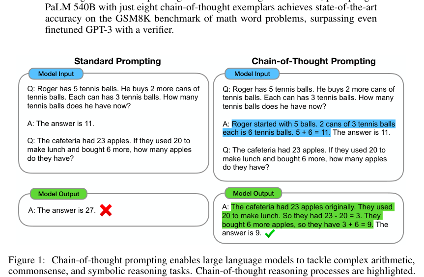

The figure compares "Standard Prompting" and "Chain-of-Thought Prompting" through two side-by-side examples of math word problems. Each example consists of a "Model Input" box containing a question and a "Model Output" box containing the answer, with the Chain-of-Thought version featuring a blue-highlighted intermediate reasoning step. The figure conveys that standard prompting leads to an incorrect answer (27), whereas chain-of-thought prompting enables the model to reach the correct answer (9) by showing its work.

**DeepSeek-R1: Incentivizing Reasoning Capability in LLMs via Reinforcement Learning** — arXiv:2501.12948 p.4

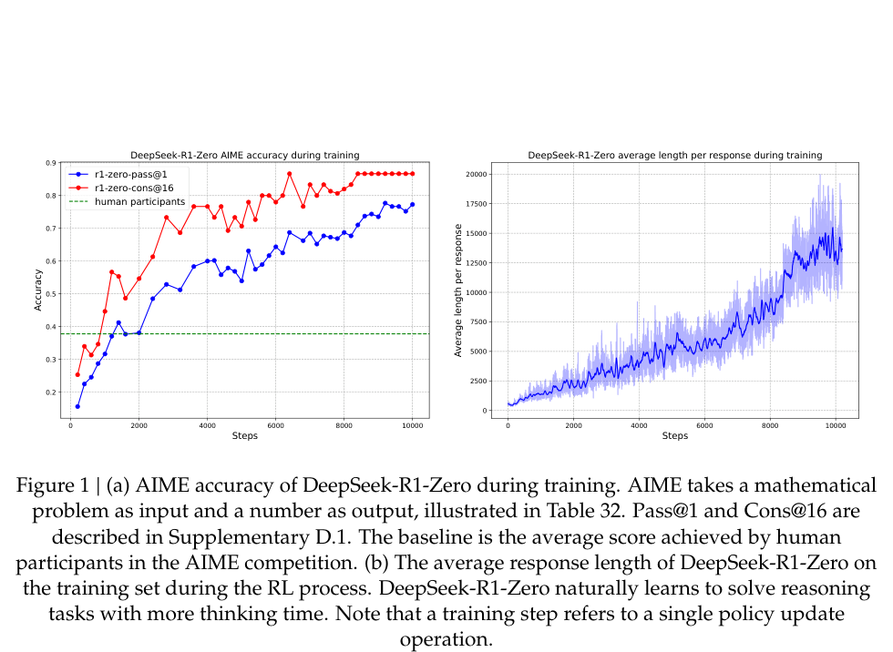

Figure 1 consists of two line graphs plotted against "Steps" on the x-axis. The left graph plots "Accuracy" on the y-axis, showing the upward trends of `r1-zero-pass@1` and `r1-zero-cons@16` relative to a horizontal dashed line representing "human participants." The right graph plots "Average length per response" on the y-axis, showing a steady increase in response length as training steps progress.

**Scaling LLM Test-Time Compute Optimally can be More Effective than
  Scaling Model Parameters** — arXiv:2408.03314 p.2

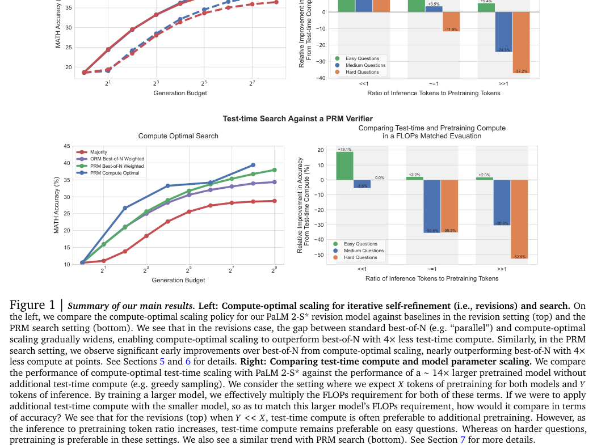

The figure consists of two side-by-side panels comparing compute-optimal scaling strategies. The left panel is a line graph plotting MATH Accuracy (%) against Generation Budget, showing that "PRM Compute Optimal" scaling outperforms "Majority," "CRM Best-of-N Weighted," and "PRM Best-of-N Weighted" baselines. The right panel is a grouped bar chart showing the relative improvement in test-time compute across different ratios of inference tokens to pretraining tokens, categorized by question difficulty (Easy, Medium, and Hard).

**Self-Consistency Improves Chain of Thought Reasoning in Language Models** — arXiv:2203.11171 p.1

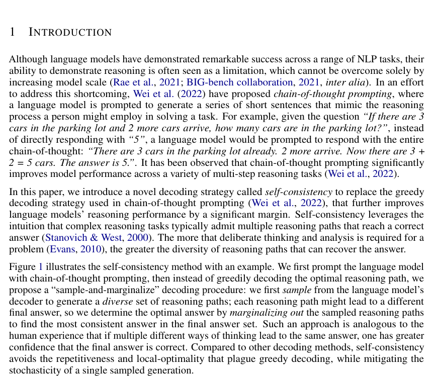

The figure illustrates the self-consistency method using a mathematical word problem as an example. It shows a language model generating multiple distinct reasoning paths (represented by text blocks) that lead to different final answers, which are then aggregated to identify the most frequent answer via a "marginalization" process.

**Training Verifiers to Solve Math Word Problems** — arXiv:2110.14168 p.2

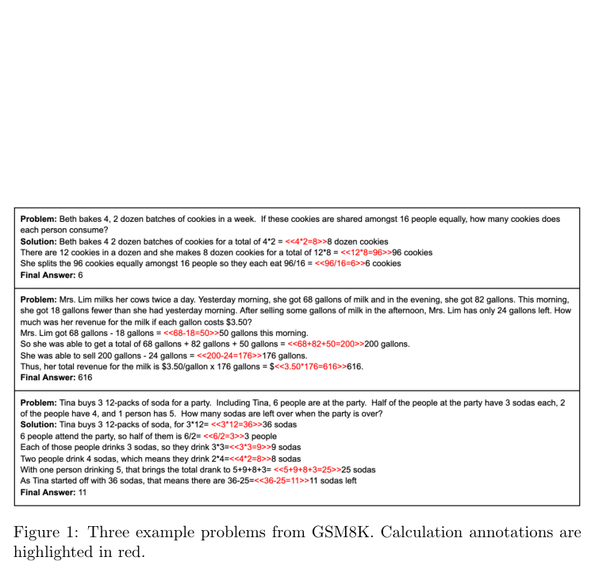

The figure displays three math word problems from the GSM8K dataset, each followed by a step-by-step solution. The solutions include calculation annotations highlighted in red, which represent the arithmetic operations used to reach the final answer.

**Measuring Mathematical Problem Solving With the MATH Dataset** — arXiv:2103.03874 p.2

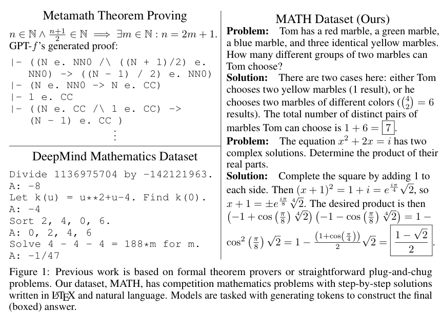

The figure is divided into two columns comparing "Metamath Theorem Proving" and the "MATH Dataset (Ours)." The left column displays formal mathematical logic and a GPT-generated proof, while the right column presents competition-style math problems followed by step-by-step natural language solutions and boxed final answers. The figure conveys that while previous work relies on formal theorem provers or simple arithmetic, the new MATH dataset focuses on complex, multi-step problem solving using LaTeX and natural language.

**Tree of Thoughts: Deliberate Problem Solving with Large Language Models** — arXiv:2305.10601 p.2

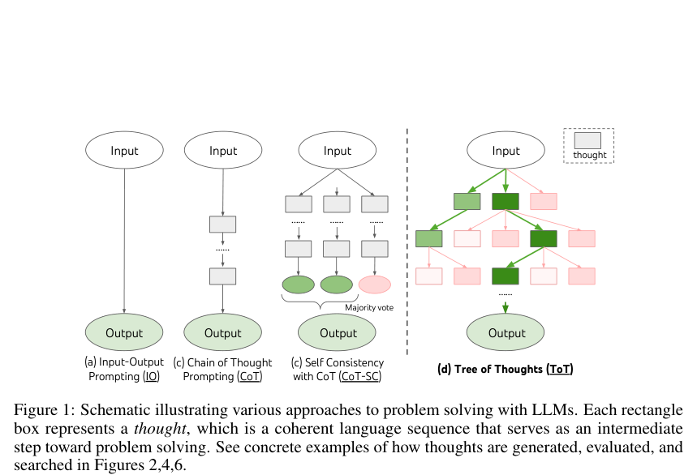

The figure uses ovals for "Input" and "Output" and rectangles for "thought" to schematically compare four prompting methods: Input-Output (IO), Chain of Thought (CoT), Self-Consistency with CoT (CoT-SC), and Tree of Thoughts (ToT). While IO and CoT show linear paths, CoT-SC illustrates multiple parallel thought paths leading to a majority vote, and ToT depicts a branching tree structure where green nodes represent selected paths and red nodes represent discarded ones.

**s1: Simple test-time scaling** — arXiv:2501.19393 p.1

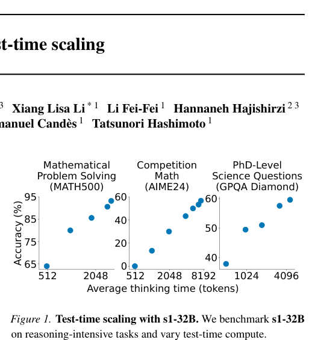

The figure consists of three scatter plots showing accuracy (%) on the y-axis against average thinking time (tokens) on the x-axis for three different benchmarks: MATH500, AIME24, and GPQA Diamond. Each plot uses blue circular markers to convey a positive correlation between increased test-time compute (thinking tokens) and improved task accuracy.

**TMAS: Scaling Test-Time Compute via Multi-Agent Synergy** — arXiv:2605.10344 p.2

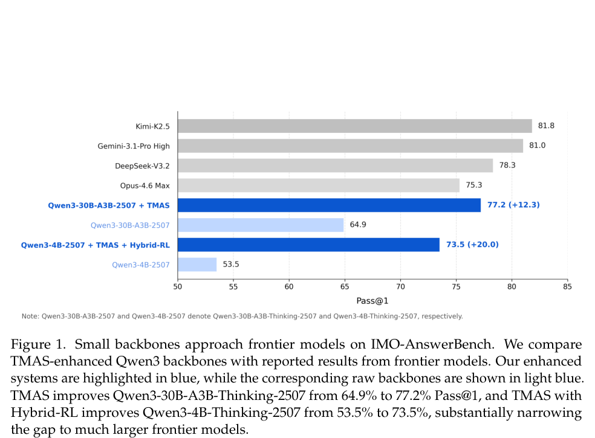

This horizontal bar chart compares the Pass@1 scores of various frontier and enhanced backbone models on the IMO-AnswerBench. The y-axis lists model names, while the x-axis represents the Pass@1 score, with gray bars representing frontier models and blue bars representing the authors' TMAS-enhanced models. The figure conveys that TMAS and Hybrid-RL significantly improve the performance of small Qwen3 backbones, narrowing the gap between them and larger frontier models like Kimi-K2.5 and Gemini-3.1-Pro High.

**The Art of Scaling Test-Time Compute for Large Language Models** — arXiv:2512.02008 p.1

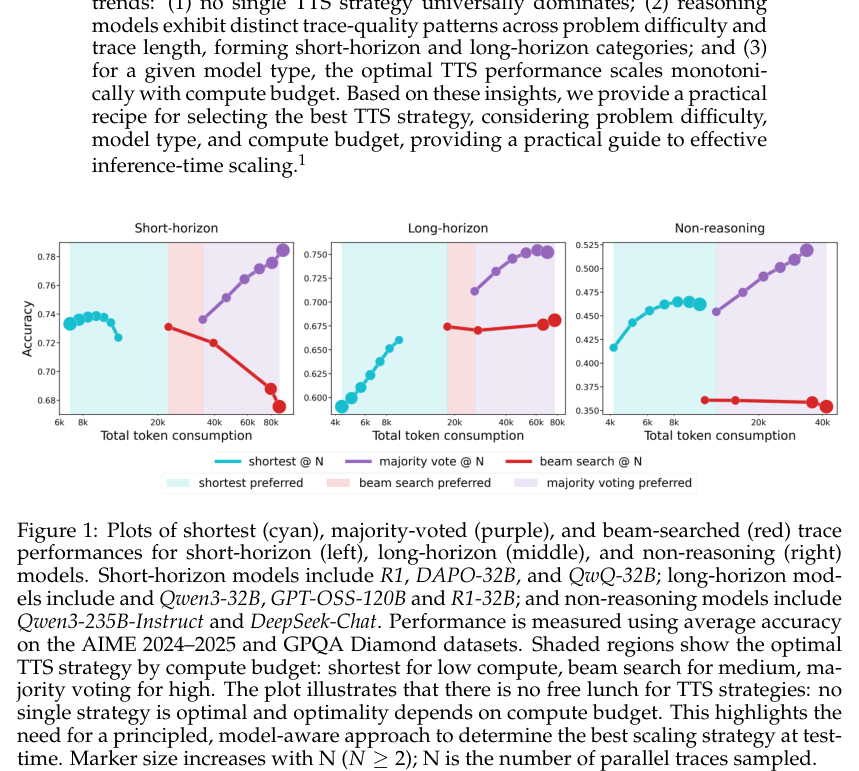

This figure consists of three line plots showing accuracy versus total token consumption for short-horizon, long-horizon, and non-reasoning models. Each plot compares three scaling strategies—shortest (cyan), majority vote (purple), and beam search (red)—using markers of varying sizes to represent the number of parallel traces ($N$). Shaded background regions indicate which strategy is optimal for a given compute budget.

**Scaling over Scaling: Exploring Test-Time Scaling Plateau in Large Reasoning Models** — arXiv:2505.20522 p.3

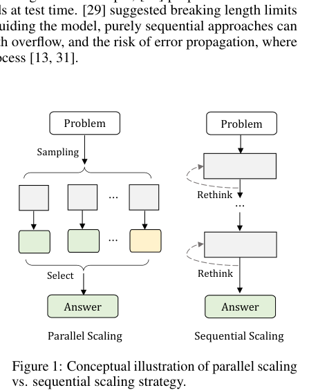

The figure consists of two flowcharts comparing "Parallel Scaling" and "Sequential Scaling" strategies. The parallel diagram shows a single "Problem" box branching via "Sampling" into multiple simultaneous paths that lead to various "Answer" options for selection, while the sequential diagram shows a single "Problem" box leading through a series of stacked boxes connected by "Rethink" arrows to reach a final "Answer."

**Scaling Test-time Compute for LLM Agents** — arXiv:2506.12928 p.3

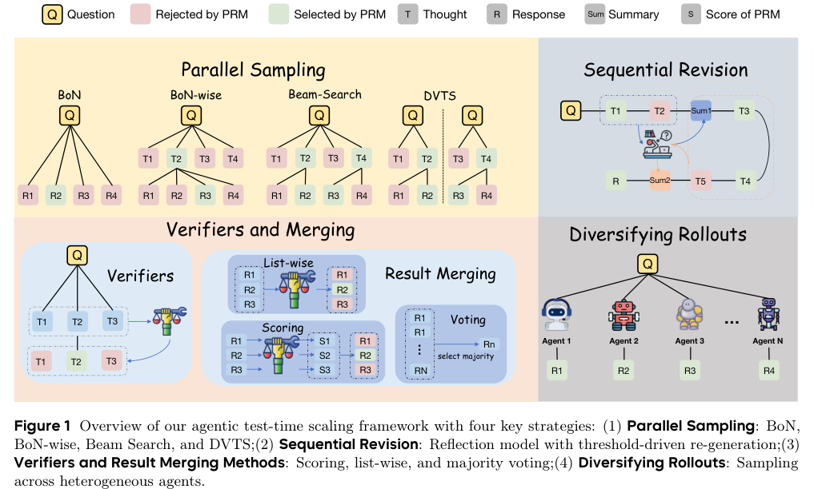

This figure presents an overview of an agentic test-time scaling framework divided into four colored panels: Parallel Sampling, Sequential Revision, Verifiers and Merging, and Diversifying Rollouts. The diagrams use labeled boxes (Question, Thought, Response, Summary) and arrows to illustrate different computational strategies, such as tree-based sampling methods, iterative reflection loops, various verification/merging techniques, and multi-agent rollouts. The visual conveys how different architectural approaches can scale the reasoning capabilities of LLM agents during inference.

**Scaling up Test-Time Compute with Latent Reasoning: A Recurrent Depth
  Approach** — arXiv:2502.05171 p.1

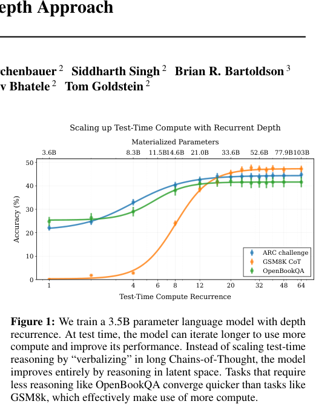

This line graph plots Accuracy (%) on the y-axis against Test-Time Compute (Recurrent Depth) on the x-axis for three datasets: ARC challenge, GSM8K CoT, and OpenBookQA. The figure conveys that increasing test-time compute improves accuracy across all tasks, with GSM8K showing the most significant scaling gains while OpenBookQA converges more quickly.

**A Survey on Test-Time Scaling in Large Language Models: What, How,
  Where, and How Well?** — arXiv:2503.24235 p.2

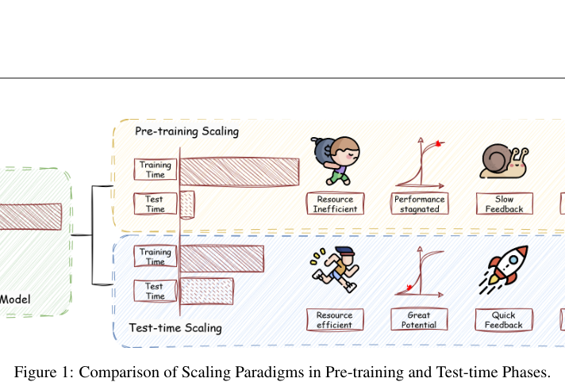

The figure uses two large boxes to compare "Pre-training Scaling" and "Test-time Scaling" paradigms, illustrating each with horizontal bars for training and test time, performance curves, and illustrative icons. It conveys that pre-training scaling is characterized by high training time, resource inefficiency, stagnated performance, and slow feedback, whereas test-time scaling is depicted as resource efficient with great potential and quick feedback.
