*deep research · 1 round(s) · 80 landmarks · frontier≥2025: 32 · 3 full-PDF critiques · grounded 48 · off-digest 0*

# The Evolution of Attention: From Sequence Modeling to the Long-Context Frontier

The fundamental challenge of natural language processing lies in the ability to model complex, non-linear dependencies within sequential data. For decades, the field struggled with the inherent limitations of recurrent architectures, which often failed to capture long-range dependencies and lacked the parallelization necessary for large-scale training. The development of attention mechanisms provided a transformative solution to these bottlenecks, enabling models to dynamically weigh the importance of different tokens regardless of their distance in a sequence. This shift is critical to the modern landscape of artificial intelligence, as the capacity to process context effectively serves as the primary driver for reasoning, translation, and generative capabilities in language models.

This review traces the technological trajectory of these models, beginning with the foundations of sequence modeling and early attention that sought to overcome the constraints of traditional recurrence. We then examine the paradigm shift brought about by the rise of pre-trained transformers and the impact of massive scaling on linguistic performance. The discussion moves into the technical refinements found in architectural variations and efficiency optimizations, alongside the growing field of mechanistic interpretability and structural analysis, which seeks to decode the internal logic of attention heads. Finally, we explore the convergence of paradigms in hybrid architectures and recurrent-attention integration, concluding at the frontier of long-context modeling and advanced efficiency techniques that define the current state of the art.

## Foundations of Sequence Modeling and Early Attention

The evolution of sequence modeling is characterized by a transition from static, fixed-length representations to dynamic, attention-driven architectures. Early approaches, such as the RNN encoder-decoder framework [arXiv:1406.1078], sought to improve statistical machine translation by learning phrase representations through the maximization of conditional probabilities. A prominent implementation of this was the multilayered LSTM encoder-decoder [arXiv:1409.3215], which mapped input sequences to a fixed-dimensional vector. While this approach achieved notable results—such as a 36.5 BLEU score when used for reranking SMT hypotheses—it suffered from a fundamental structural weakness: the information bottleneck [arXiv:1409.0473]. This bottleneck occurs because a single fixed-length vector is often insufficient to capture the full complexity of a long source sequence.

To mitigate this limitation, researchers introduced soft-attention mechanisms [arXiv:1409.0473], which allowed models to automatically search for relevant parts of the source sentence for each target word prediction. This moved the field away from the rigid constraints of the fixed-vector model toward a more flexible, automatic alignment process. Subsequent developments further specialized these attention mechanisms to balance coverage and efficiency. For instance, researchers explored the distinction between global attention, which attends to all source words, and local attention, which focuses on specific subsets of the source [arXiv:1508.04025]. Other models, such as End-to-End Memory Networks [arXiv:1503.08895], extended this by using recurrent attention over external memory to perform multiple computational "hops" per output symbol, thereby increasing the depth of reasoning available to the model compared to standard RNNs.

Parallel to these architectural shifts, the challenge of the "open-vocabulary" problem was addressed by moving away from fixed vocabularies toward subword units [arXiv:1508.07909]. By encoding rare or unknown words as sequences of morphological units, models could more effectively handle out-of-vocabulary terms than traditional back-off dictionary methods.

The culmination of these developments was a fundamental departure from recurrence itself. While previous models relied on the sequential processing of recurrent structures, the Transformer [arXiv:1706.03762] addressed the inherent limitations of complex recurrent and convolutional networks by relying solely on attention mechanisms. This shift not only improved translation quality—achieving 41.8 BLEU on the WMT 2014 English-to-French task—but also significantly enhanced computational efficiency through superior parallelization, requiring only 3.5 days of training on eight GPUs [arXiv:1706.03762].

## The Rise of Pre-trained Transformers and Scaling

The evolution of transformer-based language modeling has been defined by a shift from task-specific architectures toward unified, pre-trained representations that scale with data and compute. This progression began with the development of deep contextualized word representations, which modeled syntax and semantics by learning word vectors as functions of the internal states of a deep bidirectional language model (biLM) [arXiv:1802.05365]. This concept was significantly advanced by BERT, which introduced a transformer-based encoder designed for deep bidirectional pre-training using Masked Language Model (MLM) and Next Sentence Prediction (NSP) objectives [arXiv:1810.04805]. BERT demonstrated that a single architecture could be fine-tuned for diverse tasks, achieving state-of-the-art results such as an 80.5% GLUE score [arXiv:1810.04805] and a 93.2 F1 on SQuAD v1.1 [arXiv:1810.04805]. However, BERT's reliance on the [MASK] token introduces a structural mismatch between the pre-training and fine-tuning phases, and its large-scale variant exhibits instability on smaller datasets [arXiv:1810.04805].

Subsequent research focused on refining these pre-training methodologies. XLNet addressed BERT's limitations by proposing a generalized autoregressive pre-training method that maximizes expected likelihood over all permutations of factorization order, thereby mitigating the dependency neglect and the pre-train-finetune discrepancy inherent in BERT's denoising approach [arXiv:1906.08237]. While BERT focused on bidirectional encoding, XLNet integrated Transformer-XL ideas to improve modeling [arXiv:1906.08237]. Simultaneously, RoBERTa highlighted the importance of hyperparameter optimization and training data volume, demonstrating that BERT's performance could be significantly improved through more robust optimization [arXiv:1907.11692]. These advancements were evaluated using standardized benchmarks like GLUE, which provides a model-agnostic platform for evaluating NLU across diverse tasks [arXiv:1804.07461].

The field eventually moved toward unifying all language tasks into a single framework. T5 introduced a text-to-text format, converting various language problems into a consistent structure [arXiv:1910.10683]. This era of scaling culminated in the observation that language model performance follows predictable power-law scaling relationships relative to model size, dataset size, and compute budget [arXiv:2001.08361]. This understanding of scaling laws facilitated the development of massive autoregressive models like GPT-3, which utilizes 175 billion parameters to achieve few-shot learning capabilities through text interaction without requiring gradient updates [arXiv:2005.14165]. While earlier models like BERT required task-specific fine-tuning [arXiv:1810.04805], these larger-scale models shift the paradigm toward models that can perform tasks via simple instructions or few examples [arXiv:2005.14165].

## Architectural Variations and Efficiency Optimizations

The evolution of Transformer architectures has been primarily driven by the need to mitigate the quadratic $O(n^2)$ time and space complexity inherent in standard self-attention mechanisms, which restricts the processing of long sequences [arXiv:1904.10509, arXiv:2004.05150, arXiv:2006.04768]. Researchers have pursued several distinct strategies to achieve efficiency, ranging from sparse attention patterns to low-rank approximations and linear-time kernel estimations.

A prominent approach involves sparsifying the attention matrix. Sparse Transformers [arXiv:1904.10509] reduce complexity to $O(n\sqrt{n})$ through sparse factorizations. This concept is expanded upon by Longformer [arXiv:2004.05150], which achieves linear scaling by combining local windowed attention with task-motivated global attention, and Big Bird [arXiv:2007.14062], which utilizes a tripartite sparse mechanism comprising local, global, and random attention. While these sparse methods effectively handle longer sequences, they differ in their structural assumptions; for instance, Big Bird incorporates $O(1)$ global tokens (such as CLS) to attend to the entire sequence [arXiv:2007.14062], whereas Longformer focuses on a "drop-in" replacement for standard attention to facilitate long-document processing [arXiv:2004.05150].

Alternatively, several models seek to approximate the attention mechanism entirely to achieve linear complexity. Linformer [arXiv:2006.04768] utilizes a low-rank matrix approximation to reduce complexity from $O(n^2)$ to $O(n)$ in both time and space. Similarly, Performer [arXiv:2009.14794] introduces the FAVOR+ mechanism, which uses positive Orthogonal Random features to provide an unbiased or nearly-unbiased estimation of the softmax attention kernel, thereby achieving linear space and time complexity [arXiv:2009.14794]. While Linformer relies on the theoretical basis that self-attention can be approximated by low-rank matrices [arXiv:2006.04768], Performer focuses on the convergence and low estimation variance of its kernel approximation [arXiv:2009.14794].

Beyond attention complexity, architectural variations also address context length and parameter efficiency. Transformer-XL [arXiv:1901.02860] addresses context fragmentation through a segment-level recurrence mechanism and a novel positional encoding scheme, achieving evaluation speeds up to 1,800+ times faster than vanilla Transformers [arXiv:1901.02860]. In contrast, ALBERT [arXiv:1909.11942] focuses on reducing GPU/TPU memory limitations and training times by employing two parameter-reduction techniques and a self-supervised loss for inter-sentence coherence [arXiv:1909.11942]. Finally, RoFormer [arXiv:2104.09864] optimizes the integration of positional information via Rotary Position Embedding (RoPE), which uses a rotation matrix to encode absolute positions while incorporating explicit relative position dependency, allowing for decaying inter-token dependency as relative distance increases [arXiv:2104.09864].

## Mechanistic Interpretability and Structural Analysis

Research into the internal mechanics of transformer attention has evolved from identifying structural redundancies to characterizing the specific linguistic and causal roles played by individual components. Early investigations focused primarily on the efficiency and necessity of multi-head attention. Both arXiv:1905.09418 and arXiv:1905.10650 demonstrate significant redundancy within attention heads. While arXiv:1905.10650 employs greedy algorithms to reduce multiple heads to a single head at test time, arXiv:1905.09418 utilizes a more sophisticated architectural design involving stochastic gates and a differentiable relaxation of the $L_0$ penalty. This latter approach allows for more aggressive pruning; for instance, it successfully removes 38 out of 48 encoder heads in certain configurations with minimal impact on BLEU scores on the English-Russian WMT dataset arXiv:1905.09418.

Moving beyond mere pruning, subsequent studies have sought to decode the functional utility of these heads. arXiv:1906.04341 provides a foundational analysis of BERT, using attention-based probing classifiers to show that attention patterns correspond to specific linguistic notions, such as coreference, syntax, and the identification of direct objects or determiners. This shift from structural efficiency to functional mapping is further refined by arXiv:2505.13737, which introduces a causal head gating framework. Unlike the purely observational approach of arXiv:1906.04341, arXiv:2505.13737 utilizes causal mediation analysis and ablation to categorize heads into a causal taxonomy—distinguishing between facilitating, interfering, or irrelevant heads—without the need for hypothesis-driven templates or target labels.

Recent work has expanded this analysis to the fundamental design principles and the relationship between sparsity and interpretability. arXiv:2510.11602 deconstructs the success of dot-product attention by isolating four key principles: information mixing, sequence-dependent activations, softmax-weighted dot-product similarity, and query-key coupling. By testing hybrid architectures where these principles are selectively relaxed, they investigate the necessity of these components for effective language modeling. This structural inquiry is complemented by arXiv:2505.00509, which explores the interplay between global sparsity and local specialization. By implementing a self-ablation mechanism that enforces a $k$-winner-takes-all constraint, arXiv:2505.00509 promotes feature localization and neuron specialization, suggesting that sparsity can be a tool for enhancing interpretability rather than just a means of compression.

Finally, the focus has shifted toward correcting attention biases. arXiv:2512.20661 identifies a tendency for models to over-allocate attention to common words at the expense of task-relevant terms. To address this, they propose Adversarial Feedback for Attention (AFA), which uses a dynamic masking strategy and a discriminator to optimize attention via policy gradients, aiming for more precise token-level focus. Together, these papers illustrate a trajectory from optimizing head counts to understanding the causal, linguistic, and mathematical foundations of attention.

## Hybrid Architectures and Recurrent-Attention Integration

Recent research has increasingly moved away from pure Transformer architectures toward hybrid models that integrate recurrent or state-space mechanisms to mitigate the quadratic scaling bottlenecks of self-attention. This shift is driven by the need for computational efficiency in long-context modeling and edge computing.

One prominent strategy involves combining local attention with recurrent memory. arXiv:2505.00929 proposes a compact recurrent Transformer that utilizes shallow models to process short segments, which are then compressed into a single persistent memory vector via a recurrent neural network. This approach achieves substantially reduced FLOPs compared to standard segment-based memory methods. Similarly, arXiv:2503.18565 explores the use of xLSTM-based architectures to approximate Transformer-based attention through recurrent sequence mixing. While arXiv:2505.00929 focuses on reducing overhead for edge computing, arXiv:2503.18565 emphasizes scale efficiency through knowledge distillation from Large Language Models (LLMs) to Small Language Models (SLMs).

A different hybrid paradigm utilizes parallel pathways to balance local and global context. arXiv:2507.22448 introduces Falcon-H1, which employs a parallel hybrid approach combining Transformer-based attention with State Space Models (SSMs). This architecture aims to resolve the limitations of single-architecture models, offering superior long-context memory and efficiency; notably, its 34B flagship model outperforms larger 70B scale models in reasoning and mathematics. A similar pursuit of efficiency is seen in arXiv:2509.00605, which replaces self-attention with two parallel pathways: a causal convolution for local context and a parallel associative memory retrieval mechanism for global patterns. While Falcon-H1 leverages SSMs, arXiv:2509.00605 achieves $O(N)$ linear complexity through a gating mechanism, reporting faster training speeds than both Transformers and Mamba models on datasets like WikiText-2.

Further departures from standard attention involve reservoir computing and gated associative memory. arXiv:2507.15779 investigates reservoir computing to address the high energy demands of LLMs, comparing traditional static linear readouts with attention-enhanced reservoirs that utilize dynamic output weight adaptation. This method offers reduced training and inference speeds compared to Transformers, though it necessitates a careful balance between resource constraints and prediction accuracy. 

While these hybrid models focus on architectural efficiency, the fundamental nature of how information is embedded remains a critical theoretical concern. arXiv:2502.10927 provides a mathematical framework to analyze the underlying structures of self-attention matrices, distinguishing between the symmetry found in bidirectional training and the directionality and column dominance characteristic of autoregressive training. This theoretical grounding is essential for understanding the emergent dynamics that hybrid models, such as the recurrent-attention integrations in arXiv:2503.18565 or the parallel pathways in arXiv:2509.00605, seek to approximate or optimize.

## The Frontier: Long-Context and Advanced Efficiency

The primary obstacle to long-context modeling is the quadratic time and memory complexity inherent in standard self-attention (arXiv:2507.19595, arXiv:2508.09834). Recent research addresses this through two main trajectories: sparse/local attention mechanisms and linear/efficient attention variants.

Sparse and local attention methods aim to reduce the computational footprint by restricting the attention window. While local attention is often employed for efficiency, arXiv:2605.00768 provides a rigorous theoretical justification, proving that local attention introduces a second temporal operator in linear temporal logic, thereby enlarging the class of recognizable regular languages beyond what global attention can achieve. However, while this work offers significant theoretical novelty regarding recognizer expressivity, its empirical validation is limited to a lightweight GPT-2-small setup, which may not scale to larger models (arXiv:2605.00768). In contrast, SWAN-GPT (arXiv:2504.08719) utilizes sliding-window attention (SWA-RoPE) interleaved with layers without positional encodings (NoPE) to enable robust generalization to sequence lengths significantly longer than those seen during training without requiring additional long-context training. Another approach, InfLLM-V2 (arXiv:2509.24663), implements a parameter-free dense-sparse switchable attention that transitions from dense to sparse attention as sequences lengthen. This avoids the disruption of pretrain-on-short/finetune-on-long workflows common in other trainable sparse methods and achieves 4x faster speeds while retaining 98.1% to 99.7% performance in understanding and reasoning tasks (arXiv:2509.24663).

Parallel to sparsity, linear attention methods seek to reduce complexity from quadratic to linear through kernel approximations or recurrent formulations (arXiv:2507.19595). A specific advancement in this area is Dynamic Group Attention (DGA), which addresses the "curse of high dimensionality" by using a group coding strategy to aggregate less important tokens, thereby reducing redundant computations in long-context modeling (arXiv:2505.22107). These efficiency gains are underpinned by mathematical frameworks such as Grouped Query Attention (GQA) and Multi-Headed Latent Attention (MLA), which utilize low-rank factorizations and KV caching to reduce memory costs (arXiv:2604.00965). While arXiv:2604.00965 provides a vital pedagogical synthesis of these modern architectures, it functions primarily as a mathematical tutorial rather than a source of original empirical data (arXiv:2604.00965).

Ultimately, the frontier of attention modeling involves a trade-off between computational throughput and expressivity. While models like SWAN-GPT (arXiv:2504.08719) and InfLLM-V2 (arXiv:2509.24663) prioritize seamless adaptation and throughput, the theoretical insights from arXiv:2605.00768 suggest that the structural choice of local windows is not merely a compression tactic but a fundamental expansion of the model's logical capacity.

## Tensions and Open Problems

A central debate in the evolution of sequence modeling concerns the fundamental necessity of the attention mechanism itself. On one hand, the paradigm established by BERT (arXiv:1810.04805) and its subsequent refinements, such as the rotary position embeddings in RoFormer (arXiv:2104.09864), suggests that dense, bidirectional, or highly structured attention is the cornerstone of linguistic representation. However, recent skepticism has emerged regarding whether these complex mechanisms are truly indispensable. The work "Don't Pay Attention" (arXiv:2506.11305) challenges this orthodoxy by critiquing the reliance on attention-heavy architectures, including the efficient approximations found in Performers (arXiv:2009.14794) and the traditional RNN-based encoder-decoders (arXiv:1409.0473), arguing instead for architectures that may bypass the heavy computational tax of standard attention. This tension is further complicated by the realization that attention is only one part of the equation; as noted in arXiv:2505.06633, the feedforward networks within the Transformer architecture may play a more critical role in language modeling than the attention layers themselves, suggesting that our focus on optimizing attention may be misdirected.

Another significant tension exists between the pursuit of computational efficiency and the preservation of long-range dependency modeling. To mitigate the quadratic scaling of standard Transformers, researchers have proposed linear-complexity models like Linformer (arXiv:2006.04768) and specialized long-context structures like Longformer (arXiv:2004.05150). While these methods aim to scale to massive sequences, they face criticism regarding their ability to maintain the nuanced memory required for complex reasoning. For instance, the "Titans" architecture (arXiv:2501.00663) critiques the limitations of previous attention-based approximations like Performers (arXiv:2009.14794) and the historical alignment-based approaches (arXiv:1409.0473), proposing instead that true long-term modeling requires learning to memorize at test time. This debate is compounded by the "curse of high dimensionality" (arXiv:2505.22107), which suggests that as context lengths increase, the very mechanisms intended to manage them may suffer from structural degradation, making the choice between recurrent memory-augmented structures (arXiv:2505.00929) and sparse attention mechanisms a critical, unresolved design decision.

Finally, there remains a lack of consensus on the optimal way to integrate structural priors into neural architectures. While some argue for the superiority of generalized autoregressive pretraining, such as XLNet (arXiv:1906.08237), which seeks to improve upon the foundational contextualized representations of ELMo (arXiv:1802.05365), others suggest that the path forward lies in hybridizing architectures. This is evident in the push for hybrid RNN-Transformer models (arXiv:2502.00617) and the attempt to learn attention through recurrent structures, as seen in Distil-xLSTM (arXiv:2503.18565). The field is currently split between those seeking to refine the existing Transformer paradigm through synergistic computational graph effects (arXiv:2507.02944) and those advocating for a fundamental departure toward more efficient, recurrent-heavy, or memory-centric primitives.

### Outlook

The frontier of the field is rapidly shifting from "making attention faster" to "redefining what constitutes a sequence model." As we move toward 2026, the focus is coalescing around the mathematical expressivity of local attention (arXiv:2605.00768) and the deconstruction of design principles that govern effective language modeling (arXiv:2510.11602). The next generation of architectures will likely move beyond the binary choice of "Attention vs. RNN" toward integrated, memory-augmented systems that can dynamically balance computational cost with the high-dimensional requirements of long-context reasoning.

---

## Key Figures

**Attention Is All You Need** — arXiv:1706.03762 p.3

The figure depicts the Transformer model architecture, consisting of an encoder stack on the left and a decoder stack on the right, both composed of $N$ repeated layers. The diagram uses labeled boxes to represent functional components—such as Multi-Head Attention, Feed Forward, and Add & Norm—connected by arrows that indicate the flow of data from input embeddings to output probabilities.

**BERT: Pre-training of Deep Bidirectional Transformers for Language
  Understanding** — arXiv:1810.04805 p.3

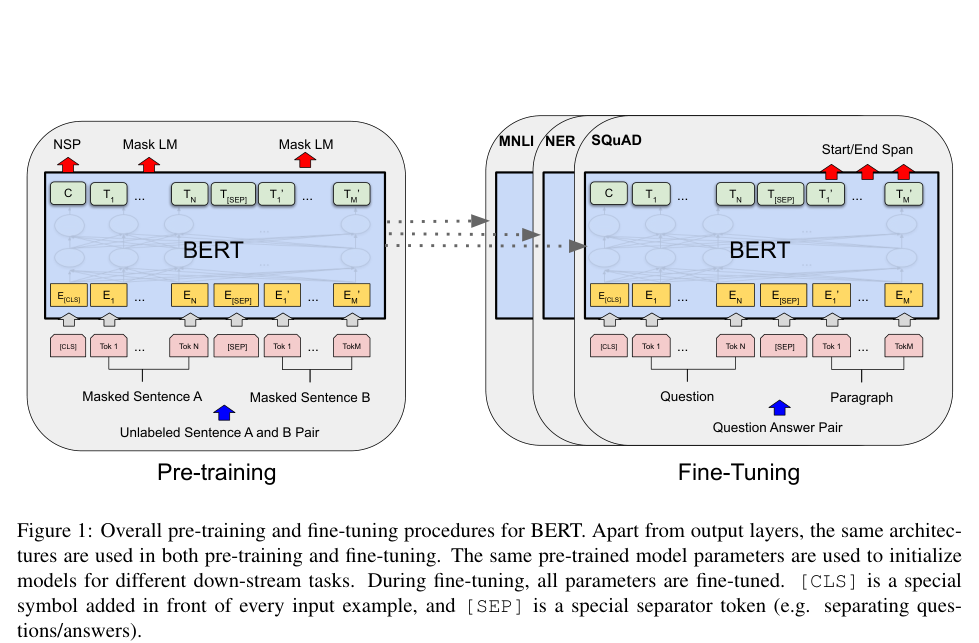

The figure illustrates the two stages of the BERT framework: pre-training and fine-tuning. The pre-training panel shows a BERT model processing an unlabeled pair of masked sentences (A and B) to perform Next Sentence Prediction (NSP) and Masked Language Modeling (MLM), while the fine-tuning panel shows the same architecture applied to specific downstream tasks like MNLI, NER, and SQuAD using question-answer pairs. A dashed arrow indicates that the parameters learned during pre-training are used to initialize the models for fine-tuning.

**Language Models are Few-Shot Learners** — arXiv:2005.14165 p.3

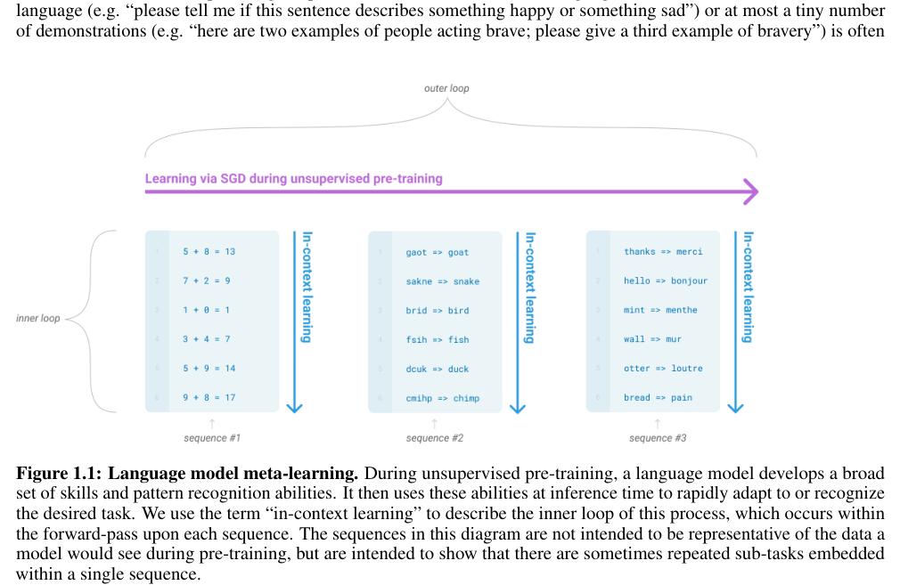

The figure uses a hierarchical diagram with brackets to illustrate the relationship between an "outer loop" of unsupervised pre-training via SGD and an "inner loop" of in-context learning. The outer loop is represented by a long purple arrow spanning three sequences, while the inner loop is shown through three individual boxes containing examples of mathematical or linguistic pattern matching. The diagram conveys that pre-training enables the model to perform rapid adaptation to new tasks within a single sequence during inference.

**Transformer-XL: Attentive Language Models Beyond a Fixed-Length Context** — arXiv:1901.02860 p.3

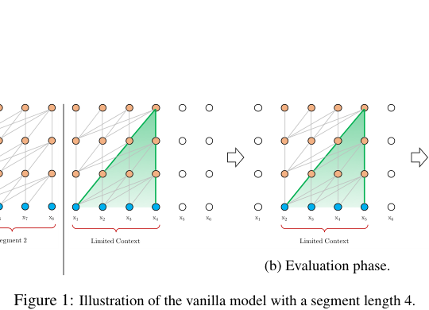

The figure illustrates the evaluation phase of a vanilla language model using two segments of length four. It depicts nodes representing input tokens (blue) and hidden states (tan) connected by arrows, with a green shaded area highlighting the "Limited Context" where information from the previous segment is used to compute representations for the current segment.

**Neural Machine Translation by Jointly Learning to Align and Translate** — arXiv:1409.0473 p.3

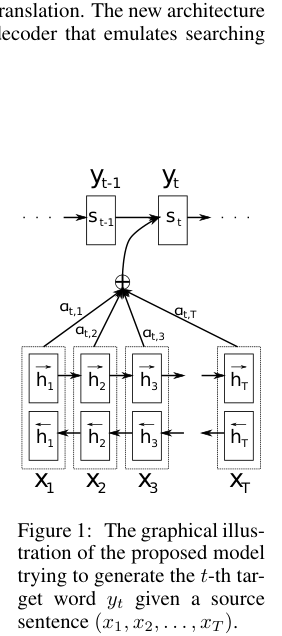

The figure is a directed graphical model consisting of nodes representing source words ($x_1, \dots, x_T$) and target words ($y_{t-1}, y_t$), connected by arrows and alignment weights ($\alpha_{t,1}, \dots, \alpha_{t,T}$). It conveys the mechanism of the model's decoder, where the $t$-th target word is generated by a weighted sum of the encoder hidden states ($h_1, \dots, h_T$) based on the alignment scores.

**Longformer: The Long-Document Transformer** — arXiv:2004.05150 p.1

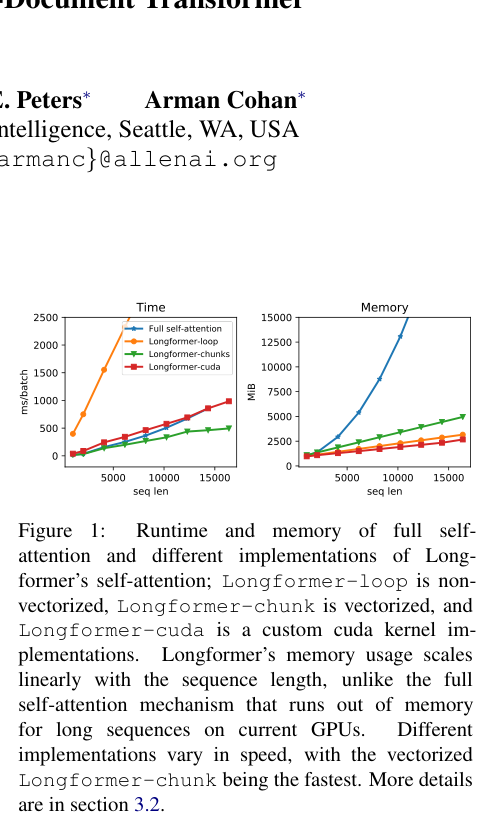

The figure consists of two line graphs, "Time" and "Memory," plotting performance metrics against sequence length (seq len). The "Time" plot shows milliseconds per batch (ms/batch) for four implementations, while the "Memory" plot shows memory usage in MiB, illustrating that full self-attention scales quadratically in time and memory compared to the linear scaling of the Longformer implementations.

**Generating Long Sequences with Sparse Transformers** — arXiv:1904.10509 p.1

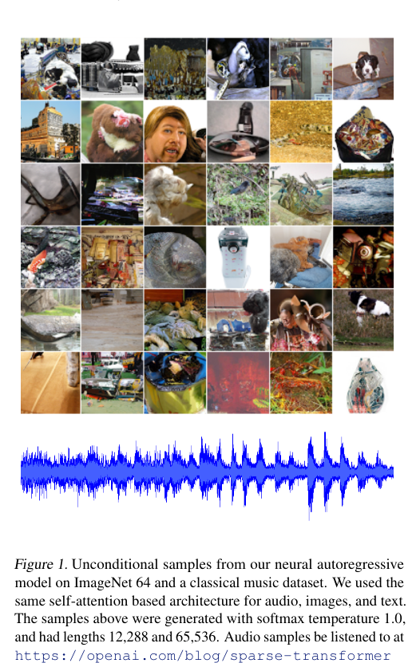

The figure displays a grid of 36 low-resolution images from ImageNet 64 followed by a blue waveform representing an audio sample from a classical music dataset. It conveys the model's ability to generate unconditional, diverse samples across different modalities, including images and audio.

**Adam: A Method for Stochastic Optimization** — arXiv:1412.6980 p.6

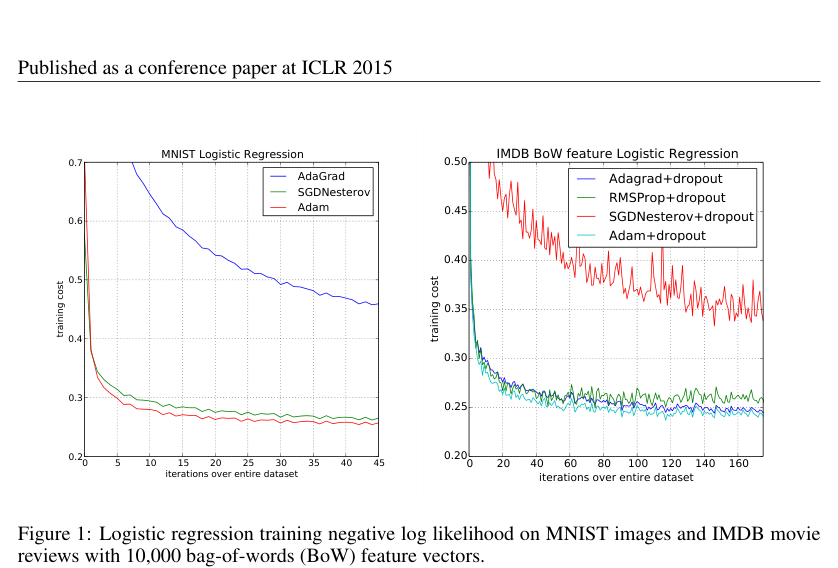

The figure consists of two line graphs comparing the training cost of different optimization algorithms on MNIST and IMDB datasets. Each plot features an x-axis representing iterations over the entire dataset and a y-axis representing training cost, with colored lines and corresponding legends indicating the performance of specific optimizers like Adam, AdaGrad, and SGDNesterov. The graphs convey that Adam achieves a lower training cost more rapidly than the other methods across both tasks.

**Characterizing the Expressivity of Local Attention in Transformers** — arXiv:2605.00768 p.3

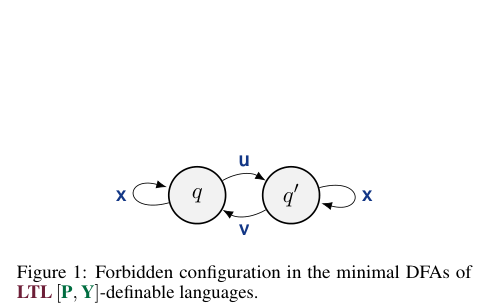

The figure depicts a state transition diagram consisting of two shaded nodes, labeled $q$ and $q'$, connected by directed arrows. A self-loop labeled $\mathbf{x}$ exists on both nodes, while a bidirectional arrow connects them with labels $\mathbf{u}$ and $\mathbf{v}$, representing the forbidden configuration in minimal DFAs for $\text{LTL } [\text{P, Y}]$-definable languages.

**Understanding Transformers and Attention Mechanisms: An Introduction for Applied Mathematicians** — arXiv:2604.00965 p.1

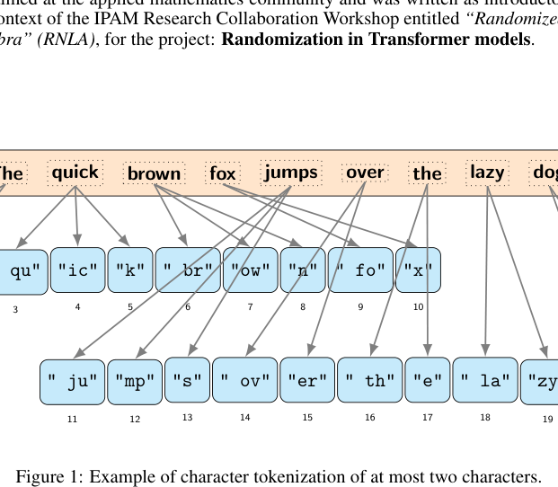

The figure displays a sequence of words in tan boxes ("the", "quick", "brown", etc.) connected by arrows to a series of light blue boxes containing character-level tokens. These tokens represent a sub-word tokenization scheme where each word is broken down into segments of at most two characters, such as "quick" being split into "qu", "ic", and "k".

**Efficient Attention Mechanisms for Large Language Models: A Survey** — arXiv:2507.19595 p.5

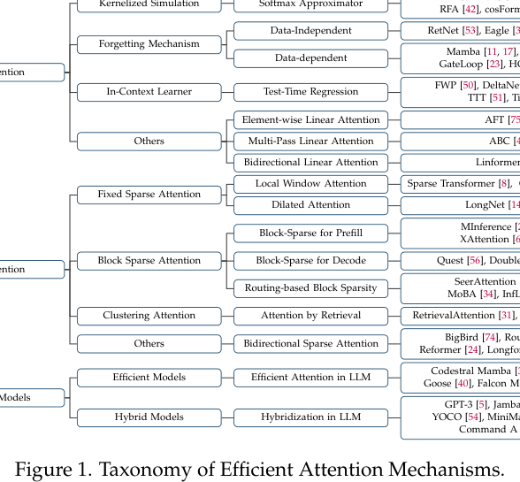

This hierarchical tree diagram classifies efficient attention mechanisms into three main categories: Attention Mechanisms, Models, and Hybrid Models. The diagram uses boxes to represent specific sub-categories and individual methods, connected by arrows to show their taxonomic relationships, and includes citations for various research papers.

**Recurrent Memory-Augmented Transformers with Chunked Attention for Long-Context Language Modeling** — arXiv:2507.00453 p.3

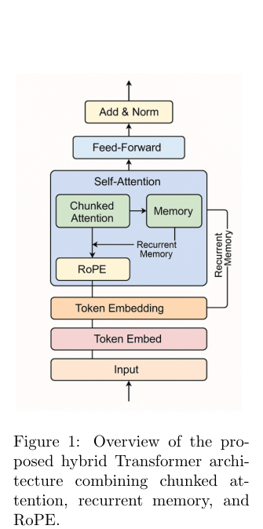

The figure is a block diagram consisting of stacked rectangular boxes connected by vertical arrows, representing a neural network architecture. It illustrates a transformer layer that integrates chunked self-attention, a recurrent memory component, and RoPE (Rotary Positional Embedding) between the self-attention and feed-forward stages.

**Is Random Attention Sufficient for Sequence Modeling? Disentangling Trainable Components in the Transformer** — arXiv:2506.01115 p.2

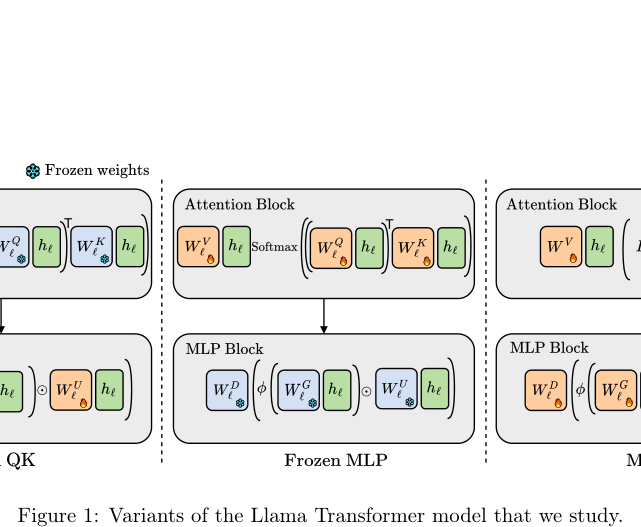

The figure presents a schematic diagram of three Llama Transformer model variants, organized into vertical columns representing different configurations of trainable and frozen components. Each variant is composed of an "Attention Block" and an "MLP Block," where individual weight matrices (such as $W^Q$, $W^K$, $W^V$, $W^D$, and $W^U$) are enclosed in boxes and marked with a snowflake icon to indicate they are frozen. The diagram conveys how different combinations of these weight matrices are kept trainable or frozen across the studied model architectures.
