*deep research · 1 round(s) · 80 landmarks · frontier≥2020: 45 · 6 full-PDF critiques · grounded 41 · off-digest 0*

# The Evolution of Attention: From Sequential Modeling to the Frontiers of Transformer Architectures

The ability to capture long-range dependencies and nuanced context within natural language remains a central challenge in computational linguistics. For decades, the primary hurdle has been the fundamental tension between the need for deep contextual awareness and the computational constraints of processing increasingly long sequences. As language models have scaled in both parameter count and training data, the mechanism used to weigh the relevance of different tokens—attention—has emerged as the definitive component of modern artificial intelligence. Understanding the trajectory of these mechanisms is essential for navigating the shift from rigid, sequential processing to the highly flexible, high-dimensional representations that define current state-of-the-art systems.

This review traces the technological arc of attention, beginning with the foundations of sequence modeling and early attention methods that sought to overcome the inherent limitations of recurrent and convolutional architectures. We examine the transformative shift brought about by the Transformer revolution and the subsequent rise of large-scale pre-training paradigms, which established self-attention as the dominant paradigm for language understanding. From this baseline, the discussion moves into the various architectural enhancements and structural variations that have refined the core Transformer block, as well as the critical pursuit of efficiency, sparsity, and linear complexity required to mitigate the quadratic scaling challenges of standard attention.

The narrative further explores the synthesis of disparate modeling approaches, specifically focusing on memory-augmented and recurrent attention mechanisms designed to extend the effective context window of models. Finally, the review reaches the current frontier, where research converges on hybrid, dynamic, and expressive attention models. These contemporary approaches aim to balance computational economy with the adaptive, nuanced processing required to achieve the next generation of linguistic intelligence.

## Foundations of Sequence Modeling and Early Attention

The evolution of sequence modeling is characterized by a transition from rigid, fixed-length representations to dynamic, memory-augmented architectures. Early efforts focused on establishing the encoder-decoder framework, which was foundational for mapping input sequences to output sequences [arXiv:1409.3215]. Specifically, arXiv:1406.1078 introduced an RNN encoder-decoder architecture designed to learn semantically and syntactically meaningful phrase representations for statistical machine translation. This work was subsequently integrated into the broader sequence-to-sequence learning paradigm [arXiv:1409.3215], which utilized multilayered LSTMs to map sequences into a fixed-dimensional vector for tasks such as English-to-French translation [arXiv:1409.3215].

However, a significant limitation of these early models was the information bottleneck created by the reliance on a single fixed-length vector to represent the entire source sequence [arXiv:1409.0473]. To address this, arXiv:1409.0473 introduced a soft-attention mechanism that extended the encoder-decoder architecture. Instead of compressing all information into one vector, this approach allowed the model to automatically search for and attend to relevant parts of the source sentence during translation [arXiv:1409.0473]. This concept of selective focus was further refined in arXiv:1508.04025, which explored more granular attentional strategies for neural machine translation. By implementing both global attention, which attends to all source words, and local attention, which focuses on a specific subset, this work provided a more nuanced approach to managing source information [arXiv:1508.04025].

Parallel to the refinement of attention in translation, research also expanded into coupling neural networks with external memory to enhance computational capabilities. While arXiv:1409.0473 focused on attending to the input sequence, arXiv:1410.5401 moved toward a more structural paradigm by coupling neural networks to external memory resources, analogous to a Turing Machine [arXiv:1410.5401]. This allowed for the inference of simple algorithms, such as sorting and associative recall, through differentiable end-to-end training [arXiv:1410.5401]. This trajectory of external memory interaction was further advanced by arXiv:1503.08895, which introduced end-to-end memory networks utilizing recurrent attention [arXiv:1503.08895]. Unlike the standard encoder-decoder models, these memory networks utilized multiple computational hops over a large external memory to perform tasks like question answering [arXiv:1503.08895]. By employing end-to-end training, these models achieved greater efficiency by requiring significantly less supervision than previous iterations [arXiv:1503.08895], marking a critical shift from simple sequence mapping toward complex, memory-augmented reasoning.

## The Transformer Revolution and Pre-training Paradigms

The introduction of the Transformer architecture marked a fundamental shift in sequence transduction by replacing traditional recurrence and convolution with multi-head self-attention mechanisms [arXiv:1706.03762]. This innovation addressed the lack of parallelizability inherent in recurrent models, enabling significantly higher training efficiency and achieving state-of-the-art BLEU scores in English-to-German (28.4) and English-to-French (41.8) translation [arXiv:1706.03762]. However, the architecture's reliance on self-attention introduces a quadratic complexity of $O(n^2 \cdot d)$ per layer, which poses efficiency challenges for processing very long sequences [arXiv:1706.03762].

Following this architectural breakthrough, research pivoted toward leveraging bidirectional context to improve language understanding. While earlier work focused on deep bidirectional language models (biLMs) to capture polysemy and complex syntax [arXiv:1802.05365], BERT [arXiv:1810.04805] advanced this by utilizing a Transformer encoder pre-trained with Masked Language Model (MLM) and Next Sentence Prediction (NSP) objectives. BERT's ability to jointly condition on both left and right context allowed it to achieve state-of-the-art results across 11 NLP tasks, including an 80.5 GLUE score [arXiv:1810.04805]. Despite these strengths, BERT suffers from a structural mismatch between pre-training and fine-tuning due to the use of [MASK] tokens, and exhibits instability on small datasets [arXiv:1810.04805].

Subsequent studies sought to refine these pre-training paradigms. RoBERTa [arXiv:1907.11692] addressed the issue of undertrained BERT models by optimizing hyperparameters and training data size [arXiv:1907.11692]. In contrast, XLNet [arXiv:1906.08237] attempted to solve the dependency neglect between masked positions and the pre-train/fine-tune discrepancy found in BERT by introducing generalized autoregressive pre-training via permutation language modeling [arXiv:1906.08237]. Moving toward unification, T5 [arXiv:1910.10683] introduced a text-to-text framework that treats all NLP tasks—such as summarization and classification—as a single format [arXiv:1910.10683].

A final paradigm shift occurred with the move from task-specific fine-tuning toward scale-driven, task-agnostic architectures. GPT-3 [arXiv:2005.14165] demonstrated that scaling an autoregressive Transformer to 175 billion parameters enables "in-context learning," allowing the model to perform tasks via text demonstrations without gradient updates. This approach yielded significant gains, such as an 18% improvement over previous state-of-the-art on LAMBADA (86.4% accuracy) [arXiv:2005.14165]. Nevertheless, this scaling approach faces criticisms regarding potential data contamination from web-scale corpora and performance limitations in specific reasoning tasks like natural language inference [arXiv:2005.14165].

## Architectural Enhancements and Structural Variations

The evolution of Transformer architectures has been driven by the need to address the inherent limitations of the standard self-attention mechanism, specifically regarding positional modeling, context length, and computational complexity. Early structural enhancements focused on refining how the model perceives sequence order. For instance, arXiv:1803.02155 introduced relation-aware self-attention to explicitly model relative position information, addressing the lack of such modeling in the original Transformer architecture. While this provided a more robust framework for machine translation, its reliance on specific positional representations has been critiqued; specifically, arXiv:2103.13597 argues that static mask matrices limit localness modeling, proposing dynamic mask attention (DMAN) with a learnable mask matrix to strengthen the model's ability to capture local dependencies.

A significant portion of architectural research focuses on overcoming the quadratic $O(n^2)$ scaling of time and memory relative to sequence length. Several distinct strategies have emerged to achieve linear or near-linear complexity. One approach utilizes low-rank matrix approximations, as seen in Linformer (arXiv:2006.04768), which reduces complexity to $O(n)$ for natural language processing tasks. Similarly, Sparse Transformers (arXiv:1904.10509) employ sparse factorizations of the attention matrix and fast attention kernels to enable density modeling of long sequences like Enwik8. Another method, Reformer (arXiv:2001.04451), replaces standard dot-product attention with more efficient techniques to reduce the prohibitive costs of training on long sequences.

In contrast to these approximation methods, other models focus on structural recurrence or hybrid attention patterns to extend context. Transformer-XL (arXiv:1901.02860) solves context fragmentation by introducing a segment-level recurrence mechanism and a novel positional encoding scheme, achieving evaluation speeds up to 1,800+ times faster than previous models. While Sparse Transformers and Linformer focus on approximating the attention matrix itself, Longformer (arXiv:2004.05150) adopts a hybrid approach, combining local windowed attention with task-motivated global attention to achieve linear scaling. This structural variation is particularly effective for long-document tasks, such as summarization, through its Longformer-Encoder-Decoder (LED) variant.

Finally, architectural innovation has also targeted parameter efficiency. ALBERT (arXiv:1909.11942) addresses the memory and training time constraints of large-scale models through two parameter-reduction techniques and a specialized self-supervised loss for inter-sentence coherence. While models like Transformer-XL and Longformer extend the *length* of the context, ALBERT optimizes the *density* and efficiency of the representations themselves, providing a different pathway to scaling language models within hardware limitations.

## Efficiency, Sparsity, and Linear Complexity

A primary challenge in scaling transformer models is the quadratic time and memory complexity of the standard self-attention mechanism relative to input sequence length [arXiv:2107.02192, arXiv:2405.05219, arXiv:2507.19595]. Recent research has diverged into several strategies to mitigate this, ranging from architectural restructuring to mathematical approximations.

One prominent approach involves replacing or augmenting the attention mechanism to achieve linear complexity. The Long-Short Transformer [arXiv:2107.02192] addresses this by implementing a dual mechanism: long-range attention via dynamic projection paired with short-term attention. To manage the scale mismatch between these two components, it introduces a dual normalization strategy, making it applicable to both autoregressive language modeling and high-resolution vision tasks [arXiv:2107.02192]. Similarly, the Conv-Basis paradigm [arXiv:2405.05219] seeks to optimize inference and gradient computation for LLMs by approximating self-attention through a convolution-based system. This method decomposes lower triangular matrices into a sum of $k$ structured convolution matrices, utilizing Fast Fourier Transforms (FFT) to achieve $O(knd \log n)$ time complexity, thereby bypassing the $O(n^2)$ bottleneck [arXiv:2405.05219].

While some models focus on approximating attention, others seek to replace it entirely or optimize the surrounding layers. Fast-FNet [arXiv:2209.12816] replaces the attention layer with efficient Fourier Transform (FT) layers to reduce parameters, training time, and memory usage in NLP tasks [arXiv:2209.12816]. This differs from GroupBERT [arXiv:2106.05822], which retains self-attention but complements it with a convolutional module and utilizes grouped transformations in feed-forward layers and convolutions to reduce the computational burden of dense operations [arXiv:2106.05822].

The literature also categorizes these advancements through broader taxonomies. A recent survey [arXiv:2507.19595] classifies efficient mechanisms into linear attention—utilizing kernel approximations, recurrent formulations, or fastweight dynamics—and sparse attention, which limits computation to token subsets through fixed patterns, block-wise routing, or clustering. This survey highlights a trend toward hybrid designs that combine local and global components to balance efficiency and modeling capacity [arXiv:2507.19595].

Finally, efficiency is not solely a matter of complexity but also of resource adaptation. The Attention Link (AL) architecture [arXiv:2302.00340] provides an efficient attention-based solution specifically tailored for low-resource machine translation, demonstrating that architectural innovations can improve performance even when training data is scarce [arXiv:2302.00340]. Collectively, these works illustrate a transition from standard quadratic attention toward specialized, low-complexity structures designed for long-context modeling and resource-constrained environments.

## Memory-Augmented and Recurrent Attention Mechanisms

To address the limitations of standard Transformers in capturing global sequence properties and managing long-range dependencies, recent research has shifted toward memory-augmented architectures and recurrent attention mechanisms. A foundational approach is the Memory Transformer (arXiv:2006.11527), which introduces dedicated memory tokens to create a bottleneck for global information. By using a specialized layer to control memory updates, this model moves beyond element-wise representations to capture properties of the sequence as a whole, proving effective for machine translation and GLUE tasks (arXiv:2006.11527).

Building upon the need for efficient long-sequence processing, the Recurrent Memory Transformer (RMT) (arXiv:2207.06881) employs segment-level recurrence. By adding special memory tokens to the input or output of sequence segments, RMT facilitates information transfer between segments, directly addressing the quadratic computational complexity of standard self-attention (arXiv:2207.06881). This concept of structured memory is further refined by the Cached Transformer (arXiv:2312.12742), which integrates a differentiable memory cache via a recurrent gating unit. While RMT focuses on segment-level recurrence to manage long-term dependencies, the Cached Transformer utilizes Gated Recurrent Cached (GRC) attention to expand the receptive field across diverse tasks, including image classification and object detection (arXiv:2312.12742).

Recent advancements have increasingly focused on optimizing the trade-off between memory overhead and computational efficiency. RecurFormer (arXiv:2410.12850) proposes a hybrid architecture that replaces recency-aware attention heads with Mamba-based linear recurrent neural networks (RNNs). This approach specifically targets the high memory overhead during LLM inference by reducing cache size (arXiv:2410.12850). Similarly, the Recurrent Memory-Augmented Transformer (arXiv:2507.00453) optimizes long-context modeling through a unified attention block that combines chunked local attention with a gated FIFO memory mechanism, effectively bypassing quadratic costs while managing both short- and long-range dependencies (arXiv:2507.00453).

A distinct evolutionary path is taken by the Forgetting Transformer (arXiv:2503.02130), which introduces "Forgetting Attention." Instead of relying solely on external memory buffers or recurrence, it incorporates a data-dependent forget gate to down-weight unnormalized attention scores. This design, featuring a "Pro" block, improves length extrapolation and long-context modeling without requiring positional embeddings, and maintains compatibility with FlashAttention (arXiv:2503.02130). While the memory-augmented models (arXiv:2006.11527, arXiv:2207.06881, arXiv:2312.12742) focus on expanding the capacity to store information, the Forgetting Transformer and RecurFormer (arXiv:2410.12850) prioritize the efficiency of information retention and the reduction of computational bottlenecks during inference.

## The Current Frontier: Hybrid, Dynamic, and Expressive Attention

Recent advancements in attention mechanisms reflect a shift from static, computationally expensive dot-product attention toward more efficient, adaptive, and theoretically grounded architectures. This evolution is characterized by three primary trajectories: structural approximation, dynamic hybridization, and the formal characterization of expressivity.

A significant portion of current research focuses on mitigating the quadratic scaling of standard attention. One approach involves approximating attention through recurrent structures; for instance, Distil-xLSTM utilizes xLSTM-based sequence mixing to approximate attention parametrization within Small Language Models (SLMs) via knowledge distillation (arXiv:2503.18565). This contrasts with the memory-efficiency strategies explored in modern LLM architectures, such as Grouped Query Attention (GQA) and Multi-Headed Latent Attention (MLA). While the mathematical foundations of these memory-efficient variants—specifically the interaction between low-rank factorizations and positional embeddings—are rigorously synthesized in recent pedagogical literature (arXiv:2604.00965), such surveys lack original empirical data (arXiv:2604.00965). Similarly, local attention mechanisms reduce quadratic costs to linear by restricting the attention window (arXiv:2605.00768), though empirical validation of these benefits is often limited to lightweight setups like GPT-2-small (arXiv:2605.00768).

The field is also moving from static to dynamic computation allocation. While some researchers investigate hybrid architectures by interleaving standard attention with controlled variants to test design principles (arXiv:2510.11602), Switch Attention (SwiAttn) introduces a more granular approach (arXiv:2603.26380). Unlike static hybrid patterns, SwiAttn employs token-level and layer-level dynamic routing between full-attention and sliding-window branches (arXiv:2603.26380). This dynamic routing achieves superior long-context performance, including perfect Needle-in-a-Haystack retrieval, yet its practical utility is currently constrained by a lack of hardware-optimized implementations for the prefill stage and empirical testing limited to 1.5B parameter models (arXiv:2603.26380).

Finally, there is a growing emphasis on the theoretical necessity of attention components. The MixiT architecture challenges the necessity of trainable weights by demonstrating that entirely random attention scores can suffice for sequence modeling (arXiv:2506.01115). This stands in tension with investigations into the specific design principles—such as query-key coupling and sequence-dependent activations—required for effective language modeling (arXiv:2510.11602). Providing a formal logical basis for these mechanisms, research has shown that local attention is not merely an efficiency trade-off but an expressive enhancement; by introducing a second temporal operator ($Y$), local windows strictly enlarge the class of recognizable regular languages beyond what global attention can achieve (arXiv:2605.00768). Together, these works suggest that the future of attention lies in balancing formal expressivity with adaptive, hardware-aware efficiency.

## Tensions and Open Problems

A primary tension in the literature concerns the fundamental architectural necessity of the attention mechanism itself. On one hand, the success of bidirectional pre-training, as demonstrated by the contextualized representations in arXiv:1802.05365, suggests that dense, global dependency modeling is essential for capturing nuanced linguistic semantics. This is further supported by the structural advancements in arXiv:1810.04805, which positions the Transformer as the gold standard for language modeling. Conversely, a growing skeptical movement questions whether the heavy computational tax of attention is truly required for sequence modeling. For instance, arXiv:2506.11305 argues that the reliance on attention may be suboptimal compared to simpler or more direct encoding methods, challenging the long-held assumption that the complex weighting of all-to-all interactions is the only path to high-fidelity representation.

Another significant debate revolves around the trade-off between global context and computational efficiency. The standard approach to scaling models often relies on the dense self-attention mechanisms described in arXiv:1803.02155 to maintain relative positional awareness. However, this approach faces severe scalability bottlenecks. To address this, researchers have proposed linear-complexity alternatives, such as the low-rank approximations introduced in arXiv:2006.04768, which aim to reduce the quadratic burden of the attention matrix. This tension is compounded by critiques regarding the efficacy of these approximations; for example, arXiv:2107.02192 suggests that while efficiency is improved, the structural integrity of long-range dependencies may be compromised, leading to a search for hybrid architectures that can balance the speed of linear models with the expressive power of original Transformer designs.

Finally, there is an ongoing disagreement regarding the optimal way to integrate structural priors into the attention mechanism. Some researchers advocate for enhancing the Transformer's ability to model complex relationships by treating it as a graph-to-graph model, as explored in arXiv:2310.17936, which seeks to bridge the gap between the dense attention of arXiv:1802.05365 and the structured connectivity found in graph neural networks. In contrast, other approaches focus on refining the attention mechanism through masking or specialized attention patterns to strengthen the model's inherent reasoning capabilities, as seen in the rethinking of relative position representations in arXiv:2103.13597. This leaves open the question of whether the future of the field lies in augmenting attention with external structural constraints or in perfecting the internal mathematical properties of the attention operation itself.

### Outlook

The current frontier is shifting away from monolithic, dense attention toward highly dynamic and heterogeneous architectures. As we move toward 2026, the field is gravitating toward "hybridization"—integrating the efficiency of recurrent structures with the parallelizability of Transformers, as suggested by recent explorations into switch-attention and memory-augmented models. The next generation of research will likely focus on "adaptive sparsity," where models do not merely attend to all tokens, but dynamically decide which components of the attention mechanism to activate based on the complexity of the input. Ultimately, the goal is to move beyond the "attention-is-all-you-need" paradigm toward a more nuanced understanding of how information should flow through a sequence, balancing computational economy with the expressive depth required for truly long-context reasoning.

---

## Key Figures

**Attention Is All You Need** — arXiv:1706.03762 p.3

The figure illustrates the Transformer model architecture, consisting of an encoder stack on the left and a decoder stack on the right, both composed of $N$ identical layers. The diagram uses labeled boxes to represent functional components—such as Multi-Head Attention, Feed Forward, and Add & Norm layers—connected by arrows to show the data flow from input embeddings and positional encodings to the final softmax output probabilities.

**BERT: Pre-training of Deep Bidirectional Transformers for Language
  Understanding** — arXiv:1810.04805 p.3

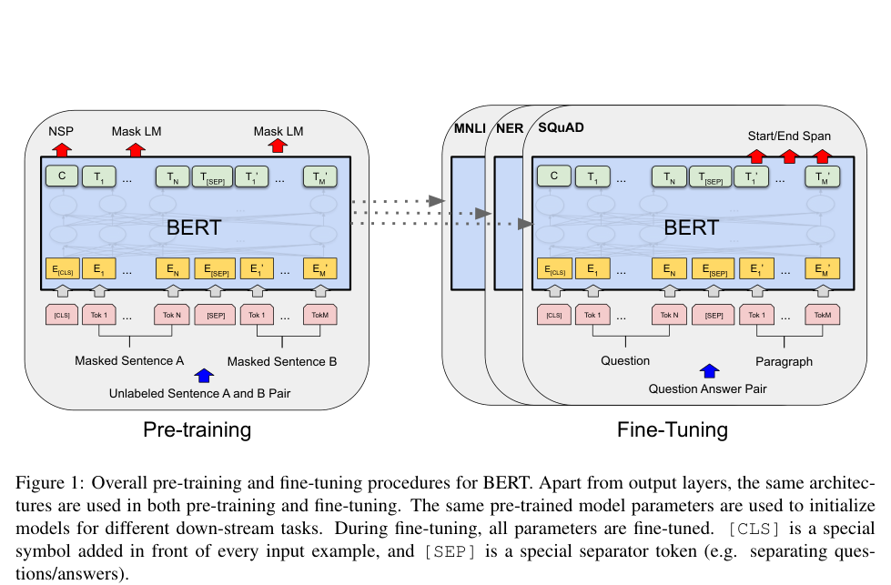

The figure illustrates the BERT workflow, divided into two stages: "Pre-training" on the left and "Fine-Tuning" on the right. The pre-training panel shows a BERT architecture processing two masked sentences (A and B) to perform Next Sentence Prediction (NSP) and Masked Language Modeling (MLM), while the fine-tuning panel shows the same architecture applied to specific downstream tasks like MNLI, NER, and SQuAD using input pairs such as question-answer pairs. Dotted arrows indicate that the pre-trained parameters are transferred to initialize the models for fine-tuning.

**Language Models are Few-Shot Learners** — arXiv:2005.14165 p.3

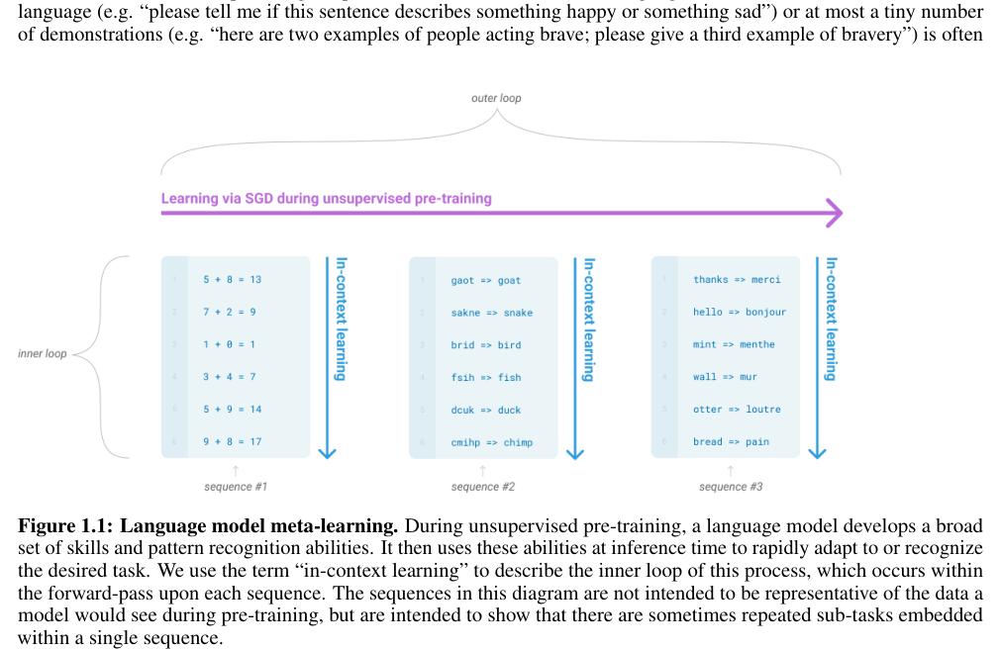

The figure uses a hierarchical diagram with "outer loop" and "inner loop" brackets to illustrate the relationship between pre-training and inference. A long purple arrow labeled "Learning via SGD during unsupervised pre-training" spans three light-blue boxes, each containing a sequence of text-based tasks (math or translation) followed by a vertical blue label for "in-context learning." The diagram conveys that unsupervised pre-training (the outer loop) enables the model to perform rapid task adaptation within individual sequences (the inner loop).

**Transformer-XL: Attentive Language Models Beyond a Fixed-Length Context** — arXiv:1901.02860 p.3

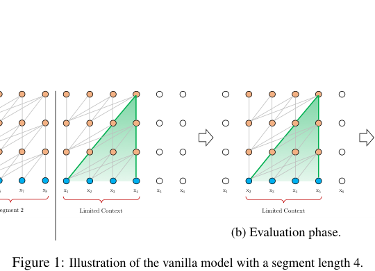

The figure illustrates the evaluation phase of a vanilla language model using two segments of length four. It depicts nodes representing input tokens (blue) and hidden states (tan) connected by arrows, with a green shaded area highlighting the "Limited Context" where information from the previous segment is used to inform the current segment.

**Neural Machine Translation by Jointly Learning to Align and Translate** — arXiv:1409.0473 p.3

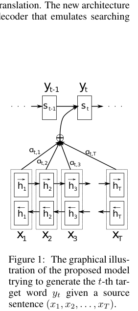

The figure is a directed graphical model consisting of rectangular nodes representing source words ($x_1, \dots, x_T$) and target words ($y_{t-1}, y_t$), connected by arrows to hidden state nodes ($h_1, \dots, h_T$ and $\tilde{h}_1, \dots, \tilde{h}_T$). Arrows from the hidden states point to alignment weights ($\alpha_{t,1}, \dots, \alpha_{t,T}$), which are then combined via a summation node to influence the generation of the current target word $y_t$. The diagram conveys how the model uses a context vector, derived from a weighted sum of source hidden states, to predict the next word in a sequence.

**Longformer: The Long-Document Transformer** — arXiv:2004.05150 p.1

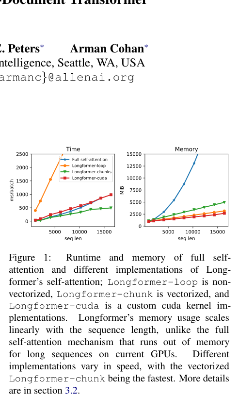

The figure consists of two line graphs with "seq len" on the x-axis, comparing "Time" (ms/batch) and "Memory" (MiB) across four implementations: Full self-attention, Longformer-loop, Longformer-chunks, and Longformer-cuda. The plots convey that while Full self-attention's time and memory usage grow quadratically with sequence length, the Longformer implementations scale linearly, with Longformer-cuda being the most efficient in both metrics.

**Generating Long Sequences with Sparse Transformers** — arXiv:1904.10509 p.1

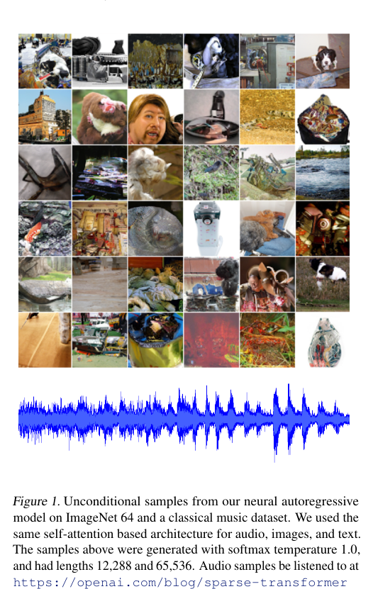

The figure displays a grid of 36 low-resolution color images from ImageNet 64 and a single blue waveform representing a classical music audio sample. It conveys the model's ability to generate unconditional samples across different modalities, specifically images and audio, using the same self-attention-based architecture.

**Understanding Transformers and Attention Mechanisms: An Introduction for Applied Mathematicians** — arXiv:2604.00965 p.1

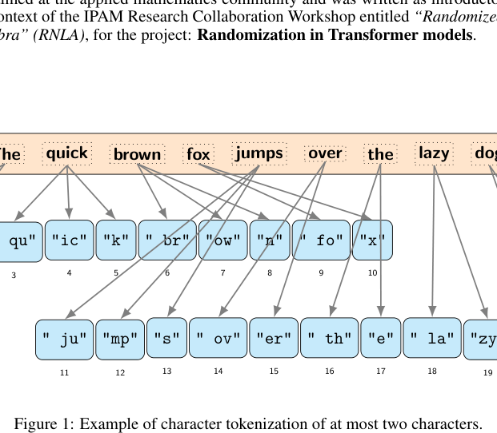

The figure displays a sequence of words (the, quick, brown, fox, jumps, over, the, lazy, dog) connected by arrows to a series of light-blue boxes containing character-level tokens. These tokens represent a sub-word tokenization scheme where each word is broken down into segments of at most two characters, such as "qu", "ic", and "k" for the word "quick".

**Switch Attention: Towards Dynamic and Fine-grained Hybrid Transformers** — arXiv:2603.26380 p.1

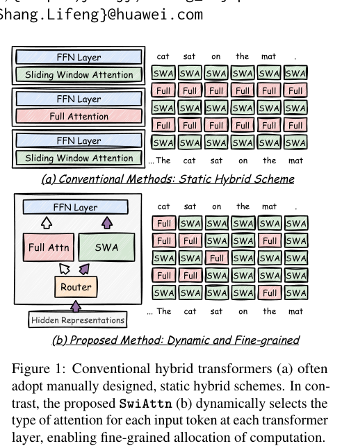

Figure 1 consists of two comparative diagrams, (a) and (b), illustrating different transformer attention mechanisms. Diagram (a) shows a stacked architecture of alternating "FFN Layer" and "Sliding Window Attention" or "Full Attention" boxes, mapped to a uniform grid of attention types for a sequence of tokens. Diagram (b) depicts a "Router" directing individual tokens to either "Full Attn" or "SWA" boxes, which are then mapped to a heterogeneous grid where each token's attention type varies independently.

**Characterizing the Expressivity of Local Attention in Transformers** — arXiv:2605.00768 p.3

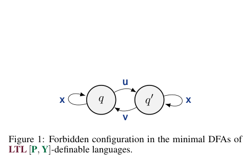

The figure depicts a state transition diagram consisting of two shaded nodes, labeled $q$ and $q'$, connected by directed arrows. A self-loop labeled $\mathbf{x}$ exists on both nodes, while a bidirectional arrow connects them with labels $\mathbf{u}$ and $\mathbf{v}$, representing the forbidden configuration in minimal DFAs for $\text{LTL } [\text{P, Y}]$-definable languages.

**Efficient Attention Mechanisms for Large Language Models: A Survey** — arXiv:2507.19595 p.5

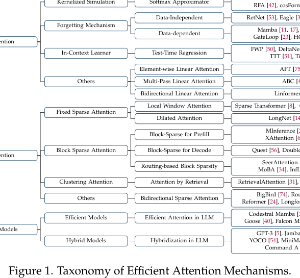

This hierarchical tree diagram classifies efficient attention mechanisms into three main branches: Attention Mechanisms, Models, and Hybrid Models. The diagram uses boxes connected by arrows to categorize specific techniques, such as "Fixed Sparse Attention" and "Clustering Attention," while providing corresponding citations for each method.

**Recurrent Memory-Augmented Transformers with Chunked Attention for Long-Context Language Modeling** — arXiv:2507.00453 p.3

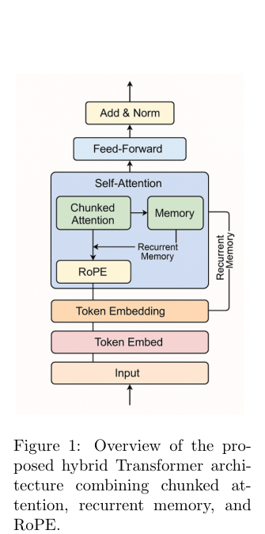

The figure is a block diagram consisting of stacked rectangular boxes connected by vertical arrows, representing a neural network architecture. It illustrates a transformer layer that integrates chunked self-attention, a recurrent memory component, and RoPE (Rotary Positional Embedding) between the self-attention and feed-forward stages.

**Forgetting Transformer: Softmax Attention with a Forget Gate** — arXiv:2503.02130 p.4

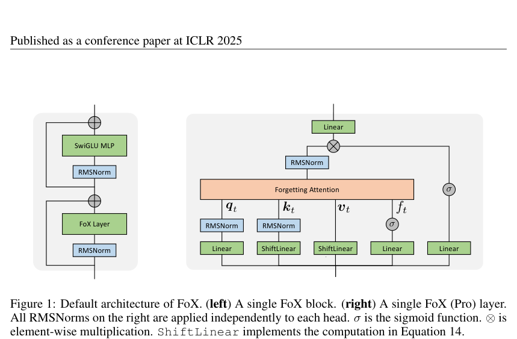

The figure presents two architectural diagrams: a single FoX block on the left and a single FoX (Pro) layer on the right. The left diagram shows a residual connection splitting into an RMSNorm/FoX Layer path and an RMSNorm/SwiGLU MLP path, both recombining via addition. The right diagram details the "Forgetting Attention" mechanism, showing inputs $q_t$, $k_t$, $v_t$, and a forget gate $f_t$ processed through various components like RMSNorm, Linear, and ShiftLinear layers, which then interact via element-wise multiplication and addition.
