*deep research · 6 round(s) · 260 landmarks · frontier≥2020: 174 · 8 full-PDF critiques · grounded 64 · off-digest 0*

# The Evolution of Attention: From Foundational Transformers to the Frontiers of Language Modeling

The ability to model complex linguistic dependencies is the fundamental challenge of natural language processing. While traditional sequential architectures struggled to capture long-range semantic relationships and lacked the capacity for parallelization, the introduction of the attention mechanism revolutionized the field by allowing models to dynamically weight the importance of different tokens regardless of their distance. This shift has catalyzed a period of unprecedented growth in machine intelligence, making the attention mechanism the primary driver behind the capabilities of modern large language models and the central focus of contemporary computational linguistics.

This review traces the historical and technical trajectory of these developments, beginning with the Foundations and Early Architectures that established the core principles of self-attention. We then examine how these models transitioned into massive Scaling and Pre-training Paradigms, which unlocked emergent linguistic abilities but also introduced significant computational burdens. To address these challenges, the literature has pivoted toward Efficient Attention and Complexity Reduction, alongside advancements in Long-Context Modeling and Memory Augmentation to extend the operational window of transformers. The review further explores the integration of external knowledge through Retrieval-Augmented Generation (RAG) Systems and the ongoing efforts in Interpretability, Analysis, and understanding Theoretical Limits. Finally, we look toward the future by examining the Frontier of Hybrid, Dynamic, and Quantum-Inspired Attention, which represents the next leap in modeling complex information.

## Foundations and Early Architectures

Early sequence-to-sequence learning was characterized by multilayered encoder-decoder structures that utilized two deep LSTMs to map input sequences to a fixed-dimensional vector for decoding (arXiv:1409.3215). A critical limitation of this approach was the information bottleneck created by forcing the entire input sequence into a single fixed-length vector (arXiv:1409.0473). This was addressed by the introduction of soft attention, which allowed the model to jointly learn to align and translate by automatically searching for relevant parts of the source sentence (arXiv:1409.0473).

The paradigm shifted significantly with the Transformer, which dispensed with recurrence and convolutions entirely in favor of a mechanism based solely on multi-head and scaled dot-product self-attention (arXiv:1706.03762). This architecture provides a major efficiency improvement over previous recurrent models by enabling $O(1)$ sequential operations, which allows for significantly higher parallelization and reduced training times (arXiv:1706.03762). For instance, the Transformer achieved state-of-the-art translation results, such as 28.4 BLEU on EN-DE (arXiv:1706.03762). However, this novelty comes with inherent trade-offs: the model requires external positional encodings to account for sequence order, and its computational complexity scales quadratically with sequence length ($O(n^2 \cdot d)$) (arXiv:1706.03762).

Following the Transformer's success, research moved toward modeling complex syntax, semantics, and polysemy through deep contextualized word representations learned from the internal states of bidirectional language models (arXiv:1802.05365). BERT extends these concepts by employing a deep bidirectional Transformer encoder that uses Masked Language Model (MLM) and Next Sentence Prediction (NSP) objectives to condition on both left and right context across all layers (arXiv:1810.04805). This approach moves beyond the limitations of unidirectional or shallowly bidirectional models, achieving state-of-the-art results on 11 tasks, including a 7.7 % absolute GLUE improvement and a 5.1 point SQuAD v2.0 F1 improvement (arXiv:1810.04805). Despite these strengths, the BERT architecture faces challenges, such as the mismatch between pre-training and fine-tuning caused by the use of the [MASK] token, and potential instability when applied to small datasets (arXiv:1810.04805). Nevertheless, BERT's ability to leverage bidirectional self-attention demonstrates that a single Transformer-based architecture can replace heavily-engineered, task-specific models through unified fine-tuning, marking a critical step in the evolution of language modeling.

## Scaling and Pre-training Paradigms

The evolution of transformer-based language models is characterized by a shift from optimizing training efficiency to exploring the fundamental limits of scale and pre-training objectives. Early efforts focused on the practicalities of training sequence-to-sequence models; for instance, arXiv:1806.00187 addressed the slow training speeds of large-scale benchmarks by introducing reduced precision and large batch training, achieving nearly a 5x speedup on a single 8-GPU machine. As the field moved toward large-scale pre-training, researchers began refining the objectives used to train these models.

A significant tension exists between autoregressive and denoising objectives. XLNet (arXiv:1906.08237) sought to resolve the dependency neglect and the pretrain-finetune discrepancy inherent in BERT's denoising approach by introducing a generalized autoregressive pretraining method using permutation language modeling. This approach integrates Transformer-XL concepts to maximize expected likelihood over all permutations of factorization order. In contrast, BART (arXiv:1910.13461) utilizes a denoising autoencoder framework specifically designed for sequence-to-sequence tasks, employing noising functions like sentence shuffling and span in-filling to reconstruct original text. While XLNet focuses on improving the autoregressive modeling of dependencies, BART optimizes the bidirectional encoder and left-to-right decoder architecture for generation and translation. Meanwhile, RoBERTa (arXiv:1907.11692) provides a critical counterpoint to earlier pre-training methodologies by demonstrating that BERT was undertrained; through a robust optimization approach involving careful hyperparameter tuning and increased training data, it established more reliable pre-training baselines.

The relationship between model size, data, and performance has since become a central pillar of research. arXiv:2001.08361 established the empirical foundation for this by discovering power-law scaling relationships, allowing for the optimal allocation of compute budgets across seven orders of magnitude. This discovery paved the way for the paradigm shift seen in arXiv:2005.14165, which demonstrated that scaling models to 175 billion parameters enables task-agnostic, few-shot learning via in-context learning. While this massive scaling provides significant gains—such as an 18% accuracy increase on LAMBADA—it introduces notable weaknesses, including vulnerability to data contamination and performance deficits in reading comprehension (RACE, QuAC) and NLI (ANLI) tasks. Subsequent developments, such as GPT-4 (arXiv:2303.08774), have moved toward multimodal capabilities (image and text) and focused on developing infrastructure that behaves predictably across these vast scales, even as the field continues to critique the limitations of purely scale-driven approaches identified in earlier large-scale models (arXiv:2303.08774).

## Efficient Attention and Complexity Reduction

The quadratic scaling of standard Transformer attention mechanisms poses significant challenges for processing long sequences, prompting diverse research into complexity reduction. These efforts can be broadly categorized into sparse factorizations, low-rank approximations, and hardware-aware exact attention.

Early approaches focused on sparsifying the attention matrix to reduce complexity. Sparse Transformers introduced factorizations that reduced complexity to $O(n \sqrt{n})$ [arXiv:1904.10509]. Building on the concept of sparsity, Longformer utilizes a combination of local windowed attention and task-motivated global attention to achieve linear scaling [arXiv:2004.05150]. Similarly, Big Bird employs a sparse mechanism incorporating $O(1)$ global tokens, which acts as a universal approximator of sequence functions and is Turing complete, allowing for sequences up to 8x longer than previous methods [arXiv:2007.14062]. While these methods reduce the number of pairwise interactions, other models seek to change the nature of the interaction itself. For instance, Fastformer replaces pairwise interactions with an additive attention mechanism to model global contexts, achieving linear complexity [arXiv:2108.09084].

In contrast to sparsity, some researchers focus on approximating the attention matrix through low-rank structures. Linformer reduces both time and space complexity to $O(n)$ by approximating the self-attention mechanism with a low-rank matrix [arXiv:2006.04768]. Another approach, the Reformer, utilizes locality-sensitive hashing (LSH) attention combined with reversible residual layers to reduce complexity from $O(L^2)$ to $O(L \log L)$ [arXiv:2001.04451]. Furthermore, Adaptive Attention Span allows the model to learn an optimal attention span, extending context size to 8k characters while maintaining control over memory and computation [arXiv:1905.07799].

A distinct paradigm shift is represented by FlashAttention, which moves away from approximating the attention mechanism and instead focuses on hardware efficiency. Rather than reducing the number of operations, FlashAttention uses tiling to minimize high IO overhead between GPU HBM and SRAM, providing exact attention with significant speedups, such as 3x on GPT-2 [arXiv:2205.14135]. FlashAttention-2 further optimizes this by improving work partitioning across thread blocks and warps to reduce non-matmul FLOPs, achieving a 2x speedup over its predecessor and reaching up to 73% of the theoretical maximum FLOPs/s on A100 GPUs [arXiv:2307.08691].

While approximation-based methods like Linformer [arXiv:2006.04768] and Reformer [arXiv:2001.04451] offer theoretical complexity advantages, they fundamentally alter the attention calculation. In contrast, the FlashAttention lineage [arXiv:2205.14135, arXiv:2307.08691] maintains the mathematical integrity of exact attention while addressing the physical bottlenecks of modern hardware. Additionally, while many models focus on sequence length, others address architectural redundancy; for example, pruning methods using stochastic gates can remove the majority of multi-head attention heads with minimal performance loss [arXiv:1905.09418].

## Long-Context Modeling and Memory Augmentation

The evolution of Transformer architectures has been largely defined by the struggle to overcome the quadratic time and memory complexity of standard self-attention while expanding the receptive field to capture long-range dependencies. Early efforts focused on mitigating context fragmentation through segment-level recurrence. Transformer-XL (arXiv:1901.02860) addressed the fixed-length limitation by introducing a segment-level recurrence mechanism and a novel relative positional encoding scheme, achieving evaluation speeds up to 1,800 times faster than vanilla Transformers. This recurrent approach laid the groundwork for subsequent memory-augmented models.

A significant shift in the literature involves moving beyond element-wise representations, which often fail to capture properties of a sequence as a whole. The Memory Transformer (arXiv:2006.11527) addressed this by introducing memory tokens to create a bottleneck for global information, managed by a dedicated update layer. This concept of augmenting the architecture with specialized tokens was further refined in the Recurrent Memory Transformer (arXiv:2207.06881), which extends the recurrence of Transformer-XL (arXiv:1901.02860) by using memory tokens to pass information between segments, specifically targeting the limitation of storing both global and local information in the same element-wise representations. More recently, Cached Transformers (arXiv:2312.12742) integrated these ideas into a Gated Recurrent Cached (GRC) attention mechanism, using a recurrent gating unit to enable continuous updates to a differentiable memory cache, thereby increasing the receptive field for both text and vision.

Parallel to memory augmentation, researchers have developed sparse and hybrid attention mechanisms to reduce computational complexity. The Long-Short Transformer (arXiv:2107.02192) utilizes a combination of long-range attention with dynamic projection and short-term attention, achieving linear complexity and handling sequences three times longer than full-attention versions. Similarly, LongT5 (arXiv:2112.07916) introduces Transient Global (TGlobal) attention to integrate local and global mechanisms into the T5 architecture, facilitating the simultaneous scaling of model size and input length.

Other approaches focus on structural alternation or extrapolation. The LSG Attention (arXiv:2210.15497) reduces $O(n^2)$ complexity by combining local, sparse, and global attention, allowing for the extrapolation of pretrained models to longer sequences without additional training. Zebra (arXiv:2312.08618) takes a different structural approach, employing a layerwise grouped local-global attention pattern that alternates between local and global layers to manage context windows efficiently. While these models differ in their specific attention types—ranging from the TGlobal attention in LongT5 (arXiv:2112.07916) to the alternating layers in Zebra (arXiv:2312.08618)—they collectively represent a transition from simple recurrence toward complex, multi-scale attention hierarchies designed to balance local precision with global context.

## Retrieval-Augmented Generation (RAG) Systems

Retrieval-Augmented Generation (RAG) systems address the fundamental limitation of parametric language models: the necessity of storing vast world knowledge within neural network parameters, which requires ever-increasing model sizes and complicates knowledge updates [arXiv:2002.08909, arXiv:2005.11401]. Early innovations focused on integrating non-parametric memory, such as dense vector indices of Wikipedia, with pre-trained sequence-to-sequence models to improve knowledge access and provenance [arXiv:2005.11401]. For instance, REALM introduced unsupervised pre-training of a latent knowledge retriever using masked language modeling and backpropagation through a retrieval step involving millions of documents [arXiv:2002.08909]. Building on these foundations, Atlas demonstrated that a carefully designed retrieval-augmented model could achieve 42% accuracy on Natural Questions while using 50x fewer parameters than a 540B parameter model, highlighting the efficiency of combining retrieval with few-shot learning [arXiv:2208.03299].

Recent research has shifted toward increasing the flexibility and intelligence of the retrieval process. While traditional methods often require retraining or specialized cross-attention, REPLUG proposes a "black-box" approach that prepends retrieved documents to the input of a frozen language model, using the model to supervise a tunable retriever [arXiv:2301.12652]. This contrasts with more integrated architectures like RankRAG, which seeks to unify the pipeline by instruction fine-tuning a single LLM to perform both context ranking and answer generation [arXiv:2407.02485]. Furthermore, to combat hallucinations and the limitations of single-step retrieval in long-form text, FLARE introduces "Forward-Looking Active REtrieval," which iteratively retrieves documents when the model detects low-confidence tokens in upcoming sentences [arXiv:2305.06983].

The complexity of RAG is further expanded by addressing long-context and noise-related challenges. MemoRAG utilizes a dual-system architecture—a light long-range system for global memory creation via KV compression and an expressive system for generation—to overcome the computational expense of long-context processing [arXiv:2409.05591]. Interestingly, while much research focuses on precision, the impact of noise is non-trivial; adding random documents to a RAG system has been shown to improve LLM accuracy by up to 35% [arXiv:2401.14887]. Collectively, these developments represent a transition from simple parametric-non-parametric combinations toward modular, active, and memory-enhanced frameworks designed to mitigate hallucination and improve transparency [arXiv:2312.10997].

## Interpretability, Analysis, and Theoretical Limits

The interpretability of transformer attention mechanisms is a contested subject, ranging from empirical skepticism regarding weight significance to the discovery of specific mechanistic circuits. A foundational tension exists between the assumption that attention weights indicate input importance and the actual information flow within the model. arXiv:1906.03731 challenges this assumption by demonstrating that attention weights alone are unreliable indicators of component importance when compared against gradient-based rankings. This difficulty is compounded by the non-identifiability of attention weights and token embeddings, which makes interpreting self-attention distributions inherently problematic arXiv:1908.04211. To address this, arXiv:1908.04211 proposes "effective attention" and gradient attribution as more robust quantification methods for measuring information mixing.

Despite these interpretability challenges, several studies have successfully mapped the functional roles of attention. For instance, arXiv:1906.04284 demonstrates that attention targets specific parts of speech and aligns with dependency relations, particularly in middle layers. Similarly, arXiv:1906.04341 utilizes an attention-based probing classifier to show that BERT captures syntactic and coreference information. While these works provide valuable insights into what models learn, they often lack a ground-truth baseline for evaluation. This limitation is addressed by arXiv:2301.05062, which introduces Tracr, a compiler that generates transformer models from human-readable programs, thereby providing a controlled laboratory where the "learned" program is known a priori.

Recent research has shifted from general structural analysis toward identifying specific mechanistic drivers of model behavior. arXiv:2209.11895 identifies "induction heads" as the specific attention mechanism responsible for in-context learning, enabling models to complete sequences by recognizing patterns like $[A][B] \dots [A] \to [B]$. This mechanistic view contrasts with broader survey-based approaches, such as arXiv:2002.12327, which synthesizes over 150 studies to provide a high-level overview of BERT's internal mechanisms, including representation and architecture.

Theoretical investigations further expand this scope by examining the computational limits of these architectures. arXiv:2006.09286 provides a theoretical analysis of the Turing-completeness of Transformers, highlighting the necessity of components like residual connections for sequence modeling. While much of the literature focuses on understanding existing models, arXiv:2010.02399 suggests that attention patterns often capture non-linguistic regularities; it proposes an auxiliary loss function to guide attention heads toward more useful patterns, thereby improving convergence efficiency. Collectively, these works move the field from questioning whether attention is interpretable toward a granular understanding of its computational power and specific functional circuits.

## The Frontier: Hybrid, Dynamic, and Quantum-Inspired Attention

Recent advancements in transformer architectures focus on mitigating the quadratic complexity of standard self-attention by transitioning toward hybrid, dynamic, and specialized attention mechanisms. A primary strategy involves combining global and local modeling to balance computational efficiency with long-range dependency retention. For instance, RecurFormer addresses the high memory overhead and inference costs of traditional LLMs by replacing recency-aware attention heads with linear recurrent neural networks (Mamba architecture) [arXiv:2410.12850]. This hybrid approach reduces cache size without the need for token eviction [arXiv:2410.12850]. Similarly, Switch Attention (SwiAttn) moves beyond static, heuristic hybrid patterns by implementing a dynamic, token-level routing mechanism [arXiv:2603.26380]. Unlike fixed-ratio models, SwiAttn allows each token to choose between a full-attention branch and a sliding-window branch via an adaptive regularization objective, achieving perfect "Needle-in-a-Haystack" retrieval accuracy [arXiv:2603.26380]. However, while SwiAttn shows a 6.3% relative improvement over static hybrids, its empirical validation is currently limited to a 1.5B parameter model and lacks hardware-optimized prefill implementations [arXiv:2603.26380].

Beyond structural hybridization, researchers are investigating the fundamental mechanics of how attention processes information. The Forgetting Transformer (FoX) introduces a data-dependent forget gate into the softmax attention mechanism to address limitations in length extrapolation and long-context modeling [arXiv:2503.02130]. This contrasts with efforts to disentangle the necessity of trainable attention weights altogether; the MixiT architecture demonstrates that entirely random attention scores, paired with frozen key and query weights, can still form induction heads and perform competitively in language modeling [arXiv:2506.01115]. This suggests that the expressivity of transformers may rely more on MLP layers or specific weight configurations than on complex, learned attention distributions [arXiv:2506.01115].

Efficiency is also being pursued through the repurposing of existing attention heads for specialized tasks. In long-context processing, researchers have developed a listwise reranking framework that utilizes the attention scores from specific middle-layer heads to estimate passage-query relevance [arXiv:2602.12192]. This approach is notable for its novelty in shifting from mere probing to explicitly training Query-focused Retrieval (QR) heads to output continuous relevance scores [arXiv:2602.12192]. While this method achieves state-of-the-art Recall@k using only 3B-4B parameter backbones—outperforming much larger 32B models—its scalability to architectures exceeding 14B parameters remains unproven [arXiv:2602.12192]. Collectively, these developments represent a shift from monolithic, quadratic self-attention toward modular, adaptive, and specialized attention components designed for scalable, long-context intelligence [arXiv:2507.19595].

## Tensions and Open Problems

A primary tension in the literature concerns the fundamental mechanism of sequence modeling: whether the Transformer's strength lies in its explicit attention matrix or in its ability to approximate recurrent dynamics. While the standard architecture introduced in arXiv:1706.03762 relies on a fixed-length global attention mechanism, subsequent work has sought to extend this temporal horizon. For instance, arXiv:1901.02860 argues that the rigid context windows of the original Transformer limit long-range dependency modeling, proposing a recurrence mechanism to enable stateful information flow. This debate is further complicated by the emergence of efficient attention variants; while arXiv:2009.14794 and arXiv:2103.02143 attempt to approximate the softmax kernel through random features to reduce complexity, more recent critiques in arXiv:2506.11305 suggest that these approximations may fail to capture the essential inductive biases required for robust sequence modeling, potentially undermining the very efficiency they seek to provide.

Another significant debate centers on the cognitive capabilities of Large Language Models (LLMs), specifically regarding whether they possess genuine reasoning abilities or merely exploit statistical shortcuts. On one hand, the success of prompting strategies described in arXiv:2201.11903 suggests that LLMs can perform complex multi-step reasoning through chain-of-thought processes. However, this view is challenged by research such as arXiv:2210.10749, which posits that Transformers often learn to bypass deep reasoning by identifying superficial patterns or automata-like shortcuts within the training data. This skepticism is reinforced by arXiv:2310.16028, which suggests that the algorithmic complexity Transformers can actually master is more constrained than the emergent reasoning behaviors might imply, raising the question of whether "reasoning" is an inherent property or a sophisticated form of pattern matching.

Finally, there is an ongoing disagreement regarding the optimal architecture for long-context information retrieval: the choice between expanding the model's internal context window versus utilizing Retrieval-Augmented Generation (RAG). Some frameworks, such as those discussed in arXiv:2407.16833, advocate for massive context windows as a way to internalize all necessary information within the attention mechanism itself. Conversely, recent analyses in arXiv:2410.05983 argue that even long-context models face significant "lost in the middle" challenges, suggesting that RAG-based approaches are more robust for retrieving specific, distant facts. This tension is further nuanced by the realization in arXiv:2602.12278 that the attention layers themselves may act as latent retrievers, blurring the distinction between internal parametric memory and external retrieval-augmented processes.

## Outlook

The frontier of the field is rapidly shifting from static attention mechanisms toward dynamic, hybrid architectures that can seamlessly transition between local precision and global memory. As we move toward the next generation of models, the focus is moving away from simply scaling parameters and toward "intelligent" attention—mechanisms that can selectively forget irrelevant noise (arXiv:2503.02130) or dynamically switch between different computational modes (arXiv:2603.26380). The integration of sophisticated reranking and query-expansion techniques (arXiv:2601.03258) suggests that the future of long-context processing will not be a choice between "long context" or "RAG," but rather a unified architecture where attention layers serve as high-speed, memory-aware retrieval engines.

---

## Key Figures

**Attention Is All You Need** — arXiv:1706.03762 p.3

The figure illustrates the Transformer model architecture, consisting of an encoder stack on the left and a decoder stack on the right, both composed of $N$ repeated layers. The diagram uses colored boxes to represent functional components—such as Multi-Head Attention, Feed Forward networks, and Add & Norm layers—connected by arrows that trace the data flow from input embeddings and positional encodings to the final softmax output probabilities.

**BERT: Pre-training of Deep Bidirectional Transformers for Language
  Understanding** — arXiv:1810.04805 p.3

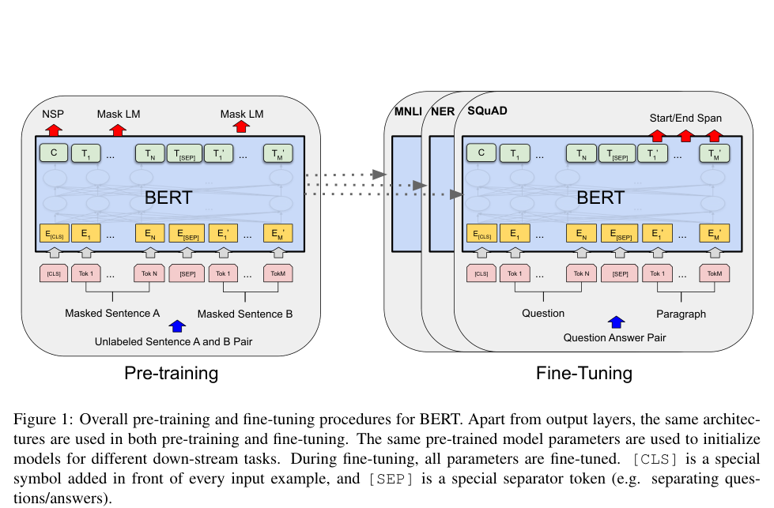

The figure illustrates the BERT workflow, divided into two stages: "Pre-training" on the left and "Fine-Tuning" on the right. The pre-training panel shows a BERT architecture processing two masked sentences (A and B) to perform Next Sentence Prediction (NSP) and Masked Language Modeling (MLM), while the fine-tuning panel shows the same architecture applied to downstream tasks like MNLI, NER, and SQuAD using specific input pairs like question-answer pairs. A dashed arrow connects the two stages, indicating that the pre-trained parameters are used to initialize the models for fine-tuning.

**Language Models are Few-Shot Learners** — arXiv:2005.14165 p.3

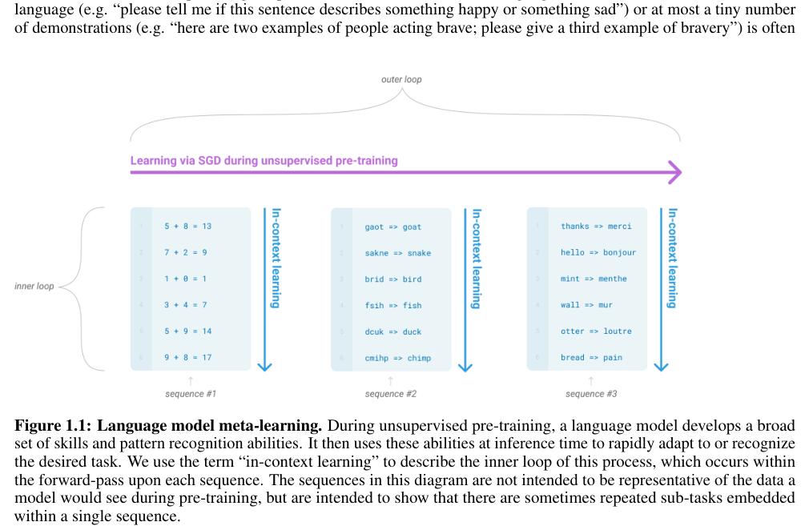

The figure uses a hierarchical diagram with brackets to illustrate the relationship between an "outer loop" of unsupervised pre-training via SGD and an "inner loop" of in-context learning. The outer loop is represented by a long purple arrow, while the inner loop consists of three separate boxes labeled "sequence #1" through "sequence #3," each containing examples of tasks (arithmetic, translation, etc.) followed by a blue vertical label for "in-context learning." The diagram conveys that pre-training enables the model to perform rapid adaptation to new tasks within a single sequence during inference.

**Exploring the Limits of Transfer Learning with a Unified Text-to-Text
  Transformer** — arXiv:1910.10683 p.3

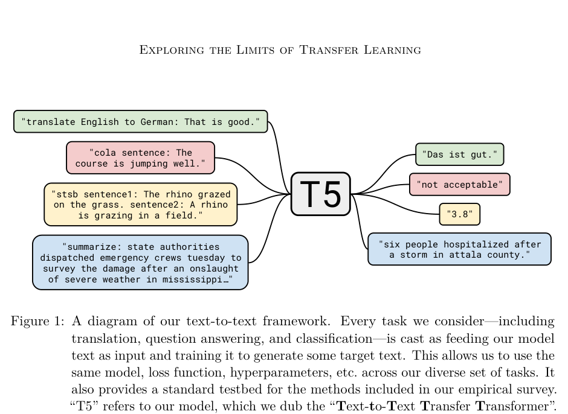

The figure depicts a central box labeled "T5" with several arrows pointing toward it from the left and several arrows pointing away from it to the right. The left-side boxes contain various text-based task instructions and inputs (e.g., translation, classification, and summarization), while the right-side boxes contain the corresponding text outputs. This diagram conveys the unified text-to-text framework where all tasks are treated as a sequence-to-sequence problem using the same model.

**Retrieval-Augmented Generation for Knowledge-Intensive NLP Tasks** — arXiv:2005.11401 p.2

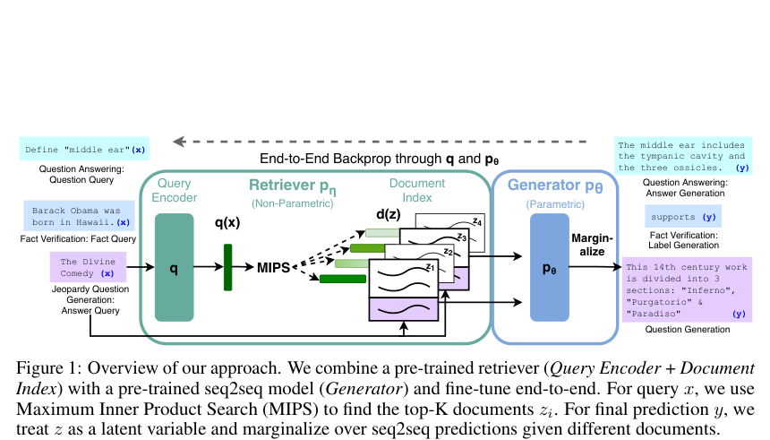

The figure illustrates a retrieval-augmented generation pipeline consisting of a Query Encoder, a non-parametric Retriever ($p_\eta$), a Document Index, and a parametric Generator ($p_\theta$). Arrows show the flow from a query ($x$) through the MIPS search to retrieve top-$K$ documents ($z_i$), which are then passed to the generator to produce a marginalized prediction ($y$). A dashed line indicates end-to-end backpropagation through the query ($q$) and the generator parameters ($p_\theta$).

**Transformer-XL: Attentive Language Models Beyond a Fixed-Length Context** — arXiv:1901.02860 p.3

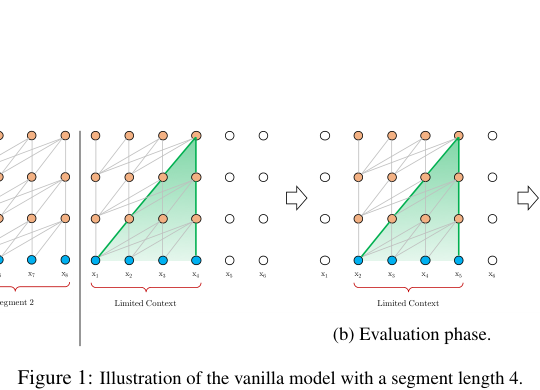

The figure displays two diagrams of a neural network architecture with a segment length of 4, consisting of input nodes (blue circles), hidden layers (tan circles), and output nodes (white circles). The left diagram (a) shows a vanilla model where connections only exist within a single segment, while the right diagram (b) illustrates the evaluation phase where a green shaded area indicates that hidden states from the previous segment are reused as context for the current segment.

**Adam: A Method for Stochastic Optimization** — arXiv:1412.6980 p.6

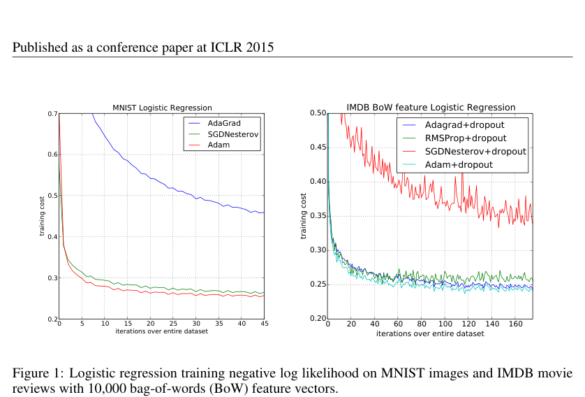

The figure contains two line graphs comparing the training cost (negative log likelihood) of different optimization algorithms across two datasets: MNIST and IMDB. The left plot shows the training cost for AdaGrad, SGDNesterov, and Adam over 45 iterations on MNIST, while the right plot shows the training cost for Adagrad, RMSProp, SGDNesterov, and Adam (all with dropout) over 160 iterations on IMDB. In both plots, the Adam optimizer achieves a lower training cost more rapidly than the other compared methods.

**Switch Attention: Towards Dynamic and Fine-grained Hybrid Transformers** — arXiv:2603.26380 p.1

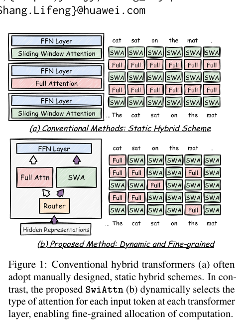

Figure 1 consists of two comparative diagrams, (a) and (b), illustrating different transformer attention mechanisms. Diagram (a) shows a stacked architecture of alternating FFN and attention layers (Sliding Window vs. Full Attention) applied uniformly to a sequence of tokens, representing a static hybrid scheme. Diagram (b) depicts a dynamic scheme where a "Router" selects between "Full Attn" and "SWA" for each individual token, resulting in a heterogeneous attention pattern across the input sequence.

**Understanding Transformers and Attention Mechanisms: An Introduction for Applied Mathematicians** — arXiv:2604.00965 p.1

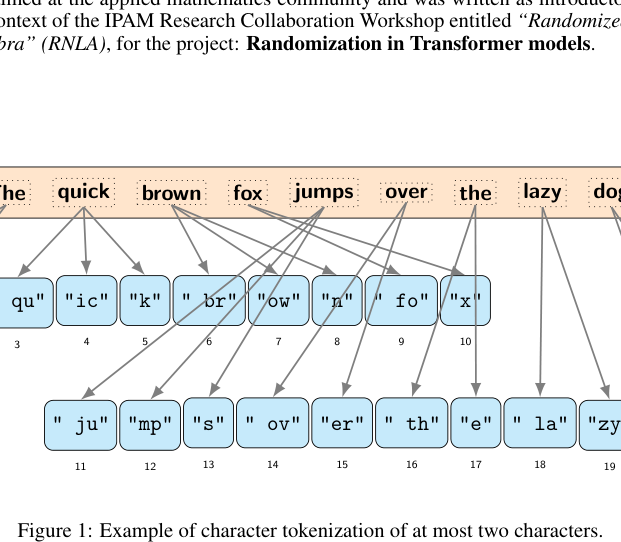

The figure displays a sequence of words ("the", "quick", "brown", "fox", "jumps", "over", "the", "lazy", "dog") at the top, with arrows pointing down to two rows of light blue boxes containing character-level tokens. These tokens represent the decomposition of the words into sub-units of at most two characters, such as "qu", "ic", and "k" for "quick," illustrating a character-based tokenization process.

**Query-focused and Memory-aware Reranker for Long Context Processing** — arXiv:2602.12192 p.3

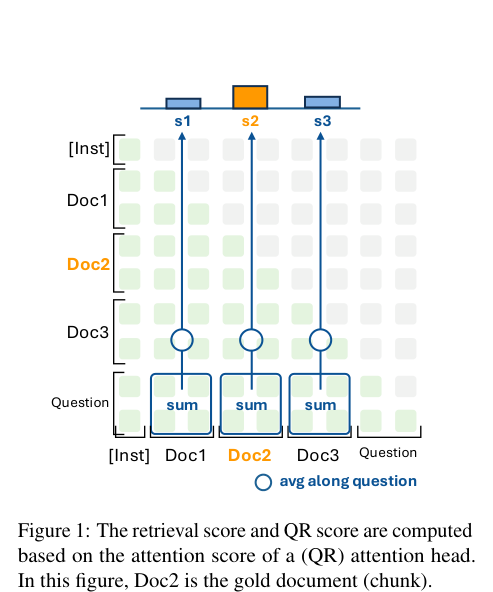

The figure displays an attention matrix where rows represent input tokens (Question, Doc1, Doc2, Doc3, [Inst]) and columns represent query-focused tokens (s1, s2, s3). Blue arrows originate from "sum" boxes at the bottom of the Question row and point toward specific attention scores in the s-columns, indicating that the retrieval and QR scores are computed by averaging attention weights along the question. The highlighted Doc2 row and s2 column signify the target gold document being evaluated.

**AttentionRetriever: Attention Layers are Secretly Long Document Retrievers** — arXiv:2602.12278 p.3

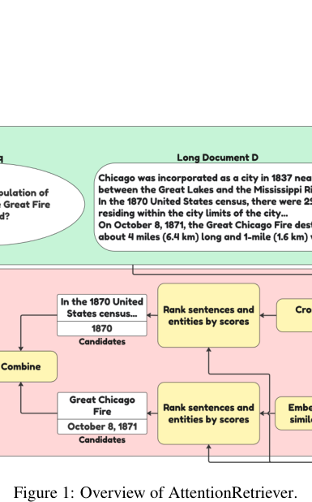

The figure uses colored boxes and arrows to illustrate a process where a long document is broken down into specific candidates, such as "1870 Candidates" and "October 8, 1871 Candidates." Arrows connect these candidates to yellow boxes labeled "Rank sentences and entities by scores," conveying how the AttentionRetriever identifies and ranks relevant information within a long document.

**Enhancing Retrieval-Augmented Generation with Two-Stage Retrieval: FlashRank Reranking and Query Expansion** — arXiv:2601.03258 p.3

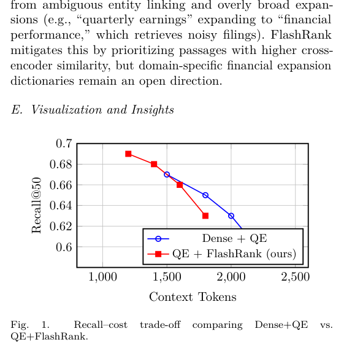

This line graph plots Recall@50 on the y-axis against Context Tokens on the x-axis to compare two retrieval methods. It features two data series: a blue line with open circles representing "Dense + QE" and a red line with filled squares representing the proposed "QE + FlashRank (ours)." The figure conveys that while the proposed method achieves higher recall at lower token counts, the "Dense + QE" method maintains higher recall as the number of context tokens increases.

**Improving Scientific Document Retrieval with Academic Concept Index** — arXiv:2601.00567 p.3

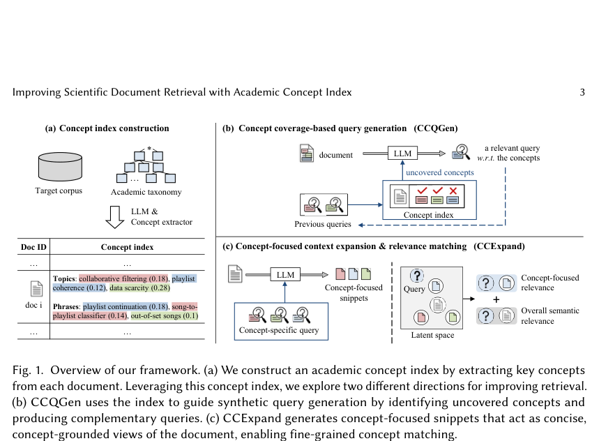

This figure provides an overview of a framework consisting of three components: (a) concept index construction, which uses an LLM and concept extractor to map a target corpus to an academic taxonomy; (b) CCQGen, which identifies uncovered concepts from a document to generate complementary queries; and (c) CCExpand, which uses an LLM to generate concept-focused snippets for matching a concept-specific query against a latent space. The diagram uses boxes, arrows, and icons to illustrate the flow from initial index construction to query generation and final concept-focused context expansion and matching.
